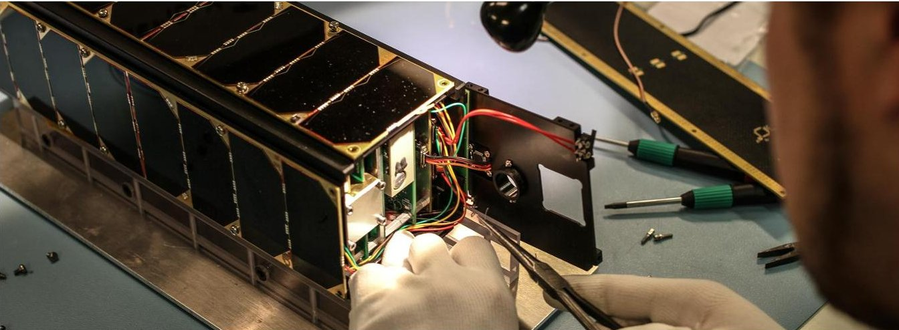
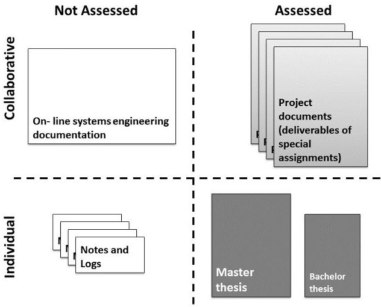

<!-- PDF_PAGE: 1 -->

# AALTO-1 EARTH OBSERVATION CUBESAT MISSION - EDUCATIONAL OUTCOMES

J. Praks, A. Kestilä, T. Tikka, H. Leppinen, O. Khurshid, M. Hallikainen

Department of Radio Science and Engineering School of Electrical Engineering Aalto University Finland e-mail: jaan.praks@aalto.fi

## 1. INTRODUCTION

Rapid development of Earth Observation technology and increasing awareness of global challenges has increased the need for lean and agile space missions and calls for a new generation of engineers to design them. Miniaturization of sensor technology and electronics has decreased the weight of a satellite, which has brought launch prices to the reach of educational institutes and smaller countries. This is recognized in many universities where nanosatellite projects are used for education. A standard, called CubeSat, has been driving the development and become the most popular development platform for university space projects [1].

One reason behind CubeSat success is probably the fact that the concept rhymes well with modern university teaching trends. Attempts are made to integrate all key components of professional expertise to comprehensive learning experience, such as theoretical knowledge, practical knowledge, self-regulative knowledge, and socio-cultural knowledge, as done in Model of Integrative Pedagogy [2] or CDIO concept [3]. Therefore increasing amount of CubeSat projects around the world give engineering students valuable hands-on experience and provide opportunity to practice teamwork skills. Rapidly increasing number of CubeSat launches reflect well the trend [4]. Entire generation of engineers with CubeSat experience has been already graduated and they are already building the foundation for future commercial Earth Observation missions, such as Planet Labs Flock constellation.

In this paper, we present educational outcomes of Finnish Aalto-1 CubeSat project and evaluate it's assets and shortcomings. Based on the analysis we point out most potent development areas, discuss best practices and try to predict the development trends of future Earth Observation missions which are influenced or created by the CubeSat generation.

## 2. AALTO-1 STUDENT PROJECT

Aalto University, the biggest technical university in Finland, joined the CubeSat movement in 2010, when the Aalto-1 student satellite project was initiated [5, 6]. The concept and the preliminary design of a 4 kg CubeSat standard based satellite was proposed by seven students during a special assignment course. The idea of building a student satellite got financial support from the university and the student team started to develop the system. Now, after five yeas, the satellite is ready and the launch of the satellite is scheduled to the second half of 2015. During this time the student-team in collaboration with researchers and engineers built a complex multi-payload technology demonstration satellite Earth Observation. The satellite has three payloads, provided by institutes and universities in Finland and advanced communication and attitude systems[7]. The main goal of the Aalto-1 mission is technology demonstration.

## 2.1. Payloads

The Aalto-1 satellite has three different payloads. The main payload is a Spectral Imager AaSI (Aalto Spectral Imager), which is a Piezo-actuated, tunable Fabry-Perot interferometer based optical imager. The instrument is able to record 2D spatial images at one to three wavelengths simultaneously. Simultaneous multiple channel data collection is enabled by matching the transmission function with the sensitivities of the color image sensor [8]. The payload is developed by VTT Technical Research Centre of Finland.

The secondary payload is a radiation monitor RADMON. The RADMON is a thin silicon detector and cesium scintillator based instrument, which is measuring incoming proton or electron particle energy loss and the leftover energy. The measurements consist of particle fluxes in several energy pass bands [9]. The payload is developed by University of Helsinki and University of Turku and also mostly by students.

The third experiment on board of the satellite is a deorbiting experiment called Plasma Brake. The plasma brake is

<!-- PDF_PAGE: 2 -->

Fig. 1. Assembly of Aalto-1 CubeSat Engineering Model.

based on e-sail concept and it consists of a long, positively or negatively charged tether and support subsystems [10]. The payload is developed by a consortium lead by Finnish Meteorological Institute.

## 2.2. Mission

The mission of Aalto-1 satellite is divided into three phases: commissioning, technology demonstration phase and science phase. The emphasis is placed on technological demonstration of AaSI imager and RADMON, while the plasma brake will start operation in the latter part of the science phase. The technology demonstration is conducted in relatively short time, while the science phase is planned to last up to two years. The spectral imager is the most demanding instrument on board, as it requires most of the down-link bandwidth, has a high peak power and strict requirements for pointing. It will acquire images in a series up to at least 20 spectral bands within the 500 nm to 900 nm spectral range, forming the desired spectral data cube product. Shortly before an image is acquired, the parallel visual spectrum camera will take a broader picture for comparison. [11]

## 3. IMPACT ON EDUCATION

Today over 80 students have been connected to the project and some of them still working with Flight Model testing. By now, 12 master theses and over 15 bachelor theses have been completed on satellite topics. Moreover, countless hours of special assignment works have been made. The project has produced a large on-line library of documentation which includes thousands of pages of reports contributed by over 50 students. More than 10 students have continued to doctoral studies on space technology and remote sensing topics. Moreover, the project has initiated also a spin-off company currently working on future Earth Observation satellites. The project has had impact on both the content and methods in our current curriculum and nowadays practical project work more

directly integrated to studies. Currently the project participation is not mandatory part of the current program.

## 3.1. Combining project work with lecture courses

A satellite project is an excellent source of motivation. Many students would like to contribute to a real space project and as such it provides practical need for skills and knowledge. When combining this need with good quality lecture courses, the learning outcome is usually good or even very good. This applies for wide variety of engineering lectures, not only space technology courses. The effect can be enhanced by using the satellite project examples in homework assignments, lectures and seminar presentations. However, participation to the student project can have on the other hand a negative impact on study times because it can consume significant amount of time of most motivated students. Current Aalto University CubeSat projects are integrated most closely to Space Science and Technology major.

## 3.2. Multidisciplinary education

Increasing interaction between different disciplines can be significant source of innovation. A satellite project involves always many engineering disciplines and therefore it provides convenient environment for cooperation between engineering students from different fields. In Aalto-1 project, students who design different aspects of the satellite, came often from different faculties and majors. In order to make this possible, the project attempts to provide thesis and special assignment topics also to other majors. The approach has worked well and additionally to student cooperation it increased cooperation also between teachers and professors of our university. However, it should be noted that wider collaboration brings additional challenges to schedules as teaching and deliverables are usually connected to curriculum calendar. Multidisciplinary project requires also special attention on systems engineering and information exchange. Very often

<!-- PDF_PAGE: 3 -->

this aspect is overlooked by inexperienced student team and the shortcomings of systems engineering is revealed only in the later part of the project when changes become costly. To fit together the entire system, by taking into account all the restrictions and managing all the interfaces needs patience, which students do not often have. Therefore it is important to involve experienced experts and develop a rigorous documentation approach.

## 3.3. Documentation and Assessment

Because satellite projects are often created in aerospace departments, usually aerospace documentation approaches are adopted is student satellite projects. However, the practices in aerospace industry are often too heavy for a student project. In order to cope with those problems an on-line documentation approach was developed for the project to where systems engineering was built in. The most important criteria for the documentation platform was that its should be accessible to all the students involved and it should allow collaborative working. Already in the early project phase it was noted that collaborative document editing delivered the best quality results.

After experimenting with many on-line platforms, the Google Drive was selected and adopted. The environment provided also elementary tools for project management, such as common calendars and mailing lists. In general, the documentation can be divided into four general classes according to whether it is collaborative or individual or collaborative and is it assessed or not. The general structure of the used approach is described in Figure 3.3. In this model, the system engineering part of the documentation consists of on-line spreadsheets which are always up-to-date. The body of the project documentation is formed by special assignments report which are the deliverables by student groups.

However, collaborative document writing brings additional difficulty to the assessment as the teacher cannot always see who has been writing the document. To solve this problem, a self evaluation system with peer-review process was implemented.

In order to cover the gaps in team knowledge, the Aalto-1 project used external experts for reviews. The review practice is commonly used in space projects and it works very well also in a student satellite project. It is important to define well the review items. Id documentation is lacking, review of the documentation helps, if the hardware has issues, it is wise to review the hardware and test results. The developed documentation approach is described in more detail in [12].

## 3.4. Community and entrepreneurship

Probably the most important aspect of a challenging student project is the emergence of community which matures during the project and creates basis for professional network for the

Fig.2. The documentation approach developed for Aalto-1 student satellite project, classified according to collaborative or individual nature and assessment practice. The on-line configuration table on the top left is the key for systems engineering. The project documents are collaborative products which are assessed by using peer-review. Thesis on the lower right is assessed always individually.

project students. In our student satellite project a large and professional consortium provided students with opportunities to connect with experienced teams and scientists and many found their future research topic through the project. Also one spin-off company, developing lean Earth Observation satellite mission, was created by the CubeSat project students.

## 4. CONCLUSIONS

The Aalto-1 satellite is still waiting for launch, but it can be said that the project has delivered already very good results in education. By analyzing the success of the students participating to a CubeSat project, it can be noted that graduates are more entrepreneur-spirited and teamwork-minded than average. By taking into account the large amount of CubeSat projects around the world one can assume that large amount of specialists have been educated who have both skills and motivation to create lean agile space missions. This will predict significant commercialization of the future Earth Observation and rapidly increasing sensor network around the globe.

## 5. REFERENCES

[1] Bob Twiggs and Jordi Puig-Suari. Cubesut Design Specification Document. Stanford University and California Polytechnical Institute, 2003.

[2] Tynjälä, P. and Gijbels, D. Transitions and Transformations in Learning and Education, pp 205-222, 2010.

<!-- PDF_PAGE: 4 -->

[3] Homepage of CDIO INITIATIVE. http://www. cdio.org/

[4] J. Bouwmeester, J. Guo, Survey of worldwide pico and nanosatellite missions, distributions and subsystem technology, Acta Astronautica, Volume 67, Issues 7-8, Pages 854-862, October-November 2010.

[5] Kirsti Keltikangas, Keijo Nikoskinen, Jaan Praks, Enhancing Interdisciplinarity in Space Technology Education, International conference: University teaching as a scholarship?, 24-26 January, Tartu, Estonia, 2011.

[6] Aalto-1 student satellite project web page. http:// aalto-1.aalto.fi

[7] Praks, J.; Kestilä, A.; Hallikainen, M.; Saari, H.; Antila, J.; Janhunen, P.; Vainio, R., Aalto-1 - An experimental nanosatellite for hyperspectral remote sensing, Geoscience and Remote Sensing Symposium (IGARSS), 2011 IEEE International , vol., no., pp.4367,4370, 24- 29 July 2011

[8] A. Näsilä, A. Hakkarainen, J. Praks, A. Kestilä, K. Nordling, R. Modrzewski, H. Saari, Aalto-1: a hyperspectral Earth observing nanosatellite, Proc. SPIE 8176, p. 81760C, 2011. doi:10.1117/12.898125

[9] Rami Vainio, Hannu-Pekka Hedman, E. Häggström, Juhani Peltonen, Risto Punkkinen, Tero Sännti, Eino Valtonen, Anssi Ilmanen, Misganaw Mera, Juha Pentikäinen, Jarmo Perälä, J. Sandhu, Timo Soukka, RADMON - Radiation Monitor for Aalto-1 Nanosatellite. In: Seppo Honkanen, Goery Genty, Jukka Jurvelin, Jukka Maalampi, Jari Turunen, Jarkko J. Saarinen, Ritva Serimaa, Heli Jantunen, Tuija Pulkkinen (Eds.), Physics Days 2012,The 46th annual meeting of the Finnish Physical Society, 200, Suomen Fyysikkoseura, 2012.

[10] Janhunen, P., Toivanen, P. K., Polkko, J., Merikallio, S., Salminen,P., Haeggstrom, E., Seppänen, H., Kurppa, R., Ukkonen, J., Kiprich, S., Thornell, G., Kratz, H., Richter, L., Kromer, O., Rosta, R., Noorma, M., Envall, J., Lätt, S., Mengali, G., Quarta, A. A., Koivisto, H., Tarvainen, O., Kalvas, T., Kauppinen, J., Nuottajarvi, A., and Obraztsov, A.: Electric solar wind sail: Towards test missions, Rev. Sci. Instrum., 81, 111301-1 111301-11, 2010.

[11] Kestilä, A., Tikka, T., Peitso, P., Rantanen, J., Näsilä, A., Nordling, K., Saari, H., Vainio, R., Janhunen, P., Praks, J., and Hallikainen, M.: Aalto-1 nanosatellite - technical description and mission objectives, Geosci. Instrum. Method. Data Syst., 2, 121-130, doi:10.5194/gi-2-121-2013, 2013.

[12] Praks, J.; Tikka, T.; Kestilä, A.; Hieta, M., Online documentation approach for assisted system engineering and assessment in student projects, Global Engineering Education Conference (EDUCON), 2015 IEEE, pp.608,611, Tallinn, Estonia, 18-20 March, 2015.