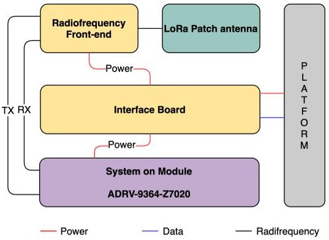
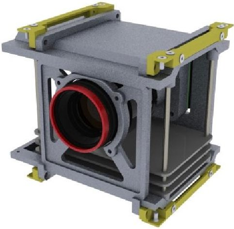
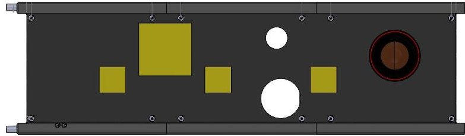
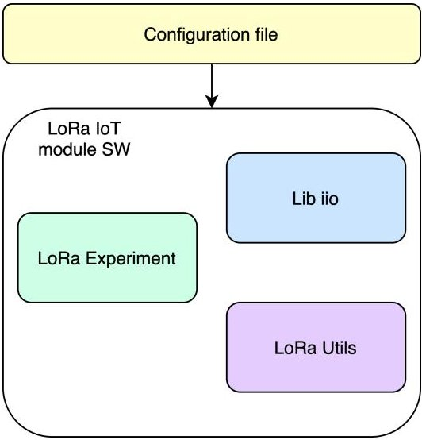

<!-- PDF_PAGE: 1 -->

# SDR-BASED LORA ENABLED ON-DEMAND REMOTE ACQUISITION EXPERIMENT ON-BOARD THE ALAINSAT-1

L. Fernandez $ ^{1,2,4} $ , M. Sobrino $ ^{1} $ , A. Rodriguez $ ^{1} $ , A. Gonga $ ^{1} $ , C. Molina $ ^{1,2} $ , L. Rayón $ ^{5} $ , M. Badia $ ^{1,2} $ , P. Fabregat $ ^{5} $ , A. Perez-Portero $ ^{1,2} $ , J. Ramos-Castro $ ^{2,3} $ , J. A. Ruiz-de-Azua $ ^{1,2,4} $ , A. Calveras $ ^{4} $ , A. H. Jallad $ ^{6} $ and Z. Abdul Aziz $ ^{6} $

$ ^{1} $CommSensLab-UPC,Universitat Politècnica de Catalunya-BarcelonaTech $ ^{2} $Institute of Space Studies of Catalonia (IEEC)-CTE-UPC $ ^{3} $Dept.of Electronic Engineering-UPC BarcelonaTech $ ^{4} $Dept.of Network Engineering-UPC BarcelonaTech $ ^{5} $IEEE Barcelona Student Branch $ ^{6} $National Space Science and Technology Center,UAE University,UAE

## ABSTRACT

Global change and sea level rise are increasing the interest in monitoring oceans, and specially the Arctic. L-band microwave radiometers can be used for thin sea ice thickness and oceans monitoring, and these maps are being routinely generated from SMOS [1] and SMAP [2], which if combined with imagers provide a higher resolution. The CubeSat-based payload RITA (RadIomeTry and vegetation Analysis) plans to address those monitoring needs by including an IoT enabled payload, a hyperspectral imager and an L-band microwave radiometer with RFI detection and mitigation [3]. The IoT payload implements an SDR-based LoRa modulation and it will be used to perform On-Demand executions of the radiometer and the imager payloads on-board RITA. As part of this work, an in-depth description of the objectives, concept of operations and hardware and software architecture and implementation of the IoT LoRa module will be provided.

Index Terms— Remote Sensing, RFI, MWR, Multispectral imaging, Earth Observation, LoRa, Internet of Things, SDR, CubeSat.

## 1. INTRODUCTION

The interest to monitor the Oceans and land has increased in recent times. This is particularly critical in the Arctic area, given that the ice is melting faster. For this reason, it is extremely important to have a constant monitoring of the Oceans and the ice accumulation over the Arctic. The oceans are mainly monitored using Microwave Radiometers (MWR) and optical and active microwave imagers, and it has been proven that combining both measurements provides higher resolution data products [4].

Currently there are three satellite missions dedicated to Ocean Monitoring with L-Band MWR: the Soil Moisture and Ocean Salinity satellite (SMOS) [1], the Soil Moisture Active Passive satellite (SMAP) [2] and FSSCat [5]. In the case of SMOS and SMAP these satellites do not include a multispectral or hyper-spectral camera, although they use the images from the Moderate Resolution Imaging Spectroradiometer (MODIS) [6] sensors on-board the Terra/Aqua satellites or Sentinel 2 and 3, to obtain higher resolution data products. In the case of FSSCat, the tandem mission includes an L-Band MWR in one satellite and HyperScout-2 [7] on the other, but does not implement techniques for RadioFrequency Interference (RFI) detection or mitigation, so the radiometric measurements can be invalidated by the presence of interferences [8]. Moreover, a novel study shows the potential that Internet of Things (IoT) technologies, such as LoRa, can have to in-situ monitor the Arctic region with in-situ IoT sensors [9].

The RITA payload plans to provide a solution to the aforementioned issues by combining in a single payload a hyper-spectral camera, an L-Band MWR with RFI detection and mitigation and a LoRa module. This module is based on a Software Defined Radio (SDR) and it has the objective of verifying this novel SDR-based technology and retrieve soil moisture measures from remote sensors to perform a multi-level acquisition once combined with the MWR data products. Additionally, the IoT sensors will also perform on-demand executions from the MWR and the imager. This novel payload execution strategy is thought to optimise the amount of data that is generated by satellites, and then has to be downloaded, by monitoring the critical parameters with IoT sensors and only requiring a satellite execution if necessary.

In this work the mission analysis and how the concept of operations has been defined. Moreover, in depth details of the hardware and software design are provided, with specifications of the expected performance.

This work is structured as follows: Section 2 presents the overall mission analysis including the mission objectives, and

<!-- PDF_PAGE: 2 -->

concept of operations. Section 3 includes the hardware architecture of the module. Section 4 contains an explanation of the software implementation. Finally, Section 5 presents the conclusions.

## 2. LORA MODULE OBJECTIVES AND CONCEPT OF OPERATIONS

The LoRa IoT module embarked as part of the RITA payload will be a proof-of-concept payload with the objective of verifying the communications space-to-Earth with an SDRbased LoRa modulation and a radiofrequency Front-End for signal conditioning. Other satellite missions that have previously flown the LoRa technology use regular Semtech modules [10], which is less modular than having an SDR. To fulfill this objective multiple LoRa modules with sensors will be placed in a target area, and these sensors will communicate with the LoRa module of the RITA Payload.

Having multiple sensors communicating with the LoRa IoT module at once is a challenge for wireless communications, since packet collisions are very common and as a consequence packet losses can occur. These collisions can be mitigated using certain medium access layer mechanisms, and another objective of the LoRa IoT module some mechanisms tailored for IoT satellite communications [11] will be tested.

Finally, another objective is to include soil moisture sensors in ground, to verify the measurements taken by the radiometer and performing on-demand executions.

The concept of operations is designed so that the experiment is executed when it passes over a target area. Based on that premise maximum and average experiment times are calculated. The maximum time is considered as it is the worse case in terms of power budget, whereas the average time gives a good approximation on the expected experiment length. Both metrics have been obtained performing simulations with the Systems Tool Kit (STK) software, assuming that the satellite is orbiting in an ISS orbit.

The values obtained from the simulations are shown in Table 1, having a maximum duty cycle per orbit of 11.81 % an average duty cycle per orbit of 10.35 %, a maximum power consumption per orbit of 0.82 W and an average power consumption per orbit of 0.72 W.

<table border="1"><tr><td>Maximum experiment time per orbit</td><td>657s</td></tr><tr><td>Maximum duty cycle per orbit</td><td>11.81%</td></tr><tr><td>Maximum consumption per orbit</td><td>0.82W</td></tr><tr><td>Average experiment time per orbit</td><td>576s</td></tr><tr><td>Average duty cycle per orbit</td><td>10.35%</td></tr><tr><td>Average consumption per orbit</td><td>0.72W</td></tr></table>

Table 1. Maximum and average duty cycle and power consumption for the LoRa module

Fig. 1. Block diagram of the LoRa IoT module

Fig. 2. RITA Payload render

## 3. HARDWARE

The LoRa IoT module is composed by a System on Module (SoM), an Interface Board (IB), a radiofrequency Front-End board and a patch antenna. The overall architecture and connections can be seen on Figure 1 and a Render of the overall components of the payload can be seen on Figure 2. It should be noted that the different components in the module are designed to operate in the 868 MHz Industrial, Scientific and Medical (ISM) frequency band, which is the band allocated for Europe [12].

The SoM is a Commercial-off-the-Shelf (COTS) component and it is based on a Zinq-7000 FPGA with an ARM Cortex-A9. Both the FPGA and the processor will do all the computation and data management. The SoM also includes an Analog Devices SDR where the LoRa modulation will be implemented, with capabilities such as coding and decoding packets.

The IB is manufactured in-house and it interfaces with the platform, so it receives power and data signals, and distributes them between the different boards.

The Front-End, also manufactured in-house, performs the signal conditioning for the received and transmitted signals. The transmission chain has a power amplifier and a powermeter and the reception chain has a Low Noise Amplifier and a bandpass filter. Additionally, there is a switch before the

<!-- PDF_PAGE: 3 -->

Table 2. Radiofrequency Front-End board components specifications

<table border="1"><tr><td>Component</td><td>Metric</td><td>Specification</td></tr><tr><td>Power Amplifier</td><td>Output power</td><td>32dBm</td></tr><tr><td rowspan="2">Low Noise Amplifier</td><td>Gain</td><td>20.5dB</td></tr><tr><td>Noise Figure</td><td>0.23dB</td></tr><tr><td>Bandpass filter</td><td>Frequencies</td><td>800-1899MHz</td></tr><tr><td>Switch</td><td>Insertion Loss</td><td>0.3dB</td></tr></table>

input of the antenna, to commute between the reception and transmission chain. The specifications for all the components can be seen in Table 2, and the selection of the components has been based on the requirements identified in [13] for a space-to-Earth communication channel.

Finally, the LoRa antenna is a single patch antenna with right hand circular polarisation designed to be matched at 868 MHz. This antenna is placed on an external surface of the 3U satellite, together with the three MWR patches, as it can be seen on Figure 3. The design of the patch is done using CST Studio Suite, and according to the simulations the antenna has a Directivity of 6.1 dB and a return loss of -21.53 dB.

Fig. 3. RITA Payload Antennas render

## 4. SOFTWARE

The software for the LoRa IoT module is implemented in the Cortex-A9 of the SoM. The architecture of the software implementation can be seen in Figure 4.

The LoRa IoT module software requires a configuration file that is uploaded from Earth. This configuration file includes the type of experiment that is going to be executed next, and the configuration for that experiment. Also, it includes the configuration for the LoRa modulation.

The rest of the software is organized in the following blocks:

- Lib iio: this block interfaces with the SDR, and it retrieves and sends samples from it

- LoRa Utils: this block implements the LoRa modulator and demodulator. It is based on currently available LoRa libraries [14].

Fig. 4. Software architecture

- LoRa Experiment: this block contains all the experiment logic. It allows to choose between the different medium access layer mechanisms or the on-demand executions strategy.

## 5. CONCLUSIONS

This article has presented the mission overview and concept of operations of the LoRa IoT module of the RITA Payload, on-board the AlainSat-1. Additionally, also the hardware and software design of this module have been described.

The LoRa IoT module has the objective of verifying the link of space-to-Earth communications, with a novel SDRbased LoRa transceiver. Moreover, also different medium access layer protocols will be evaluated, to asses the capacity of each of them. Finally, a proof-of-concept experiment of the on-demand executions will be done. Overall, this module will execute during 10.35% of the orbit, on average, with a power consumption of 0.72 W per orbit.

The hardware of this module contains the SoM, the radiofrequency front-end, the interface board, and a patch antenna. It is particularly interesting that the front-end contains a signal conditioning chain that extends the communication range. In the software side, the module implements an interface with the SDR, the LoRa modulation, and also the experiment logic. Moreover, the experiment mode and the modulation parameters are configurable in-flight by means of a configuration file that shall be uploaded from Earth.

## 6. ACKNOWLEDGEMENTS

The authors would like to thank the IEEE Geoscience & Remote Sensing Society (GRSS) for their support and funding, and the National Space Science and Technology Center, UAE for sponsoring the satellite bus, launch and operations, and for their technical advice.

<!-- PDF_PAGE: 4 -->

This work has been partially funded by project SPOT: Sensing with Pioneering Opportunistic Techniques grant RTI2018-099008-B-C21/ AEI/ 10.13039/501100011033 also by the ERDF and the Spanish Government through project PID2019-106808RA-I00 AEI/FEDER UE, and by Secretaria d'Universitats i Recerca del Departament d'Empresa i Coneixement de la Generalitat de Catalunya 2017 SGR 376 and 2017 SGR 219. Finally, this research was possible thanks to the FI-2019 grant from AGAUR-Generalitat de Catalunya.

## 7. REFERENCES

[1] E. S. Agency, "SMOS." https://www.esa.int/ Space_in_Member_States/Spain/SMOS_la_ mision_de_la_ESA_para_el_estudio_del_ agua, (Accessed: 01/2021).

[2] J. P. Laboratory, "SMAP." https://smap.jpl.nasa.gov/ (Accessed: 01/2021).

[3] A. Perez-Portero, P. Fabregat, M. Badia, M. Sobrino, C. Molina, L. Fernandez, L. Rayon, A. Rodriguez, J. F. Munoz-Martin, J. Ramos-Castro, A. H. Jallad, and Z. Abdul Aziz, "RITA: A 1U MULTI-SENSOR PAYLOAD FOR THE GRSSSAT CONTRIBUTING SOIL MOISTURE, VEGETATION ANALYSIS AND RFI DETECTION," in IGARSS 2020 - 2020 IEEE International Geoscience and Remote Sensing Symposium, 2021. Submitted.

[4] M. Piles, N. Sanchez, M. Vall-llossera, A. Camps, J. Martinez-Fernandez, J. Martinez, and V. Gonzalez-Gambau, "A Downscaling Approach for SMOS Land Observations: Evaluation of High-Resolution Soil Moisture Maps Over the Iberian Peninsula," IEEE Journal of Selected Topics in Applied Earth Observations and Remote Sensing, vol. 7, pp. 3845-3857, Sept. 2014.

[5] A. Camps, A. Golkar, A. Gutierrez, J. A. R. de Azua, J. F. Munoz-Martin, L. Fernandez, C. Diez, A. Aguilella, S. Briatore, R. Akhtyamov, and N. Garzaniti, "Fsscat, the 2017 Copernicus Masters' "Esa Sentinel Small Satellite Challenge" Winner: A Federated Polar and Soil Moisture Tandem Mission Based on 6U Cubesats," in IGARSS 2018 - 2018 IEEE International Geoscience and Remote Sensing Symposium, pp. 8285-8287, 2018.

[6] NASA, "MODIS." https://terra.nasa.gov/about/terrainstruments/modis, (Accessed: 01/2021).

[7] Cosine, "HyperScout-2." https://www.cosine.nl/cases/hyperscout-2/, (Accessed: 01/2021).

[8] A. Camps, J. Gourrion, J. m. Tarongi, A. Gutierrez, J. Barbosa, and R. Castro, "RFI Analysis in SMOS Imagery," in 2010 IEEE International Geoscience and Remote Sensing Symposium, pp. 2007-2010, 2010.

[9] L. Fernandez, J. A. Ruiz-de-Azua, A. Calveras, and A. Camps, "EVALUATION OF LORA FOR DATA RETRIEVAL OF OCEAN MONITORING SENSORS WITH LEO SATELLITES," in 2020 IEEE International Geoscience and Remote Sensing Symposium, 2020. In Press.

[10] Semtech, "LoRa." https://www.semtech.com/lora, (Accessed: 01/2021).

[11] T. Ferrer, S. Cespedes, and A. Becerra, "Review and Evaluation of MAC Protocols for Satellite IoT Systems Using Nanosatellites," Sensors, vol. 19, p. 1947, Apr 2019.

[12] I. C. Union, "SM.1896 : Frequency ranges for global or regional harmonization of short-range devices." https://www.itu.int/rec/R-REC-SM.1896/en, (Accessed: 01/2021).

[13] L. Fernandez, J. A. Ruiz-De-Azua, A. Calveras, and A. Camps, "Assessing LoRa for Satellite-to-Earth Communications Considering the Impact of Ionospheric Scintillation," IEEE Access, vol. 8, pp. 165570-165582, 2020.

[14] J. Tapparel, O. Afisiadis, P. Mayoraz, A. Balatsoukas-Stimming, and A. Burg, "An open-source lora physical layer prototype on gnu radio," 2020.