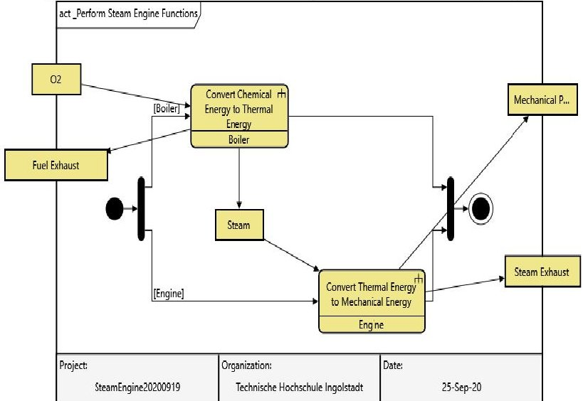
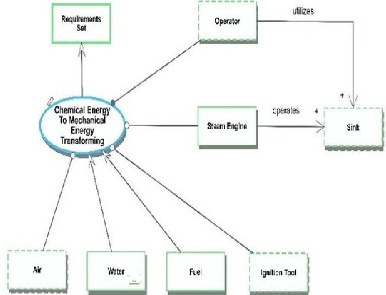
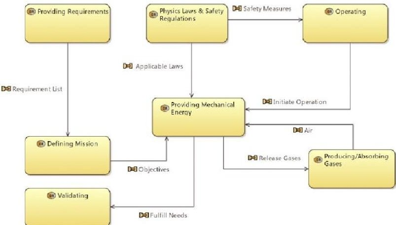
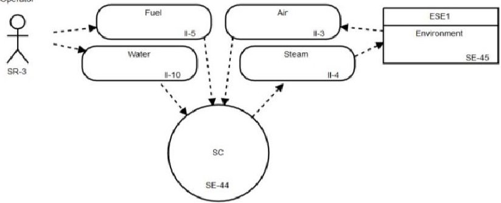

<!-- PDF_PAGE: 1 -->

# Evaluating MBSE Methodologies Using the FEMMP Framework

Marco Di Maio

Technische Hochschule Ingolstadt

Ingolstadt, Germany

Marco.DiMaio@thi.de

Mostafa Aboushama

Technische Hochschule Ingolstadt

Ingolstadt, Germany

M.Aboushama@outlook.com

Tim Weilkiens

oose Innovative Informatik eG

Hamburg, Germany

Tim.Weilkiens@oose.de

Irfan Javid

Technische Hochschule Ingolstadt

Ingolstadt, Germany

Irfan.Ch.De@gmail.com

Michael Grötsch

Technische Hochschule Ingolstadt

Ingolstadt, Germany

MichaelGroetsch17@gmail.com

Omar Hussein

Technische Hochschule Ingolstadt

Ingolstadt, Germany

Omar.Hussein@outlook.de

Sophian Beyerlein

Technische Hochschule Ingolstadt

Ingolstadt, Germany

Sophian.Beyerlein@web.de

Abstract- Model-Based Systems Engineering (MBSE) is an effective and efficient approach to implement systems engineering. Storing valuable system information in models increases the consistency, traceability, and availability of the information. Early validation and testing of system information enable timely feedback on requirements and design decisions. Many MBSE methodologies exist, making it difficult for practitioners to select the proper methodology for their particular engineering challenge. In 2016, Tim Weilkiens et al. have proposed a Framework for the Evaluation of MBSE Methodologies for Practitioners (FEMMP) and used it to evaluate their methodologies (SYSMOD and MDDM). In this paper, the Vitech Methodology (STRATA), Object-Process Methodology (OPM), RePoSyD, and ARCADIA are presented and evaluated using FEMMP. In addition, the current criteria offered by FEMMP are discussed, and new criteria are proposed.

Keywords— MBSE, FEMMP, Methodology, Evaluation, Vitech, OPM, RePoSyD, ARCADIA, Capella

## I. INTRODUCTION

Introducing MBSE promises an efficient and consistent understanding of the increasing complexity of systems. This has been proven by multiple research efforts that investigate the impact of MBSE adoption in several engineering domains, for example, nuclear engineering [1], cybersecurity [2], civil infrastructure sustainability [3], and other cases in the early project lifecycle as in [4], as well as non-engineering domains such as Veterans Affairs [5].

In addition to the modeling language and the tool, the methodology is an essential building block in implementing MBSE. All three elements must fit together and complement one another. Ideally, one first selects a methodology, then derives the appropriate modeling languages, and finally chooses the tools that best support the agreed-upon languages and methodology. In practice, however, this is often happening in reverse order, i.e., the tools dominate the selection process.

To support practitioners in evaluating a methodology, the Framework for the Evaluation of MBSE Methodologies for Practitioners (FEMMP) has been developed [6]. It enables the comparison of methodologies by giving an overview and evaluating them using a standard case study. The assessment shall provide an overview for the practitioner without the ambition to rank the methodologies objectively and thus help

them to match existing methodologies to their MBSE requirements. The process comprises four steps: 1) Compiling a summary of the methodology providing all references used; 2) Highlighting the unique and critical features of the methodology; 3) Evaluate the methodology against the framework criteria using a standard case study; and 4) Discussing the evaluation (findings, noteworthy discoveries) using five categories: a) Basics: criteria that must be met for the method to be considered an MBSE method; b) Practicality: criteria for the practical application of the methodology, for example, the modeling language; c) Efficiency: criteria that make the methodology efficient; d) Experience: criteria for the usability of the available tools used to apply the methodology; and e) Help: criteria for how well its owners, the community, support the methodology, and tool vendors.

Recently, four MBSE methodologies have been evaluated. The results are presented following the FEMMP approach in Section III and the findings regarding the FEMMP itself in Section V.

## II. RELATED WORK

Many disciplines need to evaluate methodologies, e.g., Requirements Engineering [7], Software Engineering, and Agent-Oriented Software Engineering [8]. Out of sixty-five papers reviewed, twenty were selected for discussion. These papers comprise MBSE adoption surveys and case studies.

In 2008, Jeff A. Estefan provided a Top-level Synopsis of leading MBSE methodologies [9]. Ever since most of the available research concerning the application of MBSE can be categorized as follows: (a) Challenges facing the adoption of MBSE and (b) Evaluating the impact of MBSE adoption in different engineering domains. However, hardly any of these efforts considered evaluating different MBSE methodologies based on standardized criteria. A reason for this could be that SysML is the de-facto MBSE-standard for the conceptual modeling language [10]. Some efforts took place to evaluate MBSE methodologies as in [2] and [10].

Huldt and Stenius [11] followed a systematic, iterative procedure in order to minimize cognitive bias, which was inspired by the state of the art of evaluation research within the medical sector. This yielded similarly confounding results like these from Cloutier [12]. They also found that Collaborative Infrastructure - which is not designed

<!-- PDF_PAGE: 2 -->

exclusively for systems engineering or MBSE tasks - could play a role in augmenting MBSE adoption.

Vogelsang et al. [13] presented some of the reasons impeding the adoption of MBSE by practitioners: MBSE, does not fit their context, and immature Methodologies and Tools. They conclude that these statements could either be true or result from the fact that the users' knowledge is still incomplete and premature. They add, however, that the core reason might also be the lack of academic effort.

In [14], Madni and Sievers elaborate on the integration of non-MBSE tools with MBSE tools, which still shows a gap in terms of data management. Thus, different systems might emerge to integrate MBSE and non-MBSE tools, leading to a setback in terms of consistency and traceability. The research also found that there are some fundamental problems: (a) Purely MBSE problems such as metamodels, communication of models, consistency of semantics along the product lifecycle, etc., and (b) Problems regarding systems complexity that provide challenges for MBSE, such as uncertainty regarding the boundaries of the system of interest.

The authors encountered several critical aspects while investigating the current state of the art. Literature often uses MBSE and SysML synonymously. Yet, alternatives to SysML exist and need to be included in the research. When investigating what hinders or fosters MBSE adoption, a crucial factor is often neglected: most (if not all) researchers have no taken the MBSE methodology used by the practitioners into consideration, even if the research did investigate the used MBSE methodology, it is often treated as a black box.

In the following sections, Vitech, OPM, RePoSyD, and ARCADIA are presented and assessed using FEMMP.

## III. METHODOLOGY OVERVIEW

FEMMP proposes a catalog of standard criteria to assess the practical use of available MBSE methodologies, evaluated using a simple case study (Steam Engine). The criteria are grouped by areas and allow the independent evaluation of the process, the quality of the model, its practical implementation in a tool, and how well it can be applied to the case study. The following evaluations are structured according to the FEMMP process. They are only meant as introductions to each of the methodologies and their evaluations. The detailed results can be found on mbse- methodologies.org.

## A. Vitech MBSE Methodology

1) Methodology: The name of Vitech's MBSE methodology, "STRATA", refers to the principle of designing a system in layers "Strategic Layers" [15]. The SE activities are linked across four SE domains: Requirements, Behavior, Architecture, and Verification & Validation [16], [17]. The methodology supports Top-down, Bottom-up/Reverse Engineering, and Middle-out system approaches, and a set of sub-activities is defined for each system approach [18], [19]. Designing a system using Vitech's Methodology distinguishes between three system concepts: (a) The System Context, (b) The System Under Design, and (c) The system used to design the system [20].

Vitech's Four Domains:

Requirements "A System Why": The first layer starts with a high-level requirement - a general statement of the problem

derived from the stakeholder's needs. As the system design progresses, the high-level requirements are Refined by detailed requirements in the successive layers [21], [22]. Requirements should not be broken down to merely reflect the physical decomposition of a system. Instead, they shall be transferred into verification requirements that verify the architecture and behavior-domain of a system [23].

Functional/Behavior "A System Does": The logical design is the core of the methodology. The behavior of a system is explored in this domain, describing what the system must do to accomplish its intended goal/s. Outputs and inputs of functions are then logically connected to ensure that the intended behavior is feasible. The behavior is decomposed as the design process advances [24].

Architecture/Synthesis - "A System Is": This layer realizes the physical architecture of the system, whereby design solutions, in the form of physical components, are allocated to functions on the corresponding level of detail. The logical design is thus clearly separated from the physical design, helping to avoid the premature allocation of behavior to the physical components [21].

Verification And Validation - "A System's Proof": The Verification and Validation are carried out for each layer so that the behavior and its corresponding design solution are verified against the requirements. Vitech uses the class Test Activity when referring to the necessary measures required for verifying/validating a system.

Language: The four domains and their interdependencies are designed and modeled using the System Definition Language (SDL). The metamodel is used to capture the ideas and layout the rules employed by the tools GENESYS and CORE. Objects are represented by entities/nouns, while attributes are adjectives, the relationships between entities verbs, and the attributes on the relationships adverbs [25]. All relationships are bi-directional. Recent changes to the metamodel were mainly made in the verification domain: (a) Create a Verify relationship between the class Verification Requirement and the classes representing the physical domain; (b) Create a Verify relationship between the class Verification Requirement and the class Item in the logical domain; and (c) The class Test Activity now comprises the class Test Procedure, which has therefore been deleted in the new metamodel.

2) Highlights: All Technical Processes defined by ISO/IEC/IEEE 15288:2018 are covered. The extended metamodel schemas allow the integration of Failure Mode Effect Analysis (FMEA), DoDAF Meta Model (DM2) Data Groups, Project Management, and Risk Management [26].

Practicality: GENESYS has a built-in behavior simulation tool that allows continuous inspection of system behavior at any level of detail. MATLAB, DOORS [27], and ModelCenter connectors are available. GENESYS Add-ins can be installed in MS Excel and MS PowerPoint to connect them to the design repository.

Efficiency: Vitech MBSE toolsets augment the loosely connected nine SysML diagrams by metamodel semantics. The model classes are connected inside a single design repository using the generic relationships in the metamodel. Thus, any adjustment in a specific view is processed by the back-end and dynamically propagated to other views [28].

<!-- PDF_PAGE: 3 -->

The model is continuously monitored using the built-in Completeness and Design Integrity checkers.

Experience: As mentioned, the methodology and its tools are closely coupled. The toolsets cannot be used without understanding how the metamodel can be used to describe the project elements. GENESYS displays only the relevant model entities and constructs (requirements, components, functions) according to the built diagram.

Help: An entry-level explanation can be found in the Vitech MBSE Primer [30]. Defining the system in STRATA using CORE and GENESYS is explained in the System Definition Guides [29] and [26], respectively. Learning resources and publications are available on the website and the blog.

3) Case Study: The Activity diagram in figure 1 depicts the behavior of the steam engine. One can observe that the behavior of the higher-level functions is kept in the current layer, e.g., the input O2 and the output Mechanical Power. A complete model of the case study can be found in [30].

Fig. 1: Activity Diagram of the Steam Engine Using Genesys Collaborative Edition

## B. Object-Process Methodology

Object-Process Methodology (OPM) is a formal, conceptual modeling language and an ISO standard since 2015 (see: ISO/PAS 19450:2015) [31]. It is one of the leading MBSE candidates and is often compared to SysML and, indeed, UML. Also, several research efforts were carried out to investigate the possible integration between OPM and SysML or UML [9], [32], [33].

1) Methodology: OPM is a bi-modal methodology, where each diagram Object-Process Diagram (OPD) has a corresponding automatically generated text, Object-Process Language (OPL). OPL makes it easier to understand a model also for non-technical stakeholders. OPD helps in validation and verification processes by bridging the design requirements gap [34].

OPM combines two elements: things and links. A thing might be an object, or a stateful object, or a process. In contrast, a process is a thing that might transform at least one object. A thing might be physical or informatical; this is called the essence of the thing. It can also be systemic or environmental, making it the affiliation of the thing. A link might be structural (static) or procedural (dynamic).

OPM represents both objects and processes in a single diagram, the so-called Object-Process Diagram (OPD). This

allows showing the structural and dynamic aspects of the system under development together in one model. For Complexity Management, modeling a system in OPM begins with identifying the System Diagram (SD), known in other methodologies as Context Diagram. For more about SD, see the case study.

In-zooming: In-Zooming is a primary refinement mechanism that is usually associated with a process. Using In-Zooming on a process allows modeling dynamic and static aspects synchronously (at the same time). A timeline of things is organized from the top to the bottom of the In-Zoomed process; things drawn in parallel happen concurrently. Objects that only appear inside an In-Zoomed process exist exclusively within that In-Zoomed process. In contrast, objects that also appear outside the In-Zoomed process are not exclusive to the In-Zoomed process and continue to exist after the completion of that process.

Unfolding: Unfolding is used to model asynchronous aspects of the model and is typically associated with objects. It is a structural view in which the system's structure can be analyzed in detail.

State Expression/Suppression: This mechanism allows to display or hide the object in an OPD. This mechanism feature is significant, as an object might have several states, which are not relevant to every associated process. Therefore, managing the states of objects helps to read an OPD.

Dynamic and Structural Aspects: The dynamic aspect of OPM is represented by relations between objects and processes within an OPD. In contrast, the structural aspect of OPM is represented by relations between two things of the same class (Process-to-Process) or (Object-to-Object) within an OPD.

Requirements Diagram Representation: OPM does not have a separate diagram for requirements. Requirements are modeled as a state within an object, which is then connected to the corresponding component by a unidirectional structural tagged link. The tag might be: satisfies, is implemented by, or derives [35]. Usually, OPL is part of the requirements [34].

2) Highlights: OPM simplifies the architecting of a system by using only a single diagram type, the OPD, and three complexity management mechanisms. System development is thus no longer a challenge of several aspects but a matter of the level of detail, i.e., the user can decide which details appear at which level. In SysML, on the other hand, the user has to model the system's aspects (structural and behavioral) employing one of nine different types of the diagram [36].

One key objective of modeling is to analyze system behavior to identify and understand disruptive events. OPM allows to model such events using logical operators AND, OR, and XOR and assign probabilities to the outcomes [37, pp. 357-373].

Practicality: OPM distinguishes function from behavior. The function is the utilitarian aspect of the system, which brings value to at least one beneficiary. Combining structural relations of OPM with the complexity management mechanisms allows modeling a system with variants and configurations.

Efficiency: There are no specific requirements diagrams in OPM. However, one can model requirements using stateful

<!-- PDF_PAGE: 4 -->

informatical objects. In addition, the OPM online tool OPCloud can embed various URL links to any object or process within a model. OPCloud is seamless when it comes to creating Digital Twins [36] and supports defining "Stereotypes".

Experience: OPCloud UI is minimal. Users can call any model fact from any OPD by searching for the corresponding objects or processes and activate the so-called "Bring Connected" feature, which will call the relations among thongs from other OPDs.

Help: Numerous sources to learn about OPM are available, varying from books to MOOCs.

Fig. 2: System Diagram of the Steam Engine Model

3) Case Study: This section presents a model of a simple steam engine. Figure 2 shows the system diagram (SD) at level zero. The function of the system is Chemical Energy To Mechanical Energy Transforming. The system's enablers are Air and Ignition Tool, and its operands are: Steam Engine, Water, and Fuel, and its operator is also the beneficiary. The complete model features eight Object-Process Diagrams with the corresponding Object-Process Language, see [38].

## C. ARCADIA

ARCADIA is an integrated system engineering modeling methodology for interdisciplinary domain activities of complex technical systems, developed by Thales. It adopts many concepts inspired by the Unified Modeling Language (UML) and the Systems Modeling Language (SysML) [39]. Its approach toward traceability between different engineering levels through the automated exchange of information allows to comprehensively manage complexity [40].

1) Methodology: Arcadia's methodological framework introduces a metamodeling concept that uses various diagrams with interlinked relationships to represent the processes and activities occurring among interdisciplinary elements, thus defining its structural behavior. The process begins by analyzing stakeholders' needs before developing solutions to satisfy the resulting requirements [40].

Through implementation from start to end, whatever the approach or sequence, the complexity, and the system's elements consistently increase [39], [40].

Language: ARCADIA provides both a method and a language. It allows the development and integration of the system architecture across different levels. The process is flexible and allows the implementation of multiple sequential steps that do not necessarily have to be followed in sequence.

Tools: Capella is ARCADIA's open-source software tool. It helps to employ the process and offers methodological guidance and multi-domain editing and viewing capabilities to help develop the system's software and hardware architectures [40]. It thus provides a high-value environment and design support to systems engineers working on complex projects.

Engineering Levels: ARCADIA introduces five levels of engineering, including product building or prototyping, divided into need- and solution-based modeling. The users' requirements and system's definition are modeled in the first two architecture levels, Operational Analysis (OA) and System Analysis (SA). The need-based modeling translates the users' high-level requirements into an Operational architecture, which transforms to the next level to define the system's needs and defines how it can meet the user's expectations.

2) Highlights: ARCADIA system's architecture development stages align with the ISO/IEC/IEEE 15288:2018 standard system life cycle's technical processes. An exception is its mission analysis, which has been included to help high-level understanding objectives behind design decisions and provide a purpose for the solution.

Practicality: ARCADIA enforces its functional hierarchical concept by driven-modeling [39]. Capella allocates the leaf functions to the structure and only allows the information flow within the leaf functions. Each function and sub-function of the system is created independently from the architecture level and only later assigned to a particular component at the physical level [41]. The tool also ensures the traceability of system functions and activities from all layers, which helps to avoid redundancies.

Efficiency: The layout of traditional viewpoints can be customized by applying filters or changing colors. Capella also monitors user's behavior, especially during the functional decomposition and transition of activities between different levels, to minimize human errors [39], [40].

Experience: Capella is compliant with user experience conventions. Sometimes the finalized architecture becomes complicated due to providing all viewpoints information in a single diagram. However, this can be avoided by using filters.

Help: An entry-level explanation and practical information can be found in two reference books for ARCADIA's principles and Capella's practical guide.

3) Case Study: This section presents the need for a solution-based model of a simple steam engine system. Figure 3 shows the Operational Activity Interaction Blank (OAIB) is a need-based model that shows the high-level user's requirements and how the different operational activities interact to accomplish high-level objectives. The system's objective "Providing Mechanical Energy" is triggered by the inputs received from the activities "Providing Requirements" and "Defining mission" and accomplished by "Procedure Manual," "Operating," and "Producing/Absorbing Gases." ARCADIA also validates the

<!-- PDF_PAGE: 5 -->

capability by analyzing how well the system satisfies its users.

Fig. 3: OAIB Requirement-Based Activity Model

## D. RePoSyD

1) Methodology: Requirements Engineering, Project Management, and System Design (RePoSyD). The methodology has its own cloud-based tool and modeling language. It goes back to a development that began in 1997 that was based on a tool called RDD-100 and later Design DataBase (DDB). DDB was the SE standard methodology used in a large German naval defense contractor. The lessons learned from more than 20 years of experience in using the DDB led to the development of the new tool RePoSyD in 2017. DDB was developed as a client-server application in C++ for Windows. Due to its architecture, however, integration with other systems caused difficulties. RePoSyD has therefore been based on a multi-tier architecture and uses state-of-the-art web technologies for the application itself and the integration with other systems. The methodology uses the IEEE-1220 systems engineering process definition as a foundation. It is designed for large engineering teams working in different locations but can also be used by smaller teams in the exact location. The so-called joint reference model is used to combine System Development and Project Management.

2) Highlights: Information and visualization are clearly distinguished within the methodology and the tool. Diagrams have the sole purpose of visualization, and information needs

to be linked outside of the diagram, which means deleting or changing a diagram in RePoSyD will not damage, change or remove any relations between the underlying model elements. Relations can exclusively be changed under the relationship settings for each design object. The methodology and tool are free to use and do not require additional software to share information with other domains. The API follows Open Services for Lifecycle Collaboration (OSLC) standards and allows for integration with other tools. The report generator guarantees correct documentation by flagging changes and recommending to make the necessary changes to the documentation. The tool includes Logic Diagrams, as signal processing imposes requirements on a system. Sharing all model elements across different projects is allowed. Model elements in the tool can be duplicated in the settings and then be allocated to another project (M. Hoppe, personal communication, July 24, 2020).

Fig. 4 System Context Diagram

3) Case Study: Figure 4 shows the system context diagram, which provides a high-level view of the system and is used to show entities interacting with the System of Interest (SoI). RePoSyD's System Context Diagram uses a circle as a symbol for the system that is being developed. A stickman with the tag "SR" represents stakeholders and square blocks external system elements, tagged "SE". The rounded blocks refer to Interface Items and have the tag "II". The direction of arrows with dotted lines shows the flow direction of the Interface Items.

The following section, IV presents a summarized part of the evaluation of the four presented methodologies; the complete evaluation can be found in [42].

IV. METHODOLOGIES EVALUATION

Table 1 Vitech MBSE Methodology Evaluation Based on FEMMP

<table border="1"><tr><td>ID Area</td><td>Title</td><td>Scale</td><td>Vitech Evaluation</td></tr><tr><td>A-00-P</td><td>ISO Standard</td><td>-</td><td>All the Technical Processes are incorporated. The methodology and its tool support other process steps, e.g., Quality Management, Risk Management, Project Planning Process, &amp; Risk Management.</td></tr><tr><td>A-01-P</td><td>Framework</td><td>-</td><td>Almost all DoDAF views are covered. The extended schema in [43] connects the DoDAF metamodel (DM2) Data Groups.</td></tr><tr><td>A-02-L</td><td>Philosophy</td><td>Yes</td><td>Vitech schema includes 57 classes, they are roughly categorized in 6 elements: Requirement Element, Functional Element, Physical Element, Interface Element, Verification Element, and Other Element.</td></tr><tr><td>A-03-T</td><td>Precision</td><td>A</td><td>Tools and methodology are intimately intertwined through the SDL. The tool permits only the usage of the relationships defined in the metamodel.</td></tr><tr><td>B-00-L</td><td>Language</td><td>-</td><td>The four domains and their interdependencies are represented using the System Definition Language (SDL). Vitech provides a SysML-friendly environment in GENESYS besides their own language and graphical representations.</td></tr><tr><td>B-01-M</td><td>Scalability</td><td>B</td><td>The methodology and its toolsets support small- and large-scale systems. GENESYS 4.0 and higher versions include the so-called Cross-Project Relationships, which enables the share and reuse of the same entities amongst different projects. Thus, scaling a system is possible [44].</td></tr><tr><td>B-02-M</td><td>Scope</td><td>-</td><td>The methodology supports the Top-down, Bottom-up/Reverse Engineering, and Middle-out system approaches.</td></tr><tr><td>B-03-M</td><td>Tailoring</td><td>A</td><td>Vitech's schema include 57 different classes, and it can be tailored according to the project needs.</td></tr><tr><td>B-04-P</td><td>Consistency</td><td>Yes</td><td>The one-design repository connects model classes; thus, changes in one view are automatically reflected in the other views and on different system levels. Built-in Design Integrity Checker detects errors in the design.</td></tr></table>

<!-- PDF_PAGE: 6 -->

Table 2 OPM MBSE Methodology Evaluation Based on FEMMP

<table border="1"><tr><td>ID Area</td><td>Title</td><td>Scale</td><td>OPM Evaluation</td></tr><tr><td>A-00-P</td><td>ISO Standard</td><td>-</td><td>Project-Product Lifecycle Management(PPLM) approach ensures that the enterprise can manage all scenarios at all levels, including management, legal, technical, and environmental constraints[45]</td></tr><tr><td>A-01-P</td><td>Framework</td><td>-</td><td>Currently, patterns and an ontology can be used to model operational viewpoints(OV)和ConOps[46]</td></tr><tr><td>A-02-L</td><td>Philosophy</td><td>-</td><td>OPM has only model elements.Any model element that exists at least in one OPD could be used across the entire model.OPM does not separate the content from the representation.</td></tr><tr><td>A-03-T</td><td>Precision</td><td>B</td><td>OPCloud does enforce OPM semantics.OPM prohibits the introduction of any unidentified processes or workarounds.</td></tr><tr><td>B-00-L</td><td>Language</td><td>-</td><td>OPM uses its own language established by Dori based on minimal universal ontology.This ontology is called Object-Process Theorem,and it comprises"Stateful objects,processes,and relations among them."</td></tr><tr><td>B-01-M</td><td>Scalability</td><td>B</td><td>OPM is suitable for projects of any level of complexity,using four mechanisms which are In/Out-Zooming,Folding/Unfolding,and State Expression/Suppression.The orthogonal detail-based decomposition facilitates flawless bidirectional transitions of the captured information between different OPDs.Furthermore,OPM provides a tree view of the system in order to aid model comprehension and ease navigation.</td></tr><tr><td>B-02-M</td><td>Scope</td><td>-</td><td>OPM is domain-independent, thanks to its minimal universal ontology.OPM distinguishes between the essence of objects and processes,either Physical or Informatical.Therefore,OPM can model both natural and artificial systems or any combinations thereof.OPM supports any of the following architecture practices:"top-down","bottom-up",or"middle-out".</td></tr><tr><td>B-03-M</td><td>Tailoring</td><td>B</td><td>OPM enables users to customize relations between two things of the same class(Process-to-Process)or(Object-to-Object)using a Tagged Link.Dori et al. extended OPM to support Application Domain Modeling(ADOM)[47].</td></tr><tr><td>B-04-P</td><td>Consistency</td><td>Yes</td><td>The complexity management approach of OPM ensures consistency.OPCloud does recognize modifications in processes,objects,and links and propagates them through the whole model.</td></tr></table>

Table 3 ARCADIA MBSE Methodology Evaluation Based on FEMMP

<table border="1"><tr><td>ID Area</td><td>Title</td><td>Scale</td><td>ARCADIA Evaluation</td></tr><tr><td>A-00-P</td><td>ISO Standard</td><td>-</td><td>Technical Processes: stakeholders&#x27; needs and requirements definition, system requirements definition, system analysis, architecture, and design definition process, implementation process.</td></tr><tr><td>A-01-P</td><td>Framework</td><td>-</td><td>ARCADIA architecture framework uses a diverse set of views from DoDAF and NAF: OVs, SOVs, SVs[48].</td></tr><tr><td>A-02-L</td><td>Philosophy</td><td>Y</td><td>A Capella diagram contains a set of model elements that carry semantic information. Capella uses different graphical objects and colors for the separate visual presentation of model elements within the diagram[40].</td></tr><tr><td>A-03-T</td><td>Precision</td><td>A</td><td>Capella is an integrated and comprehensive modeling tool that provides support to the ARCADIA language/method. Capella strictly complies with ARCADIA modeling principles and distinguishes the different engineering perspectives from the system context and from modeling the solution[40].</td></tr><tr><td>B-00-L</td><td>Language</td><td>-</td><td>The language incorporates different elements with independent descriptions: Function, Interface, Component, Activity, Actors, Entity, Capability, Mission, etc.[39].</td></tr><tr><td>B-01-M</td><td>Scalability</td><td>A</td><td>ARCADIA is suitable for the development of small to large size and complex systems.</td></tr><tr><td>B-02-M</td><td>Scope</td><td>-</td><td>Innovation, Product development, High complexity context, dealing with Prospective challenges of system engineering, Contribution to the definition of innovative practices, etc.[39].</td></tr><tr><td>B-03-M</td><td>Tailoring</td><td>B</td><td>ARCADIA diagrams and modeling elements are tailored and customized within the defined standard description. Model elements can be customized(e.g.,change color,move,delete from,size,expend,align)in the preferences.</td></tr><tr><td>B-04-P</td><td>Consistency</td><td>Y</td><td>The self-contained process defines its associated semantics of elements in all stages.It enforces the automated transition of model elements from top to bottom to ensure that in-/output are connected and create a hierarchical functional tree containing all system elements.</td></tr></table>

Table 4 RePoSyD MBSE Methodology Evaluation Based on FEMMP

<table border="1"><tr><td>ID Area</td><td>Title</td><td>Scale</td><td>REPOSYD Evaluation</td></tr><tr><td>A-00-P</td><td>ISO Standard</td><td>-</td><td>All Technical, Project, Enterprise, and Agreement processes are incorporated in the Methodology.</td></tr><tr><td>A-01-P</td><td>Framework</td><td>-</td><td>RePoSyD covers most of the DoDAF viewpoints. All Viewpoints(AV-1-Av-2), Capability Viewpoints(CV-2,CV-6),Data and Information Viewpoint(DIV-1-DIV-3),Operational Viewpoint(OV-1-OV-5b),Project Viewpoint(PV-2),Services Viewpoint(SvcV-1-SvcV-7),Standard Viewpoints(StdV-1-StdV-2),System Viewpoint(SV-1-SV-7,SV-10a-SV10c).</td></tr><tr><td>A-02-L</td><td>Philosophy</td><td>Yes</td><td>Model Elements are clearly distinguished from Diagram Elements.In some cases,the same representation format is used,but it is still distinguishable by the identification code starting with the class of referred elements.</td></tr><tr><td>A-03-T</td><td>Precision</td><td>A</td><td>RePoSyD's tool fully constrains the usage to its metamodel.It does not allow the usage of"wildcard"elements or any workarounds.The relationship between elements is pre-defined and can't be overridden.</td></tr><tr><td>B-00-L</td><td>Language</td><td>-</td><td>RML(RePoSyD's Modeling Language)uses a metamodel to describe the real-world semantics.The objects are embodied in entities expressed in nouns,their attributes are adjectives,and relationships between the entities are described by verbs.</td></tr><tr><td>B-01-M</td><td>Scalability</td><td>A</td><td>RePoSyD and its tool support large-scale projects for teams at different locations as well as small teams working locally.</td></tr><tr><td>B-02-M</td><td>Scope</td><td>-</td><td>RePoSyD is applicable for all purposes where systems engineering is used.</td></tr><tr><td>B-03-M</td><td>Tailoring</td><td>C</td><td>The metamodel can be reduced to exclude irrelevant design objects for certain purposes.The roles can be set up such that the diagrams will"black box"irrelevant information for them.</td></tr><tr><td>B-04-P</td><td>Consistency</td><td>Yes</td><td>RePoSyD provides total consistency.All steps are connected,and in-/output purposes are clearly defined.</td></tr></table>

## V. FEMMP - DISCUSSIONS AND SUGGESTIONS

The FEMMP questions are all relevant for the practitioners but do not necessarily cover all aspects that are

of interest to the various Subject Matter Experts (SMEs) who have to work with a methodology. The selection of a practical MBSE methodology needs to take into account how it will actually be applied. It is critical to consider the definition of validation criteria and metrics, such as the

<!-- PDF_PAGE: 7 -->

Content Validity Index (CVI), to ensure the clarity and completeness of the evaluation framework. The findings and suggestions regarding FEMMP are presented as follows:

- Covering ISO 15288 processes does not necessarily mean that the methodology can adequately manage these processes. In other words, MBSE models the information resulting from the processes. Furthermore, exchanging information between MBSE and non-MBSE tools within the technical domain is still a challenge, let alone the exchange with the processes outside this technical domain. "CoveringISO 15288" - as stated in FEMMP question A-00-P - might therefore be open to misinterpretations.

- Question B-06-M could be extended to define what is meant by "Interruption". More examples could support practitioners. (e.g., Are "Quality Gates", "System-Level transitions", or setbacks to "Requirement specification" already Interruptions?)

- Question B-09-M is ambiguous as to "which type of simulation is considered?". The purpose of the simulation should be described. For example, a consistency check could be performed using simulation. However, it could also be the simulation of modeled solutions, e.g., by State-Machine - Simulation.

- For Trade-off selections, a quantitative scale might be more convenient than the qualitative scale offered by FEMMP.

- Based on the literature review in the related work, the learning curve is one of the main problems for practitioners. In FEMMP, there are no criteria about the learning curve of the methodology. Consequently, metrics and methods for measuring the learning curve should be defined.

- As mentioned previously, a metamodel is crucial for a common understanding across the project. In the case of a tool-specific methodology, such as STRATA or OPM, it is also imperative to have a rigorous connection between the metamodel and the tool. For these reasons, the addition of criteria to the FEMMP catalog that addresses the metamodel is necessary.

- The current case study for evaluating MBSE methodologies using FEMMP is a simple steam engine. It has to be modeled using a reverse engineering process, which might not be enough to assess a mature methodology. Therefore, additional case studies shall be developed that can address other aspects of a methodology.

- As pointed out in the related work, a multi-user environment in an MBSE tool is crucial. This, however, results in a significant concern; data security. Thus, additional criteria to the FEMMP catalog might be: How well does the tool support the distribution of the work among different parties without compromising data security?

## VI. SUMMARY AND OUTLOOK

Three MBSE methodologies (Vitech, OPM, RePoSyD, and ARCADIA) have been evaluated using FEMMP, and a summary of the findings is presented in the context

discussing MBSE adoption and the related problems. The results shall not only aid practitioners in selecting a methodology but also help the researchers to improve the FEMMP and its evaluation criteria.

The comparison of MBSE methodologies is an ongoing process and has been moved to the online platform mbsemethodologies.org to better provide access and cater to the dynamic, ever-changing nature of the subject. It also invites all members of the SE community to engage and submit or discuss their own findings.

## REFERENCES

[1] J. Navas, P. Tannery, S. Bonnet, and J.-L. Voirin, "Bridging the gap between model-based systems engineering methodologies and their effective practice - a case study on nuclear power plants systems engineering," INSIGHT, vol. 21, no. 1, pp. 17-20, 2018, ISSN: 2156485X. DOI: 10.1002/inst.12185. [Online]. Available: https://onlinelibrary.wiley.com/doi/epdf/10.1002/inst.12185 (visited on 06/20/2020).

[2] A. Aigner and A. Khelil, "Assessment of model-based methodologies to architect cyber-physical systems," in Proceedings of the International Conference on Omni-Layer Intelligent Systems - COINS '19, Unknown, Ed., New York, New York, USA: ACM Press, 2019, pp. 146-151, ISBN: 9781450366403. DOI: 10.1145/3312614.3313779.

[3] M. Matar, H. Osman, M. Georgy, A. Abou-Zeid, and M. El-Said, "Evaluation of civil infrastructure sustainability: A model-based systems engineering (MBSE) approach," in ECPPM, 2014, pp. 327- 334.

[4] Q. Do, S. Cook, and M. Lay, "An investigation of MBSE practices across the contractual boundary," Procedia Computer Science, vol. 28, pp. 692-701, 2014, ISSN: 18770509. DOI: 10.1016/j.procs.2014.03.083.

[5] R. Krishnan, S. Virani, and R. Gasoto, "Discovering toxic policies using MBSE constructs," in Disciplinary Convergence in Systems Engineering Research, A. M. Madni, B. Boehm, R. G. Ghanem, D. Erwin, and M. J. Wheaton, Eds., Cham: Springer International Publishing, 2018, pp. 341-350, ISBN: 978-3-319-62216-3. DOI: 10.1007/978-3-319-62217-0{\textunderscore}24. [Online]. Available: https://link.springer.com/chapter/10.1007/978-3-319-62217-0_24.

[6] T. Weilkiens, A. Scheithauer, M. Di Maio, and N. Klusmann, "Evaluating and comparing MBSE methodologies for practitioners," in 2016 IEEE International Symposium, pp. 1-8. DOI: 10.1109/SysEng.2016.7753174. (visited on 05/16/2020).

[7] L. M. Cysneiros, V. Werneck, and E. Yu, "Evaluating methodologies: A requirements engineering approach through the use of an exemplar," Journal of Computer Science & Technology, vol. 5, 2005.

[8] C.-e. Lin, K. M. Kavi, F. T. Sheldon, K. M. Daley, and R. K. Abercrombie, "A methodology to evaluate agent oriented software engineering techniques," in 2007 40th Annual Hawaii International Conference on System Sciences (HICSS'07), IEEE, 2007, p. 60, ISBN: 0-7695-2755-8. DOI: 10.1109/HICSS.2007.20. (visited on 09/30/2020).

[9] J. A. Estefan et al., "Survey of model-based systems engineering (MBSE) methodologies," INCOSE MBSE Focus Group, vol. 25, no. 8, pp. 1-12, 2007.

[10] J. Maurandy, A. Helm, E. Gill, and R. Stalford, "11.5.3 cost-benefit analysis of SysML modeling for the atomic clock ensemble in space (aces) simulator," INCOSE International Symposium, vol. 22, no. 1, pp. 1726-1745, 2012, ISSN: 23345837. DOI: 10.1002/j.2334-5837.2012.tb01433.x.

[11] T. Huldt and I. Stenius, "State-of-practice survey of model-based systems engineering," Systems Engineering, vol. 22, no. 2, pp. 134- 145, 2019, ISSN: 10981241. DOI: 10.1002/ sys.21466.

[12] R. Cloutier, "Current modeling trends in systems engineering," INSIGHT, vol. 18, no. 2, pp. 10-13, 2015, ISSN: 2156485X. DOI: 10.1002/inst.12013.

[13] A. Vogelsang, T. Amorim, F. Pudlitz, P. Gersing, and J. Philipps, "Should I stay or should I go? on forces that drive and prevent MBSE adoption in the embedded systems industry," in Product-

<!-- PDF_PAGE: 8 -->

Focused Software Process Improvement, ser. Lecture Notes in Computer Science, M. Felderer, D. Méndez Fernández, B. Turhan, M. Kalinowski,F. Sarro, and D. Winkler, Eds., vol. 10611, Cham: Springer International Publishing,2017, pp. 182-198,ISBN: 978-3- 319-69925-7.doi:10.1007/978-3-319-69926-4{\textunderscore}14. (visited on 06/20/2020).

[14] A. M. Madni and M. Sievers, "Model-based systems engineering: Motivation, current status, and research opportunities," Systems Engineering, vol. 21, no. 3, pp. 172-190,2018,ISSN: 10981241.doi:10.1002/sys.21438.

[15] Loyd Baker JR. and James E. Long, Role of system engineering across the system life cycle, Vienna, Virginia, 2007. [Online]. Available: http://www.vitechcorp.com/resources/technical_papers/200701031 632040.baker_long.pdf (visited on 09/01/2020).

[16] S. T. Booth, "4.2.3 network centric architectures: are we up to the task?" INCOSE International Symposium, vol. 15, no. 1, pp. 600- 609, 2005, ISSN: 23345837. DOI: 10.1002/j.2334- 5837.2005.tb00693.x.

[17] D. Mazeika, A. Morkevicius, and A. Aleksandraviciene, "MBSE driven approach for defining problem domain," in 2016 11th System of Systems, pp. 1-6. DOI: 10.1109/ SYSOSE.2016.7542911. (visited on 05/05/2020).

[18] R. L. Sorensen, "9.6.3 systems engineering in a cots world," INCOSE International Symposium, vol. 14, no. 1, pp. 2050-2062, 2004, ISSN: 23345837. DOI: 10.1002/j.2334-5837.2004.tb00633.x. (visited on 04/04/2020).

[19] Sara Sumner, The three systems engineering approaches: Top-down, middle-out, and bottom-up, US, 2015. [Online]. Available: http://community.vitechcorp.com/index.php/the-three-systems engineering-approaches-top-down-middle-out-and-bottom-up.aspx (visited on 09/02/2020).

[20] Zane Scott, The systems perspective, US, 2016. [Online]. Available: http://www.vitechcorp.com/resources/white_papers/systems_perspective.pdf (visited on 06/26/2020).

[21] D. A. Long and Z. B. Scott, A primer for model-based systems engineering, Second edition. [Blacksburg, Va.]: Vitech, 2011, ISBN: 978-1-105-58810-5.

[22] L. Baker, "Lessons learned applying model-based system engineering methods to a strategic planning activity," INCOSE International Symposium, vol. 7, no. 1, pp. 296-300, 1997, ISSN: 23345837. DOI: 10.1002/j.2334-5837.1997.tb02185.x.

[23] Zane Scott, The forgotten system, US, 2020. [Online]. Available: http://community.vitechcorp.com/index.php/the-forgotten-system 2.aspx (visited on 08/25/2020).

[24] J. E. Long, "Relationships between common graphical representations used in system engineering," INSIGHT, vol. 21, no. 1, pp. 8-11, 2018, ISSN: 2156485X. DOI: 10.1002/ inst.12183. (visited on 09/28/2020).

[25] David Long, The meaning is in the metamodel, 2018. [Online]. Available: http://community.vitechcorp.com/index.php/themeaning-is-in-the-metamodel.aspx (visited on 09/02/2020).

[26] Vitech Corporation, Genesys 6.0: System definition guide, 2018. [Online]. Available: http://www.vitechcorp.com/support/documentation/genesys/600/systemdefinitionguide.pdf (visited on 08/26/2020).

[27] ——, Doors connector guide, US, 2020. [Online]. Available: http://www.vitechcorp.com/support/documentation/genesys/2020/D OORSConnectorGuide.pdf (visited on 07/16/2020).

[28] David Long and Zane Scott, One model, may interests, many views, US, 2018. [Online]. Available: http://technodocbox.com/Databases/93510249-One-model manyinterests-many-views.html.

[29] Vitech Corporation, Core: System definition guide, Blacksburg, Virginia, US., 2015. [Online]. Available: http://www.vitechcorp.com/support/documentation/core/900/system definitionguide.pdf (visited on 09/02/2020).

[30] Mostafa Aboushama, Steam engine model using Genesys collaborative edition, 2020. [Online]. Available: https://1drv.ms/b/s!As9RDXs888g_gXO8NlAyYYowjbgH.

[31] ISO/PAS 19450:2015: Automation systems and integration object-process methodology, 2015. [Online]. Available: https://www.iso.org/standard/62274.html (visited on 05/16/2020).

[32] Y. Grobshtein and D. Dori, "Generating SysML views from an opm model: Design and evaluation," Systems Engineering, vol. 14, no. 3, pp. 327-340, 2011, ISSN: 10981241. DOI: 10.1002/sys.20181. (visited on 05/16/2020).

[33] M. C. Hause and R. L. Day, "Frenemies: Opm and SysML together in an MBSE model," INCOSE International Symposium, vol. 29, no. 1, pp. 691-706, 2019, ISSN: 23345837. DOI: 10.1002/j.2334-5837.2019.00629.x. (visited on 05/14/2020).

[34] D. Dori, R. Martin, and A. Blekhman, "Model-based metastandardization," in 2010 IEEE International Systems Conference, IEEE, 2010, pp. 593-597, ISBN: 978-1-4244-5882-0. DOI: 10.1109/SYSTEMS.2010.5482321. (visited on 06/09/2020).

[35] Y. Mordecai and D. Dori, "Model-based requirements engineering: Architecting for system requirements with stakeholders in mind," in 2017 IEEE International Systems Engineering Symposium (ISSE), IEEE, 2017, pp. 1-8, ISBN: 978-1-5386-3403-5. DOI: 10.1109/SysEng.2017.8088273. (visited on 05/17/2020).

[36] H. Kohen and D. Dori, "Improving conceptual modeling with objectprocess methodology stereotypes," Applied Sciences, vol. 11, no. 5, p. 2301, 2021. DOI: 10.3390/ app11052301.

[37] D. Dori, Model-Based Systems Engineering with OPM and SysML. New York, NY: Springer New York, 2016, ISBN: 978-1-4939-3294-8. DOI: 10.1007/978-1-4939-3295-5. (visited on 05/10/2020).

[38] Omar Hussein, Steam engine model, 2020. [Online]. Available: https://1drv.ms/b/s!As9RDXs888g_gTnD5Fkozb6YQLCM?e=QdL 8Xu.

[39] J.-L. Voirin, Model-based system and architecture engineering with the ARCADIA method. Amsterdam: Elsevier, 2017, ISBN: 978-1-78548-169-7.

[40] P. Roques, Systems architecture modeling with the ARCADIA method: A practical guide to Capella / Pascal Roques. Amsterdam: Elsevier, 2017, ISBN: 978-1785481680.

[41] P. G. Mathew, Model-based system engineering methodology for implementing networked aircraft control system on integrated modular avionics - environmental control system case study, 2019. [Online]. Available: https://spectrum.library.concordia.ca/985095/ (visited on 08/15/2020).

[42] Marco Di Maio, Tim Weilkins, Omar Hussein, Mostafa Aboushama, Irfan Javid, Sophian Beyerlein, and Michael Groetsch, Evaluating MBSE methodologies using the FEMMP framework: Evaluation tables, 2021. [Online]. Available: https://1drv.ms/b/s!As9RDXs888g_gXBH4QmiXey0pWYa.

[43] Vitech Corporation, Dodaf v2.0 viewpoints, 2019. [Online]. Available: t.ly/qQhr.

[44] ——, Genesys 4.0: New features guide, US, 2016. [Online]. Available: http://www.vitechcorp.com/support/documentation/genesys/400/GENESYS40NewFeaturesGuide.pdf.

[45] A. Sharon, V. Perelman, and D. Dori, "8.2.2 a project-product lifecycle management approach for improved systems engineering practices," INCOSE International Symposium, vol. 18, no. 1, pp. 942-957, 2008, ISSN: 23345837. DOI: 10.1002/j.23345837.2008.tb00854.x. (visited on 08/23/2020).

[46] Y. Mordecai, N. K. James, and E. F. Crawley, "Object-process model-based operational viewpoint specification for aerospace architectures," in 2020 IEEE Aerospace Conference, IEEE, 2020, pp. 1-15, ISBN: 978-1-7281-2734-7. DOI: 10.1109/AERO47225.2020.9172685. (visited on 05/16/2020).

[47] Arnon Sturm, Dov Dori, and Onn Shehory, "Domain modeling with object-process methodology," in Proceedings of the Eighth International Conference on EnterpriseInformation Systems, SciTePress - Science and Technology Publications, 2006, pp. 144- 151, ISBN: 978-972-8865-41-2. DOI: 10.5220/0002494601440151. (visited on09/22/2020).

[48] J. L. Voirin, S. Bonnet, and D. Exertier, A model-based engineering method for system, software and hardware architectural design, 2015. [Online]. Available: https://download.eclipse.org/capella/publis/An_Introduction_to_Arc adia_20150115 (visited on 09/20/2020).