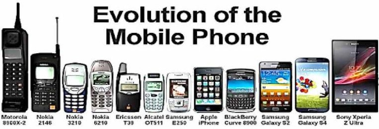
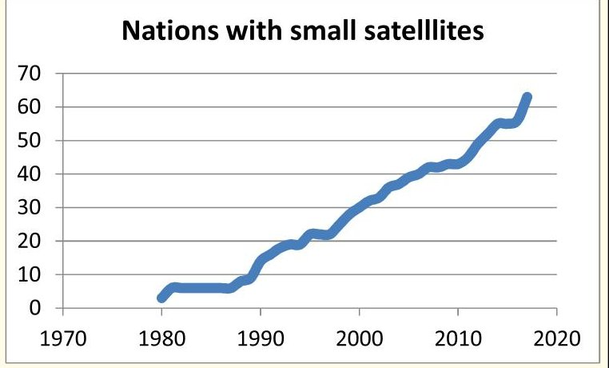
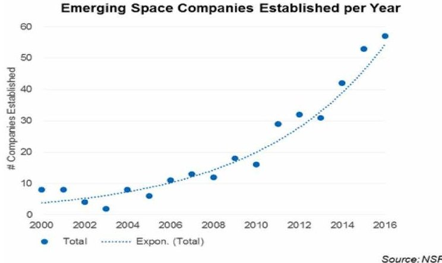
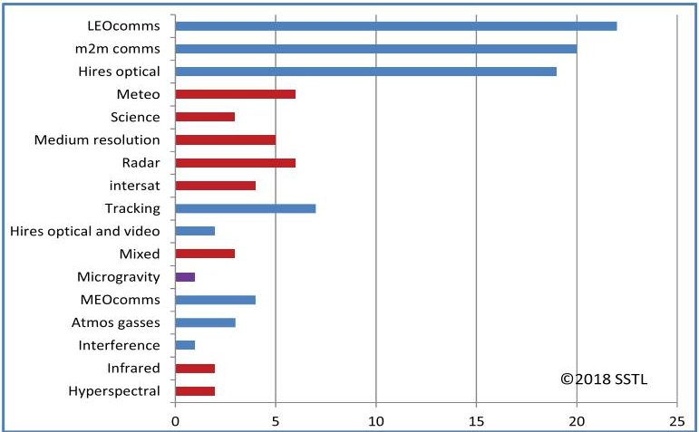
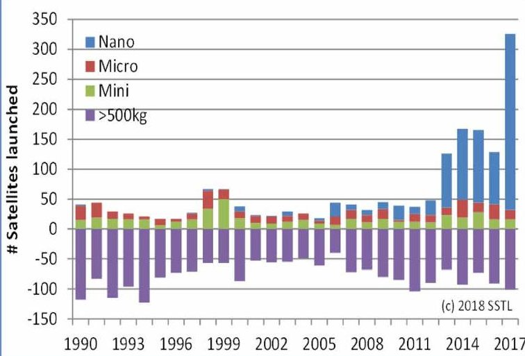

<!-- PDF_PAGE: 1 -->

# Modern Small Satellites Changing the Economics of Space

This paper reviews the history of small satellite development and then summarizes their present capabilities and applications, followed by a look at the future technology trends that small satellites can exploit—both in Earth orbit and for exploration of the solar system.

By MARTIN N. SWEETING $ ^{ID} $ , Member IEEE

ABSTRACT | Earth orbiting satellites come in a wide range of shapes and sizes to meet a diverse variety of uses and applications. Large satellites with masses over 1000 kg support high-resolution remote sensing of the Earth, high bandwidth communications services, and world-class scientific studies but take lengthy developments and are costly to build and launch. The advent of commercially available, high-volume, and hence low-cost microelectronics has enabled a different approach through miniaturization. This results in physically far smaller satellites that dramatically reduce timescales and costs and that are able to provide operational and commercially viable services. This paper charts the evolution and rise of small satellites from being an early curiosity with limited utility through to the present where small satellites are a key element of modern space capabilities.

KEYWORDS | CubeSat; microsatellite; nanosatellite; NewSpace; small satellites

## I. INTRODUCTION

The exploration and exploitation of space has been a costly endeavor, but one that has undoubtedly yielded a vastly improved understanding of our planet, our solar system, and the wonders of the universe. Society now takes the day-to-day benefits of space for granted, whether it be for improved weather forecasting, ubiquitous communications and navigation, or the response to natural or man-made

disasters. Indeed, the functioning of the developed world has become dependent on space to provide economic and social infrastructure, not forgetting the dependence on space capabilities to support effective security and military operations.

The dawn of mankind's space era in 1957 with the launch of Sputnik-1 by the Soviet Union precipitated a predominantly military and political response, triggering the well-known space race of the 1960s. Early space efforts were dominated by striving for political "one-up-man ship" through the exploration of the solar system and human spaceflight, culminating in the Apollo Moon landings, and gaining military advantage from the "high ground" of Earth for surveillance and communications. The economic exploitation of satellites to provide civil communications, primarily for voice and television, and Earth observation (EO) for meteorology and land resources was controlled tightly by governments. Building satellites required technically advanced and expensive capabilities, launchers were likewise costly and risky, and the ground infrastructure was complex. All of these combined to make access to space the preserve of only the most technically advanced and economically wealthy of nations. This privileged access to space provided these "space nations" with an overwhelming advantage over the space "have-nots" resulting in a position of superiority enjoyed and taken for granted for some four decades.

The balance of space power began to shift with the advent and widespread availability of microelectronics that enabled physically smaller satellites to be built by smaller teams with modest facilities and utilizing "spare" launch capacity as secondary payloads alongside larger

<!-- PDF_PAGE: 2 -->

Table 1 General Classification of Femto/Pico/Nano/Micro/Mini Small-Large Satellites [1]

<table border="1"><tr><td>Class</td><td>Mass(kg)</td></tr><tr><td>Large satellite</td><td>&gt;1000</td></tr><tr><td>Small satellite</td><td>500 to 1000</td></tr><tr><td>Mini-satellite</td><td>100 to 500</td></tr><tr><td>Micro-satellite</td><td>10 to 100</td></tr><tr><td>Nano-satellite</td><td>1 to 10</td></tr><tr><td>Pico-satellite</td><td>0.1 to 1</td></tr><tr><td>Femto-satellite</td><td>&lt;0.1</td></tr></table>

(paying) brethren. Thus, the early 1980s ushered in the beginning of the era of the modern small satellite.

Of course, physically small satellites by themselves were nothing new; many of the early U.S. and Soviet satellites and later experimental satellites from other nations would fall into this classification so that, over the last 60 years, some 1500 satellites under ~100 kg have been launched worldwide. However, what differentiates the later generation of "modern" small satellites discussed in this paper was the combination of a different management approach with the use of commercially available microelectronics devices to create reprogrammable, reconfigurable satellites capable of sophisticated functions with high utility in a fraction of the volume, mass, cost, and timescales.

Small satellites are a state of mind rather than defined simply by physical parameters, although the classification in Table 1 has become widely adopted. It is, of course, recognized that there is continuous innovation and development in the design and operation of large satellites but, carried out within large companies or institutions, these innovations are generally gradual and highly risk adverse. There are very good reasons for this approach, as the satellites are often extremely costly and their objectives technically demanding. The long development cycles mean that the technology used once it reaches orbit may be over a decade behind the capability of the state of the art and that applications or services therefore evolve gradually. The hallmark of the modern small satellite is the adoption of up-to-date consumer technologies combined with rapid development cycles executed by small agile teams operating closer to IT industry management models rather than those found in military/aerospace organizations [2].

This paper endeavors to provide the background to the evolution of small satellites and highlight the key technical and business developments that have brought them into the space mainstream. The advent of "NewSpace $ ^{1} $

has made this a very wide field with a plethora of players many of whom may turn out to be ephemeral. Nevertheless a number of examples have been selected throughout the paper to illustrate the trend, and it is recognized that there are many others that could equally have been used.

## II. SMALLSAT TECHNIQUES

In 1950, Alan Turing, predicted that "by the turn of the century, computers would have a billion words of memory." In 1965, Intel cofounder Gordon Moore observed that the number of transistors on a chip was increasing exponentially: doubling roughly every two years-or ten times every 6.5 years. This trend has continued to the present day and the exponential rate of advance has stimulated an enormous commercial market for increasingly miniaturized industrial and consumer electronics. It has attracted huge investments and has driven manufacturing production processes to achieve high device volumes at very low unit cost with extreme reliability.

The designers and manufacturers of large satellites have developed detailed processes to assure quality through rigorous batch testing of individual components with system reliability achieved through duplicate or triplicate redundancy. However, the qualification time taken for components, often specially developed for space in small quantities, means that their capabilities are often decades behind that of the prevailing consumer technology.

The revolution in microelectronics production techniques, developed for the consumer mass market of millions or billions of devices, has meant that random component failures have been virtually eliminated. When appropriately used in spacecraft, testing and performance assurance can be achieved more effectively and cheaply at subsystem level rather than screening individual components. Commercialoff-the-shelf (COTS) microelectronics devices have thus effectively established a new benchmark for high reliability devices in space. COTS microelectronics devices employed on satellites, however, must be selected and used with due attention to their widely varying susceptibility to the effects induced by the radiation environment experienced in different Earth orbits, especially when traveling through or operating within the two main regions of trapped particles and when encountering highly energetic galactic "cosmic" particles and rays. The induced effects vary from deposited charge causing a temporary change of state in a digital circuit through to disruption to the semiconductor crystal lattice that may cause a permanent reduction in performance or catastrophic failure. Thus, designers need to be fully aware of the fabrication processes of individual COTS devices and assess their suitability for the orbital environment to be encountered. This can be a challenge, as the same device types from different manufacturing foundries can exhibit widely different susceptibility and, with a very rapid COTS development cycle, there may be little opportunity to gain substantial in-orbit heritage before the device

<!-- PDF_PAGE: 3 -->

becomes obsolete. Fortunately, with experience and careful study of the device structures combined with radiation testing, suitably selected COTS microelectronics has been shown to perform reliably and over long mission lifetimes in both low and medium Earth orbits.

Small satellite builders were early adopters of these innovative COTS technologies in order to overcome the limitations imposed by their small budgets and limited mass and volume. By adapting and carefully selecting devices for use in a space environment, they were to achieve high performance at increased functional density and low cost through miniaturization and reduced power consumption. The use of rapidly evolving COTS microelectronics has not been limited simply to processor speed, the capacity of solid-state memories, the density and sensitivity of imaging sensors, but also the onboard data handling peripherals, for example, the use of the controller area network (CAN) bus from the automotive industry where communications reliability is paramount. Developments in terrestrial communications techniques and devices have been exploited to enable ever higher communication link data rates within the limited energy budgets of small satellites, enabling them to achieve steadily higher EO resolution and coverage and increased communications capacities for LEO services.

When conventional satellites first used onboard microcontrollers and then microprocessors, they employed fixed instruction sets that were "burned" into PROM prior to launch and were unable to be reprogrammed in orbit. In the first instance largely driven by safety concerns during launch, the early microsatellite onboard computers were launched empty of operational software and hence, somewhat out of necessity, pioneered in-orbit reprogrammable, reconfigurable, and adaptable platforms where functions could be replicated through the use of multiple different technology paths, further helping to avoid systematic component or design issues. As a result, small satellites often contain rather complex software, and ensuring quality and reliability of code has become as important a component as the hardware.

Alongside the exploitation of COTS hardware and (to a lesser extent) software, successful small satellite organizations adopted a different management approach-one more identified with the new agile IT industry. Specifically, small satellite teams and their projects exhibited: 1) highly innovative technical staff; 2) small, motivated teams; 3) devolved responsibility, rigor, and quality; 4) good team communications, close proximity; 5) well-defined mission objectives and constraints; 6) knowledgeable use of modern components; 7) layered, failure-resilient system architecture; 8) subsystem burn-in rather than component screening; 9) short timescale (to prevent possible escalation of objectives); and 10) design to cost 11) and run by well-informed and responsive management personnel. Such characteristics are best found in small companies or research teams, rather than in large aerospace organizations, who may find

it difficult to adopt or modify the procedures, staff, and structures necessary for large aerospace projects to those more appropriate to produce affordable small satellites.

It is not possible to include the full range of small satellite activities and organizations in this paper and so, in the following sections, examples are taken to illustrate the evolution, current state, and possible future developments of small satellites. There are many excellent detailed reviews and accounts of the development and role of small satellites, and the reader is encouraged to read further about these.

## III. THE EVOLUTION OF SMALLSAT CAPABILITIES

The first satellites were physically small and lightweight due to the constraints of the available launchers, for example, Sputnik-1 weighed 83 kg and Explorer-1 was just 14 kg. However, as the launcher capability developed, the mass of the satellites rapidly grew: Sputnik-2 weighed 508 kg and Sputnik-3 weighted 1327 kg. The United States and Soviet Union then competed in the 1960s in a race to place ever larger and more sophisticated spacecraft in orbit around the Earth and then the Moon.

When charting the continuous development and evolution of small satellites from these early beginnings, it is perhaps helpful to consider how advances in available technologies gave rise to steps of their increasing capabilities and their applications.

## A. Stage 1: Power Limited

The first microsatellites were largely pioneered by radio amateurs [3] who, from the early days of the space era and with their innate experimental spirit, wanted to extend their hobby beyond the ionosphere and into space. A mere four years after Sputnik, a group of radio amateurs in California built a 10-kg satellite, OSCAR-1, which was launched in December 1961 as a secondary payload by a Thor-DM21 Agena-B launcher from Vandenberg Air Force Base, CA, USA. This first radio amateur satellite, like Sputnik-1, had no solar cells and carried a simple battery-powered radio beacon transmitting its message of "HI" in Morse code for three weeks until its onboard battery was depleted. Nevertheless, OSCAR-1 was the world's first piggyback satellite and the world's first private nongovernment spacecraft to be launched.

## B. Stage 2: Passive Attitude Stabilization Fixed Program

Solar cells and rechargeable batteries were rapidly adopted to achieve useful lifetimes in orbit and rudimentary attitude stabilization techniques and fixed discrete component logic circuits employed to provide improved performance. The U.K. MoD small satellite "Prospero" (66 kg), successfully launched on the U.K. Black Arrow in 1971,

<!-- PDF_PAGE: 4 -->

used spin stabilization and carried a tape recorder onboard which lasted about two years and some 730 recordings. The U.S. TELSTAR-1 made history by providing the first intercontinental satellite communications in 1962 as a spinstabilized 173-kg small satellite in a low Earth orbit (LEO). In 1964, the U.S. Transit satellites provided worldwide positioning, as the forerunner to global positioning system (GPS), initially 55-kg spin-stabilized satellites and later used gravity-gradient stabilization.

Radio amateurs steadily enhanced the capabilities of their, literally, home-built small satellites and by OSCARs 6, 7, and 8 in the 1970s, they had developed analog communication transponders operating at very high frequency (VHF) and ultrahigh frequency (UHF) in LEO-all launched again as secondary payloads accompanying larger institutional missions. These microsatellites had very coarse attitude stabilization, simply using permanent magnets and eddy current dampers to align approximately along the geomagnetic field lines and black/white painted antennas to impart a slow spin for thermal balance that was adequate, if not ideal, for their experimental communications objectives. The functions of these radio amateur microsatellites were monitored by early digital logic integrated circuits telemetry and relied on real-time control from the ground as they possessed no onboard reprogrammable computers. The Soviet Union also launched a series of 20 radio amateur satellites, dubbed Radio Sputnik (RS), the first two of which were launched together on October 26, 1978 carrying VHF to high-frequency (HF) linear transponders, a telemetry beacon, and a digital serial first-in-first out (FIFO) store Morse "Codestore" unit. The RS-1 and RS-2 satellites had no stabilization and the transponders aboard operated for only a few months before battery problems disabled both spacecraft. Other Soviet spacecraft used several passive stabilization techniques, such as gravity gradient with limited nadir pointing precision. The coarse attitude control limited both the power generation and communications links for these small satellites. In 1986, Sweden launched its first satellite Viking-1 (550 kg) spin stabilized into an elliptical polar orbit to study auroral plasma physics.

## C. Stage 3: Active Control

Advances in digital logic integrated circuits enabled a greater degree of capability but still limited operational flexibility. For example, the U.K. "Miranda" small satellite (93 kg) was launched in 1971 using fixed logic control circuits but demonstrated a significant advance with a three-axis gyro system and innovative cold propane gas attitude control thrusters with sun and Earth sensors to achieve three-axis stabilization.

Greater flexibility and performance was achieved by the introduction of more highly integrated microprocessors. While early and larger spacecraft such as Pioneer, Viking, and Voyager contained central processing units (CPUs)

fabricated from discrete logic, the first (civilian) satellite known to employ a true microprocessor (RCA 1802) was the 158-kg U.S. MAGSAT launched in 1979, although using a fixed instruction program "burned" into PROM before launch to provide a more extensive menu of telecommands functions controlling the satellite's operations.

## D. Stage 4: True Flexibility

The transition to the modern, reprogrammable small satellite occurred in 1981 with the launch of a 54-kg microsatellite UoSAT-1 (UoSAT-OSCAR-9) that included two inorbit reprogrammable microcomputers. Built by a group of radio amateurs and researchers at the University of Surrey (Guildford, U.K.), drawing on the experience of the previous OSCAR missions and AMSAT personnel, UoSAT-1 was arguably the first civilian satellite that was reprogrammable in orbit. In fact, its onboard RCA1802 and Ferranti F100L microcomputers were launched empty of software, except for a "boot loader," and a series of programs were subsequently compiled on the ground and uploaded to the satellite. The previous year, a radio amateur communications satellite (AMSAT Phase-3A 92 kg) intended for a Molniya orbit included a reprogrammable RCA1802 CPU, however the satellite did not reach orbit due to an Ariane-4 launch failure. UoSAT-1 marked several additional innovations such as closed-loop magnetorquer-assisted gravity-gradient stabilization and the first use of digitally synthesized voice transmissions at VHF narrowband frequency modulation (NBFM; ~15 kHz) for easy reception of telemetry by school children. The satellite operated for eight years in a 550-km LEO before reentering on October 13, 1989, some six years beyond its expected design life. A second satellite UoSAT-2 (UoSAT-OSCAR-11, 60 kg) was designed and built by the same team in just six months and launched in 1984 on a NASA Delta as a secondary payload with LANDSAT-D'. It again carried two in-orbit reprogrammable onboard computers (RCA1802 and NSC800), the latter enabling the first LEO digital store-and-forward e-mail experiments before the World Wide Web and internet infrastructure was widespread. The UoSAT-2 digital voice synthesiser, based on a COTS product, was used in an innovative to communicate position data to a Canadian-Soviet Ski-trek arctic expedition in 1988 [4].

AMSAT-OSCAR-10 (AO-10), a 140-kg star-shaped German AMSAT microsatellite, was launched alongside the European Test Satellite (ECS-1) on an Ariane 1-06 launcher in June 1983 into a geostationary transfer orbit (GTO) and, using an attached booster, this was changed to a Molniya orbit $ ^{2} $ to support long distance amateur satellite communications using VHF and UHF transponders. AO-10's onboard internal housekeeping unit (IHU) computer employed

<!-- PDF_PAGE: 5 -->

a simple computer design built around a single, radiation hardened RCA1802 microprocessor with just 16 kB of RAM to support the relatively routine housekeeping tasks. Eventually, in 2003, the onboard computer failed due to radiation damage of the memory devices.

The U.S. Department of Defense (DoD) and the Defense Advanced Research Projects Agency (DARPA) started a LightSat initiative [5] in the mid-1980s with the goal of reducing the costs and development time of small spacecraft in the 50-1000-kg range. The first microsatellite developed under this program was Global Low-Orbit Message Relay (GLOMR) unstabilized communication satellite (62 kg) launched on the Space Shuttle (STS-61-A, 1985) that provided transparent "bent-pipe" and digital store-and-forward communications that collected sensor data from ground terminals. Its design included two complementary metal-oxide-semiconductor (CMOS;1802 family) microprocessors-one for communications control, the other for scheduling, mass memory, housekeeping, and mission control, telemetry, and command functions. GLOMR reentered the atmosphere after 14 months in orbit and was followed by GLOMR-2/MACSAT improved systems. Radio amateurs continued the civilian development of digital store-and-forward communications through the Japanese FUJI-OSCAR-12, an amateur radio communications satellite launched on a Japanese H-1 launcher in 1986 that used an NSC-800 CPU and 1 MB of dynamic RAM. In 1992, the joint Swedish-German spin-stabilized Freja (256 kg) minisatellite was launched as a secondary payload on a Chinese Long March II rocket and followed the earlier Viking-1 mission to carry out more detailed studies of auroral plasma physics and carried a reprogrammable processor with 15 MB of memory.

The above examples illustrate the key impact made on the capability and utility of small satellites through the introduction of early in-orbit reprogrammable microcomputers.

## E. Stage 5: Emerging Utility

Despite these advances, during the 1980s, microsatellites were largely considered to be "of interest but little real use," except perhaps for education and training. Larger satellites were becoming ever more impressive in their capabilities and provision of services, but at a cost in both time and money, and microsatellites were seen as somewhat of an unwelcome distraction. However, as microsatellite technical capabilities gradually developed throughout the 1990s, interest grew in their use for technology demonstration and verification, new digital services prior to widespread internet infrastructure, rudimentary EO, radio science and military applications, and, in particular, training programs for developing space nations. By the early 2000s, micro/minisatellites were capable of meeting operational and commercial needs.

The NASA SMEX (Small Explorer) program [6] commenced in 1988 to provide frequent opportunities for highly focused and relatively inexpensive space science missions on minisatellites (SAMPEX, FAST, TRACE, SWAS, and WIRE).

The first microsatellite to provide some semicommercial communications services was the 50-kg UoSAT-3 satellite, launched on Ariane-4 in 1990 carrying several payloads, one of which provided digital store-and-forward communications for use with low-cost, portable ground stations. SatelLife [7], a U.S. nonprofit organization, provides desperately needed low-cost "last mile" communication links between medical institutions and health programs in the developing world used the UoSAT-3 payload for communications trials. A follow-on dedicated HealthSat-2 microsatellite was completed from concept to launch within one year and launched in 1993, again on Ariane-4, to form the operational HealthNet global communications system.

The Air Force Research Laboratory (AFRL) MightySat program [8] in 1994 created opportunities using small satellites for frequent, inexpensive, on-orbit demonstrations of emerging space system technologies and to accelerate their transition into operational military use. In 1995 and 1999, the French Direction Générale de l'Armement (DGA) launched two 50-kg microsatellites, Cerise and Clémentine, using the Surrey Satellite Technology Ltd. (SSTL, Guildford, U.K.) microsatellite platform [9] to demonstrate intelligence gathering missions targeting low-frequency electronic signals from targeted regions in the 20-MHz-1-GHz range. These were the forerunners of the later French Essaim ELINT constellation (2005 Ariane-5) comprising four 120-kg microsatellites that flew in formation. (Incidentally, Cerise was hit by a cataloged space debris object from an Ariane rocket in 1996 [10], making it the first verified case of an accidental collision between two artificial objects in space, although the Cerise satellite survived and was returned to service some six months later.)

The pace of development of small satellite complexity and capabilities accelerated in the late 1990s. This was especially stimulated by a series of international collaborations with emerging space nations wishing to take advantage of affordable access to space through microsatellite missions that could not only meet national needs but also be used to train indigenous personnel. These largely training missions also provided opportunities to develop and test new COTS devices and techniques in orbit rapidly in a stepwise managed-risk manner. In particular, a series of microsatellites demonstrated steadily improved EO capabilities from KITSat and PoSAT in 1994/5 [1-km ground sample/ sampling distance (GSD) NIR] to ThaiPhutt, the first multispectral imaging microsatellite to achieve 300-m GSD (NIR, red, green, blue). Nevertheless, while interesting and educational, the image resolution and fidelity had no real commercial value. An example of useful science, however, came from the Chilean FASat-Bravo microsatellite (1998)

<!-- PDF_PAGE: 6 -->

that carried an instrument to monitor the distribution of ozone comprising two nadir-pointing ultraviolet (UV) cameras, one operating with charge-coupled device (CCD) detectors, and the other with UV photodiodes to derive relative global maps of total ozone concentrations that was calibrated against the NASA TOMS mission data [11]. FASat-Bravo also demonstrated an early use of the CAN bus $ ^{3} $ on a microsatellite. All these microsatellites used 2-D CCD arrays for imaging as the attitude stability was not yet sufficient for the use of linear (line-scan) arrays. Microsatellite missions such as BIRD, S-80/T, Astrid-1, and FAISAT and minisatellites such as UoSAT-12, INTA-Minisat, and AMPTE demonstrated steadily improved capabilities. At the end of the decade, four example missions can be used to illustrate that small satellites were approaching the threshold of real utility. The first example was UoSAT-12 [12], a 300-kg minisatellite that used the avionics that had been developed for earlier microsatellites and added propulsion and an onboard GPS receiver enabling orbital maneuvering, reaction wheels, and star cameras enabling precision attitude control and pointing, and microwave downlinks dramatically increasing data transfer. UoSAT-12 carried an experimental analog and digital regenerative transponder, MERLION, built with Nanyang Technological University (NTU, Singapore) [13] with an L-band uplink and S-band downlink, and a 30-m GSD camera five-band multispectral alongside a "high-resolution" (for the time) NIR EO camera using COTS optics to achieve 10-m GSD panchromatic imaging. Launched in 1998 on the first orbital launch of the Russian DNEPR SS18 converted ICBM, UoSAT-12 demonstrated commercial quality Earth imaging from a small satellite and the use of internet protocols (IPs) in communicating with the spacecraft; it is believed to be the first civil satellite to have had its own web address in orbit.

The second example was DLR-TUBSAT [1999 PSLV 720-km sun-synchronous orbit (SSO)] that carried three COTS video cameras using Sony CCD array systems with Nikon optics providing 370-, 120-, and 6-m resolution images still and video transmitted in real time to the ground at S-band. Impressively, the satellite attitude and hence camera pointing were simply controlled via keyboard, joystick, or mouse control commands from a groundstation terminal [14].

The third example is the 6.5-kg SNAP-1 nanosatellite [15], at the other end of the SmallSat scale, launched in June 2000 on a Russian Cosmos-3M launcher from the Plesetsk Cosmodrome, into a 700-km SSO with the primary payload Nadezhda, a Russian COSPAS-S&RSAT (Search & Rescue Satellite) payload. The SNAP-1 objectives were to demonstrate miniature electrical and mechanical COTS technologies on capable nanosatellites and their use as autonomous robots for observing orbiting space vehicles. The SNAP-1 nanosatellite was three-axis stabilized $ (<1^{\circ}) $ by

a single Y-momentum wheel and magnetorquers for nutation damping and wheel momentum management. Attitude was sensed by a three-axis magnetometer and sun sensors and 50-g GPS receiver used for autonomous orbit determination, onboard navigation parameters and timing and performed differential orbit determinations in conjunction with a copassenger 50-kg microsatellite. SNAP-1 carried a machine vision based upon a COTS CMOS video system with active pixel sensor technology to enable it to act as a remote inspector of the host Nadezhda satellite (picture) and also provide time-lapse video of the Earth's surface. SNAP-1 included a miniature propulsion system comprising a 30- $ \mu $ N heated thruster with a delta-v capacity of 3 m/s. This was used first to demonstrate orbit control (the primary objective) by maintaining its altitude by overcoming the relative atmospheric drag effects, and then also to climb up to an altitude about 1 km higher than that of the companion microsatellite and attempt an "arms-length" rendezvous. A long sequence of thruster firings was initiated under the automatic control of the OBC, and the GPS navigation system was used to keep track of the orbital changes by means of the propulsion maneuvers. While a true rendezvous was not achieved, the agility and maneuverability of SNAP-1 under automatic control was amply demonstrated, meeting its objectives of demonstrating that nanosatellites can be constructed rapidly to achieve sophisticated mission requirement and demonstrated a number of firsts for a nanosatellite: the first fully three-axis attitude stabilized nanosatellite; the first nanosatellite with onboard propulsion demonstrating orbit control; the first in-orbit images of another spacecraft from a nanosatellite; the first successful use of a GPS receiver onboard a nanosatellite used for orbit maneuvering.

The fourth example is the ESA "PROBA" series of microsatellites, the first of which launched in 2001 [16] explored onboard autonomy and a miniaturized hyperspectral camera (CHRIS) [17] that provided 19 spectral bands (fully programmable out of 150 channels) in the VNIR range (400-050 nm) at a GSD of 17 m or configured to provide 63 spectral bands at a spatial resolution of about 34 m. Nearly 20000 environmental science images have been acquired from PROBA-1.

Small satellites attracted further attention in military circles since they offered potential advantages in an unpredictable world by representing small and hence less conspicuous targets in orbit and the potential for rapid, responsive deployment. In addition to Russia and France, the U.S. DoD gradually developed a new space operations concept, called Operationally Responsive Space (ORS), which called for the rapid development and launch of spacecraft to augment or partially replace existing spacecraft. The objective was to develop both new small launch vehicles for small satellites using standardised buses and plug-and-play architectures to shorten dramatically the development time required for such missions. The first

<!-- PDF_PAGE: 7 -->

spacecraft in the program, TacSat-2 (370 kg), was launched on December 16, 2006. In July 2007, DARPA initiated "System F6" to describe the program as "future, fast, flexible, fractionated, and free-flying" to create a self-forming network of spacecraft nodes that together act like a single satellite. However, while these programs adopted the technology approaches of small satellites, they largely failed to adopt the other essential component of light-touch management, procurement, and approach to risk: consequently, the result was small, capable but very costly satellites.

There are several other examples of small satellites used for government/military applications such as the SAR-Lupe (770 kg) reconnaissance satellite [18] to provide highresolution radar imagery to German defence forces. Five SAR-Lupe satellites have been launched into three orbital planes on Cosmos (Russia 2006-2008), into an average altitude of $ \sim 500 $ km, near-polar orbits （ $ 98.2^{\circ} $ ）providing 0.5-m resolution in spotlight mode to 8 m in ScanSAR mode. The Israeli Ministry of Defense (MoD) launched its first spaceborne radar minisatellite technology demonstration mission TecSAR (300-kg PSLV 2008), designed and developed by IAI/MBT, however few specific detailed characteristics are available [19].

## F. Stage 6: Early LEO Constellations

Small satellites had attracted attention by offering useful capabilities, but had not yet made it into the mainstream of space activities. Largely demonstration missions were not yet really operational and government small satellite programs were still somewhat ponderous and costly.

To achieve persistent widespread or global coverage from LEO, it is necessary to construct constellations of satellites. In the early 1990s, several commercial proposals emerged for constellations of small satellites operating in LEO to take advantage of the advances in digital communications technologies to provide worldwide communications, focusing on services not provided by the established geostationary Earth orbit (GEO) satellites—primarily for machine-to-machine (M2M) low-rate data and mobile voice communications especially at high latitudes.

The first, and most successful of these, was Orbcomm [20] with its initial launch in 1991 building up to around 50 satellites in five orbital planes each weighing 40-45 kg and mostly launched on the U.S. Pegasus air launch system into 750-km $ 4 7^{\circ} $ inclination orbits supporting M2M messages of typically 25-500 characters through 14 Earth station gateway sites. A similar civilian messaging system, using 250-kg GONETS small satellites [21], was launched by Russia in 1996, derived from the Strela military communication satellites, and later version, Gonets-M, continues to provide a satellite communication and data service for both private and state requirements to the present day.

Two more ambitious, and costly, constellations targeted real-time voice and data. Globalstar [22], whose

first-generation satellites launched in 1998, weighed 550 kg in 1400-km $ 5 2^{\circ} $ orbit planes and used a network of 24 ground gateway stations to provide low latency (~60 ms) transparent "bent-pipe" connectivity from the around 50 satellites to the public switched telephone network and internet. However, Globalstar does not cover polar areas, due to the lower orbital inclination. On any given call, several satellites transmit a caller's signal via CDMA technology to a satellite dish at the appropriate gateway where the call is then routed locally through the terrestrial telecommunications system. After investment losses of around $ 4.3 $ billion, the company went bankrupt in 2002 but underwent refinancing and emerged in 2002 with 24-satellite second-generation Globalstar system using 700-kg satellites.

The Iridium constellation, established in 1998, comprised a system of around 66 active 689-kg satellites in six 780-km circular orbital planes spaced $ 3 0^{\circ} $ apart with 11 satellites in each providing a uniquely worldwide voice and data communication from handheld satellite phones and other transceiver units. The system used more complex onboard regenerative signal processing and microwave intersatellite links to manage the routing and handover of calls from one satellite to the next but operated voice channels at only 2.2-3.8 kb/s, which requires very aggressive voice compression and decompression algorithms. The relatively cumbersome handheld phone terminals $ ^{4} $ (when compared to present-day smartphones) and high tariffs meant that the service appealed only to relatively wealthy users in remote regions, rather than the general consumer. Latency for data connections was still relatively high averaging 1800 ms round-trip, highly variable depending on the path that data take through the satellite constellation. Although the technical challenges for the complex Iridium were largely met successfully, the business case was not, and bankruptcy quickly followed in 1999 with investment losses of around $ 6 billion. As the constellation awaited the order to deorbit, a group of investors bought Iridium's assets, valued at $ 5.5 billion, for about $ 25 million and relaunched the service—without the burden of the initial capital outlay [23], although, compared with cellular-phone network operators, Iridium is still expensive for the consumer and the U.S. DoD is currently an anchor customer. $ ^{4} $

The Globalstar and Iridium business cases initially failed due a mismatch between the market demand and the cost of the technology development, the large number of satellites, and the costly infrastructure required. Both were resurrected when the capital costs were written off and the operating costs alone then profitably supported the relatively small specialist user communities (by comparison to terrestrial networks), such as the Amundsen-Scott South Pole Station and military users. However, the financially painful experience with Globalstar and Iridium, from combined

<!-- PDF_PAGE: 8 -->

investment losses of in excess of $10 billion, resulted in a dramatic loss of confidence in LEO constellation systems by the international financial investment community who would then not entertain any such proposals for the next 15 years.

It is of interest to note that, while both the Iridium and Globalstar satellites could be classified as "small" in terms of physical size, their execution was more in line with traditional concepts. Orbcomm, on the other hand, was closer to the "SmallSat" concept and proved more successful.

So the first 40 years of the space age were dominated by ever larger satellites. Huge and powerful GEO communications satellites brought the advantages of scale and economy for trunk and direct-to-home services while remote sensing and science satellites grew to carry multiple payloads on the assumption of the same principle, although, in practice, multiple-instrument platforms turned out to be extremely expensive and incurred inevitable compromises between instruments. Small satellites, while steadily improving, had not yet achieved the necessary combination of platform, payload and ground segment technologies, business case robustness, and management techniques and so were not a significant player.

## IV. SMALL SATELLITES BECOME OF AGE

Somewhere around the year 2000, the modern SmallSat concept matured sufficiently to be able to combine technology, cost, and utility effectively to cross the threshold of commercial viability, and it was in the application to EO that small satellites made their greatest initial impact. Whereas the early microsatellite EO missions exploited 2-D CCD area arrays due to their coarse attitude control, the combination of improved sensors, onboard data storage handling capacity, precise pointing and attitude control, and high speed data downlinks allowed the use of multispectral push-broom imagers, greatly increasing performance, and enabled the transition from demonstration missions to operational and commercial services. Several individual example microsatellite missions demonstrated the potential of small satellites for operational EO.

BIRD (94-kg 2001 PSLV 570-km SSO) [24] was a DLR (German Aerospace Center) microsatellite technology demonstration mission to observe fires/hot spots on Earth and verify a new type of two-channel cooled infrared sensor system on a microsatellite and onboard preprocessing techniques. BIRD operated successfully for two years downloading image data at 2.2 Mb/s at S-band demonstrating its utility for fire detection until experiencing a gyro malfunction [25].

TopSat(120-kglaunchedin2005onaCosmos-3M)[26],[27] was a three-axis stabilized high-resolution EO with an offpointing capability of $ \pm 3 0^{\circ} $ included a high-precision three-axis fiber-optic gyro for the off-track and pitch compensation maneuvers required for supporting time delay integration (TDI). This allowed the camera to "stare" at its target for a longer period of time—equivalent to increasing the exposure

time on a camera一to yield 2.8-m GSD (Pan), 5.6-m GSD (MS). The image was tasked, captured, and data downloaded in X-band at 11 Mb/s direct to a mobile ground station within a few minutes from capture, demonstrating significant military utility. TopSat demonstrated the capabilities and affordability of sovereign constellations of small satellites for classically high value remote sensing missions.

SMART-1 (367-kg 2003 Ariane-V) [28] was an example of a small satellite for exploration beyond Earth orbit. Physically about 1 m across and lightweight in comparison to other probes, it demonstrated the use of electric propulsion with 58.8 kg of xenon to produce a delta-v of 2737 m/s. SMART-1 was launched into a GTO and took just over a year to reach a $ 2200\times 4500-km $ lunar orbit, completing its mission two years later with a deliberate impact onto the lunar surface. The mission is interesting because, while the satellite itself was relatively inexpensive, the cost of the necessary operations to support the year-long orbital transfer certainly was not. (The total budget by ESA was $170 million.)

## A. Small Satellite Constellations for EO

While the capabilities of individual microsatellites were becoming useful, despite their relatively modest spatial and spectral resolutions, their real utility emerged through the formation of constellations, as the low cost and physical size of small satellites made building and launching EO constellations economically practicable, and they were able to add a new dimension to EO not affordable with large satellites that of increased temporal resolution. The first examples of such EO microsatellite constellations were the Disaster Monitoring Constellation (DMC) [29] and RapidEye [30].

The DMC was an innovative and successful international project of remote sensing satellites led by the United Kingdom, where participating countries all owned their satellites individually but operated them collaboratively, exchanging data between the partners. Constructed at SSTL and launched on Cosmos and Dnepr all into 686-km SSO, but owned and operated by Algeria, China, Nigeria, Spain, Turkey, and the United Kingdom, the DMC provided rapid response emergency Earth imaging for both national needs and international disaster relief. With five satellites in operation, the constellation could offer access to any location on the Earth's surface at least once per day and achieved the responsiveness that is needed for emergencies and for disaster support, with images provided across the Internet from the designated satellite(s) and a member country's ground station within a day of a request being made. The DMC formally joined the International Charter for Space and Major Disasters in November 2005 and monitored the effects and aftermath of natural and man-made disasters such as flooding, landslides, earthquakes, forest fires worldwide occurring on average once per week. The DMC was particularly effective during the large-scale Indian Ocean Tsunami (2004) and

<!-- PDF_PAGE: 9 -->

Hurricane Katrina (2005) disasters. Imaging for disasters only used around 10%15% of the Constellation's capacity and the remainder was used for national resource monitoring and supplying data into the commercial market. Seven DMC satellites were launched between 2003 and 2008 that were all built to a common standard to enable imagery to be interchanged. With 30-m GSD (later 20-m GSD) in three spectral bands and a wide swath width of 600 km and strips of over 1000 km, the DMC microsatellites were available to far larger areas of imagery than, but at comparable resolution to, established government imaging satellites such as Landsat without the need to assemble multitemporal mosaics. DMC imagery was deliberately designed to be comparable to Landsat imagery in order to leverage the expertise and software of the large established remote sensing community used to working with Landsat data. The DMC satellites are also notable for communicating with their ground stations using the IP for both payload data transfer and command and control, so extending the internet into space. This included an onboard internet router and the first use of the "bundle" protocol in space where sensor data were successfully delivered from the satellite using this disruption- and delay-tolerant networking protocol designed for the interplanetary internet. The U.K.-DMC satellite included a GPS reflectometry experiment, essentially a bistatic radar technique that was used to measure average ocean wave heights to aid ship routing around high sea state areas. Nigeria's second satellite in the DMC (300-kg minisatellite NigeriaSat-2 2006 Dnepr) added a 2.5-m GSD imager to the wide swath multispectral payload and was accompanied by a third medium resolution microsatellite (NigeriaSat-X), built by Nigerian engineers at SSTL.

RapidEye (156-kg 2008 Dnepr 630-km SSO) represented a major milestone in the EO industry. It was the first fully commercial operational class EO system using a constellation of five microsatellites that provided exceptional performance for their class and a full end-to-end commercial EO system. A dedicated Spacecraft Control Center and an 80-Mb/s X-band data downlink ground station service was able to plan, acquire, and process up to 5000000 km $ ^{2} $ of imagery every day from the five-band multispectral imager (RGB, red edge, and near IR bands) with 6.5-m GSD to generate land information products [31]. Although the satellites were designed and manufactured in a "SmallSat" mentality mode, the top-level commercial management structure that was created resembled more a traditional space mission, which resulted in higher costs. The commercial operation of RapidEye, however, was not without its difficulties when the cost of operations forced the company into bankruptcy in 2011 with its subsequent acquisition by BlackBridge of Canada (and later in 2015 acquisition by Planet Labs) and, in a manner rather similar to both Iridium and Globalstar but on a far smaller scale, became profitable operations once the capital cost was written off.

## B. Small Satellites for Education, Training, and Capacity Building

Modern microsatellites revolutionized space in the same way that the personal computer (PC) revolutionized computing. The low cost of entry to space afforded by small satellites and their growing capabilities enabled any nation, government department, small companies, and individual universities to access space directly in an affordable and low risk manner. Nations and organizations who wish to take their first steps into space need to learn from more experienced space users and to generate a cadre of trained personnel before establishing their own national agencies and academic or commercial presence in space.

The growing space industry and the many associated service and scientific organizations require a steady flow of enthusiastic, trained, and competent young engineers and scientists to meet the challenges of the future. Although microsatellites are physically small, they are nevertheless complex vehicles that exhibit virtually all the characteristics of a large satellite. This makes them particularly suitable as a focus for the education and training of scientists and engineers by providing a means of direct, hands-on experience at all stages and in all aspects (both technical and managerial) of a real satellite mission—from design, production, test, and launch through to orbital operation.

A very effective model to achieve this knowledge training and skills transfer using affordable microsatellites was led by the United Kingdom (University of Surrey and SSTL) through 18 international programs [32] carried out between 1985 and 2017 involving teams undertaking combinations of academic training and research coupled with first-hand design, construction, and management of associated small satellites. The programs carried out in conjunction with the University of Surrey have assisted in the formation of five new national space agencies and six spin-out companies, the most successful of which being Satrec Initiative of South Korea. Aside from Surrey, a few other organizations (e.g., Berlin Space Tech, Satrec Initiative) have also implemented successful training programs and have enabled further buildup of capacity around the world.

UNISEC-Global, an international nonprofit body consisting of local chapters across the world and established in 2013 in Japan, has provided another forum to promote practical space development activities. Targeting mainly university level students, young researchers, their tutors, it encourages cooperation and knowledge sharing on designing, developing, manufacturing, launching, and operating micro/nano/picosatellites and rockets.

## C. CubeSats

A CubeSat is a particular form factor of a nanosatellite that is made up of multiples of $ 1 0 \times1 0 \times1 0 \mathrm{c m}^{3} $ units, each with a mass of about 1.5 kg. In 1999, California Polytechnic State University and Stanford University proposed the

<!-- PDF_PAGE: 10 -->

CubeSat specifications to enable graduate students to build a tiny satellite and thus develop the skills necessary for the design, manufacture, and testing of small satellites intended for LEO. The aim was to come up with a concept that would not only allow university groups to rapidly implement a small space mission, but also to ensure that the chances of being embarked on a space launch as a secondary passenger were maximized, by standardizing interfaces and reducing risk to (often much more expensive) copassengers. Many earlier university nanosatellites were never completed and launched, and the yearly turnover of students was seen as one of the factors in their lack of success. The standardized form of CubeSats and resulting availability of subsystem "building blocks" helped to reduce the project timescale and overcome this difficulty.

The CubeSat concept, as initially proposed [33], did not set out to become a standard; rather, it became a standard over time as it became widely adopted by educational users. Since CubeSats are constructed of standard module unit of $ 1 0 \times1 0 $ -cm cross section, they can be launched and deployed using a common encapsulated deployment system called a Poly-Picosatellite Orbital Deployer (P-POD), developed and built by Cal Poly. The P-POD has a standard interface to the launcher irrespective of the CubeSats it contains, and this greatly reduces the complexity, effort, and risk that would otherwise be required for mating a piggyback satellite with its launcher. Thus, the CubeSat design specifically minimizes risk to the rest of the launch vehicle and main payloads and, furthermore, this standardization among payloads and launchers enables quick exchange of payloads and utilization of launch opportunities at short notice.

The first CubeSats were launched in June 2003 on Eurockot. As CubeSats gained popularity among universities and startup companies, similar deployment systems were marketed, such as the ISISPOD [34] and QuadPack, a 12U multideployer with simple and flexible launch adapter interfaces developed by European company ISIS to accommodate CubeSats onboard a large variety of launch vehicles. During launch, the CubeSats are fully enclosed by the QuadPack and are only dispensed upon signal by the launch vehicle. The QuadPack deployer can be preconfigured to one of the various types of the QuadPack series to launch any configuration of satellites inside, from a combination of 1U, 2U, and 3U CubeSats to assemblies of $ 1 \times1 2 \mathrm {U}, $ $ 2 \times6 \mathrm {U}, $ and $ 4 \times3 \mathrm {U}. $

While there are these mechanical constraints in order to simplify access to launch opportunities, there is no corresponding electronics form factor or communications protocol specified or required by the CubeSat design specification, although hardware has consistently utilized certain commonly used and convenient COTS interfaces that, importantly, stimulates a maximum of design flexibility and innovation. CubeSat missions typically involve experiments that can be miniaturized or serve purposes such as EO, education, and amateur radio. Many CubeSats are used

to demonstrate spacecraft technologies that are targeted for use in (larger) small satellites or that present questionable feasibility.

In the first decade, academia accounted for the majority of CubeSat launches until 2013, when over half of launches were for nonacademic purposes. By 2014, most newly deployed CubeSats were for commercial missions built by large and small companies alike or for amateur radio projects. 2017 saw a record 103 secondary nanosatellites launched on an Indian PSLC, of which 101 were using the CubeSat configuration launched by dispensers (88 were EO CubeSats for Planet, USA). The original objective of the CubeSat concept was to give low-budget research programs affordable access to space. Unit costs for CubeSat launches have ranged from $40000 in the mid-2000s for a 1U system (1 kg, $10 $10 $10 cm) to nearly $85000 in 2017 costs through providers such as Nanoracks deploying small spacecraft from the International Space Station. The European company ISIS/ISL has executed or supported more than ten launch campaigns on six different launch vehicles, successfully sending 250 satellites into orbit by 2017.

There is no doubt that nanosatellites and especially the CubeSat standard has greatly increased access to space for smaller organizations and especially educational establishments; however, there has been a very high failure rate approaching 50% up to 2015, for University-built CubeSats [35]. It is speculated that the reason for this is that inexperienced students (and faculty) believe that the "hard part" is designing, building, and testing the subsystems of the satellite and that they grossly underestimate the importance of integrated spacecraft-level systems testing and complexity of subsequent in-orbit operations (when you cannot press the reset button!). It is encouraging to see that in the last couple of years the success rate has been increasing as these lessons are learned both by teams returning for follow-on missions and observed more carefully by those new to the game. Indeed, it is suggested to those new teams intending to embark on a CubeSat project that they should first attempt "CanSats" [36], which are in effect small "satellites" containing all the necessary subsystems found in a real satellite—such as power and communications—that fit into a 330-mL soft drink can and are launched on small sounding rockets to an altitude of about 1 km. They are equipped with a recovery system, usually a parachute, to limit damage upon recovery and to allow the CanSat to be reused. The challenge for the students is to fit all the major subsystems found in a satellite, such as power, sensors, and a communication system, into this minimal volume and to experience the complexities of system integration and field operations, before moving on to a more demanding CubeSat project.

CubeSats have to obey the laws of physics, and their limited aperture for sensors and limited capacity for solar energy collection and storage restrict their utility for many operational applications. Similar to the evolution of the mobile phone, from a brick to a matchbox and then to

<!-- PDF_PAGE: 11 -->

Fig. 1. The evolution of size versus convenience and capability.

a hand-sized smartphone (Fig. 1), the initial single-unit CubeSats have grown to become multiple units $ (\times3\mathrm{U},\times6\mathrm{U}, $ $ \times12\mathrm{U} $ , even $ \times24\mathrm{U} $ are proposed).

This highlights that it is not so much the CubeSat itself that has driven this explosion in nanosatellite but rather the standardised (P-POD/QuadPack) launch interface, which raises the question "is there an optimum size of a small satellite?" as a tradeoff function of physical dimensions/mass (hence power and aperture), cost (including launch), and spacecraft/mission utility. This was discussed in 2014 [37] by reviewing a range of different historical SmallSat missions constrained to less than 200 kg and, although using a limited database of satellite characteristics available, it indicated that using these factors, a spacecraft configuration with a mass of 30 kg and dimensions of $ 5 0 \times 5 0 \times 5 0 $ cm optimizes spacecraft utility, mission utility, and cost. This rudimentary analysis and modeling appears to be borne out by the general movement of service-oriented CubeSat-based missions to multiple units amounting to around $ \sim 2 0-2 5 $ kg.

In summary, small satellites demonstrated their ability to support a range of missions contributing useful value across institutional, commercial, and training uses with a lower cost of entry for technologically developing nations and new space players than had previously been possible (Fig. 2).

## V. "NEWSPACE"

The combination of commercial utility and low unit cost brought small satellites to center stage sometime around 2010 and stimulated proposals for new applications and business models that, in turn, excited the investment community (who had recovered from or forgotten the earlier painful experiences). The modest facilities needed to design and build small satellites made them very attractive to entrepreneurial and innovative small startup companies who identified new market applications and who could raise substantial investment in their ideas. At the same time, established space players saw both threats to their business and opportunities to diversify and have proposed investing in SmallSat systems on an even grander scale. Several huge global service companies, such as Google, Facebook, and Amazon, have entered the fray to ascertain whether this new industrial space environment could further enhance their market sector dominance.

Fig. 2. Small satellites enabling wider access to space.

Small satellites have become fashionable and form a major component of the so-called "NewSpace" environment that tends to imply initiatives led by business and industry with private funding, rather than the more traditional model led by government agencies. There are a myriad of new space business proposals and startups with responding to a strong investor appetite. In the present decade, some 400 emerging space companies have been founded supported by $10 billion in investments (Fig. 3), all seeking to deliver new applications or pursue new approaches to operating in space. Strategic investors, wealthy entrepreneurs, and venture capital comprise the largest investment by volume, while angel investors support the greatest number of individual deals. Some 35% of these emerging space companies have secured outside investment, trading equity for growth capital as well as access to expertise and key partnerships. Roughly $2.5 billion has been invested in small satellites with nearly half of that amount taking place in 2017 (excluding investments announced for the mega-constellations proposed by SpaceX and OneWeb). In most cases it is too early to see which will be successful. Indeed there has already been a considerable degree of consolidation as some of the early companies mature or struggle to generate an adequate return on investment; just a few examples from the major application areas are presented here in order to provide a flavor of the activity.

## A. Earth Observation

EO has undergone a dramatic revolution, from the cumbersome and restrictive mechanisms of tasking, retrieving, and distributing image data by tape and later CD to approved and, for high-resolution imagery, tightly controlled end-user customers. The advent of small satellite constellations coupled to the internet, cloud storage, and advanced processing and distribution methods has changed EO from a science to a commodity. Image data by itself is of little value as the user requires actionable knowledge from EO products that fuse data from many sources, not just space. The evolution of small satellite EO companies RapidEye, SkyBox, BlackBridge, and Planet (Labs) provides examples

<!-- PDF_PAGE: 12 -->

Fig. 3. The growth of "NewSpace" companies.

of the rapid changes that have taken place and volatility of the EO small satellite market.

SkyBox Imaging, a startup company formed in California in 2009 raised some $90 million and launched its first 83-kg EO microsatellite, SkySat-1, in 2013 providing 0.9-m resolution pan and became the first company ever to release HD video from space. It captures up to 90-s video clips at 30 frames/s at a spatial resolution of 1.1 m at nadir. This was followed by a second identical satellite SkySat-2 satellite launched in 2014 (Soyuz) providing 0.9-m pan and 4-m m/s and 1.1-m video and SkySat-3 in 2016 (PSLV). SkyBox's approach was to both build the satellites and develop the applications processing to help businesses monitor the number of ships in a port, the volume of oil in a refinery storage tank, and the number of trees being cut in a Brazilian rain forest [38]. Google acquired SkyBox Imaging for around $500 million in 2016, and renamed it Terra Bella, with the view to increase its space-derived data into Google's vast imagery catalog for applications such as keeping Google Maps accurate with up-to-date imagery. Five further SkySat satellites, built by Space Systems/Loral (SSL), were launched in 2106 on PSLV & Vega and six further satellites scheduled for launch in late 2017 on an Orbital Minotaur. In early 2017, however, Google sold Terra Bella and its SkySat satellite constellation to Planet Labs for an undisclosed price and entered into a multiyear agreement to purchase SkySat imaging data.

Planet-Labs (now Planet) was founded in San Francisco in 2011 as a startup by former NASA employees. Planet commenced launching a new constellation of EO CubeSats with the objective of collecting the entire land mass of the Earth every day at 3-5-m resolution in RGB NIR wavelengths. Planet designed and manufactured 5-kg CubeSats with a "3U" form factor （10-cm $ \times $ 10-cm $ \times $ 30-cm）with foldout solar arrays and antennas and a three-year design lifetime. Called "Doves," Planet's first demonstration CubeSats were launched in 2013 and were followed by the first "flocks" of multiple CubeSats to form their constellation. The flocks were delivered into orbit using standard CubeSat dispensers on various launchers (e.g., ISS, PSLV, Dnepr, Antares, Soyuz,

and Falcon-9) into a variety of orbits between 400-km/52 $ ^{\circ} $ and 500-700-km SSO. On February 15, 2017, Planet launched 88 satellites that, to date, was the largest fleet of satellites on a single launch (PSLV) and brought their total number launched into orbit to 149. Without onboard propulsion, the Dove CubeSats used differential (atmospheric) drag to separate the satellites around their orbit planes, taking about six months after launch [39], [40]. Planet's operational concept is to image continuously at nadir when over land and use its own global network of ground stations to support both spacecraft mission operations and image data downlink. The downlinked image files are transferred from local ground station servers to Planet's cloud infrastructure for ingestion into the company's data processing and distribution pipeline. Planet's user base is broad, including traditional EO value-add businesses and the science community taking advantage of the daily data—timescales that sparser observations from other satellites and aircraft could not provide.

As we have seen earlier, RapidEye (Germany) was the first commercial EO constellation of small satellites but ran into financial problems and, after bankruptcy, was acquired by BlackBridge (Canada) in 2011 and then in turn acquired by Planet in 2015, adding its five RapidEye microsatellites to their flocks of CubeSats. Planet then acquired Terra Bella, formerly SkyBox Imaging, from Google in February 2017 adding seven further satellites bringing Planet's total to around 190 small EO satellites in orbit. Planet has raised around $160 million from some 20 investors, in addition to its undisclosed equity arrangements with Google.

Iceye, a startup company based in Finland, recently secured $13 million for their proposed constellation of microsatellites providing SAR imagery, ranging from urban planning and tracking port activity to environmental and agricultural applications.

SSTL had pioneered operational EO microsatellites and minisatellites through the DMC, with the satellite owner operating the system and image data being sold by the square kilometer or further downstream as value-added products. In 2015, SSTL adopted an innovative business model borrowed from the geostationary communication market, in which many service providers lease transponder bandwidth and time from satellite owners on a broadly pay-as-you-go basis that allows a maximum of flexibility in response to demand for the service provider while minimizing capital outlay. SSTL adapted this model to the EO market by building and launching three 450-kg EO minisatellites and retaining ownership and operations in orbit operated and leasing guaranteed imaging payload capacity was leased to separate international EO service operators. This allowed them to concentrate on the imaging service for their customers without needing to be concerned with the satellite operations and housekeeping. The initial constellation of three optical EO minisatellites was launched into a 686-km SSO on PSLV in 2015 providing high-quality 1-m GSD (0.85-m processed) pan and 4-m GSD multispectral imagery

<!-- PDF_PAGE: 13 -->

able to provide daily imaging worldwide. The capacity on the first three satellites in the constellation was leased by a single customer, but a fourth identical optical minisatellite and a small S-band SAR minisatellite (NovaSAR) are due to be added to the constellation in early 2018 with multiple "time-shared" capacity access users.

## B. LEO Communications-Based Services

Small satellites have triggered a relatively recent resurgence of interest in using LEO constellations for communications-based services, such as Internet of Things (IoT) and machine-to-machine data exchange, tracking ships using the automatic identification system (AIS) and tracking aircraft in flight using automatic-dependent surveillance broadcast (ADS-B). Again, there are many organizations proposing a range of services using small satellites in LEO, so the following recent "startup" initiatives are selected simply as examples of different business models.

exactEarth, founded in 2009 by COM DEV (Canada), arguably pioneered satellite AIS (S-AIS) data services for ship tracking and maritime situational awareness. Initially using a constellation 9 CubeSats mainly in polar orbits, the service was enhanced in 2017 with the launch of 9 S-AIS payloads hosted onboard the Iridium-Next constellation. This addition provides improved coverage and latency of data delivery and added a new M2M/IoT sensor network service as an alternative low-cost maritime communications channel supporting the emergence of e-Navigation and the Maritime Cloud.

Spire Global, founded in 2012, funded its first educational satellite ArduSat via crowd funding, and $106330 was raised via Kickstarter. In 2014, it focused on becoming a data analytics provider that uses S-AIS information provided by a constellation of CubeSats to track ships on the high sea. Spire initially raised $25 million and, in 2016, a further $40 million and has launched around 50 CubeSats.

GOMSpace, founded in Denmark in 2007 who specializes in advanced radio technologies, launched its first CubeSat in 2013 to demonstrate aircraft tracking from space based on reception of ADS-B signals using software-defined radio techniques and its subsequent GOM-X mission in 2016. GOMSpace is a supplier of nanosatellite platforms, payloads, and services in collaboration with a number of service partners and customers.

Sky and Space Global successfully completed full capability tests in September 2017 for phone calls, instant message, voice recording, and image transfers through its 3 Diamonds commercial demonstration nanosatellites (built by GOMSpace). This was the first time ever that a voice call has been facilitated by nanosatellites, which represents a huge breakthrough for the company, and the telecoms and satellite industries in late June 2017 have also demonstrated their capability to facilitate the exchange of text messages, voice recordings, and images between different users.

Hawkeye360 (Virginia, USA, 2015) has raised $10 million and the company is proposing a space-based radio-frequency (RF) mapping and analytics system using nanosatellites to provide a space-based global intelligence network.

Audacity, another Stanford startup in 2015, with $7 million investment, is a space communications service provider providing continuous space communications access through a constellation of small satellites using intersatellite links.

Cloud Constellation (Los Angeles 2015) intends to establish its "SpaceBelt"-independent space-based cloud network infrastructure using intersatellite links in a small satellite constellation to offer secure storage and transfer data around the world, without exposure to any terrestrial communications infrastructure.

These examples covering new EO and LEO communications services illustrate the variety and volatility of the small satellite private sector and "NewSpace" communities that have attracted large investments and a huge amount of media attention. However, this emerging space market remains at an early stage in development. Few companies have reached peak operations, and delivery of promised game-changing products and services has yet to achieve significant return on investments made. The emerging space market is undoubtedly vibrant, novel, and with strong potential to change the face of the space industry, but the perception of its success is still somewhat different from reality.

## VI. FUTURE DEVELOPMENTS

The exponential (Moore's Law) advancement in capability of microelectronics, microelectromechanical systems (MEMS), materials, and production techniques has stimulated a "gold rush" of investments into so-called NewSpace businesses and ambitious projects, large and small. Among these are a number of proposals for so-called "mega" constellations of small satellites numbering in hundreds to thousands (Fig. 4) that, if they mature, would radically change both the communications and EO space business.

Fig. 4. Applications for proposed SmallSat constellations.

<!-- PDF_PAGE: 14 -->

## A. "Mega" Constellations

Providing ubiquitous broadband communications anywhere across the globe has been the holy grail of satellite business for decades and dominated by the geostationary satellite service operators. Early attempts at using LEO systems proved technically demanding and financially disastrous, however technical advances in both satellites and, importantly, in the terrestrial terminal and network infrastructures, coupled with an increasing need for low latency communications, have encouraged a new proposition. To provide ubiquitous communications or truly persistent EO from LEO necessitates a constellation of a large number of satellites in multiple planes.

Boeing plans to launch and operate a network of 1396 satellites at 1200 km in 35 planes orbiting at $ 4 5^{\circ} $ inclination, and six planes at $ 5 5^{\circ} $ employing V-band with each satellite's footprint subdivided into thousands of 8-11-km-diameter cells, with each cell using up to 5 GHz of bandwidth. A further 1560 satellites are then planned to be launched later, adding 12 more planes at $ 5 5^{\circ} $ inclination at the same 1200-km orbit, and 21 planes inclined at $ 8 8^{\circ} $ and orbiting at 1000 km.

SpaceX plans a LEO constellation consisting of 4425 satellites, operating at V-band in 83 planes at between 1110 and 1325 km with a further 7518 satellites in Ka- and Ku-band to provide ubiquitous high-bandwidth broadband services eventually up to 1 Gb/s per user for consumers and businesses.

Telesat describes its V-band LEO constellation as one that "will follow closely the design of the Ka-band LEO Constellation," also using 117 satellites as a second-generation overlay.

OneWeb, formerly known as WorldVu, has raised $1.2 billion for a planned satellite constellation consisting initially of 648 (although later updated to 882) microsatellites of about 125-150 kg operating in 1200-km orbits, each capable of delivering at least 8 Gb/s of throughput via a Ku-band payload to provide worldwide internet access for individual consumers and airlines. OneWeb will build the satellites at a new purpose-built highly automated factory in Florida capable of churning out 15 satellites per week at a price targeted below $0.5 million per satellite and expects to transform satellite manufacturing by dramatically lowering the cost in large volumes for high-performance space applications.

The total number of small satellites that have been proposed for various constellations amounts to nearly 25000 of which around 23000 are for communications, 1500 are EO, and another 800 in various services. Even if only a fraction of these proposals make it to reality, the manufacture of such huge numbers of satellites allows, for the first time, true mass production techniques to be employed, even though the numbers are small compared to the consumer market for electronics and automobiles. These large constellations are forcing designers to adopt more industrial approaches and driving suppliers to invest in automation of manufacture and test in order to achieve unit production low cost

at a high delivery tempo. The question is how will this radically different design/manufacturing capability and capacity impact the relatively lower quantity small satellite business. On the one hand, it may enable new business concepts to be brought to market quicker and at low cost, assuming that the big players are prepared to provide access to their production lines to startups who may challenge their current mega-systems. On the other hand, if the production lines are inflexible, this may stifle innovation.

## B. Small Satellites in GEO

The provision of high capacity communications, whether voice, television, or data for civil, domestic, or military services, has driven the development of steadily larger (7000 kg) and longer lifetime satellites (>15 years) where the economies of scale yield clear $/Mb/s benefits although with initial high capital investment. However, the evershortening technology development cycles and more agile business models have begun to call this model into question with interest by operators growing in smaller (~2500 kg) lower capital cost, shorter lifetime (~5-7 years) satellites that could be operated in clusters allowing greater agility, more rapid technology refresh, and lower individual launch costs. The smaller highly reconfigurable Quantum satellite under construction by SSTL & Airbus for EutelSat will test this hypothesis in 2019.

## C. Space Wide Web?

The expectation of consumers is to have access to digital services all the time and everywhere. In developed urban areas, the rollout of fifth-generation (5G) infrastructure using high microwave frequencies and microcells will provide high data rate (up to gigabits per second) with very low latency for applications ranging from the IoT, observations from HAPs and drones, public safety and autonomous driving, to extreme video and gaming. However, there are large tracts of the globe without even second-generation (2G) infrastructure. Satellite networks, both LEO and GEO, will be essential to provide geographic ubiquity by backhauling and trunking for delivery of 5G services in all parts of the globe on the ground, in the air, and at sea. Intelligent and optimized traffic management via satellite, such as content push, can support offloading from terrestrial-mobile networks to alleviate congestion and ensure network resilience.

Thus, we will see the convergence of terrestrial and space networks resulting in not just the World Wide Web but into a Space Wide Web, extending to EO and scientific satellites, the ISS and eventually outposts on Moon and Mars.

## D. What Next for Small Satellites?

The physical design and construction techniques for satellites have been dictated and constrained by the launcher volume under the fairing and ascent phase dynamics

<!-- PDF_PAGE: 15 -->

(vibration, noise, shock). This has been the case from the very first launches of tiny satellites to the present day leviathans. Ground assembly and integration into a launch vehicle imposes significant limitations on the size, volume, and design of payloads that can be accommodated within the fairing of a single launch vehicle, the largest of which is less than 6 m in diameter. The structural designs for large, complex satellites are challenging but are really only necessary to survive the aggressive first 20 min or so of ascent to orbit. NASA's James Webb telescope, for example, costing some $9 billion, is about the largest practicable telescope that can be origami-folded into the largest available launcher fairing. A different approach will be needed for the next generation of telescopes if, say, double the aperture is required.

Small satellites generally are less structurally complex as they are physically compact and have lower coupling to the launcher environment. An effective means of constructing large apertures in space could be through robotic assembly in orbit of numbers of small satellites Lego-like to form physically larger structures that could be used for optical, radar, or communications applications-for business, scientific, or exploration objectives. The structures can be reconfigurable in orbit to meet changing mission objectives, such as spare apertures trading resolution against signal-to-noise ratio. The small and relatively robust "Lego-satellites" can be launched in space-efficient stacks on a number of launchers, meaning, in principle, an unlimited size of assembled structure in orbit. The challenges associated with precise autonomous robotic assembly in orbit are not trivial, especially if optical alignments are required.

In order to demonstrate this concept, the Autonomous Assembly of a Reconfigurable Space Telescope (AAReST) mission [41] has been developed by CatTech, Jet Propulsion Laboratory (JPL), University of Surrey, and Indian Institute of Space Science and Technology (IIST). It is a prime focus design with the primary mirror divided into a sparse aperture consisting of an arrangement of 10-cm-diameter circular mirrors attached to a cluster of CubeSats, two of which are able to undock from the cluster and navigate independently. The telescope then deploys its sensor package to the focus of the mirror array using a deployable boom and, using wavefront sensors, the mirrors can be adjusted and calibrated in order to minimize the size of the mirrors' individual point spread function (PSF). Once the initial calibration and imaging requirements have been met, two of the mirror segments, carried by independent CubeSats equipped with propulsion systems, are to detach from the mirror cluster, perform an orbital maneuver to reposition themselves at a new location in the array, and then redock to the cluster to demonstrate on-orbit assembly of the mirror segments. Once the cluster is reassembled, the mirror calibration and imaging are to be performed again in order to show the capability of calibration in various configurations.

The logical next step from in-orbit assembly is to exploit terrestrial developments in additive (and subtractive)

manufacturing techniques (so-called 3-D printing) to move the manufacturing of software-defined spacecraft into orbit [42]. Eventually raw materials alone are launched and then design software uploaded to manufacture the required functions on "gossamer" spacecraft, thus completely bypassing the structural constraints of the launch phase and, possibly, also simplifying the demands on the launcher itself leading to lower launch costs.

Over the next decade, the amount of data that will be cumulatively downlinked by small satellites is expected to reach 3.9 exabytes (exabyte = 10 $ ^{12} $ MB). Traditional RF capabilities are unlikely to be able to meet this demand for increasing communications rate and hence bandwidth for both individual and constellations of small satellites to support the new services being proposed. This has spurred the development of optical communications terminals. Initially rather massive and power hungry, Bridgesat, formed in 2015, is applying technology sourced from The Aerospace Corporation and Draper and, with an initial $ 6 $ million investments, is developing compact, low-power in-space optical terminals to transmit data at rates up to 2.5 Gb/s with the intention to increase this to 10 Gb/s.

## VII. CONSTRAINTS ON SMALL SATELLITES

There are several factors that currently constrain the development of the small satellite business of which the most intractable of these is launch to orbit. There are also other concerns regarding, for example, space debris, EO policies, and communications frequency allocations, but these are major topics in their own right and beyond the scope of this paper, so will only be brought to the reader's attention for further reference.

## A. Small Satellite Launchers

The availability of timely and low-cost launch to orbit has been the major constraint upon the growth of the small satellite market. The first experimental and amateur radio small satellites up to the 1990s benefited from sporadic opportunities as secondary payloads carried either free or at only nominal cost. Once microsatellites and then nanosatellites became more business-like in the 1990s, "free launches" were no longer offered. Arianespace was the first to offer a repeatable, commercial launch service for microsatellites on their Ariane-4 "ASAP" (Ariane Structure for auxiliary Payloads) and this proved to be a key stimulus to the nascent SmallSat industry but limited to 50-kg maximum mass and a maximum envelope of approximately $ 3 5 \times 3 5 \times 7 0 $ cm. As the demand for SmallSat launches increased (Fig. 5), coinciding with the fall of the Soviet Union and a need in Russia for export currency, a number of launchers such as Cosmos, Tsyklon, Zenit, Dnepr, Rockot, and Start-1 (derived from earlier missiles) became available through Russian and Ukrainian entities. These provided more launch options with regard to orbit, mass, and envelop,

<!-- PDF_PAGE: 16 -->

Fig. 5. The comparative growth in launches of small satellites.

although the negotiation and bureaucracy surrounding the arrangement of launch services as well as the management of unpredictable schedules were at times more challenging. The Cosmos and converted Ukrainian Dnepr launchers were particularly suited for dedicated launches of clusters of small satellites, such as the DMC, from ~2000 to 2015 but for primarily political reasons the Dnepr has been gradually phased out in favor of Soyuz and the new Russian launcher Angara that have proved considerably more expensive.

Pegasus air launch (Orbital) was used for a number of government and commercial small missions (e.g., Orbcomm) but has a limited envelope and is costly, thus not suitable for typical "NewSpace" companies, although it does have an advantage of being able to launch at, in principle, any latitude/inclination and any location without many of the constraints of a launch site infrastructure.

Launching small satellites from ISS has been used mainly for P-POD encapsulated nanosatellites but the manrating process has not made this an inexpensive option and results in an elliptical orbit with an apogee of 380-420 km and inclination of $ 51.6^{\circ} $ , with a satellite life expectancy of 100-250 days.

The mushrooming of nanosatellites and microsatellites in the last few years has encouraged a surge in small launcher developments, both from agencies (e.g., Vega/ESA, Epsilon/Japan, KuaiZhou/China) and startups (e.g., Rocket Lab, Orbital Express). Indeed some 50 new small launch vehicles are in various stages of development. Several of the proposals for new launchers emphasise a move away from highly toxic to "green" propellants, which is certainly to be encouraged. There is a common misconception that small launchers result in lower $/kg for small satellites: thus far, this has not be borne out in practice as costs and size do not decrease linearly but tend to hit a minimum due to development, launch site, and range safety costs. Small launchers in the range of 100-250 kg to SSO can offer advantages for customers prepared to pay a premium for quick call-up launch on demand for military, security, or replenishment missions.

Large launchers can offer the lowest $/kg but small satellites are unable to utilize their full load capacity and rideshare brings the schedule and orbit constraints mentioned earlier. The launcher "sweet spot" appears to be for medium launchers capable of 1200-1500 kg to SSO such as Dnepr and PSLV where payloads with similar orbit and schedule requirements can sensibly be aggregated and the full mass and envelope capacity of the launcher utilize to its full extent yielding the best combination of $/kg, orbit choice, and schedule.

Space-X developed the Falcon-1 launcher for small satellites in 2008. Falcon-1 became the first privately developed liquid-fuel launch vehicle to orbit the Earth, on its fourth attempt. In 2009, Falcon-1 achieved SpaceX's first commercial launch when it successfully delivered the Malaysian (RazakSat) satellite to equatorial orbit. Following this fifth launch, Falcon-1 was retired and succeeded by Falcon-9 to address the more lucrative big satellite launch market, leaving regular and affordable dedicated small satellite launches essentially to PSLV and, less regularly, DNEPR and Eurokot.

It is possible that air-launch proposals (e.g., Virgin Galactic) targeting the space tourism market might be able to offer competitive small satellite launch and an additional service (e.g., Virgin Orbit). However, like Pegasus, it is likely to be a high $/kg option as the aircraft costs are not likely to be much lower that a streamlined ground launch infrastructure and the efficiency gains from air launch are not very significant; the main advantage still being freedom of launch location. The list of abandoned air launch projects is indicative of the difficulty of the business case.

It is interesting to observe that several space and launch agencies are seeing the commercial possibilities of SmallSat launches. Antrix (PSLV), Glavkosmos (Soyuz), and Arianespace (Ariane 6, Vega C) are all actively pursuing this business for their medium and large rockets. New operators like Blue Origin are also looking at this market, especially the constellations. One new trend is the emergence of launch brokers (like Spaceflight and TriSept) that accumulate customers for specific rideshare missions, sometimes even buying the entire capacity of the rocket (like Falcon 9). Brokers can provide access to launchers that might not be available for an individual SmallSat customer.

So the costs of getting small satellites into orbit is still a major driver of the mission cost and associated commercial business cases that also does not encourage fundamental change to satellite design. The various new launcher proposals aim to reduce costs by tens of percent, which is of course welcomed, but cost reductions of 90% are needed to stimulate radical satellite design and manufacturing approaches that can create new business models.

## B. Frequency Allocations and Coordination

The plethora of University-class nanosatellites and CubeSats launched since 2005 has brought pressure on suitable frequency spectrum allocations as many have used

<!-- PDF_PAGE: 17 -->

VHF and UHF allocations intended for the amateur satellite service or adjacent commercial allocations. This has caused considerable congestion as the available bandwidth is very restricted. Fortunately, many of the University-class nanosatellites are quite short lived, sometimes less than six months before reentry, thus allowing frequency reuse, but as the capabilities and ambitions of these small satellite builders grows, so does their demand for spectrum.

The spectrum demands for many new startup business services are now competing for the larger, but still finite, bandwidths at low microwave frequencies (1-10 GHz) allocated for communications and remote sensing services. The proposed new "mega-constellations" that aim to provide ubiquitous digital communications and high persistence global EO are in a different category altogether. Here, the required bandwidths dictate the use of higher microwave allocations such as V-band (35 GHz) for SpaceX, Boeing, and Telesat (Canada); and Ku-band (11/14 GHz) and Ka-band (20-30 GHz) for OneWeb that are being fiercely contested and where concerns have been raised regarding their compatibility with the established geostationary satellite services.

## C. Small Satellites and Space Debris

The first pieces of space debris were parts of Sputnik 1 in 1957. There are now more than 23000 objects 10 cm or larger in size that are being tracked in LEO with most debris in a belt between 600 and 1200 km above the Earth, with another belt at around 1450 km. The density of debris is close to the threshold of the "Kessler effect," in which collisions lead to a runaway increase in numbers of pieces of debris. SmallSats themselves are not a major problem as space debris, providing they do not fragment and have a natural end-of-life deorbit through low altitudes or some deorbit device (e.g., a drag sail, as demonstrated in 2017 by the InflateSail nanosatellite that deorbited in ~70 days from an initial 505-km SSO [42]). It was said that one factor in the original concept of the $ 1 0 \times1 0 \times1 0 $ cm CubeSats was based on the minimum size that the U.S. Air Force publicly acknowledged it could track in LEO. The only serious problem small satellites pose regarding additional debris generation is if there were to be a significant number of them in LEO that do not comply with the deorbit guidelines and do not possess propulsion to maneuver out of the way of debris, assuming, of course, that they are also designed with minimum risk of fragmentation.

The larger microsatellites and minisatellites increasingly have propulsion systems for precise orbit injection and constellation lifetime station keeping and collision avoidance; at the end of operational life, these satellites then use their remaining propellant to reduce their orbital perigee altitude in order to speed up reentry. Of course, great care needs to be taken to minimize the risk of the fragmentation of these satellites due to pressurized or unstable propellants.

Several small satellite missions are being proposed for active debris removal, such as the European Union (EU) low-cost in-orbit microsatellite demonstrator mission "RemoveDebris" and commercial projects such as by the startup Astroscale based in Singapore, Japan, and U.K. There are significant political and legal sensitivities surrounding active debris removal and, again, extreme care needs to be taken not to generate yet more (even tiny) debris in the process of removal and deorbit.

If the large numbers of satellites proposed for LEO actually materialize, especially in constellations, then the same drivers that led to the global air traffic control system on Earth may also lead to the creation of an analogous space traffic control system, especially as the quantity of space debris continues to increase.

## D. EO Policy—Shutter Control, Privacy

High-resolution remote sensing from space was, until very recently, the preserve of governments and hence under their direct control. The new EO industry changes the notion that observations are all about science or intelligence; it is now about business, and the line between public and private information becomes blurred. The delivery mechanisms for EO data are also changing dramatically, bringing access online to the individuals or SMEs on a "per pixel" or processed value-added basis. The advent of privately owned commercial SmallSat EO constellations providing both high spatial and temporal resolution is challenging the relevance and practicality of existing policies and regulatory mechanisms. Countries, to a greater or lesser extent, currently control data collection and delivery and can impose interruption of service for national security or political reasons. Once global, persistent imaging becomes commonplace, with resolutions of 0.5 m or better and delivery to the general user in minutes, possibly seconds, then current control policies will be ineffective, in much the same way as control over communications was lost with the advent of the internet. This raises issues of both national security and personal privacy that will have to be addressed in the immediate future as a matter of some urgency.

There is a question regarding how best to manage the public-funded EO data sources that benefit from free access to stimulate exploitation and private-sector EO initiatives that need a return on their financial investments that see the former as potentially undermining their business case. Currently, this is being addressed through the managing of the "freshness" of data so as to maintain the private sector incentive. However, this mechanism is unlikely to be sustainable much into the future: the analogy of the shift from film cinemas to video store to off-air set-top recoding to internet streaming bears a moments consideration.

The deluge of data from remote sensing satellites, airborne platforms, and in situ sensors (including social media) already poses several data handling, quality, and provenance

<!-- PDF_PAGE: 18 -->

issues. Agreements on metadata standards across all these platforms will be needed if reliable knowledge is to be distilled from these sources.

## VIII. CONCLUSION

Present day small satellites in many instances now rival and in some aspects surpass the capabilities of traditional large satellites but at a fraction of the cost. However, small satellite missions do not replace large satellite missions, as their goals and issues are often different; rather they complement them, for instance, in providing high temporal coverage, or global coverage from LEO with minimal communication delays. It is true to say that the technologies that are used by small satellites are not fundamentally different from those employed on large satellites; the difference is primarily in the speed of adoption of new technologies and especially COTS devices to achieve rapid product cycles with high utility at low cost, combined with a more agile management and business style.

There is a similar relation between small and large satellites as exists between microprocessors and mainframe or supercomputers: some problems are better addressed via distributed systems, for example, constellations of small satellites (typically for global coverage), while others may require centralized systems (e.g., a large optical instrument, as in a space telescope or a high-power direct broadcast communications system).

In particular, modern small satellites in LEO are radically changing the EO/remote sensing and digital communications space business through increasing use of M2M exchanges linking the IoT with "big data" warehouses and AI data mining and knowledge extraction.

Enormous investments from the private sector have been attracted to a large number of new companies with new services, and this has been a major enabler of innovation. The next five years will show which of these yields the

The greatest impediment to the rapid development of the small satellite sector is the cost and availability of launch to orbit. While there is a movement to produce more costeffective launchers-both small and large-there are few solutions on the near horizon.

expected return on investments, and considerable consolidation in the sector is to be expected.

The "mega" constellations being proposed will stimulate processes for the mass production of small satellites and maybe also small launchers. They could also lead to not only "digital factories" on Earth but also autonomous space assembly of large systems comprising thousands of "smart" nano/microsatellite "Lego" blocks and, ultimately, in-orbit manufacturing of satellites and space vehicles.

Small satellites have become fashionable and are catalyzing new applications and business models, just as their terrestrial counterparts the laptop and the smartphone have done. The emerging "NewSpace" sector is vibrant, innovative, and with strong potential to change the face of the space industry and the space-enabled services for the greater benefit of the global population.

## Acknowledgments

The author would like to acknowledge the many colleagues and friends, too numerous to mention individually, with whom he has worked over four decades and who have made essential contributions to the small satellite program at the University of Surrey. In particular, however, he would like to acknowledge the contribution and friendship of J. King and colleagues at AMSAT who started the author on this road. He would also like to thank several colleagues for their time and effort in reviewing this paper and their helpful advice. Finally, the author would like to apologize in advance to those organizations whom it was not possible to reference in this short paper—it is no reflection on them!

## REFERENCES

[1] M. N. Sweeting, "UoSAT microsatellite missions," Electron. Commun. Eng. J., vol. 4, no. 3, pp. 141-150, Jun. 1992.

[2] M. N. Sweeting, "The University of Surrey UoSAT-2 spacecraft mission," J. Inst. Electron. Radio Eng., vol. 57, no. 5, pp. 99-115, Sep./Oct. 1987.

[3] A Brief History of AMSAT. [Online]. Available: https://www.amsat.org/amsat-history/

[4] Wikipedia, "Soviet-Canadian 1988 Polar Bridge Expedition." [Online]. Available: https://en.wikipedia.org/wiki/ Soviet%E2%80%93Canadian_1988_Polar Bridge_Expedition

[5] R. J. Bonometti and E. D. Nicastri, "The role of small satellites in our national defense," Advanced Space Technology Program, Defense Advanced Research Projects Agency[Online]. Available: http://digitalcommons.usu.edu/cgi/viewcontent.cgi?article=2557&context= smallsat

[6] NASA, Explorers Program. [Online]. Available: https://explorers.gsfc.nasa.gov/smex.html

[7] J. Mullaney, "SatelLife: Pioneering the path for electronic communication and health information in the developing world." [Online]. Available:https://www.isoc.org/ inet96/proceedings/a3/a3_2.htm

[8] L. J. Freeman, C. C. Rudder, and P. Thomas, "MightySat II: On-orbit lab bench for Air Force Research Laboratory," in Proc. 14th Annu. AIAA/USU Conf. Small Satellites, Logan, UT, USA, 2000, pp. 1-20.

[9] SSTL, "CERISE: The mission." [Online]. Available: https://www.sstl.co.uk/Missions/ CERISE-Launched-1995/CERISE/CERISE- The-Mission

[10] NASA Space Science Data Coordinated Archive. [Online]. Available: https://nssdc. gsfc.nasa.gov/nmc/spacecraftDisplay. do?id=1995-033B

[11] C. I. Underwood, A. Valenzuela, M. Schoenherr, M. Arancibia and M. Fouquet, "Initial in-orbit results from a low-cost atmospheric ozone monitor

operating on board the FASat-Bravo microsatellite," Philos. Trans. A, Math. Phys. Eng. Sci., vol. 361, no. 1802, pp. 71-76, 2003.

[12] J. Ward and P. M. Sweeting, "First in-orbit results from the UoSAT-12 minisatellite," in Proc. 13th Annu. AIAA/USU Conf. Small Satellites, Logan, UT, USA, 1999.

[13] T. W. Chua, "Merlion L & S band system," in Proc. 13th Annu. AIAA/USU Conf. Small Satellites, Logan, UT, USA, 1999, pp. 1-8.

[14] S. Roemer and U. Renner, "Flight experiences with DLR-tubsat," in Proc. IAA Symp. Small Earth Observ. Satellites, Berlin, Germany, 2000, pp. 1-4.

[15] C. I. Underwood, G. Richardson, and J. Savignol, "SNAP-1: A low cost modular COTS-based nano-satellite—Design, construction, launch and early operations phase," in Proc. 15th AIAA/USU Conf. Small Satellites, Logan, UT, USA, 2001.

[16] ESA. [Online]. Available: https:// earth.esa.int/web/guest/missions/esa- operational-eo-missions/proba

<!-- PDF_PAGE: 19 -->

[17] M. Cutter and M. Sweeting, "A hyperspectral imaging mission for small satellites—Five years orbit experience," in Proc. 3rd Int. Conf. Recent Adv. Space Technol. (RAST), Istanbul, Turkey, Jun. 2007, pp. 355-360.

[18] S. Lange, "SAR-Lupe satellites launched," in Straegie & Technik—Internationa Ed., 2nd ed. 2007, pp. 13-15.

[19] Y. Shapir, "The launch of Israel's TecSAR satellite," INSS Insight no. 44, 2008.

[20] J. Harms. The Orbcomm Experience. [Online]. Available: https://artes.esa.int/sites/default/files/1_The_Orbcomm_Experience.pdf

[21] ROSCOSMOS. GONETS LEOSAT System. [Online]. Available: http://www.gonets.ru/eng/

[22] J. B. Lagarde, "GLOBALSTAR system: An overview," in Mobile and Personal Satellite Communications. London, U.K.: Springer-Verlag, 1995.

[23] J. Bloom, Eccentric Orbits: The Iridium Story. London, U.K.: Grove Press, 2016.

[24] K. Briesß, W. Bärwald, T. Gerlich, H. Jahn, F. Lura, and H. Studemund, "The DLR small satellite mission BIRD," Acta Astronaut., vol. 46, nos. 2-6, pp. 111-120, Jan./Mar. 2000.

[25] H. Jahn, K. Briess, and A. Ginati, "FIRES—A small satellite mission for fire detection from space," in Proc. IAA Symp. Small Satellites Earth Observ., Berlin, Germany, 1996, paper IAA-B-905P.

[Online]. Available: http://www.dlr.de/ Portaldata/49/Resources/dokumente/ archiv3/1102.pdf

[26] P. Brooks, "Topsat—High resolution imaging from a small satellite.

[27] M. Price, "TopSat-A small satellite approach to high resolution optical imaging," Proc. SPIE, vol. 4814, pp. 162-173, Sep. 2002.

[28] G. D. Racca, G. P. Whitcomb, and B. H. Foing, "The SMART-1 mission," ESA Bull., vol. 95, pp. 1-10, Aug. 1998.

[29] A. da Silva Curiel, "First results from the disaster monitoring constellation (DMC)," Acta Astronaut., vol. 56, nos. 1-2, pp. 261-271, Jan. 2005.

[30] "Product Perspective: Five New Stars In The Sky—RapidEye," SatMagazine, Oct. 2009. [Online]. Available: http://www.satmagazine.com/story. php?number=1682911865

[31] E. Stoll, "The RapidEye constellation and its data products," in Proc. IEEE Aerosp. Conf., Big Sky, MT, USA, Mar. 2012, pp. 1-9.

[32] SSTL Training & Development. [Online]. Available: https://www.sstl.co.uk/Products/ Training-Development

[33] J. Puig-Suari. CUBESAT Design Specifications Document. 2001. [Online]. Available: http:// www.space.aau.dk/cubesat/documents/ Cubesat_Design_Specifications.pdf

[34] ISIPOD CubeSat Deployer, ISIS.

[35] M. Swartwout, "The first one hundred CubeSats: A statistical look," J. Small Satellites, vol. 2, no. 2, pp. 213-233, 2013.

[36] ESA. (2017). UK CanSat Competition. [Online]. Available: https://www.stem.org. uk/sites/default/files/pages/downloads/ UK%20CanSat%20Competition%20 guidelines%202017_2.pdf

[37] D. J. Barnhart and M. N. Sweeting, "Right-sizing small satellites," in Proc. 28th Annu. AIAA/USU Conf. Small Satellites, Logan, UT, USA, 2014, pp. 1-8.

[38] J. M. Dyer and J. McClelland, "Paradigm change in earth observation—Skybox imaging and SkySat-1," in Proc. 12th Reinventing Space Conf., 2014, pp. 69-89.

[39] C. Foster, H. Hallam, and J. Mason, "Orbit determination and differential-drag control of planet labs CubeSat constellations," in Proc. AIAA Astrodyn. Specialist Conf., Vale, CO, USA, 2015, pp. 1-13.

[40] ESA. eoPortal Directory. [Online]. Available: https://directory.eoportal.org/web/eoportal satellite-missions/f/flock-1

[41] C. Underwood, "Autonomous assembly of a reconfigurable space telescope (AAReST)—A CubeSat/microsatellite based technology demonstrator," in Proc. 27th Annu. AIAA/USU Conf. Small Satellites, Logan, UT, USA, 2013.

[42] ESA. eoPortal Directory. [Online]. Available: https://directory.eoportal.org/web/eoportal satellite-missions/i/inflatesail

[43] S. Pellegrino, "Autonomous Assembly of a Reconfigurable Space Telescope (AAReST)." [Online]. Available: http://www.pellegrino. caltech.edu/aarest1/

## ABOUT THE AUTHOR

Martin N. Sweeting (Member, IEEE) received the B.Sc. and Ph.D. degrees in electronic engineering from the University of Surrey, Guildford, U.K.

In 1985, he founded a spinoff University company (SSTL), Guildford, U.K., which has since designed, built, launched, and operated in orbit 54 nanosatellites, microsatellites, and minisatellites, including the international Disaster Monitoring Constellation (DMC) and additionally the

34 navigation payloads for the European Galileo operational constellation. He is Executive Chairman of SSTL with 550 staff and a distinguished professor at the University of Surrey leading the academic Surrey Space Centre researching advanced small satellite concepts and techniques.

Sir Martin has been appointed OBE (Officer of the British Empire) and knighted by HM The Queen, and has received the prestigious von Karman Wings Award from CalTech/JPL in the United States. In 2014, he received the Chinese Academy of Sciences/COSPAR Jeoujang Jaw Award recognizing his contribution to international space development. In 2016, he was identified as one of the U.K.'s 20 most influential engineers. In 2017, he was listed as one of the 500 most influential people in the United Kingdom. He is a Fellow of the Royal Society (the U.K. Academy of Sciences) and a Fellow of the Royal Academy of Engineering, who has pioneered rapid-response, low-cost and highly capable small satellites utilizing modern consumer (COTS) electronics devices to change the economics of space.