<!-- PDF_PAGE: 1 -->

# A Model-Based Approach for Requirements Engineering for Systems of Systems

Jon Holt, Simon Perry, Richard Payne, Jeremy Bryans, Stefan Hallerstede, and Finn Overgaard Hansen

Abstract—Model-based systems engineering (MBSE) is a discipline of systems engineering in which the model forms the heart of all the systems engineering activities and is the basis of many of the project artefacts. Systems modeling is no longer viewed as simply a "good idea" but is becoming an increasingly important part of any systems engineering project. The application of MBSE is becoming well understood at the systems level; however, there is a lack of research and subsequent industrial application at the system of systems (SoS) level. This paper presents a model-based approach to requirements engineering for SoSs. The approach is derived from an MBSE approach to requirements engineering and therefore represents current best practice in SoSs in terms of established standards and research. This paper builds upon and is an evolution of the initial foundations for model-based requirements engineering for systems of systems that were published in an earlier paper.

Index Terms—Model-based systems engineering (MBSE), requirements engineering, systems modeling, systems of systems (SoSs).

## I. INTRODUCTION

MODEL-BASED systems engineering (MBSE) describes an approach to systems engineering where the model forms the heart of all the systems engineering activities and is the basis of many of the engineering artefacts [2]. The benefits that can be realized when applying a model-based approach compared with a more document-centric approach are well known and include reduced development time, enhanced analysis capability, and increased potential for reuse.

In order to realize these benefits, however, there are a number of areas that must be addressed [3].

1) People: There must be properly educated, trained, and experienced people available who hold the appropriate competence for their roles.

2) Process: In order to realize MBSE capability, there must be an effective set of processes in place, which is properly deployed and available to all people.

3) Tools: "Sharp" tools are required, particularly for automation, but not just in the form of computer-aided system engineering tools. Other tools will include notations, architectural frameworks, and so on.

3) Acknowledged SoSs, which have recognized objectives, a designated manager, and resources for the SoS; however, the constituent systems retain their independent ownership, objectives, funding, and development and sustainment approaches.

2) Collaborative SoSs, in which constituent systems interact more or less voluntarily to fulfill agreed upon central purposes.

4) Directed SoSs, which is an integrated system of systems built and managed to fulfill specific purposes. It is centrally managed during long-term operation to continue to fulfill those purposes, as well as any new ones the system owners might wish to address.

## A. SoS-Specific Requirements on Engineering Approaches

1) Virtual SoSs, which lack a central management authority and a centrally agreed upon purpose for the SoS.

Researchers have proposed various characterizations of SoSs. A widely known characterization is given in [7] and includes the following:

There is a wide range of possible SoSs, and any approach to MBRE for SoSs must be applicable to each. This range includes the following four types of SoS [6].

1) operational independence of elements, where constituent systems have the ability to operate independently;

2) managerial independence of elements, where constituent systems do operate independently;

3) evolutionary development, where the function and purpose of the SoSs evolve over time;

In the world of system engineering, there are an increasing number of approaches that address these three areas and are being widely applied in the industry [4]. In the world of systems of systems (SoSs) engineering, however, there is a dearth of well-developed approaches available. One example of this is the area of model-based requirements engineering (MBRE), where there are established approaches for MBRE at the systems level [3] and an acknowledged lack of approaches at the SoS level [5]. This paper addresses that need by providing a processbased approach to MBRE for SoSs.

4) emergent behavior, where behaviors exhibited in the SoS do not exist in any constituent system;

5) geographic distribution, where the geographic extent of the SoS is large.

The operational and managerial independence of constituent systems means that the management of requirements exists in different constituent systems and at the SoS level, potentially

<!-- PDF_PAGE: 2 -->

leading to competing and conflicting requirements, which must be controlled in some way. Therefore, as well as all the considerations present in MBRE for systems, there are features unique to engineering for SoSs, which must be addressed [5].

1) The perspectives of the SoS and the constituent systems must be addressed. This includes the identification of capabilities for the SoS and the needs of each individual constituent system. The goals and requirements of individual constituent systems may duplicate or conflict with the goals and requirements among other constituent systems.

2) The current and future needs of the SoS must be considered against the capabilities of the individual constituent systems. This includes understanding how best to engineer individual constituent systems, understanding how the capabilities provided by these constituent systems can be combined to meet the goals of the SoS and understanding the needs on the SoS's environment. Over time, it is likely that unplanned emergent behaviors—which can be desirable or undesirable—appear in the SoS. The requirements for the overall SoS need to evolve and adapt to cope with this.

3) The lifecycle methodologies of constituent systems are likely to be different since, by definition, the constituent systems in an SoS are independent. They are also likely to be different stages in their lifecycles, with some constituent systems relatively young and some well into their maintenance phase.

It is therefore vital that any approach to MBRE can manage requirements at both the constituent systems level and the SoS level. SoS requirements management also requires a long-term management strategy for handling SoS evolution and emergent behaviors.

This paper defines a process-based approach to MBRE at the SoS level, which allows requirements engineering at both the constituent level and the SoS level. We present a case study to demonstrate the application of this process, demonstrating how to model a holistic view of the SoS requirements view and requirements of constituent systems. Our case study does not demonstrate long-term management of requirements in an SoS with explicit handling of emergent features and continuous evolution. Long-term requirements management for SoSs is considered as future work.

## B. MBRE for SoSs

It is essential that any new approach builds on existing best practice and does not seek to "reinvent the wheel." This paper takes as its start point the approach to context-based requirements engineering (ACRE) [3]. ACRE has been applied very successfully at the systems level but has not yet been applied at the SoS level.

Existing best practice (for systems engineering) is found in best practice guides, such as the capability maturity model integration [8]----[10] and the U.S. Department of Defense "Systems Engineering Guide for Systems of Systems—Essentials" [11]. ISO standards, the most significant of which in this work is

ISO 15288 [12], are also important, as are best practice MBSE approaches such as [13].

Based on all of these source requirements, a number of use cases were drawn up that could be traced back to the source requirements. The use cases were used to put the source requirements into the context of this research. The proposed approach for MBRE for SoSs could be demonstrated to satisfy the use cases. Then, through traceability views, it is also possible to show which context they meet.

While none of these best practice sources individually contain enough information for the research, when the relevant sections of each had been identified, it was possible to create a more complete set of requirements for this work.

The diagram in Fig. 1 shows that the main use case for MBRE for SoSs is to "Provide SoS requirements approach" that must be applicable to different types of SoS (the constraint "Apply to different types of SoS") and across the whole life cycle (the constraint "Apply across life cycle").

There is one main use case that helps to realize this, which is "Provide SoS requirement engineering processes." While there is only a single include relationship shown here, this leaves room for future expansion, for example, to define processes for requirements management. This has three main inclusions, which are as follows:

1) "Understand context," which applies to both the SoS level ("Understand SoS context") and the constituent system level ("Understand CS context");

2) "Understand relations between CS and SoS," which provides the understanding of the interfaces and interactions between the constituent systems and their SoS;

3) "Define verification & validation criteria," which ensures that the SoS both works and satisfies its original needs.

All of this is constrained by the need to meet current best practice ("Comply with best practice").

The approach that was to be developed would consist of the following: an ontology, a set of processes, and a framework; each of these will be expanded upon in the subsequent sections in this paper. Section II introduces the best practice ACRE approach for MBRE. In Section III, we detail the modifications made to ACRE to make the approach suitable for SoSs. Section IV provides an SoS case study with which we verify the approach defined in this paper. Conclusions are drawn in Section V.

## II. ACRE

As a start point for developing an approach for MBRE for SoSs, a number of approaches for requirements engineering were considered [13]. The approach that was decided upon was the ACRE approach, for the following reasons.

1) It follows a true MBSE approach. ACRE describes a requirements ontology that is then used as a basis for a number of views that can be used to visualize a complete set of requirements.

2) The ACRE approach does not dictate any specific process, and hence, it may be used with any process of methodology.

3) The ACRE approach may be also used at different levels of project in terms of scale (from a small one-week

<!-- PDF_PAGE: 3 -->

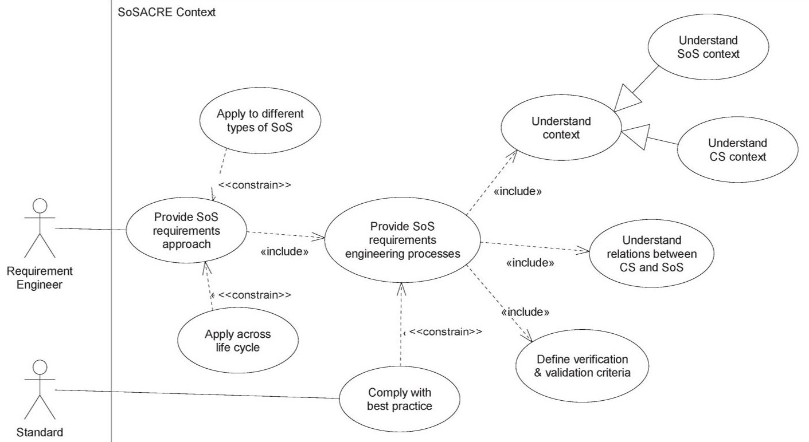

Fig. 1. Requirements modeling: SoSs context.

project to a large multiyear project) and in terms of rigor (from noncritical to mission-critical systems).

4) The ACRE approach may be also visualized using any notation or combination of appropriate notations.

The flexibility of the approach, therefore, was the primary reason for selecting ACRE as the starting point for an SoSMBRE approach. This section introduces in more detail the ACRE approach: the ontology is presented in Section II-A, and the framework is detailed in Section II-B.

## A. ACRE Ontology

In order to capture and describe the concepts and terminology, an ontology was introduced. An ontology provides a visualization of all the key concepts, the terminology used to describe them, and the interrelationships between said concepts. The ontology, however, is much more than just a data dictionary and plays a pivotal role in the definition and use of any rigorous framework.

The use of ontologies for defining frameworks for architectures, such as enterprise architectures, process architectures, and system architectures, is one that is well established and extensively used throughout the industry. For examples of the use of ontologies, see [4], [14], and [15]. Whenever any framework is defined in terms of a set of views, then an ontology is essential. It is the ontology that enforces the consistency and rigor demanded by such frameworks.

The ontology introduced here will cover all of the concepts pertinent to MBRE, and a number of views will be defined based on this ontology. Each view will focus on, and expand upon, a subset of the ontology and instantiate, or realize, specific concepts in the context of a real system or project.

Based on the results of a survey of modeling techniques, SysML was decided upon for the modeling notation for this work [16]. The choice of SysML was due to a number of

reasons, including its widespread use in the industry, extensive tool support, and flexibility of use. The ACRE ontology is defined using a SysML block definition diagram, as shown in Fig. 2.

The ontology in Fig. 2 shows that there is an abstract concept of a "Need" that has three types: "Requirement," "Capability," and "Goal." One or more Need is elicited from one or more "Source Element." One or more "Rule" constrains one or more Need.

One or more "Use Case" elements describe the context of each Need via the "Context." There are two types of context shown here, namely, the "System Context" and the "Stakeholder Context," although this list is incomplete. Note that the original ACRE approach is aimed at the system (or constituent system) level, and therefore, there is no reference to an SoS here.

## B. ACRE Framework

The ACRE approach consists of a number of predefined views that are based on the ACRE ontology. Fig. 3 shows the set of views in the ACRE framework.

One or more "Scenario" validate one or more Use Case, and there are two types of Scenario: the "Semi-formal Scenario" and the "Formal Scenario."

These views are described as follows.

1) The Source Element View contains all relevant source information that is required to specify the system requirements. It is essential that the origin of all requirements is known, and this is what this view records. This view is primarily used as a mechanism to establish traceability and provide links between the requirements and any other aspect of the system.

2) The Requirement Description View contains structured descriptions of each of the needs, including requirements, goals, and capabilities. The main purpose of this view

Authorized licensed use limited to: Bibliothèque ÉTS. Downloaded on September 08,2026 at 04:54:10 UTC from IEEE Xplore. Restrictions apply.

<!-- PDF_PAGE: 4 -->

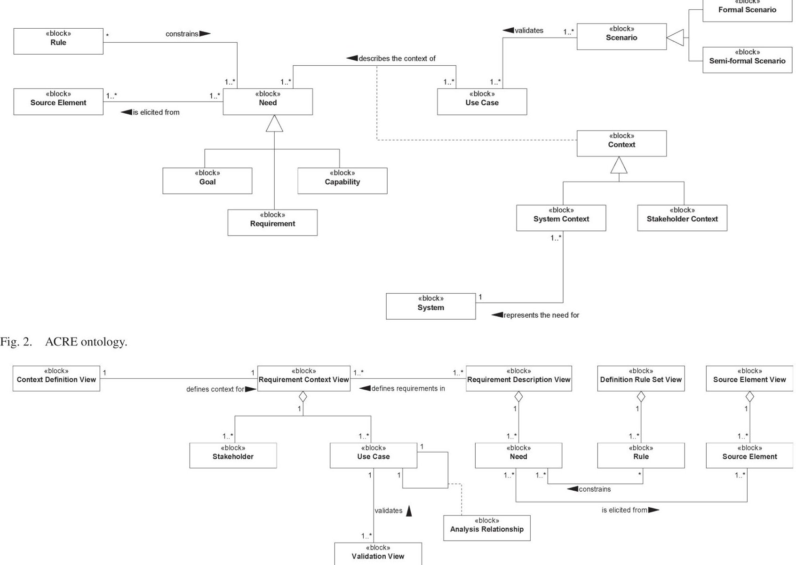

Fig. 3. ACRE framework.

is to describe each individual requirement according to a predefined set of attributes. The attributes will vary depending on a number of factors. This view is primarily used for managing the requirements of a system and is the basis of implementation for many current commercial requirements management tools. Each requirement description provides a noncontextual description of the requirement.

3) The Rule Set Definition View contains rules that may have to be applied to each requirement definition. For example, these may be complexity rules in the form of equations of more general text-based rules.

4) The Requirement Context View contextualizes requirements, giving them meaning by looking at them from a specific point of view. This is known as putting the requirements into context and forms the basis of the approach presented in ACRE. Without a context, requirement descriptions may be interpreted in different ways depending on the viewpoint of the reader. It is essential, then, that each requirement be looked at from different points of view, or in different contexts. When a requirement is put into context, it is known as a "use case," and by considering these use cases and the relationships between them and other use cases or stakeholders, it is possible to generate a complete point of view, or

context. These contexts may be based on a number of elements, such as stakeholders or levels of hierarchy in a system.

5) The Context Definition View identifies the points of view that are explored in the Requirement Context View. These points of view, or contexts, may take many forms, including stakeholders and levels of hierarchy in a system.

6) The Validation View provides the basis for demonstrating that the requirements can be met or complied with in some way. These views can be informal scenarios, such as those based on sequence diagrams at various levels of abstraction, or they may be formal, such as mathematicalbased scenarios.

7) The Traceability View. A key part of any requirements engineering endeavor is to provide traceability both to and from the original requirements. Traceability relationships may be "implicit" and "explicit." Implicit relationships are inherent in the modeling language itself. Explicit relationships are not inherent in the modeling notation but are dependent on the application of the modeling. These relationships can be directly identified from the ontology and the framework. It is often necessary, therefore, to exactly define where the traceability relationships exist. Indeed, it is possible to trace between almost any system element and any element in the framework.

<!-- PDF_PAGE: 5 -->

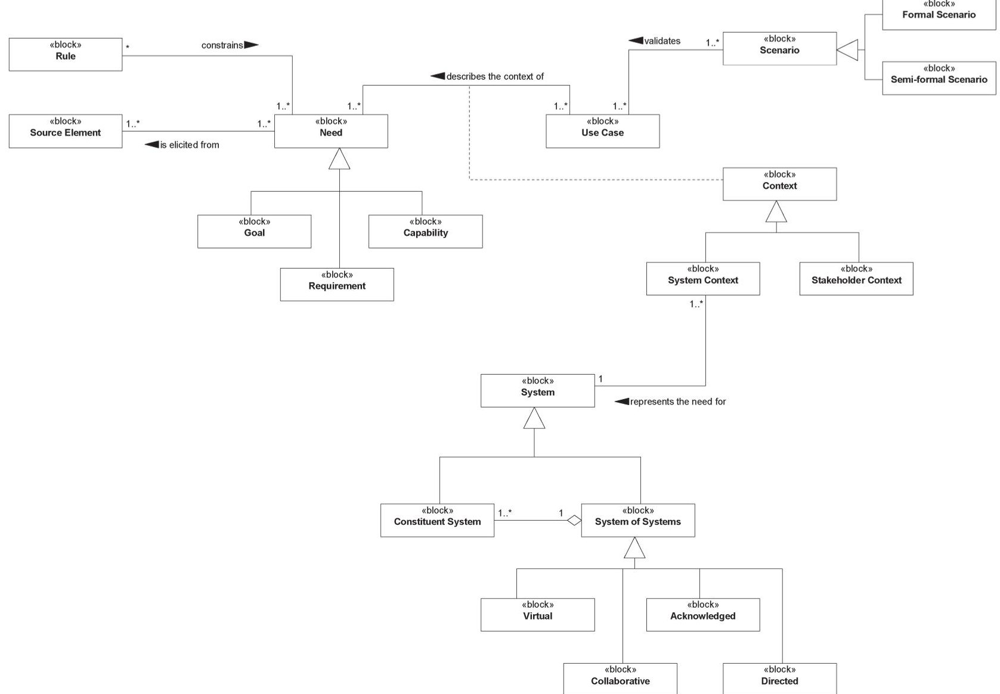

Fig. 4. COMPASS ontology.

## III. APPLYING ACRE TO SoSs

The next step in the research was to define a set of processes that could be used to describe the approach. It was decided to use the ACRE ontology and framework as a start point and to define processes based around them. This would enable the first draft of the processes to be defined and then applied to a test model in order to assess the suitability of the process.

## A. Defining the Processes

The processes were defined using a best practice modelbased approach known as the "seven views" approach [14]. The processes were identified based on the use cases and then defined according to the approach.

These processes were then applied to a test model in order to assess their suitability for SoSs. This test model is an SoS that represents emergency service providers [19] and will be discussed later in this paper. Based on the experience of applying these processes, it was then possible to refine the processes based on the lessons learned and to revisit the original ACRE ontology and framework.

One of the features of ACRE is that it is based on a contextbased approach to requirements engineering. This context-based approach for systems engineering is particularly interesting from the point of view of SoSs, bearing in mind the following points.

2) An SoS may be thought of as a different higher level point of view of a set of systems. Therefore, a context exists at both the system level and the SoS level [18].

1) A context represents a system from a specific point of view.

Bearing these points in mind, it was anticipated that most of the knowledge and experience of applying ACRE at a system level could be reused, to a certain extent, at the SoS level as exactly the same modeling techniques could be applied.

## B. SoS-ACRE Approach

The new approach for MBRE for SoSs, which is known as SoS-ACRE, consists of the following elements:

1) the ontology, where all the key concepts and terminology are defined;

2) the framework, where all the necessary views are defined;

3) the process set, where all the processes necessary to generate the views in the framework were defined.

Each of these is expanded upon on the following sections: Section III-B1 defines the SoS-ACRE ontology, the framework is defined in Section III-B2, and the processes are given in Section III-B3.

1) SoS-ACRE Ontology: The SoS-ACRE ontology was based on the ACRE ontology and is shown in Fig. 4.

The first point to notice here is that the ontology here is very similar to the original ACRE ontology. The area where the ontology has changed is in the definition of the systems that

<!-- PDF_PAGE: 6 -->

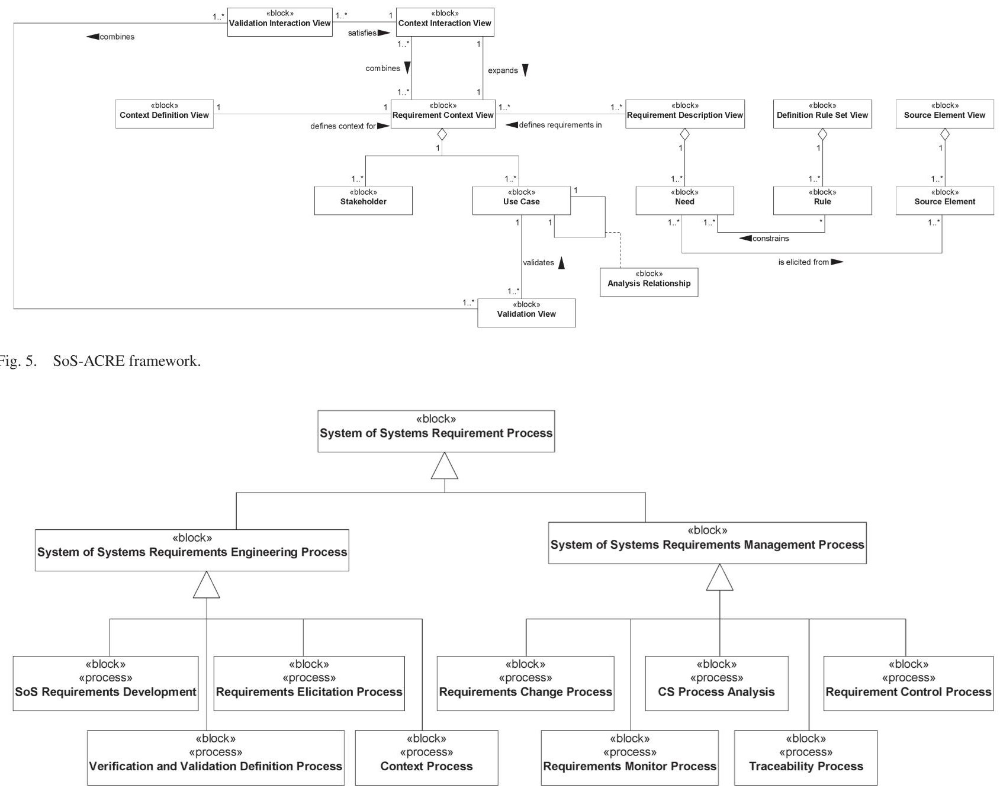

Fig. 6. SoS-ACRE requirements processes.

relate to the context. In the updated ontology, it can be seen that the "System Context" represents the need of two types of "System": the "Constituent System" and the "System of System" (that itself is made up of a number of Constituent System).

2) SoS-ACRE Framework: The SoS-ACRE framework took as its starting point the ACRE framework. The SoS-ACRE framework for SoSs is shown in the diagram in Fig. 5.

The new framework is again very similar to the original ACRE framework. It was found that the basic ACRE approach could be applied at both the system and SoS levels. However, this still left some gaps as, although a context could be defined at both the constituent system and SoS levels, there was a need to understand the relationships between them. This resulted in the need to define two new views that are necessary when modeling requirements for SoSs.

1) The "Context Interaction View." A context can be defined at both the constituent system and SoS levels, but these contexts need to be related together. For example, the capabilities of an SoS need to be mapped to the requirements of the underlying constituent system that realizes them. The purpose of this view, therefore, is to allow the

interactions between the SoS context and its constituent system contexts to be visualized. The Context Interaction View expands upon the SoS context and combines a number of constituent system contexts.

2) The "Validation Interaction View." It is possible to generate a number of scenarios for any context that can be used for validation purposes. Therefore, if a set of validation views exists at the SoS level and a set also exists for each constituent system, then there must be some relationship between them. The Validation Interaction View satisfies the SoS context by combining the set of constituent system validation views.

By enhancing the original ACRE framework with these new views, it was now possible to use this framework as a basis for the SoS-ACRE processes.

3) SoS-ACRE Processes: The SoS-ACRE processes describe the approach taken to generate the views in the framework, according to the ontology. The processes were defined using the seven views approach to process modeling, which resulted in a set of eight processes being defined, as shown in the diagram in Fig. 6.

<!-- PDF_PAGE: 7 -->

The diagram here shows the library of processes (known as the "process content view" in the seven views approach) that were defined for SoS requirements. The "SoS Requirements Engineering Process" has four processes defined that are briefly described as follows:

1) "SoS Requirements Engineering," which is the overarching process that controls the requirements engineering;

2) "Requirements Elicitation Process," which is the process where the initial requirements are elicited from the relevant parts of the source elements;

3) "Context Process," which is the process that defines a context at either the constituent system level or the SoS level.

4) "Verification and Validation Definition Process," which is the process that defines the verification and validation criteria for the SoS.

In Section I-A, we suggested that SoS requirements engineering needs to account for dual views of the requirements, as well as a particularly challenging management process (due to emergent features, mismatched constituent lifecycles, and continuous evolution). Here, we briefly describe the "SoS Requirements Management Process," which has the following five processes defined:

1) "Requirements Change Process," which controls changes to the constituent system or SoS requirements;

2) "CS Process Analysis," which allows the management processes of a constituent system to be understood;

3) "Requirement Control Process," which ensures that all requirement changes are agreed to and commitment is obtained;

4) "Requirements Monitor Process," which allows changes in requirements at both the constituent system and SoS levels to be identified;

5) "Traceability Process," which allows traceability views to be set up.

A low-level description of these processes using the other six of the seven views is not within the scope of this paper. The processes are defined in full in [20].

These processes were executed in different sequences to satisfy the project use cases.

## IV. TESTING THE APPROACH

This section discusses how the SoS-ACRE approach was tested. This consisted of both verification and validation of the processes before moving on to industrial trials.

Due to the nature of the test model, the focus was on verifying the engineering processes; verifying management processes is the object of current research.

## A. Verifying the Processes: The LESLP Case Study

Here, we illustrate the requirements engineering processes developed in this paper. We use an SoS case study based on a collection of emergency services collaborating in response to a major incident. In Section IV-A1, we provide a background to

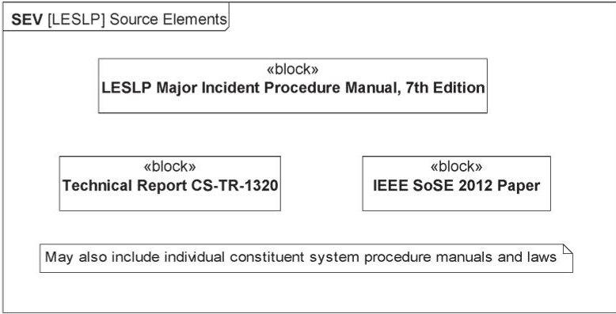

the case study, and in Section IV-A2, we enact the requirements engineering processes.

Fig. 7. Source Element View for LESLP case study.

1) Case Study Background: We base this work on the Major Incident Procedure Manual developed by the London Emergency Services Liaison Panel (LESLP) [19]. As described in [21] and [22], the system formed by the collaboration of emergency services may be considered an SoS in the terms of Maier [7] and characterized as an acknowledged SoS [6].

The LESLP manual defines procedures that are required from the different emergency services upon the formation of a major incident response. It is this document that forms the main basis for eliciting requirements for the case study.

2) Requirements Engineering for the LESLP Case Study As aforementioned, we enact only the requirements engineering processes on the LESLP case study. The reason for this limitation is due to the nature of the study and of the management processes themselves. The SoS requirements management processes described in this paper require knowledge of the management structure of the individual constituent systems, which are not available to us in this work. We feel that, while we could derive some of this information from the procedure manual, it would not be reflective of the actual use of the processes and not be a valid verification of the processes. Therefore, this element will form a piece of future work.

We begin requirements modeling using the "SoS Requirements Engineering" process, in which the source elements are initially identified. The "Source Element View" (SEV) in Fig. 7 shows that there are three sources for deriving requirements: the seventh edition of the LESLP Major Incident Procedure Manual, a technical report, and a conference paper. A note is added to state that procedure manuals for the individual constituent systems may be also source elements for further iterations of the process.

Given the source elements, the next step of the process is to identify the constituent systems and the stakeholders of the SoS. These are captured in "Context Definition View" (CDV), where each entity is considered as a context for the requirements elicited later. Fig. 8 presents a CDV for the SoS constituents, and Fig. 9 presents the CDV of the stakeholders of the SoS. In Fig. 8, the SoS is composed of multiple constituent systems, which may be an emergency service (Police, Fire, Coastguard, or Ambulance), a communication system, the armed forces, or the local authority. Fig. 9, identifies three top-level stakeholder types, namely, Customer, External, and Supplier. We identifyember 08,2026 at 04:54:10 UTC from IEEE Xplore. Restrictions apply.

<!-- PDF_PAGE: 8 -->

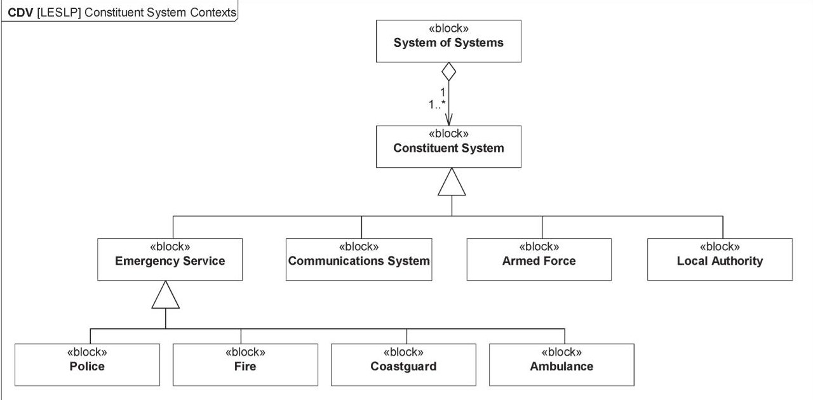

Fig. 8. Context Definition View for LESLP constituent systems.

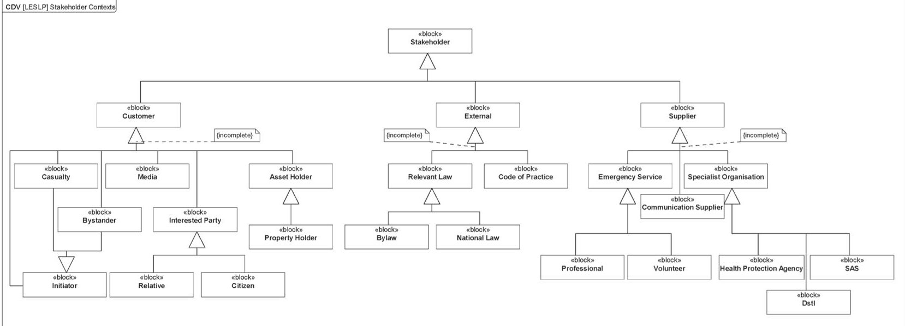

Fig. 9. Context Definition View for LESLP stakeholders.

subtypes for each, for example, Customer may include Casualty, Bystander, and Media. The diagram shows that each type is incomplete and may require further effort to ascertain additional stakeholders.

The next stage of the process is to signal the start of the Requirements Elicitation Process, where initial requirements are elicited from the relevant parts of the source elements. This process results in the definition of a "Requirement Definition View" (RDV), as shown in Fig. 10. The RDV shows the toplevel requirement to "Respond to Major Incident," which is broken into subrequirements that must be fulfilled. We trace back to the LESLP Procedure Manual source element (although this could conceivably form a separate diagram) to ensure that there is adequate traceability of requirements. A comment is provided to state that further effort is required for this case study to elicit additional requirements.

For this case study, this is the end of the Requirements Elicitation Process. In a larger study, there should be a process of identifying needs and requirements, involving multiple source elements.

The completion of the Requirements Elicitation Process results in starting the Context Process first for the SoS and subsequently for each individual constituent system. We therefore begin with defining the "Requirement Context View" (RCV) for the SoS, as presented in Fig. 11. The RCV places the requirements in context, which is defined as use cases. Each use case should be traceable from the requirements identified in the RDV. For each use case, we identify the stakeholders of the SoS who also have some involvement or interest. For example, in Fig. 11, the "Assist Public" use case has some involvement with the Casualty stakeholder and is a part of the "Take Action" use case, which, in turn, extends the high-level use case Respond to Major Incident.

The Context Process continues with internal reviews to ensure completeness and consistency. The completion of this check results in the initiation of the Verification and Validation Definition Process for the given context. In this case, we enact the process for the SoS context.

In the Verification and Validation Definition Process, we define scenarios for each use case for a given context. We partially

<!-- PDF_PAGE: 9 -->

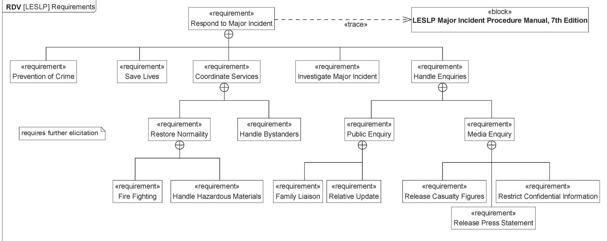

Fig. 10. Requirement Definition View for LESLP case study.

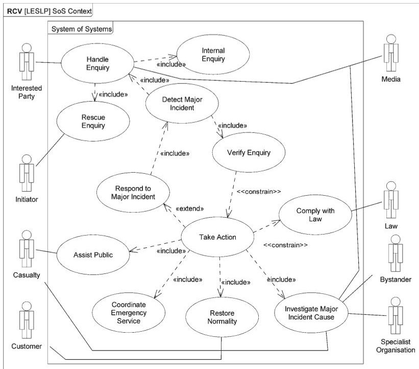

Fig. 11. Requirement Context View for LESLP SoS.

demonstrate this process for the SoS context by considering two possible scenarios for the Assist Public use case identified above. For the basis of this work, we define two semiformal scenarios in the form of "Validation View" (VV), as shown in Figs. 12 and 13. In these two VVs, we consider possible interactions between the two entities (Casualty stakeholders and the SoS), which are involved in the Assist Public use case. These VVs do not consider how the SoS performs the internal actions—these will follow when considering the individual constituent system contexts. As such, they are used at a later stage to ensure there is some consistency in the way in which each entity relates to a given requirement.

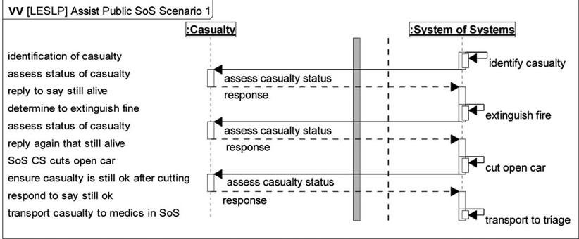

When each use case has been validated for the SoS, the Verification and Validation Definition Process is completed, and we return to the Context Process, where additional reviews are performed. This completes the Context Process for the SoS, returning to the SoS Requirements Engineering Process, and,

Fig. 12. Validation View 1 for Assist Public use case.

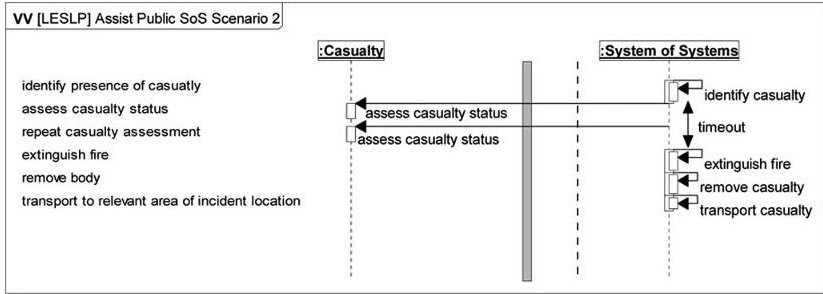

Fig. 13. Validation View 2 for Assist Public use case.

subsequently, starting the Context Process for each constituent system. We omit the remainder of the RCVs and VVs for space reasons; however, they are available in [20].

The final stage of the SoS Requirements Engineering Process is to ensure consistency in interactions between the stakeholders and the constituent systems, as mentioned earlier.

## B. Validating the Processes: Satisfying the Original Requirements

The previous section looked at the verification of the MBRE for SoS processes and considered whether the processes worked. This is in line with the definitions of verification and validation of Boehm [23], where verification asks, "are we building the system right?" By this, we ensure we are building a system (in this case, the MBRE for SoS processes) in the right way so that it works. Here, we briefly consider the validation

<!-- PDF_PAGE: 10 -->

of the processes, or, as stated by Boehm, "are we building the right system?" That is, are the processes fit for the purpose? This is done by ensuring that the processes trace back to the requirements in context that were shown in Fig. 1 and through the original requirements and their sources.

As previously stated, the approach taken to define the processes was based on the ACRE approach. A single model was produced that contained the requirements for SoS-ACRE and the process definitions (based on the seven views approach). As both the ACRE and seven views approaches are true MBSE approaches, then it is a simple matter to combine the artefacts of both into a single SysML model. The model was also fully traceable as follows.

1) The SoS-ACRE processes were executed in sequences as scenarios. These scenarios were then traced back to the project use cases. (Validation View to Requirement Context View).

2) The use cases represent the original requirements in the context of the project's constituent systems. For traceability, these use cases were traced back to the original requirements (Requirement Context View to Requirement Description View).

3) The original requirements were derived from a number of requirements sources, such as standards, best practice guides, and project documentation. (Requirement Description View to Requirement Source View).

This traceability was built into the model, and thus, traceability views corresponding to the relationships between the views detailed above can be now automatically produced.

By establishing this traceability, the processes were validated, being shown to meet their use cases (requirements in context), which, in turn, were traced to their original requirements and from there to their sources.

## C. Industrial Trials

This work has been carried out as part of the EU FP7 project COMPASS [17], part of which has been concerned with the provision of case studies that may be used to verify the SoSACRE approach.

Now that the SoS-ACRE processes have been verified and validated, it was possible to perform another iteration of the development process in order to refine the processes before moving on to full industrial trials. The industrial trials consist of two full case studies. The first study constitutes a home audio video ecosystem where networked systems such as TV, home cinema, and DVD deliver digital content from internal or external sources to multiple users. In this domain, a major area of concern is the digital rights management contracts on the content. The second example is dynamic coordination of healthcare services in response to an accident (call management, dispatching, triage, hospital management systems, etc.).

The original requirements for this work were taken from a number of sources, including standards, best practice guides, papers, and project documentation. Not only did this work result in an MBSE approach for requirements for SoSs, but the approach taken to carry out this work was itself an MBSE approach.

## V. CONCLUSION

This paper has presented an approach to carrying out MBRE that is suitable for SoSs.

The resultant approach consists of an ontology, a framework, and a set of processes.

The approach taken was based on the best practice ACRE approach and defined an extra set of SoS views. The current position of this work is that it has been applied to the LESLP test model and will now be applied to multiple case industrial case studies as part of the overall validation.

## REFERENCES

[1] J. Holt, S. Perry, M. Brownsword, D. Cancila, S. Hallerstede, and F. Overgaard Hansen, "Model-based requirements engineering for system of systems," in Proc. 7th IEEE Conf. Syst. Syst. Eng., 2012, pp. 561-566.

[2] INCOSE Systems Engineering Handbook, INCOSE, San Diego, CA, USA, Aug. 2007.

[3] J. D. Holt, S. A. Perry, and M. J. Brownsword, Model-based Requirements Engineering. Herts, U.K.: IET Publ., 2011.

[4] C. E. Dickerson and D. N. Mavris, Architecture and Principles of Systems Engineering. Boca Raton, FL, USA: CRC Press, 2009.

[5] G. A. Lewis, E. Morris, P. Place, S. Simanta, and D. B. Smith, "Requirements engineering for systems of systems," in Proc. 3rd Annu. IEEE SyCon, Mar. 2009, pp. 247-252.

[6] J. Dahmann and K. Baldwin, "Understanding the current state of US defense systems of systems and the implications for systems engineering," in Proc. IEEE Syst. Conf., Apr. 7-10, 2008, pp. 1-7.

[7] M. W. Maier, "Architecting principles for system of systems," Syst. Eng., vol. 1, no. 4, pp. 267-284, 1998.

[8] "CMMI for development, Version 1.3," Softw. Eng. Inst., Carnegie Mellon Univ., Pittsburgh, PA, USA, 2010, (Version 1.3, November 2010).

[9] "CMMI for acquisition. Version 1.3," Softw. Eng. Inst., Carnegie Mellon Univ., Pittsburgh, PA, USA, 2010, (Version 1.3, November 2010).

[10] "CMMI for services. Version 1.3," Softw. Eng. Inst., Carnegie Mellon Univ., Pittsburgh, PA, USA, 2010, (Version 1.3, November 2010).

[11] Systems Engineering Guide for Systems of Systems, Office of the Under Secretary of Defense, USA DoD, Washington, DC, USA, Aug. 2008.

[12] Software and Systems Engineering Life Cycle Processes, ISO 15288, 2009.

[13] J. A. Estefan, "Survey of model-based systems engineering (MBSE) methodologies," INCOSE MBSE Focus Group, San Diego, CA, USA, 2008.

[14] J. D. Holt, A Pragmatic Guide to Business Process Modelling, 2nd ed. London, U.K.: BCS Publ., 2009.

[15] J. D. Holt and S. A. Perry, Modelling Enterprise Architectures. Herts, U.K.: IET Publ., 2010.

[16] The COMPASS project. (2012). Initial report on SoS architectural models, Portland, ME, USA, Document D22.1. [Online]. Available: http://www compass-research.eu/deliverables.html

[17] COMPASS project web site. [Online]. Available: http://www. compass-research.eu/

[18] J. D. Holt, S. A. Perry, and M. J. Brownsword, "Context-based systems engineering," in Proc. 5th Int. IEEE Conf. SOSE, Jun. 2010, pp. 1-6.

[19] LESLP Major Incident Procedure Manual—Seventh Edition, The Stationery Office, Norwich, U.K., Jun. 2007.

[20] The COMPASS project. (2012). Report on guidelines for SoS requirements, Portland, ME, USA, Document D21.1. [Online]. Available: http:// www.compass-research.eu/deliverables.html

[21] R. Payne, J. Bryans, J. Fitzgerald, and S. Riddle, "Interface specification for system-of-systems architectures," in Proc. 7th Int. Conf. IEEE SoSE, Jul. 2012, vol. 6, pp. 567-572.

[22] R. Payne and J. Bryans, "Modelling the major incident procedure manual: A system of systems case study," Comput. Sci., Newcastle Univ., Newcastle upon Tyne, U.K., Tech. Rep. Series CS-TR-1320, Mar. 2012.

[23] B. W. Boehm, Software Engineering Economics. Upper Saddle River NJ, USA: Prentice-Hall, 1981.

<!-- PDF_PAGE: 11 -->

Jon Holt received the Ph.D degree from Swansea University, Swansea, U.K., in 1994.

He is currently a Visiting Professor of Systems Engineering, Cranfield University, Bedford, U.K., and also with Atego Systems, Cheltenham, U.K. He is an internationally published and recognized expert in the field of system engineering. He is an international award-winning author and public speaker in the field of applied systems engineering and research. He has authored nine books and over 100 papers on modelbased systems engineering. His main area of interest

is the application of systems modeling to all aspects of system engineering.

Prof. Holt is a Fellow of the Institution of Engineering and Technology and the British Computer Society and a member of the International Council on Systems Engineering, where he is currently the Technical Director of the U.K. Chapter. He is a Chartered Engineer and a Chartered Information Technology Professional.

Simon Perry received the B.S. degree in math from the Leeds University, Leeds, U.K.

Since 1986, he has worked as a software engineer, a systems architect, and a systems engineer in a wide range of business areas, including defense, finance, building construction, nuclear installations, utilities, and transport. He currently holds a lecturing position at Warwick University, Conventry, U.K. and also with Atego Systems, Cheltenham, U.K., where his role includes consulting, mentoring, and the development and delivery of training. His main areas of work

are concerned with the application of systems modeling to all aspects of systems engineering: process modeling, enterprise architectures and architectural frameworks, requirements engineering, and capabilities and competencies. He has coauthored five books on systems engineering.

Mr. Perry is a member of the International Council on Systems Engineering and the Institution of Engineering and Technology.

Richard Payne received the Ph.D. degree from Newcastle University, Newcastle upon Tyne, U.K., in 2012.

He is currently a Research Associate with the School of Computing Science, Newcastle University. Following his Ph.D. on models of dynamic reconfiguration, he worked on the U.K. Ministry of Defence project on Interface Contracts for Architectural Specification and Assessment. He is now working on the COMPASS project, designing advanced modeling and verification techniques. His research interests

include architectural modeling, systems of systems, and verification tools for formal methods.

Jeremy Bryans is currently a Senior Research Associate in the School of Computing Science and a member of the Centre for Software Reliability with Newcastle University, Newcastle upon Tyne, U.K. He works on the European Union project COMPASS, where he is developing semantic foundations for a modeling language for systems of systems. He was a Co-Investigator on the Engineering and Physical Sciences Research Council project Trusting Dynamic Coalitions, developing techniques to design compositional provenance policies for coalition

members. His research interests are in the modeling and analysis of collaborating systems and in the development of trustworthy policies for their interaction.

Stefan Hallerstede received the Ph.D. degree from the University of Southampton, Southampton, U.K., in 2001.

From 2001 to 2004, he was a Head Research Engineer with KeesDA S.A., Grenoble, France, from where he joined ETH Zürich, Zürich, Switzerland, for three years to work on incremental formal modeling and associated tool development. He was a Lecturer with the University of Düsseldorf, Düsseldorf, Germany, for three years before joining, in 2011, Aarhus University, Aarhus, Denmark, where he is

currently an Associate Professor in the School of Engineering. His research focuses on applied formal methods covering theoretical foundations, tool development, and industrial use of mathematical techniques for the description of systems.

Finn Overgaard Hansen received the M.Sc.E.E. degree from Technical University of Denmark, Kongens Lyngby, Denmark, in 1977.

He is currently a Professor with the School of Engineering, Aarhus University, Aarhus, Denmark, where he is leading the embedded systems group. From 1978-1984, he worked in the industry as a software developer of embedded systems and, later, for 15 years, with the Danish Technological Institute, with the development and dissemination of software methods to the Danish industry. He returned to the

academe in 2001, with the purpose of working toward the Master's degree in information technology. His main research interest is in architecture and design of software for networked embedded systems.