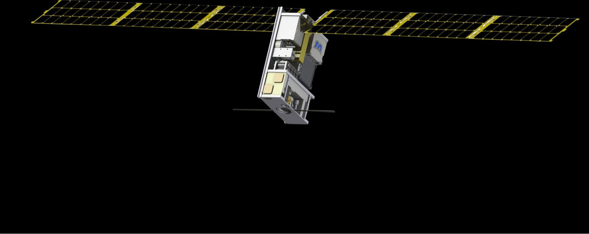
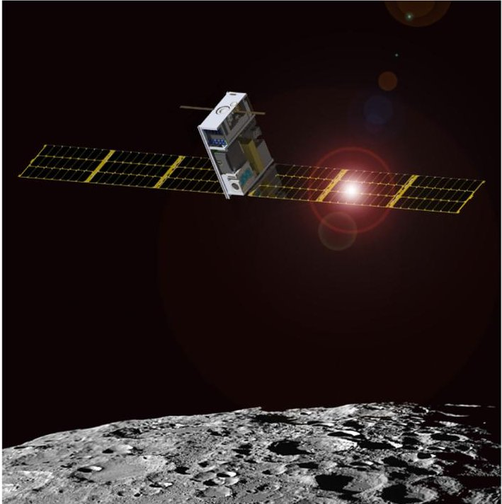
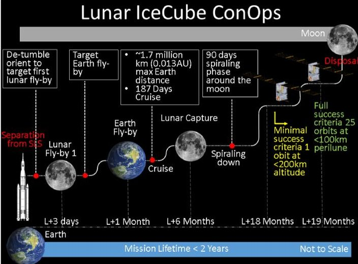
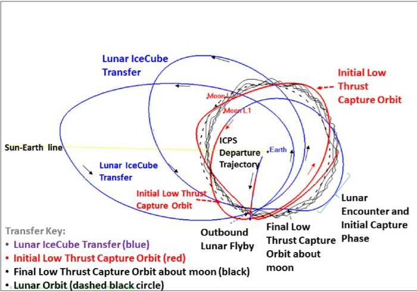
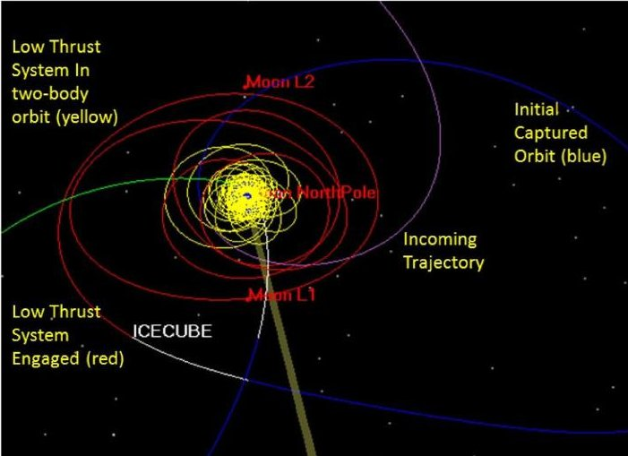
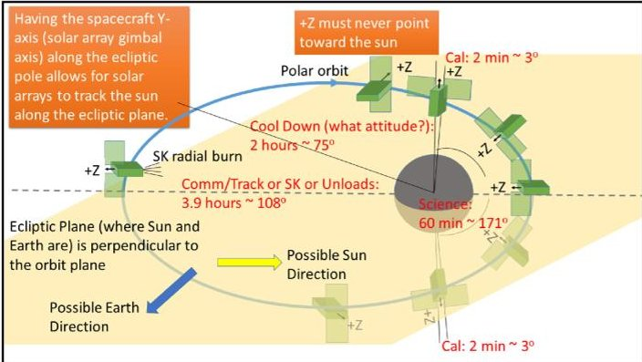
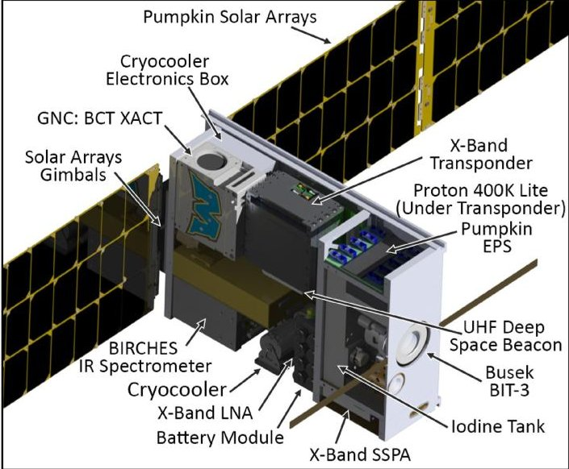
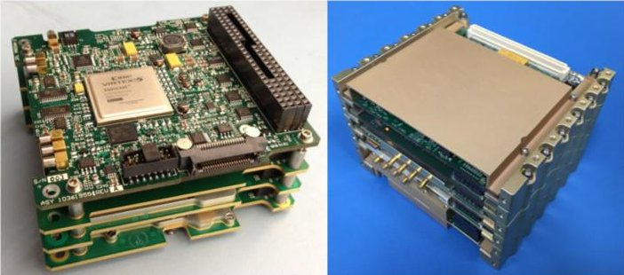
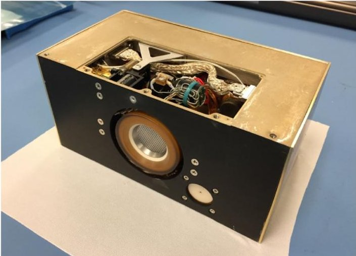
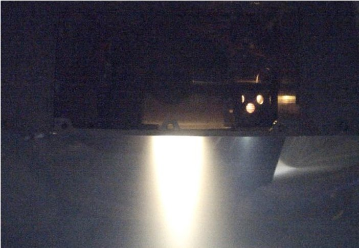

<!-- PDF_PAGE: 1 -->

# The Lunar IceCube EM-1 Mission: Prospecting the Moon for Water Ice

Benjamin K. Malphrus, Kevin Z. Brown, Jose Garcia, Charles Conner Jeff Kruth, Michael S. Combs, Nathan Fite, Sean McNeil, Sarah Wilczweski, Kennedy Haught, Aaron Zucherman, Morehead State University Pamela Clark, Krisjani Angkasa, Nathaniel Richard, Jet Propulsion Laboratory California Institute of Technology Terry Hurford, Dave Folta, Clifford Brambora, Robert MacDowall Paul Mason, Sun Hur-Diaz, Joseph Breeden, Robert Nakamura, NASA Goddard Spaceflight Center Andres Martinez, NASA HQ. Michael M. Tsay, Busek Co. Inc.

## INTRODUCTION

Lunar IceCube is a NASA nanosatellite mission designed to prospect, locate, and measure volumes and composition of water ice deposits and other volatiles on the Moon in support of future exploitation by robots and human explorers. Lunar IceCube is one of several public-private partnerships selected under NASA's Next Space Technologies for Exploration Partnerships Broad Agency Announcement for the development of advanced exploration systems. Among the first small satellites planned to explore deep space, Lunar IceCube, along with the 12 other Exploration Mission One (EM-1) missions will help lay a foundation for future small-scale planetary missions. In addition to providing useful scientific data, Lunar

Authors' current address: B. K. Malphrus, K. Z. Brown, J. Garcia, C. Conner, J. Kruth, M. S. Combs, N. Fite, S. McNeil, S. Wilczweski, K. Haught, A. Zucherman are with the Morehead State University, Morehead, KY 40351 USA; P. Clark, K. Angkasa, N. Richard are with the Jet Propulsion Laboratory California Institute of Technology, Pasadena, CA 91109 USA; T. Hurford, D. Folta, C. Brambora, R. MacDowall, P. Mason, S. Hur-Diaz, J. Breeden, R. Nakamura are with NASA Goddard Spaceflight Center, Greenbelt, MD 20771 USA; A. Martinez is with the NASA HQ; Michael M. Tsay is with the Busek Co. Inc., Natick, MA 01760 USA. Manuscript received August 29, 2018, revised December 29, 2018, and ready for publication April 2, 2019. Review handled by Peter Kinman. 0885/8985/19/$26.00 $2019 IEEE

IceCube will help inform NASA's strategy for sending humans farther into the solar system.

Morehead State University (MSU), located in Morehead Kentucky, is leading the 6U CubeSat mission in partnership with scientists and engineers at NASA/GSFC [in Greenbelt, Maryland, JPL at Caltech (Pasadena, CA) and Busek (Natick, Massachusetts)]. Under the university-led partnership, MSU's Space Science Center will build, integrate and test the 6U nanosatellite and provide communications and tracking support via its 21-m ground station antenna.

While primarily a science mission, Lunar IceCube will demonstrate technologies that may enable future interplanetary exploration with small satellite platforms including radiation-hardened subsystems, a full-duplex deep space transponder equipped with navigational needs and telecom functions a precise ranging transponder/transceiver, a capable attitude determination and control system, a high power solar array and an innovative electric propulsion (EP) system. The EP (Busek BIT-3 Iodine engine) generates 1.2 km/s of delta-v and, combined with an innovative low energy manifold trajectory, allows the spacecraft to reach lunar orbit from Earth escape with minimal energy [1]. The 13 secondary payloads to be deployed on EM-1, including Lunar IceCube, will usher in a new era of solar system exploration with small satellite platforms.

## SCIENCE OBJECTIVES

The primary science objectives of the Lunar IceCube mission are to undertake spectral determination of the composition and distribution of volatiles in the lunar regolith as

<!-- PDF_PAGE: 2 -->

a function of time, latitude, regolith age and to provide a geological context for those measurements through spectral determination of mineral components. Lunar IceCube could determine the relationship between adsorbed and bound water, hydroxyl, and ice throughout the diurnal cycle. The mission also has the potential to lend insight into understanding the role of external sources, internal sources, and solar wind proton and micrometeorite bombardment in formation, trapping, releasing of water, and exosphere formation.

Although previous missions [e.g., Clementine, Chandrayaan-1, and LRO/lunar crater observation sensing satellite (LCROSS)] discovered various signatures of $ \mathrm{O H / H_{2} O} $ on the lunar surface, they were not optimized for volatile characterization. Broadband infrared compact high resolution exploration spectrometer (BIRCHES) is designed with the high spectral resolution (5 nm) and wavelength range (1-4 $ \mu\mathrm{m} $ ) needed to fully characterize water and other volatiles, and to distinguish forms of water, including ice. Because the emphasis was on maximizing coverage during the nominal mission, LRO was not designed to provide repeated systematic (by time of day) measurements of representative features at higher and lower latitudes. IceCube is designed to provide said systematic measurements [2].

Findings from several lunar missions played a major role in modifying our understanding of the role and potential availability of resources on the Moon. The LCROSS observed abundant water and ice released from the floor of polar crater Cabeus at impact. Unexpectedly, an OH feature, indicating the presence of an OH veneer extending from poles to equator, was derived from IR spectral absorption features detected by instruments onboard

Chandrayaan, Deep Impact, and Cassini. These findings suggest that the Moon has both water and OH diurnal cycles that are global and not yet fully verified and understood. Furthermore, the apparent presence of water and OH, even at mid-latitudes, and of water associated with pyroclastic deposits has a profound effect on our understanding of the nature of surface chemistry on all airless exposed bodies. Specifically, if such OH and water is of solar wind origin, then the observations suggest that $ \sim 1 $ - keV protons interacting with any oxide-rich surface will thus generate OH via surface interactions. In essence, the discovery of lunar OH at lunar latitudes as low as $ 30^{\circ} $ could imply that all exposed oxide-rich bodies are miniature water and OH factories, a finding with implications for in situ resource utilization. Further reconnaissance of our nearest neighbor, the Moon, will be essential to determine the viability of such a proposition [3].

Three EM1 lunar orbiter missions, Lunar IceCube, Lunar Flashlight, and LunaH-Map will contribute to our understanding of the lunar global water cycle, and its impact on in situ surface modification processes (degree of interaction with solar wind protons resulting in physical or chemical changes on grain surfaces and the release or generation of volatiles) and on the potential generation or storage of water as a resource [4]. Table 1 describes the impact of each mission on our understanding of sources and sinks for water.

## CONCEPT OF OPERATIONS

Lunar IceCube, shown in Figure 1, will be deployed at "Bus Stop One" (360 500-km altitude) approximately four hours into the SLS mission and after the Orion space capsule has reached escape velocity (11.186 km/s) and

<!-- PDF_PAGE: 3 -->

Table 1.

<table border="1"><tr><td>Water source or sink</td><td>Solar wind(time of day, latitude, shadowing effects)</td><td>Meteorite impact(transients)</td><td>Pyroclastics, other bound-water minerals(globally distributed volcanic deposits)</td><td>Polar cold traps(shadowed regions, buried ice)</td><td>Thermal migration(time of day, latitude, poleward facing slopes)</td></tr><tr><td>L-IC</td><td>Time of day</td><td>Maybe</td><td>Yes</td><td>No</td><td>Yes</td></tr><tr><td>LM</td><td>Shadowing</td><td>Maybe</td><td>No</td><td>Yes</td><td>No</td></tr><tr><td>LF</td><td>Shadowing</td><td>Maybe</td><td>No</td><td>Yes</td><td>No</td></tr></table>

separated from the interim cryogenic propulsion stage (ICPS). After detumbling and early operations procedures, Lunar IceCube will perform a series of trajectory correction maneuvers to fly by the Moon in an appropriate dynamic state to allow the spacecraft to follow a low energy manifold trajectory, taking it as far as 1 Mkm （ $ 1 0^{6} $ km) from Earth and returning to the Earth-Moon system allowing the Moon to capture the spacecraft in a weakly stable orbit. Lunar IceCube will then use the EP system to spiral down into a final quasi-stable science orbit. The primary mission phases include 1) deployment and early operations to Lunar Fly-bay ( < 7 days ), 2) cruise phase (approximately 180 days), 3) lunar orbit capture (21 days), 4) science mission phase (180 days), and 5) an extended science mission phase (180 days). Once the final science orbit is achieved (100km perilune at the equatorial crossing by 5000-km apolune) the science instrument is engaged in a series of spectroscopic mapping observations of lunar volatiles. The deep

Figure 1. Artist's conception of Bus Stop One in lunar orbit-courtesy of MSU.

space network, including the affiliated MSU 21-m ground station (Deep Space Station 17) will receive science data and telemetry from the spacecraft at a data rate ranging from 64 kbps to 128 kbps. The DSN will have contact with Lunar IceCube every third orbit, so the spacecraft must perform autonomously for 2 of 3 orbits during every 24-hour period. An overview of the Concept of Operations (Con- Ops) is shown below in Figure 2.

## FLIGHT DYNAMICS

## NAVIGATION AND TRAJECTORIES

Injected into a direct lunar transfer as a payload onboard EM-1 on the initial flight of NASA's SLS, Lunar IceCube will employ a lunar gravity assisted multibody transfer trajectory with an innovative radio-frequency (RF) ion engine to return to the moon and attain a specific lunar science orbit. Constraints on the translunar trajectory limit the types of feasible Sun-Earth/Moon transfers which encounter the Moon with the necessary ballistic capture energy and orbit orientation. For Lunar IceCube, key

Figure 2. Lunar IceCube concept of operations.

<!-- PDF_PAGE: 4 -->

Figure 3.

Lunar IceCube transfer trajectory.

dynamical parameter values must be attained to enable the ballistically captured trajectory to evolve into the desired science orbit. If these parameter values are not achieved during this lunar approach phase, gravitational perturbations may result either in lunar impact or in a captured orbit that does not meet mission requirements and cannot be amended given the limitations of the propulsion system. However, dynamical systems analysis demonstrates that capture dynamics can lead to stable trajectories that remain bounded about the Moon.

To explore the design space for low-thrust enabled transfers that link an arrival trajectory with the lunar science orbit, dynamical models of varying levels of fidelity are employed: from the circular restricted three-body problem (CR3BP) to an operational modeling environment. The CR3BP offers an autonomous model of the Earth-Moon system, while also enabling the development of a general itinerary for the Lunar IceCube spacecraft, the visualization of solutions of interest, and guidance of the process to locate science orbit approach paths. This insight, in combination with techniques from dynamical systems theory, is incorporated into a general procedure for generating feasible trajectories that reach the desired science orbit in a low-thrust-enabled point mass ephemeris model. These analyses were performed using ATD, GMAT, and STK [5].

Following deployment and an outbound lunar flyby, feasible transfers for Lunar IceCube leverage the gravity of the Sun for phasing and energy adjustment to approach a feasible science orbit. Analysis of these trajectories, which connect a state that lies far beyond the lunar radius to a low lunar science orbit, is supported by concepts from multibody dynamics. In particular, a CR3BP approximation of the Earth-Moon system is valuable. In the CR3BP, the Jacobi constant offers a measure of the energy of the spacecraft, while also placing bounds on the motion. In designing a trajectory for Lunar IceCube, the value of the Jacobi constant for a trajectory entering through the

Figure 4.

Lunar capture and low thrust transfer to science orbit.

Earth-Moon L2 Libration gateway is constrained by the deployment and postdeployment lunar flyby conditions.

Lunar IceCube transfers are dependent upon the outbound ICPS trajectory. Using the ICPS provided states, the current transfer trajectory is shown in a solar rotating coordinate frame in Figure 3. This transfer uses two revolutions to align the incoming ballistic trajectory with a low energy lunar capture. The small arrows in the figure show the direction of motion with coast periods shown in blue and thrust periods shown in red (initial capture) and black (final capture). The outbound lunar flyby has an altitude of only 5045 km. To achieve this design, three low thrust maneuvers (1.24 mN) using the Busek BIT-3 system are placed at approximately half day intervals, each with a duration of $ \sim1 $ day except for the final maneuver which is only 4-hours long. Once the outbound lunar flyby is achieved the remaining trajectory is ballistic and captures naturally.

## SCIENCE ORBIT

Once Lunar IceCube approaches the moon, it is ballistically captured for several orbits. At a specified time (and location) the BIT-3 system is activated once again, and the science orbit is attained by a spiral down of the capture orbit to the science orbit. This long-term maneuver of over two to three months, depending on outages for shadow and navigation tracking, is shown in Figure 4 in an Earth Moon rotating frame.

During the initial outbound, transfer, and capture trajectories, navigation services using the DSN in communication with the onboard Iris radio will provide for range and Doppler measurement data which is used to determine the definitive state and subsequent dynamic states used for all orbit related products. The GSFC flight dynamics facility (FDF) will be used to process the tracking data to determine the trajectory, plan all maneuvers, generate

<!-- PDF_PAGE: 5 -->

Figure 5.

Attitude control and orientation of Lunar IceCube during the science orbit.

products, and interface with the Mission Operations Center (MOC) located at MSU [6]----[8]. The final science orbit has the following characteristics:

- 100 km periapsis altitude at equatorial crossing.

- Drives argument of periapsis at ascending node.

- High inclination (70-90).

- Overlap of groundtracks for calibration.

- Drives Semimajor axis (period of 7 hrs).

- 5000 km apoapsis altitude.

## ATTITUDE MODELING AND CONTROL

The Lunar IceCube mission requires an intricate choreography of the attitude control systems (ACS), including on-board determination and control systems and mission operations to perform complex attitude control maneuvers during all phases of the mission. During the science orbit, these maneuvers include: 1) orienting the spacecraft's instrument Lunar Nadir for science observations, 2) orienting toward anti-Lunar Nadir for instrument calibration, 3) pointing the antenna systems toward the Earth vector for communications, 4) keeping the solar arrays pointed toward the sun vector, and 5) orienting the spacecraft to optimize thermal management, all while avoiding "keep out zones" for the star tracker and IR spectrometer. ACS maneuvers during a typical science orbit are shown below in Figure 5.

Since the spacecraft contacts the ground approximately once every three orbits, the ACS command sequence must be carefully constructed, and the spacecraft must act autonomously between communication sessions. The spacecraft will enter a safe mode if a scheduled communication session is missed. These requirements along with requirements to dynamically adjust thrust vectors and attitude orientations during the cruise phase and to maintain a challenging low perigee science orbit, have represented a challenge for the Flight Dynamics team.

Attitude control models were developed that informed the ACS design, resulting in the use of three 50 milli-Newton meter second (mNms) reaction wheels, a precise star tracker and a series of sun sensors. Mission operations will be made relatively complicated by these attitude control maneuvers, but the mission design based on the ACS models developed closes for all mission phases.

## SPACECRAFT SYSTEMS

## BIRCHES INSTRUMENT

The BIRCHES is a compact (1.5U, 3.2 kg, 10-15 W including cryocooler) point spectrometer with a compact cryocooled 1 Megapixel HgCdTe focal plane array for broadband (1-4 $ \mu $ m) measurements, achieving sufficient SNR (>400) and spectral resolution (10 nm) through the use of a linear variable filter assembly to characterize and distinguish important volatiles (water, H2S, NH3, CO2, CH4, OH, organics) and mineral bands. BIRCHES is a miniaturized, actively cooled version (via a closed system 600-mW Cryo-Cooler) of the OVIRS instrument on OSIRIS-Rex. The instrument has built-in flexibility, using an on-orbit adjustable 4-sided iris, to maintain the same spot size regardless of variations in altitude (by up to a factor of 5) or to vary spot size at a given altitude, as the application requires. Compact instrument electronics have been developed which feature a reprogrammable PRO-ASIC III FPGA which can be easily reconfigured to support different read out and averaging schemes. The BIRCHES instrument has been designed to survive the rigors of the vibration during launch, the temperature variations experienced during the mission, and the radiation environment on the way to and at the moon and is an evolutionary step in compact and efficient instrument design. The instrument will provide hyperspectral measurements of volatile-related features in the 1-4 micron region, especially the 3 micron band, consisting of several waterrelated features. Previous lunar orbiting near IR spectrometers did not provide measurements beyond 3 microns

BIRCHES has heritage from OSIRIS-Rex, OVIRS and New Horizons LEISA. BIRCHES represents a compact version of a family of simple, versatile, and low-cost instruments, adapted as OSIRIS Rex OVIRS is adapted, from the GSFC-developed LEISA. LEISA-derived instruments represent (lower cost, mass, volume, power) concepts in spectrometer design made possible by largeformat infrared detectors combined with advances in thinfilm technology in the form of nondispersive thin film filters, called wedged or linear variable etalon filters (LVE or LVF), as wavelength selection elements. Such spectrometers represent a great reduction in optical and mechanical complexity and volume compared to the conventional grating, prism, or Fourier transform

<!-- PDF_PAGE: 6 -->

Table 2.

<table border="1"><tr><td colspan="2">Performance of the Lunar IceCube Spacecraft</td></tr><tr><td>Launch mass(wet mass)</td><td>14kg</td></tr><tr><td>Propellant mass</td><td>1.5kg</td></tr><tr><td>Payload mass capability, volume</td><td>3.5kg,2.0U</td></tr><tr><td>ADCS pointing accuracy</td><td>±.14arcseconds(1σ)</td></tr><tr><td>Lunar orbit knowledge</td><td>10m,0.15m/s</td></tr><tr><td>Maneuver rate</td><td>3°/s</td></tr><tr><td>Payload power capability</td><td>17.8W</td></tr><tr><td>Prime power generated</td><td>120-W continuous</td></tr><tr><td rowspan="4">Performance ofBIT-3RF ion propulsion system</td><td>Nominal thrust:1.0mN</td></tr><tr><td>Nominal lsp:2130s</td></tr><tr><td>MaximumΔV capability:2.9km/s(at max power)</td></tr><tr><td>Total impulse capability:38800Ns</td></tr></table>

spectrometers and mechanically or electrically tunable filter systems. To meet requirements while maintaining a low-cost profile, BIRCHES utilizes:

- Teledyne H1RG focal plane array with a linear variable filter, spares from OVIRS.

- Thermally isolated, compact optics, designed and developed as GSFC internal R&D.

- AIM microcryocooler developed for AFRL being qualified on Lunar Ice Cube for deep space.

- H1RG generic compact detector interface electronics with a flexible architecture suitable for point or imaging spectrometers leveraging ongoing NASA/ GSFC internal R&D efforts to developed mixed signal ASICs.

## SPACECRAFT BUS

Development of the Lunar IceCube deep space CubeSat bus leveraged MSU's previous CubeSat mission experience with LEO CubeSat technologies and incorporates new commercial-of-the-shelf (COTS) technologies to develop an evolved, radiation-tolerant 6U CubeSat that can support interplanetary investigator science. The Lunar IceCube bus incorporates high power generation (120 W of continuous power in cislunar space adapted by Pumpkin Inc. from their lower power Supernova design), a radiation-hardened flight computer (Proton 400K made by Space Micro, Inc.), a highly capable micronized Guidance, Navigation, and Control system and Blue Canyon Technologies XACT attitude determination and control

subsystem. Several options were considered for communications including COTS systems and a high throughput Xband communication system designed by JPL for lunar CubeSat missions. The JPL X-band radio, known as Iris, was selected. Iris V2.1 is a full transponder that is capable of high data throughput (256 kbps) and has Doppler and ranging capabilities. The primary performance parameters of the Lunar IceCube spacecraft are shown in Table 2 followed by an image of the spacecraft with primary systems identified (see Figure 6). The radiators have been removed from this image to illustrate the location of the subsystems.

The Iris radio, shown in Figure 7, is a full-duplex Xband transponder, planned to be used in more than 60% of

Figure 6. Lunar IceCube spacecraft subsystems.

<!-- PDF_PAGE: 7 -->

Figure 7. Iris V1 (left) and V2 (right) transponder.

the EM-1 missions including, Lunar IceCube, Lunar Flashlight, Lunar Polar Hydrogen Mapper (LunaH-Map), ArgoMoon, BioSentinel, Near-Earth Asteroid Scout, and CubeSat for Solar Particles. Offering both the deep space and near Earth frequencies, the Iris radio first was designed by JPL for the interplanetary nanospacecraft pathfinder in relevant environment mission [9], along with the first-generation of the Iris deep-space transponder [10]. Since, further development has occurred and the second-generation of Iris is currently underway to Mars, as a communications relay for the Mars Cube One mission [11]. The navigation capabilities onboard Iris include the sequential/PN ranging, delta-DOR, and doppler-with PN regenerative ranging [12] currently in works at JPL. Pictured below is the first and second generation of the Iris transponder.

## PROPULSION

Lunar IceCube's engine is an innovative, miniaturized solar electric propulsion system known as BIT-3. Developed by Busek Company. BIT-3 is a RF gridded ion propulsion system and fueled by solid-storable iodine propellant. Despite its small form factor (1.6U in volume, as shown in Figure 8), the BIT-3 engine is state-of-the-art

Figure 8. BIT-3 iodine-fueled RF ion engine system.

Figure 9. BIT-3 hot firing with iodine propellant in vacuum chamber.

in performance and energy density. At the maximum input power of 80 W, it can produce a total impulse upward of 31 kN-sec. This is equivalent of 2.3-km/sec delta-V for a 6U/14 kg-CubeSat like Lunar IceCube [13]. In addition, the BIT-3 system has a built-in two-axis gimbal and can support active thrust vectoring for spacecraft attitude control, C.G. alignment, or reaction wheel desaturation. Figure 9 shows BIT-3 in operation. One major enabling technology of BIT-3 is the use of iodine as propellant, as its high packing density ( $ \sim $ 4.5 g/cc) helps push the envelope on device miniaturization. The ability to use iodine for EP is a true game-changer for CubeSats because iodine has near-zero storage pressure, making it safe to launch while allowing for conformal and very lightweight tanks. For example, the iodine tank in the BIT-3 system is rectangular-shaped and 0.010" in wall thickness [14]. The lightweight nature of the tank helps achieve a state-of-the-art propellant loading mass fraction of 87%. In contrast, legacy EP propellant xenon has to be stored as compressed gas (>1000 psi), so it would require bulky pressure vessels that are unfavorable for spacecraft size, weight and power (SWaP) trades. Per-unit-volume speaking, a xenon system would contain only $ \sim $ 25% of total energy compared to an iodine system, due to the combination of low storage density (1.5-2g/cc) and volume requirement of a high-pressure tank [15].

## MISSION OPERATIONS

Lunar IceCube mission operations will be distributed between the NASA partners and MSU. The MOC at Morehead State will serve as the primary hub for operations with the FDF at NASA GSFC providing navigation trajectory, and attitude control operations. FDF will provide navigation and maneuver planning to ensure the trajectory design is met. FDF provides for the planning, ephemeris generation, tracking evaluation, and operational support products, as well as data archiving. Science

<!-- PDF_PAGE: 8 -->

Mission Operations will be led by JPL and include scientists at JPL, GSFC, and Morehead State.

The NASA Deep Space Network and the affiliated MSU 21-m ground station will provide telemetry, tracking, and command services for Lunar IceCube. At the greatest distances that the spacecraft travels during its low energy trajectory (>1 million km), data rates to the 34-m beam waveguide stations of the DSN will occur at 128 kbps and 32 kbps to the 21-m station. In Lunar orbit, data throughput rates will be increased to 128 kbps and 64 kbps for the 34 m and 21 m stations, respectively. A data volume of 7.5 MB of data per orbit is produced. During the science mission phase, ground contacts will occur every third orbit, allowing all of the science data to be telemetered down. Ranging for navigation and tracking will be provided by all stations.

## MISSION RISKS AND CHALLENGES

During development of the Lunar IceCube mission, numerous risks were identified and resolved resulting in several important lessons learned. Perhaps the most significant lesson learned was that certain aspects of the mission do not scale with interplanetary CubeSats. While the spacecraft envelope and all subsystems are scaled to 6U size, many processes and systems do not scale down. Navigation and tracking, attitude modeling and control, flight software, ground data systems, and especially telecommunications systems complexity do not scale. These aspects are essentially as complex and as challenging as large-scale missions. Some aspects of the systems design, may, in fact, be more challenging. Thermal management and thermal systems design, for example, represent a significant challenge. Given the small scale of the space frame, there is insufficient surface area to radiate heat away as is common in conventional spacecraft. A combination of patchwork radiators, each dedicated to a subsystem or combination of subsystems, mission operations strategies that manage subsystems power (and resulting residual heat) along with an attitude control strategy that uses the orientation of the spacecraft to minimize thermal effects and point radiators to cold space, is used to mitigate the thermal challenge.

Integrating the technology required to perform the science mission and operate within the harsh cislunar and lunar environment (in both radiation and thermal respects) represented a significant challenge. Compressing all the technology of BIRCHES into a 1.5U volume and 3.4 kg of mass represented a challenge. Meeting the 14.0-kg mass budget for the entire spacecraft systems was challenging. Several solutions emerged, including the use of lightweight materials (i.e., replacing aluminum enclosures with magnesium), eliminating structure and replacing EMI/EMC enclosures with shielding and gaskets made from nickel-filled PTFE matrix, and

underloading propellant were all part of the mass burn down strategies.

Achieving Lunar capture with insufficient delta-v to get from Earth escape to direct Lunar capture represented one of the most significant challenges of the mission design. The delta-v required to achieve lunar capture directly from Earth escape is 2.8 km/s. With 1.3 kg of propellant available, this direct transfer is not possible. The mission designers implemented a complex, low energy manifold trajectory that could be achieved with the 1.2 km/s of delta-v generated by the miniature RF ion engine. Developing a mission profile that allows maintenance of the science orbit with very little propellant margin was also difficult. Fortunately, analytic tools are now available to design such trajectories using the interplanetary superhighway.

Performing the complex attitude control choreography during the science orbit without saturating the reaction wheels required a sophisticated attitude control model. Unloading momentum from the reaction wheels without the use of attitude correction thrusters required the use of an innovative technique of spiral thrusting that will be implemented during both the outbound trajectory and the science orbit.

The EM-1 CubeSats have been developed rapidly by lean teams and will be operated by small teams. These aspects along with their compactness, standardization of deployment packaging and interfaces as touchstones have created unique challenges. To effectively harness the CubeSat paradigm for deep space missions, as the EM-1 CubeSats have begun to do will require: 1) sharing of personnel and equipment resources and tools, 2) automated, electronic capture systems for testing and documentation, and 3) a new track for deep space missions which capitalizes on emerging communication and transportation services, and prioritizes rapid technology qualification and/or reasonable cost multiplatform concepts. Further lessons and successful models for a deep space CubeSat paradigm will emerge from the collaboration of those creating an innovative and tailored solution with a standard platform for deep space missions. This first round of interplanetary CubeSats will provide numerous lessons learned and set the stage for the future exploration of the solar system with small satellite platforms.

## ACKNOWLEDGMENTS

The authors wish to acknowledge funding from NASA's Advanced Exploration Systems for the Lunar IceCube Mission along with the guidance and mentorship from A. Martinez (Lunar IceCube Program Executive), M. Ching, and A. Walden along with M. Lupisella (AES Lead at NASA GSFC). The authors also wish to acknowledge significant contributions from NASA's Space Launch Systems (S. Higginbotham and Dr. K. Robinson) and our Secondary Payload Interface Manager Terry Gardner (NASA MSFC).

<!-- PDF_PAGE: 9 -->

## REFERENCES

[1] B. Malphrus et al., "The lunar IceCube EM-1 mission: Prospecting for lunar water ice," in Proc. 42nd COSPAR Sci. Assembly, Jul. 22, 2018.

[2] P. E. Clark et al., "Lunar IceCube mission: Determining lunar water dynamics with a first generation deep space cubesat," in Proc. Lunar Planetary Sci. Conf. Proc., 2017, p. 1043-1044.

[3] P. E. Clark et al., "Lunar Ice Cube mission: Determining lunar water dynamics with a first generation deep space CubeSat," in Proc. 47th Lunar Planetary Sci. Conf. Mar. 21-25, 2016. Paper 1043.pdf. Available at: http:// www.hou.usra.edu/meetings/lpsc2016/pdf/1043.pdf

[4] P. E. Clark et al., "Broadband InfraRedCompact high-resolution exploration spectrometer: Lunar volatile dynamics for the lunar ice cube mission," in Proc. 30th Annu. AIAA/ USU SmallSat Conf., Aug. 6-11, 2016. Available at: http:// digitalcommons.usu.edu/cgi/viewcontent.cgi?article= 3474&context=smallsat, pp. 1-18

[5] D. Folta, K. Howell, A. Cox, and N. Bosanac, "The lunar IceCube mission design: Construction of feasible transfer trajectories with a constrained departure," in Proc. 26th AAS/AIAA Space Flight Mech. Meeting, Feb. 2016.

[6] "Sequential Ranging," Module 203 of DSN Telecommunications Link Design Handbook. Jet Propulsion Lab., Pasadena, CA, USA. Document 810-005. Available at: https://deepspace.jpl.nasa.gov/dsndocs/810-005

[7] "Delta Differential One-way Ranging," Module 210 of DSN Telecommunications Link Design Handbook. Jet Propulsion Lab., Pasadena, CA, USA. Document 810-005.

[8] "Pseudonoise and Regenerative Ranging," Module 214 of DSN Telecommunications Link Design Handbook. Jet Propulsion Lab., Pasadena, CA, USA. Document 810-005.

[9] A. Klesh, "INSPIRE: Interplanetary nanospacecraft pathfinder in relevant environment," in Proc. AIAA SPACE Conf. Expo., 2013, pp. 1-6.

[10] C. B. Duncan, "Iris transponder - Communications and navigation for deep space," in Proc. Small Satellite Conf., 2014, p. 1-10. Available at: https://digitalcommons.usu.edu/smallsat/2014/AdvTechComm/3/.

[11] A. Klesh, "MarCO: Early operations of the first CubeSats to Mars," in Proc. Small Satellite Conf., 2018, p. 1-6. Available at: https://digitalcommons.usu.edu/smallsat/ 2018/all2018/474/.

[12] M. Kobayashi, "Iris deep-space transponder for SLS EM-1 CubeSat missions," in Proc. 31st Annu. AIAA/USU Conf. Small Satellites, Aug. 5-10, 2017. Paper SSC17-II-04. Available at: http://digitalcommons.usu.edu/cgi/viewcontent. cgi?article = 3603&context = smallsat

[13] M. Tsay, J. Frongillo, K. Hohman, and B. K. Malphrus, "Lunar cube: A deep space 6U CubeSat with mission enabling ion propulsion technology," in Proc. 29th Annu. AIAA/USU Conf. Small Satellites, Aug. 8-13, 2015. Paper SSC15-XI-1. Available at: http://digitalcommons.usu.edu/cgi/viewcontent.cgi?article = 3235&context = smallsat

[14] M. Tsay, J. Frongillo, and K. Hohman, "Iodine-fueled mini RF ion thruster for CubeSat applications," in Proc. 34th Int. Elect. Propul. Conf., Jul. 4-10, 2015. Paper IEPC-2015-273. Available at: http://erps.spacegrant.org/uploads/images/2015Presentations/IEPC-2015-273_ISTS-2015-b-273.pdf

[15] M. Tsay, J. Frongillo, J. Model, J. Zwahlen, and L. Paritsky, "Flight development of iodine BIT-3 RF ion propulsion system for SLS EM-1 CubeSats," in Proc. 30th Annu. AIAA/USU SmallSat Conf., Aug. 6-11, 2016. Available at: http://digitalcommons.usu.edu/cgi/viewcontent.cgi? article = 3471&context = smallsat