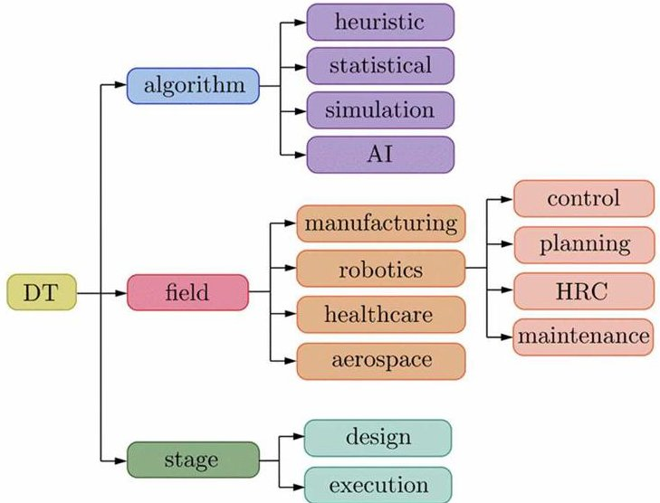
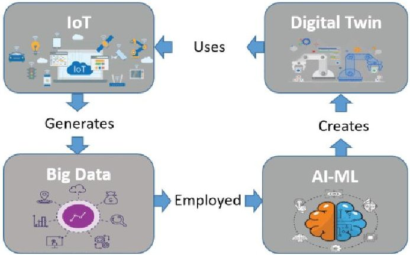

<!-- PDF_PAGE: 1 -->

# Sustainability and Resilience in the MICS SPOKE8 project: the role of the Digital Twin

Nicola Berti

University of Padua ,

Padua, Italy

nicola.berti@unipd.it

Mohsen Zeynivand

Politecnico di Milano,

Milan, Italy

mohsen.zeynivand@polimi.it

Loredana Cristaldi

Politecnico di Milano,

Milan, Italy

loredana.cristaldi@polimi.it

Giambattista Gruosso

Politecnico di Milano,

Milan, Italy

giambattista.gruosso@polimi.it

Ala Arman

Sapienza Università di Roma,

Roma, Italy

arman@diag.uniroma1.it

Laura Boca De Giuli

Politecnico di Milano,

Milan, Italy

laura.bocadegiuli@polimi.it

Luca Martiri

Politecnico di Milano,

Milan, Italy

luca.martiri@polimi.it

Daria Battini

University of Padua,

Padua, Italy

daria.battini@unipd.it

Riccardo Scattolini

Politecnico di Milano,

Milan, Italy

riccardo.scattolini@polimi.it

Pierluigi Plebani

Politecnico di Milano,

Milan, Italy

pierluigi.plebani@polimi.it

Alessio La Bella

Politecnico di Milano,

Milan, Italy

alessio.labella@polimi.it

Eva Masero

Politecnico di Milano,

Milan, Italy

eva.masero@polimi.it

Paolo Rocco

Politecnico di Milano,

Milan, Italy

paolo.rocco@polimi.it

Gian Antonio Susto

University of Padua,

Padua, Italy

gianantonio.susto@unipd.it

Parisa Esmaili

Politecnico di Milano,

Milan, Italy

parisa.esmaili@polimi.it

Devis Bianchini

University of Brescia ,

Brescia, Italy

devis.bianchini@unibs.it

Ambra Galeazzo

University of Padua,

Padua, Italy

ambra.galeazzo@unipd.it

Francesco Leotta

Sapienza Università di Roma,

Roma, Italy

leotta@diag.uniroma1.it

Massimo Mecella

Sapienza Università di Roma,

Roma, Italy

mecella@diag.uniroma1.it

Luigi Salmaso

University of Padua,

Padua, Italy

luigi.salmaso@unipd.it

Letizia Tanca

Politecnico di Milano,

Milan, Italy

letizia.tanca@polimi.it

Abstract—The concept of the Digital Twin (DT) has risen to prominence in parallel with the ongoing digitization initiatives across industries and the rise of Industry 4.0. This innovative approach harnesses a diverse array of cutting-edge technologies, including Artificial Intelligence (AI), Big Data analytics, and the Internet of Things (IoT), to smoothly merge virtual representations with their physical counterparts. Through this integration, organizations can conduct in-depth analysis and make real-time decisions, all backed by data. This transformative fusion of digital and physical fields not only enhances operational efficiency but also opens up new avenues for innovation and value creation within various sectors.

Keywords—Digital twin, Artificial Intelligence, Machine Learning (ML), Big data, Industry 4.0 & 5.0

## I. INTRODUCTION

Within the framework of Industry 4.0 and the imminent transition to Industry 5.0, smart factories stand at the forefront, primed to provide customers with unprecedented opportunities for accessing innovative services and products that boast elevated levels of efficiency, quality, and reliability.

Central to this evolutionary leap is the introduction of novel paradigms that capitalize on the capabilities of industrial IoT, pioneering algorithms, and cloud infrastructure. These transformative advancements serve to extend the value chain by catalyzing the emergence of fresh business models, which not only meet customer needs more effectively but also drive revenue growth for manufacturing enterprises. By leveraging these cutting-edge technologies and reimagining traditional approaches, smart factories are revolutionizing the manufacturing landscape, marking the beginning of an era of unparalleled innovation and value creation for all involved stakeholders [1].

The concept of Digital Twin (DT) is crucial in this evolving scenario. In its largest definition, DT technology is using data streams to create a digital representation of a realworld asset to improve collaboration, information access, and decision-making. Through a combination of simulation technology and data (gathered from sensors, historical records, etc.), a virtual twin of a physical object or process is built in software. In DT technology, the data the physical and virtual twins exchange creates a virtuous cycle that is, the

<!-- PDF_PAGE: 2 -->

physical object's data helps to optimize the twin, and the twin's data helps to optimize the physical object.

DT technology can be adopted at different degrees: whereas digital twins can refer to 3D model of an asset, users can also use it to conceptualize and build fully interactive physics-based models. Moreover, while we could consider a virtual representation of an asset a "digital twin," we could also extend that definition to non-physical objects: financial organizations might use DT technology too, but instead of modeling physical products that will build cars or fly into space, they aim to model things like behaviors, tendencies, and histories. As another example, if a bank wanted to ensure they are not authorizing fraudulent purchases, they might build a "digital twin" of an individual's spending tendencies and history so to identify when the real-life individual is making legitimate purchases and when there's cases of suspected fraud.

The Digital Twin (DT) framework shown in Fig. 1 relies on models that describe the attributes of physical counterpart of the twin and follow their lifecycle mimicking the operation in real time. In practice, a comprehensive DT can be seen as a collection of various models, each tailored for specific targets. These models are evaluated on tools using the data received from the physical counterpart, representing a robust approach to simulate, validate, forecast, and even manage the entire lifecycle of a physical entity.

Fig. 1. Multi-axial classification of digital twins [2].

In this paper, we will outline the vision about DT technology that is being proposed by the authors in the context of a large research project about digital factories and Industry 4.0, with specific focus on sustainability and resilience of manufacturing supply chains.

## II. RELATIONSHIP BETWEEN KET AND DT IN MICS SPOKE8 SCENARIO

Key Enabling Technologies (KETs) as big data, IoT, advanced sensing, artificial intelligence (AI), extended and immersive reality, and blockchain technology, enable realtime linkage between physical devices and virtual models, thus facilitating mutual mapping and dynamic interaction [3][4]. Through the integration of KETs, the implementation of digital twins has progressively become achievable [4], as illustrated in Fig. 2 [2][4]. Research and application fields related to this paradigm are not restricted to the areas reported in Fig.1, but can easily include education, construction, food and agriculture, sports, and many others.

Fig. 2 Relationship between IoT, big data, AI/ML, and digital twins [4].

## A. Human-in-the-loop

The deployment of a DT enables the strategic management of the bidirectional data flow between physical and digital environments to monitor, simulate, predict, and subsequently control the parameters that characterize the investigated system [5]. The first adoptions of this concept in the manufacturing sector have been used to monitor the working conditions of machines with embedded smart sensors connected to the cloud, exploiting the Internet-of-Things (IoT). Companies could significantly increase their production efficiency by reducing the number of unexpected equipment failures. Similarly, interest in continuous monitoring of safety and risk parameters has recently expanded to workers who, like mechanical resources, can be monitored through motion capture systems and biosensor technologies to analyze health conditions and intervene promptly to avoid foreseeable risks [6].

Considering that a core value of the Industry 5.0 trend is placing humans at the center of the production, researchers and practitioners started referring to Human Digital Twin (HDT) as a subsystem of DT technology that includes human beings in the monitoring phase, trying to change the integration of the humans with the system by coupling humans' characteristics directly with the system design [7]. The generation of potentially hazardous health-related working conditions can be assessed by the HDT in different stages of industrial modelling.

The potential of an HDT varies according to its degree of integration into production processes. The adoption of HDT into the design stage allows decision makers to anticipate the generation of potential critical issues for the workforce at the initial strategic decision steps. The automatization process that several companies have begun to follow, increasingly considers the adoption of collaborative robots (also referred as cobots) to exploit all the advantages of the synergies created by the collaboration between the efficiency of robots and the dexterity of operators. The collaborative workstation design process is still one of the biggest challenges for companies today, in fact, incorrect design may lead to additional costs but, above all, it can have consequences on operators' safety due to robot proximity. Therefore, the integration of HDT with Augmented Reality/Virtual Reality (AR/VR) in the design phase of human-robot collaborative settings allows managers to anticipate operator's working conditions and predict the potential occupational and health-related risks. One of the main objectives in human-robot collaboration concerns the optimization of cobot motion planning toward precise control

<!-- PDF_PAGE: 3 -->

and online task execution with respect to ergonomic and safety-oriented key performance indicators (KPIs). To achieve this goal, robot's behavior must adapt in real-time according to the human status, sensed by several sensors such as Inertial Measurement Units (IMU) or surface electromyography (s-EMG) as well as vision technology. Safety and efficiency represent the main trade-off in collaborative settings; therefore, research directions are moving towards the efficient implementation of safety specifications, minimization of the safety intervention through online motion re-planning and real-time monitoring of the operator's pose and ergonomic indexes [8][9].

Aiming to support operational decisions in the execution stage, HDT prioritizes quick selection of good compromises between short-term productivity adjustments (e.g., due to the introduction of urgent orders) and safety level. The reaction time in such scenario represents one of the most valuable factors; hence, solving algorithms adopted to find optimal, or near optimal solutions represent a competitive leverage to increase the chance for companies to rapidly react to unforecastable events or to rapidly changing customers' demand [7].

## B. Blockchain

A supply chain is a complex, global network of different, independent, and linked organizations that work together to create value for customers [10]. On the other hand, blockchain is a distributed technology that allows to suitable and secure transactions of data among the agents participating in the network [11]. In the supply chain management, blockchain technology can be integrated to log the movements of the network as cryptographically linked blocks. In this way, the blockchain can record all the historical activities conducted within the supply chain.

One of the goals of SPOKE8 project is to propose an innovative distributed monitoring supply-chain solution able to set up trusted and efficient data exchange among the organizations and to evaluate whether the agreements among the parties belonging to the supply chain are respected. Trust is supported by a blockchain-based solution which monitors and stores information about the compliance of the running processes.

This is a notable example of the recent concept of Digital Twin of an Organization (DTO) [12], in which processes can be modeled and mined according to a process-oriented approach, based on process mining techniques and the use of process logs. A blockchain can be used as the log-collecting system of the supply chain, which in addition to previously mentioned properties, allows to collect auditable traces of supply chain execution [13].

## C. Large Language Models

Sentiment and semantic analysis are important methodologies to be considered in shaping digital twins strategies, since they can offer deep insights into consumer sentiments and contextual understanding that drive decisionmaking and innovation. Integrating sentiment analysis into twins allows these virtual representations to tap into textual data sources such as customer feedback and social media interactions, providing a pulse on the sentiment surrounding their real-world counterparts. This insight is invaluable for product development, as it offers direct feedback on consumer satisfaction and areas for improvement. For instance, by analyzing product reviews, digital twins can identify recurring

themes and sentiments, guiding decisions on feature enhancements or modifications.

Moreover, semantic analysis equips digital twins with the ability to comprehend the contextual meaning embedded within data associated with physical entities. By analyzing through semantic methods unstructured textual data like maintenance logs and sensor reports, digital twins can glean insights into operational status and performance trends, aiding in predictive maintenance and optimization strategies. The integration of domain-specific knowledge further enhances their ability to interpret complex data streams accurately.

In addition to improving operational efficiency, sentiment and semantic analysis in digital twins have broader implications for sustainable product design. By applying advanced NLP techniques to analyze consumer feedback, digital twins can identify features and attributes that contribute to positive or negative perceptions of a product. Semantic analysis aids in understanding the underlying context, while sentiment analysis quantifies consumer satisfaction trends over time. This holistic approach empowers digital twins to inform product design decisions, prioritize sustainable features, and enhance consumer satisfaction, ultimately driving innovation and meeting evolving market demands.

Furthermore, leveraging NLP and semantic analysis enhances the interaction between digital twins and humans.

State-of-the-art LLMs (Large Language Models) like GPT (Generative Pre-trained Transformer) have revolutionized the field of textual data analysis and adoption and enabled machines to generate coherent and contextually relevant text, facilitating tasks such as document summarization, question answering, and content generation. Through such models and by analyzing natural language commands and queries, digital twins can better understand user intent and preferences, facilitating more intuitive interactions. This is particularly crucial in scenarios like remote monitoring and virtual assistance, where seamless communication is paramount for effective decision-making and operation.

Specifically, we can distinguish between three main categories of flavors of usage of LLMs in these scenarios:

- Usage of sample data, e.g. Tabular QA. Given a a dataset (e.g., a table) and a natural language question, the model then reasons over the table to generate the response. Notable approaches are TAPAS [14], TAPAX [15], Chain-of-Tables [16].

- Usage of external data sources, such as relational databases - Text-to-SQL models, or knowledge graphs - Text-to-SPARQL. Models falling in this category are trained to convert natural language to a query language (e.g. SQL, SPARQL) [17][18][19]; the generated query can then be run against a data source (e.g. RDBMS, KG, etc.); they usually need additional information besides the query, e.g. a database schema.

- Analytics over external data sources. Whereas previous approaches were limited in the data being simple (e.g. sample data) or the use of a single data source (e.g. a database), very recent approaches attempt at considering multiple data sources and at an higher level of abstraction, e.g., generating plots and complex analytics [20][21].

A recent survey on the usage of LLMs for engineering complex information systems [22], discusses the different

<!-- PDF_PAGE: 4 -->

potentialities of such a technology and applications to digital twins and, more generally, to digital factories.

## D. DT of machine tools

Digital twin modeling in the context of machine tools, as a part of manufacturing industries, involves creating a virtual replica or simulation of the components, in this case, the spindle and 3-axis of a computer numerical control (CNC) machine, including the workpiece. This virtual replica is designed to imitate the real-world behavior of the components, both in normal operating conditions and during failure scenarios. The primary objectives of this digital twin are:

- Analyzing performance: the digital twin is utilized to evaluate the performance of the machine tool, mainly focusing on energy consumption during the machining. Manufacturers can identify opportunities for improving energy efficiency by analyzing energy consumption patterns.

- Simulating disturbances and failures: the digital twin introduces disturbances and failures, such as vibrations on bearings, to simulate real-world scenarios where the spindle may encounter issues. This enables manufacturers to assess the spindle's behavior under adverse conditions and identify potential failure modes. Understanding these failure modes is crucial for optimizing maintenance schedules and reducing downtime.

- Synthetic dataset generation: by continuously monitoring and updating the model with real-time data, valuable information can be gathered, as a dataset, about the system's behavior during the machining process. In addition, real-time simulation provides a platform to evaluate different scenarios and strategies without resorting to physical experimentation. The dataset generated by real-time simulation can serve as a valuable resource for further analysis, optimization, and decision-making. Moreover, generating a synthetic dataset requires a fast platform that simplifies data exchange between the actual system and the digital twin model, facilitating real-time system monitoring and enabling dynamic adjustments during evaluation.

To accomplish these tasks effectively, the digital twin model needs to be validated using data collected from actual CNC machining tools. This validation ensures that the virtual replica accurately represents the behavior of the real-world components.

The digital twin model is applied to hardware-in-the-loop (HIL) simulation and OPAL-RT platform to implement the proposed methodology. HIL simulation involves connecting the virtual model to physical hardware, allowing for real-time interaction, and validating the digital twin's performance. Additionally, the model can integrate data from the field, such as sensor readings from the actual CNC machine, and generate profiles using industrial protocols like OPC Unified Architecture (OPC-UA). This integration with real-world data enhances the accuracy and applicability of the digital twin model.

The digital twin modeling for machine tools offers a powerful approach to optimizing performance, predicting failures, and improving energy efficiency in industrial applications. Additionally, the synthetic datasets generated by

the digital twin can be utilized to train machine learning algorithms, further enhancing predictive maintenance and optimization capabilities.

## E. AI-based adaptive MES and DTs

Digital twin technology, coupled with a service-based approach to Industrial APIs and AI-based techniques, allow extending MES - Manufacturing Execution System, to enhance adaptivity in manufacturing processes [23]. A MES is used during the manufacturing phase to coordinate assets by monitoring, tracking, and controlling them. It also deals with functionalities such as quality checks, real-time understanding, system integration, and production programming, by generating the most efficient short-term operation schedule necessary to fulfill the master production plan. Adaptivity represents a vital characteristic in manufacturing environments. The term is part of the Triple-A strategy [24], which includes three conceptual aspects: (i) adaptability that involves modifying process designs to accommodate market changes; (ii) alignment, encouraging collaboration among partners to enhance overall performance; and (iii) agility, which focuses on swiftly responding to shortterm fluctuations in supply or demand. By achieving adaptivity, an adaptive MES aims at improving the orchestration of manufacturing assets, ensuring greater flexibility and responsiveness in dynamic industrial environments. These include software systems, machines, and human operators. Each asset offers a specific set of operational functionalities (i.e., a set of key-actions it is able to perform) and has unique properties, including internal characteristics, costs, and probabilities of failure [25], often derived through digital twins as the ones discussed in previous sections. In such scenarios, the accurate orchestration of these assets to adaptively achieve specific targets is a critical challenge. Further, this orchestration must be dynamic since the internal properties of assets can change over time. For instance, machines may degrade and eventually break down. Additionally, non-trivial constraints between assets further complicate the orchestration process, making manual orchestration impractical. The employment of AI techniques can simplify the orchestration task [25]. Automated Reasoning techniques, such as automated planning and Markov Decision Processes (MDPs), can model these problems using formal languages to find optimal solutions to predefined manufacturing goals. These techniques can achieve various levels of adaptivity in response to unexpected events: (i) local adaptivity by "repairing" the original process instance (instance repair approach), (ii) full adaptivity by replanning a new sub-process instance (instance planning approach), and (iii) policy-based adaptivity by choosing the optimal policy on all possible solutions (policy-based approach).

Accurate orchestration depends on obtaining complete and correct information about the assets. To this end, each manufacturing asset is modeled as a finite-state machine in a service-based approach through a set of services accessible via an Industrial API [26][27]. The properties of the assets are used to form the finite-state machine, which fully encapsulates the state-based nature of the assets and the probabilistic effects underlying their operational functionalities (often computed by the digital twin). Indeed, manufacturing assets typically operate in discrete states, such as ready, broken, and maintenance, and a finite-state machine effectively represents these states and the probabilistic transitions between them, capturing real-world uncertainties like equipment failures or

<!-- PDF_PAGE: 5 -->

variations in performance efficiency. The Industrial API provides endpoints to monitor states, retrieve asset characteristics, and invoke operations. Implementing an Industrial API requires a wrapper software component that serves as the interface to the physical assets and the digital twin and offers API endpoints for the various interactions.

A practical example of such an approach is represented by the tool named AIDA (Adaptive InDustrial APIs) [28]. In this tool, an orchestrator has been developed integrating automated reasoning techniques to fully adaptively orchestrate manufacturing assets through the Industrial APIs via a designed GUI. AIDA can automatically retrieve manufacturing data from ongoing processes, dispatch commands, and monitor unexpected events. When such events occur, AIDA adapts the process based on the employed technique.

## III. CONCLUDING REMARKS

In this paper, the new solutions for Digital Twins (DT) defined for the targets of MICS SPOKE 8 project have been presented. It has been discussed how DT supports the maintenance of the apparatus and the wellbeing of workers, adaptive manufacturing processes and supply chains, also based on blockchains. This empowers sustainable growth and testing of a resilient and flexible manufacturing system in extended value chains.

## ACKNOWLEDGMENTS

This work was carried out within the MICS (Made in Italy - Circular and Sustainable) Extended Partnership and received funding from Next-Generation EU (Italian PNRR - M4 C2, Invest 1.3 - D.D.1551.11-10-2022, PE00000004).

## REFERENCES

[1] M. Grieves, J. Vickers. Digital Twin: Mitigating Unpredictable, Undesirable Emergent Behavior in Complex Systems, Transdisciplinary Perspectives on Complex Systems pp 85-113. Springer 2016

[2] C. Cella, A.M. Zanchettin, P. Rocco. Digital technologies for the design of human-robot collaborative cells. 2023 IEEE International Conference on Metrology for eXtended Reality, Artificial Intelligence and Neural Engineering (MetroXRAINE 2023) IEEE DOI: 10.1109/METROXRAINE58569.2023.10405765

[3] G. Fedorko, V. Molnár, M. Vasil, R. Salai. Proposal of digital twin for testing and measuring of transport belts for pipe conveyors within the concept Industry 4.0, Measurement, vol. 174, 2021

[4] M. Mazhar Rathore, S. A. Shah, D. Shukla, E. Bentafat, S. Bakiras. The Role of AI, Machine Learning, and Big Data in Digital Twinning: A Systematic Literature Review, Challenges, and Opportunities. IEEE Access, vol. 9, 2021 pag 32030-32052

[5] C. Cimino, E. Negri, L. Fumagalli (2019). Review of digital twin applications in manufacturing. Computers in Industry, 113, 103130.

[6] N. Berti, S. Finco. Digital twin and human factors in manufacturing and logistics systems: State of the art and future research directions. IFAC-PapersOnLine, 2022 - Elsevier

[7] N. Berti, S. Finco, M. Guidolin, D. Battini. Towards Human Digital Twins to enhance workers' safety and production system resilience, IFAC-PapersOnLine, 2023- Elsevier

[8] A. M. Zanchettin Human tracking from quantised sensors: An application to safe human-robot collaboration. Control Engineering Practice, 141, 105727 (2023)..

[9] B. Lacevic, Abdalla Rs S. E. M. Newishy, A. M. Zanchettin, P. Rocco Enhanced Performance of Human-Robot Collaboration Using Braking Surfaces and Trajectory Scaling. In 2023 IEEE/RSJ International

Conference on Intelligent Robots and Systems (IROS) (pp. 5942- 5949). IEEE.

[10] H. van der Valka, G. Strobelb, S. Winkelmanna, J. Hunkerc, M. Tomczyka. Supply Chains in the Era of Digital Twins - A Review. International Conference on Industry Sciences and Computer Sciences Innovation. Procedia Computer Science 204 (2022) 156-163.

[11] P. Dutta, T. M. Choi, S. Somani, R. Butala. Blockchain technology in supply chain operations: Applications, challenges and research opportunities Transportation Research Part E: Logistics and Transportation Review Volume 142, October 2020.

[12] G. Park and W. M. P. Van Der Aalst, Realizing a Digital Twin of an Organization Using Action-oriented Process Mining (2021), 3rd International Conference on Process Mining (ICPM), Eindhoven, Netherlands, 2021, pp. 104-111, doi: 10.1109/ICPM53251.2021.9576846.

[13] L. M. M'Baba, M. Sellami, W. Gaaloul, M. F.Nanne. Blockchain logging for process mining: a systematic review. HICSS 2022: 55th Hawaii International Conference on System Sciences, Jan 2022 Hawaii, United States. pp.6197-6206

[14] J. Herzig, P. K. Nowak, T. Müller, F. Piccinno, J. M. Eisenschlos, TaPas: Weakly Supervised Table Parsing via Pre-training. Proceedings of the 58th Annual Meeting of the Association for Computational Linguistics. 2020.

[15] Q. Liu, B. Chen, J. Guo, M. Ziyadi, Z. Lin, W. Chen, Jian-Guang Lou TAPEX: Table Pre-training via Learning a Neural SQL Executor. International Conference on Learning Representations. 2021.

[16] Z. Wang, H. Zhang, Chun-Liang Li, J. M. Eisenschlos, V. Perot, Z. Wang, L. Miculicich, Y. Fujii, J. Shang, Chen-Yu Lee, T. Pfister, Chain-of-Table: Evolving Tables in the Reasoning Chain for Table Understanding. The Twelfth International Conference on Learning Representations. 2023.

[17] T. Yu, M. Yasunaga, K. Yang, R. Zhang, D. Wang, Z. Li, D. Radev, Syntaxsqlnet: Syntax tree networks for complex and cross-domaintext-to-sql task. arXiv preprint arXiv:1810.05237 (2018).

[18] P. Ochieng, PAROT: Translating natural language to SPARQL. Expert Systems with Applications: X 5 (2020): 100024.

[19] Z. Gu, J. Fan, N. Tang, L. Cao, B. Jia, S. Madden, X. Du Few-,shot text-to-sql translation using structure and content prompt learning. Proceedings of the ACM on Management of Data 1.2 (2023): 1-28.

[20] Y. Zhang, Q. Jiang, X. Han, N. Chen, Y. Yang, K. Ren, Benchmarking Data Science Agents. arXiv preprint arXiv:2402.17168 (2024).

[21] A. Parisi, Z. Yao Zhao, F. Noah. Talm: Tool augmented language models. arXiv preprint arXiv:2205.12255 (2022).

[22] M. Mecella, Engineering Information Systems with LLMs and AI-based techniques. Tutorial at CAiSE 2024, LNCS 14663, https://doi.org/10.5281/zenodo.11489177.

[23] F. Bianchini, M. Calamo, F. De Luzi, M. Macri, M. Marinacci, J. Mathew, F. Monti, J. Rossi, F. Leotta, M. Mecella. SAMBA: A reference framework for Human-in-the-Loop in adaptive Smart Manufacturing. International Conference on Industry 4.0 & Smart Manufacturing 2024 - ISM 2024

[24] H.L. Lee, et al. (2004). The triple-a supply chain. Harvard business review 82, 102-113.

[25] F. Monti, L. Silo, F. Leotta, M. Mecella. Services in smart manufacturing: Comparing automated reasoning techniques for composition and orchestration, in: Symposium and Summer School on Service-Oriented Computing 2023, Springer.

[26] T. Catarci, D. Firmani, F. Leotta, F. Mandreoli, M. Mecella, F. Sapio, A conceptual architecture and model for smart manufacturing relying on service-based digital twins. 2019 IEEE International Conference on Web Services (ICWS).

[27] F. Monti, L. Silo, F. Leotta, M. Mecella, On the suitability of AI for service-based adaptive supply chains in smart manufacturing. 2023 IEEE International Conference on Web Services (ICWS).

[28] G. De Giacomo; M. Favorito, F. Leotta M. Mecella, F. Monti, L. Silo, AIDA: a tool for resiliency in smart manufacturing. International Conference on Advanced Information Systems Engineering (CAiSE 2023