<!-- PDF_PAGE: 1 -->

INSTRUMENTS AND MISSIONS

ADRIANO CAMPS $ ^{ID} $ , JOAN FRANCESC MUNOZ-MARTIN $ ^{ID} $ , JOAN ADRIÀ RUIZ-DE-AZUA $ ^{ID} $ LARA FERNANDEZ $ ^{ID} $ , ADRIAN PEREZ-PORTERO $ ^{ID} $ , DAVID LLAVERÍA $ ^{ID} $ , CHRISTOPH HERBERT $ ^{ID} $ MIRIAM PABLOS $ ^{ID} $ , ALESSANDRO GOLKAR $ ^{ID} $ , ANTONIO GUTIÉRREZ, CARLOS ANTÓNIO, JORGE BANDEIRAS, JORGE ANDRADE, DAVID CORDEIRO, SIMONE BRIATORE, NICOLA GARZANITI $ ^{ID} $ FABIO NICHELE, RAFFAELE MOZZILLO, ALESSIO PIUMATTI, MARGHERITA CARDI, MARCO ESPOSITO, CHRIS VAN DIJK, NATHAN VERCRUYSSEN, JOAO BARBOSA, JOHN HEFELE, RICK KOELEMAN, BERNARDO CARNICERO DOMINGUEZ, MASSIMILIANO PASTENA $ ^{ID} $ GIANCARLO FILIPPAZZO, AND AMANDA REAGAN

# FSSCat: The Federated Satellite Systems $ ^{3} $Cat Mission

Demonstrating the capabilities of CubeSats to monitor essential climate variables of the water cycle

The Federated Satellite Systems/ $ ^{3} $ Cat-5 (FSSCat) mission was the winner of the European Space Agency (ESA) Sentinel Small Satellite $ ^{3} $ Challenge and overall winner of the 2017 Copernicus Masters competition. It consisted of two six-unit CubeSats. The Earth observation payloads were 1) the Flexible Microwave Payload 2 (FMPL-2) onboard $ ^{3} $ Cat-5/A, an L-band microwave radiometer and GNSS reflectometer (GNSS-R) implemented using a software-defined radio (SDR), and 2) the HyperScout-2 onboard $ ^{3} $ Cat-5/B, a hyperspectral camera, with the first experiment using artificial intelligence to discard cloudy images. FSSCat was launched on 3 September 2020 and injected into a 535-km synchronous orbit. $ ^{3} $ Cat-5/A was operated for three months until the payload was probably damaged by a solar flare and coronal mass ejection. During this time, all scientific requirements were met, including the generation of coarse-resolution and downscaled soil moisture (SM) maps, sea ice extent (SIE) maps, concentration and thickness maps, and even wind speed (WS) and sea surface salinity (SSS) maps, which were not originally foreseen. $ ^{3} $ Cat-5/B was operated a few more months until the number of images acquired met the requirements. This article briefly describes the FSSCat mission and the FMPL-2 payload and summarizes the main scientific results.

## INTRODUCTION

The FSSCat mission was the winner of the 2017 ESA $ S^{3} $ Challenge and overall winner of the Copernicus Masters competition. FSSCat was proposed by the Universitat Politiccnica de Catalunya (UPC), and it consisted of two six-unit CubeSats, which were successfully launched on 3 September 2020 on the Vega Small Satellite Mission Service PoC, flight VW16. The two spacecraft, $ ^{3} $Cat-5/A [international designation: 2020-061 W; North American Aerospace Defense Command (NORAD) ID: 46292] and $ ^{3} $Cat-5/B (international designation: 2020-061X; NORAD ID: 46293) were in a $ 97.4^{\circ} $inclination sun-synchronous orbit, with a perigee of 535 km and an apogee of 538 km. The mission's primary goals were the generation of 1) coarse-resolution SM maps and SIE and thickness maps, using L-band microwave radiometry and GNSS reflectometry; 2) downscaled SM maps, by combining passive microwave and multispectral optical data; and 3) testing communication techniques for future satellite federations. Secondary goals were the generation of SSS and WS maps.

$ ^{3} $Cat-5/A carried FMPL-2 [1], designed and implemented by the UPC. FMPL-2 inherited the concept of the Passive Advance Unit instrument, combining an L-band microwave radiometer and a GNSS-R in a single instrument [2]. $ ^{3} $Cat-5/B carried the HyperScout-2 hyperspectral imager, with a $ 3 1 \times1 6^{\circ} $ field of view [3]. HyperScout-2 included two channels: channel 1, in the visible and near infrared, with $ 4,000 \times $ 1,850 pixels; 45 bands, from 400 to 1,000 nm; and a spectral resolution of 16 nm, and channel 2, in the thermal infrared, with $ 1,024 \times7 6 8 $ pixels; three bands, from 8 to 14 $ \mu\mathrm{m} $ ; and spectral resolutions of 1,100 nm in the first two bands and 6,000 nm in the third one. HyperScout-2 had augmented processing performance by using the PhiSat-1 board experiment, featuring the new Myriad 2 artificial intelligence chip, which improves data processing capabilities for hyperspectral imagery [4]. In addition, both CubeSats included an optical intersatellite link from Gölbriak Space, and an ultrahigh-frequency intersatellite link demonstrator from the UPC to test the concept of satellite federations.

Thanks to the background and previous experience of the teams, this challenging mission was implemented in just 1.5 years. In addition to the UPC and Gölbriak, Deimos Engenharia was the prime contractor of the

<!-- PDF_PAGE: 2 -->

mission and responsible for the data processing ground segment; Tyvak International was the platform provider, system integrator, CubeSat deployer, launch interface provider, and operations manager; and the ESA Earth Observation Program, which initiated the $ S^{3} $ Challenge, provided technical and program advice and expertise, the funding scheme, and access to ESA testing facilities.

Two weeks after launch, the commissioning phase of $ ^{3} $ Cat5/A was declared successful. The FMPL-2 payload was first executed on 14 September 2020. The payload commissioning lasted 10 days, and it was formally finalized on 25 September 2020. During these first days, the instrument was successfully executed eight times over the North Pole, providing quality radiometric measurements at the L band and GNSS-R measurements that were used to calibrate and tune the configuration of the instrument. The data showed an absolute accuracy of the FMPL-2 radiometer of better than $ \sim 0. 5 $ K, and the radiometric sensitivity was estimated to be $ \sim 0. 2 $ K over the ocean and $ \sim 0. 5 $ K over land, for an integration time of 100 ms [5]. The long-term stability was also estimated in [5, Fig. 10] as $ < 0. 5 $ K over 12 days.

Then, the instrument entered into nominal operations, being executed over the poles, following a five-day basis: five days in a row over the North Pole, at latitudes >55 $ ^{\circ} $ and five days in a row over the South Pole, at latitudes of less than $ -55^{\circ} $ . The minimum latitude was decreased to $ 45^{\circ} $ after one month of the mission and finally to $ 35^{\circ} $ thanks to a positive power budget and the downlink capability of $ ^{3} $ Cat-5/A data at the UPC S-band ground station at the Observatori Astronòmic del Montsec, owned and operated by the Institut d'Estudis Espacials de Catalunya [6]. FMPL-2 was operated until 4 December 2020 when, after the three months of operations originally planned, the spacecraft could no longer communicate with the payload, which could have been damaged by the solar flare and coronal mass ejection that occurred on 29 November 2020, the most powerful of their types to that point in solar cycle 25 [7]. This article describes the FMPL-2 payload architecture and presents its main scientific results obtained during the three months of operation [8].

## FLEXIBLE MICROWAVE PAYLOAD 2: A NOVEL SOFTWARE-DEFINED RADIO-BASED HYBRID L-BAND RADIOMETER AND GNSS REFLECTOMETER

FMPL-2 was a combined L-band microwave radiometer and GNSS-R implemented using a Zynq-7000 SDR [1] (see Figure 1). L-band microwave radiometry can be used to infer surface SM and sea ice thickness (SIT) up to $ \sim 6 0 $ cm [9]. Downscaled SM maps can be generated using validated algorithms developed for the ESA Soil Moisture and Ocean Salinity (SMOS) mission, using visible and near infrared data [10]. Figure 2(a) shows the radio-frequency (RF) front end block diagram of FMPL-2. The upper branch was connected to the right-hand circular polarization up-looking antenna to pick the direct GNSS signal used as a reference (output I1) and was connected to the GNSS receiver. The

lower branch was connected to a six-dual-band left-hand circular polarization (LHCP) down-looking antenna array [Figures 1(b) and 2(b)] to pick the reflected GNSS signals (GPS and Galileo) at 1,575 MHz and the radiometric signal at 1,413 MHz.

From 535 km, the footprint of the down-looking antenna was $ 3 5 0 \times 5 0 0 \mathrm{k m} $ . The input of the second branch could be selected among the down-looking antenna, an active cold load, and a matched load for the internal absolute calibration of the microwave radiometer. Since the two receiver inputs of the Zynq-7000 had to be at the same frequency, a transmitter output was used as a local oscillator of the I2 branch. An integration time of 100 ms was selected for the microwave radiometer, as the radiometric sensitivity ( $ \sim0.2 $ K) was enough to compensate for the WS effects of the brightness temperatures (BTs) over the ocean. This custom-made RF front end [Figure 2(c)] was manufactured by Balamis, a UPC spin-off company.

A GNSS-R can be understood as a multistatic radar with as many transmitters as there are navigation satellites in view, and raw data can typically be processed as a scatterometer, but they can also be processed as an altimeter and even as an unfocused synthetic aperture radar. The most general GNSS-R observable is the so-called delay Doppler map (DDM), which in the so-called conventional GNSS-R is computed from the complex cross correlation of the reflected GNSS signal with a locally generated replica of the transmitted GNSS signal for different Doppler frequencies and delay bins [11]. The GNSS-R is very sensitive to the parameters of the surface where the scattering is taking place, and the peak and shape of the DDM contains information on the reflectivity itself and the mean-square slopes of the surface where the scattering is taking place. Over the ocean, the DDM is much more spread out, both in the delay and Doppler frequency domains, than it is over sea ice and land [11], and this spread can be related to, e.g., WS (e.g., [12], [13], and [14]), although it is affected by swell, rain, and other effects. To optimize the spatial resolution for SIE detection, the GNSS-R incoherent integration time was set to 40 ms so that the blurring induced by the subsatellite point movement was about the size of the first Fresnel zone ( $ \sim 3 0 0 $ m), i.e., the spatial resolution under coherent scattering conditions [15], [16].

## SCIENTIFIC DATA PROCESSING

Five scientific products have been obtained using artificial neural networks (ANNs) that have been trained using different input variables for each product and "ground truth" as the output.

## SOIL MOISTURE

SM was retrieved using a two-hidden-layer feedforward ANN with seven neurons in each layer. The input variables were the land surface temperature [the fifth major global reanalysis produced by the European Center for Medium-Range Weather Forecast, ECMWF (ERA5) skin temperature from

<!-- PDF_PAGE: 3 -->

ECMWF, with a 30-km resolution]; the red and near-infrared bands of multispectral images or the normalized difference vegetation index from, e.g., the NASA Moderate Resolution Imaging Spectroradiometer, at 9- and 36-km spatial resolutions, aggregating to an original 1-km spatial resolution product; and the FMPL-2 LHCP L-band BTs from the nadirlooking antenna. The ANN was trained with 60% of the data to avoid overfitting, using the 36-km NASA Soil Moisture Active Passive mission SM product, and the training was interrupted after 20 epochs.

Figure 3(a) provides a sample SM map produced over a week. Figure 3(b) displays the scatter plot of the soil SMAP moisture values and the FMPL-2/ANN-retrieved ones. The $ R^{2} $ coefficient was 0.8, and the standard deviation of the error with respect to the SMAP product was 9.2% , which was $ \sim 2-2.5 $ times larger than the $ \sim 4\% $ accuracy quoted for SMOS SM products. The interested reader is referred to [17] for further details.

## SEA ICE CONCENTRATION/EXTENT

Sea ice concentration (SIC) maps were generated using L-band microwave radiometry and/or GNSS-R data. Two regression-fit ANNs were used for each data source, with

three hidden layers of five, ten, and five neurons each and five and eight input variables, respectively. The L-band microwave radiometry ANN was trained using OSI SAF [18] sea ice cover or the National Snow and Ice Data Center ground truth as a target output, and FMPL-2 BTs, the along-track standard deviation and gradient of the BTs, the ERA 5 skin temperature from ECMWF, and the land cover fraction (as a percentage) were used as input variables. For the GNSS-R, the inputs were the FMPL-2 BTs, averaged DDM, reflectivity, standard deviation of the reflectivity, DDM signal-to-noise ratio, elevation angle of the reflected signal, land cover fraction within an area larger than the antenna footprint, and ERA 5 skin temperature. All variables were bilinearly interpolated to the GNSS-R specular reflection points, and the FMPL-2 BTs were needed to improve the performance of the network. Both networks were trained using $ \sim 1 5, 0 0 0 $ random samples for each pole, and they were validated using $ \sim 5, 0 0 0 $ random samples for each pole.

SIE maps were generated using a binary classification ANN with only one hidden layer with 10 neurons. Figure 4 gives sample SIE and SIC maps for the

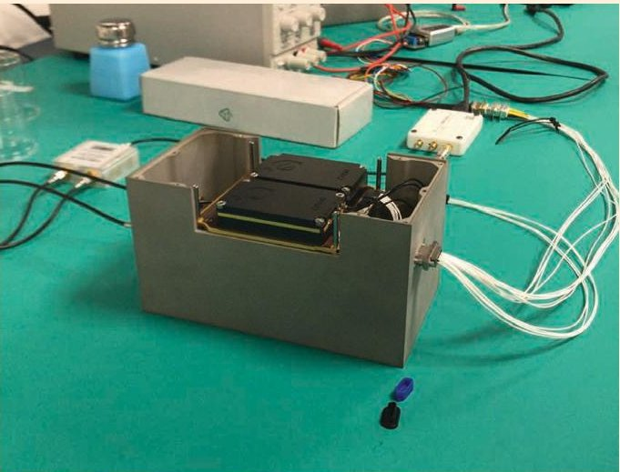

(a)

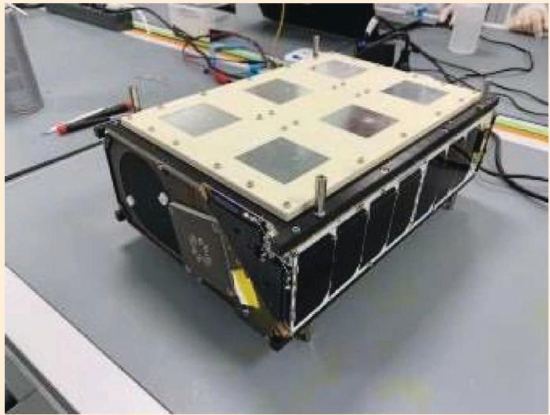

(b)

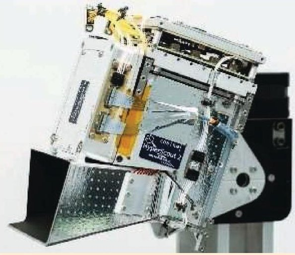

(c)

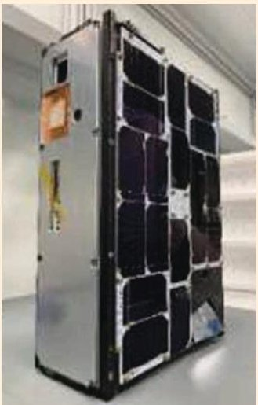

(d)

FIGURE 1. The (a) FMPL-2 combined microwave radiometer and GNSS-R, (b) $ ^{3} $Cat-5/A (NORAD ID: 46292) and dual-band nadir-looking antenna, (c) HyperScout-2, and (d) $ ^{3} $Cat-5/B (NORAD ID: 46293), with the HyperScout-2 baffle at the bottom-right corner.

<!-- PDF_PAGE: 4 -->

Arctic and Antarctica, derived with the FMPL-2. The performance of these ANNs is summarized in Table 1. As evident in Figure 4(a) and (b), although the GNSS-R reflectivity was available only over the specular reflection points, its variations offer a finer granularity of the SIE that is not captured by the microwave radiometry

data. Figure 4(c) shows the temporal evolution of the SIE during October and November. Note that, as compared to OSI SAF "ground truth," the error is smaller than 6% which is comparable to the errors among different SIE products. The interested reader is referred to [19] for further details.

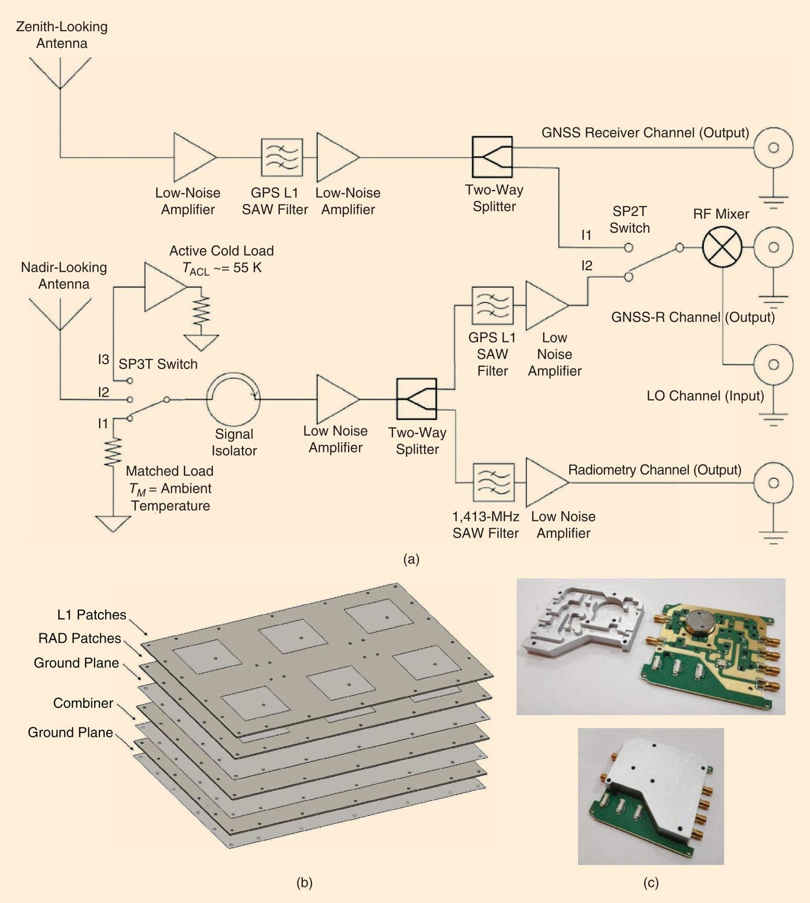

FIGURE 2. (a) The FMPL-2 payload radio-frequency (RF) front end. The first connector on the right-hand side goes to a navigation receiver, the second one is an input of an SDR (receiver 1), the third one is a transmitter channel (transmitter 1) used as local oscillator, and the fourth one is the second input of the SDR (receiver 2) (adapted from [1]). (b) The down-looking antenna. (c) The RF front end (Source: Balamis; used with permission). SAW: surface acoustic wave; LO: local oscillator; RAD: microwave radiometer.

<!-- PDF_PAGE: 5 -->

## SEA ICE THICKNESS

SIT maps were generated using a predictive regression model deep NN (DNN) with a normalization layer, two hidden dense nonlinear layers with 64 neurons each, and one linear single-output layer. The input variables were the FMPL-2 BTs, the ERA 5 skin temperature from ECMWF, and the OSI SAF OSI-401-b SIC product. Since the only SIT "ground truth" data available were those generated by the SMOS mission, they were the training output variable that was used.

Figure 5(a) and (b) present some results for the Arctic and Antarctica, respectively. Figure 5(c) is a scatter plot of the SMOS-derived SIT used as ground truth, and the FMPL-2/DNN-derived SIT. Good agreement is found up to a ~50-cm SIT. Beyond ~50 cm, the sea ice is too thick to "see" the sea water and be able to quantify the ice thickness

impact in the BTs. Figure 5(d) has a mean absolute error (MAE) histogram showing a nearly unbiased SIT prediction with a standard deviation of just 6.5 cm, just slightly larger than the SMOS one. The interested reader is referred to [20] for further details.

## WIND SPEED

WS is a proxy for sea state roughness, and it has to be precisely estimated to retrieve the SSS. To do that, the correlation with other geophysical variables was first studied. As expected, the GNSS-R data presented a very small correlation with respect to the sea surface temperature (SST) and a negative correlation ( $ \sim-0.25 $ ) with respect to the WS and SSS, although this last correlation may be also influenced by geographical effects (i.e., higher WSs at higher latitudes with a lower SSS). A slightly larger correlation $ \sim-0.3 $

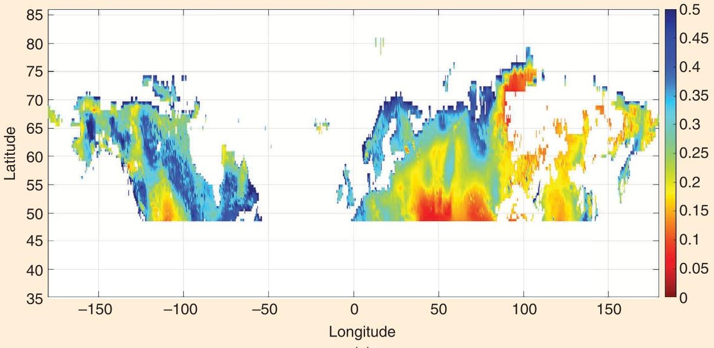

(a)

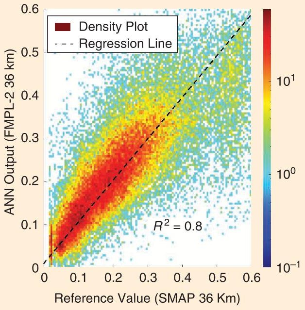

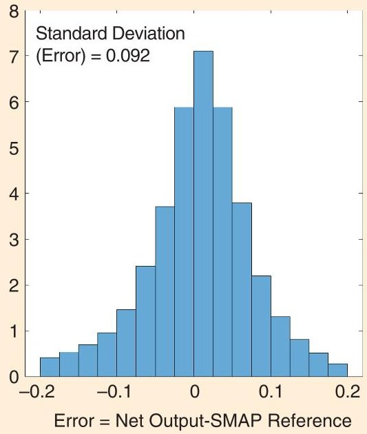

(b)

FIGURE 3. The (a) weekly average SM map derived from FMPL-2 using an ANN, with data from a spatiotemporal-averaged map from 1 October 2020, and (b) error statistics (from [17]).

<!-- PDF_PAGE: 6 -->

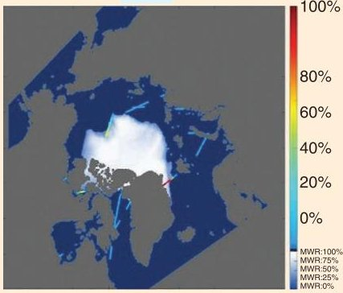

(a)

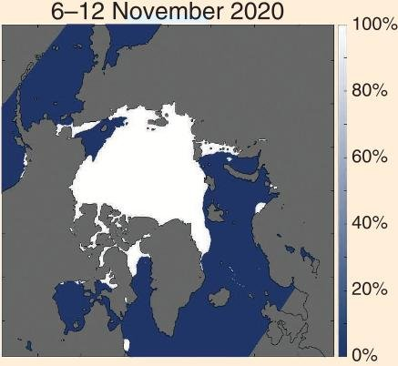

(b)

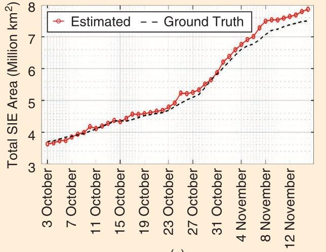

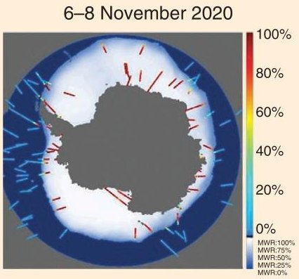

(c)

(d)

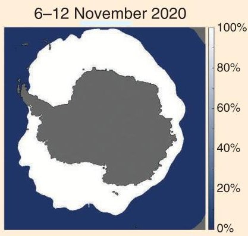

(e)

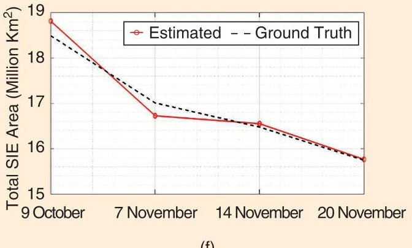

(f)

FIGURE 4. Sample SIE (a) -(d), and SIC maps (b)-(e) for the Arctic Ocean (a)-(b) and Antarctica (d)-(e), as derived from FMPL-2, and corresponding temporal evolution during October and November (c)-(f). Error is < 6% when compared to OSI SAF "ground truth" (adapted from [19]). Jet colorbar indicates GNSS-R reflectivity, bone colorbar indicates fractional coverage.

was also found between the moving standard deviation of the reflectivity $ (\Gamma) $ and WS product. Finally, the L-band BTs exhibited a small correlation with respect to the WS, SST, and SSS.

When trying to retrieve the WS from FMPL-2 data, several ANNs were tested. The training process followed the same approach as for the others: the data were randomly split into 20% for training and 80% for testing. It was found that, for low WSs, the GNSS-R data performed better than the L-band BTs and vice-versa. Therefore, the WS estimate was significantly better when combining both the GNSS-R and L-band BTs. However, the best results were obtained with an ANN that included the SST and SSS data, as well. In this case, the correlation coefficient increased to $ R^{2}=0.89 $ , and the root-mean-square error (RMSE) reduced to 1.68 m/s. The interested reader is referred to [21] for further details.

## SEA SURFACE SALINITY

SSS maps were generated using an ANN topology with two hidden layers, with

eight neurons each. The SSS can be derived from L-band microwave radiometry data, but the SSS signature is easily hidden by sea surface roughness effects. Therefore, the best SSS results were achieved when combining L-band BTs, SST, and GNSS-R data (reflectivity, the moving standard deviation of the reflectivity, and the elevation angle of the reflected signal served as a proxy for sea surface roughness). The ANN was trained using 20% of the available points and the SMOS SSS maps, as they are the only existing ones, and the other 80% of the data was used for testing. Figure 6 provides sample results

TABLE 1. A SUMMARY OF THE PERFORMANCE OF THE SIC AND SIE ANNS.

<table border="1"><tr><td></td><td></td><td colspan="2">ARCTIC</td><td colspan="2">ANTARCTIC</td></tr><tr><td colspan="2">ERRORS WITH RESPECT TO OSI SAF PRODUCTS</td><td>SIC</td><td>SIE</td><td>SIC</td><td>SIE</td></tr><tr><td rowspan="4">MWR error</td><td>Global</td><td>2.37%</td><td>1.95%</td><td>5.55%</td><td>3.57%</td></tr><tr><td>Ice areas(SIC&gt;90%)</td><td>2.87%</td><td>0.02%</td><td>5.25%</td><td>0.21%</td></tr><tr><td>Water areas(SIC=0%)</td><td>1.05%</td><td>1.52%</td><td>2.35%</td><td>2.9%</td></tr><tr><td>Transition areas(0&lt;SIC&lt;90%)</td><td>11.27%</td><td>8.5%</td><td>11.3%</td><td>7.33%</td></tr><tr><td>GNSS-R error</td><td></td><td>2.8%</td><td>1.1%</td><td>2.29%</td><td>1%</td></tr><tr><td colspan="6">MWR: microwave radiometer.</td></tr></table>

<!-- PDF_PAGE: 7 -->

of the retrieved SSS, ground truth, and error maps over the Arctic, Antarctica, with error statistics; the SMOS SSS ground truth-FMPL-2 ANN SSS scatter plot; and the MAE histogram.

In one overpass, the SSS RMSE was 0.43 practical salinity unit (PSU), while SMOS SSS maps have a nominal error of 0.1 PSU every $ 1 0 0 \times1 0 0 $ km and every month. Assuming that the errors follow a normal distribution and are uncorrelated, the RMSE averages with the square root of the amount of data averaged, so homogenizing the revisit times and spatial resolutions the FMPL-2 SSS RMSE averaged over one month would be $ \sim0. 4 3 $ PSU/$ \sqrt{3 0} \approx0. 0 8 $ PSU, while the SMOS SSS RMSE over a $ 3 5 0 \times5 0 0 $ -km pixel would be 0.1 PSU// $ \sqrt{(3. 5 \times5)} \approx0. 0 2 4 $ PSU; that is, the FMPL-2 SSS RMSE is roughly four times larger than that of SMOS. The interested reader is referred to [21] for further details.

## CONCLUSION

The FSSCat mission and the main scientific results of the FMPL-2 combined microwave radiometer and GNSS-R payload onboard the $ ^{3} $Cat-5/A spacecraft have been presented. A number of climate variables associated to the water cycle have been presented: SM, downscaled using visible

and near-infrared data; SIC, including extent and thickness; sea surface WS; and sea salinity. FSSCat was the first ESA Third Party Mission based on CubeSats [22], and all data are freely available at https://catalogue.nextgeoss.eu/. The mission was implemented in a record time (1.5 year), although its launch was delayed one more year due to Vega 15 explosion and the COVID-19 lockdown of the Kourou spaceport.

FSSCat has shown the potential of small satellites to conduct valuable science missions, either as gap fillers between high-end missions or simply to reduce the revisit time by forming satellite constellations with slightly worse performance than full-fledged missions but at a fraction of the cost (e.g., $ ^{3} $Cat-5/A with FMPL-2 cost $ \sim $US$1.5 million including the launch; SMOS was $ \sim $US$315 million, and SMAP was $ \sim $US$915 million). Because of the mass, volume and power limitations, the achievable performance cannot match that of full-fledged high-end missions, but the data accuracy can be improved by cross calibration with data from coetaneous large high-end satellites. For example, a CubeSat-based constellation of eight satellites embarking with an FMPL-2-like payload would, on a daily basis, allow

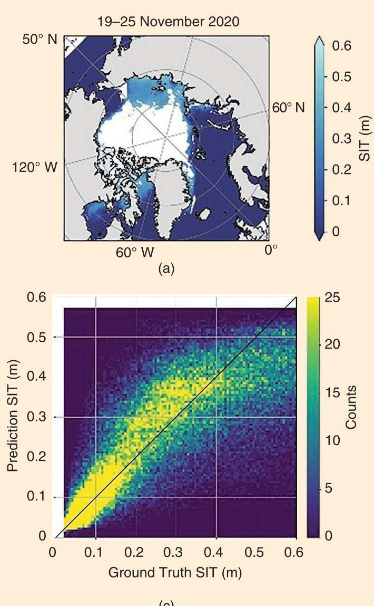

(c)

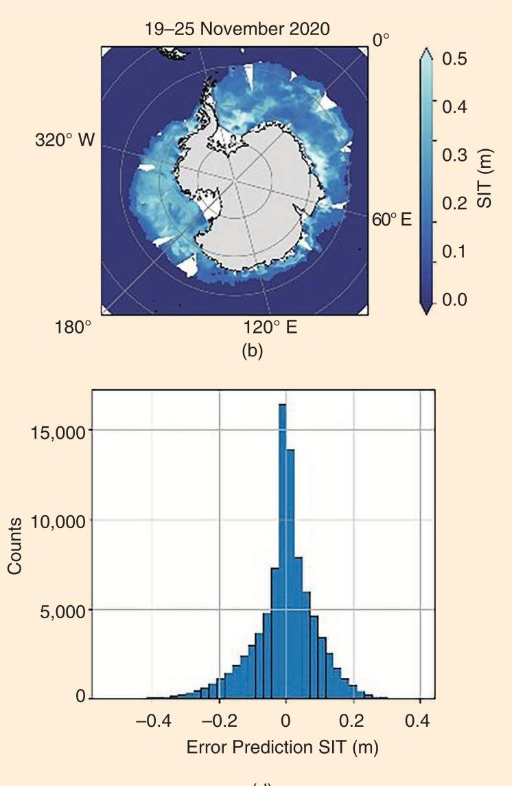

(d)

FIGURE 5. Sample SIT maps over (a) the Arctic Ocean and (b) Antarctica, with error statistics: the (c) SMOS SIT ground truth/FMPL-2 DNN SIT scatter plot and (d) mean absolute error histogram (from [20]).

<!-- PDF_PAGE: 8 -->

entirely covering all latitudes above $ + 4 5^{\circ} \mathrm{N} $ , with enough footprint oversampling to retrieve SM products daily [16], while the revisit time of SMOS is ~three days at the equator.

$ ^{3} $Cat-5/B also implemented the first artificial intelligence processor in space [3], [4] to download only cloudfree imagery. It is foreseen that constellations of intelligent Earth observation sensors, acquiring and downloading

only useful data, and interconnected satellites, to share resources and reduce latency, will be able to provide global near-real-time data for the upcoming digital twins of Earth.

## ACKNOWLEDGMENT

This work was supported by the 2017 ESA $ ^{3} $ challenge and Copernicus Masters overall winner award (FSSCat project)

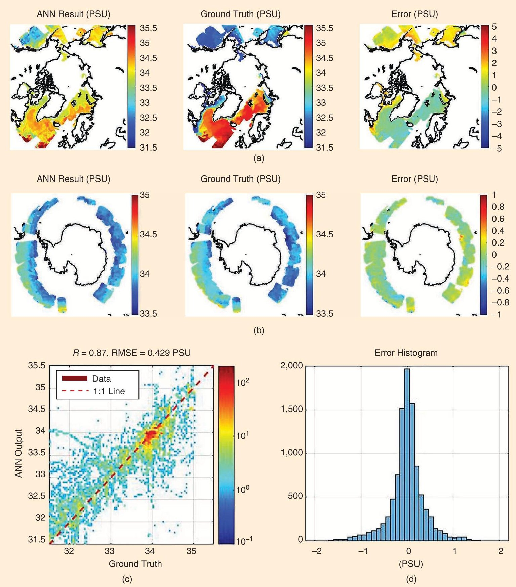

FIGURE 6. Sample retrieved, ground truth, and SSS error maps over (a) the Arctic Ocean and (b) Antarctica, with error statistics: the (c) SMOS SSS ground truth/FMPL-2 ANN SSS scatter plot and (d) MAE histogram (from [21]). PSU: practical salinity unit.

<!-- PDF_PAGE: 9 -->

and ESA project FSSCat Validation Experiment in MOSAIC; Spanish Ministry of Science, Innovation, and Universities Sensing With Pioneering Opportunistic Techniques grant RTI2018-099008-BC21/AEI/10.13039/501100011033; GNSS Environmental and Societal Missions grant PID2021- 126436OB-C21; and Unidad de Excelencia Maria de Maeztu grant MDM-2016-0600.

## AUTHOR INFORMATION

Adriano Camps (adriano.jose.camps@upc.edu) is with Universitat Politiccnica de Catalunya, E-08034 Barcelona, Spain; Institut d'Estudis Espacials de Catalunya, E-08034 Barcelona, Spain; and United Arab Emirates University, Abu Dhabi, United Arab Emirates.

Joan Francesc Munoz-Martin (joan.francesc.munoz martin@upc.edu) is with is with Universitat Politecnica de Catalunya, E-08034 Barcelona, Spain, and the Jet Propulsion Laboratory, California Institute of Technology, Pasadena, CA 91109-8001 USA.

Joan Adrià Ruiz-de-Azua (joan.adria@tsc.upc.edu) is with Universitat Politècnica de Catalunya, E-08034 Barcelona, Spain, and i2Cat, The Internet Research Center, E-08034 Barcelona, Spain.

Lara Fernandez (lara.fernandez.c@upc.edu) is with Universitat Politiccnica de Catalunya, E-08034 Barcelona, Spain.

Adrian Perez-Portero (adrian.perez.portero@upc.edu) is with Universitat Politècnica de Catalunya, E-08034 Barcelona, Spain.

David Llaveria (david.llaveria@upc.edu) is with Universitat Politècnica de Catalunya, E-08034 Barcelona, Spain.

Christoph Herbert (christoph.josef.herbert@upc.edu) is with Universitat Politiccnica de Catalunya, E-08034 Barcelona, Spain.

Miriam Pablos (mpablos@icm.csic.es) is with Institut de Ciencies del Mar, E-08034 Barcelona, Spain, and the Barcelona Expert Center on Remote Sensing, E-08034 Barcelona Spain.

Alessandro Golkar (a.golkar@skoltech.ru) is with the Department of Aerospace and Geodesy, Technical University of Munich, D-80333 Munich, Germany, and Universitat Politecnica de Catalunya, E-08034 Barcelona Spain.

Antonio Gutiérrez (antonio.gutierrez@deimos.com.pt) is with Deimos Engenharia, P-1990 Lisbon, Portugal.

Carlos António (carlos.antonio@deimos.com.pt) is with Deimos Engenharia, P-1990 Lisbon, Portugal.

Jorge Bandeiras (jorge.bandeiras@deimos.com.pt) is with Deimos Engenharia, P-1990 Lisbon, Portugal.

Jorge Andrade (jorge.andrade@deimos.com.pt) is with Deimos Engenharia, P-1990 Lisbon, Portugal.

David Cordeiro (david.cordeiro@deimos.com.pt) is with Deimos Engenharia, P-1990 Lisbon, Portugal.

ing, Cranfield University, Cranfield, MK43 0AL Bedfordshire, U.K., and Golbriak Space, Tallin, Estonia.

Simone Briatore (briatore@golbriak.space) is with Golbriak Space, 12618 Tallin, Estonia.

Fabio Nichele (fabio@tyvak.eu) is with Tyvak International, I-10149 Torino, Italy.

Nicola Garzaniti (nicola.garzaniti@cranfield.ac.uk) is with the School of Aerospace, Transport, and Manufactur-

Alessio Piumatti (alessio.piumatti@tyvak.eu) is with Tyvak International, I-10149 Torino, Italy.

Raffaele Mozzillo (raffaele@tyvak.eu) is with Tyvak International, I-10149 Torino, Italy.

Margherita Cardi (margherita@tyvak.eu) is with Tyvak International, I-10149 Torino, Italy.

Marco Esposito (m.esposito@cosine.nl) is with Cosine NL-2171 AH Sassenheim, The Netherlands.

Chris van Dijk (c.vandijk@cosine.nl) is with Cosine, NL 2171 AH Sassenheim, The Netherlands.

Nathan Vercruyssen (n.vercruyseen@cosine.nl) is with Cosine, NL-2171 AH Sassenheim, The Netherlands.

Joao Barbosa (j.barbosa@cosine.nl) is with Cosine, NL 2171 AH Sassenheim, The Netherlands.

John Hefele (j.hefele@cosine.nl) is with Cosine, NL-2171 AH Sassenheim, The Netherlands.

Rick Koeleman (r.koeleman@cosine.nl) is with Cosine NL-2171 AH Sassenheim, The Netherlands.

Bernardo Carnicero Dominguez (bernardo.carnicero. dominguez@esa.int) is with the European Space Research and Technology Center, European Space Agency, NL-2200 AG Noordwijk, The Netherlands.

Massimiliano Pastena (massimiliano.pastena@esa.int) is with the European Space Research and Technology Center, European Space Agency, NL-2200 AG Noordwijk, The Netherlands.

Giancarlo Filippazzo (giancarlo.filippazzo@esa.int) is with the European Space Research Institute, European Space Agency, I-00044 Frascati (RM), Italy.

Amanda Reagan (amanda.reagan@esa.int) is with the European Space Research Institute, European Space Agency, I-00044 Frascati (RM), Italy.

## REFERENCES

[1] J. F. Munoz-Martin, L. F. Capon, J. A. Ruiz-de-Azua, and A. Camps, "The flexible microwave payload-2: ASDR-based GNSS-reflectometer and L-band radiometer for CubeSats," IEEE J. Sel. Topics Appl. Earth Observ. Remote Sens., vol. 13, pp. 1298-1311, 2020, doi: 10.1109/JSTARS.2020.2977959.

[2] A. Camps, X. Bosch-Lluis, I. Ramos-Perez, J. F. Marchan-Hernandez, B. Izquierdo, and N. Rodriguez-Alvarez, "New instrument concepts for ocean sensing: analysis of the PAUradiometer," IEEE Trans. Geosci. Remote Sens., vol. 45, no. 10, pp. 3180-3192, Oct. 2007, doi: 10.1109/TGRS.2007.894925.

[3] HyperScout-2. Accessed: Sep. 11, 2022. [Online]. Available: https://www.cosine.nl/cases/hyperscout-2/

[4] G. Giuffrida et al., "The $ \Phi $ -Sat-1 mission: The first on-board deep neural network demonstrator for satellite earth observation," IEEE Trans. Geosci. Remote Sens., vol. 60, pp. 1-14, 2022, Art no. 5517414, doi: 10.1109/TGRS.2021.3125567.

[5] J. F. Munoz-Martin et al., "In-orbit validation of the FMPL-2 instrument—The GNSS-R and L-band microwave radiometer

<!-- PDF_PAGE: 10 -->

payload of the FSSCat mission," Remote Sens., vol. 13, no. 1, p. 121, 2021, doi: 10.3390/rs13010121.

[6] "NanoSatLab." UPC. Accessed: Sep. 11, 2022. [Online]. Available: https://nanosatlab.upc.edu/en/facilities-folder/ground -segment

[7] "Powerful solar flare, coronal mass ejection occur on November 29," National Association for Amateur Radio, Newington, CT, USA, 2020. Accessed: Sep. 11, 2022. [Online]. Available: https:// www.arrl.org/news/view/powerful-solar-flare-coronal-mass ejection-occur-on-november-29

[8] A. Camps et al., "FSSCat mission description and first scientific results of the FMPL-2 onboard 3CAT-5/A," in Proc. 2021 IEEE Int. Geosci. Remote Sens. Symp. IGARSS, pp. 1291-1294, doi: 10.1109/ IGARSS47720.2021.9554589.

[9] L. Kaleschke et al., "SMOS sea ice product: Operational application and validation in the Barents Sea marginal ice zone," Remote Sens. Environ., vol. 180, pp. 264-273, Jul. 2016, doi: 10.1016/j.rse.2016.03.009.

[10] G. Portal et al., "A spatially consistent downscaling approach for SMOS using an adaptive moving window," IEEE J. Sel. Topics Appl. Earth Observ. Remote Sens., vol. 11, no. 6, pp. 1883-1894, Jun. 2018, doi: 10.1109/JSTARS.2018.2832447.

[11] V. U. Zavorotny, S. Gleason, E. Cardellach, and A. Camps, "Tutorial on remote sensing using GNSS bistatic radar of opportunity," IEEE Geosci. Remote Sens. Mag., vol. 2, no. 4, pp. 8-45, Dec. 2014, doi: 10.1109/MGRS.2014.2374220.

[12] J. L. Garrison, A. Komjathy, V. U. Zavorotny, and S. J. Katzberg, "Wind speed measurement using forward scattered GPS signals," IEEE Trans. Geosci. Remote Sens., vol. 40, no. 1, pp. 50-65, Jan. 2002, doi: 10.1109/36.981349.

[13] G. Foti, C. Gommenginger, P. Jales, M. Unwin, and J. Rosello, "Spaceborne GNSS-reflectometry for ocean winds: First results from the UK TechDemoSat-1 mission," Geophys. Res. Lett., vol. 42, no. 13, pp. 5435-5441, 2015, doi: 10.1002/2015GL064204.

[14] M. P. Clarizia and C. S. Ruf, "Wind speed retrieval algorithm for the Cyclone Global Navigation Satellite System

(CYGNSS) mission," IEEE Trans. Geosci. Remote Sens., vol. 54, no. 8, pp. 4419-4432, Aug. 2016, doi: 10.1109/TGRS.2016. 2541343.

[15] A. Camps, "Spatial resolution in GNSS-R under coherent scattering," IEEE Geosci. Remote Sens. Lett., vol. 17, no. 1, pp. 32-36, Jan. 2020, doi: 10.1109/LGRS.2019.2916164.

[16] A. Camps and J. F. Munoz-Martin, "Analytical computation of the spatial resolution in GNSS-R and experimental validation at L1 and L5," Remote Sens, vol. 12, no. 23, p. 3910, 2020, doi: 10.3390/rs12233910.

[17] J. F. Munoz-Martin, D. Llaveria, C. Herbert, M. Pablos, H. Park, and A. Camps, "Soil moisture estimation synergy using GNSS-R and L-band microwave radiometry data from FSSCat/ FMPL-2," Remote Sens., vol. 13, no. 5, p. 994, 2021, doi: 10.3390/ rs13050994.

[18] "Observing oceans from space." OSI SAF. Accessed: Sep. 11, 2022. [Online]. Available: https://osi-saf.eumetsat.int/

[19] D. Llaveria, J. F. Munoz-Martin, C. Herbert, M. Pablos, H. Park, and A. Camps, "Sea ice concentration and sea ice extent mapping with L-band microwave radiometry and GNSS-R data from the FFSCat mission using neural networks," Remote Sens., vol. 13, no. 6, p. 1139, 2021, doi: 10.3390/rs13061139.

[20] C. Herbert, J. F. Munoz-Martin, D. Llaveria, M. Pablos, and A. Camps, "Sea ice thickness estimation based on regression neural networks using L-band microwave radiometry data from the FSSCat mission," Remote Sens., vol. 13, no. 7, p. 1366, 2021, doi: 10.3390/rs13071366.

[21] J. F. Munoz-Martin and A. Camps, "Sea surface salinity and wind speed retrievals Using GNSSR and L-band microwave radiometry data from FMPL-2 onboard the FSSCat Mission," Remote Sens., vol. 13, no. 16, p. 3224, 2021, doi: 10.3390/rs13163224.

[22] "Introducing the newest ESA third party missions." Earth Online. Accessed: Sep. 11, 2022. [Online]. Available: https://earth esa.int/eogateway/news/introducing-the-newest-esa-third-party missions

## CONFERENCE REPORTS

(continued from p.258)

## FIRST PRIZE PAPER RECIPIENT

The first prize was presented to Gunjan Joshi, The University of Tokyo, Japan, for her 3MT presentation "MultiSensor Data Fusion Using Explainable Neural Networks" (see Figure 13).

## SOME WORDS OF THANKS

The IEEE GRSS Awards Committee thanks the evaluators of IGARSS 2021 technical sessions; the editorial boards of IEEE Transactions on Geoscience and Remote Sensing, IEEE Geoscience and Remote Sensing Letters, and J-STARS; the IEEE GRSS Publications Awards Committee; the GRSS Symposium Awards Committee; the GRSS Special Awards Committee; and the GRSS Student Prize Paper Awards

Committee for the valuable input they provided during the awards process.

We also encourage all GRSS members to actively participate in nominating distinguished colleagues for these major GRSS awards, including the IEEE GRSS Distinguished Achievement Award; IEEE GRSS Outstanding Service Award; IEEE GRSS Education Award; and IEEE GRSS special awards, such as the IEEE GRSS Early Career Award, IEEE GRSS David Landgrebe Award, and IEEE GRSS Regional Leader Award. GRSS members can nominate articles for the publication awards by following the instructions on the GRSS home page (http://www.grss-ieee.org/ about/awards/).

GRS