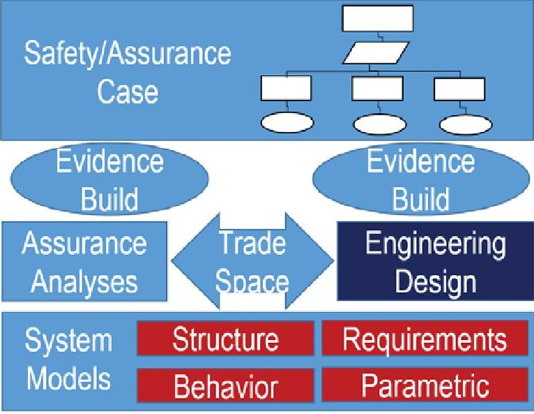
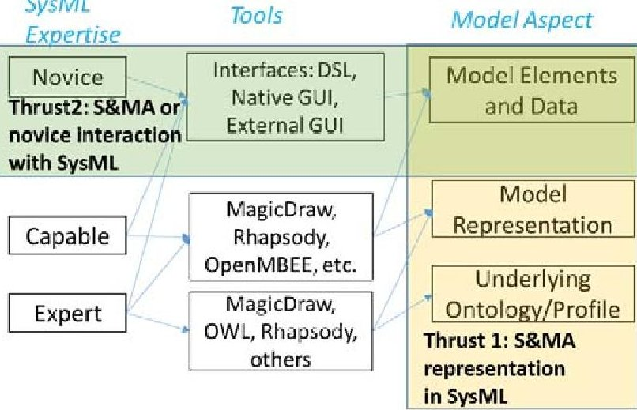
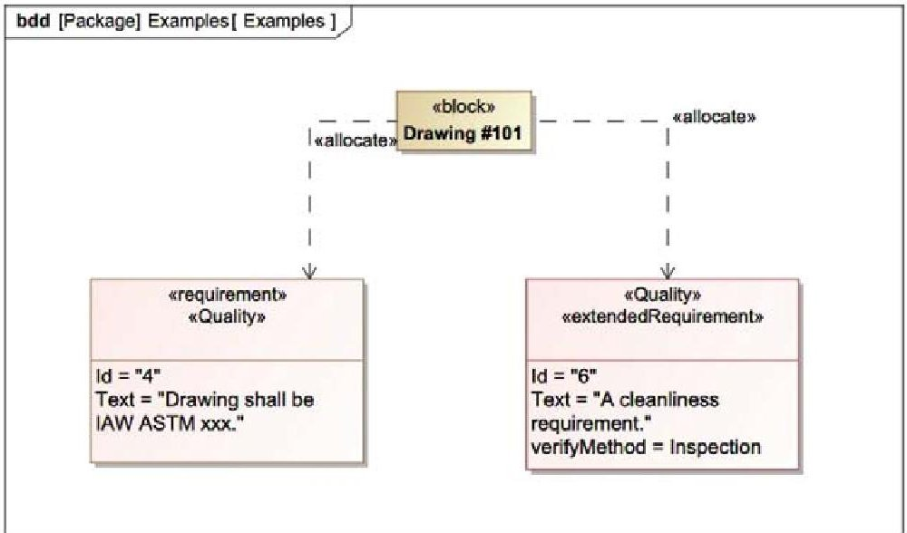
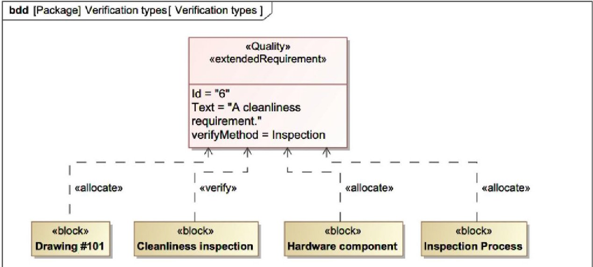
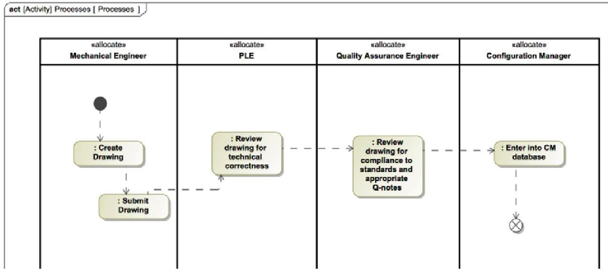
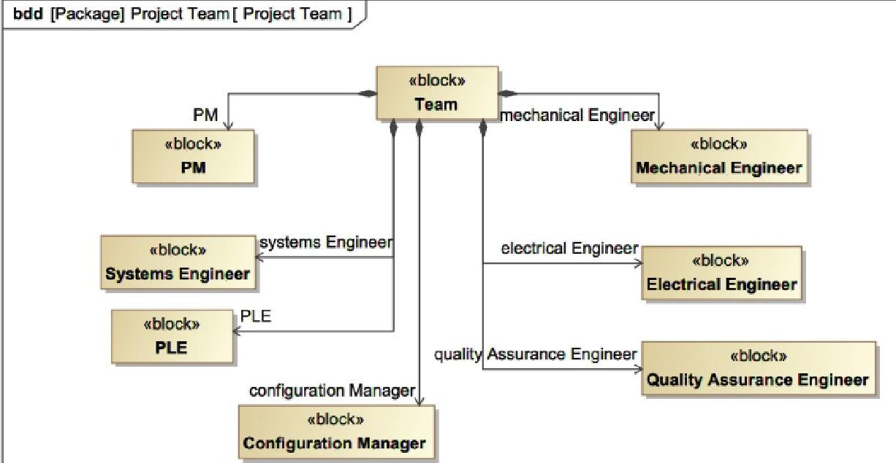

<!-- PDF_PAGE: 1 -->

# NASA Quality Assurance in an MBSE World

Steven L. Cornford, PhD, Jet Propulsion Laboratory

David Kotsifakis, MSci, NASA/Goddard Space Flight Center

Sean Beckman, BSci, NASA John H. Glenn Research Center

Martin S. Feather, PhD, Jet Propulsion Laboratory

John W. Evans, PhD, NASA Office of Safety and Mission Assurance

Key Words: model-based systems engineering, safety and mission assurance, model-based mission assurance

## SUMMARY & CONCLUSIONS

Over the past decade or so, the emergence of Model Based Systems Engineering (MBSE) has demonstrated its desirability and value in terms of 1) being a single source of truth, 2) unambiguous definitions and relationships, and 3) after representation, the ability to explore/extract any sets of data on demand. While much work has been done in showing the value to the system engineering discipline in these areas, how does that value translate to the Safety and Mission Assurance (S&MA) world? This paper provides a vision of a very desirable future of NASA S&MA after it is fully integrated into the MBSE framework. We explore the impact and consequences of the MBSE Value items discussed above and how they impact the disciplines of quality assurance, reliability and maintainability, system safety, and software assurance. We provide insight into how the MBSE modeling tools can be used to define S&MA processes (ideally as a result of Use Case [1] elaboration of processes represented in MagicDraw $ ^{\circled{2}} $ ), produce S&MA products (ViewEditor output of various items), and represent S&MA disciplines (S&MA inside of MagicDraw). We also provide insight into the degree to which some elements can be directly integrated into a SysML $ ^{\circled{2}} $ model and when, as often happens, an interface to some external source must be provided. The desirability of this future is part of the reason for the NASA Office of Safety and Mission Assurance's (OSMA) recent creation of a Model Based Mission Assurance (MBMA) Program [2] and the MBMA annual workshops. We briefly summarize the efforts to date to generate S&MA Use Cases for eventual deployment into pilot and project efforts.

Even simple use of the SysML modeling tools can be used to capture quality assurance tasks and integrate them with the systems engineering and produce products that are easy to use by quality practitioners that are unfamiliar with these methods.

We anticipate finding opportunities to pilot and implement various Quality Assurance (QA) Use Cases in FY20. The MBMA Program is focused on implementation; the NASA Office of the Chief Engineer's Community of Practice, as well as the SmallSat communities, are very interested in the integration of S&MA. Finally, as projects move forward utilizing whatever efficiency increases they can find in a cost-

constrained environment, the S&MA community cannot be caught unawares and needs to continue preparing for the evergrowing implementation of MBSE across NASA and our government and commercial partners.

## 1 INTRODUCTION

Over the past decade or so, improvements and changes in descriptive models of systems have been occurring. This has mainly come about in the shift from a document-centered approach to an approach using a dedicated language known as the Systems Modeling Language (SysML). SysML has allowed Systems Engineers (SEs) to consolidate information about a system and even automate some tasks leaving the SEs to concentrate on the actual engineering and decision-making. Many of our quality assurance (QA) tasks either overlap or interface with systems engineering tasks, thus, it is important for quality engineers to understand and contribute to these system engineering models. We will explore some of the ways in which QA processes and products may be model within the framework of SysML. First let us look at how quality can be assured by using requirement elements in a systems model.

Requirements come from many sources, agency internal requirements (NPRs), military standards (MIL-STDs), and industry standards (SAE, ISO, ASTM, etc...) are some of the places from which projects can pull requirements. These requirements then are tailored or flowed into project documentation, sometimes this means creating a pointer in a document to a requirement in another document. Certain quality assurance requirements are included on drawings as notes (Q-notes). With some upfront effort, all the applicable requirements could be stored in a model as requirement blocks, these can be stereotyped as a "quality requirement". This creates a library of requirements, from the various sources and should be maintained by the organization's quality group. Done properly, all the most current requirements can be stored in one place so all the models have access to the most current version of the requirements. This then becomes the single source of information where the applicable project quality requirements are concerned. On a larger scale, the agency could maintain these libraries in a single database/model such that a

<!-- PDF_PAGE: 2 -->

project can go and pull the applicable requirements. It should also be possible to send out notifications of changes made to requirements in the "master" library so that project quality can make sure that the most current version of the requirement is present in a project model if needed. The beauty of maintaining a project model is that one requirement block is related to many other model elements, which means if the requirement changes it is automatically changed for each of the other elements instead of having to check many documents to make sure they are updated properly simplifying the configuration management process.

Requirement blocks pulled from the library then can be related to other blocks in the model, such as: a team member who would be responsible for the requirement, verification type and method, and how that requirement has been satisfied (e.g., an inspection report block). Blocks representing the ASTM drawing requirements can be created. These requirement blocks then can be allocated to a block that represents a drawing, not the drawing itself that is housed in a CAD model (see Figure 3). When the drawing is reviewed for completeness and signed off by the appropriate team members, a relation can be established that the ASTM requirement(s) have been satisfied by the drawing block. A table can be generated showing the quality requirements associated with the drawing block, from there it is a simple matter to see which drawing blocks have satisfied all their allocated requirements.

The entrance criteria for certain gate reviews is to have a certain percentage of drawings complete and approved by the time of the review. This method of generating tables of drawing blocks and their completeness and approval status can yield a metric of the status of a project's drawings. The model could allow for value properties that capture sign off data. For example, which drawings are signed off, which are in the sign off queue, or which still have requirements to meet. By assigning requirements within a model, a project can make sure that the drawings are compliant with the appropriate standards.

## 2 BACKGROUND

NASA Office of Safety and Mission Assurance (OSMA) created and deployed a Program dedicated to Model Based Safety and Mission Assurance (MBMA) in FY19. This Program is discussed elsewhere but has a number of efforts focused on advancing the state of MBMA. This Program focuses on understanding the relationship and overlap between the disciplines of Safety and Mission Assurance and that of Systems Engineering. Practitioners of either discipline know there are significant overlaps. It is the goal of the MBMA Program to determine the overlaps, engage with the Model Based Systems Engineering (MBSE) community to develop SysML profiles, tool APIs (Application Programming Interfaces) or anything in between to enable the direct connections between these discipline models. The end goal of the OSMA MBMA Program is shown in Figure 1, and consists of developing those Policies and Standards, which enable direct coupling between the S&MA disciplines and the Engineering disciplines all the while supporting the evidence builds required for any given Safety/Assurance case.

## Effective Policies and Standards

Figure 1. As discussed in [3], the NASA OSMA MBMA Program is committed to developing the Effective Policies and Standards which will enable the rest of the S&MA discipline.

The disciplines of Safety and Mission Assurance encompass a large number of individual, sometimes disparate disciplines. The NASA OSMA website lists a number of disciplines under Safety and Mission Assurance but one of the key disciplines that we will focus on here is that of Quality Assurance. This discipline has the following main emphases:

1. Identification and Traceability

2. Procurement and Contract Quality Assurance Requirements

3. Control of Fabrication Activities

4. Contamination Control

5. Electrostatic Discharge Prevention

6. Nonconformance and Problem Reporting and Control

7. Inspection and Test of Stored Limited-Life Hardware

8. Handling, Preservation, Marking, Packaging, Packing, and Transportation

9. Acceptance Data Package (Preparation or review)

10. Control of Quality Records

11. Verification activities

12. Quality Assurance Audits

As we begin to implement the various associated Quality Assurance Use Cases, it is worth remembering that we will begin with exploring one or more ways of representing the underlying notions of these Use Cases in the SysML language. Various CAD-type drawing tools are currently effectively being used to create, refine and ultimately build hardware elements. The interfaces between these tools and the MBSE tools will need to be established, much as they were for Mechanical Engineering. Systems Engineers aren't interested in the mesh count, but do want some of the mass properties. Similarly, Systems Engineers aren't particularly interested in various drawing standards and references, but do want to know if they

<!-- PDF_PAGE: 3 -->

conform or not. Requirement blocks can be tied to drawing blocks, hardware blocks, procurement process activity diagrams and actions. Requirement blocks can be tied to work instruction blocks or processes. Inspection and test process blocks can be tied to verifications and process activity diagrams and actions (Figure 4).

All of these can be analyzed by scripts and generate Boolean values at component level blocks to show which have been reviewed.

SysML

Figure 2. Illustration of the two main thrusts of the NASA OSMA MBMA Program. Thrust 1 focuses on representing various aspects of the S&MA domain in SysML models, while Thrust 2 focuses on lowering the barrier to interacting (editing, reviewing, etc.) with the model.

## 3 THRUST 1: REPRESENTING S&MA IN THE MODEL

Where there is significant overlap between S&MA and SE (Requirement processes are an obvious example) we anticipate being able to capture these notions within a SysML profile and it will then be directly a part of any SysML modeling effort. Requirements typing, tailoring, monitoring, verification and validation can easily be represented in SysML and interfaces/APIs to external Requirement Management tools (e.g., DOORS $ ^{\circledR} $ NG) are well-established. What remains is to determine the relevant requirements to capture, or decide upon a representation/ontology (e.g., Thermal Requirements are specialized Environmental Requirements which are either specialized Requirements or specialized Constraint Requirements or specialized Constraint Blocks depending upon the modeling methodology being employed).

Other S&MA notions (e.g., Radiation Testing and Analysis) will probably never be represented directly in SysML but will require the development of an interface to a different set of tools. The requirements/constraints for the Radiation Environment can certainly be captured in SysML, but confirmation or Verification of the values will undoubtedly require the execution of sophisticated 'black box' radiation models.

One aspect of the NASA MBMA Program is the annual MBMA Workshop (two of which have been held so far). The

most recent Workshop focused on defining the Use Cases applicable for the S&MA domain. The attendees developed Summary Use Cases for most of the primary S&MA disciplines and developed good example Use Cases for several of the more detailed Use Cases. Our intention is to keep looking for opportunities to pilot and implement these Use Cases on flight projects. This will result on the determination of what elements of S&MA are possible to represent in a SysML profile, and which ones will require more careful analyses of what to expose/share between SysML and external models.

Our work with NASA MBSE Integration and Modernization Initiative (MIAMI) has resulted in the representation of many key S&MA elements including Hazards, Hazard Procedures linked to Components undergoing other Procedures, the traceability of these Procedures to governing S&MA Requirements, typing Environmental Requirements, and a preliminary definition of Risk as part of a Class D Risk Management process to name a few.

A model can be used to show how QA requirements can be related to other model elements such as drawings, hardware, inspection processes, and inspection reports.

SysML is also good for modeling at least some of our quality assurance processes as activity diagrams. A simplified version of these are the old flow diagrams that may have been included in process documentation. However, in a SysML model there is much more information stored "behind the scenes" as it were within the elements. Information about relationships to other elements for example. Also, if a relationship is established in one diagram, it carries through to all the other diagrams containing those elements. This helps maintain correct information since it is associated with one model element that is used many times thus building in a certain amount of "correctness" into the model. In Figure 5, we set up a simplified activity diagram, with swimlanes, for reviewing a drawing. In another block definition diagram (Figure 6) we define the team members that this diagram assigns action elements to.

With a series of these process activity diagrams it can be made clear which team member has which action. These are all associated with the single team member block and it would be possible to create an output listing all of the actions that a team member needs to take across a project. A Boolean true/false value can then be assigned to each action to show completion, making it easy to pull from the model those actions that have yet to be completed.

Returning to the criteria that a certain percentage of drawings have been completed and approved at the time of a design review: it should now be apparent that values and data can be stored in a model and associated with different model elements. Thus, we can also assign a Boolean value can be assigned to a drawing block showing whether it has been approved yet. A table can be generated or a script written to showing which drawings have been approved and which have not. Keeping in mind there must be a good deal of diligence in maintaining the model.

<!-- PDF_PAGE: 4 -->

Figure 3. Sample of relationships between a Drawing and Requirements

Figure 4. Inspection and test process blocks can be tied to verifications and process activity diagrams and actions

Figure 5. Activity diagram for reviewing a drawing

<!-- PDF_PAGE: 5 -->

Figure 6. Members of the drawing review team.

Another QA process that is of utmost importance for a project is the tracking of non-conformances. We have shown how processes can be modeled through the use of activity diagrams; this will be also be possible for an organization's non-conformance process. Not only can we assign team responsibilities to actions within that process, we can also assign that process to other model elements such as a hardware definition block when a non-conformance is discovered. Again, a Boolean value in the block can indicate whether that non-conformance has been closed and another value in the block can store the disposition information. A table of open and closed non-conformances is then easily generated from within the model. However, many organizations already possess nonconformance database tools. The state of scripting and thirdparty applications is progressing all the time. So, in the near future it should be possible to share data between the SysML model and other engineering tools, if it is not already available. That way engineers can continue to use the tools they are familiar with while still being able to contribute to the model data.

We are still exploring modeling in the S&MA domain and have started developing use cases to aide in this effort. Questions remain about how to model, what to model, and can we model areas of the S&MA domain.

## 5 THRUST 2: INTERACTING WITH THE MODEL/LOWERING THE BARRIER

As part of the MIAMI Cross Life Cycle Modeling Team's efforts, we developed several demonstration interfaces to the underlying SysML model. ModelCenter $ 1 9^{\mathrm {T M}} $ currently uses the DocGen [4] framework collaboratively developed, but the documents produced can only be viewed; changes cannot by synched back to the model. ViewEdtior enables the 'two-way street' of producing a document: when editing it on a browser, changes go back into the model, after which regeneration of a new version of the document contains the changes. There is indeed some overhead in developing the 'flows' (essentially

activity diagrams) for the creation of the document but the payoff is very large. We envision profiles and other S&MA SysML products will essentially be a matched pair consisting of: 1) a pattern for modeling, representing and packaging, and 2) a method for finding, filtering, extracting, organizing and presenting that data. These provides a 'standard' for modeling which provides agreed-upon outputs while allowing the freedom model/represent how those outputs are generated.

Our focus has shifted to the production of Gate products/artifacts, and developing the modeling patterns which enable them to be developed and created. A parallel effort is developing model-checking capabilities so the promise of "correct by construction" is tainted less by the errors of humans.

## 6 WHAT'S NEXT?

The NASA MBMA Program in FY20 will focus on using the results of previous prototypes and demonstrations to begin to 1) implement the S&MA Use Cases and 2) produce the various S&MA Gate Products.

This year's MBMA Workshop will share these results and is intended to be a working meeting. We will have both modelers, practitioners and leaders to generate some of these products directly at the Workshop.

## ACKNOWLEDGEMENTS

The authors would like to thank Dr. Frank Groen at NASA HQ for supporting this effort.

"It must be considered that there is nothing more difficult to carry out nor more doubtful of success nor more dangerous to handle than to initiate a new order of things; for the reformer has enemies in all those who profit by the old order, and only lukewarm defenders in all those who would profit by the new order; this lukewarmness arising partly from the incredulity of mankind who does not truly believe in anything new until they actually have experience of it." - Nicolo Machiavelli, "The Prince". We thank the MBSE visionaries in this endeavor who have the foresight and fortitude to push ahead nevertheless.

<!-- PDF_PAGE: 6 -->

This research was carried out at NASA HQ, NASA/Goddard Space Flight Center, NASA John H. Glenn Research Center, and the Jet Propulsion Laboratory, California Institute of Technology under a contract with the National Aeronautics and Space Administration.

## REFERENCES

1. A. Cockburn, Writing Effective Use Cases, 1st edition, Addison-Wesley Professional, 2000.

2. Model-Based Mission Assurance https://sma.nasa.gov/sma-disciplines/model-based-mission-assurance.

3. J. Evans, S. Cornford, M. S. Feather, "Model based mission assurance: NASA's assurance future," 2016 Annual Reliability and Maintainability Symposium (RAMS), IEEE 2016, pp 1-7.

4. DocGen - a documentation tool http://www.openmbee.org/

## BIOGRAPHIES

Steven L. Cornford, PhD

Jet Propulsion Laboratory, California Institute of Technology 4800 Oak Grove Drive

Pasadena, CA, 91109, USA

e-mail: steven.l.cornford@jpl.nasa.gov

Steven Cornford earned his PhD in Physics from Texas A&M University, and has worked at JPL since 1992. He has performed a variety of line management and project management functions. He has been a system engineer, reliability engineer, test engineer and a DARPA Principal Investigator. He is currently particularly interested in crosscutting problems and efforts to increase the breadth of earlyphase modeling and trade space exploration. He has authored over 100 papers.

David Kotsifakis, MSci

NASA/Goddard Space Flight Center

32400 Fulton St.

Wallops Island, VA, 23337

e-mail: david.p.kotsifakis@nasa.gov

David Kotsifakis is a Systems Engineer at Wallops Flight Facility for the Guidance, Navigation, and Control Section of the Systems Engineering Branch. He earned his MSci from University of Maryland - College Park, and his BSci in Aerospace Engineering from Missouri University of Science and Technology in 1981. He has worked for NASA's Wallops Flight Facility since 1982. Although his current work involves MBSE, he has served as Head of Flight Systems with NASA/Wallops, project manager for Sounding Rockets, and Project Manager for NASA's technology development effort for a flight termination replacement called AFSS (Autonomous Flight Safety System).

Sean Beckman, BSci NASA John H. Glenn Research Center 21000 Brookpark Rd Cleveland, OH 44135

## e-mail: sean.m.beckman@nasa.gov

Sean Beckman received a Bachelor of Science degree in physics from the University of Akron and is pursuing a Master's of Science degree in Systems Engineering from Worcester Polytechnic Institute. He has spent over 15 years as a systems engineer working various projects for NASA, Boeing and DoD, including NASA GRC's Fluids and Combustion Facility, Orion and Altair spacecraft, the 747-8 aircraft, and the Army's Armored Multi-Purpose Vehicle. While specializing in requirements management he has taken on other systems engineering roles and tasks for these programs. Sean is now a quality assurance engineer at NASA's Glenn Research Center. A member of the Cleveland-Northern Ohio chapter of INCOSE Sean is an advocate of Model Based Systems Engineering and continues studying SysML and ways it can be used for system development most recently looking at Model Based Mission Assurance (MBMA) in the NASA community. He currently holds an INCOSE Systems Engineering Professional certification.

Martin S. Feather, PhD

Jet Propulsion Laboratory, California Institute of Technology 4800 Oak Grove Drive

Pasadena, CA, 91109, USA

e-mail: martin.s.feather@jpl.nasa.gov

Martin Feather is a Principal Software Assurance Engineer in JPL's Office of Safety and Mission Success, and has been with JPL for over 20 years. His activities are focused on identifying, developing and infusing research results that offer the prospect of improving assurance of space missions, with a particular interest in software. He received his BA and MA in Mathematics and Computer Science from the Cambridge University, UK, and PhD in Artificial Intelligence from the University of Edinburgh, UK, all in the previous millennium. He has authored or coauthored over 150 papers.

John W. Evans, PhD

Office of Safety and Mission Assurance

NASA

300 E St SW

Washington, DC, 20546, USA

e-mail: john.w.evans@nasa.gov

John Evans earned his PhD in Materials Science and Engineering from Johns Hopkins University, and is the Program Manager for Reliability and Maintainability and Program Executive for the NASA Electronic Parts and Packaging Program at NASA HQ Office of Safety and Mission Assurance. He has authored or coauthored 3 textbooks, a book chapter on electronic materials and over 50 publications.