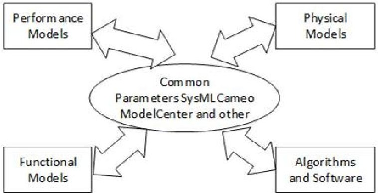
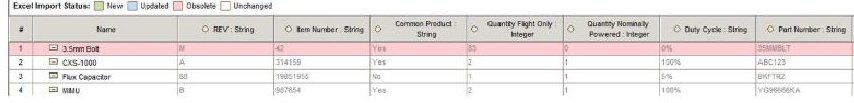
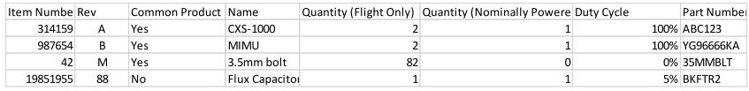
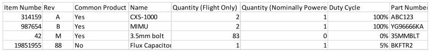
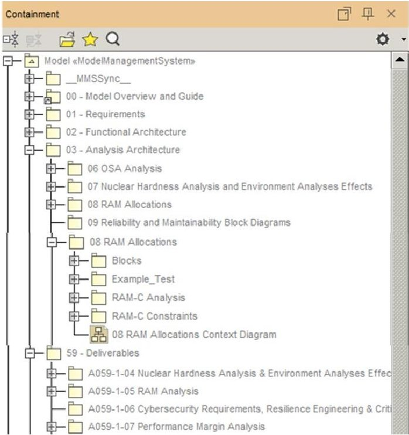
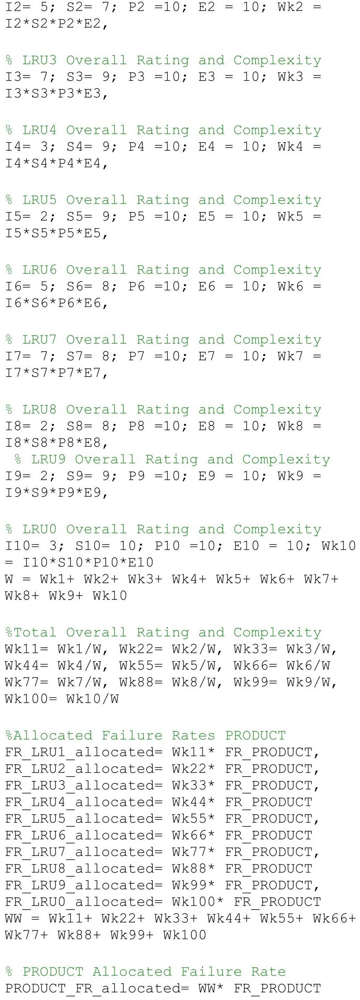

<!-- PDF_PAGE: 1 -->

# Integrating Reliability Engineering with Model Based Systems Engineering

Matthew W. Daniels, Lockheed Martin

Ken Pierre PhD, Lockheed Martin

Key Words: MBSE, Digital Tapestry, Reliability Modeling, R&M Management

## SUMMARY & CONCLUSIONS

As fully digital programs become commonplace, it is imperative that Reliability Engineering (RE) adapt to take advantage of all the benefits that Model-Based Systems Engineering (MBSE) offers. At the same time, integrating RE with MBSE cannot result in a loss of modeling and prediction fidelity, nor should it drive significant learning on reliability engineers of new tools and programming languages. The approach should, however, consider the particular nuances of the modeling being performed. This paper describes two distinct techniques for this integration effort adopted by two program areas within the same company. Both approaches contain unique advantages, and it is shown that there is no single best way to perform RE within an MBSE framework.

The first approach described performs the reliability analysis in a Microsoft Excel based model. The important properties of the system hardware are captured in a table in Cameo. This table is then exported to Excel and compared to the hardware in the Excel reliability model. Once any hardware changes have been updated, the table can be exported back to Cameo to include the updated reliability properties.

The second approach described integrates MATLAB with Cameo. The reliability analysis is either performed in MATLAB or another tool then integrated into MATLAB. Then, through a series of scripts, Cameo connects with the MATLAB analysis to fully integrate the system model with the reliability model.

Each of these approaches can be used by a wide variety of programs in diverse industries. The appeal of these approaches is that it allows Reliability Engineers to continue using their current tools while ensuring that their models always align with the current system architecture.

## 1 INTRODUCTION

According to INCOSE, MBSE is "A formal application of modeling to support system requirements, design, analysis, verification and validation activities beginning in the conceptual design phase and continuing throughout development and later life cycle phases."

MBSE enables the creation of complex multi-disciplinary systems. SysML is the key MBSE component. However, Reliability Engineering is not fully developed by the SysML

language. The Cameo Safety and Reliability Analyzer Plugin contain an FMEA Project Template and a Safety and Reliability Analysis Project Template. These templates include unwieldy predefined packages and diagrams. The MBSE integrated reliability engineering approach is not yet standardized, matured, and flexible. Thus, engineers rely on their strategies to fill in the gap or to implement into MBSE reliability engineering models, analyses, and tasks, including Fault Tree Analysis (FTA), Probability of Success (Ps) predictions, Failure Mode Effects & Criticality Analysis (FMECA), Bayesian Networks, Limited Life Analysis (LLA), Single Point Failure Analysis, Availability & Maintainability Analysis, Reliability Testing, data analysis, and Probabilistic Risk Assessments (PRA).

One of the MBSE applications is to facilitate Digital Transformation and Digital Twin (DT) by providing the SyslML/Cameo with ways to perform analytical modeling as efficiently as descriptive modeling. One such way is using MATLAB/Simulink. DT assesses engineering system performance, reliability, maintainability, supportability, remaining usable life, system health and performance in the field, and other factors. It will be shown how this can be achieved through the MBSE Integration methods described.

## 2 SCIENTIFIC VALUE AND INDUSTRY DIGITAL TRANSFORMATION FACILITATOR

The driven motivation for this work is mainly due to the Department of Defense's (DoD) strenuous effectiveness, safety, reliability, and performance system requirements data needed as part of the Digital Transformation (DT) project. MBSE is the core of the Digital Transformation in the Defense Industry and is presently being used to develop the Digital Twin and Hardware-in-the-Loop efforts. The methodology proposed herein is a practical solution for complex multidisciplinary engineering applications and challenges encountered.

Reliability Engineering presents a challenge in that respect. The challenge is that the SysML Cameo language is not a fully developed analytical tool. Thus, the MBSE integrated reliability engineering approach is not yet standardized, mature, and flexible; the authors' primary goal is to bridge the gap with other analytical modelers, thus facilitating the implementation of reliability engineering into SysML Cameo and advancing the progress in Digital Twin DT. This claim and benefit are

<!-- PDF_PAGE: 2 -->

addressed in the sections that follow.

Some of the claims of this paper are that it provides the ability to perform and implement into Cameo easily the following analytical calculation and data:

- Reliability Engineering Models and Analyses

- Reliability Allocation

- Fault Detection and Isolation Allocation

- Missile Fuze Fuzing Path Probability of Success

- Fault Tree Analysis (FTA)

- Failure Mode Effects Criticality Analysis (FMECA)

- Bayesian Networks

- Probabilistic Risk Assessment (PRA)

- Single Point Failure Analysis

- Availability, Maintainability Analysis

- Reliability Testing and data analysis

For instance, in Figure 2 below, the bulleted list above belongs under the performance section.

Figure 1. What Might Be in a Digital Twin

## 3 APPROACH 1: EXPORTING AND IMPORTING PROPERIES FOR RELIABILITY WITH CAMEO

The first approach to integrating RE with MBSE involves linking a pre-existing RE tool with the Cameo System Model. By connecting the two tools, the Reliability Engineer or Team is given direct insight into changes made to the baseline system model, can reflect those changes in the reliability prediction, and import back into Cameo the resultant reliability prediction results. This forms a closed-loop interface with the System Model without attempting to force Cameo to perform reliability analysis, a function beyond its intended design and purpose.

A significant problem that a systems reliability engineer faces throughout a project's proposal and design phases is staying informed about ever-changing system designs.

Often a change may not be communicated well or may not be communicated at all to reliability engineering. There are several reasons for this, including an underlying assumption that a design change does not impact the reliability prediction, a belief that reliability engineering is already fully aware of the change, or even forgetting that reliability engineering needs to know about the design change. When a design change is not communicated well, it is possible that a trade study appropriately includes reliability engineering. However, the study lead neglected to follow up with reliability to ensure they were aware of the study's outcome.

One purpose of MBSE is to prevent the above-described scenarios from happening. The Cameo System Model is viewed as the source of truth for the baseline design of a system. By interfacing the system reliability model with the Cameo System Model, RE can achieve a closed-loop MBSE approach.

The key to this approach is to identify the key attributes of all hardware in the System Model that are important to RE. With the help of the MBSE and Cameo experts a script is written in Cameo that creates, and automatically updates, a table that includes these properties for every piece of hardware in the design. This table, as shown in Figure 2, represents a subset of a traditional Master Equipment List (MEL) or Program Hardware/Software List (PHSL).

Figure 2. Cameo Reliability Table Screenshot

This table, once populated with all the design data required, can then be exported to Microsoft Excel. Due to its computational power, versatility, broad familiarity, and ubiquity, the standard RE tool used on many projects is Excel based. The file exported from Cameo is either imported into the RE tool or its contents are copied and pasted into the tool. From this point, it is easy to view a comparison to the previous import to determine if there are any changes to the system design that may affect the reliability prediction as shown in Figure 3.

Figure 3. Example RE Model Table - Imported

In the example shown in Figure 3 above, it is seen that a change has been made to the system design since the last time the Reliability Engineer pulled in the table from Cameo. Figure 4 below shows that the Reliability Engineer has updated the reliability model to reflect the change, and the resultant reliability prediction has changed.

Figure 4. Example RE Model Table - Updated

Once the Reliability Engineer has updated the model to reflect the current system design, the predicted reliability values can be imported back into Cameo. This allows for a closed-loop solution ensuring that the reliability model represents the current design baseline, and the Cameo System Model contains updated reliability predictions.

## 4 APPROACH 1: CAMEO ATTRIBUTES FOR RELIABILITY

Not all attributes of all system model components are consequential to reliability analysis. For instance, a change in the mass or physical dimensions of a hardware item doesn't influence the reliability of that hardware, assuming that all other

<!-- PDF_PAGE: 3 -->

attributes that influence reliability stay the same. Likewise, the manufacturer or color of paint used on the end product likely doesn't impact reliability, so RE wouldn't need to know every time these change.

The following list contains the attributes deemed necessary for the reliability prediction. Depending on the project, customer requirements, and other factors, additional or fewer attributes may be needed for an accurate forecast. Nevertheless, this list may be a good starting point for most projects.

2. Revision Number - This increments if any aspect of the component has changed.

1. Item Name-A common name given to the component to help identify it.

3. Item/Part Number - Ensures that the correct reliability prediction is used that matches the component.

4. Common Product Flag - If true, alerts the reliability engineer that this component is likely used in other systems, and they can use the already developed prediction.

5. Quantity per System - Informs the model of the total number of this component in the system.

6. Quantity Powered - If different from the Quantity per System number above, it may indicate standby redundancy.

7. Duty Cycle - Informs the reliability engineer what duty cycle (powered on-time percentage) to apply to the component. This is important to ensure that the System Model assumes the same duty cycle as the Reliability Model.

8. Vendor/Supplier- If the name of the supplier changes, then that may indicate either a different component is being used or a shift in the component's reliability.

9. Important to RE Flag - This defaults to true for all components. The reliability engineer may change this to false for component types not included in the reliability prediction to avoid seeing changes to components that don't apply to RE.

10. Allocated Reliability - This value should source from the project's Requirements Management program, which may or may not be Cameo. Any change to this value should be directed or approved by RE.

11. Predicted Reliability - This value is calculated by the Reliability Model and exported back into Cameo once all other properties have been verified to align with the System Model. By exporting this back to Cameo it enables easy verification that reliability allocations are met and others on the project can readily determine what the predicted reliability of a component is without needed access to the Reliability Model or having to ask a Reliability Engineer.

The above attributes should already be included by default for all products in the System Model. The most likely attributes not already part of the model are 4,9,10,and 11. The MBSE team managing the System Model can easily instantiate these attributes for all current components with a default value and default to including them for all new components.

## 5 APPROACH 2: IMPLEMENT RELIABILITY TASKS INTO MBSE

This section aims to implement indirectly into the MBSE system via model transformations to transfer data to and from external tools like MATLAB, Excel, or any other Reliability Engineering analysis tool. Some of the goals are:

- Implementing reliability physics engineering

- Reasoning on and analysis of this and reliability data

- Graphing and Visualizing reliability data.

- Validating the thoroughness of the reliability data and results

- Accounting for the reliability information the related model elements i.e., requirements, design elements, parametric models, test cases, and test results.

In this strategy, reliability tasks may be performed in any tool, i.e., Excel, Origin, ReliaSoft, Weibull analysis software, and transposed into Cameo since Cameo Simulation Toolkit can use MATLAB, which is installed on the local machine for solving mathematical expressions. The MATLAB reliability task scripts and models may share common data between modeling elements once called by Cameo. The resulting data between modeling elements. After adjustments, the model can be updated, refined, and used in other programs.

After the prior analysis in one of the Reliability Software Tools the next steps are:

1. Selecting MATLAB as Mathematical Solver for Cameo Simulation Toolkit

2. Implementing MATLAB Reliability Engineering Tasks into Cameo

5. 1 Selecting MATLAB as Mathematical Solver for Cameo Simulation Toolkit

Switch the mathematical solver to MATLAB by Setting the Mathematical Engine field in the environment option to MATLAB

- Select Options in the Environment in main menu bar.

The Environment Options dialog will open.

- Select Simulation in the left pane.

- In Mathematic Engine, select MATLAB from drop-down list

- Click OK

- 5. 2 Implementing MATLAB Reliability Engineering Tasks into Cameo

- From the main menu, click Tools > Integrations.

- Open the Integrations dialog

- Select MATLAB and click Integrate/Remove Integration

- Specify the directory where you installed MATLAB and click OK.

## 6 ARCHITECTURE IN CAMEO

The Analysis Architecture should contain the details of the RMA tasks and specific analyses performed on the product. Each task or analysis has a dedicated package inside the Analysis Architecture package. The individual RMA task or analysis packages contain elements related to that task or

<!-- PDF_PAGE: 4 -->

analysis, i.e., constraints, data types, data sources, blocks contexts, block definition diagrams, and parametric diagrams. Figure 5 below shows a basic Analysis Architecture adjusted to showcase the reliability architecture to illustrate the point.

Figure 5: A Tailored Analysis Architecture in Cameo

## 7 AN EXAMPLE OF FAILURE RATE RELIABBILITY ALLOCATION INTO CAMEO VIA MATLAB

Limited Reliability tasks and analyses involved are:

- Missile Reliability Allocation

- Missile profile (Storage, Dormant, Maintenance, Transportation, Silo, Launch, Flight)

- Missile Fuze Reliability - Fuzing paths impact on reliability

- Reliability Vs Retargeting Cycle Number in Silo

- FMECA

To limit the size of this endeavor, this paper will address only the failure rate allocation using MATLAB. Once the failure rate allocation MATLAB code is obtained, the procedure in section 5 is used to have Cameo call and execute the MATLAB code.

The Cameo executed MATLAB code is the placed in Cameo directory number 8 shown in Figure 5.

The Product MATLAB code Reliability Allocation is as follow:

FR_PRODUCT =0.0000000011;

% LRU0 Overall Rating and Complexity

I1= 5; S1= 7; P1 =10; E1 = 10; Wk1 = I1*S1*P1*E1,

% LRU2 Overall Rating and Complexity

<!-- PDF_PAGE: 5 -->

%Allocated MTBF Calculation Cells J7 to J17

MTTF_PRODUCT = 1/FR_PRODUCT

MTTF_LRU1_allocated =1/FR_LRU1_allocated,

MTTF_LRU2_allocated =1/ FR_LRU2_allocated

MTTF_LRU3_allocated =1/FR_LRU3_allocated,

MTTF_LRU4_allocated =1/FR_LRU4_allocated

MTTF_LRU5_allocated =1/FR_LRU5_allocated,

MTTF_LRU6_allocated =1/FR_LRU6_allocated

MTTF_LRU7_allocated= 1/ FR_LRU7_allocated

, MTTF_LRU8_allocated= 1/

FR_LRU8_allocated

MTTF_LRU9_allocated= 1/FR_LRU9_allocated,

MTTF_LRU0_allocated= 1/ FR_LRU0_allocated

The Product MATLAB code Reliability Allocation Results are given in the MATLAB Workspace result in Figure 6 below. This MATLAB stand along executed result is then compared with the Cameo\MATLAB executed results to validate the figures. The Cameo\MATLAB executed results are accessible in the Cameo directory number 8 shown in Figure 5.

## 8. CONCLUSION

The objective of this paper was to illustrate multiple approaches to integrating RE tasks and analyses with MBSE. Since Cameo and other MBSE tools are not designed to be RE tools, these approaches combine the best tools for RE with a tool designed for MBSE to fully integrate RE for Digital Transformation.

These approaches can be broadly applied across any industry or project type to ensure that RE creates high-fidelity analyses while utilizing the best aspects of MBSE.

## ACKNOWLEDGEMENTS

The authors would like to thank April Luczywek, Lockheed Martin Space MBSE Senior Manager, for providing funding to enable this paper to be written. They would also like to thank Karan Sachdeva, Gary Shubert, and Walker Herring for implementing the Cameo script described by the first approach in this paper.

## TRADEMARK ACKNOWLEGEMENTS

CAMEO is a trademark of No Magic, Inc. Digital Twin is a trademark of Willow Technology, Inc. Excel is a trademark of Microsoft, Inc. MATLAB is a trademark of The Mathworks, Inc. Origin is a trademark of OriginLab Corporation RELIASOFT is a trademark of Hottinger Brüel & Kjaer mbH

SysML is a trademark of The Object Management Group

<table><thead><tr><th>Name</th><th>Value</th></tr></thead><tbody><tr><td>E1</td><td>10</td></tr><tr><td>E10</td><td>10</td></tr><tr><td>E2</td><td>10</td></tr><tr><td>E3</td><td>10</td></tr><tr><td>E4</td><td>10</td></tr><tr><td>E5</td><td>10</td></tr><tr><td>E6</td><td>10</td></tr><tr><td>E7</td><td>10</td></tr><tr><td>E8</td><td>10</td></tr><tr><td>E9</td><td>10</td></tr><tr><td>FR_LRU0_allocated</td><td>9.7633e-11</td></tr><tr><td>FR_LRU1_allocated</td><td>1.1391e-10</td></tr><tr><td>FR_LRU2_allocated</td><td>1.1391e-10</td></tr><tr><td>FR_LRU3_allocated</td><td>2.0503e-10</td></tr><tr><td>FR_LRU4_allocated</td><td>8.7870e-11</td></tr><tr><td>FR_LRU5_allocated</td><td>5.8580e-11</td></tr><tr><td>FR_LRU6_allocated</td><td>1.3018e-10</td></tr><tr><td>FR_LRU7_allocated</td><td>1.8225e-10</td></tr><tr><td>FR_LRU8_allocated</td><td>5.2071e-11</td></tr><tr><td>FR_LRU9_allocated</td><td>5.8580e-11</td></tr><tr><td>FR_PRODUCT</td><td>1.1000e-09</td></tr><tr><td>I1</td><td>5</td></tr><tr><td>I10</td><td>3</td></tr><tr><td>I2</td><td>5</td></tr><tr><td>I3</td><td>7</td></tr><tr><td>I4</td><td>3</td></tr><tr><td>I5</td><td>2</td></tr><tr><td>I6</td><td>5</td></tr><tr><td>I7</td><td>7</td></tr><tr><td>I8</td><td>2</td></tr><tr><td>I9</td><td>2</td></tr><tr><td>MTTF_LRU0_allocated</td><td>1.0242e+10</td></tr><tr><td>MTTF_LRU1_allocated</td><td>8.7792e+09</td></tr><tr><td>MTTF_LRU2_allocated</td><td>8.7792e+09</td></tr><tr><td>MTTF_LRU3_allocated</td><td>4.8773e+09</td></tr><tr><td>MTTF_LRU4_allocated</td><td>1.1380e+10</td></tr><tr><td>MTTF_LRU5_allocated</td><td>1.7071e+10</td></tr><tr><td>MTTF_LRU6_allocated</td><td>7.6818e+09</td></tr><tr><td>MTTF_LRU7_allocated</td><td>5.4870e+09</td></tr><tr><td>MTTF_LRU8_allocated</td><td>1.9205e+10</td></tr><tr><td>MTTF_LRU9_allocated</td><td>1.7071e+10</td></tr><tr><td>MTTF_PRODUCT</td><td>9.0909e+08</td></tr><tr><td>P1</td><td>10</td></tr><tr><td>P10</td><td>10</td></tr><tr><td>P2</td><td>10</td></tr><tr><td>P3</td><td>10</td></tr><tr><td>P4</td><td>10</td></tr><tr><td>P5</td><td>10</td></tr><tr><td>P6</td><td>10</td></tr><tr><td>P7</td><td>10</td></tr><tr><td>P8</td><td>10</td></tr><tr><td>P9</td><td>10</td></tr><tr><td>PRODUCT_FR_allocated</td><td>1.1000e-09</td></tr><tr><td>S1</td><td>7</td></tr><tr><td>S10</td><td>10</td></tr><tr><td>S2</td><td>7</td></tr><tr><td>S3</td><td>9</td></tr><tr><td>S4</td><td>9</td></tr><tr><td>S5</td><td>9</td></tr><tr><td>S6</td><td>8</td></tr><tr><td>S7</td><td>8</td></tr><tr><td>S8</td><td>8</td></tr><tr><td>S9</td><td>9</td></tr><tr><td>W</td><td>33800</td></tr><tr><td>Wk1</td><td>3500</td></tr><tr><td>Wk10</td><td>3000</td></tr><tr><td>Wk100</td><td>0.0888</td></tr><tr><td>Wk11</td><td>0.1036</td></tr><tr><td>Wk2</td><td>3500</td></tr><tr><td>Wk22</td><td>0.1036</td></tr><tr><td>Wk3</td><td>6300</td></tr><tr><td>Wk33</td><td>0.1864</td></tr><tr><td>Wk4</td><td>2700</td></tr><tr><td>Wk44</td><td>0.0799</td></tr><tr><td>Wk5</td><td>1800</td></tr><tr><td>Wk55</td><td>0.0533</td></tr><tr><td>Wk6</td><td>4000</td></tr><tr><td>Wk66</td><td>0.1183</td></tr><tr><td>Wk7</td><td>5600</td></tr><tr><td>Wk77</td><td>0.1657</td></tr><tr><td>Wk8</td><td>1600</td></tr><tr><td>Wk88</td><td>0.0473</td></tr><tr><td>Wk9</td><td>1800</td></tr><tr><td>Wk99</td><td>0.0533</td></tr><tr><td>WW</td><td>1</td></tr></tbody></table>

Figure 6: MATLAB Workspace Result for the Allocation

<!-- PDF_PAGE: 6 -->

## REFERENCES

1. SysML Distilled - A Brief Guide to the Systems Modeling Language by Lenny Delligatti

2. System Effectiveness A.R. Habayeb - Pergamon Press

3. Exploratory Data Analysis with MATLAB Third Edition Chapman & Hall/CRC

4. Computational Statistical Experiments in Matlab - Raazesh Sainudiin and Dominic Lee Department of Mathematics and Statistics, University of Canterbury, Christchurch, New Zealand

5. Intelligent Reliability Analysis Using MATLAB and AI - Perform Failure Analysis and Reliability Engineering using MATLAB and Artificial Intelligence - by Dr. Cherry Bhargava; Dr. Pardeep Kumar Sharma - FIRST EDITION 2021- ISBN: 978-93-90684-656

6. Statistics in Engineering with Examples in MATLAB $ \textcircled{R} $ and R - Second Edition

7. MATLAB Simulink - Quick Guide

8. Modeling and Simulation of System Using MATLAB and Simulink by Devendra K. Chaturvedi; CRC Press

9. Numerical Analysis Using MATLAB and Excel - Third Edition by Steven T. Karris

## BIOGRAPHIES

Matthew W. Daniels

Lockheed Martin

RDL 340 Room 301, Mail Drop: 0310

12257 S Wadsworth Blvd

Littleton, CO 80125 USA

## matthew.w.daniels@lmco.com

Matthew W. Daniels graduated from Florida Institute of Technology with Bachelor of Science degrees in Physics and Astronomy/Astrophysics in 2001. In 2004, he graduated from the University of Pennsylvania with a Master of Engineering

degree in Systems Engineering that emphasized applied probability and statistics. Since 2001, Matt has worked as an engineer for Lockheed Martin in various capacities. He began his career at Lockheed Martin Management & Data Systems as a systems engineer. In 2006 he transferred to Lockheed Martin Space and has worked in Mechanical, Software, Systems, Reliability, and Mission Success engineering. In 2019 Matt became an American Society for Quality Certified Reliability Engineer. Matt is currently a Senior Staff Reliability Engineer and Recognized Technical Talent for the Lockheed Martin Space Central Engineering Line of Business supporting various military satellites, commercial satellites, and common product developments. Matt is considered an expert in Functional Availability analysis, Reliability Optimization, and Reliability Modernization.

## Ken Pierre, PhD Lockheed Martin

## ken.pierre@lmco.com

Ken Pierre is a Sr. Staff, RTT System Engineer at Lockheed Martin and has a doctorate in Electrical Engineering at the University of South Florida. His doctorate focus was originally in RF-Microwave engineering then he switched to control engineering model-based fault diagnosis. He received a Bachelor of Science degree in electrical engineering from CUNY in New York. He received a Master of Science degree in electrical engineering (Microelectronics) from USF, the University of South Florida. He wrote his MSEE thesis while working at Bell Labs in Microelectronic Devices Performance and ruggedness. Ken started his career working at Bell Laboratories in R&D Microelectronics. He also worked at the Department of Commerce Electrical Engineering USA Patent and Trademark Offices (USPTO), Raytheon, British Aerospace Engineering (BAE), Northrop Grumman, Jabil Circuit, and now he has been working at Lockheed Martin for 16 years.