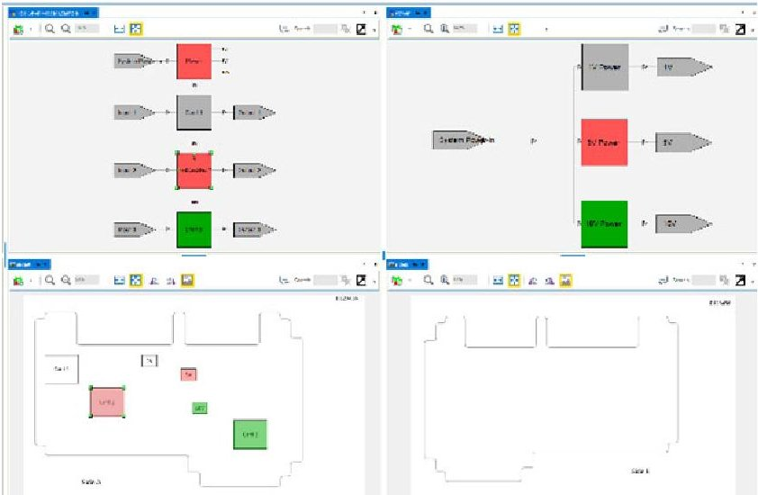
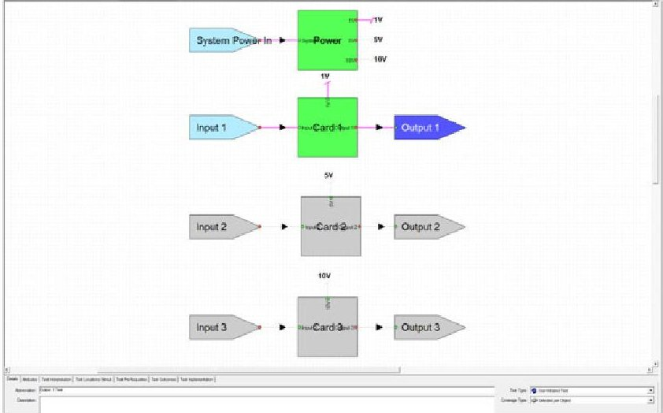
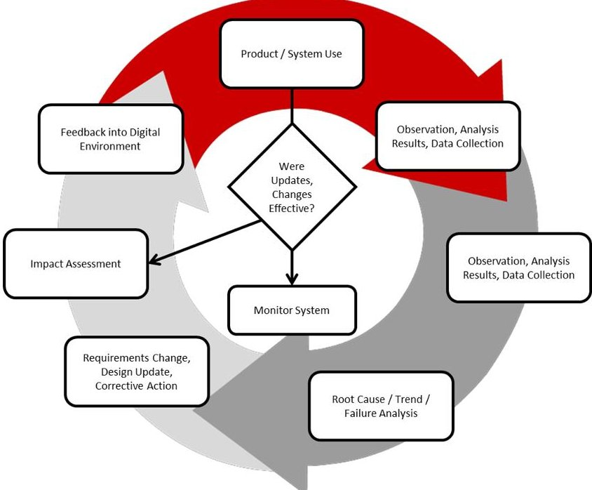
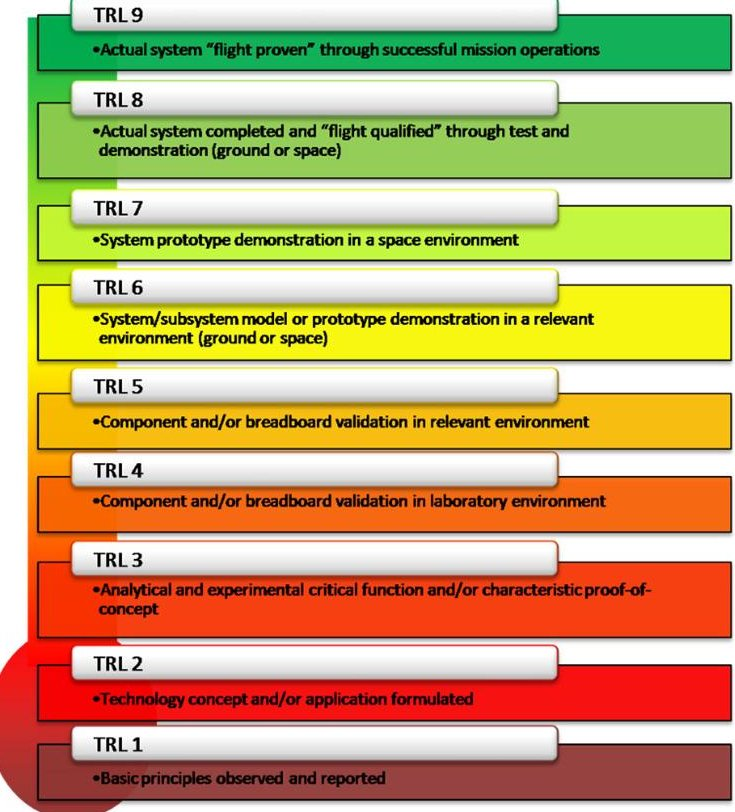

<!-- PDF_PAGE: 1 -->

# Digital Engineering Transformation for Reliability/Maintainability

Raymond Beshears, Raytheon

Jordan Long, Raytheon

Key Words: Reliability, Maintainability, Digital Thread, Digital Twin, Digital Engineering Transformation

## INTRODUCTION

A digital engineering (DE) framework allows for increased rigor and extensibility from product engineering development for Reliability and Maintainability (R&M) design, analyses, and extensions into test development. The digital engineering environment ecosystem facilitates a methodology for assessing the product hardware architecture to optimize R&M requirement development, assessment, and extend into test development applications. In the test development phase, algorithms and foundation software constructs for test development can be added in model repositories and exported for software coding utilization. The DE environment fosters improved integration, quicker defect containment, and a more agile test development cycle through leveraging digital information exchange and layering across models. It enhances the capability to transition engineering domain knowledge from design to test environments, facilitates closed loop update capability for maturation over the lifecycle, and sets up the technical information necessary for robust diagnostic understanding. This paper walks through a digital engineering framework methodology example to showcase the capabilities and benefits that can be realized from the transition between product design and test development phases. Gap areas and challenges are discussed along with recommendations for path forward. In summary, this DE framework capability provides a digital transformation methodology leveraging critical engineering information necessary for successful R&M test and diagnostic frameworks which can be utilized across the product lifecycle.

## 1 DIGITAL ENVIRONMENT FACILITATION/ANALYSIS INTO R&M

Creating complex systems requires large teams of engineers and stakeholders working together. Connected work environments that synchronize efforts will achieve better results and facilitates the interchange of information within large teams [1]. A digital environment is an integrated ecosystem of data interaction which fosters model information interaction and utilization across the product lifecycle. Since the systems that are designed are very complex, the digital environment tends to represent a mixture of models that range from behavior mapping, 3D CAD models, simulators, and so on. When a digital environment is created, digital representations of systems and sub-systems are used in place of spreadsheets, documents, and presentation slides.

In many instances, R&M activities are still performed outside of the DE environment. However, it is strongly encouraged to develop R&M products within the DE to leverage benefits of speed, rigor, and re-use of information throughout the cycle of the program lifecycle.

A digital engineering (DE) framework allows for increased rigor into R&M analyses, design, and extensions into test development, sustainment, and product support. Classical methods involve various R&M artifacts (analyses, work products, reports) which are contained within software tools, documents, and spreadsheets. These artifacts and tools do not have a connection to a digital environment. Extra work typically needs to be expended to manually manipulate the data so it can reside and be maintained in various R&M tools. Overtime, R&M efforts begin to lag behind the development, test, and overall lifecycle of products and systems. When R&M connections are in a digital environment, R&M is able to be in closer lockstep of changes and extensions of utilization across the lifecycle. If the focus is on reliability testing, a digital model can be created to define the test, pass/fail criteria, and testing steps in a dynamic environment. The digital environment contains all the schematics, assembly drawings, requirements, and functions necessary for feeding a digital thread. Digital Thread is the use of digital models/tools to represent design, analyses, simulation manufacturing, and sustainment activities. It is based on an architecture that links/leverages the data in a digital forum across the product lifecycle. As an example, the digital thread for reliability testing could be then automated, or performed in a dynamic manner where specific areas of the reliability testing is focused on and leverage design information across several model sets for speeding up the test plan, test development, test execution and test results. Once the relationship mapping rules sets are automated, a translator capability is created between the DE and R&M tools resulting in a faster test capability, additional rigor in test optimization, and resulting efficiency across the product's lifecycle.

Overall, the digital environment contains various models that consist of data, states, behaviors, and relationships to other models. These relationships between models most directly facilitate the optimization of R&M activities in a systems lifecycle. Developing a capability to chain various models and connect them to R&M models is important for facilitating R&M assessments for a product while leveraging the needed data from the feeding models. A digital thread can be developed across these models for automating cross-model analyses, bill

<!-- PDF_PAGE: 2 -->

of material (BOM) updates, schematic changes, requirement updates, test procedure changes and facilitate faster R&M throughput and efficiency. For example, a digital thread could support automating the reliability and maintainability analysis of an electrical box by integrating model-based definitions of the schematic, BOMs, assembly drawings, functions, R&M prediction libraries or test/field history, and test profiles. The results of the analysis and interchange of data within the thread maintains rigor and reduces the workload across large teams of engineers.

## 2 DESIGN FOR MFG AND TEST

A key component of verifying any product involves test to various degrees. Some of these areas include testing design requirements, integration and test (I&T), qualification tests, manufacturing tests and customer-level tests. Tests can be composed of embedded test, such as Built-In-Test (BIT), or external testing via test equipment. The design and development portion of manufacturing and depot type test environments in the sustainment phase can identify with many challenges through the transition from product design. This paper will focus on manufacturing and depot testing in the sustainment phases, but the methodology can be utilized in any test phase.

Test requirements and test design in the manufacturing sustainment phases depend greatly on the product that needs to be tested. The design information of the product itself is foundational knowledge for executing a plan and associated requirements/design for test. As product designs move toward digital engineering environments using models, the knowledge transfer into tests transitions from gather document artifacts to consuming the digital models and the data within for test application. This new paradigm sets up a digital framework for understanding the design more quickly and applying feedback for testability inputs into the product. Furthermore, digital threads using standards across models set up areas for digital transformation and linkage further accelerating the ability to leverage and build needed data for test.

## 3 DESIGN FOR AUTOMATION, TESTING, SUSTAINMENT

Currently, many factory and depot testing environments use engineers to facilitate testing because of the complexity of the system and the domain knowledge required to probe hardware and determine the location of the fault. Dynamic Functional (DF) models bring together the engineering domain knowledge and the design artifacts (e.g. schematics, hardware drawings, hardware photographs, and test procedures) all in one location for an operator, tester, maintainer, or engineer. Having all the views and documentation in one digital model makes it easier to support test failures and navigate through troubleshooting needs to isolate to root cause fault locations. Often engineers start with a broken piece of hardware, attach it to a test set, and run through a set of tests specified by a test procedure.

Using a DF model approach allows the user to start down a test sequence and as tests fail, rather than following all the tests as scripted in a test procedure, the engineer can change the

order of the tests dynamically to hone in on the suspect components using as few tests (and hours) as possible.

Figure 1. Test Coverage Illustration

Furthermore, as shown in Figure 1, the DF model shows the technician/maintainer which pieces have been checked by the executed tests and their status (green means functioning properly, red is suspected bad, and yellow is a component in the failed path for which there is not enough information to determine if it is good or bad). Overlays with other design information such as drawings, pictures, schematics add additional helpful, additional context to the user.

This simplifies the process of test execution and assimilating the information required to determine suspect hardware by minimizing the number of tests needed to identify suspected faulty components. Digital design data (e.g. schematics, drawings, algorithms, test setup procedures, pictures, etc.), domain knowledge of engineering experience, and historical data can be added to the model to further refine candidate lists to diagnostic understanding within the model, probabilities of suspect items to test results can modified as well. For example, if test A fails then the most likely candidate is component 1, a secondary possibility is component 2. If test B fails, then the primary suspect is component 2, followed by component 3. If both tests A and B fail, then the suspect is very likely component 2.

Figure 2. Test Coverage Illustration

<!-- PDF_PAGE: 3 -->

Test coverage is easily viewable in the graphical user interface (GUI) of the DF model. Just as importantly, gaps in test coverage are easily understood. Even though many programs know their tests and coverage are insufficient, they do not have the full understanding of where test gaps exist to evaluate whether or not tests can be designed and implemented to cover those gaps. Figure 2 illustrates test coverage (green) and non-coverage (gray). In this example, the gray components would indicate gaps in test coverage if no tests in the test set checked those paths.

## 4 TRANSFORM TO CLOSED LOOP CAPABILITIES

A key feature in a digital environment is to have an automated, closed loop, feedback system. Within the environments of the engineering domain are areas that represent the phases of a product's lifecycle. Some of the main phases of the product's lifecycle consist of:

- Requirements that define capabilities and features,

- A design that contains those capabilities and features,

- The testing (verification) that demonstrates the capabilities and features.

- From an R&M perspective, the focus is on transforming necessary data sources and feedback for closed loop capabilities in areas that define R&M:

- sustainment

- maintainability

- reliability

- servicing

- predictable, and demonstratable.

By creating these closed loop features, it is possible to extend the lifecycle of a product further and lower sustainment costs through continuous improvements in R&M. Enhancing and transitioning domain knowledge to a closed loop environment streamlines capabilities of understanding impacts and how associated changes impact the bottom line in a much more efficient manner.

In order to build up the digital environment, a digital twin and a set digital threads need to be created. A digital twin is a virtual representation of a physical product, system, or assembly that can mimic and predict its physical counterparts, controls, workflows, and systems [2]. A digital twin has three components:

1) a digital definition of its counterpart,

2) digital threads that make up the product of systems lifecycle,

3) information models that correlates and presents data in order to make decisions throughout the lifecycle of the product.

The digital thread's aim is to signify the digitization and traceability throughout a product's lifespan. They link all of digital twins capabilities such as the designs, performance data, product data, supply chain data, and software going into creating the product [3]. The digital thread, in combination with digital twins, enable's design requirements, designs, capabilities, features, and all the data that needs to be used or referenced. If a system has a field failure due to a fault in a microelectronics, the digital twin, with traceability across the

lifecycle of the system, is able to assist in identifying the issue.

It is essential that feedback (requirement changes, design updates, and corrective actions) gets incorporated into the digital environment. As the product or system moves along the lifecycle path, feedback will need to be incorporated into the digital environment. When Reliability, Availability, Maintainability, and Testability analyses are updated at intervals, the results and corrective actions taken will need to be fed back into the digital environment. When a test anomaly occurs, the digital model will be used to quickly isolate the cause of the test failure to support repair. As a result of the corrective actions (testing issues, design change, requirements update), the relevant information learned will need to be fed back into the model. By utilizing a closed loop system like that in Figure 3 with automation, an overall increase in the speed and efficiency of models/digital twins development and extensibility within DE is realized helping save time and cost.

Figure 3. Closed Loop Feedback into a Digital Thread

## 5 CHALLENGES-ISSUES/FUTURE WORK

While digital engineering approaches have many advantages, there are also challenges and gaps that need to be identified and worked for longevity of success across the product lifecycle. Model ontologies and reference architectures must be defined within meta-models to achieve the digital thread and mapping of data constructs that flow across models. The digital model infrastructure and ontology and tools for implementation are key to a successful digital environment integration. Skill sets need to be trained and equipped to work within the digital environment with awareness for how model pieces fit together to realize efficient integration into other digital model facets. The cost to setup the digital environment and train can lead to increase costs upfront which can be recovered by the higher efficiency data interchanges across engineering, manufacturing, and sustainment needs. Configuration management aspects, multiple user environments, and proprietary protection controls are a

<!-- PDF_PAGE: 4 -->

challenge in the digital engineering approach that requires methods for proper handling. Features such as tracking multiple model configurations, tagging the digital data with source/configuration insights as well as an upper-level supervisory management approach to handle and track the data interchanges are all challenges that must be solved for widespread utilization. In addition, determining a method for handling digital thread history across the product lifecycle is vital for understanding the pedigree and source information necessary to manage change and "know" what it being leveraged.

Figure 4. Hardware Technical Maturity Level Example

Another key need is a standard model-level maturity assessment similar to Technical Readiness Level standards with hardware shown in Figure 4. This maturity level framework would help evaluate model maturity levels and gap areas of development necessary to move toward higher maturity. It also provides better understanding of model fidelity through handoffs across various utilizations of data.

As these challenges and gaps are addressed and managed across the program lifecycle, the digital engineering approach will be positioned for better alignment across stakeholders, clearer operability across givers/receivers, and understanding of "completeness" within the model environments. In context of the DE approach for R&M and test diagnostic development, working these challenges/gaps will result in more streamlined digital thread environment supporting faster transitions for realizing better sustainment outcomes along with improved manufacturing/depot test solutions with diagnostic frameworks.

## 6 CONCLUSIONS & RECOMMENDATIONS

The DE environment improves integration, allows for quicker defect containment, and provides a more agile test development cycle through leveraging digital information

exchange and layering of data and engineering domain knowledge across models. In addition, it facilitates a closed loop update capability for maturation over the lifecycle improving sustainment and providing the technical information which is necessary for robust diagnostic understanding. Gap areas and challenges need further attention to continue making progress and maturing the DE environment to handle R&M and test needs. In summary, this DE framework capability provides a digital transformation methodology leveraging critical engineering information necessary for successful R&M test and diagnostic frameworks which can be utilized across the product lifecycle.

## REFERENCES

1. Retrieved from https://www.saic.com/features/MBSE-Pushes-Digital-Engineering-Forward

2. Miskinis, Carlos. (2018, November) What does a digital thread mean and how it differs from digital twin. Retrieved from: https://www.challenge.org/insights/digital-twin-and-digital-thread/

3. Hastings, Will. (2019, September) What is a Digital Thread? Retrieved from: https://www.ptc.com/en/blogs/corporate/what-is-a-digital- thread

4. https://www.nasa.gov/directorates/heo/scan/engineering/ technology/technology_readiness_level

BIOGRAPHIES

Jordan B. Long

Raytheon, an RTX Business 13510 North Central Expressway Dallas, TX 75243 USA

## email: jordan.long@rtx.com

Jordan Long is a Sr. Manager and a Reliability, Maintainability, and Availability Subject Matter Expert in the Lifecycle Engineering directorate at Raytheon. Jordan has 20 years of experience in RMA in the domain of Space and Airborne Systems. Jordan focuses on bring creative and innovative solutions to challenging projects. He has been instrumental in capturing new business, building detailed reliability and availability models, and leading teams in a field that is rapidly changing to meat cost, schedule, and customer needs. Jordan's other interests include participating in industry level working group where guidelines and standards are developed. Jordan received a B.S. in Mathematics and a B.S. in Computer Science from California Lutheran University.

Raymond Beshears Raytheon, an RTX Business 2501 W. University Drive MS 8023 McKinney, Texas 75070 USA

e-mail: raymond.beshears@rtx.com

Raymond Beshears is a Technical Fellow in Engineering in Lifecycle Engineering at Raytheon, an RTX business. He is a

<!-- PDF_PAGE: 5 -->

subject matter expert in reliability/maintainability/testability engineering as well as Built-In Test design, and development of diagnostic capabilities. Raymond's interests include working model-based capabilities and solutions as well as applying a digital thread framework to support the full product lifecycle.

He has been instrumental in developing digital threads across models for streamlining development and diagnostic capabilities that support both embedded and factory/depot test troubleshooting. Raymond received a B.S. in Electrical Engineering from Texas Tech University