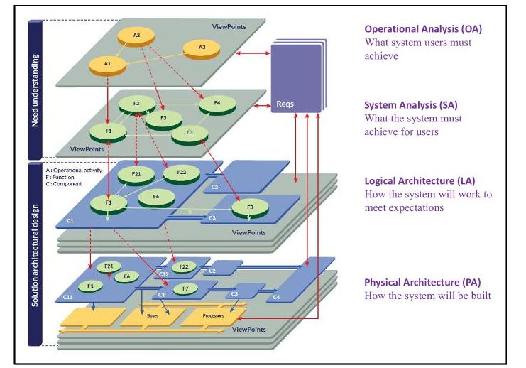
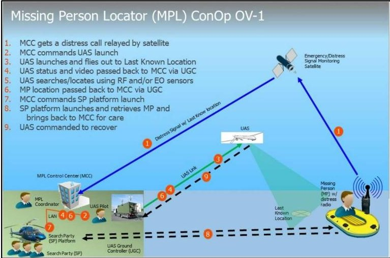
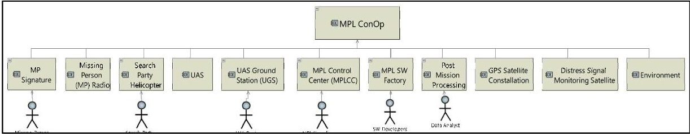
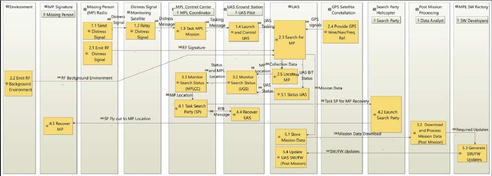
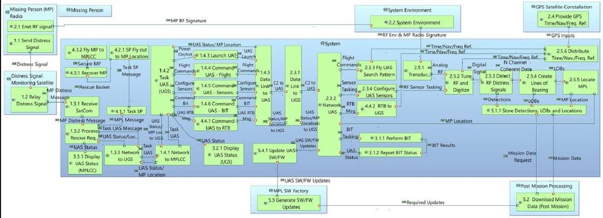
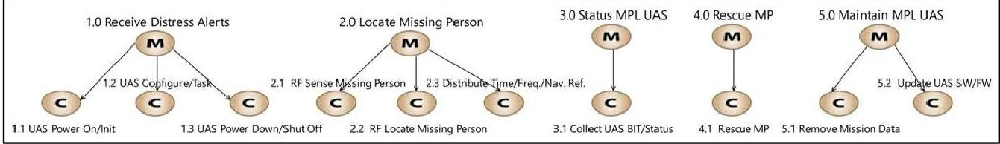
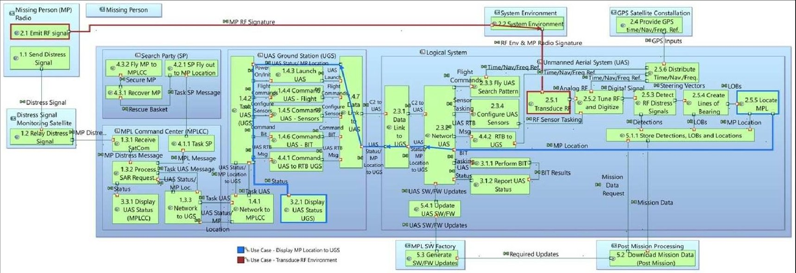
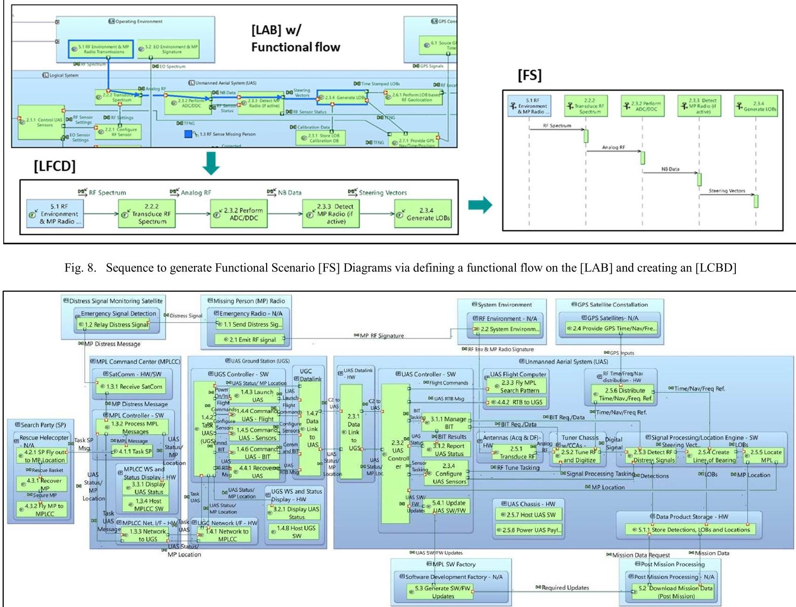
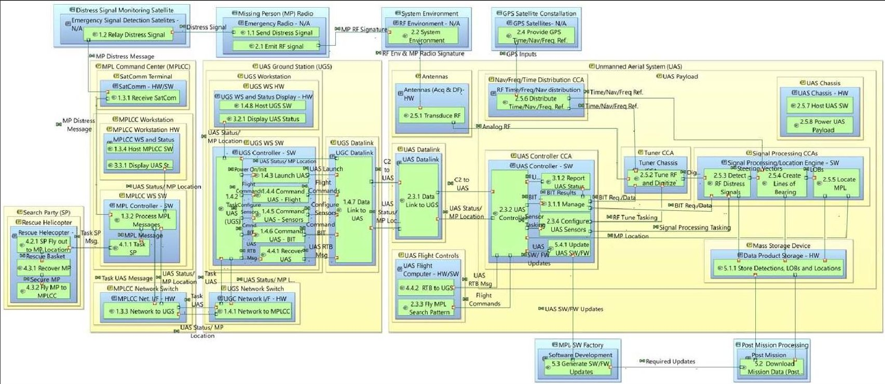

<!-- PDF_PAGE: 1 -->

# A Model Based System Architecture Methodology Leveraging the ARCADIA Method

Eric B. Dano, Ph.D., Senior Member, IEEE

Engineering Management and Systems Engineering Department

George Washington University

Washington, DC (USA)

ericdano@gwu.edu.com

Stephane Lacrampe

Co-founder, CEO

Obeosoft Canada Inc.

Comox, BC (Canada)

stephane.lacrampe@obeosoft.ca

Abstract—System Architecture, its derived requirements and decision analysis performed, are often attributed to defining 70% of the cost and capabilities of a system. However, after nearly two decades of Model Based Systems Engineering (MBSE), there is a lack of architecture focused methodologies and tools to aid programs in creating a robust, transdisciplinary system architecture. One notable exception is the Thales developed Architecture Analysis and Design Integrated Approach (ARCADIA) method. The ARCADIA Architecture Development Method (ADM) provides instance-based methodologies for each ADM step with rich viewpoints and views to ensure a robust architecture is obtained. As the goal of the proposed methodology is to rapidly create a robust, transdisciplinary system architecture, ARCADIA was selected for its native alignment with this goal. However, the ARCADIA method is like a framework and requires a defined methodology to be applied to it to determine what views, and in what order, constitutes the desired architectural model. The proposed methodology defined these elements based on alignment with the IEEE 15288:2015 architecture standard, and to further the goals of ease of learning, rapid modeling, and reduced modeler workload/errors. In addition, the proposed methodology adds multiple supplemental views into the system model to add context and ensure a transdisciplinary architecture is realized. The proposed methodology also stresses the integration of decision analysis and requirements derivation into all ADM steps to ensure a complete architecture is realized prior to the development phase. Some basic qualitative findings from a partial test of the proposed methodology are described herein. A larger quantitative comparison between the proposed methodology and other MBSE standards is planned for Fall 2023.

Keywords—Model Based Systems Architecture, Systems Architecture, ARCADIA Capella

## I. INTRODUCTION - ARCADIA CAPELLA

ARCADIA is a system engineering method, based on architecture-centric and model-driven engineering activities. The ARCADIA method was created by Thales in 2007, placing robust architectural synthesis, and ease of use, as the core of the method [1]. The ARCADIA Operational Analysis, System Analysis, Logical Architecture and Physical Architecture ADM steps directly align with most published architecture ADMs [e.g., 2], and more importantly, directly maps to the architecture steps defined in the technical processes portion of the IEEE 15288:2015 [3]. In fact, ARCADIA is unique in its approach to first abstract itself to better define the "problem space" (15288:2015 "Business or mission analysis process," and

"Stakeholder needs and requirements definition process" steps) before synthesizing the system architecture [4].

The ARCADIA method fully Integrates the three required elements for MBSE: a methodology/framework/meta-model, modeling language and a modeling tool (Capella). The Capella tool has many inherent features such as common methods in each ADM step, with significant error prevention logic, to reduce the modeler's learning curve, modeling time and modeling errors. Capella is an open-source tool and can be downloaded and used freely by individuals or companies [5], [6]. In addition, there are several open-source add-ons that increase the utility of ARCADIA (e.g., requirements viewpoint), and a variety of commercial add-ons, which can be purchased to extend Capella's capabilities [7]. A good description of the ARCADIA method and Capella features are described in [4]. The ARCADIA method serves as an exemplar approach for architecting subsystems, systems, and small systems of systems, which aligns with the architecture needs of most large industries.

## II. OVERVIEW OF PROPOSED METHODOLOGY

For the many advantages described in the previous section, the proposed methodology uses 4 of the 5 defined ARCADIA Method ADM steps as shown in Fig.1 [5]. In addition, the proposed methodology uses only a subset of the defined ARCADIA views, in a specified order (for each ADM step) to minimize redundancy and further reduce modeling time without effecting the model fidelity.

Fig.1. Leveraged ARCADIA Capella 4-Step ADM

<!-- PDF_PAGE: 2 -->

The proposed methodology strongly emphasizes the requirements generation and the use/documentation of decision analysis in each ADM step. Further, the proposed methodology also augments the selected ARCADIA views with some supplemental views for enhanced architectural context.

The supplemental views are either images or text and will be added into generic model objects in the first and the last ADM steps using existing tool features. The supplemental views are in four general categories: 1) views to ensure the architecture meets the customer's Concept of Operations (ConOps), value statements, requirements, constraints, budget, and schedule, 2) views that provide additional context for the architecture, 3) views to document the architectural synthesis process, including risks, opportunities, trade studies/analyses findings, etc., and 4) views used to ensure the architecture was collaboratively developed with the many "ilities" stakeholders.

In addition to the supplemental views, the proposed methodology emphasizes the use of trade/decision analysis methods in all ADM steps to synthesize a robust system architecture. Methods include option generation [8], stakeholder identification [9], trade studies, heuristics, system dynamics [10], modeling and simulation [11], classical methods [12], and formal methods [13]. In [14], these methods were used to analyze an Unmanned Aircraft System (UAS) and serves as an exemplar for this process. A system's "ilities" staff are key stakeholders for all decision analysis findings and need to be part of the review process to ensure a transdisciplinary architecture is achieved [15]. These trades/analyses are performed and documented as part of each ADM step to select the solution that best meets the customer's needs.

System requirements are also a critical output from each ADM step and emphasized in the proposed methodology. The top-level operational capabilities, decomposed in the first two ADM steps (operational and system analysis), will directly translate to system functional requirements, with the subsystem functional requirements defined in ADM step 3 (logical architecture) and the Configuration Item (CI) level functional requirements in ADM step 4 (physical architecture). The system Use Cases are derived in parallel to the functional decomposition and will further define additional functional requirements, as well as identify where performance and other non-functional requirements need to be derived, decomposed, and allocated to meet the system's needs. This combination of traditional functional decomposition and Use Case analysis ensures that a complete architecture and corresponding set of functionality and requirements are defined.

The proposed methodology leverages the power of the highly integrated ARCADIA method/Capella Tool and defines a sequence of views for each ADM step which further reduces the modeler's learning curve, modeling time and modeling errors. With the addition of supplemental views and the focus on requirements generation/decision analyses, it provides an effective means to generate complete IEEE 15288 [3] compliant architectures.

## III. PROPOSED METHODOLOGY APPLIED TO A MISSING PERSON LOCATOR (MPL) SYSTEM

In the following sections, details of the proposed methodology (activities, views, and order) to synthesize a system architecture will be described for each ADM step. To best illustrate the proposed methodology, an exemplar Missing Person Locator (MPL) small System of Systems (SoS) will be modeled. For this example, the MPL customer wants a resilient Unmanned Aerial System (UAS) based solution so that it may be integrated directly with a leveraged MPL Command Center (MCC), UAS Ground Controller (UGC) and Helicopter based Search Party (SP). Customer value statements include a short time to Missing Person (MP) location. The customer provided Operational ConOp (DoDAF OV-1) is shown in Fig. 2. It should be noted that even with a reduced number of architecture views required in this methodology, not all views can be displayed in this paper. The model files with the complete set of views described in this paper may be downloaded at [16].

Fig. 2. Example Customer MPL ConOp

## A. ADM Step 1 - Operational Analysis

The Operational analysis defines what elements/actors are required to meet customer ConOps and defines the high-level Operational Capabilities that the conceptual system needs to meet at an abstract level (before system boundaries are defined). Table 1 lists the views for ADM step 1 (Operational Analysis) in the order dictated by the proposed methodology.

TABLE I. ADM STEP 1- OPERATIONAL ANALYSIS

<table border="1"><tr><td>Order</td><td>View</td><td>Description</td></tr><tr><td>1</td><td>n/a</td><td>Add supplemental views into model for context</td></tr><tr><td>As required</td><td>n/a</td><td>Perform trades/decision analyses, systems thinking and define requirements</td></tr><tr><td>2</td><td>[OEBD]</td><td>Operational Entity Breakdown Diagram</td></tr><tr><td>3</td><td>[OCB]</td><td>Operational Capability (Blank) Diagram</td></tr><tr><td>4</td><td>[OAB]</td><td>Operational Architecture (Blank) Diagram</td></tr><tr><td>5-Optional</td><td>[OAS]</td><td>Operational Activity Scenario Diagram</td></tr><tr><td>6</td><td>[CDB]</td><td>Class Diagram (Blank) – Conceptual Data Definitions</td></tr></table>

<!-- PDF_PAGE: 3 -->

As can be seen, the first step is to add the supplemental views by adding the text or graphical element to a model object so that it can be referenced from within the model. The eight supplemental views include elements to provide additional context to the architecture and include: Architecture Review Staff List, Project Description, Assumptions, ConOps (operational and support), Key Requirements (incudes caveats and value statements), Integrated Dictionary, Acronyms, and System Operational Environment.

The perform trades/decision analyses, systems thinking and define requirements occurs in each of the ADM steps and needs to be documented. Based on the results of the system thinking and various option generation techniques, the [OEBD] is created to define the Entities and Actors required to meet the customer's ConOps (see Fig. 3). The Entities/Actors must represent all aspects of the conceptual system domain including operational elements, support elements, governing organizations, standards, the environment, etc. In the [OEBD] shown in Fig. 3, the example support Entities of "MPL Software Factory" and "Post Mission Processing" are included along with their associated Actors.

The [OCB], defines the top-level system capabilities required to meet the customer's ConOps and value statements and shows the links between the Operational Capabilities and the Operational Entities/Actors defined in the [OEBD]. Like the [OEBD], the [OCB] must contain both operational and support capabilities. In the MPL model [16], you can see that an Operational Capability of "Maintain MPL UAS" is included. It is critical that the architect/modeler solicits for both operational and support based capabilities in this ADM step. This is a prerequisite to defining a complete set of decomposed functions which will be later allocated, aggregated, and partitioned into the system's physical elements, as well as included in the concurrent requirements derivations.

The MPL [OAB] is generated by first creating a column for each Entity/Actor defined in the [OEBD]. The next step is to decompose the Operational Capabilities from the [OCB] into lower-level Operational Activities, allocate the Activities into the appropriate Operational Entities/Actors column in the diagram, and then define the interactions between all Activities. This high-level allocation/aggregation and functional decomposition ultimately aids the architect/modeler in generating a complete architecture, with strong alignment to the IEEE 15288:2015 technical process steps of: "Business or mission analysis," and "Stakeholder needs and requirements definition" [3] prior to architecture generation (see Fig. 4).

The optional [OAS] Scenario diagram (aka Sequence Diagram) can be generated as described in ADM Step 3 for the [FS] view. The [CDB] is used to progressively define the data architecture. In ADM step 1, just the Data Packages (groups of common data types) and high-level data types are defined.

## B. ADM Step 2 - System Analysis

System Analysis will define the system boundaries, decompose the Operational Activities (imported from previous ADM step) into lower-level system functions, and also define the external system interfaces, system use cases, and update the high-level data model. This step begins by importing and

transitioning the artifacts from ADM Step 1 to ADM Step 2 (which is inherent in the Capella tool). Because ARCADIA is instance based [1], the Capella tool knows where artifacts are in the hierarchy, without requiring the user to stereotype blocks. Table 2 lists the proposed views for ADM step 2 (Systems Analysis) in the order dictated by the proposed methodology.

TABLE II. ADM STEP 2 - SYSTEM ANALYSIS

<table border="1"><tr><td>Order</td><td>View</td><td>Description</td></tr><tr><td>1</td><td>n/a</td><td>Import artifacts ADM Step 1→ADM Step 2</td></tr><tr><td>As required</td><td>n/a</td><td>Perform trades/decision analyses, systems thinking and define requirements</td></tr><tr><td>2</td><td>[CSA]</td><td>Contextual System Actors Diagram</td></tr><tr><td>3</td><td>[SAB]</td><td>System Architecture (Blank) Diagram</td></tr><tr><td>4</td><td>[MCB]</td><td>Mission Capability (Blank) Diagram</td></tr><tr><td>5</td><td>[IS]</td><td>Interface Scenario-External Interfaces</td></tr><tr><td>6</td><td>[FS]</td><td>Functional Scenario Diagram</td></tr><tr><td>7-Optional</td><td>[CDB]</td><td>Class Diagram (Blank)-Internal/External Data Definitions</td></tr></table>

Based on the results of the decision analysis used to define the system boundaries, the [CSA] is created to implement the boundary into the model. Capella makes this easy by auto populating the [CSA] view with a dark blue "System" block with all the [OEBD] defined System Entities/Actors linked to it. The architect/modeler simply deletes the System Actors that are internal to the system and adds in any actors that may have been found through decision analysis or missed. With the external System Entities/Actors defined in the [CSA]. The resulting view is a "black box" diagram.

The [SAB] (aka Functional Architecture) view is generated by expanding the dark blue System block so that the Level 0 functions (Activities from the previous ADM step) can be functionally decomposed into Level 1 functions and placed in the system block along with their interfaces to other Level 1 functions and external Level 0 functions. The functional decomposition is done concurrently with the definition of system level functional requirements and provides strong alignment to the ISO/IEC/IEEE 15288:2015 technical process steps of: "System Requirements Definition," and "Architecture Definition" [3] (see Fig. 5). Clearly, if non-functional requirements were not generated in the Operational Capabilities in ADM step 1, they would not have any decomposed functionality or derived requirements in this ADM step.

The [MCB] is used to decompose the System Missions into top-level Use Cases that must be performed in order to meet the customer's ConOps (see Fig. 6). The architect/modeler will derive functional, performance and non-functional requirements from the Use Cases, which are then combined with the derived requirements from the functional decomposition in the [SAB]. This 2-source approach to requirements yields a more complete set of all system functionality/requirements.

The [IS] view is created to define the System's external interfaces. The view is created by adding the system and all external System Entities/Actors as lifelines. The interfaces are modeled differently than flows. Therefore, the links between the system and external entities and flows will need to be

<!-- PDF_PAGE: 4 -->

manually added. Created external interfaces are shown in the interface directory, which facilitates early interface coordination efforts with vendors of the external elements.

The optional [FS] Scenario diagrams can be generated as described in ADM Step 3. For ADM Step 2, the [CDB] is updated to show Data Packages and Data Types, now categorized as either internal or external to the system.

## C. ADM Step 3-Logical Architecture

The Logical Architecture is used to define internal system sub-elements, interfaces, states-modes, and data definition. High-level aggregation (combining) of Level 1 systems functions to common sub-elements is performed based on decision analysis to optimize the aggregated functions. The Logical Architecture also allows for assessment of the system's Use Cases by rapidly creating functional flow and Scenario diagrams for each system Use Case, which is a native capability of the Capella tool. The flow and Scenario diagrams should be vetted with the customer as an early validation activity. Table 3 lists the proposed views for ADM step 3 (Logical Architecture) in the order dictated by the proposed methodology.

TABLE III. ADM STEP 3-LOGICAL ARCHITECTURE

<table border="1"><tr><td>Order</td><td>View</td><td>Description</td></tr><tr><td>1</td><td>n/a</td><td>Import artifacts ADM Step 2→ADM Step 3</td></tr><tr><td>As required</td><td>n/a</td><td>Perform trades/decision analyses, systems thinking and define requirements</td></tr><tr><td>2</td><td>[LCBD]</td><td>Logical Component Breakdown Diagram</td></tr><tr><td>3</td><td>[LAB]</td><td>Logical Architecture (Blank) Diagram</td></tr><tr><td>4</td><td>[IS]</td><td>Interface Scenario-External Interfaces</td></tr><tr><td>5</td><td>[FS]</td><td>Functional Scenario Diagram</td></tr><tr><td>6</td><td>[CDB]</td><td>Class Diagram (Blank)-Internal/External Data Definitions</td></tr><tr><td>7</td><td>[MSM]</td><td>Mode State Machine Diagram</td></tr></table>

The system's sub-elements are determined based on the results of trade studies/decision analysis. The [LCBD] is used to create the sub-elements within the system boundaries defined in the previous ADM step 2. Capella auto populates the [LCBD] with a "Logical System" block. The modeler simply creates a sub-element block for each desired sub-element, adds them in to the view and links them to the "Logical System" block.

The [LAB] is created by adding and expanding the subelement blocks inside the System block so that the defined Level 1 functions can be entered, along with their interfaces to other functions. Level 1 System Functions may be added, deleted or modified in this ADM step. The [LAB] is done concurrently with further definition of the sub-element/sub-system level functional requirements and provides strong alignment to the IEEE 15288:2015 technical process step of, "Architecture Definition" [3] (see Fig. 7 - Note: 2 Use Case threads were created onto the [LAB] as described in the next paragraph).

At the logical architecture level, the Use Cases are mature and reviewed by stakeholders for completeness. A Logical Functional Chain Description [LFCD] is generated for each use case, by selecting a series of Level 0/1 System Functions and interfaces, and then transitioning them into an [FS] Scenario/ Sequence Diagram with System Level 1 Functions for lifelines (see Fig. 8). This allows a project to use the Capella tool to quickly generate all the functional flow artifacts required to

catch any functionality that may have been missed in the traditional functional decomposition.

The created [IS] defines the System's internal interfaces. The internal sub-elements are the lifelines, with the internal functions and interface names manually added to them. Created internal interfaces are shown in the interface directory, which facilitates early interface coordination efforts between sub-element vendors.

For ADM step 3, the [CDB] is updated to show the parameters for each Data Type (internal and external) in the previously defined [CBD]. A [MSM] is created to define the states and modes of the system, including both operational and support states/modes. It is important to define any state/mode dependent requirements concurrently with this step.

## D. ADM Step 4 - Physical Architecture

The Physical Architecture will define the system at the configuration item (CI) level. The decision analysis activities are critical in this ADM step to determine how to best perform the low-level functional allocation (assignment to hardware/ software/firmware/etc., based on heuristics, and required performance), aggregation (combining like elements that are similar to get high cohesion and low coupling between groups of functions), and partitioning (determining the hosting elements for all aggregated functionality based on required performance, available CI formats, leverage, etc.). When complete, this ADM step creates a "White Box" view of system with Level 0 (Subelement), Level 1 (Assembly) and Level 2 (Configuration Item) Node Physical Components (NPCs) defined, with allocated/ aggregated functions contained in the Behavior Physical Components (BPCs) which will be partitioned into the NPCs. All interfaces are defined at this level. Table 4 lists the model views which will be created, and the order that they will be generated as defined by the proposed methodology.

TABLE IV. ADM STEP 4-PHYSICAL ARCHITECTURE

<table border="1"><tr><td>Order</td><td>View</td><td>Description</td></tr><tr><td>1</td><td>n/a</td><td>Import artifacts ADM Step 3→ADM Step 4</td></tr><tr><td>As required</td><td>n/a</td><td>Perform trades/decision analyses, systems thinking and define requirements</td></tr><tr><td>2</td><td>[PAB]</td><td>Physical Architecture (Blank) Diagram-Behavioral Physical Components(BPCs)</td></tr><tr><td>3</td><td>[PAB]</td><td>Physical Architecture (Blank) Diagram-Node Physical Components(NPCs)</td></tr><tr><td>As required</td><td>[IS],[CDB][FS],[MSM]</td><td>Update only if changes were made</td></tr><tr><td>4</td><td>n/a</td><td>Add supplemental views into model for context,</td></tr></table>

Architecture [PAB]s will be defined in two steps. The first step is to create a "behavioral" [PAB] with the sub-elements defined in the [LCBD] and imported from ADM Step 3. The imported sub-elements become the Level 0 BPCs (behavioral sub-elements). One to many Level 1 BPCs (behavioral CIs) are created in each of the level 0 BPCs and define the allocation (typically encapsulated in the Level 1 BPC name) of the functions placed into them. Functions are aggregated into a common Level 1 BPC by the architect/modeler, based on their functional properties (i.e., cohesion and coupling) and required performance. The resulting artifact is the combined functional

<!-- PDF_PAGE: 5 -->

architecture overlaid on top of the behavioral architecture (see Fig. 9).

The second step is to create a new "physical" [PAB] with the physical sub-elements, defined in the [LCBD] and imported from ADM Step 3. The imported sub-elements become the Level 0 NPCs (physical sub-elements). One to many Level 1 NPCs (physical assemblies) are created and placed in each of the level 0 BPCs. Similarly, one to many Level 2 NPCs (physical CIs) are created and placed in each of the level 1 BPCs (physical assembly) based on the partitioning decision analysis findings. The most value to the user is obtained by overlaying the combined functional/behavioral architecture (from the "behavioral" [PAB]) into the physical architecture defined in the second [PAB] to have a complete architectural view in a single artifact. This is achieved by selecting the created Level 1 BPCs and placing them in the Level 1(assembly level)/2 (CI level) NPCs as appropriate. The resulting artifact is the combined physical/functional/behavioral architecture (see Fig. 10).

These two physical architecture steps drive the overall system properties, and especially modularity [17]. If these, properties were not considered in the architecture level decision analyses and implemented into the system, it would be difficult/expensive to implement that attribute in a later system phase. As a heuristic, for a modular system architecture, there is typically a 1:1 mapping between the functional and physical architectures [18] as was implemented in the proposed methodology.

The last views in ADM Step 4 are supplemental views using the technique previously described. The fourteen supplemental views include: Reliability, Maintainability, Availability, Safety, Integrated Logistics Support, Training, Testability, Producibility, Affordability, Interoperability, Mission Planning/Post Mission processing, Modular Open System Approach, Cyber Security and any Special Certification (if applicable). Each view will have a series of domain questions to be addressed by the architect/modeler. The list of questions should be aligned with an organization's engineering standards. These supplemental views and questions are critical to ensure a transdisciplinary system architecture was achieved before moving on to the development stage [15]. As an example, questions for testability may include:

- Were test needs/equipment considered for development? production? sustainment?

- Were test points and BIT incorporated into the system?

- Were testability requirements derived and specified?

- Were applicable test lessons learned reviewed?

- Has the test system architecture been documented?

## IV. ALTERNATIVE ARCHITECTURES

The Operational Analysis is at the conceptual level before the system is defined, and therefore architectural alternatives typically only occur in the later 3 ADM steps. Alternatives must first be assessed through decision analysis, with suboptimal alternatives eliminated from further consideration. In cases where decision analysis can't eliminate alternatives, the process is to clone the model at the ADM step above where the

alternatives are desired, and then work each alternative in their respective model until a baseline is established. An example alternative for the MPL would be a precision location multiUAS swarm as described in [14]. For this example, the alternatives are generated at the System Analysis level since they have different functionality, so the operational Analysis artifacts would be cloned to work each alternative.

## V. LIMITED BETA TEST

Procedures for the proposed methodology were written up and provided to 2 Masters students in a system requirements course. They were tasked with performing the first 2 ADM steps and deriving requirements from the produced ARCADIA artifacts. They were not practicing systems engineers and had no prior system architecture or MBSE experience. While the sample set was too small for any quantitative analysis, the open comments part of the survey collaborated the assertions of ease of use of the proposed methodology:

- "It was incredibly easy to use. I was very surprised that it helped me more than I originally expected it to."

- "It was very interesting to learn the concepts discussed in class with a practical approach (methodology/tool)."

- "The [OEBD] helped me identify the stakeholders of the project . . . it was nice to see them laid out like that."

Collection of the quantitative metrics over a larger sample set of students is planned for the Fall 2023.

## VI. CONCLUSION

This paper presented a proposed methodology using a 4 step ADM subset of the ARCADIA method. The methodology defined a subset of the ARCADIA views to be used in each ADM step and the order in which they would be created in. This approach served to eliminate redundancy and reduce modeling time and modeling errors without effecting the completeness of the defined architecture. To add additional system context that is not covered by current ARCADIA method views, the proposed methodology added supplemental views into the Operational Analysis (8 views on programmatics, environment, definitions, etc.) and Physical Architecture (14 views on "ilities", metrics, and risks and opportunities, etc.) ADM steps. The proposed methodology heavily emphasized the use and documentation of trades/decision analysis in each ADM step. These methods were applied to both the architecture decisions and the requirements elicited from the architectural artifacts. In addition, the importance the architect/modeler working closely with a diverse set of "ilities" staff during the architecture process was emphasized in the proposed methodology.

An exemplar Missing Person Location (MPL) system, classified as a small System of Systems, was used to show an application of the proposed methodology (see [16] for model files with all views). The architectural views were made accurately and quickly due to ARCADIA Capella's instancebased approach, which also institutes several features that significantly lower the learning curve for practitioners, reduce modeling time and reduce possible modeling errors by abstracting elements that are most error prone from the users.

<!-- PDF_PAGE: 6 -->

Because of its architecture-centric origins, and tight coupling of MBSE language, model and tool, ARCADIA Capella simplifies the synthesis of high-fidelity architectures and associated requirements.

The proposed methodology's use of the ARCADIA Capella tool (significant error checking, common tasks in each ADM step, rapid generation of scenario/sequence diagrams, etc.), rigorous decision analysis (to select between architectural alternatives or to determine optimal system solutions), and sound requirements elicitation (functional, performance and

"ilities") leads to a truly robust and transdisciplinary architecture. While this methodology could be implemented using other frameworks/languages (e.g., UAF/SysML), the authors posits that the lack of the inherent Capella development and error checking features would likely lead to a longer modeler learning curve, increased modeling time and likely additional modeling errors [19]. However, for enterprise level applications (e.g., national defense) one would likely have to engage with the frameworks specifically designed for large Systems of Systems.

Fig. 3. [OEAB] Operational Entities and Actors Diagram

Fig. 4. [OAB] Operational (aka Conceptual) Architecture Diagram

Fig. 5. [SAB] System (aka Functional) Architecture Diagram

<!-- PDF_PAGE: 7 -->

Fig. 6. [MCB] Mission Capability (M) Diagram (top level Use Cases are Cs)

Fig. 7. [LAB] Logical Architecture Diagram with Use Case threads shown

Fig. 9. Behavioral [PAB] Physical Architecture Diagram

<!-- PDF_PAGE: 8 -->

Fig. 10. Physical [PAB] Physical Architecture Diagram with Behavioral [PAB] overlayed

## REFERENCES

[1] S. Bonnet, J. Voirin, D. Exertier and V. Normand, 2016, "Not (strictly) relying on SysML for MBSE: Language, tooling and development perspectives: The Arcadia/Capella rationale," Annual IEEE Systems Conference (SysCon), Orlando, FL., 2016.

[2] H. Sillitto, Architecting Systems - Concepts, Principles and Practice College Publications - Systems Series, Volume 6, UK, 2014.

[3] ISO/IEC/IEEE 15288:2015 Standard, 'System and software engineering System lifecycle processes',

[4] S. Alai, 'Evaluating ARCADIA/Capella vs. OOSEM/SYSML for System Architecture development', Masters Thesis Purdue University, Indianapolis, IN (USA), 2019.

[5] J. Voirin, 'Model-based System and Architecture Engineering with the ARCADIA Method', Elsevier Publishing, 2018.

[6] Eclipse ARCADIA Website, "Capella v6.0 Download Website," https://www.eclipse.org/downloads/download.php?file=/capella/core/products/releases/6.0.0, viewed 5/25/2023.

[7] Eclipse ARCADIA Website 'Capella Add-Ons Website', https://www.eclipse.org/capella/addons.html, viewed 5/25/2023.

[8] A. M. Madni, "Generating novel options during System Architecting: Psychological Principles, System Thinking, and Computer-Based Aiding," Systems Engineering, Vol. 17, No. 1, 2014, pp. 1-9.

[9] Douglas A, Mazzuchi T & Sarkani S 2020 'A stakeholder framework for evaluating the -ilities of autonomous behaviors in complex adaptive systems', Systems Engineering. 2020 Sep; 23(5): pp. 633-655.

[10] J. Monat and T. Gannon, Using Systems Thinking to Solve Real-World Problems, College Publications - Systems Series, Volume 8, UK, 2017.

[11] E. Ordoukhanian, and A. M. Madni, "Introducing resilience into multi-UAV system-of-systems network," In: Madni A., Boehm B., Ghanem R., Erwin D., Wheaton M. (eds.), Disciplinary Convergence in Systems Engineering Research, Springer, pp. 27 -39, 2018.

[12] H. Hwang, K. Lansey and R. Quintanar, "Resilience-based failure mode effects and criticality analysis for regional water supply system," Journal of Hydrodynamics, IWA Publishing, Vol. 17, Issue 2, March 2015, pp193-210.

[13] M. Sievers and A. M. Madni, "A flexible contracts approach to systems resiliency," IEEE International Conference on Systems, Man and Cybernetics, San Diego, CA., Oct 5-8, 2014.

[14] E. Dano, 'Resilient system engineering in a multi-UAV system of systems (SoS)', International Symposium on Systems Engineering (ISSE), 2019.

[15] A. M. Madni, Transdisciplinary Systems Engineering, Springer International Publishing, 2018.

[16] Missing Person Locator (MPL) full model file link: https://obeo-mirrorcapella-releases.s3.eu-west- 1.amazonaws.com/models/Missing_Person_Locator_Example.zip (to be opened using Capella v6.0.0 (see [6]))

[17] E. Dano, "Importance of reuse and modularity in system architecture," International Symposium on Systems Engineering (ISSE), 2019.

[18] K. Ulrich, Chap 12, Fundamentals of Product Modularity, In: S. Dasu, C. Eastman (eds) Management of Design, Springer, Dordrecht, pp. 219-231, 1994.

[19] M. Pierce & B. Cameron, "A sheep in wolf's cloths: SysML is not living up to the hype of revolutioning product development," https://www.linkedin.com/posts/keith-jacobsen-07287363_a-sheep-inwolfs-clothing-sysml-tsp-white-activity-7105664212076564480-qTde/ Technology Strategy Partners White paper, 2023.