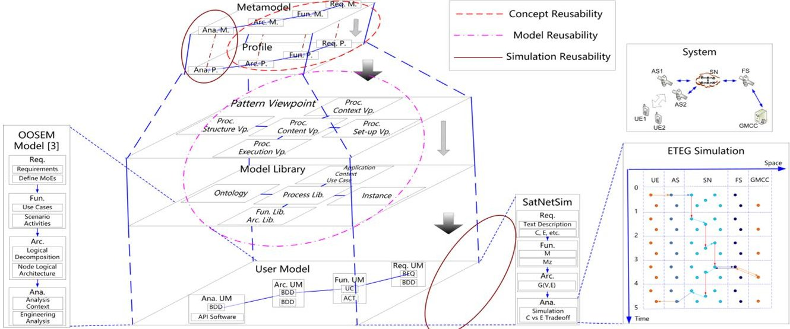
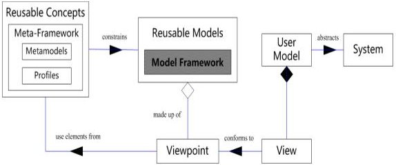
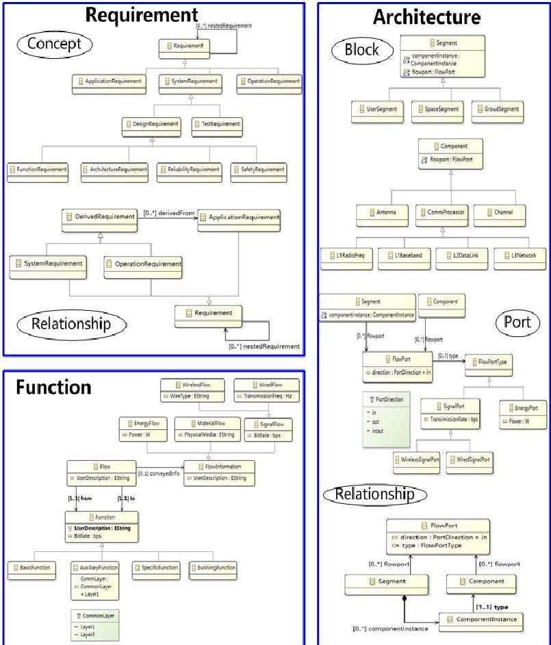
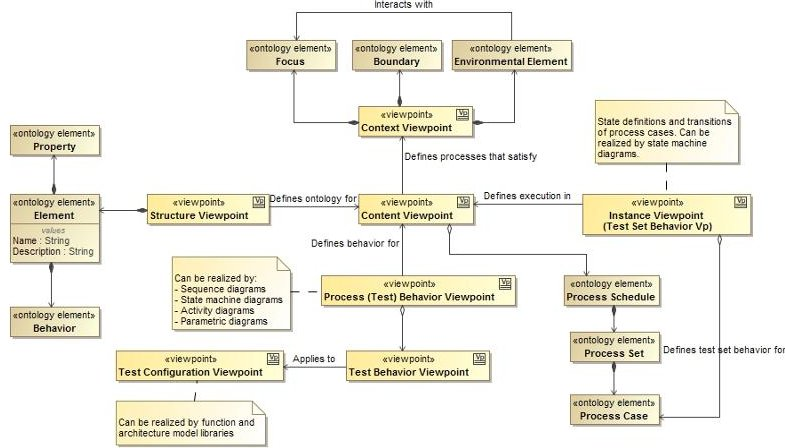
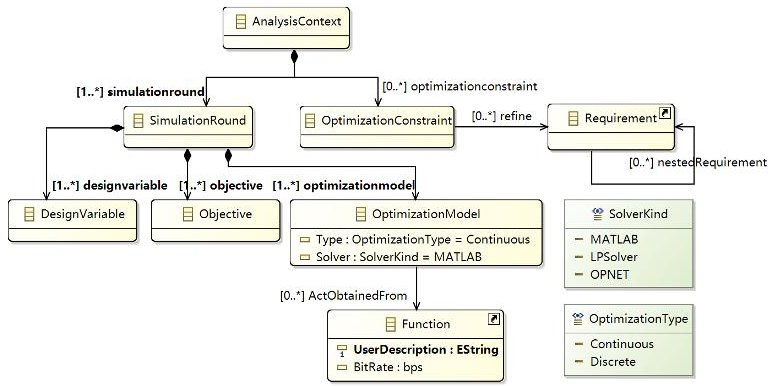
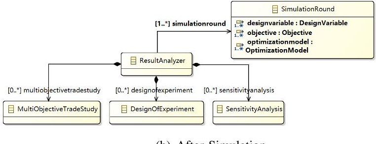
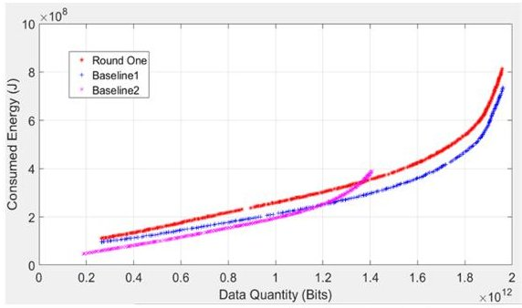
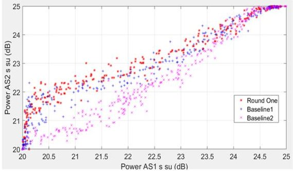
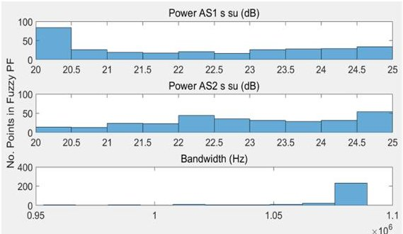
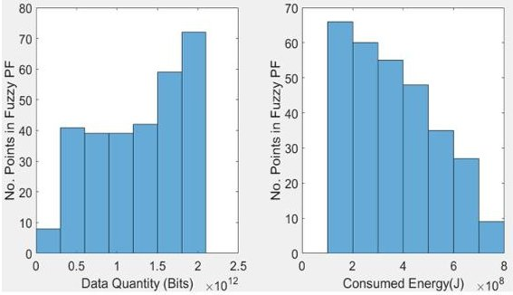

<!-- PDF_PAGE: 1 -->

# Reusable MBSE Modeling and Simulation for Satellite Network

Su Gao, Yue Cao, Zhigeng Fang and Shikun Xie

Abstract—Model-based approach with reusable mechanisms can serve as an effective way for complex system architecting. In this paper, satellite network as an example of complex system is modeled in a reusable manner using the system modeling language (SysML) together with pattern viewpoints and simulation constructs. Based upon abstract syntax descried using metamodels and a set of profiles, concept reusability is established for the specific domain. Additionally a reusable modeling framework is developed with tailored design patterns and multiple viewpoints. Analysis metamodel and profile are further presented to preserve reusability during iterations among multiple optimization rounds of product development. A novel satellite network simulation model is formulated to integrate with multi-level SysML models. Multi-objective optimization is solved by transformation under practical application scenarios. Results show that the model captures comprehensive system features and the model-based mechanism is extensible along the system lifespan.

Index Terms-Reusability, satellite network, domain specific model, pattern viewpoint, simulation, multi-objective optimization

## I. INTRODUCTION

SYSTEM architecting should satisfy requirements derived from stakeholder needs during the whole product lifecycle. Reusable models allows extensions and tailoring of the model when new needs arise. Metamodeling of the system modeling language (SysML) [1] provides concept reusability mechanism by allowing domain specific extensions to the language. A modeling and architecting framework using the INCOSE Object-Oriented Systems Engineering Method (OOSEM) [1] for satellite communication network can be found in [2]. To construct reusable models that can be applied at various stages of the problem and to other similar type of problems, the idea of pattern has been introduced [3]. Reusable mechanism should be extended from within the modeling software to the set of multi-disciplinary simulation software and hardware [4].

Considering multi-disciplinary simulation in the satellite network domain, [5] has set up a multi-objective optimization incorporating communication capacity and satellite energy consumption. But it considered only geostationary earth orbit (GEO) satellite which has simpler application scenario than low earth orbit (LEO) satellite networks. By taking the frequently-changed topology of LEO satellites into account, [6] investigated energy consumption as constraint to the

maximization of system capacity in a mission-aware topology design. But the model was not reusable for further detailed implementation and complicated multi-step optimization limited its use in practical scenarios. Energy-efficient routing for LEO network was considered in [7] with power allocation to various functions onboard the satellite investigated. But it did not take the satellite-to-ground transmission link into account, which consumes the most energy in satellite payload.

The main contributions of this paper include:

- Domain metamodels are established with stereotypes utilized to add new language concepts. A set of profiles, SysML4SatNetSim, is developed and reusable concepts in satellite network domain is thus formulated. SysML model following the OOSEM procedure [2] is reinvestigated and design patterns [3] are modified to build up a reusable modeling framework. In this way, SysML models will have a rigorous structure which speeds up the modeling cycle by distributing relevant patterns, rather than a random collection of diagrams.

- A novel satellite network simulation model is presented for the integration with multi-level SysML models. The extended time-evolving graph (ETEG) [6] is extended to model satellite communication network. Different layers based on communication protocol levels are separated for identifying resource utilization. With practical application scenarios for LEO satellite network, a multi-objective optimization problem is formulated and solved to provide Pareto solution set. Consumed energy, considering both user downlink [6] and inter-satellite link [7], reflects comprehensive energy consumption and assists architecture value updates in the SysML model.

This paper is organized as follows. Section II gives an overview of the whole reusable framework. Section III presents SysML-based modeling and architecting approaches for concept, model and simulation reusability. Multi-objective optimization problem based on ETEG satellite network is established in Section IV. A case study with practical application scenarios is modeled and simulated in Section V where results are compared with other works. The paper is concluded in Section VI.

## II. METHOD OVERVIEW

OOSEM-based satellite network modelling and simulation [2] provides a complete system engineering procedure for satellite system architecture optimization. The elements developed during this procedure can be divided into requirements, functions, architectures and analysis as illustrated at the left of Fig. 1.

<!-- PDF_PAGE: 2 -->

Fig. 1. Method Overview.

To improve efficiency and reconfigurability of the model development, concept reusability should be considered first. Metamodels supporting satellite network domain specific concepts as shown at the top of Fig. 1 should be used. Next, profiles should be developed in the specific application domain. Stereotypes are utilized to add new language concepts, which are grouped together in special packages called profiles. A stereotype is extended based on one or more metaclasses in a reference metamodel. In this work, metaclasses closest to the domain concepts are chosen to create stereotypes. Based on this, a collection of stereotypes in the given satellite network simulation domain forms a profile under the name SysML4SatNetSim.

A second-stage reusable mechanism is to develop a model framework using elements from metamodels and profiles in the reusable concepts. As illustrated in Fig. 2, system is abstracted by user model which are formed with a number of views. Each view is manifested in one or more SysML diagrams. The user model, however, should not just be a random collection of diagrams, but with a rigorous structure. The structure of the model is defined by the model framework. The views in the user model should conform to viewpoints which are parts of the model framework. A pattern [3] has a number of viewpoints and one or more patterns are used in a framework with intended purpose and application. Pattern viewpoints and model libraries developed based on them forms the model reusability mechanism as shown in Fig. 1.

Fig. 2. Model Reusability and Other Elements.

The third-stage, simulation reusability, is facilitated by analysis modeling in SysML and its interaction with multidisciplinary simulation tools, shown as the two circles with solid lines for simulation reusability in Fig. 1. Analysis

metamodels and profiles should be developed to define data exchanged before, during and after simulation. Multi-objective optimization results obtained in simulation tools such as Pareto set and relevant design variable values are returned to the modeling tool, which can further be analyzed in SysML to get suggested architecture point to update model values. Analysis models and interface between modeling and simulation tools should be reusable in that, when more parameters are added to reflect more complex system characteristics, system architecting relying on model-simulation interface can easily be extended without setting up the interface again.

## III. REUSABILITY

## A. Concept Reusability: Domain Specific Language Definition

Domain specific metamodel in this paper is developed in EcoreTools following the MOF 2.0 rules. Satellite network metamodel consists of requirement, function, architecture and analysis metamodels. The first three are presented in Fig. 3.

Requirement metamodel describes methods to model system requirements. Requirement can be divided into application, system and operation requirements. Function metamodel describes system function modeling mechanism. Functions are realized as activities in SysML. Flow is used to deliver message between function activities. Architecture metamodel gives system architecture modeling methods. Satellite network system architecture is formed by two types of elements, segment and component. The profile SysML4SatNetSim has four sub-profiles corresponding to the metamodels.

## B. Model Reusability: Framework with Pattern Viewpoints and Model Libraries

A framework-based approach is outlined and key issues of relevant patterns are considered to ensure the consistency and reusability of viewpoints and model libraries. The "Seven Views" Framework of process modeling (Fig. 16.4 of [3]) considers processes with activities together with their application context and execution behavior. This is conceptually similar to the network simulation framework and thus is chosen as a baseline of our reusable model framework.

<!-- PDF_PAGE: 3 -->

Fig. 3. Requirement, Function and Architecture Metamodels.

However, not all the viewpoints in the "Seven Views" Framework are suitable or necessary for establishing specific simulation application so the framework needs to be modified. The modification is illustrated in Fig. 4. Structure Viewpoint (Ontology) defines ontology for the content viewpoint by describing model elements in terms of their properties and behaviors. It also defines, for one element, the relationship with other elements and how it breaks down into parts. Content Viewpoint (Process Library) works as a core of the whole framework as it defines the processes to be executed in various stages of the simulation and thus can be regarded as a process library. It is modified from the test structure viewpoint of the test pattern from [3] to account for satellite network simulation characteristics.

Fig. 4. Modification of Process Modeling for Satellite Network Simulation.

## C. Simulation Reusability: Analysis Modeling and Design-Analysis Interaction

Analysis metamodel gives modeling methods for analysis as shown in Fig. 5. Optimization model used during simulation should obtain activities from function models. Thus, a newly defined relation ActObtainedFrom is used for this type of connection. Analysis profile designed based on the metamodel relates design in SysML and simulation in multidisciplinary software. Analysis user model developed based on analysis profile has relations with requirement, function and architecture models. The obtained Pareto set and design variable values are sent back to the system modeling tool.

(a) Before and During Simulation

(b) After Simulation

Fig. 5. Analysis Metamodel.

## IV. MULTI-OBJECTIVE SATELLITE NETWORK ARCHITECTING

## A. Extended Time-Evolving Graph for Satellite Communication Networks

Satellite communication network simulation is within the system engineering framework discussed in previous sections where detailed optimization are carried out across multiple layers of the system. The time-varying topology of LEO satellite network due to orbit movement relative to the earth surface can be characterized by predictable connections among satellites [9]. In this context, the network model can be expressed by using the (ETEG) [10] which characterizes network resources in both spacial and temporal dimensions.

A general satellite communication network consists of a set of user equipments $ U=\{u_{1},u_{2},\dots,u_{L}\} $ , satellites $ S=\{s_{1},s_{2},\dots,s_{M}\} $ and ground stations $ G=\{g_{1},g_{2},\dots,g_{N}\} $ . A time-slotted system [10] divides the topology and real-time connections of the network elements into consecutive time slots indexed by $ t\in\Gamma=\{1,\dots,T\} $ . Each time slot has a duration of $ \Delta \tau $ and the network topology and connection is

<!-- PDF_PAGE: 4 -->

fixed during each time slot. The ETEG representation is thus defined as follows.

Definition 1: ETEG Representation for Satellite Communication Network. Define a satellite communication network by a directed graph $ \mathcal{G}(\mathcal{V},\mathcal{E}) $ . The set of vertices is denoted as $ \mathcal{V}=\mathcal{V}_{u}\cup \mathcal{V}_{s}\cup \mathcal{V}_{g} $ where $ \mathcal{V}_{u},\mathcal{V}_{s} $ and $ \mathcal{V}_{g} $ correspond to the replicas of user equipments, satellites and ground stations, respectively. The set of arcs is denoted as $ \mathcal{E}=\mathcal{E}_{l}\cup \mathcal{E}_{b} $ where $ \mathcal{E}_{l} $ is the set of link arcs and $ \mathcal{E}_{b} $ is the set of processing arcs. $ \mathcal{E}_{l} $ can be further divided as $ \mathcal{E}_{l}=\mathcal{E}_{su}\cup \mathcal{E}_{ss}\cup \mathcal{E}_{sg} $ where $ \mathcal{E}_{su}, $ $ \mathcal{E}_{ss} $ and $ \mathcal{E}_{sg} $ models the user links, inter-satellite links (ISLs) and feeder links, respectively.

The graph elements should be expressed with time-slotted notations for modeling and calculation:

- The sets of vertices can be expressed as $ \mathcal{V}_{u}=\{u_{i}^{t} \mid u_{i} \in U,1 \leq t \leq T\} $ $ \mathcal{V}_{s}=\{s_{i}^{t} \mid s_{i} \in S,1 \leq t \leq T\} $ and $ \mathcal{V}_{g}=\{g_{i}^{t} \mid g_{i} \in G,1 \leq t \leq T\} $

- The arcs in $ \mathcal{E}_{su} $ model the links between user equipments and the satellite network in each time slot, i.e. $ \mathcal{E}_{su}=\{(s_{i}^{t},u_{j}^{t})\cup(u_{j}^{t},s_{i}^{t})\mid 1\leq t\leq T,u_{j} $ within $ s_{i} $ coverage in $ t \} $ . The arcs in $ \mathcal{E}_{ss} $ model the ISLs between satellites within the satellite network in each time slot, i.e. $ \mathcal{E}_{ss}=\{(s_{i}^{t},s_{j}^{t})\cup(s_{j}^{t},s_{i}^{t})\mid 1\leq t\leq T,s_{j} $ within $ s_{i} $ coverage in $ t \} $ . The arcs in $ \mathcal{E}_{sg} $ model the links between the ground station and the satellite network (feeder link) in each time slot, i.e. $ \mathcal{E}_{sg}=\{(s_{i}^{t},g_{j}^{t})\cup( g_{j}^{t},s_{i}^{t})\mid 1\leq t\leq T,g_{j} $ within $ s_{i} $ coverage in $ t \} $ .

- Processing arcs are modeled to represent the capability of satellites to store data between consecutive time slots. The set of such arcs is denoted as $ \mathcal{E}_{b}=\{(v_{i}^{t},v_{i}^{t+1})\mid v_{i}^{t}\in \mathcal{V}_{s},1\leq t\leq T-1\} $

Information passing through the network should be encapsulated according to certain protocols such as the open system interconnection (OSI) model [11]. Satellite payload can be designed as "transparent" to perform only physical layer (layer 1) functions, or with onboard processing to include data link layer (layer 2), network routing (layer 3) and upper layer capabilities. The following definition is to classify payload functionalities into different protocol layers.

Definition 2: Layer Label. Label $ y\in\{1,...,Y\} $ represents the highest layer of the information to be processed in a satellite payload following a predefined communication protocol, where Y is the highest layer in the protocol.

Example 1: Non-real time mission flows can be transmitted in the satellite network only in the physical layer with y=1 and higher layer access and routing are left to ground station. Real-time missions requires that the payload should be equipped with network routing with y=3 to process the information and find routing within satellites as it may be a waste of time to go back to the ground stations. Protocols following the OSI standard have Y=7.

It is necessary to treat information flows from various layers separately since they bring different capability (transmission capacity, satellite network level) or requirement (power, satellite platform level) to the model. The layer label is thus regarded as a shared parameter among network, satellite and payload/platform level MBSE models which can further be

related to parameters of these levels. As seen in the previous example, layer label represents mission classification in network level. It also guides platform power allocation to the payload as higher level processing requires more power.

Let $ M_{z} $ be a mission carried out by the satellite network with $ 1\leq z\leq Z $ , where Z is the total number of missions for the application scenario concerned. Each mission $ M_{z} $ can be divided into a number of flows to be transmitted in the network.

Definition 3: Flow and Flow Element. Define the $k$-th flow of the $z$-th mission with label $y$ as $f_{k_z}(y)$. In the ETEG framework, a flow is characterized within each time slot $t$ and allocated to certain user equipment $i$ where $1 \leq i \leq L$. Define flow element as $f_{k_z}(i,t,y)$, which allocates $f_{k_z}(y)$ to the $i$-th user equipment (started by user $i$) in the $t$-th time slot.

It can be deduced that the set of flows corresponding to a user equipment is $ f_{k_{z}}(i,y)=\{f_{k_{z}}(i,t,y)\mid 1\leq t\leq T\} $ The set of flows originated in certain time slot t is $ f_{k_{z}}(t,y)=\{f_{k_{z}}(i,t,y)\mid 1\leq i\leq L\} $ . Thus, a flow is thoroughly captured by its flow elements in all the related UEs and time slots, i.e. $ f_{k_{z}}(y)=\{f_{k_{z}}(i,t,y)\mid 1\leq t\leq T,1\leq i\leq L\} $ . The formal definition of a mission is hence as follows.

Definition 4: Mission. A mission is defined as $ M_{z}=\Psi_{1\leq k_{z}\leq K_{z}}f_{k_{z}}(y) $ , where $ \Psi $ represents the arrangement of the $ K_{z} $ flows of the mission $ M_{z}. $

The set of all the missions for the application scenario with $ Z $ missions in total is represented as $ \mathcal{M}=\cup_{1\leq z\leq Z} M_{z}. $

Multi-objective optimization provides tradeoff between two conflicting functions. The tradeoff achieved among the two gives a set of non-dominated solutions known as the Pareto optimal solutions [12]. Fuzzy Pareto front is often obtained by using heuristic algorithms, determining a set of near-optimal solutions for designers to choose.

A number of notations are firstly defined to be used in the optimization problem.

TABLE I

NOTATIONS FOR SATELLITE NETWORK MODEL.

<table border="1"><tr><td>No.</td><td>Symbol</td><td>Definition</td></tr><tr><td>1</td><td>i-s-su</td><td>Satellite i payload to send signal from satellite i to users (through user link)</td></tr><tr><td>2</td><td>i-s-ss</td><td>Satellite i payload to send signal from satellite i to other satellites (through ISL)</td></tr><tr><td>3</td><td>i-r-us</td><td>Satellite i payload to receive signal from users to satellite i (through user link)</td></tr><tr><td>4</td><td>i-r-ss</td><td>Satellite i payload to receive signal from other satellites to satellite i (through ISL)</td></tr><tr><td>5</td><td>i-p</td><td>Satellite i payload to do onboard processing</td></tr></table>

The multi-objective optimization problem aims at maximizing system capacity C while at the same time minimizing total power consumption in the satellite network:

$$
\begin{array}{l} \max C = \max \sum_ {f _ {k _ {z}} (y) \in \mathcal {M}} \sum_ {s _ {i}: \left(s _ {i}, u _ {j}\right) \in \mathcal {E} _ {s u}} R \left(P _ {i - s - s u}\right) \\ \min P = \min \sum_ {f _ {k _ {z}} (y) \in \mathcal {M}} \sum_ {s _ {i} \in \mathcal {V} _ {s}} \left(P _ {i - s - s u} + P _ {i - s - s s}\right) \\ + P _ {i - r - u s} + P _ {i - r - s s} + P _ {i - p}) \\ \end{array}
$$

<!-- PDF_PAGE: 5 -->

For system capacity maximization, the rate can be calculated as

$$
R \left(P _ {i - s - s u}\right) = B _ {0} \log \left(1 + S N R _ {i}\right)
$$

with

$$
S N R _ {i} = \frac {g _ {i} ^ {2} P _ {i - s - s u} (O B O)}{N _ {0} B _ {0}}
$$

where (according to [13])

- $ P_{i-s-su}(OBO) $ is the power allocated to the $ i-s-su $ link with TWTA output backoff OBO;

- $ g_{i} $ is the link gains and losses including satellite beam antenna gain towards the intended coverage area, gain of the receiving antenna, free space loss and other losses;

- $ N_{0} $ is the noise power spectral density depending on the receiving antenna and equivalent noise temperature;

$ B_{0} $ is the signal bandwidth.

For power consumption minimization, it is known that the payload sending signal from satellite i to ground user equipment is the transmission rate bottleneck among all the payload links. Thus, the rate calculated from $ P_{i-s-su} $ is regarded as the rate the satellite can transmit for the UE service. Power consumption by other payload functionalities can be calculated from $ P_{i-s-su} $ as:

$$
P _ {i - r - u s} = \alpha_ {r - u s} \cdot R \left(P _ {i - s - s u}\right)
$$

$$
P _ {i - s - s s} = \alpha_ {s - s s} \cdot R \left(P _ {i - s - s u}\right)
$$

$$
P _ {i - r - s s} = \alpha_ {r - s s} \cdot R \left(P _ {i - s - s u}\right)
$$

$$
P _ {i - p} = \mu \cdot \left(R \left(P _ {i - s - s u}\right)\right) ^ {\gamma}
$$

where the values of $ \alpha_{r-us},\alpha_{s-ss},\alpha_{r-ss},\mu $ and $ \gamma $ can be determined based on the model in [7].

Services originated from ground UEs arrives at access satellites randomly according to certain arrival rate. Meanwhile, an NGSO satellite moves relative to the earth surface so there is only a periodical fixed time duration that the satellite can serve the ground UEs. Therefore, capacity calculation can be transformed to data quantity Q transmitted for services generated when UEs are within the satellite coverage area. Similarly, power calculation can be transformed to energy E consumed in the network for transmitting the service. The optimization problem can thus be rewritten as

$$
\begin{array}{l} \max Q = \max \sum_ {f _ {k _ {z}} (y) \in \mathcal {M}} \sum_ {s _ {i}: \left(s _ {i}, u _ {j}\right) \in \mathcal {E} _ {s u}} \\ R \left(P _ {i - s - s u}\right) \cdot t _ {d u r} \left(P _ {i - s - s u}\right) \\ \min E = \min \sum_ {f _ {k _ {z}} (y) \in \mathcal {M}} \sum_ {s _ {i} \in \mathcal {V} _ {s}} \\ \left[ \left(P _ {i - s - s u} + P _ {i - r - u s}\right) \cdot t _ {d u r} \left(P _ {i - s - s u}\right) \right. \\ + \left(P _ {i - s - s s} + P _ {i - r - s s} + P _ {i - p}\right) \cdot T _ {m i n} ] \\ \end{array}
$$

where $ t_{dur} ( P_{i-s-su} ) $ represents the time duration with service arrivals when UEs are within the coverage area of the satellite. It is a function of $ P_{i-s-su} $ since the power level of satellite downlink transmission determines the duration

that UEs can connect to the satellite. $ T_{min} $ is the minimum simulation time for the service transmission in the network when satellite power levels for all the functionalities are above a pre-specified threshold. i-s-ss, i-r-ss and i-p links consumes energy for the service no matter whether the ground link is connected or not; so the time used when calculating their energy consumption is the whole simulation time $ T_{min} $ On the other hand, i-s-su and i-r-us links only consumes energy when the satellite and UEs are connected.

## V. CASE STUDY AND RESULT ANALYSIS

## A. Case Study Setup

The optimization of objectives Q and E are considered with respect to optimizing design parameters within one satellite. Three factors are considered in mission setup for simulation including Access Point for UEs connecting to satellites, Protocol Level of flows requiring different satellite resources, and Service Type supported by different UE capabilities. Simulation parameter values are as follows. Output power $ P_{i-s-su} $ is set within the range of 20 to 25 dBW. $ \alpha_{s-ss} $ is 0.05 W/Mbps. $ \alpha_{r-us}, $ $ \alpha_{r-ss} $ and $ \mu $ are all set to 0.01 W/Mbps. $ \gamma $ is set to 1.4.

## B. Result Analysis

With pre-specified design variable ranges, multi-objective optimization simulation using genetic algorithm is performed to obtain fuzzy Pareto front architecture points. Population size is set to 1000 with Pareto fraction 30% and 200 generations. Non-dominated objective values are returned with corresponding design variable choices.

1) Round-One Results (Two DVs) and Comparison: Round-one simulation with two design variables is carried out and the Pareto front of two-objective tradeoff is illustrated in Fig. 6. Two baseline results using algorithms from literature is also included in the figure. Baseline 1 uses the GreenSR algorithm in [7] which considered only inter-satellite link energy consumptions and the traffic model did not distinguish different traffic types. Baseline 2 uses the OP-GMS method in [8] which allocated power with downlink channel status but did not take in energy consumed in the space network. The results show that, by considering both user link and inter-satellite links, the model captures comprehensive system energy consumption. This is also interpreted that, at some locations, the Pareto front obtained with various traffic types (Round One) provides better performance for the one with uniform traffic (Baseline 2).

What is concerned is the effect of modeling to design variable choices. As illustrated by the round-one points in Fig. 7, most non-dominated points allocate more power in AS2 than in AS1. This is because AS1 executes more intersatellite transmissions than AS2 which take some portion of the power to be allocated to downlink transmission. This shows the importance of making satellite design choices based on a power model considering all transmission links, which gives more practical suggestions for system architecting.

<!-- PDF_PAGE: 6 -->

Fig. 6. Objective Values in Fuzzy Pareto Front (Round One).

Fig. 7. Design Variable Values in Fuzzy Pareto Front (Round One).

2) Round-Two Results (Three DVs): In the second-round simulation, the number of design variables increases from two to three to reflect bandwidth design choices. Distributions of the three design variables for non-dominated architecture points is shown in Fig. 8. Most values of $ P_{AS1-s-su} $ are in the 20 to 20.5 dB range while for $ P_{AS2-s-su} $ , values in 22 to 22.5 and 24.5 to 25 takes more than half of the set. Bandwidth is better chosen as the highest within the range though some with lower values can be considered in band-limited cases. Distributions of the objectives is shown in Fig. 9. It is seen that architecture points with high data quantity and low energy consumptions take most of the non-dominated set.

Fig. 8. Design Variable Distributions for Non-Dominated Points (Round Two).

## VI. CONCLUSIONS

A SysML-based modeling and simulation approach for satellite network is presented in this paper. Reusability is emphasized for the model to be consistent during the whole system lifecycle. Domain specific metamodels and profiles are the basis of a reusable setup. Model framework with multiple pattern viewpoints can increase the development efficiency of model libraries and user models. Simulation reusability connects SysML modeling with simulation tools and satellite

Fig. 9. Objective Distributions for Non-Dominated Points (Round Two).

network optimization problem has been solved with practical mission setup to assist architecture value decision.

## REFERENCES

[1] S. Friedenthal, A. Moore and R. Steiner, A Practical Guide to SysML: the Systems Modeling Language, 2nd ed., Elsevier Inc., 2012.

[2] S. Gao, W. Cao, L. Fan and J. Liu, "MBSE for satellite communication system architecting," IEEE Access, vol. 7, no. 1, pp. 164051-164067, Dec. 2019.

[3] J. Holt, S. Perry and M. Brownsword, Foundations for Model-based Systems Engineering: from Patterns to Models, The Institution of Engineering and Technology, London, 2016.

[4] G.-D. Kapos, V. Dalakas, M. Nikolaidou and D. Anagnostopoulos, "An integrated framework for automated simulation of SysML models using DEVS," Simulation, vol. 90, no. 6, pp. 717-744, 2014.

[5] A. I. Aravanis, B. Shankar M. R., P. Arapoglou, G. Danoy, P. G. Cottis and B. Ottersten, "Power Allocation in Multibeam Satellite Systems: a Two-Stage Multi-Objective Optimization," in IEEE Transactions on Wireless Communications, vol. 14, no. 6, pp. 3171-3182, Jun. 2015.

[6] D. Zhou, M. Sheng, X. Wang, C. Xu, R. Liu and J. Li, "Mission Aware Contact Plan Design in Resource-Limited Small Satellite Networks," in IEEE Transactions on Communications, vol. 65, no. 6, pp. 2451-2466, Jun. 2017.

[7] Y. Yang, M. Xu, D. Wang and Y. Wang, "Towards Energy-Efficient Routing in Satellite Networks," in IEEE Journal on Selected Areas in Communications, vol. 34, no. 12, pp. 3869-3886, Dec. 2016.

[8] D. Zhou, M. Sheng, R. Liu, Y. Wang and J. Li, "Channel-Aware Mission Scheduling in Broadband Data Relay Satellite Networks," in IEEE Journal on Selected Areas in Communications, vol. 36, no. 5, pp. 1052-1064, May 2018.

[9] C. Joo and J. P. Choi, "Dynamic cross-layer transmission control for station-assisted satellite networks," IEEE Trans. Aerosp. Electron. Syst., vol. 51, no. 3, pp. 1737-1747, Jul. 2015.

[10] R. Liu, M. Sheng, K.-S. Lui, X. Wang, Y. Wang, and D. Zhou, "An analytical framework for resource-limited small satellite networks," IEEE Commun. Lett., vol. 20, no. 2, pp. 388-391, Feb. 2016.

[11] The OSI model's seven layers defined and functions explained, Microsoft Support, 2015.

[12] E. G. Talbi, Metaheuristics From Design to Implementation, Wiley, Hoboken, NJ, USA, 2009.

[13] G. Maral and M. Bousqouet, Satellite Communications Systems: Systems, Techniques and Technology, Wiley, Hoboken, NJ, USA, 2009.