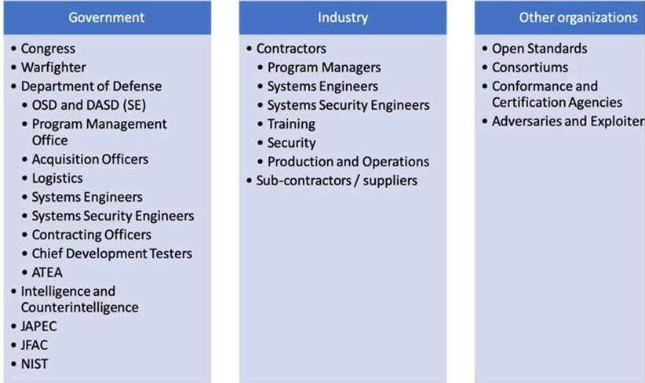
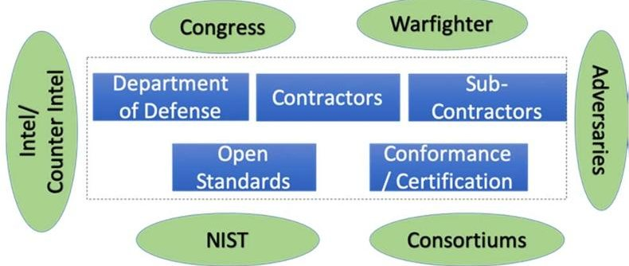
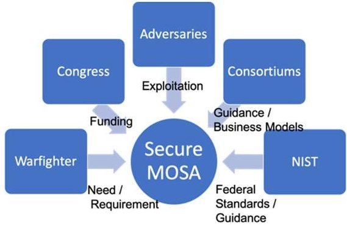
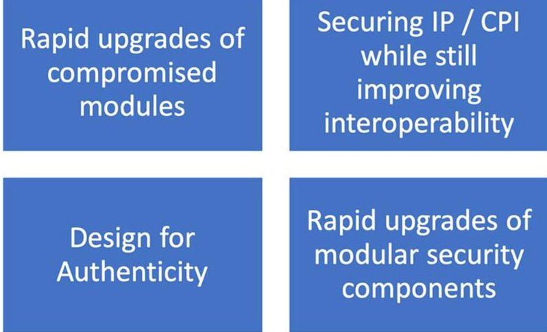
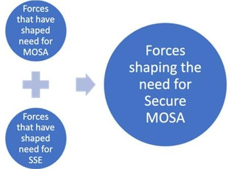
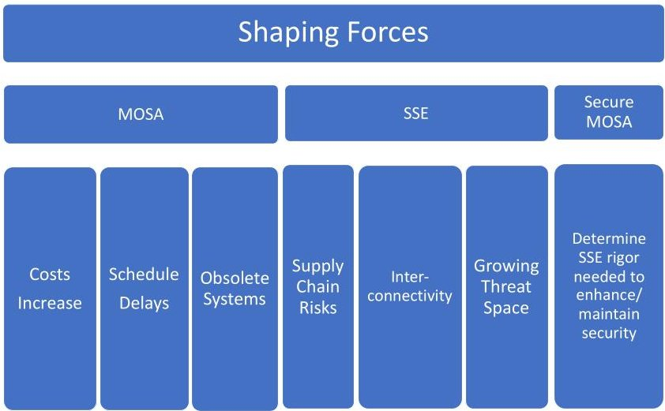
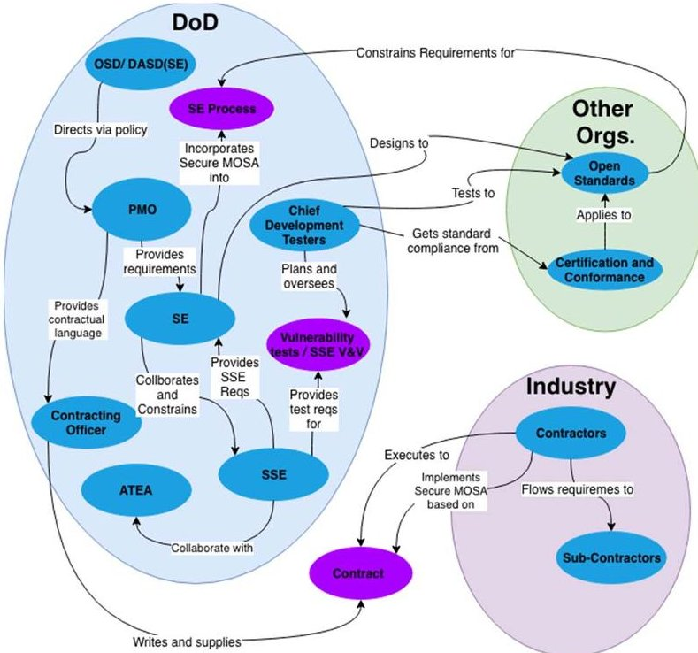

<!-- PDF_PAGE: 1 -->

# The Need for a Secure Modular Open Systems Approach (MOSA): Building the Case Using Systems Thinking Methodologies

Giselle Bonilla-Ortiz

School of Systems and

Enterprises

Stevens Institute of Technology

gbonilla@stevens.edu

Hoboken, NJ USA

Dinesh Verma, Ph.D.

School of Systems and

Enterprises

Stevens Institute of Technology

Hoboken, NJ USA

dinesh.verma@stevens.edu

Abstract A broad survey of available publications indicates that security is still regarded as an unknown in Modular Open Systems Approach (MOSA) architectures. Additionally, open security approaches for modular systems can be seen as a barrier to successful MOSA implementations, given that vulnerability discovery by attackers may be aided by open security architectures and standards. Modular Open architecture security requirements such as those for Anti-Tamper and Cybersecurity need to be an integral part of the MOSA lifecycle. Also, a primary concern of businesses is to maintain competitive advantage by means of protecting their proprietary data. In essence, MOSA systems are characterized by defining common interfaces and not the functionality within the system itself, maintaining proprietary data protected within the boundaries of each module. Is this sufficient to provide horizontal protection across plug-and-play MOSA systems? To begin studying questions such as this, this paper utilizes Systems Thinking methodologies to explore the US Department of Defense (DoD) method to MOSA and Systems Security Engineering (SSE). The authors introduce several systems thinking methodologies to scope the problem and identify the benefits of incorporating SSE into the MOSA lifecycle. Using systemic tools, the authors identify the stakeholders that influence and are affected by both MOSA and SSE, determine the system boundary, describe the relationships between all components within the system, explore several shaping forces that have brought MOSA to its present state and determine the proposed value added by designing a trusted and secure MOSA.

Keywords—Modular Open Systems Approach, MOSA, Systems Security Engineering, Program Protection, Systems Thinking, Systemigram

## I. INTRODUCTION

Modular Open Systems Approach (MOSA) is the Department of Defense (DoD) method to designing composable systems that follow open standards and can be acquired from independent vendors, allowing for a more competitive defense market. The benefits of MOSA range from increased competition to the ability of rapid technology refresh and deployment, as well as cost savings and improved interoperability.

Equally as important is the DoD's desire to mitigate the risks of losing critical program information and maintaining

operability of their systems during potential cybersecurity attacks. Incorporating Program Protection and Systems Security Engineering (SSE) into the DoD's acquisition process is the prime method of managing these security risks.

If MOSA will be the way of the future, then making sure security implications are understood within this approach is paramount for its success and warfighter advantage.

MOSA has been a topic of many recent publications, however the intersection of MOSA and security is almost inexistent in current research. Here, we will introduce the concept of a Secure MOSA and utilize Systems Thinking methodologies to kickstart an understanding of the complex relationships contained in this system.

## II. SYSTEMS THINKING METHODOLOGIES FOR SECURE MOSA

## A. Perspectives: Identifying Stakeholders for Secure MOSA

Secure MOSA stakeholders were identified by particularly focusing on the DoD Acquisition process. At a high level, Congress, the warfighter and the Department of Defense are stakeholders. According to the Defense Acquisition Guidebook, Chapter 9 [2], the primary roles for supporting Program Protection are the Program Management Office (PMO), the systems engineer (SE), the system security engineer (SSE), and chief developmental tester. (Note that the DAU guidebook identifies several SSE functions that for simplicity here, we have condensed into SSE). The Guidebook also identifies several organizations available to the PM and SE as Program Protection resources such as: Intelligence and Counterintelligence, the Joint Acquisition Protection and Exploitation Cell (JAPEC), the Joint Federated Assurance Center (JFAC) and the DoD AntiTamper Executive Agent (ATEA). The National Institute of Standards and Technology (NIST) may create and provide guidance specific to MOSA security. Contractors will also play a key role in deploying a Secure MOSA. Adversaries are identified in this list as the antagonist Secure MOSA will be protected from.

Figure 1 shows the identified stakeholders across the US Government, Industry as well as other organizations. The

<!-- PDF_PAGE: 2 -->

relationships among these stakeholders is explored further in Section E.

Figure 1: Secure MOSA Stakeholders

## B. Secure MOSA System Boundary

Because this is a study of relationships and benefits, the system boundary will include key players that influence and are affected by both MOSA and SSE within the governing agencies, DoD and its suppliers. We have determined that for purposes of this analysis, the following stakeholders reside outside the boundary of the system: Congress, Warfighters, NIST, Intelligence and Counterintelligence agencies, Consortiums and the adversaries that seek to exploit a MOSA system. Figure 2 shows this pictorially.

Figure 2: Secure MOSA System Boundary

The remainder of this paper will focus its analysis on the components and organizations shown within the boundary. However, one important aspect is to understand any relationships that cross the Secure MOSA system boundary. Such inputs will likely have an impact on the system and will influence key decisions throughout its lifecycle. For example, known adversarial attacks will influence the security capabilities that will be designed within a MOSA system. Funding received from Congress will impact the what work a PM can scope into their system. NIST and Consortiums may provide guidance and best practices. Finally, the core requirement for a Secure MOSA is derived from current needs of the warfighters. These inputs are shown in Figure 3.

Figure 3: Inputs to Secure MOSA

## C. Value Adding Processes: Identifying the benefits of a Secure MOSA

The benefits of both MOSA and Systems Security Engineering are well understood and documented in literature. However, to establish the need for a Secure MOSA we must understand the value added by incorporating SSE into MOSA design principles. First, we take a look at the value added by designing a system using MOSA standards.

The DoD has identified the following high-level benefits of MOSA [3]: Enhance competition; Facilitate technology refresh, incorporate innovation; enable cost savings / cost avoidance; and to improve interoperability. It is clear that affordability is enabled by MOSA because of its "plug-and-play" property, which results in more efficient upgrade cycles rather than expensive maintenance or redesign [4]. Additionally, MOSA allows programs to avoid relying heavily on fully proprietary systems that lock them into one vendor, it provides for agile technical solutions delivered to the warfighter through more easily sharable and replaceable components and allows rapid upgrades influenced by user feedback [5].

The value of incorporating SSE into any system can be summarized as the ability to mitigate threats during system development and deployment, address the possible capture of a system by an adversary during military operations, and the protection of capabilities that enhance warfighter advantage [6]. Additionally, SSE provides for the protection of vendor Intellectual Property (IP) and cost savings derived from the mitigation of cyber-attacks.

So, what is the value of incorporating SSE into MOSA design principles? If a module (or the vendor supplying that module) is compromised by an exploiter, then the system can be more easily upgraded with a compatible module that has not been compromised. A Secure MOSA system, if designed appropriately, will be able to protect vendor IP and Critical Program Information (CPI) while still maintaining the interoperability of its components. Also, modularizing security techniques and making them composable modules helps in rapid upgrades with new security technologies if both are compliant to a given MOSA standard.

Another important aspect is that DoD has become more and more dependent on commercial technology and components sourced through a complex global supply chain, adding significantly to the risk of malicious insertion, counterfeit or otherwise compromised system modules [7]. A value added by Secure MOSA would then be design for authenticity. Modules

<!-- PDF_PAGE: 3 -->

compatible with a given system would need to have the capability to be authenticated by the other MOSA compliant components.

The Secure MOSA value adding processes are summarized in Figure 4.

Figure 4: Secure MOSA Value Adding Processes

## D. Secure MOSA Shaping Forces

This section will explore the forces that have shaped MOSA and SSE into their present form. As shown in Figure 5, the need for a Secure MOSA is shaped by both the need for MOSA and SSE.

Figure 5: Shaping Forces

The need for MOSA was implicitly endorsed by the DoD as in 1994 when the Under Secretary of Defense for Acquisition and Technology directed the use of an open systems approach in the acquisition of weapon system electronics. Furthermore, that same year the Open Systems Joint Task Force was established with the purpose of overseeing military services' transition to open systems [8]. More recently in 2004, the DoD announced MOSA as a strategy for the development of new systems and the modernization of existing ones [9]. This was reaffirmed when in early 2019, all three military service secretaries of the United States signed a memo requiring open standards across weapon systems [10]. This guidance has been long brewing due to the understanding that MOSA would lower lifecycle costs and increase the interoperability across DoD systems. Increasing costs, schedule delays and the need to rapidly upgrade obsolete systems to deploy to the warfighter are shaping forces driving the MOSA requirement.

The ever-evolving threat space to DoD systems has been historically shaping the need for Program Protection and

Systems Security Engineering. DoD systems are increasingly relying on commercially available technology and foreign supply chains. Additionally, systems are becoming more and more complex, are widely interconnected and increasingly software dependent [11]. Engineering principles must be incorporated into the design of security techniques to protect these complex systems.

Given these forces that have shaped the MOSA and SSE landscapes independently, it is fair to say that a Secure MOSA will be needed to protect these systems from today's (and the future's) threat space. One particular example comes from the engineering of Systems of Systems (SoS), which are also composable (though to a grander scale) and not all components of a SoS may have gone through the same SSE rigor.

The Secure MOSA shaping forces are summarized in Figure 6.

Figure 6: Secure MOSA Shaping Forces

## E. Telling the Story: Visualizing Secure MOSA Relationships Using Systemigrams

Systemigram was the tool selected to visualize the relationships among stakeholders and components within the Secure MOSA system boundary. The first step in constructing a Systemigram is to carefully and intelligently craft the prose that will be later described using the diagram [13]. The text for the Systemigram is as follows:

As with any other program that moves through the DoD Acquisition lifecycle, Secure MOSA requirements have to be developed at the highest level and based on the understanding of the end user's need. The DoD PMO for a particular program will receive direction (via policy) from the Office of the Secretary of Defense (OSD) and Office of the Deputy Assistant Secretary of Defense Systems Engineering (ODASD SE) to incorporate MOSA into their program as feasible, and to follow the appropriate SSE guidelines to protect the system. The PMO flows the Secure MOSA requirements to the program. Other notable actions the PMO must take is managing the risks associated with incorporating MOSA and SSE as well as including the Secure MOSA requirements in contracts. Based on the requirements flowed by the PMO, the SE incorporates MOSA and Security into the systems engineering process. The SE also performs trade-off analyses between security and design considerations, they collaborate with the SSE on security

<!-- PDF_PAGE: 4 -->

requirement adjustments and constrains the SSE based on overall system decisions.

The SSE has to work within the constraints of a MOSA architecture and these constraints are provided by the SE. They conduct the appropriate security analyses, assess vulnerabilities and work with the contractors to design the security architecture. The SSE is responsible for working with the SE to incorporate security requirements into the systems engineering artifacts. If the Secure MOSA has Anti-Tamper requirements, then the SSE works with the DOD ATEA to make sure these are adequately implemented.

Given the Secure MOSA program set forth by the SE and SSE, the chief developmental tester plans the Development, Test and Evaluation (DT&E) activities which include vulnerability testing, Validation and Verification (V&V) of SSE requirements and conclude with Operational Test and Evaluation (OT&E). The chief developmental tester should also be responsible for the testing of MOSA requirements against the program's open standard of choice. The chief developmental tester needs to direct the contractors designing the Secure MOSA to V&V the open standard requirements as well as receive MOSA certification from the appropriate Conformance Certification organizations.

The contractors also play a key role in deploying Secure MOSA. Contractors have to execute based on what they contractually agreed upon with the PMO as well as design, implement and test the Secure MOSA based on the contractual requirements. Contractors should also assure that appropriate Secure MOSA requirements are flowed to suppliers and vendors via their contracting offices.

The complete Systemigram is shown in Figure 7.

Figure 7: Systemigram showing Secure MOSA relationships

## F. Conclusion

Modular Open Systems Approach (MOSA), if adopted effectively by the DoD and its contractors, will result in significant cost savings, rapid upgrades and greater advantage for the warfighter. Ensuring that Program Protection and Systems Security Engineering are incorporated into the MOSA lifecycle will be paramount in the approach's success and maintaining technological advantage over adversaries.

Systems Thinking provides excellent tools that can help gain a deeper understanding of the problem scope that is incorporating SSE practices into MOSA. This paper is merely but an introduction of a more complex system that consists of many more relationships and components to be explored. Systemigrams can prove to be a powerful tool to continue expanding the knowledge depth of these relationships.

## ACKNOWLEDGMENT

The lead author of this paper would like to thank Professor Mo Mansouri from the School of Systems and Enterprises at Stevens Institute of Technology whom through his teaching of the Systems Thinking course encourages his students to use the methodologies learned in class to understand real-world problems.

## References

[1] Openness in military systems part 1: Analysis & applications. MILCOM 2012 - 2012 IEEE Military Communications Conference, MILITARY COMMUNICATIONS CONFERENCE, 2012 - MILCOM 2012.1, 2012. ISSN: 978-1-4673-1729-0.

[2] Defense Acquisition Guidebook, Chapter 9: Program Protection, Version 5.

[3] N. Davendralingam, C. Guariniello, S. Tamaskar, D. DeLaurentis, and M. Kerman, "Modularity research to guide MOSA implementation," The Journal of Defense Modeling and Simulation: Applications, Methodology, Technology, Jan. 2018.)

[4] K. R. Hibbert, "A need for systems architecture approach for next generation mine warfare capability," Naval Postgraduate School, Monterrey, California, 2006.

[5] P. Zimmerman, M. Ofori, D. Barrett, J. Soler, and A. Harriman, "Considerations and examples of a modular open systems approach in defense systems," Journal of Defense Modeling & Simulation, Apr. 2018.

[6] http://acqnotes.com/acqnote/careerfields/system-security-engineering

[7] K. Baldwin, J. Dahmann, and J. Goodnight, "Systems of Systems and Security: A Defense Perspective," INSIGHT, vol. 14, no. 2, pp. 11-14, Jul. 2011.

[8] United States Government Accountability Office (GAO), "DOD Efforts to Adopt Open Systems for Its Unmanned Aircraft Systems Have Progressed Slowly", July 2013.

[9] R. Harrison, "Future-Proof Today's Test Systems to Handle Tomorrow's Devices," EE: Evaluation Engineering, vol. 51, no. 9, pp. 54-54, Sep. 2012.

[10] https://www.afmc.af.mil/News/Article- Display/Article/1752516/services-improve-interoperability-through common-data-standards/

[11] K. Baldwin, P. R. Popick, J. F. Miller, and J. Goodnight, "The United States Department of Defense revitalization of system security engineering through program protection," in 2012 IEEE International Systems Conference SysCon 2012, 2012, pp. 1-7.

[12] J. Dahmann, G. Rebovich, M. McEvilley, and G. Turner, "Security engineering in a system of systems environment," in 2013 IEEE International Systems Conference (SysCon), 2013, pp. 364-369.

[13] Boardman, J. and B. Sauser, Systems Thinking: Coping with 21st Century Problems. 2008, Boca Raton, FL: Taylor & Francis / CRC Press.