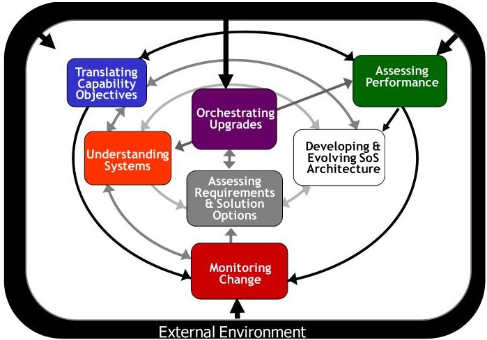
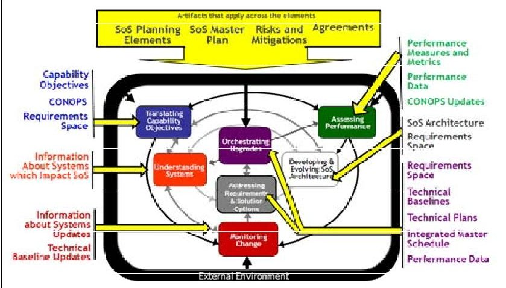
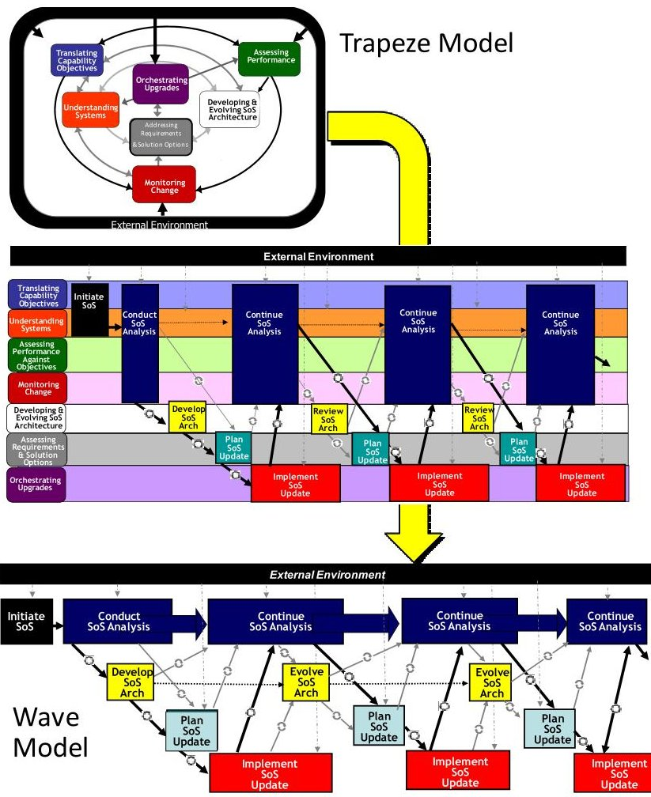
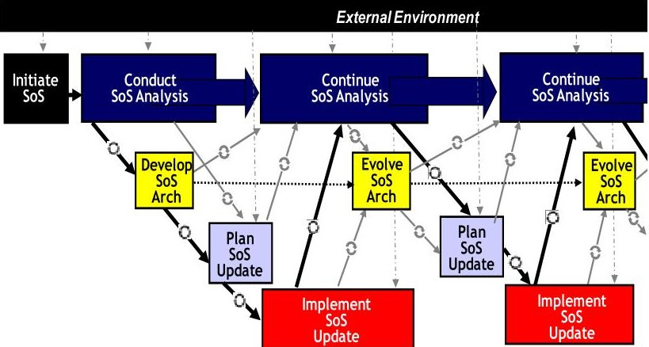

<!-- PDF_PAGE: 1 -->

# An Implementers' View of Systems Engineering for Systems of Systems

Dr. Judith Dahmann and Mr. George Rebovich The MITRE Corporation Mclean, VA, USA {jdahmann, grebovic} at mitre.org

Dr. JoAnn Lane

University of Southern California

Los Angeles, CA, USA

jolane at usc.edu

Mr. Ralph Lowry Modern Technology Solutions, Inc. Alexandria, VA, USA ralph.lowry at mtsi-va.com

Mrs. Kristen Baldwin US Department of Defense Washington, DC, USA kristen.baldwin at osd.mil

Abstract- This paper builds on and extends U.S. Department of Defense published guidance on systems engineering (SE) of systems of systems (SoS) by developing and presenting a view of SoS SE that translates the SoS SE core elements, their interrelationships, and SoS decision-making artifacts and information from a "trapeze" model to a more familiar and intuitive time-sequenced "wave" model representation. The information is thus rendered in a form more readily usable by SoS SE practitioners in the field and one that corresponds with incremental development approaches that are the norm for SoS capability evolution. The paper describes and motivates the development of the wave model, discusses its key characteristics, and provides examples of SoS efforts that reflect this view of SoS SE. Finally, the paper describes how the information critical to successful SoS SE is created, where it fits into the wave model, how it evolves over time, and in which artifacts the information is normally contained.

Keywords-system of systems, system of systems engineering, systems engineering, artifacts.

## I. INTRODUCTION

To meet new and emerging operational needs, an increasing number of military capabilities are being fielded through a system of systems approach by leveraging legacy systems, together with some new development, while the individual systems continue to support current users. Recognizing this trend, the U.S. Department of Defense published guidance on systems engineering (SE) of systems of systems (SoS) in 2008 [5]. The guide presents SoS SE as seven core elements, each of which can be mapped to the 16 technical and technical management processes in the Defense Acquisition Guidebook [4]. The guide uses a "trapeze model" to depict and describe the interrelationships and interactions among the SoS SE core elements. Building on the guide, later work identified and characterized information critical to successful SoS SE and acquisition decision making, as well as the work products or artifacts that normally contain the information [6].

This paper draws on the practitioner experiences that provided the basis for the development of the DoD SoS SE Guide [5] and it builds on and extends the previous work by developing and presenting a view of SoS SE that translates the SoS SE core elements, their interrelationships, and SoS decision-making artifacts and information from a "trapeze" model to a more familiar and intuitive time-sequenced "wave" model representation. The information is rendered in a form more readily usable by SoS SE practitioners in the field and one that corresponds with incremental development approaches that are the norm for SoS capability evolution.

## II. FOUNDATIONS

Although systems of systems have been defined in various ways [1,2,3], the key characteristic of SoS is the independence of the systems which comprise an SoS. For the purposes of this paper we define SoS as "a set or arrangement of systems that results when independent and useful systems are integrated into a larger system that delivers unique capabilities" [5]. This characteristic challenges the traditional application of SE, since many models of SE are based on the ability of the systems engineer to define boundaries and requirements clearly and to control the development environment so that requirements can be optimally allocated to components based solely on SoS technical trade analyses.

Today's defense SoS environment makes this approach unworkable. Because SoS systems engineers frequently use existing systems as their "components," they are faced with an allocation of functionality and implementation details that cannot be made optimal to meet SoS user needs. In addition, the lack of control over the development of the component systems with independent ownership, funding, development processes and, in some cases, different operational missions, requires the systems engineer to accommodate considerations beyond the technical when evaluating capability objective options. Finally, unanticipated changes in the external environment may occur during development (e.g., changes in national priorities, funding, threat assessments, and magnitude or nature of the demands placed on SoS capabilities), and they

<!-- PDF_PAGE: 2 -->

may have an overriding effect on user capabilities required or able to be delivered, further complicating the work of the systems engineer.

Figure1 depicts one view of SoS SE presented in [5]. This model applies particularly to "acknowledged" SoS, in which an organization is responsible for the SoS and supporting SoS systems engineering while independent organizations and SE teams are responsible for the constituent systems that support the SoS capability objectives. This trapeze model presents the core elements of SoS SE and their relationships. Although this may be a good conceptual view of SoS SE, it may be less useful to practitioners looking to chart an implementation approach on their SoS program.

Figure 1.Trapeze Model Depiction of SoS SE [4]

## III. INFORMATION CRITICAL TO SUCCESSFUL SOS SE

There has been increased attention to supporting development and acquisition decisions with data, evidence or knowledge [7]. Although SoS evolution is not necessarily managed through formal acquisition processes in all cases, SoS teams normally identify key decision points and support them with various forms of data, evidence or knowledge that are often contained in key work products or artifacts. These decision points are sometimes called "knowledge points" [8] and the artifacts that contain the evidence or knowledge may be viewed as "boundary objects" that bridge the elements of the SoS SE process or the different organizations that work together to deliver an SoS capability. As part of an International SoS SE project under The Technical Cooperation Program (TTCP), information critical to successful SoS SE was identified, as well as the artifacts in which they are normally contained. Table 1 below lists the artifacts and characterizes how the information in them differs from the corresponding individual system artifact and Figure 2 shows the way the artifacts align with the SoS SE core elements. A more detailed discussion is in [9].

TABLE 1. Key SoS Information Artifacts

<table border="1"><tr><td>SoS Information</td><td>Characteristics</td></tr><tr><td>Capability Objectives</td><td>Focused on capabilities at the SoS-level. Solution(s) typically require multiple constituent systems, not all of which may be known in advance. Scope typically initially defined in the charter for the SoS.</td></tr><tr><td>CONOPS</td><td>Multiple system focus. Often developed after constituent systems have been fielded; Evolves over time, sometimes substantially.</td></tr><tr><td>Systems Information</td><td>Focus is on system-level information that affects SoS-level capability objectives. Extends beyond technical issues to include operational, fiscal, organizational, and planning issues.</td></tr><tr><td>Requirements</td><td>Requirements space versus set of specific requirements. Defined at a level of detail that enables trades among potential and actual constituent systems and interfacing external systems.</td></tr><tr><td>Performance Measures and Methods</td><td>Focus is on performance of SoS solution. As independent as possible of the specific systems to allow for assessment of alternative implementation approaches.</td></tr><tr><td>Performance Data</td><td>Often collected in operational environment. Used to support continuous improvement of the SoS.</td></tr><tr><td>SE Planning Elements</td><td>Focus is on determining rhythm, organizational structure, technical reviews, and decision processes across SoS evolution. Ability and willingness of constituent systems to support SoS plans is an important consideration.</td></tr><tr><td>Risks and Mitigations</td><td>Focus is on desired capabilities and undesirable emergent behaviors of the SoS. Includes single system risks or dependencies related to SoS capabilities and plans.</td></tr><tr><td>Master Plan</td><td>Focus is on SoS-level view across multiple increments and touch points for constituent systems. Reflects the SoS evolution strategy. Focus is often on continuous improvement versus achievement of a defined end state.</td></tr><tr><td>Agreements</td><td>Focus is on managing relationships among multiple organizations. Agreements support SoS evolution including specific commitments to execute SoS increment development.</td></tr><tr><td>Architecture</td><td>A shared framework primarily aimed at informing analysis and decisions for developing or evolving SoS capabilities. A context for understanding the relationships among constituent systems and developing implementation options for meeting capability requirements. Includes key constituent systems information, connectors and protocols used to communicate and/or synchronize processing across the constituents, key data elements/structures that cross interfaces, and key data conversions to facilitate data sharing and communications between constituents.</td></tr><tr><td>Technical Baselines</td><td>Focus is on SoS-level description plus identification of constituent system baselines that are part of the SoS baseline.</td></tr><tr><td>Technical Plan(s)</td><td>Focus is on planning the implementation and test of changes to constituent systems to execute an SoS increment.</td></tr><tr><td>Integrated Master Schedule</td><td>Set of SoS SE activities and milestones plus key single system activities and milestones that are driving SoS critical path. Focus is on key synchronization points among SoS constituents and pointers to development schedules of constituent systems for the current SoS increment.</td></tr></table>

<!-- PDF_PAGE: 3 -->

Figure 2. Core Elements of SoS SE and Associated Information

## IV. PRACTITIONERS' VIEW OF SOS SE: THE WAVE MODEL

While the trapeze model of SoS SE provides a good conceptual view of the core elements and their interrelationships, it is less useful to a practitioner looking to chart an implementation approach on an SoS program. A wave model of SoS SE unwinds the trapeze model and then maps the core elements to a more familiar view of SoS SE as a series of six time-sequenced major steps in implementing an SoS SE process. The transformation of the trapeze model to the wave model is depicted in figure 3. The arrows between the wave model elements depict the normal process flow and the embedded circles in the arrows indicate that there may be and usually is back-and-forth iteration between these elements.

The wave model elements are depicted in figure 4 and described in more detail, below. This model has several driving characteristics that reflect the attributes of SoS:

Multiple Overlapping Iterations of Evolution reflect the fact that most SoS leverage developments of their constituent systems, and consequently, SoS are characterized by incremental development.

Ongoing Analysis provides an analytic basis for each iteration of SoS evolution. Unlike traditional systems engineering in which upfront analysis drives development, engineering of SoS requires continuous analysis to address the dynamic nature of the SoS and its context.

Continuous Input from External Environment is key for SoS SE, since any manager or engineer of an SoS has control over only a small part of the environment that affects the SoS.

Architecture Evolution is also important. While the architecture of an SoS ideally provides a persistent framework for the SoS evolution over time, the planned SoS architecture is typically implemented incrementally and may itself evolve.

Figure 3. Unwrapping the Trapeze Model to Create the Wave Model [10]

Forward Movement with Feedback drives the evolution of an SoS which typically adopts a "battle rhythm" driven by elements in the SoS context (e.g. the development plans of a key constituent system or the unit fielding schedule) which are not under the control of the SoS. These external driving events effectively "pace" the execution of the SoS evolution. While there may be feedback within an evolution, many SoS adopt a "bus stop" approach, where they deliver those changes that can be implemented during an iteration and defer the rest to subsequent evolutions (or the next time the bus stops.)

## IV. WAVE MODEL ELEMENTS AND ASSOCIATED SOS INFORMATION ARTIFACTS

## The steps in the wave model are described below.

Initiate SoS provides the foundational information to start the SoS SE process, including an understanding of objectives, key users, user roles and expectations, and core systems supporting capabilities. Information important to the execution of this element includes a statement of top-level objectives for the SoS (SoS capability objectives), a description of how systems in the SoS will be employed in an operational setting (SoS CONOPS) and programmatic and technical information about systems that affect SoS capability objectives (systems information).

<!-- PDF_PAGE: 4 -->

Figure 4. SoS SE Wave Model Elements[10]

Conduct SoS Analysis provides an analysis of the "as is" SoS and the basis for SoS evolution by establishing an initial SoS baseline and developing initial plans for the SoS engineering efforts. Artifacts important to this element are SoS technical baselines (including requirements baseline, allocated baseline and product baseline), SoS performance measures and methods (basis for overall SoS performance and continuous SoS improvement), SoS performance data (to assess progress towards SoS capability objectives), SoS requirements space (first order SoS user needs and functions to provide the capability in various environments), and SoS planning elements (to provide structure and process for SoS SE, including pacing of SoS upgrades, organizational structure and decision processes, and technical reviews), SoS risks and mitigations (especially those that emanate from outside the SoS, including changes to constituent systems of the SoS). SoS master plan (the SoS analog to a systems acquisition strategy) and agreements (delineates broad roles and responsibilities of SoS participants and their specific commitments in a development increment).

Develop and Evolve SoS Architecture develops and evolves the persistent technical framework for addressing SoS evolution and a migration plan identifying risks and mitigations. The SoS architecture is the key artifact created and used in this element. The architecture is created in the first execution of this element. Subsequently, the SoS architecture is evolved, as depicted in figure 4. The architecture provides a shared representation of the SoS technical framework and is used to inform and document decisions and guide SoS evolution. The SoS architecture includes systems, key SoS functions, relationships and dependencies, as well as end-to-end functionality, data flow and communications protocols. It is used to address possible changes in functionality, performance or interfaces. It defines the way in which the contributing, constituent systems work together. Implementation of the architecture will add to the requirements space with changes needed in systems both in interfaces and in functionality when key to cross-cutting SoS issues.

Plan SoS Update evaluates the SoS priorities, options and backlogs to define the plan for the next SoS upgrade cycle. In this element, an allocated baseline is created for the update, risks and mitigations are identified, agreements are developed implementation and integration and test plans are created, an

integrated master schedule (IMS) is developed for update and the SoS master plan is updated. This involves the creation of two artifacts, technical plans and the IMS, as well as updating of several artifacts mentioned earlier: SoS technical baselines, SoS requirements space, SoS risks and mitigations, agreements, and the SoS master plan. The technical plans include those for SoS implementation, integration and test. They are developed for each increment of SoS evolution. The IMS focuses on key SoS activities and integration points. It links to the detailed development schedules maintained by constituent systems for the current update.

Implement SoS Update involves the SoS SE team monitoring implementations at the constituent system level and plans and conducting SoS level testing, resulting in a new SoS product baseline. The systems implement and test changes at their level while the SoS SE team monitors progress and updates the IMS. SoS SE team leads SoS integration and test, developing data on SoS performance and any unanticipated factors encountered. Artifacts containing information key to the element include: technical plans, IMS, SoS requirements space, SoS performance data, and SoS technical baselines.

Continue SoS Analysis involves ongoing analysis that revisits key information (and their containing artifacts) on the state of and plans for the SoS as a basis for future SoS evolution. Updates to the SoS baseline can come from a variety of sources, including: changes in objectives, CONOPS or external factors, results of the most recent SoS update, data on SoS performance, data on and insights into unanticipated factors, changes in constituent systems, and risks and mitigations. Updates to plans include: key planning elements (update rhythm, organization, decision processes, roles and responsibilities), agreements with critical players (users, constituent systems) and the SoS master plan.

Information is created and used throughout this progress. Table 2 shows a logical grouping of the SoS information and Table 3 shows how this information is employed at each step in the wave model [10].

TABLE 2: Logical Grouping of SoS SE Information

<table border="1"><tr><td>SoS capability-related information</td><td>SoS capability objectives
SoS-level CONOPS
Requirements space</td></tr><tr><td>System-related information</td><td>System information that impacts SoS capability objectives</td></tr><tr><td>SoS technical information</td><td>SoS architecture
SoS performance-related artifacts
• Performance measures &amp; methods
• Performance data
SoS technical baselines</td></tr><tr><td>SoS management &amp; planning information</td><td>SoS risks &amp; mitigations
SoS-level agreements
Plans
• SoS SE planning elements
• Master plan
• Technical plan(s)
• IMS</td></tr></table>

<!-- PDF_PAGE: 5 -->

TABLE 3. Information Supporting Steps in Wave Model [10]

<table border="1"><tr><td colspan="2">Information Applied at Each Step</td><td>Initiate SoS</td><td>Conduct SoS Analysis</td><td>Develop SoS Arch</td><td>Plan SoS Update</td><td>Implement SoS Update</td><td>Continue SoS Analysis</td></tr><tr><td rowspan="3">SoS Capability-Related Info</td><td>SoS Capability Objectives</td><td>Established</td><td>Used</td><td>Used Indirectly</td><td>Used</td><td>Used</td><td>Updated</td></tr><tr><td>SoS Level CONOPS</td><td>Created</td><td>Used</td><td>Used Indirectly</td><td>Used</td><td>Used</td><td>Updated</td></tr><tr><td>Requirements Space</td><td></td><td>Established</td><td>Updated</td><td>ID’d and Tagged</td><td>Updates</td><td>Updated</td></tr><tr><td>System Info</td><td>Systems Information</td><td>Captured</td><td>Used</td><td>Used</td><td>Used</td><td>Used</td><td>Updated</td></tr><tr><td rowspan="4">SoS Technical Information</td><td>Performance Measures</td><td></td><td>Defined</td><td>Used</td><td>Used</td><td>Used</td><td>Updated</td></tr><tr><td>Performance Data</td><td></td><td>Captured</td><td>Used</td><td>Used</td><td>Updated</td><td>Updated</td></tr><tr><td>SoS Technical Baselines</td><td></td><td>Created</td><td>Used</td><td>Created</td><td>Created</td><td>Updated Used</td></tr><tr><td>SoS Architecture</td><td></td><td></td><td>Documented Updated</td><td>Used</td><td>Used</td><td>Used Indirectly</td></tr><tr><td rowspan="6">SoS Planning and Management Information</td><td>SE Planning Elements</td><td></td><td>Established</td><td>Updated</td><td>Updated</td><td>Updated</td><td>Updated</td></tr><tr><td>Master Plan</td><td></td><td>Established</td><td>Updated</td><td>Updated</td><td>Updated</td><td>Updated</td></tr><tr><td>Agreements</td><td></td><td>Established</td><td>Updated</td><td>Updated</td><td>Updated</td><td>Updated</td></tr><tr><td>Technical Plan(s)</td><td></td><td></td><td>Evaluated</td><td>Established</td><td>Updated</td><td>Used</td></tr><tr><td>IMS</td><td></td><td></td><td>Used</td><td>Established</td><td>Updated</td><td>Used</td></tr><tr><td>Risks and Mitigations</td><td>Captured</td><td>Updated</td><td>Updated</td><td>Updated</td><td>Updated</td><td>Updated</td></tr></table>

As Table 3 shows, information is generated (created, establish or defined), captured, updated, and used at different steps in the wave model.

SoS capability-based information provides the capability context for the SoS SE, and is generated early in the process (Initiate SoS, Conduct SoS Analysis). The capability objectives and CONOPS provide the user needs and operational context which is used in architecture development and evolution and in planning and implementing SoS updates.

These are updated as part of the ongoing SoS analysis (Continue SoS Analysis) to reflect changes. The requirements space is established as part of the initial analysis (Conduct SoS Analysis), and is updated as the SoS SE proceeds through the subsequent steps in the model.

System information is captured early in the process when the SoS is launched (Initiate SoS). This information is used through the development, planning and implementation, and is updated with continued analysis.

Forтрипт For SoS technical information, performance measures and methods are generated and updated as part of the SoS analysis (Conduct and Continue SoS Analysis) and are used throughout development and implementation. Performance data are captured as part of the initial analysis (Conduct SoS Analysis), are used to develop and implement the architecture and SoS updates, and are updated with based on the implementation of updates to the SoS. Technical baselines are established as part of initial analysis and are updated with plans and implementation of updates to the SoS. Finally, the, the "as is" SoS architecture is captured based the results of initial SoS analysis (Develop SoS Architecture) and is then updated and used to support SoS evolution.

Key elements of SoS planning and management information, SE planning elements, the master plan for the SoS and supporting agreements, are established early as part of initial analysis (Conduct SoS Analysis) and these are updated as the SoS SE proceeds through the steps in the model. Technical plans and schedules (IMS) are established for each SoS update cycle (Plan SoS Update) and are updated based on implementation (Implement SoS). These are used to evaluate and changes to the architecture and to integrate these changes into the schedule (Develop SoS Architecture) and to update the Master Plan (Continue SoS Analysis). Finally, risks and mitigations are identified when an SoS is launched (Initiate SoS) and are updated at each step thereafter.

## VI. SUMMARY AND CONCLUSIONS

This paper has presented a time-sequenced wave model representation of SoS SE that is usable by SoS SE practitioners in developing implementation approaches to their activities. It has identified information critical to decisionmaking in SoS evolution, noted the artifacts in which the information is normally contained, and where the information and artifacts are created, updated and used in the wave model.

The wave model and the information underpinning systems engineering for SoS are used as the basis for developing pragmatic approaches to addressing SoS. Work continues to identify examples and to investigate data and model-driven approaches to representation and analysis of the information key to SoS SE decisions. In particular, as our understanding of SoS SE matures, we expect to be able to identify the key knowledge points in the SoS SE process and ways that information and SoS analysis inform those decisions for both the SoS and for the constituent systems.

<!-- PDF_PAGE: 6 -->

## References

1. Maier, M. Architecting principles for systems-of-systems, Systems Engineering Vol.1, No.4 (1998) 267-284.

2. Sage, A.P. and C.D. Cuppan, On the Systems Engineering and Management of Systems of Systems and Federations of Systems, Information, Knowledge, Systems Management, Vol. 2, No. 4 (2001), pp. 325-345.

3. Jamshidi, M. Introduction to Systems of Systems, in Systems of Systems Engineering: Innovations for the $ 2 1^{s t} $ Century, Wiley, 2009.

4. DoD. Defense Acquisition Guidebook. Washington, D.C.: Pentagon, February 2010.

5. OUSD AT&L. Systems Engineering Guide for Systems of Systems. Washington, D.C.: Pentagon, August 2008.

6. Dahmann, J. S., et. al. Systems Engineering Artifacts for SoS. Proceedings of Institute of Electrical and Electronics

Engineers Systems Conference. San Diego, CA: April 5-8, 2010.

7. General Accounting Office. "Using a Knowledge-Based Approach to Improve Weapon Acquisition." 2009. GAO- 04-386SP; http://www.gao.gov/htext/do4386sp.html

8. D. Eccles. "Engineering and Integrating the Ballistic Missile Defense System." Crosslink, Aerospace Corporation. Spring 2008. http://www.aero.org/publications/crosslink/spring2008/04.ht ml

9. Dahmann J., G. Rebovich, J. Lane and R. Lowry. "System Engineering Artifacts for Systems of Systems."

Proceedings of the IEEE Systems Conference, April 5-8, in San Diego, CA, 2010.

10. Lane, J., et. al. "Key System of Systems Engineering Artifacts to Guide Engineering Activities", Presentation at NDIA Systems Engineering Conference. San Diego CA: October 2010.