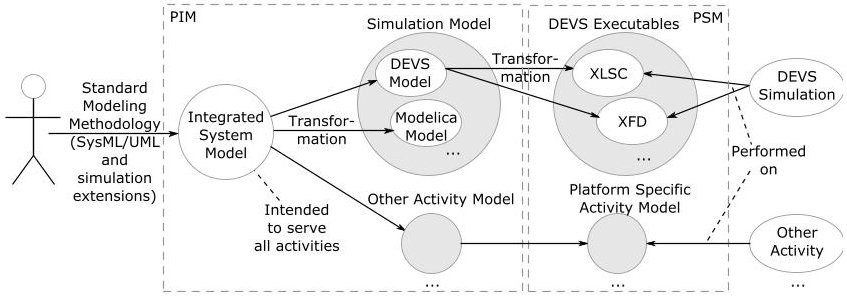
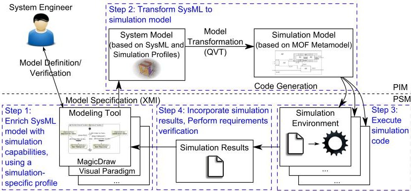
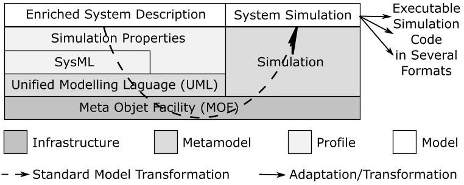
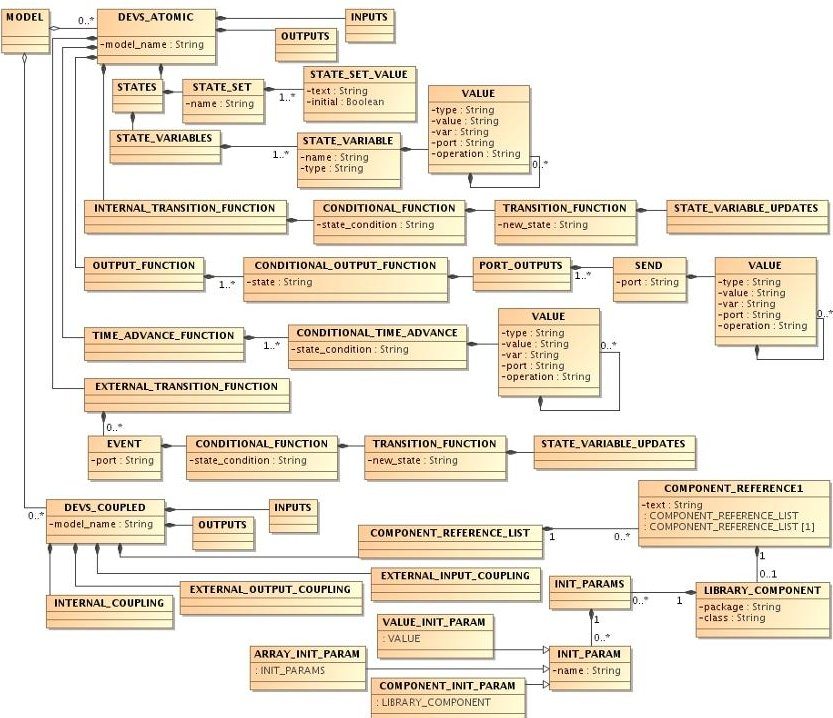
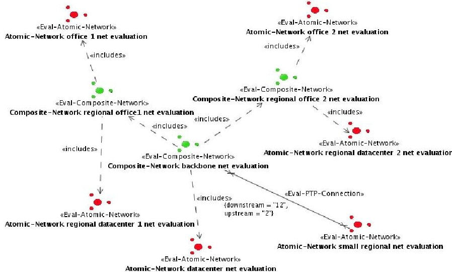
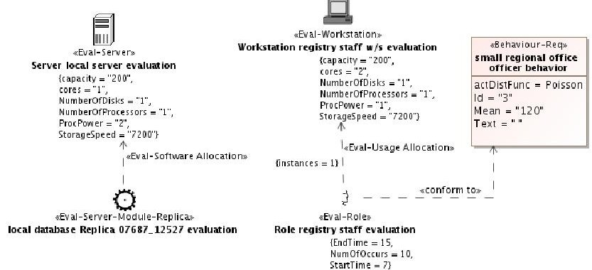
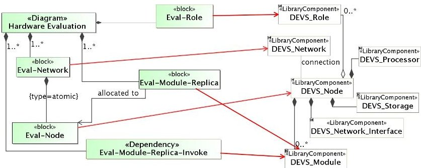
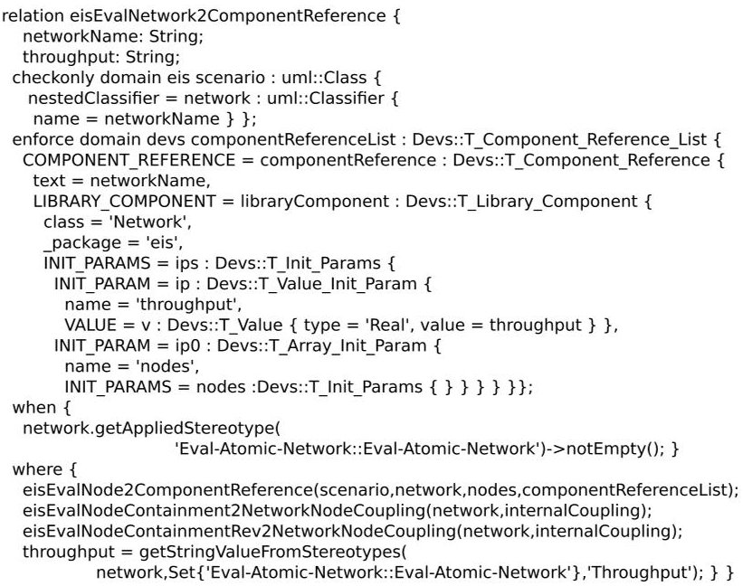

<!-- PDF_PAGE: 1 -->

<div align="center">

# Model-based System Engineering using SysML: Deriving Executable Simulation Models with QVT

</div>

George-Dimitrios Kapos, Vassilis Dalakas, Anargyros Tsadimas, Mara Nikolaidou and Dimosthenis Anagnostopoulos

Department of Informatics & Telematics

Harokopio University of Athens

70 El. Venizelou Str, 17671 Athens, GREECE.

{gdkapos, vdalakas, tsadimas, mara, dimosthe}@hua.gr.

Abstract—Systems Modeling Language (SysML) is used to define hierarchical system models in model-based engineering (MBE). Although SysML may effectively serve the description of complex systems, it can not effectively support all model-based engineering activities. For example, system validation is usually performed via simulation. In this case, SysML system models should be transformed to domain-specific models, e.g. executable simulation models suitable for specific simulation tools. This paper identifies the key issues for efficient SysML model simulation, utilizing Model Driven Architecture (MDA) concepts. The generation of executable simulation code from SysML system models is considered as a model transformation from the SysML meta-model to the simulation meta-model. Since SysML meta-model is defined using Meta-Object Facility (MOF), the definition of MOF simulation meta-models and the utilization of the Query/View/Transformation (QVT) language for model transformations are analytically discussed. The presented approach is not restricted in a specific simulation framework or type. However, in this paper, the experience obtained from a case study on discrete event simulation is evaluated and the conditions that favor the selection of specific simulation frameworks are identified.

Index Terms—Model-based Engineering, SysML, MDA, Model Transformation, QVT, Simulation, DEVS

## I. INTRODUCTION

In model-based system engineering, a central system model is used as a reference to perform all engineering activities in the specification, design, integration, validation, and operation of a system [1]. To this end, Systems Modeling Language (SysML) [2], a widely used general purpose language, has been proposed by the Object Management Group (OMG). According to SysML, system models should be defined independently of specific implementations or tools.

System validation is an engineering activity, which is usually performed in a model-based fashion using simulation [3]. Thus, a transformation of the SysML system model to the corresponding executable simulation code is necessary. Such a transformation may be accomplished in two ways. One way, is to write tailor-made simulation code, while an alternative is to follow model transformation standards as dictated by software engineering techniques.

The approach followed here, is strictly based on Model Driven Architecture (MDA) concepts, focusing on defining a

Meta-Object Facility (MOF) meta-model for the simulation domain and corresponding model transformation rules using Query/View/Transformation (QVT) in a standardized fashion [4]. MDA separates the specification of system functionality in a Platform Independent Model (PIM) from the specification of the implementation of that functionality on a specific technology platform in a Platform Specific Model (PSM). These key characteristics render MDA suitable for the implementation of a transformation of the SysML system model to the corresponding executable simulation code, instead of producing code in a custom fashion.

The motivation behind this effort derives from the lack of standardized approaches to perform system simulation. Today, the engineers use specific commercial simulators or restrict to in-house software tools. Hence, in the last decade, there is a strong effort to standardize and unify frameworks and methodologies related to modeling and simulation, driven by international organizations such as the Association for Computing Machinery (ACM), the Society for Modeling & Simulation International (SCS) and/or the Object Management Group (OMG). Simulation methodologies provide the means to define custom system models, which are consequently simulated using corresponding simulation environments. Currently, focus is set on benefiting from the wide acceptance of standard languages and well-defined formalisms as SysML, to define system models, simulated by a number of simulation frameworks. Such a need has already been recognized and there are many efforts towards simulating SysML models (e.g., [5] - [9]).

This paper, discuss on the adoption of MDA concepts in order to seamlessly transform SysML models to executable discrete event simulation models. More specifically, the potential of applying standard model transformation methods, based on QVT, as an effort to produce executable simulation code from SysML models, is explored. It presents our experience in defining a simulation-specific MOF meta-model using the Discrete Event System Specification (DEVS) simulation methodology, as well as, the corresponding transformation of SysML models to simulation specific models, using QVT. DEVS formalism targets at specifying discrete event simu-

<!-- PDF_PAGE: 2 -->

lation models executed on a variety of simulators [10], such as DEVS-C++, DEVSJava [11] and others. It was selected due to intense and mature research efforts for providing standard Extensible Markup Language (XML) representations of DEVS models, which are automatically executed in well known DEVS simulation environments. Focus is set on the role of two key MDA elements: simulation specific MOF and QVT. Advantages and disadvantages deriving from their implementation are identified, revealing the potential of such an approach, while the reasons why they are not widely adopted by simulation practitioners are explored. Conditions that favor the selection of a specific simulation framework to simulate SysML models are also identified.

In the rest of the paper, Section 2 provides a short overview of existing efforts to simulate SysML and model transformation using QVT. Section 3 identifies key issues on transforming SysML models to simulation-specific models via standard methods and tools. In Section 4, we discuss the representation of simulation-specific domains using MOF, based on our experience from DEVS MOF meta-model definition. In Section 5, we discuss the capabilities of QVT to describe detailed SysML-to-DEVS model transformations. Conclusions and future work reside in Section 6.

## II. RELATED WORK

## A. SysML Model Simulation

SysML is a standard language for modeling complex systems and systems of systems. It is actually a Unified Modeling Language (UML) profile that extends a subset of UML model elements, so that system requirements and specifications can be described. SysML is smaller than UML and simpler to use for the description of systems, as it is relieved by the software centric perspective of UML. On the contrary, it introduces two new types of diagrams (Requirement and Parametric Diagrams) that facilitate requirements engineering, as well as performance and quantitative analysis.

Simulation is a well established method for system validation. However, SysML notation does not target the creation of simulation models. Therefore, since SysML became a standard for system modeling, there was a prompt and intense interest in creating simulation models from SysML models. Such models heavily depend on the method used to perform simulation.

Various approaches have been proposed from both research and industrial communities (e.g., [5], [7], [8], [9], [12]) towards this direction. In most cases, SysML models, defined within a modeling tool, are exported in XML format, consequently, transformed into simulator specific models and forwarded to the simulation environment. Depending on the nature and specific characteristics of systems under study, there is a diversity of approaches on simulating models defined in SysML, which utilize different SysML diagrams. In [13], a method for simulating the behavior of continuous systems using mathematical simulation is presented, utilizing SysML parametric diagrams, which allow the description of complex mathematical equations. System models are simulated using composable objects (COBs) [14]. It should be noted that in

any case SysML models should be defined in a way, which facilitates simulating them [15]. These approaches are better suited for systems with continuous behavior.

Simulation of discrete event systems is usually performed, based on system behavior described in SysML activity, sequence or state diagrams. In [8], system models defined in SysML are translated to be simulated using Arena simulation software. MDA concepts are applied to export SysML models from a SysML modeling tool and, consequently, transformed into Arena simulation models, which must be enriched with behavioral characteristics before becoming executable. In [16], the utilization of Colored Petri Nets is proposed to simulate SysML models. If the system behavior is described using activity and sequence diagrams in SysML, it may be consequently simulated using discrete event simulation via Petri Nets. In both cases, although SysML system models are extracted and used, the system engineer must add large parts of the simulation code, especially concerning system behavior.

In [6], simulation is performed using Modelica language. Graph transformations are used for the generation of Modelica models from SysML models. To ensure that a complete and accurate Modelica model is constructed using SysML, a corresponding profile is proposed to enrich SysML models with simulation-specific capabilities. Towards this direction, the SysML4Modelica profile and the corresponding SysML to executable Modelica simulation code transformation, using standard MDA methods, as QVT language, have been endorsed by the OMG [9].

A commercial collaborative model-based systems engineering workspace that uses SysML as the front-end for orchestrating system engineering activities, from the early stages of system development, called SLIM, is available from Intercax [12]. Integration with MATLAB/Simulink, Mathematica and OpenModelica is offered in a variety of commercial tools, but these tools are used as math solvers and not as a system validation method.

The authors share the vision of SLIM, but our approach targets at the transformation of SysML models to executable DEVS simulation models via open standards [17] as the SysML4Modelica effort. In [18], a three-step methodology, independent of the selected simulation framework, was identified that was successfully applied in [17] for automated discrete event simulation code generation, based on SysML models. The latter is accomplished by enriching these models with simulation properties [17], [19].

## B. Model transformation and QVT

Based on OMG's MDA, models with standard definitions and semantics should be created for domains of interest. To ensure their interoperability, applications should be based on the same model. However, in order to extend this facility across multiple, related domains, a standard model transformation language is required.

The MOF 2.0 QVT [20] is a model transformation standard proposed by OMG with a hybrid declarative/imperative nature. QVT relations is a declarative language, where a

<!-- PDF_PAGE: 3 -->

transformation is defined as a set of relations between the elements of source and target meta-models. It has both textual and graphical notations. Moreover, the use of QVT may better establish a transformation, especially in comparison to custom transformation code. However, QVT transformations are not widely applied, despite the availability of related efforts recorded in the literature and appropriate tools and the fact that it is based on the declarative definition of specific relations between SysML and simulation-specific elements.

In [21], alignment of data warehouse development process to MDA is attempted. A meta-model for multidimensional(MD) data warehouses is defined at the PIM level, while a set of QVT relations are proposed for transforming MD PIMs to Common Warehouse Meta-model (CWM) models, considered as PSMs. In [22], relational QVT is used for creating UML Testing Profile models from UML models. Sequence diagrams are transformed to test cases via the appropriate relations. In [23], QVT is used for representing Open Distributed Processing (ODP) correspondences, when UML is used for the specification of the ODP viewpoint of systems. Since ODP correspondences depend on each system and configuration, a new set of QVT relations must be defined in each case. Thus, QVT is not used for the definition of a standard transformation for this domain, but as the mean for defining the correspondences. In [24], QVT graphical notation is used to specify a transformation as a set of QVT relations. It is proposed that each relation is implemented as an XSLT rule template, while a prototype tool is also developed. In [25], graphical debugging is proposed for the QVT relations language, to overcome limited debugging support in existing QVT tools. In [26] the need to effectively abstract the useful information of the source model is focused and relevant QVT features are explored.

A model driven development framework for modeling and simulation is proposed in [27]. Focus is not given on system engineering. Therefore, conceptual models are initially defined using Business Process Model and Notation (BPMN), instead of SysML, and further transformed using ATLAS Transformation Language (ATL), a commonly used appoach, answering some of the QVT requirements. Also, in this approach, different tools are built for different types of users that work on transformed variations of the initial model.

In the framework discussed here, the extensive use of QVT relations and operations is explored to transform SysML models to executable simulation-specific models. To obtain these simulation models both system structure and behavior should be extracted from corresponding SysML models in a multi-level fashion as described in the following.

## III. KEY ISSUES ON TRANSFORMING SYSML SYSTEM MODELS TO SIMULATION-SPECIFIC MODELS

Although system validation is an important activity in model-based system engineering, SysML models do not contain all information required to create executable simulation models [15]. Furthermore, executable simulation models depend on the simulation methodology adopted and the specific

execution environment. Thus, when selecting a specific simulation framework, the following issues must be considered [18]:

- To simulate a SysML model the system engineer should incorporate in it simulation-specific properties, e.g., specialize the model to serve a specific engineering activity: in this case, system validation using simulation. To achieve this, simulation-related profiles are usually defined, as for example Modelica4SysML [9] or DEVS-SysML profile [17]. Depending on the selected simulation methodology, each profile facilitates the description of the required simulation details. Such profiles should be applied in different modeling tools (e.g., MagicDraw) and enable the validation of the simulation-enriched SysML model prior their transformation to simulation code.

- It is more efficient to include all simulation-related information within the SysML model using the simulation profile defined and automatically produce the entire simulation code, rather than partially create the structure of the simulation model and further extend it within the simulation environment or tool as suggested in [7], [28]. Hence, the system engineer does not have to write any simulation code and study the specific simulation environment and tools. This feature is not supported by most of the approaches recorded in the literature, focusing on transforming SysML system structure to simulation models, while system behavior is described in the simulation environment.

- SysML to simulation-specific model transformation should be accomplished in a standardized fashion using existing languages and tools, as QVT, promoting the simplicity and correctness of the overall transformation process instead of writing tailor-made code.

- In order to facilitate such a transformation, it is essential to define a MOF meta-model for the selected simulation methodology, as the SysML meta-model is defined in MOF. Such a standardized meta-model for a specific simulation domain is of greater value, when the same simulation methodology can be applied using different tools, as for example the DEVS methodology. The simulation-specific model should be easily translated to executable code for specific simulators. In this case, the simulation-specific MOF meta-model may serve as a PIM towards two directions: a) enable SysML to simulation-specific model transformation and b) enhance interoperability between different simulators independently of the language they use (for example C++ or Java) and the way they are executed (centrally or distributed).

Fig. 1 presents an MDA-based approach towards SysML model simulation considering these remarks. Proper enrichment of the integrated SysML system model allows several engineering activities to be performed on PSMs that derive from PIMs. Focusing on system validation activity, DEVS or Modelica models are indicated as examples of simulation models that could be derived from the integrated system

<!-- PDF_PAGE: 4 -->





<div align="center">

Fig.1. Simulating System Models based on MDA concepts

</div>

model, given that the respective simulation information was chosen. Furthermore, each kind of simulation PIMs (e.g., DEVS or Modelica models) must be transformed to executable PSMs (e.g., XLSC, XFD). This approach could also be applied in other engineering activities, provided that the appropriate PIMs, PSMs and transformations will be defined.

In a more pragmatic context, the use of DEVS simulation methodology to simulate SysML system models and automatically produce DEVS executable code adopting MDA concepts has been proposed by the authors [18], as an example of applying this approach. The corresponding methodology is presented in Fig. 2 where four steps are identified:





<div align="center">

Fig. 2. A Methodology for Simulating System Models with DEVS

</div>

1) SysML model enrichment. The DEVS SysML profile, that has been defined in the MagicDraw UML tool [29], is the basis for enriching SysML models.

2) Model transformation. Enriched models are exported from MagicDraw in XML Metadata Interchange (XMI) [30] format and transformed to DEVS models, according to the implemented QVT transformation and the target (DEVS) meta-model. Such a transformation can be executed by any QVT compliant tool (e.g., MediniQVT).

3) Simulation execution. Ideally, DEVS simulation models can be executed by compatible, generic DEVS simulators, if they exist. However, other simulators, with different executable simulation model format, should be supported, too. XLSC over DEVSJava [31] has been used as the simulation execution environment.

4) Results incorporation. Simulation results are inserted into SysML model to help the system designer to perform requirements verification based on predefined requirements.

Implementing the required infrastructure for applying the proposed methodology, was enabled by two main factors:

Note that only the first and the last steps require input by the system engineer, while the other ones can be fully automated.

1) Several XML representations have been proposed for DEVS models, mainly targeting DEVS simulators interoperability. Therefore, DEVS community was prepared for the definition a DEVS MOF meta-model and automated code generation based on it.

2) This approach is extensively based on standards (UML, XMI, MOF, QVT, XSLT). Thus, at least one tool was available for each step of the process.

## IV. DEFINING SIMULATION-SPECIFIC MOF META-MODELS

When models need to be exported from a context, transformed and imported into other contexts, then there is a fundamental need for an application-independent way to define how models of a certain domain are supposed to be, i.e. a way to define meta-models. The UML 2 MOF meta-model [32] is the foundation for cross-application handling of models. MOF is widely used and is supported by many modeling tools. SysML and any simulation-specific profiles are based on the same meta-model, i.e. the UML MOF metamodel.

In this cotext, existence of a MOF meta-model for any specific simulation framework is important. First, such a meta-model provides the basis for a complete, conceptual representation of simulation models. Second, it is a reference, target meta-model, for transformations from/to other (system) models. The fact that the meta-model is defined in terms of MOF enables the use of MDA concepts and standards for the transformations, like QVT. Third, it can act as a reference, source format, for transformations to executable simulation code for specific simulators. Models defined according to MOF are stored in XML according to the XMI format.





<div align="center">

Fig. 3. System and Simulation Models with MOF

</div>

Fig. 3 provides a layered representation of MOF, metamodels, profiles and models for system description and simulation in a standardised fashion. The important role of a MOF Simulation meta-model is easily identified, as:

- it enables usage of standard transformation languages (like QVT),

- it provides a standard representation for the simulation-specific domain, acting like a reference point for diverse simulation-specific execution environments,

- it provides a single point, from which transformations or simple adaptations may be defined for automated code generation for several simulation execution environments.

<!-- PDF_PAGE: 5 -->

To simulate SysML models using DEVS, as suggested in Fig. 2, a MOF meta-model for DEVS has been defined. Fig. 4 provides an outline of the meta-model. As illustrated in the figure, simulation models contain DEVS Atomic and DEVS Coupled elements [10]. DEVS Atomic elements enable the definition of system behaviour and contain ports (input and output), states and four functions that define simulation time advancement and state transitioning. DEVS Coupled elements enable the definition of composite models in a way similar to SysML components and contain ports (input and output), other DEVS (Atomic or Coupled) elements and couplings (e.g., port inter-connections).





<div align="center">

Fig. 4. Outline of the DEVS MOF meta-model

</div>

MOF meta-model definition was based on previous efforts to provide a common XML representation for DEVS [33]. However, the main concern of such efforts was only to ensure interoperability between DEVS simulators. The adoption of MOF contributes to the standardization of the common metamodel and promotes DEVS integration with other simulation methodologies and SysML/UML modeling approaches. Since the aim of the proposed approach was to fully automate DEVS executable code generation, implementation details, such as the definition of complex expressions and functions, were also included in the DEVS MOF meta-model. Recently, the first version of another DEVS meta-model has been proposed [34], revealing the intense research interest in DEVS meta-modeling due to lack of standardization.

For the execution of DEVS models, XLSC over DEVSJava [31] was selected, since it accepts DEVS models in an XML format as input and was available and fully functional. The execution of DEVS models defined according to the proposed DEVS MOF in this environment was straightforward. The same conditions would apply for any XML-based DEVS simulation execution environment. Java or other programming language code (for DEVSJava or other tools) can also be automatically created, but this would not be as trivial as in

the case of XML-based environments.

As several well-established simulation frameworks are already available, this increases motivation for implementing such an approach. The existence of simulators with XML interfaces simplifies and accelerates implementation and application of such an approach.

## V. TRANSFORMING SYSTEM MODELS TO SIMULATION MODELS USING QVT

Utilizing a standard, declarative, meta-model aware transformation approach, like QVT, the definition of model transformations is simplified. This allows the developer to focus on actual model element relations, rather than technical transformation issues. Additionally, Object Constraint Language (OCL) with imperative extensions allows powerful manipulation of model elements.

Alternative options that do not take full advantage of the MOF, are also feasible. Attempting to obtain model information using the modeling tool Application Programming Interface (API) or from the exported system model representation in XML or other format and create simulation code, using a custom tool, is one of them. However, lack of consistency, coupling with specific tools and maintenance cost are only a few of their disadvantages. Unexpectedly, in practice, this was the dominant approach so far, since users seamed reluctant with the extensive use of QVT, despite its benefits.

In the following, we discuss our experience using QVT to generate executable DEVS simulation models from SysML enterprise information system (EIS) models, defined using the EIS SysML profile. In the case of SysML-to-DEVS model transformation, the MediniQVT tool was used to define the DEVS MOF 2.0 meta-model and the QVT transformation.





<div align="center">

Fig. 5. Hardware architecture of an information system

</div>

Consider a system, defined using the EIS SysML profile, as described in [35]. A specific view, called evaluation view, depicts system software and hardware architecture and enriches model elements with simulation-specific attributes. Fig. 5 presents the hardware architecture of an information system, consisting of three regional offices and a datacenter. There are two kinds of networks: atomic and composite.

<!-- PDF_PAGE: 6 -->

Composite networks contain other sub-networks (atomic or composite), while atomic networks are comprized of nodes, software components that are allocated to these nodes and user roles that are interacting with the software components. To simplify the presentation of the transformation, we will focus on atomic networks. Fig. 6 presents a specific atomic network of fig. 5. User behavior is defined with specific attributes, like StartTime and through behavior requirement. A behavior requirement extends SysML requirement entity, with simulation specific attributes like distribution function and its parameters.





<div align="center">

Fig. 6. An atomic network consisting of nodes, software components and user roles

</div>

In order to effectively define the EIS to DEVS transformation, a set of DEVS simulation components, respective to EIS model elements, has been developed and utilised. A high level mapping of EIS elements (left side), contained in an Atomic network, to the respective DEVS elements (right side) is illustrated in Fig. 7. In some cases there is one-to-one mapping between EIS and DEVS elements (Network, Role, Node), while, in others, DEVS elements emerge from the combination of more than one EIS elements (Module). In the case of Node element, the functionality of the DEVS_Node simulation component is implemented as a composition of three other components (DEVS_Processor, DEVS_Storage and DEVS_Network_Interface).





<div align="center">

Fig. 7. EIS to DEVS mapping

</div>

The generated DEVS model for the Atomic Network of Fig. 6 is provided in Fig. 8 in XMI format.

Using QVT, the transformation has been defined in a declarative manner as a set of relations between elements of the two meta-models, simplifying the process in several ways and promoting transformation consistency. In the remainder of this section, a few such cases are discussed.

```xml

<COMPONENT_REFERENCE xsi:type="Devs:T_Component_Reference"

    text="Atomic-Network small regional net evaluation">

  <LIBRARY_COMPONENT class="Network" package="eis">

    <INIT_PARAMS>

      <INIT_PARAM xsi:type="Devs:T_Value_Init_Param" name="throughput">

        <VALUE type="Real" value="100"/>

      </INIT_PARAM>

      <INIT_PARAM xsi:type="Devs:T_Array_Init_Param" name="nodes">

        <INIT_PARAMS>

          <INIT_PARAM xsi:type="Devs:T_Value_Init_Param" name="node">

            <VALUE type="String" value="Server local server evaluation"/>

          </INIT_PARAM>

          <INIT_PARAM xsi:type="Devs:T_Value_Init_Param" name="node">

            <VALUE type="String" value="Workstation registry staff w/s evaluation"/>

          </INIT_PARAM>

        </INIT_PARAMS>

      </INIT_PARAM>

    </INIT_PARAMS>

  </LIBRARY_COMPONENT>

</COMPONENT_REFERENCE>

...

<COMPONENT_REFERENCE xsi:type="Devs:T_Component_Reference"

    text="Workstation registry staff w/s evaluation" instances="1">

  <LIBRARY_COMPONENT class="Node" package="eis">

    <INIT_PARAMS>

      <INIT_PARAM xsi:type="Devs:T_Value_Init_Param" name="processingPower">

        <VALUE type="Real" value="1"/>

      </INIT_PARAM>

      <INIT_PARAM xsi:type="Devs:T_Value_Init_Param" name="processors">

        <VALUE type="Integer" value="1"/>

      </INIT_PARAM>

      <INIT_PARAM xsi:type="Devs:T_Value_Init_Param" name="cores">

        <VALUE type="Integer" value="2"/>

      </INIT_PARAM>

    ...

  </INIT_PARAMS>

  </LIBRARY_COMPONENT>

</COMPONENT_REFERENCE>

```

<div align="center">

Fig. 8. DEVS XMI representation of an EIS Atomic Network

</div>

## A. Imperative Relational Approach

Using QVT, a single transformation is defined to convert the SysML system model, defined as a hierarchy of components, to a DEVS coupled model, consisting of other DEVS models, either coupled or atomic. This transformation is unidirectional and defined using QVT relations. Each QVT relation consists of (a) the declaration of the source and target meta-model domains it is applied to, (b) the when clause, defining the preconditions that must hold so that the relation is applied and (c) the where clause indicating relations that should be applied if this relation is valid. This way model element relationships, preconditions and postconditions are declared in distinct sections of relation definitions, simplifying the definition of transformations. This eliminates syntactical errors and facilitates avoiding logical ones. In Fig. 9, the relation applied to EIS Atomic Networks to create DEVS Network components is presented. When the precondition holds, i.e. the Eval-Atomic-Network stereotype is applied to a SysML block, four predicates are applied (where clause). The first one creates the list of components contained in the network. The second and third configure network components interconnections (forward and reverse direction, respectively).

## B. Stereotype Handling

The stereotype mechanism is commonly used to discriminate EIS elements with attributes important for simulation. As stereotypes defined for meta-model elements of the source meta-model can be easily checked in relation preconditions, elements of the source meta-model a transformation should be applied to are effectively identified. The QVT relation eisEvalNetwork2ComponentReference, depicted in Fig. 9, is applied only for blocks stereotyped as Eval-Atomic-Network,

<!-- PDF_PAGE: 7 -->





<div align="center">

Fig. 9. Transforming Network elements to DEVS components with QVT

</div>

as indicated in the when clause (precondition). The same holds for stereotype properties defined as tagged values. For example, the throughput attribute of DEVS Network element is assigned the Throughput tagged value of the Atomic Network.

## C. Controlling Sets of Meta-model Elements

In QVT, OCL declarative set operators, like select, any and forAll, can be used, allowing the conditional aggregation and validation of target meta-model elements that a relation is applied to. Using them, element multiplicity may be handled in a clear, declarative fashion, allowing emphasis to be given on defining the actual conditions that must hold, further promoting model transformation correctness. The QVT code fragment, depicted in Fig. 10, is used to apply a relation for all network names stored in a string, delimited by a new line character. The split method creates a sequence of the delimited network names and the select operator selects only the network names $ (x) $ with size above one, to avoid empty entries. The second select operator contains in its condition and therefore applies the atomicNetworkName2CompositeNetworkIP relation to all selected network names. The result of a select operation is a collection that is converted to boolean with the isEmpty operation, so that it can be placed in the where clause.

```javascript

where {

  networksString.split('\n')->select(x | x.size()>1) ->

    select(y | atomicNetworkName2CompositeNetworkIP(y,networks)).isEmpty();

}

```

## Fig. 10. Handling collections in QVT with OCL

## D. Operational Characteristics

Operational characteristics may be facilitated, whenever the relational approach is not convenient. For example, Fig. 11 depicts the definition of a query that checks parentheses alignment in an expression. This is implemented in a procedural manner, but it can be used in when clauses of relations. This way, relational and operational characteristics may be combined. Appropriate balance of such a combination may further simplify the definition of the transformation.

```php

query parenthesesOk(s:String, i:Integer) : Boolean {

  if (s.size()=0 and i=0)

  then true

  else if (s.size()=0 and i<>0)

  then false

  else if (s.startsWith('('))

    then parenthesesOk(s.substring(2,s.size()),i+1)

    else if (s.startsWith(')'))

      then parenthesesOk(s.substring(2,s.size()),i-1)

      else parenthesesOk(s.substring(2,s.size()),i)

      endif

    endif

  endif

endif}

```

<div align="center">

Fig. 11. Custom operational query definition in QVT

</div>

## E. QVT Usability

Summarizing, QVT seems ideal for model transformation, provided models are defined based on MOF meta-models. As far as QVT transformation definition is concerned, although there is a standard graphical notation for QVT relations, it can not be effectively applied for large transformations with complex expressions, as expected in most cases. Thus, model transformation relations are defined using QVT code. However, once a transformation is defined, it may be simply applied by system engineers in different models without additional parameterization.

When defining a QVT transformation, acquaintance with OCL is a prerequisite for fruitful results, making it quite difficult for system engineers and simulation practitioners. Furthermore, although numerous QVT tools are available, no adequate documentation is provided. These facts contribute to the impression that QVT is hard to use for the simulation community.

## VI. CONCLUSIONS

The adoption of MDA concepts may facilitate simulation code generation for SysML models. Precisely, in the case of simulating SysML models with DEVS, we have experienced that an entirely MDA-based approach is both feasible and most importantly, practical. Existence of simulation-specific MOF meta-models is fundamental in such approaches, since it is the only prerequisite to take advantage of main MDA characteristics, and standard transformation tools based on QVT. It would enable simulation communities to integrate with SysML in a standardized way, and promotes interoperability.

Lack of know-how, adhesion to proprietary representations, difficulty in forming standardization groups and partial difficulties in using existing transformation tools were identified as some of the reasons behind the fact that simulation-specific MOF meta-models are not established. However, research and industry across multiple domains and simulation community could benefit from such an evolution.

Here, transformation of SysML system models to simulation models is considered as a standards-based process that transforms elements of the UML meta-model to elements of the simulation-specific meta-model. Each transformation to a simulation framework is defined in its own semantic context, while high-level, semantic-aware transformations are defined with QVT. The overall methodology utilizes existing tools for both SysML system modeling and simulation execution, as well as model transformation.

<!-- PDF_PAGE: 8 -->

As already stated the alternative would be directly produce simulation code using a custom application integrated within the adopted SysML modeling tool. Some simulation practitioners might favor it, as they would consider such an approach much simpler. However, it may lacks in model transformation consistency and completeness. It should be noted that the use of domain specific languages (DSLs) instead of SysML is possible, but it constitutes a not so general approach. In addition, the overhead for creating extensions in multiple DSLs, incorporating them in the corresponding modeling tools and defining transformations to target simulation frameworks would be dramatically increased.

Future work involves the progressive development of a MOF meta-models library for different simulation environments, further contributing to their interoperability and the exploitation of a common SysML profile serving all of them.

## VII. ACKNOWLEDGEMENTS

The authors would like to thank Nicolas Meseth, Patrick Kirchhof, and Thomas Witte for their valuable help.

## REFERENCES

[1] L. Baker, P. Clemente, B. Cohen, L. Permenter, B. Purves, and P. Salmon, "Foundational Concepts for Model Driven System Design," July 2000.

[2] O. M. G. Inc, Systems Modeling Language (SYSML) Specification, Version 1.3, Std., June 2012, http://www.omg.org/spec/SysML/1.3/PDF.

[3] A. Law, Simulation modeling and analysis, 4th ed., ser. McGraw-Hill series in industrial engineering and management science. McGraw-Hill, 2006.

[4] OMG, "Model Driven Architecture. Version 1.0.1," Available online via http://www.omg.org/cgi-bin/doc?omg/03-06-01.pdf, June 2003.

[5] E. Huang, R. Ramamurthy, and L. F. McGinnis, "System and simulation modeling using SysML," in WSC '07: Proceedings of the 39th conference on Winter simulation. Piscataway, NJ, USA: IEEE Press, 2007, pp. 796-803.

[6] A. A. Kerzhner, J. M. Jobe, and C. J. J. Paredis, "A formal framework for capturing knowledge to transform structural models into analysis models," Journal of Simulation, vol. 5, no. 3, pp. 202-216, 2011.

[7] O. Schonherr and O. Rose, "First steps towards a general SysML model for discrete processes in production systems," in Proceedings of the 2009 Winter Simulation Conference, Austin, TE, USA, December 2009, pp. 1711-1718.

[8] O. Batarseh and L. F. McGinnis, "System modeling in sysml and system analysis in arena," in Proceedings of the Winter Simulation Conference, ser. WSC '12. Winter Simulation Conference, 2012, pp. 258:1-258:12. [Online]. Available: http://dl.acm.org/citation.cfm?id=2429759.2430107

[9] OMG, SysML-Modelica Transformation (SyM), Nov. 2012. [Online]. Available: http://www.omg.org/spec/SyM/1.0/PDF/

[10] B. P. Zeigler, H. Praehofer, and T. Kim, Theory of Modeling and Simulation, 2nd ed. Academic Press, 2000.

[11] B. P. Zeigler and H. S. Sarjoughian, Introduction to DEVS Modeling and Simulation with JAVA. DEVSJAVA Manual, 2003. [Online]. Available: www.acims.arizona.edu/PUBLICATIONS/publications.shtml

[12] M. Bajaj, D. Zwemer, R. Peak, A. Phung, A. Scott, and M. Wilson, "Slim: collaborative model-based systems engineering workspace for next-generation complex systems," in Aerospace Conference, 2011 IEEE, 2011, pp. 1-15.

[13] R. Peak, R. Burkhart, S. Friedenthal, M. Wilson, M. Bajaj, and I. Kim, "Simulation-based design using SysML part 1: A parametrics primer," in INCOSE Intl. Symposium, San Diego, CA, USA, 2007, pp. 1-20.

[14] R. Peak, C. J. Paredis, and D. R. Tamburini, "The composable object (COB) knowledge representation: Enabling advanced collaborative engineering environments (CEEs), COB requirements & objectives (v1.0)," Georgia Institute of Technology, Atlanta, GA, Technical Report, Oct. 2005.

[15] D. R. Tamburini, "Defining executable design & simulation models using SysML," Available online via http://www.pslm.gatech.edu/topics/sysml/, March 2006.

[16] R. Wang and C. Dagli, "An executable system architecture approach to discrete events system modeling using SysML in conjunction with colored petri nets," in IEEE Systems Conference 2008. Montreal: IEEE Computer Press, April 2008, pp. 1-8.

[17] G. D. Kapos, V. Dalakas, M. Nikolaidou, and D. Anagnostopoulos, "An integrated framework for automated simulation of SysML models using DEVS," 2012.

[18] M. Nikolaidou, G.-D. Kapos, V. Dalakas, and D. Anagnostopoulos, "Basic Guidelines for Simulating SysML Models: An Experience Report," in Proc. Seventh Int. Conf. on System of Systems Engineering (SoSE) 2012, July 2012, pp. 95-100.

[19] M. Nikolaidou, V. Dalakas, L. Mitsi, G.-D. Kapos, and D. Anagnostopoulos, "A SysML profile for classical DEVS simulators," in Proceedings of the Third International Conference on Software Engineering Advances (ICSEA 2008). Malta: IEEE Computer Society, October 2008, pp. 445-450.

[20] OMG, "Meta object facility (MOF) 2.0 Query/View/Transformation specification," Transformation, no. April, pp. 1-230, 2008. [Online]. Available: http://www.omg.org/spec/QVT/1.0/PDF/

[21] J.-N. Mazon, J. Trujillo, M. Serrano, and M. Piattini, "Applying MDA to the development of data warehouses," in Proceedings of the 8th ACM international workshop on Data warehousing and OLAP, ser. DOLAP '05. New York, NY, USA: ACM, 2005, pp. 57-66. [Online]. Available: http://doi.acm.org/10.1145/1097002.1097012

[22] B. P. Lamancha, P. R. Mateo, I. R. de Guzmán, M. P. Usaola, and M. P. Velthius, "Automated model-based testing using the UML testing profile and QVT," in Proceedings of the 6th International Workshop on Model-Driven Engineering, Verification and Validation, ser. MoDeVVa '09. New York, NY, USA: ACM, 2009, pp. 6:1-6:10.

[23] J. R. Romero, N. Moreno, and A. Vallecillo, "Modeling ODP correspondences using QVT," in Model-Driven Enterprise Information Systems, Proceedings of the 2nd International Workshop on Model-Driven Enterprise Information Systems, MDEIS 2006, In conjunction with ICEIS 2006, Paphos, Cyprus, May 2006, L. F. Pires and S. Hammoudi, Eds. INSTICC Press, 2006, pp. 15-26.

[24] D. Li, X. Li, and V. Stolz, "QVT-based model transformation using XSLT," SIGSOFT Softw. Eng. Notes, vol. 36, no. 1, pp. 1-8, Jan. 2011.

[25] A. Kusel, W. Schwinger, M. Wimmer, and W. Retschitzegger, "Common pitfalls of using QVT relations-graphical debugging as remedy," in Engineering of Complex Computer Systems, 2009 14th IEEE International Conference on. IEEE, 2009, pp. 329-334.

[26] P. Stevens, "Bidirectional model transformations in QVT: Semantic issues and open questions," Software and Systems Modeling, vol. 9, no. 1, pp. 7-20, 2010.

[27] D. Cetinkaya, A. Verbraeck, and M. D. Seck, "Mdd4ms: A model driven development framework for modeling and simulation," in Proceedings of the 2011 Summer Computer Simulation Conference. Society for Modeling and Simulation International, Jun. 2011, pp. 113-121.

[28] L. McGinnis and V. Ustun, "A simple example of SysML-driven simulation," in Winter Simulation Conference (WSC), Proceedings of the 2009. IEEE, 2009, pp. 1703-1710.

[29] MG, SysML Plugin for Magic Draw, 2007.

[30] OMG, "MOF 2.0 XMI Mapping Specification. Version 2.1.1," Available online via http://www.omg.org/technology/documents/formal/xmi.htm, December 2007.

[31] N. Meseth, P. Kirchhof, and T. Witte, "XML-based DEVS modeling and interpretation," in SpringSim '09: Proceedings of the 2009 Spring Simulation Multiconference. San Diego, CA, USA: Society for Computer Simulation International, 2009, pp. 1-9.

[32] OMG, "Model Driven Architecture. Version 1.0.1," Available online via http://www.omg.org/cgi-bin/doc?omg/03-06-01.pdf, June 2003.

[33] J. Martín, S. Mittal, M. López-Peña, and J. De la Cruz, "A W3C XML schema for DEVS scenarios," in Proceedings of the 2007 spring simulation multiconference-Volume 2. Society for Computer Simulation International, 2007, pp. 279-286.

[34] S. Garredu, E. Vittori, J. F. Santucci, and P.-A. Bisgambiglia, "A meta-model for devs - designed following model driven engineering specifications," in SIMULTECH'12, 2012, pp. 152-157.

[35] M. Nikolaidou, A. Tsadimas, and D. Anagnostopoulos, "Model-based enterprise information system architecture design using sysml," in IEEE Systems Conference 2010, April 2010.