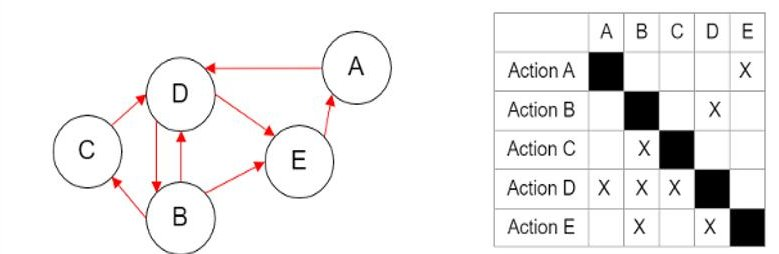
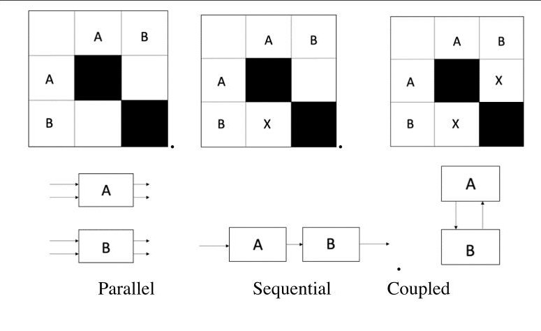
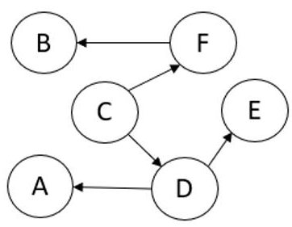
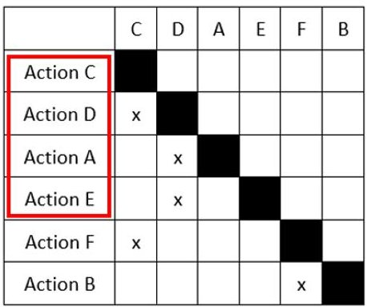
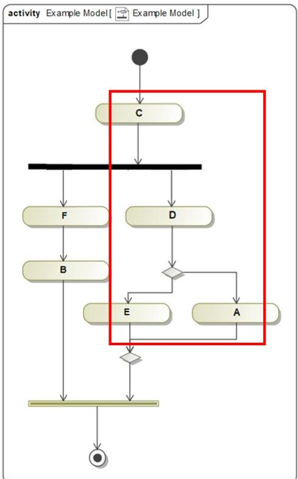
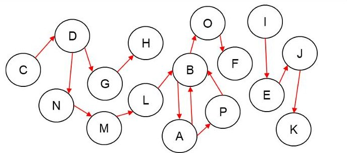
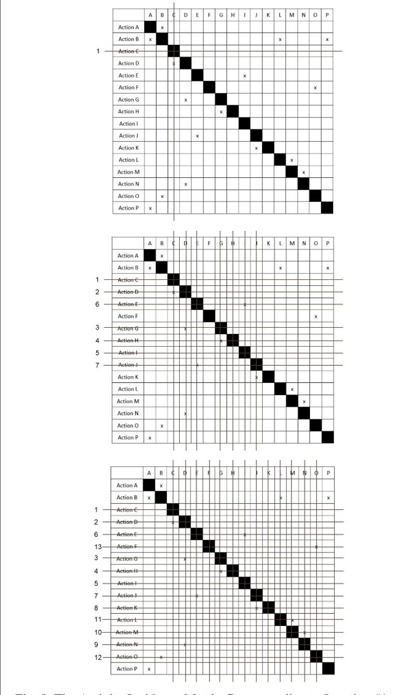
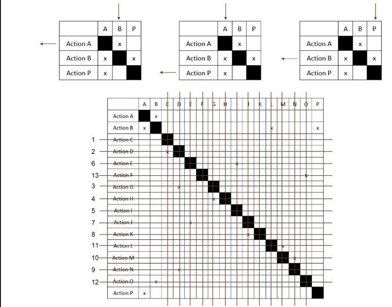
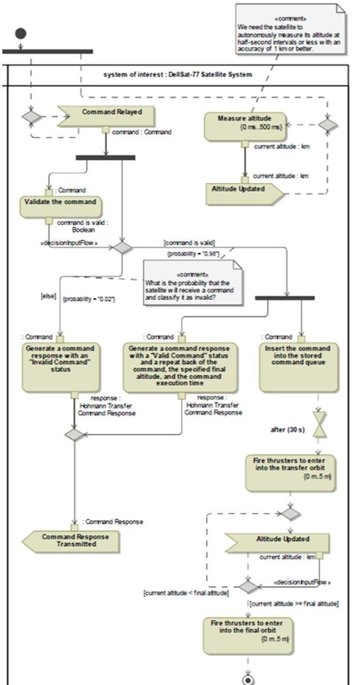

<!-- PDF_PAGE: 1 -->

# A Novel Approach to Behavior Design for Model Based Systems Engineering Application Using Design Structure Matrix

Aditya Akundi Complex Engineering Systems Laboratory, Department of Manufacturing and Industrial Engineering The University of Texas Rio Grande Valley Brownsville Texas 78520

Brownsville, Texas, 78520.

Rocio J. Lopez-Terrazas Department of Industrial, Manufacturing, and Systems Engineering The University of Texas at El Paso El Paso, Texas, 79968.

Tzu-Liang (Bill) Tseng Department of Industrial, Manufacturing, and Systems Engineering The University of Texas at El Paso El Paso, Texas, 79968.

Carmen N. Almeraz Department of Industrial, Manufacturing, and Systems Engineering the University of Texas at El Paso El Paso, Texas, 79968.

Hebin Luan

Avionics Engineering Department Mission Systems Group Naval Air Warfare Center Aircraft Division Patuxent River, MD 20670.

Abstract- Model-Based Systems Engineering (MBSE) is the formalized application of modeling to support various system evolving stages starting from the conceptual design phase to all the life cycle phases that follow. To facilitate in an efficient system behavior design process, in this paper, a Design Structure Matrix (DSM) based approach is developed and illustrated for determining the operational sequence of activities relevant to requirements of the system and in identifying the concurrent activities as well. A triangularization algorithm method is extended especially for application on activity diagrams to determine knowledge activities in an interaction graph to identify groups of activities and arrange them concurrently. The findings through the DSM based approach are validated by a system engineering expert and are implemented to construct the MBSE activity diagram to facilitate an enhanced behavior design of the system. This paper illustrates the use of Design Structure Matrix to facilitate modeling interdependencies between activities and the approach to aggregate the resulted sequential and concurrent activities with the activity diagram, applied to a case study of Execute Hohmann Transfer based on DellSat-77 Satellite System. In addition, the potentials benefits of using a Design Structure Matrix methodology for assisting Model Based Systems Engineering activities for enhanced systems behavior design is portrayed.

Keywords—MBSE, DSM, SysML, Triangularization, Activity Diagram, Systems Engineering, Model-Based Systems, DellSat-77

## I. INTRODUCTION

As systems are getting more complex, it has become more difficult for the systems modeler to visualize the interactions and sequences between activities, system requirements, structures, and parameters. Therefore, different tools, methods, and algorithms are required to help the modeler have a better visualization of the components of its system. In this paper, the behavioral design of the system considered, is used for analysis. Usually, a behavior design based approach is used to communicate the expected system's actors and behavior with the stakeholders [1].

Design Structure Matrix (DSM) is becoming a widely used tool to represent and conduct analyses of different processes, products, and organizations for system modeling mostly for decomposition and integration purposes. This

method differs from other tools such as project-management tools since it focuses on representing flow of information rather than workflow. A DSM is a model that exchanges information that allows complex tasks to be represented in order to determine a sequence in which tasks should be modeled. To model and understand a complex system generally:

a) The system is decomposed into known subsystems

b) The relationship and integration of the subsystems that emerge to system behavior are considered,

c) The effect of external inputs and outputs on the system are considered

With technology advancing day by day, system requirements evolve and change as well. Changes in requirements reflect in multiple subsystems, which lead to increased project lead times and costs. This leads to the question; Can the DSM be used to determine operational sequences? In order to determine this, first comes understanding the system behavior. For behavioral analysis, the only thing considered is the component-based representation, since each component behavior must be understood first before understanding the overall system behavior. An advantage of using a matrix instead of a digraph is its ability to provide systematic mapping among components. However, these are not intended to capture the behavioral characteristics of the system.

## II. BACKGROUND

## A. Model Based Systems Engineering (MBSE)

As the world continues revolutionizing, systems are becoming more complex. In 2014, the International Council of Systems Engineering (INCOSE) released an article that stated the vision they had for systems engineering for 2025. In order to help systems engineering to address the market demands of innovation, productivity, product quality and safety for the increasingly complexity in systems, one of the main expectations stated is the usage of models and simulations [2].

Since then, research has been done on model-based approaches in different areas of engineering throughout

<!-- PDF_PAGE: 2 -->

different parts of the life cycle to help transition from document-based to model-based approach, in order to control the model of the system instead of controlling the documentation about the system [3]. Traditionally, systems engineers produce artifacts and models using the document-based approach for systems. The communication is not effective, and the documentation is not as accurate as expected because when creating individual models or making changes, it is difficult to integrate them into a coherent model of the overall system. Moreover, considering the modelling activities performed by systems engineers in different teams of a project it is often difficult to fully integrate with other activities of the systems engineering process. Therefore, document-based approach has the tendency to produce a chain of inconsistencies along all the artifacts owned by different teams on a project or a system [3].

MBSE is the formalized application of modeling to support system requirements, design, analysis, verification, and validation activities beginning in the conceptual design phase and continuing throughout development and later life cycle phases [4]. The MBSE approach is expected to become the standard practice in the systems engineering field and will be crucial to support effective collaborative development environment and facilitate the systems engineering activities [5].

In [1], Delligatti presents an interesting point of view of the three pillars of MBSE: a modeling tool, a modeling method, and a modeling language. Modeling tools enable to create an integrated, and consistent system model, which is the main artifact of MBSE. The system model consists of model elements, which are interconnected, and represent key aspects of the system such as activities and artifacts developed throughout life cycle phases. Furthermore, modeling tools help create the model elements and their relationships using a modeling method which is a set of tasks already tailored to meet project's specific needs. The system model and the model elements are expressed in a standard modeling language which includes a set of rules that determines whether a given model is well formed or not. There are different modeling languages that MBSE practitioners use, the most common one is Systems Modeling Language (SysML).

## B. Systems Modeling Language (SysML)

In this paper, modeling language is of main focus. There are different modeling languages that MBSE practitioners use, the most common one is Systems Modeling Language (SysML). Object Management Group, Inc. (OMG) owns and published the standards specifications of SysML, including grammar and notations. SysML is intended to unify diverse modeling languages used by systems engineers and can be used with a wide variety of discipline- and domain-specific modeling languages [6]. SysML is a language/medium used to create system models, and specify structures, requirements, behaviors, allocations, and constraints [1]. There are three groups of SysML diagrams: structure, behavior, and requirements. In this paper, we focus on the "behavior" diagram. Moreover, there are four kinds of behavioral SysML diagrams: activity diagram, sequence diagram, state machine diagram, and use case diagram. Each diagram must have a frame, a contents area, and a header. The header normally contains four pieces of information: diagram kind (shown as its SysML-defined abbreviation), model element type, model element name, and diagram name. Based on these four pieces of information, the diagram can be identified. As each diagram

has its set of elements based on the purpose of each one of them; in this paper, a behavioral diagram.

## C. Activity Diagrams

An activity diagram is a type of behavioral diagram, which help to express information about a system's dynamic behavior. It can be easily identified via examining the header. Furthermore, the SysML-defined abbreviation for activity diagram is act, and the only allowable model element type is activity. Activity diagrams are used to model the workflow that is complex and has conditions, constraints, sequential and concurrent activities. The activity diagram represents the executed actions in order based on the availability of their inputs, outputs, and control; and how the actions transform the inputs to outputs [1]. There are three types of nodes that can be found in activity diagrams: action, object node, and control node; and two types of edges: object flow and control flow. A list of the most important and common elements used in activity diagrams can be found in Table I divided by type of element.

TABLE I. FEATURES OF ACTIVITY DIAGRAMS

<table border="1"><tr><td>Type of Element</td><td>Name of Element</td></tr><tr><td rowspan="5">Actions</td><td>Action</td></tr><tr><td>Call Behavior Action</td></tr><tr><td>Send Signal Action</td></tr><tr><td>Accept Event Action</td></tr><tr><td>Wait time Action</td></tr><tr><td rowspan="4">Object Node</td><td>Pin</td></tr><tr><td>Activity Parameter</td></tr><tr><td>Non streaming Behavior</td></tr><tr><td>Streaming Behavior</td></tr><tr><td rowspan="7">Control Node</td><td>Initial Node</td></tr><tr><td>Activity Final Node</td></tr><tr><td>Flow Final Node</td></tr><tr><td>Decision Node</td></tr><tr><td>Merge Node</td></tr><tr><td>Fork Node</td></tr><tr><td>Join Node</td></tr><tr><td rowspan="2">Edges</td><td>Object Flow</td></tr><tr><td>Control Flow</td></tr></table>

## D. Design Structure Matrix (DSM)

The Design Structure Matrix (DSM), also known as Dependency and Structure Modelling, is a popular method used for improving and analyzing the design of system models and products in different implementation areas. A DSM provides a simple, visual representation of a complex system that facilitates innovative solutions to decomposition as well as integration problems [7]. It is also amenable to analyses such as clustering and sequencing, which assist in modularity and minimizing cost and schedule risk processes. A DSM is a square matrix, meaning it has an equal amount of rows and columns that shows the relationships between the system elements (N rows x N columns). Typically, the system behavior and values are determined by the interactions between its primary elements. In recent years, the use of the DSM system representation and analysis techniques have led to many advantages in a variety of settings, including systems engineering, product development, project planning and project management.

A DSM needs to be adapted to the elements and relationships that exist within the system. Basically, the type of the elements and dependencies needs to be defined as

<!-- PDF_PAGE: 3 -->

precisely as possible to obtain the information structure for the matrix. There are two main components used to convey the DSM information: inputs in rows (IR) or inputs in columns (IC) (the inputs of an action are either elements in a row or a column) [8].

There are two main DSM types: static and time-based. Static can be architecture or organizational design structure matrices; whereas time-based can be activity or parameter based. Time-based DSMs can be applied for project scheduling, activity sequencing, cycle time reduction, risk reduction and low-level process sequencing and integration. A simple DSM example is shown in Figure 1, based on a digraph form. A digraph is a representation of a set of nodes connected via edges along with the direction of flow associated with them. Figure 1 shows a sample digraph consisting of five nodes, two feedbacks and six feed forward loops. A binary DSM representation of this digraph is also shown indicating the presence or absence of interactions, where, the nodes analogous to the digraph are labeled A through E, which are placed across rows and columns. This approach of node placement helps to identify the relations among them. Reading across row E for example, it is observed that node E has inputs from node B and node D marked by an 'X' in the table. Similarly, reading down column D, it can be seen that the output of node D acts as an input for node B. It

Fig. 1. Sample Digraph and Corresponding DSM Representation

Fig. 2. Common Types of Flows in DSM

can also be observed that, all the feed forward loops are placed below the diagonal and all the feedback loops are placed above the diagonal [9].

In [10], Nonsiri et al. have process architecture DSMs represented by Inputs in Rows/Feedback above the Diagonal (IR/FD) convention where an input is represented in row (IR) and a feedback is represented above diagonal (FAD). They also present three common types of flows; parallel, sequential, and coupled, which represent the interactions between tasks and are distinguished by an X or values in the corresponding DSM cell. Between parallel (independent) activities no

information exchange is required; these activities can be executed simultaneously. Sequential (dependent) activities require sequential information transfer and they are typically performed in series. Coupled (inter-dependent) activities are mutually dependent on information and they often require multiple iterations to complete. The DSM method facilitates for minimizing iterations in the process.

Figure 2 shows a portrayal of the described flows. Time-based DSMs can be applied for project scheduling, activity sequencing, cycle time reduction, risk reduction and low-level process sequencing and integration [11].

## III. DESIGN STRUCTURE MATRIX BASED METHODOLOGY

There are many variant DSM methodologies from literature. The one is used for this paper is called the "Triangularization Algorithm." This approach can be implemented in modeling one-dimension matrix (e.g., activity only) to form many sub-groups with the sequence and identify concurrent activities among overall activities. This methodology requires a di-graph, which is modeling interdependencies among activities initially. The interaction between actions of collection is represented as a digraph (directed graph), where a vertex denotes a task, and a directed edge denotes a dependence. Based on the interactions within a graph, three types of interaction graphs have been defined: continuous, semi-continuous, and discrete. After the digraph is acquired, the incidence matrix of activity can be developed. Note that action dependencies and iterations are represented more clearly in an incidence matrix. A nonempty element in the incidence matrix represents a dependence between the corresponding tasks (row and column). The action-dependence problem is equivalent to cluster determination in graphs and matrices, of which numerous approaches have been discussed in literatures [12], [13]. The triangularization algorithm is one approach for determining dependence and has been defined for digraphs. The algorithm has been widely used in modular products, both for design [14] and concurrent engineering [15].

## A. Triangularization Algorithm

The triangularization algorithm [15,16] identifies groups of activities and arranges them concurrently. This algorithm is extended to determine knowledge activities in an interaction graph. To present the algorithm, a terminology is introduced. An activity with no other activity preceding it is called an Origin Activity (OA) if there are no other items preceding it. The OA activities can be easily identified in the incidence matrix. If the ith row of the incidence matrix has only one nonempty element (a diagonal element), then it is an OA. In a digraph with no OAs, there exists at least one cycle. And an activity with activities preceding it is called a Destination Activity (DA). Note that if an analyst is not satisfied with the outcome, examination of the interaction graph is usually undertaken. A modified triangularization algorithm, revised from the original, in order to model activity dependencies is presented here.

Step 0: Begin [with the initial sequence of the activities (1,2, 3, ..., m)]

Step 1: End the algorithm if all the vertices are underlined.

Identify an activity which is an origin activity (OA) or a destination activity (DA)

Go to Step 5 if neither an OA nor a DA is found.

<!-- PDF_PAGE: 4 -->

Step 2: Apply the Sorting Rule to the activity identified in Step 1.

If the activity is an origin activity (OA), move it to the most left position in the sequence of activities that are not underlined.

If the activity is a destination activity (DA), move it to the most right position in the sequence of activities that are not underlined.

Step 3: Underline the activity identified in Step 1.

Step 4: Delete the row and column associated with the underlined activity (see Step 1) from the incidence matrix and go to Step 1.

Step 5: Find a cycle.

Step 6: Merge all the activities in the cycle into one activity.

Step 7: Update the corresponding rows and columns in the incidence matrix and go to Step 1.

Step 8: Assign the activities and cycles in the final solutions to levels according to the earliest start time.

Here, the triangularization algorithm is used to model activity dependencies and it can deal with the multi-interaction graph simultaneously. In the next section, the activities are partitioned by the triangularization algorithm and illustrated in the example. This algorithm determines a set of clusters to schedule activities. Furthermore, the algorithm could be performed to explore a process structure and enhances concurrence of the activities involved in the process.

## B. An Illustrated Example

The following example demonstrates the use of the presented modified triangularization algorithm.

Fig. 3. The Digraph Described in the Illustrated Example

Example: Considering the actions and associated interactions of the digraph illustrated in Figure 3, Action C needs to feed both action D and F, action D needs to decide between action A and E, and action B is preceded by action F. Based on the digraph, a binary DSM representation was made to indicate the presence or absence of interactions, as represented in Figure 4. This will help the modeler to see the sequence of the system's activities or actions. Then, the triangularization method is applied in order to arrange the actions. It can be easily identified that Action C is the first OA in the matrix, as it does not have predecessors. Action C is going to be moved to the most left position in the sequence of activities and it is going to be the first one to be underlined.

The next step is to delete the row and column associated with the underlined activity. Then after applying steps 1 to 4 several times, all the activities are underlined, and the result is {C, D, A, E, F, B}. In this case, a cycle could not be

identified, therefore, steps 5 to 7 are not applied. Figure 5 shows the final result and the activities were assigned accordingly to the earliest start time identified based on the OA's and DA's.

<table border="1"><tr><td></td><td>A</td><td>B</td><td>C</td><td>D</td><td>E</td><td>F</td></tr><tr><td>Action A</td><td></td><td></td><td></td><td>x</td><td></td><td></td></tr><tr><td>Action B</td><td></td><td></td><td></td><td></td><td></td><td>x</td></tr><tr><td>Action C</td><td></td><td></td><td></td><td></td><td></td><td></td></tr><tr><td>Action D</td><td></td><td></td><td>x</td><td></td><td></td><td></td></tr><tr><td>Action E</td><td></td><td></td><td></td><td>x</td><td></td><td></td></tr><tr><td>Action F</td><td></td><td></td><td>x</td><td></td><td></td><td></td></tr></table>

Fig. 4. The Initial Incident Matrix

Fig. 5. The Finalized Matrix after Performing the Triangularization Algorithm

After organizing the sequence of the activities with the triangularization algorithm, this finding is used to facilitate the modeler to arrange activities involved in behavior design. In addition, it can help the modeler determine which activities interact with each other with only feed forward loops. The draft activity diagram shown in Figure 6 can be developed

Fig. 6. Activity Diagram of the Illustrated Example in Fig.3.

<!-- PDF_PAGE: 5 -->

using the findings derived from the triangularization algorithm.

In Figure 6, the control nodes are implemented to simulate different situations and interactions that the activities are involved. Action C feeds Action F and D, therefore, a fork node was used to simulate both feed forward loops coming out of Action C. Moreover, a decision node was used to simulate the decision that needs to take place after Action D, and a merge node was used to simulate that both decisions (i.e., Action E and Action A) will end in the same result. Note that since Action E and Action F are mutual exclusive and Action F is an immediate successor from Action C, consequently the Action F is placed at the beginning of the second path. Once all action items (e.g., Action A through Action F) have been identified, they are placed in the activity diagram.

## IV. CASE STUDY AND COMPUTATIONAL RESULTS

In this section, an use case of "Execute Hohmann Transfer" is implemented in this case study adopted from the DellSat-77 Satellite System [1], [17]." Basically this case study describes different standings of the DellSat-77 satellite system when it enters or leaves the orbit and correlation between satellite attitude and orbit control. If the satellite is in the orbit then the system will execute spin stabilization. The satellite must de-spin and dump momentum as the satellite is out of orbit. Here, the primary actor is the NASA mission manager while the supporting (secondary) actors include but not limited to NASA mission manager, flight controller and Tracking and Data Relay Satellite (TDRS). Note that there are two preconditions described in this case studies: (1) The DellSat-77 Satellite must be in its parking orbit, and (2) The DellSat-77 Satellite must have an open communications link to a TDRS. The activity list and the digraph described interrelation among activities in this case study (see Figure 7) are as follows:

A-Update altitude; B-Measure Altitude; C-Satellite receives valid command (command relayed); D-Validate the command; E-Invalidate the command; F-Fire thrusters to enter into the final orbit; G-Generate a command response with a "Valid Command" status, Repeat back of the command, the specified final altitude, and the command execution time; H-Transmit Valid Command Response; I-Satellite receives invalid command; J-Generate a command response with an "Invalid Command" status; K-Transmit invalid command response ; L-Fire thrusters to enter into the transfer orbit; M-Wait time (30 sec.); N-Insert the command into the stored command queue; O-Current Altitude Greater

Fig. 7. The Digraph Used for modeling inter-relationship among the activities in the "Satellite Situation" Case Study

or equal than final altitude; P- Current Altitude Less than final altitude

In this case study, the initial digraph is used to construct the initial activity incidence matrix (see Iteration #1 in Figure 8). Following through the steps described in the triangularization algorithm, the intermediate solutions (e.g., Iteration #7 and Iteration #13) can be found in Figure 8.

In Iteration # 13, the sequence of activities (e.g., {C,D,G,H,I,E,J,K,N,M,L,O,F,A,B,P}) is determined per definition of OA and DA depicted from the triangularization algorithm.

Fig. 8. The Activity Incidence Matrix Corresponding to Iteration #1, Iteration # 7 and Iteration #13 (from top to bottom) as the Triangularization Algorithm is performed.

Per the triangularization algorithm, the next step is to identify the cycle (if any) from the activity incidence matrix. One can observe that Activities "A, B and P" alternatively have a role being predecessor or successor from each other in this case study. Therefore, the cycle "B-A-P" is formed in Iteration #14 and the final solution carried out from the triangularization algorithm is illustrated in Figure 9.

The findings through the triangularization algorithm (i.e., the DSM based approach) are validated by a systems engineering

<!-- PDF_PAGE: 6 -->

expert and the sequence of activities and concurrency among a couple of activities (e.g., activities "A", "B" and "P") are implemented to construct the MBSE activity diagram to enhance behavior design in the system (see Figure 10). There are less identified activities in Figure 10 than Figure 9, where

Fig. 9. The Iteration #14 to Identify Cycle and the Final Iteration (Iteration #15) in this Case Study (from left to right)

11 final articulated activities are observed in the MBSE activity diagram while 16 activities are listed in the final resulted incident matrix (after Iteration #15).

The conclusion obtained from Figure 9 is that some of the actions needed to be modified and/or merge to use the features of activity diagrams (e.g., types of actions and control nodes). First, considering the fact that the satellite is only going to receive one command which is either valid or invalid, therefore activities C and I can be merged by creating only one activity called "Command Relayed" where the satellite is going to receive that command, and later in the diagram the satellite can determined if it is valid or invalid. Then, in order to meet the requirement of determining if the command is valid or invalid, activities D and E can be merged by implementing a decision node in the diagram that will be preceded by an action called "Validate Command". Since there is only going to be one command in the system, activities H and K can be merged by calling them "Command Response Transmitted". A fork node is going to be used to represent the start of concurrent sequences between activity D and activities G and N.

Activity diagrams allow to have different types of actions; activity M is a wait time action, and it will be represented in the diagram with the corresponding notation of a stylized hourglass symbol with a time expression string beneath it. The cycle "B-A-P" is not necessarily going to be represented together, as the satellite needs to be measuring the altitude constantly. Therefore, the activities B and A are going to be shown independently from the other sequences. However, a Send Signal and Accept Event actions are going to be shown in the diagram to represent when activity A is going to be taking place to represent the cycle. After the event is accepted, as can be seen in the activity diagram there could be two outcomes that will follow different sequences: activities O and P. This can be represented by implementing a decision node after the altitude is updated. The cycle "B-A-

P" is going to be represented by placing a merge node before the altitude update event is accepted. After revising the sequence of activities and concurrency among activities, the final list of activities was completed in Table 2.

TABLE II. ACTIVITY CONVERSION FROM THE FINAL RESULTED INCIDENT MATRIX TO THE MBSE ACTIVITY DIAGRAM

<table border="1"><tr><td>Activities in DSM based approach</td><td>Activities in MBSE Activity Diagram</td></tr><tr><td>C&amp;I</td><td>Command Relayed</td></tr><tr><td>D&amp;E</td><td>Validate the command (decision node created)</td></tr><tr><td>G</td><td>Generate a command response with a “Valid Command” status, Repeat back of the command, the specified final altitude, and the command execution time</td></tr><tr><td>J</td><td>Generate a command response with an “Invalid Command” status</td></tr><tr><td>H&amp;K</td><td>Command Response Transmitted</td></tr><tr><td>N</td><td>Insert the command into the stored command queue</td></tr><tr><td>M (wait time action)</td><td>Wait time (30 sec)</td></tr><tr><td>L</td><td>Fire thrusters to enter into the transfer orbit</td></tr><tr><td>F</td><td>Fire thrusters to enter into the final orbit</td></tr><tr><td>B</td><td>Measure Altitude</td></tr><tr><td>A</td><td>Altitude Updated (send signal and accept event actions created)</td></tr><tr><td>O&amp;P</td><td>Decision and Merge nodes created</td></tr></table>

Fig. 10. The Detailed MBSE Activity Diagram Based on Findings Derived from the Modified DSM Approach

<!-- PDF_PAGE: 7 -->

## V. CONCLUSION

This paper illustrates the use of DSM integrated with Triangularization algorithm to facilitate modeling interdependencies between activities in the designated system and the approach to aggregate the resulted sequential and concurrent activities with the MBSE activity diagram. The articulated sequential activities derived from the original activity set provide an indication of how to study this problem further and pave a path for effective further investigation. This paper forms the basis for solving many other similar problems that occur in aerospace, manufacturing and service industries.

## ACKNOWLEDGMENT

This work was partially supported by the National Science Foundation (ECR-PEER-1952634). The authors wish to express sincere gratitude for their financial support.

## REFERENCES

[1] Delligatti, L. (2013). SysML distilled: A brief guide to the systems modeling language. Addison-Wesley.

[2] INCOSE, A. (2014). A world in motion: systems engineering vision 2025. International Council on Systems Engineering, San Diego, CA, USA.

[3] Friedenthal, S., Moore, A., & Steiner, R. (2014). A practical guide to SysML: the systems modeling language. Morgan Kaufmann.

[4] INCOSE, T. (2007). Systems engineering vision 2020. INCOSE, San Diego, CA, accessed Jan, 26, 2019.

[5] Ramos, A. L., Ferreira, J. V., & Barcelo, J. (2011). Model-based systems engineering: An emerging approach for modern systems. IEEE Transactions on Systems, Man, and Cybernetics, Part C (Applications and Reviews), 42(1), 101-111.

[6] OMG, O. OMG Systems Modeling Language (OMG SysML), Version 1.4, Object Management Group Std., 2015.

[7] T. R. Browning, "Applying the design structure matrix to system decomposition and integration problems: a review and new directions," in IEEE Transactions on Engineering Management, vol. 48, no. 3, pp. 292-306, Aug. 2001, doi: 10.1109/17.946528

[8] Salas Cordero, S., Fortin, C., & Vingerhoeds, R. (2020). Concurrent Conceptual Design Sequencing For MBSE Of Complex Systems Through Design Structure Matrices. Proceedings of the Design Society: DESIGN Conference, 1, 2375-2384. doi:10.1017/dsd.2020.96

[9] A. Akundi, E. Smith, T. Tseng and I. Rubio, "Quantifying system structural complexity using design structure matrices," 2018 Annual IEEE International Systems Conference (SysCon), Vancouver, BC, 2018, pp. 1-8, doi: 10.1109/SYSCON.2018.8369494

[10] Nonsiri, Sarayut & Christophe, François & Coatanéa, Eric & Mokammel, Faisal. (2014). A Combined Design Structure Matrix (DSM) and Discrete Differential Evolution (DDE) Approach for Scheduling and Organizing System Development Tasks Modelled using SysML. Journal of Integrated Design and Process Science. 18. 10.3233/jid-2014-0013.

[11] Şule TaşlıPektaş, M. P. (2006). Modelling detailed information flows in building design with the parameter-based design structure matrix. Design Studies, Vol 27., Issue 1, 99-122.

[12] J. Edmonds, "Matroid and the greedy algorithm," Math. Program., vol. 9, no. 1, pp. 31-56, 1971.

[13] L. R. Ford and D. R. Fulkerson, Flow in Networks. Princeton, NJ: Princeton Univ. Press, 1962

[14] C.-C. Huang and A. Kusiak, "Modularity in design of products and systems," IEEE Trans. Syst., Man, Cybern. A, vol. 28, no. 1, pp. 66- 77, Jan. 1998.

[15] A. Kusiak, J. Zhu, and J. Wang, "Algorithms for simplification of the design process," in Proc. National Science Foundation (NSF) Design Manuf. Syst. Conf., Charlotte, NC: ASME, 1993, pp. 1107-1111.

[16] B. Tseng and C.C. Huang, "Capitalizing on Knowledge: A Novel Approach to Crucial Knowledge Determination," IEEE Transactions on Systems, Man, and Cybernetics Part A: Systems and Humans, vol. 35, no. 6, pp. 919-931, 2005.

[17] L. Delligatti, "OOSEM Accelerator $ ^{\mathrm{TM}} $ MBSE Methodology Training Course Handbook," Pearland, Texas, 2020.