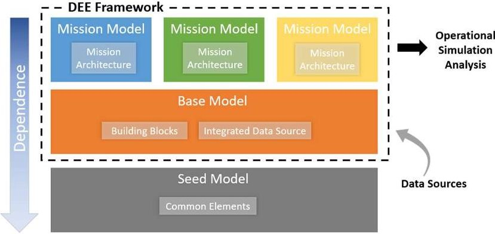
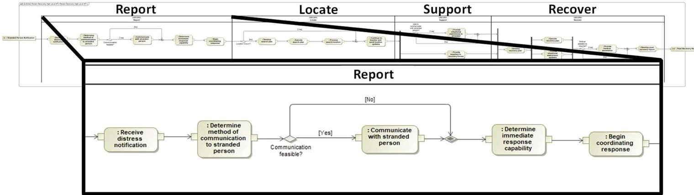
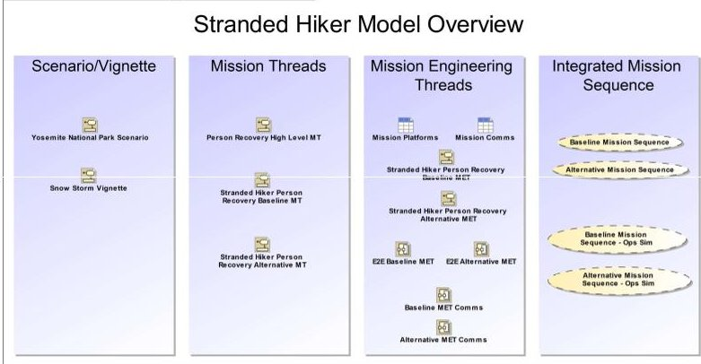
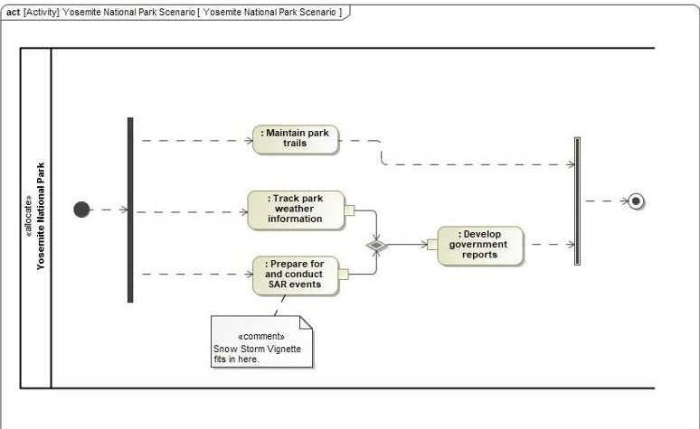
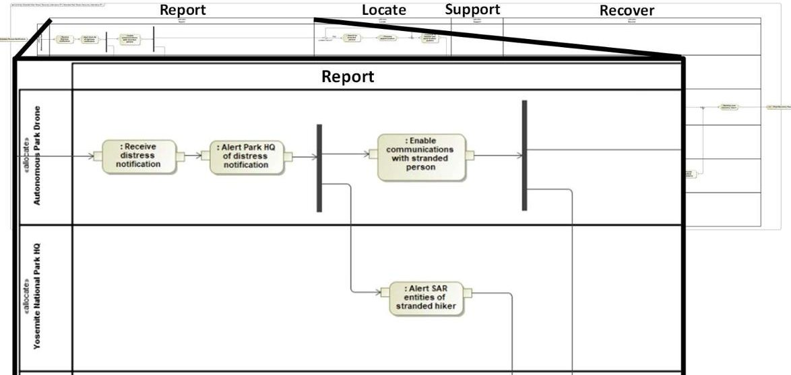
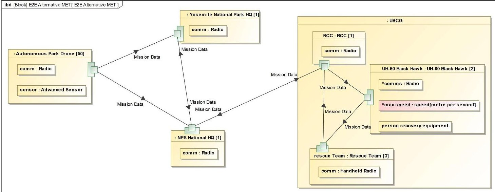
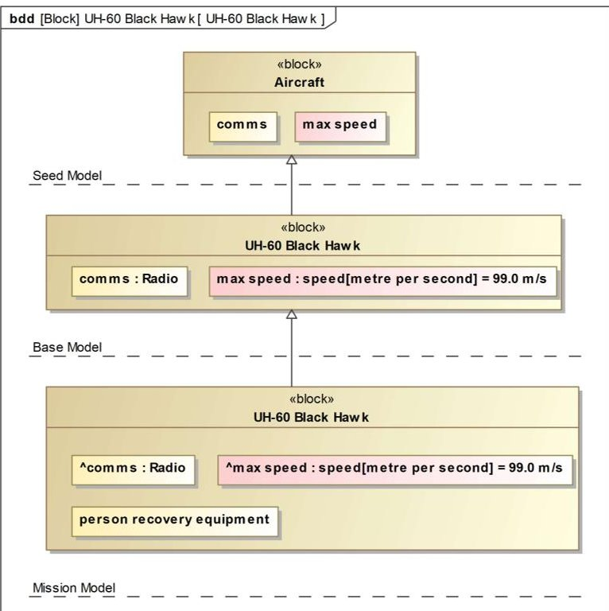
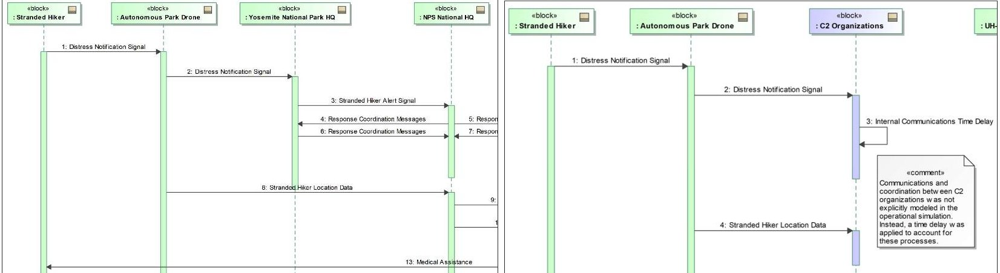

<!-- PDF_PAGE: 1 -->

# Enabling Mission Engineering through a Reusable Digital Engineering Environment

Michael J Pennock MITRE Labs The MITRE Corporation McLean, VA, USA mpennock@mitre.org

Gabriela I Driscoll MITRE Labs The MITRE Corporation McLean, VA, USA gidriscoll@mitre.org

Judith S Dahmann MITRE Labs The MITRE Corporation McLean, VA, USA jdahmann@mitre.org

Meg Adams MITRE Labs The MITRE Corporation McLean, VA, USA madams@mitre.org

Abstract—Mission engineering is the deliberate organization and integration of a system of systems (SoS) to achieve a particular goal or mission. As such, it often requires the consideration of many alternative configurations of independent constituent systems and organizations over a diverse set of operating contexts with a focus on the achievement of desired mission outcomes. While digital engineering approaches and tools would seem to be a natural means to aid engineers in managing the associated complexity, mission engineering poses several challenges to its successful application. Among these challenges are the diversity of SoS constituents, complex system behaviors and interactions, and multiple relevant levels of abstraction. The direct consequence is that each mission may require a different characterization of the SoS architecture and corresponding set of simulation models. This paper presents an approach developed at the MITRE Corporation to partially mitigate these challenges by constructing a reusable digital engineering environment based on a shared modeling framework. The digital engineering environment leverages a multi-layered SysML architecture model that evolved through its application to multiple, real-world mission engineering efforts. The layered structure enables the reuse and rapid construction of new mission architectures and facilitates the coordination of multiple analysis efforts using different simulation tools.

Keywords—model-based systems engineering, systems of systems, mission engineering, digital engineering

## I. INTRODUCTION

Increasingly systems engineering (SE) is addressing more complex systems including systems of systems which include organizations and complex socio-technical environments. An example is the recent movement toward what is termed 'mission engineering'(ME). Mission engineering is the deliberate organization and integration of a system of systems (SoS) to achieve a particular goal or mission $ ^{1} $ . In effect, ME combines more traditional mission analysis with System of Systems Engineering (SoSE) with the objective of improved mission outcomes [1].

Mission engineering requires evaluating multiple different configurations of the SoS over a set of relevant performance requirements, and these performance requirements may vary from mission to mission. These circumstances suggest the application of digital engineering approaches and tools to manage the technical complexity. For any given mission, alternative SoS configurations are engineered and tracked within a system architecture tool and then fed into simulation tools to predict performance against key mission requirements. The digital tool chain should accelerate the design cycle by providing an authoritative repository for data, leveraging the reuse of model artifacts, and enabling the rapid reconfiguration of models to evaluate alternatives.

In practice, the authors have found several challenges to the application of digital engineering approaches to mission engineering. Among these challenges are the relative diversity of SoS constituents, complex system interactions, and multiple relevant levels of abstraction. The direct consequence is that each mission may require a different characterization of the SoS architecture and corresponding set of simulation models. This means that the ostensibly reusable models must be reworked resulting a diminished yield from the digital engineering approach.

To partially mitigate this problem, the MITRE Corporation developed a reusable digital engineering environment (DEE) through the application of digital engineering approaches to multiple, real-world mission engineering efforts. This empirical approach enabled the identification of abstractions and model components that were stable across multiple contexts as well as which aspects should be tailorable. The resulting digital engineering environment leverages a multi-layered SysML architecture model. The layered structure enables the reuse and rapid construction of new mission architectures and facilitates the coordination of multiple analysis efforts using different simulation tools.

<!-- PDF_PAGE: 2 -->

The remainder of this paper is organized as follows: Section II describes the aspects of mission engineering that make the application of digital engineering particularly challenging. Section III describes the authors' approach to developing a reusable digital engineering environment for mission engineering, and Section IV describes an application of that approach and environment to an example problem. Section V discusses lessons learned including the strengths and weakness of the approach. Finally, Section VI concludes the paper with a discussion of future work.

## II. BACKGROUND

The SE Body of Knowledge (SEBOK) [2] addresses ME, emphasizing the fact that "mission engineering must simultaneously consider operational, technical, and acquisition issues and their integration in order to design a solution to achieve the mission goal" [3]. Initial work has been done to understand the relationship of ME to SE and SoSE and the skillsets needed by systems engineers for ME [4].

The US Department of Defense (DoD) has released an initial version of a ME Guide [5]. The DoD ME Guide provides foundational concepts for ME. This includes key definitions: Mission Thread (MTs) are defined as "the tasks to be executed to conduct or carry out the mission to satisfy a defined objective" [5]. Threads essentially define the activity or process sequences critical to achieving the desired capability as a chain of events of how systems, people, data, methods, tactics, timing, and interfaces will interact to complete necessary tasks to achieve mission or capability objective(s). As details associated with specific systems, technologies, or people are added, the generic MTs become Mission Engineering Threads (METs). The MET essentially represents the SoS, broadly defined, supporting the mission.

Increasingly, the systems engineering community is moving toward digital engineering as a means cope with the challenges of engineering systems in a dynamic and evolving environment [6]. Digital engineering leverages a digital thread to manage the propagation of changes across the various models of a system and maintain consistency [7]. It is comprised of several components including Model-based Systems Engineering (MBSE), digital architecture, and simulation [8]. These modelbased approaches and tools would seem to be a natural means to aid engineers in managing the complexity associated with mission engineering. However, mission engineering poses several challenges to their successful application.

ME focuses on SoS with characteristics which differ from traditional systems. Systems are engineered to meet specific user needs in a mission context and system components are engineered and integrated to provide critical system functionality under a range of conditions. Mission operations are supported by sets of systems (or systems of systems) which work together in particular ways to achieve mission objectives. Different configurations of systems may be used to achieve the mission depending on the environmental conditions and systems supporting each role in a mission will vary over the course of the operation and be used for multiple missions.

Mission SoS are sensitive to mission context. Variable physical environments, threats, and non-material elements are

critical in driving SoS for missions. From a practical perspective, execution of missions is based on the employment of the set of systems available and appropriate for the mission environment. Performance needs of a system in the mission SoS may vary depending on the performance of other systems in the SoS ('requirements float and flow'). And while there may be a logical sequence of actions for a mission, in practice, there are varying sets of systems which support missions under different situations,

The systems composed into an SoS architecture to support a mission are typically drawn from a variety of specialty areas (sensors, weapons, platforms, communications) and diverse organizations which bring various perspectives to the mission. Specificity provided by models can help avoid misunderstandings about system behavior, system interactions/interfaces (Have I addressed all the key activities critical to execute the mission?). A model allows for representation of the complexity of the interrelations among systems in the mission, reflecting the variety of paths in the mission architecture. It is important to have a commonly understood representation providing the mission engineer and stakeholders a cross cutting integrated view across the systems and how they are expected to be employed in a mission context.

Finally, missions can be large and comprise many systems, and the time required to develop a model framework for each mission architecture can raise the cost of entry for use of models to support mission engineering. Gathering the needed data to understand the current state of a large mission can be difficult given the diversity of knowledgeable mission stakeholders.

Under these circumstances digital tool chains and model reuse become quite appealing, but the previously described complexity of mission SoS inhibit some of the key benefits of digital engineering approaches. For example, the near infinite number of behavioral paths and interactions make extensive, executable behavioral models challenging. Furthermore, mission engineering questions often span multiple levels of abstraction. For example, a mission engineer may need to understand the impact of introducing a new technology to a constituent system will have on an entire campaign. Answering this question may involve multiple analyses using a combination of different types of simulation tools using different modeling paradigms. Then answering a different question regarding the same mission may require an entirely different set of abstractions and tools. This makes the implementation of interfaces to exchange data among tools challenging as they can be context and problem dependent.

This situation should not be surprising as it has long been recognized that as one moves further from systems that can be described purely by physics and toward systems with substantial human and social aspects, the appropriate system characterization becomes context dependent [9][10]. In technical terms, it means that choosing the ontology for the reference system depends on the question of interest [11]. The immediate implication is that is difficult to know a priori which modeling abstractions, data exchanges, and tools will be reusable across the full range of mission engineering needs in a particular application domain.

<!-- PDF_PAGE: 3 -->

For example, Knöös Franzén, et al. proposed an approach to designing SoS to fulfill a specific mission that leverages tailored domain ontologies to identify collections of feasible constituent systems using the Protégé ontology tool [12]. Options in the resulting SoS design space were then automatically evaluated using an agent-based simulation. However, in the mission engineering problems examined by the authors, such an approach would be difficult to apply because the SoS architecture is largely fixed based on the existing inventory of systems. Instead of searching a large design space over a fixed scenario, the problem faced by the authors was one of evaluating the effectiveness and robustness of a limited number of candidate modifications to a large and complex SoS over a wide range of scenarios. To complicate matters further, the candidate modifications often varied in terms of level of abstraction ranging from low-level engineering changes to high-level changes in the concept of operations. This meant that it was difficult to determine the appropriate ontology to answer the questions of interest.

Consequently, this led the authors to take a flexible, empirical approach to developing the reusable digital engineering environment. Evolving the DEE over multiple mission engineering studies enabled the identification of stable components that entail a reasonable level of tailoring over multiple, related applications. While this meant sacrificing certain aspects of digital engineering such as rapid automated simulation configuration, the result seemed to substantially reduce the cycle time for each subsequent analysis. The remainder of this paper describes the results of those efforts.

## III. APPROACH

To partially mitigate the challenges associated with applying digital engineering to the mission engineering of complex systems-of-systems, a re-usable DEE was developed using a shared modeling framework. The shared modeling framework is a set of configuration-managed models of mission systems and operations. It was originally developed through prior work at MITRE, and it has been adapted to support mission engineering [14]. Each model layer of the framework is built on and inherits from the previous layer. The structure of the DEE is comprised of three layers, as shown in Fig. 1.

- The Seed Model contains SysML elements that can be applied to multiple domains. It defines common system properties in supertypes or "superclasses" that can provide consistency in these elements. An example of a seed model element is a generic aircraft platform.

- The Base Model draws upon a compilation of data sources and the seed model to create common, reusable systems and MTs that can be applied in different mission scenarios. An example of a common system is a UH-60 Black Hawk aircraft, and an example of a base MT is Person Recovery, which could be applied in multiple search and rescue (SAR) mission scenarios.

- The Mission Models use the base model and other data to address different ME studies. They provide digital representations of the mission architectures for each

study, including the scenario (in some cases), a representation of the MT as applied to the study scenario and vignette, and the MET or physical architecture model that shows the allocation of systems to the mission activities in the scenario for the study.

The DEE is structured to allow for separate models of the mission architectures (MTs, METs) to be developed to meet the particular needs of each study. All of the models draw on base model representations, including representations of the base MT and the growing set of systems which are reused as appropriate for each study.

The DEE base model was developed to provide a scenarioagnostic MT and systems inventory for reuse in a set of ME studies. The base model only contains mission activities and systems that could be applied across different mission scenarios. The base model provides the following minimum essential elements: a set of top-level "types" of systems (e.g., Platform, Communications), a set of specific systems that are categorized by the types of systems (e.g., UH-60 Black Hawk aircraft, handheld radio), and a scenario-agnostic MT with mission activities. The base model was developed using a bottoms-up approach with a specific mission scenario as a starting point. As subsequent mission scenarios were added to the overall DEE, the base model was evolved to refine the scenario-agnostic MTs and expand the systems inventory.

A mission model was developed for each ME study by leveraging the base model. Each mission model follows the same basic structure, including five main sections.

Fig. 1. Structure of the DEE (Adapted from [13])

- The Scenario/Vignette section provides digital representations of the overall scenario and specific vignette in which the mission is conducted. These views provide the larger context for the MT under analysis.

- The Mission Threads section provides digital representations of the baseline and alternative MTs.

- The Mission Engineering Threads section provides digital representations of the baseline and alternative METs, including tabular views of detailed system characteristics and parameters, a mapping of systems to mission activities, end-to-end (E2E) views of

<!-- PDF_PAGE: 4 -->

Fig. 3. Top-Level Person Recovery MT (Adapted from [13])

system connections, and communications architecture views.

- The Integrated Mission Sequences section provides representative instances of MET execution for the baseline and alternative METs, which show what is exchanged between systems and the timing of system-to-system exchanges.

- The Operational Simulation Analysis section provides SysML-based representations of the operational simulations conducted for the ME study. These representations are compared with the MTs and METs defined in the model to identify the necessary assumptions and/or abstractions made for the operational simulations.

The DEE was implemented as a set of SysML models using MagicDraw. The Teamwork Cloud capability of MagicDraw allows for different model projects to reuse elements from other models in shared "project usages". First, the seed model was developed as an individual model project. Then a separate model project was created for the base model. Using the Teamwork Cloud capability, the seed model was added as a project usage to the base model. As building blocks were created for the model, SysML generalization relationships were used to enable inheritance of properties from the seed model's common elements to building blocks in the base model. As each ME study began, a corresponding mission model project was created. The base model was added as a project usage in each mission model to allow for reuse of the base MT and systems inventory.

## IV. EXAMPLE APPLICATION

In this paper, a set of notional search and rescue (SAR) ME studies will be used to exemplify the application of this approach. A notional Person Recovery base MT was applied to two mission scenarios, recovery of a hiker stranded in a national park and recovery of a person stranded at sea.

The DEE contains a 'landing page', which allows the user to navigate the DEE and access both base models and mission models tailored for each study. Each mission model also contains a landing page to helps users navigate through various views of the mission architecture.

Fig. 2. Mission Model Landing Page for Recovery of a Stranded Hiker (Adapted from [13])

Fig. 4. Yosemite National Park Scenario (Adapted from [13])

Fig. 2 is a snapshot of an example landing page for one of the notional studies, showing the model views included for that specific study, recovery of a hiker stranded in a national park.

Each mission model defines the mission architecture for a specific ME study. This mission architecture defines the conduct of the mission for a particular study. It defines, at a minimum, the baseline and alternative METs and the systems-of-systems architectures employed to carry out the mission.

The Scenario/Vignette section in Fig. 2 contains links to the digital representations of the scenario (Fig. 4) and vignette used in a particular ME study. These views provide context for the mission objectives and help to identify key players in the SoS conducting the mission.

<!-- PDF_PAGE: 5 -->

Fig. 6. Stranded Hiker Person Recovery Alternative MET (Adapted from [13])

Fig. 5. E2E View of the Stranded Hiker Person Recovery Alternative MET (Adapted from [13])

Fig. 7. Re-use of Seed Model and Base Model System Definitions in a Notional Mission Model (Adapted from [13])

The Mission Threads section in Fig. 2 contains links to the MT-related views in the mission model. The Top-Level Person Recovery MT (Fig. 3) is pulled directly from the base model. The Stranded Hiker Person Recovery Baseline MT is a modified version of the Top-Level Person Recovery MT that has been tailored for the specific scenario of a hiker stranded in a national park. It is intended to capture the baseline (i.e., "as-is") method of conducting the mission to recover a stranded hiker. In other words, it is how the mission is conducted today. Mission activities that are modified or added for the particular mission model are created in that mission model. All other activities from the base MT that are unchanged can be pulled directly from the base model. In the MagicDraw implementation of this approach, this means that unchanged activities from the base MT can be pulled from the base model project usage. To exercise the process of applying this approach, the base MT was also applied to the mission scenario of recovering a person stranded at sea.

Once the baseline MT is established, the alternative MT(s) can be developed based on the technology insertions or changes to the systems-of-systems that are under study. In other words, the alternative MTs are meant to capture how the mission could be conducted in the future.

<!-- PDF_PAGE: 6 -->

Fig. 8. Notional Mission Sequence Comparison with Operational Simulation Implementation (Adapted from [13])

The Mission Engineering Threads section of Fig. 2 contains links to the MET-related views in the mission model. The mission-specific systems and roles are identified from the scenario description and data sources and defined as SysML blocks in the MagicDraw implementation of this approach. These are the systems and roles that are allocated to the activities laid out in the MTs. As these systems and roles are allocated to the mission activities, the MTs become METs. Fig. 6 shows the detailed view of the Stranded Hiker Person Recovery Alternative MET, which is a modified version of the Stranded Hiker Person Recovery Baseline MET that has been altered to account for a notional technology insertion.

In this example, the base model already contains definitions of some of the systems used in the METs, so the mission model systems were related back to the base model definitions to enable inheritance of pre-defined properties from the base model. Fig. 7 shows how generalization relationships were used to relate mission model systems to the base model systems and base model systems to the seed model definitions in the MagicDraw implementation of this approach.

If the base model had not already had a system definition for the UH-60 Black Hawk, then it would have been added to the base model systems inventory for reuse in subsequent ME study mission models. The base model is intended to evolve as more information is gathered with each ME study.

The E2E views provide stakeholders with a complete overview of a MET. These views include the systems in the MET organized by their order of involvement in MET activities from left to right. The view also shows the connectivity among these systems to show how mission data needs to flow to execute the MET. The net result is a model of the physical architecture of the SoS. Fig. 5 shows a notional example of an E2E view for the alternative MET in the mission to recover a stranded hiker.

In some ME studies, understanding the communications architecture may be particularly important to enable mission execution. However, modeling the communications architecture in SysML is problematic due to its multi-layered nature. For example, the E2E view shown in Fig. 5 depicts the upper most (application) layer of the communications architecture, the data flows that need to occur among systems. However, understanding the transport layer and network layer

for communications between systems may also be important. This has led to the adaptation of an approach to communications modeling developed by the National Aeronautics and Space Administration (NASA) Jet Propulsion Laboratory that enables the modeler to capture and link the different layers of the communication model in SysML [15].

While the E2E view provides an overview of the whole System of Systems (SoS) physical architecture, it is not always clear from the E2E view how various systems interact to achieve the mission. In principle, the activity diagram with swim lanes conveys this information, but in practice they can be quite complicated and difficult to interpret. To address this issue, the Integrated Mission Sequences section provides a representative set of sequence diagrams that traverse the MET activity flow for excursions of interest. This view is particularly useful as a basis of discussion with analysts performing the operational analysis of the METs, because it provides a reasonable point of comparison with simulation script files and code.

Typically, operational simulations need to abstract away aspects of METs. This is done to isolate the aspects of the METs that are relevant to the study questions. Different questions may require different abstractions and consequently, different simulation tools. The DEE provides a useful mechanism to describe, store, and communicate those abstractions. To that end, different methods of comparing the DEE representation of a MET with its implementation in an operational simulation were employed.

Fig. 8 shows one method, which directly compares two sequence diagram-based views. On the left of Fig. 8 is a sequence diagram generated from the full MET activity diagram and on the right is a sequence describing the key simulation objects and their interactions for the same mission execution. The side-by-side view allows for the simultaneous identification of differences, both in terms of system representation and behavior. The simulation model shown on the right abstracts many of the command-and-control entities on the left into a single object, colored blue. This dramatically simplifies the command-and-control behaviors and exchanges that must be described in the simulation. This was a reasonable abstraction for this simulation study because the detailed inner workings of command-and-control systems were not relevant

<!-- PDF_PAGE: 7 -->

for the study question. Instead, it was sufficient to summarize these activities with a time delay in the simulation.

## V. DISCUSSION AND LESSONS LEARNED

As discussed previously, the reusable DEE has been applied to several different mission engineering efforts. Over the course of those efforts, the authors identified several effective aspects of the approach as well as several lessons learned for improvement in future iterations.

## A. Effective Aspects

Perhaps the most important aspect of the approach from a reusability standpoint is that it has enabled the authors to substantially reduce the cycle time to develop the mission engineering architecture for each subsequent mission engineering study. Not surprisingly, the first iteration took the longest at a few months as the team had to build the infrastructure and experiment with alternative configurations and abstraction approaches. However, as the approach stabilized and the base model inventory grew, the team was able to generate a first draft version of a new mission model in hours to days.

This rapid development time means that mission models can be leveraged in the early-stage planning and development of a mission engineering effort as well as facilitate ME study team collaboration. This is because changes could be considered without concern over the time and effort required to make updates to the model. The modeling team developed candidate architectures that served as the starting point for discussions among the larger mission engineering and analysis team. As the study evolved, the mission model was updated rapidly to ensure that all team members had a shared understanding of the mission engineering threads that need to be modeled and evaluated. Importantly, the use of the mission models has prompted identification of several gaps in the mission analyses. These gaps were then addressed or else documented for future resolution.

From a technical perspective, the seed model to base model to mission model inheritance structure has been very effective for modeling the physical and organization components. Using SysML generalization relations coupled with property redefinition when needed has enabled the rapid population of a new mission model with tailored systems and organizations. Furthermore, the lessons learned from each study iteration led to the identification of improvements to the MITRE-wide seed model. These improvements have been made to the latest version of the seed model and are now available to all mission engineering projects at MITRE. Reuse of system behaviors has been more challenging and will be discussed in the next section.

A surprising benefit of the approach has been the documentation of the operational simulation implementation as a SysML model within the DEE. This aspect was not a planned part of the DEE. Instead, it emerged as a way to capture the inevitable abstractions and simplifications that occur when constructing a simulation model of a complex system. While it does provide a useful means to archive modeling assumptions for future reference, it also proved to be an effective way to communicate to stakeholders what is actually represented in a given simulation model. While stakeholders understand that

assumptions and simplifications must be made to model the system, they are usually not experts in the simulation tools. The SysML models provide a more digestible means to convey key assumptions and abstractions to the stakeholders. In addition, it provides a basis for coordinating multiple analysis efforts using different simulation tools, as it provides a mechanism to see which aspects of a mission model are represented in which simulation tool.

## B. Lessons Learned

The two aspects of the DEE that have proven the most challenging have been reuse of system behaviors and supporting direct data exchange with simulation models. The original plan for system behaviors was to capture relevant behaviors within the systems themselves as state diagrams or activity diagrams. The idea was that these could be stitched together to construct a mission thread. This approach was abandoned almost immediately. In the context of mission engineering, each system, organization, or individual human can perform many different actions with complex interactions. In many real-world missions, the activities may not ever be performed the same way twice as actors adapt to the context and circumstances. To complicate matters further, behaviors were abstracted differently depending on the question of interest just to keep the models manageable. Instead, activity diagrams constructed to represent mission threads turned out to be useful fictions. The mission would never be executed exactly as described, but the activity diagram still provides a mechanism to ensure all key behaviors were addressed and key interfaces were identified.

For the above reasons, the reuse of behavioral artifacts has been less effective. Instead, the team has started developing generic mission thread activity diagrams for categories of missions that can be stored in the base model. These threads can then be tailored to describe a specific mission in the mission model. Unfortunately, there is no equivalent to the inherit and property redefinition used on the structural side of the model. Consequently, the team has resorted to copying the generic thread from the base model and creating a new instance in the mission model. This new instance is then tailored, but changes to the original generic thread in the base model will not propagate to the mission model. One of the outstanding issues is determining the right set of generic threads at the appropriate level of abstraction. The authors plan to investigate this through additional studies across a diverse set of missions.

Finally, one of the most widely advertised benefits of digital engineering is data exchange across a digital tool chain. As part of the DEE, the team had intended to support the direct transfer of key system attributes to simulation models for evaluation. In the ideal case, an SoS configuration could be constructed in the system architecture tool and then exported to an operational simulation to predict mission performance. In practice, this has proven challenging, not because an interface cannot be built, but because, in the context of these mission studies, each study seemed to require different simulation tools and different data exchanged. This affects the reusability of the interface. As noted in Section II, for complex systems, the appropriate abstraction is usually question dependent. In the authors' experience with the mission studies used to the develop the

<!-- PDF_PAGE: 8 -->

## REFERENCES

DEE, each study was driven by different questions that required different sets of data and assumptions even when the operating context was similar. The net result was the simulation model for each study was quite different, and each would have required a new interface to ingest configuration data from the architecture model.

Moving forward the authors are looking for points of configuration commonality across the various mission studies. Identifying these shared or at least frequently reoccurring abstractions may lead to the development of interfaces that at least accelerate the initial configuration of a simulation model even if it is not sufficient to automate run execution.

## VI. CONCLUSIONS AND FUTURE WORK

This paper presented an approach developed at the MITRE Corporation to develop a reusable digital engineering environment to enable and accelerate mission engineering. The DEE was developed and evolved over the course of several real-world mission engineering efforts. The result is a multilayered SysML architecture model that enables the reuse and rapid construction of new mission architectures and facilitates the coordination of multiple analysis efforts using different simulation tools.

While several benefits were realized, additional work remains. Driven by continued application to future mission engineering studies, the authors plan to develop a library of domain-relevant, generic mission threads that minimize the amount of tailoring required to instantiate a new mission model. Furthermore, the authors plan to continue to investigate and identify the circumstances under which automated data exchange between architecture and simulation tools have a favorable benefit/cost ratio for these types of applications as well as experiment with mechanisms to accelerate the configuration of simulation models to evaluate mission engineering threads.

## ACKNOWLEDGMENT

The authors would like to acknowledge Christina Thompson and Joshua Mathews, both of the MITRE Corporation, as key contributors to the development of the DEE and the execution of the mission engineering studies used to develop it. The authors would also like to thank Marc Goldenberg, OUSD Research and Engineering, Mission Engineering Chief Engineer for his collaboration, contribution and encouragement for the work presented in this paper

Approved for public release. Distribution unlimited 21-02348-17 2022 The MITRE Corporation. ALL RIGHTS RESERVED

[1] J. Dahmann, "Mission Engineering: Systems of Systems Engineering in Context," Keynote Presentation, IEEE SoSE Conference, May 2019.

[2] R. Giachetti, "Mission Engineering, Systems Engineering Body of Knowledge," https://www.sebokwiki.org/wiki/Mission_Engineering. (Accessed 4 11 2021).

[3] D.L. Van Bossuyt, P. Beery, B.M. O'Halloran, A. Hernandez, and E. Paulo, "The Naval Postgraduate School's Department of Systems Engineering approach to mission engineering education through capstone projects," Systems, Vol 7., No 3, pp. 38, 2019.

[4] N.A.C. Hutchison, S. Luna, W.D. Miller, H.Y. See Tao, D. Verma, G. Vesonder, and J. Wade, "Mission engineering competencies," Proceedings of the American Society for Engineering Education (ASEE) Annual Conference and Exposition, 2018.

[5] US Department of Defense, Mission Engineering Guide, November 2020.

[6] A. Baker, K., Pepe, N. Hutchison, M. Blackburn, R. Khan, R. Peak, J. Wade and C. Whitcomb, "Preparing the Acquisition Workforce: A Digital Engineering Competency Framework," in 2020 IEEE International Systems Conference (SysCon), 2020, pp. 1-6.

[7] R. E. Giachetti and W. Vaneman, "Requirements for a System Model in the Context of Digital Engineering," in 2021 IEEE International Systems Conference (SysCon), 2021, pp. 1-7.

[8] A. Baker, K. Pepe, N. Hutchison, H.Y. Tao, R. Peak, M. Blackburn, R. Khan and C. Whitcomb, "Enabling the Digital Transformation of the Workforce: A Digital Engineering Competency Framework," in 2021 IEEE International Systems Conference (SysCon), 2021, pp. 1-8.

[9] M. J. Pennock and W. B. Rouse, "The epistemology of enterprises," Systems Engineering, vol. 19, no. 1, pp. 24-43, 2016

[10] M. J. Pennock and C. Gaffney, "Managing epistemic uncertainty for multimodels of sociotechnical systems for decision support," IEEE Systems Journal, vol. 12, no. 1, pp. 184-195, 2016.

[11] M. Hofmann, "Ontologies in Modeling and Simulation: An Espistemological Perspective," in Ontology, Epistemology, and Teleology for Modeling and Simulationj, A. Tolk, Ed., Heidelberg, Springer, 2013, pp. 59-87.

[12] L. Knöös Franzén, S. Schön, A. Papageorgiou, I. Staack, J. Olvander, P. Krus, K. Amadori and C. Jouannet, "A System of Systems Approach for Search and Rescue Missions," in AIAA Scitech 2020 Forum, 2020.

[13] The MITRE Corporation, "Reusable Mission Engineering Digital Engineering Environment (ME06)", Mission Engineering Series, Modular Open Online System Engineering (MOOSE), https://mitre.tahoe.appsembler.com/, 2022.

[14] A. L. Khaw and A.G. Curtis, Configuration Management (CM) Plan for the NC3 Enterprise Model Shared Framework, The MITRE Corporation, MP200599, 2020.

[15] P. M. Shames and M. A. Sarrel, "A modeling pattern for layered system interfaces, INCOSE International Symposium, vol. 25, no. 1, pp. 914- 927, 2015.