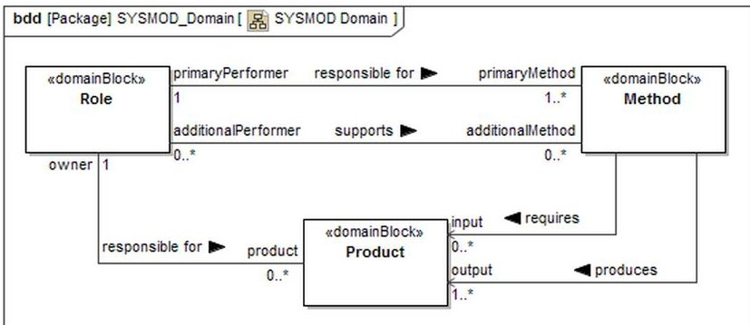
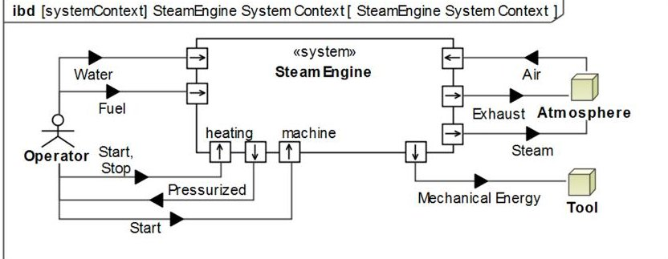
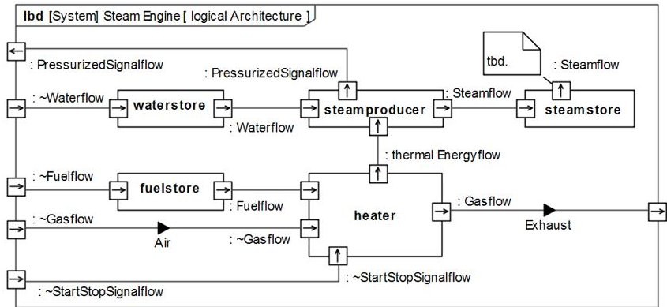
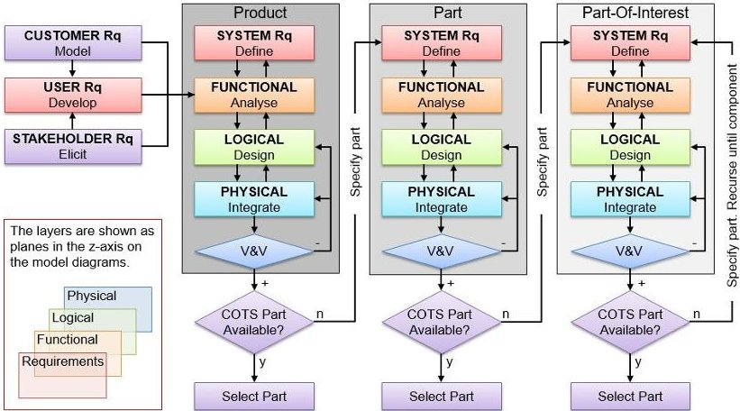
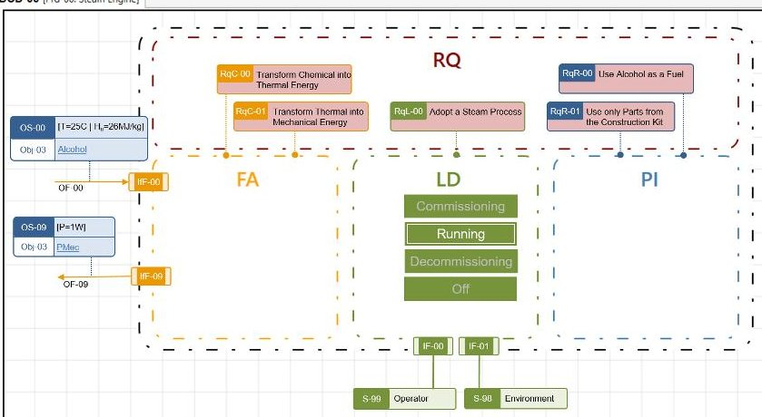
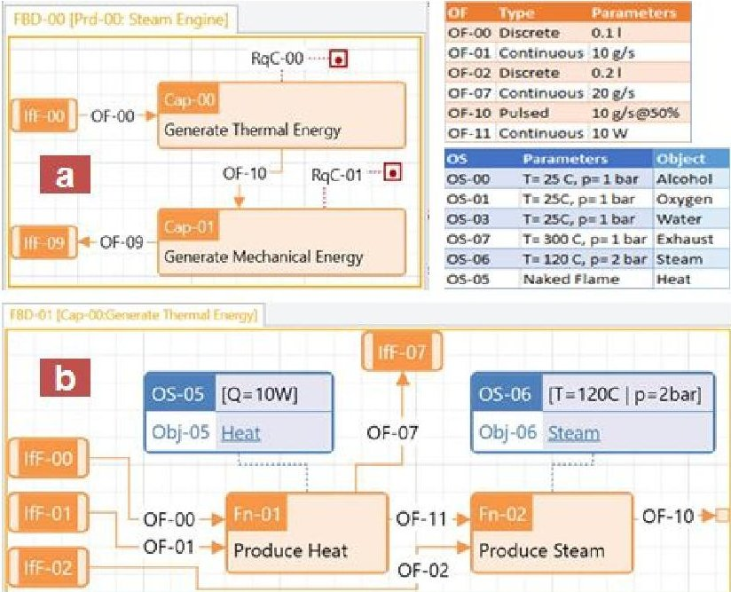
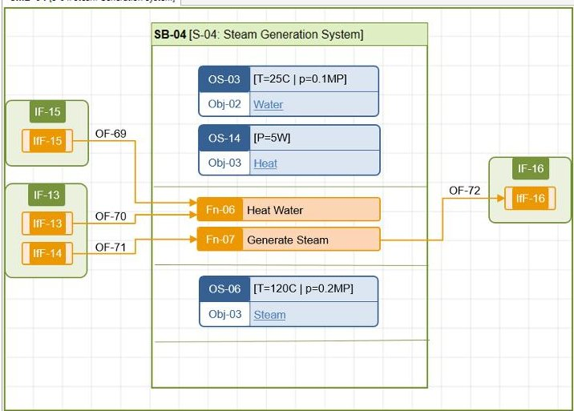

<!-- PDF_PAGE: 1 -->

# Evaluating and Comparing MBSE Methodologies for Practitioners

T. Weilkiens and A. Scheithauer

oose Innovative Informatik eG, Hamburg, Germany Tim.Weilkiens@oose.de

M. Di Maio and N. Klusmann

projectglobe ltd., London, United Kingdom

marco.dimaio@projectglobe.com

Abstract—The objective of Model-Based System Engineering (MBSE) is to provide the right tools to create and manage all life-cycle information in a pragmatic, concise, consistent and traceable way across the numerous perspectives and architectural levels. Its practical use, however, is currently impeded by a universal lack of experience and integration with development processes. Interested engineers therefore find it difficult to select the methodology best suited for their particular context. This paper proposes a Framework for the Evaluation of MBSE Methodologies for Practitioners (FEMMP) based on a catalogue of standard criteria to assess the practical use of the available methodologies, which are evaluated using a standard case study. The paper illustrates the evaluation process comparing the authors' own methodologies: SYSMOD+ and the MDDM.

Index Terms—MBSE; Pragmatic; FEMMP; Evaluation; Product Development; SYSMOD; FAS; VAMOS; MDDM; MDDP

## I. INTRODUCTION

Systems Engineering (SE) is an acknowledge key enabler to an effective and sustainable development of complex products. Model-Based Systems Engineering (MBSE) promises to improve its efficiency and to provide a better understanding of emergent behaviour and complicated feedback loops. It can also help to standardise processes and to improve the quality, confidence and exchange of information. However, the wider use of MBSE across the domains is impeded by a lack of experience, which makes it difficult to analyse, evaluate, and choose the methodologies best suited for a particular context. As a result, prospective users often select the tool to then adapt the - arguably more important - process to it.

This paper addresses this problem by proposing a Framework for the Evaluation of MBSE process for Practitioners (FEMMP) for the objective comparison of methodologies, to support engineers in their selection process. To be practical a methodology must include process steps for product development and mature enough to be readily applied. The FEMMP assesses them against a set of test criteria that are evaluated using a standard case study. It is illustrated by comparing the authors' own methodologies: Weilkiens' Systems Modelling Toolbox (SYSMOD+) combining SYSMOD [1], Functional Architectures in SysML (FAS) [2] and Variant Modeling with SysML (VAMOS) [3] and projectglobes Model-Driven Development Methodology (MDDM) [4].

## II. RELATED WORK

The number of MBSE methodologies is constantly increasing since Estefan [5] surveyed them in 2008 as part of the

INCOSE MBSE initiative. An overview can be found e.g. on the INCOSE website [6], in Weilkiens Blog [7] and MBSE cookbooks [8]. Other methodologies have been developed by e.g. Thales [9], Dassault Systemes [10] and ESA [11].

Selecting the most appropriate approach requires an overview of complete methodologies, which has not yet been published. So far, the focus is on comparing MBSE tools (see e.g. [12] and [13]). As a result many practitioners have resorted to selecting the tool and adapting their development processes to it. To address this, an independent evaluation framework is proposed. Such frameworks exist in other domains e.g. Software Engineering [14], [15]. Different evaluation methods are reviewed in [16].

## III. FRAMEWORK FOR THE EVALUATION OF MBSE METHODOLOGIES FOR PRACTITIONERS (FEMMP)

The (FEMMP) has been developed to support end-users in the selection process for their individual challenge. It also aims to provide a common platform to collect, compare, and discuss the various methodologies available. A methodology is defined as a combination of processes, tools and people [17]. In MBSE there is also the question of the modelling language. Though SysML is becoming the standard MBSE language, alternatives are available that allow for a more efficient approach in a particular context. Also, SysML is often extended to adapt it to the domain specific semantics, so that many variations of the standard exist across the community.

A practical methodology must be a) focused on product development, either for innovation, documentation, re-factoring or reverse-engineering; b) fully documented and supported; and c) mature enough to be readily applied to at least one common scenario from industry or public engineering projects.

The FEMMP defines a catalogue of criteria against which the methodologies are assessed (see Table 1). They are grouped by areas and allow the independent evaluation of the process, the quality of the model, its practical implementation in a tool, and how well it can be applied to a standard case study. The assessment shall provide an overview for the practitioner without the ambition to rank the methodologies objectively. It is therefore kept simple by evaluating the criteria in a simple yet appropriate way, e.g. yes/no, with a list, or by selecting an index from a standard scale. The objective is to successively replace Lists and possibly Scales by Key Performance Indicators (KPI) and to substantiate the evaluation results by user feedback and survey results.

<!-- PDF_PAGE: 2 -->

## A. Evaluation Process

The methodologies are evaluated in a standard format along the following process steps:

1) Methodology: An overview in free text format with illustrations and references for more information.

2) Highlights: Selected features making the methodology unique or interesting are explained and discussed in detail.

3) Case Study: A brief summary of notable points from applying the methodology to a standard challenge including some of the artefacts, design solutions and/or reports.

4) Evaluation: A table listing the evaluation of the framework criteria with answers, explanations and comments.

5) Discussion: A summary of the process and its results.

## B. Criteria

Table I gives an overview of the criteria, which have been grouped by the following aspects:

1) Essentials: The criteria that have to be met for the approach to be accepted as an MBSE methodology, i.e. to make sure that the MBSE initiatives main ideals are correctly represented and properly implemented.

2) Practicality: The criteria distinguishing the methodology as a practical one, e.g. defining its engineering scope, choice of modelling language, control over the process, and major process and modelling features.

3) Efficiency: The criteria that make the methodology more efficient, e.g. auto versioning and backup, background checks for errors or inconsistencies, automated or supported generation of reports and design documentation etc.

4) Usability/Experience: The user experience (UX) of the tool. The criteria aim to be objective and only evaluate the UX against defined standards and conventions.

5) Support: How well is the methodology supported by its owners, INCOSE, the OMG, tool vendors etc. The criteria include documentation, training and help offerings.

The criteria indicate their scope, i.e. if they apply to the whole methodology, the process, language, or the tool. There are no criteria applicable to "people" yet, as they require more experience to be evaluated objectively. The criteria are still being developed and expected to change with further application of the FEMMP. Rigorous testing is therefore required to consolidate the catalogue and understand each criterion's contribution and how they map across methodologies.

The criteria are sorted by relevance using a weighting between "1" and "3", with "3" being the ones to focus on first. The weighting does not necessarily reflect "importance", but includes considerations about the practicality of assessing the criteria. They are subject to review and are likely to change with increasing numbers of methodology assessments.

## C. Evaluation Metrics

The framework employs four major types of metrics:

1) Yes/No Question: Includes a free text justification.

2) Selection/List: Names the relevant items with explanations.

3) Qualitative Assessment Scale:

A - Fully Compliant: The methodology covers the item exhaustively and addresses it well.

B- Acceptable Performance: Minor constraints or limitations apply, but they are documented well.

C - Limited Applicability: Major constraints or limitations apply that require considerable extra effort, cumbersome workarounds or extensive customisation.

G-Generalisation: Compliance claimed, but no conclusive information on the practical application is provided. X-Not Addressed: The criterion is not addressed, not implicit and no reasons for its omission are provided.

## D. Case Study

The evaluation framework is tested using a standard case study: A steam engine has to be modelled using only the parts available in a given construction kit [18] to limit the solution space for the physical integration of the product, where arguably the creativity of the domain experts is more relevant than the MBSE methodology. The customer need is a product "that provides sufficient mechanical energy to turn a wheel from a steam process using alcohol as a fuel." The mechanical energy is limited to 1W and the only interfacing systems are the environment and one operator. Other case studies will be added to acknowledge hat some MBSE methodologies have been devised for a specific domain or industry.

## IV. EVALUATION OF SYSMOD+ AND MDDM

This paper is the first in a series of studies comparing practical MBSE methodologies. The two methods compared have been developed by the authors themselves:

1) Tim Weilkiens SYSMOD+: A combination of SYSMOD, FAS, and VAMOS with Cameo System Modeller [19];

2) projectglobes MDDM: A combination of the Model-Driven Development Process (MDDP) and the Lean Information Management Engine (LIME)[4].

The two methodologies have been assessed by the respective authors. The results are presented following the evaluation process (see Chapter III-A). For convenience, overviews and discussions of the results have been combined at the end.

## A. Systems Modeling Toolbox (SYSMOD+)

The Systems Modeling Toolbox (SYSMOD) is a generalpurpose methodology to model system requirements and system architectures [1]. The preferred modeling language for SYSMOD is the international standard SysML [20]. Any SysML modeling tool could be used for SYSMOD. We have used Cameo Systems Modeler from NoMagic for the tool specific criteria in the evaluation matrix. SYSMOD was first published in 2006 and is one of the first MBSE methodologies that uses SysML. It is well applied in industry projects. According to the MBSE survey by the INCOSE UK chapter SYSMOD is used in 6% of the MBSE projects [21] and according to the MBSE survey 2014 by INCOSE it is used in 10% of the MBSE projects [22]. FAS was first published in 2010 and is successfully used in different domains in industry projects, for example, healthcare, automotive, and

<!-- PDF_PAGE: 3 -->

TABLE I

FEMMP: FRAMEWORK FOR THE EVALUATION OF MBSE METHODOLOGIES FOR PRACTITIONERS

<table border="1"><tr><td>ID</td><td>Area</td><td>Category</td><td>Title</td><td>Description</td><td>Type</td><td>Wt</td></tr><tr><td>A-00-P</td><td>Essentials</td><td>Process</td><td>ISO Standard</td><td>What process steps of ISO 15288 are covered?</td><td>List</td><td>3</td></tr><tr><td>A-01-P</td><td>Essentials</td><td>Process</td><td>Framework</td><td>What views from the reference framework are used?(MODAF, DODAF...)</td><td>List</td><td>3</td></tr><tr><td>A-02-L</td><td>Essentials</td><td>Language</td><td>Philosophy</td><td>Are Model Elements clearly distinguished from Diagram Elements?(separation of content from representation)</td><td>Y/N</td><td>3</td></tr><tr><td>A-03-T</td><td>Essentials</td><td>Tool</td><td>Precision</td><td>How precise does the tool implement process semantics and sequence?(Is the process well enforced, can wildcard elements be used e.g. an association relationship, are constrained clearly communicated and controlled, are work arounds allowed that reduce the model quality)</td><td>Scale</td><td>3</td></tr><tr><td>B-00-L</td><td>Practicality</td><td>Language</td><td>Language</td><td>What Modelling Language is used?(If NOT SysML: How well does it define the real-world semantics of the engineering, are elements strictly typed, is their meaning unambiguous, do they have a defined purpose etc.)</td><td>List</td><td>3</td></tr><tr><td>B-01-M</td><td>Practicality</td><td>Methodology</td><td>Scalability</td><td>How well does the model scale?(suitable for large projects, "grows" with time without becoming cumbersome, does it require partitioning e.g. in a tree)</td><td>Scale</td><td>3</td></tr><tr><td>B-02-M</td><td>Practicality</td><td>Methodology</td><td>Scope</td><td>For what engineering purpose is the methodology suited(innovation, improved products, refactoring, reverse engineering,...)?</td><td>List</td><td>2</td></tr><tr><td>B-03-M</td><td>Practicality</td><td>Methodology</td><td>Tailoring</td><td>How easy is it to tailor the methodology?(add, delete or change processes or process steps, object definitions or toggle tool features on and off)</td><td>Scale</td><td>3</td></tr><tr><td>B-04-P</td><td>Practicality</td><td>Process</td><td>Consistency</td><td>Is the process self-contained?(are in./outputs to all steps connected)</td><td>Y/N</td><td>3</td></tr><tr><td>B-05-M</td><td>Practicality</td><td>Methodology</td><td>Variants</td><td>How well does the methodology support the variant management?</td><td>Scale</td><td>3</td></tr><tr><td>B-06-M</td><td>Practicality</td><td>Methodology</td><td>Complexity</td><td>How often is the methodology "interrupted"?(by external processes and/or non-integrated tools)</td><td>Scale</td><td>2</td></tr><tr><td>B-07-T</td><td>Practicality</td><td>Tool</td><td>Connectivity</td><td>How easily can the information be exchanged with other tools?(What standard API are provided by the tool, what API can be added, Is import and export based on open protocols, is it guided, e.g. by a wizard, can it be rolled-back, what the quality control mechanism etc.)</td><td>Scale</td><td>3</td></tr><tr><td>B-08-L</td><td>Practicality</td><td>Language</td><td>Integration</td><td>How well can the model be integrated with specialty engineering models?(CAD, PNID, Project Management, Document Management)</td><td>Scale</td><td>1</td></tr><tr><td>B-09-M</td><td>Practicality</td><td>Methodology</td><td>Simulation</td><td>How well does the methodology provide for an integrated simulation?</td><td>Scale</td><td>2</td></tr><tr><td>B-10-M</td><td>Practicality</td><td>Methodology</td><td>Redundancy</td><td>How well does the methodology prevent duplication?(of work, model elements, artefacts, communications and reports)</td><td>Scale</td><td>2</td></tr><tr><td>C-00-T</td><td>Efficiency</td><td>Tool</td><td>Perspectives</td><td>To what level is the creation of experts&#x27; perspectives automated?(can views be defined on the model or do they require manual re-work)</td><td>Scale</td><td>1</td></tr><tr><td>C-01-T</td><td>Efficiency</td><td>Tool</td><td>Checking</td><td>Does the tool support consistency checking of the model?(Automated detection of wrong content and/or formats, flagging of, &quot;loose ends&quot; etc.)</td><td>Y/N</td><td>2</td></tr><tr><td>C-02-T</td><td>Efficiency</td><td>Tool</td><td>Reporting</td><td>How quickly are standard/custom reports, is design documentation created?(select templates or views, filter reports, re-use of settings, define aggregation, required level of experience, potential level of automation)</td><td>Scale</td><td>1</td></tr><tr><td>C-03-T</td><td>Efficiency</td><td>Tool</td><td>Admin</td><td>How well does the tool help to minimise work that isn't creating any value?(low admin, auto versioning and back-up)</td><td>Scale</td><td>1</td></tr><tr><td>C-04-T</td><td>Practicality</td><td>Tool</td><td>Reuseability</td><td>Does the tool allow to reuse any type of Modelling Element across projects?(sharing the same object with the same lifecylce in any project)</td><td>Y/N</td><td>2</td></tr><tr><td>D-00-T</td><td>Experience</td><td>Tool</td><td>Navigation</td><td>How easy is it to find the correct model element?(are elements links, users &quot;guided&quot; in the process, information well aggregated, need to &quot;jump&quot; screens)</td><td>Scale</td><td>2</td></tr><tr><td>D-01-T</td><td>Experience</td><td>Tool</td><td>Intuition</td><td>How intuitive is the tool to work with?(compliance with UX conventions, standard tool reactions e.g. tool tips, double/right click, drag&amp;drop, delete, Keyboard shortcuts, spell check, familiar operations e.g. as MS-Office)</td><td>Scale</td><td>2</td></tr><tr><td>D-02-T</td><td>Experience</td><td>Tool</td><td>View</td><td>How easy is it to configure the UX dynamically?(define a matrix with sorting &amp; filtering of columns and rows, store customised view, annotation, comment)</td><td>Scale</td><td>1</td></tr><tr><td>D-03-T</td><td>Experience</td><td>Tool</td><td>UI</td><td>How readable is the UI?(Good use of screen estate and colour, zoom, can fonts and sizes be changed, is information well presented...)</td><td>Scale</td><td>1</td></tr><tr><td>E-00-M</td><td>Help</td><td>Methodology</td><td>Documentation</td><td>How well is the methodology supported?(books, manuals, case studies, online help, community, websites, interactive support, user feedback etc.)</td><td>Scale</td><td>3</td></tr><tr><td>E-01-M</td><td>Help</td><td>Methodology</td><td>Training</td><td>How well is training supported?(availability, consultants, coaches, e-training, background knowledge required)</td><td>Scale</td><td>1</td></tr><tr><td>E-02-T</td><td>Help</td><td>Tool</td><td>Support</td><td>How well is the tool supported?(vendor response times, 24/7 helpline etc.)</td><td>Scale</td><td>1</td></tr></table>

<!-- PDF_PAGE: 4 -->

manufacturing as discussed in the paper [2]. A system model created with SYSMOD can be supplemented by a functional architecture created with the FAS method [23] and with system variants created with the VAMOS method [3]. FAS and VAMOS are independent of SYSMOD and could be applied without SYSMOD. They do, however, fit together perfectly to form a consistent system model - like pieces of a puzzle.

1) Methodology: SYSMOD comprises three main artefacts:

- Methods: best practices for creating a SYSMOD Product.

- Products: crucial artefacts for the system development like requirements or architecture descriptions.

- Roles: work descriptions of a person; responsible for Products and a primary/additional performer of Methods.

Figure 1 shows the relationships between SYSMOD Methods, Products, and Roles. A Role is responsible for 1..* Methods and supports 0..* Methods as a co-worker. A Method has exactly one Role that is responsible for the Method and some Roles as additional performers. Each Method requires 0..* Products as inputs and produces 1..* Products as outputs. Exactly one Role is responsible for a Product.

Table II lists all SYSMOD methods with their input and output products, and their primary performing roles.

Although SYSMOD is a toolbox and not a process some default processes are provided to demonstrate a typical logical order of execution of the SYSMOD Methods. In practice a project typically uses a customized set of methods in a different order, including recursions, iteration and loops.

2) Highlights: SYSMOD covers the technical processes from ISO 15288 [24] guiding systems engineers from system objectives, stakeholder needs and requirements, domain and functional analysis to architecture descriptions. The modeling language SysML and its SYSMOD profile clearly define the semantics of model elements and relationships. Different diagram types provide specific views for the model stakeholders.

Practicality: SYSMOD is a general-purpose methodology to create requirements and architecture specifications, mainly used to specify updated and new products or parts. It provides a set of wide-spread, well-known methods (like use case analysis) that can be adapted for specific purposes. SysML is supported by several standard and proprietary interchange formats and tools to connect a SysML-based model with other engineering models and tools like RQM tools, CAD, PLM, simulation packages, etc.

Fig. 1. Overview SYSMOD concepts

TABLE II OVERVIEW SYSMOD METHODS

<table border="1"><tr><td>Primary Performer</td><td>Input Products</td><td>SYSMOD Method</td></tr><tr><td>Project Manager</td><td>None</td><td>Describe the System Idea and the System Objectives</td></tr><tr><td>Requirements Engineer</td><td>Base Architecture, System Idea, System Objectives</td><td>Identify Stakeholders</td></tr><tr><td>System Architect</td><td>System Idea, System Objectives</td><td>Describe the Base Architecture</td></tr><tr><td>Requirements Engineer</td><td>Stakeholders, System Idea, System Objectives</td><td>Model Requirements</td></tr><tr><td>Requirements Engineer</td><td>Requirements</td><td>Identify the System Context</td></tr><tr><td>Requirements Engineer</td><td>Requirements, System Context</td><td>Identify System Use Cases</td></tr><tr><td>Requirements Engineer</td><td>System Use Cases</td><td>Identify System Processes</td></tr><tr><td>Requirements Engineer</td><td>System Use Cases, Requirements</td><td>Model Use Case Activities</td></tr><tr><td>Requirements Engineer</td><td>Use Case Activities</td><td>Model the Domain Knowledge</td></tr><tr><td>System Architect</td><td>System Use Cases, System Context, Requirements, Base Architecture</td><td>Model the Logical Architecture</td></tr><tr><td>System Architect</td><td>Logical Architecture</td><td>Model the Product Architecture</td></tr><tr><td>System Architect</td><td>Physical Architecture</td><td>Verify Architecture with Scenarios</td></tr><tr><td>System Architect</td><td>Physical Architecture</td><td>Define System States</td></tr></table>

Efficiency: Modeling tools like the Cameo Systems Modeler [19] validate the model based on predefined rules, for example SysML conformity, and self-defined rules. In case of a detected issue it provides automatic tasks for their resolution. A report wizard allows to export information in different formats, e.g. PDF, MS-Word and -Excel, open office, etc.

Experience: Cameo can be configured for specific project needs, e.g. using special dialogues, toolbars, or views.

Help: The SYSMOD methodology is published in a book available in English [25], German [26] and Japanese. The most recent documentation "SYSMOD-The Systems Modeling Toolbox" was published by MBSE4U in 2015 [1]. MBSE4U has also published a book about VAMOS [3]. The book Model-Based System Architecture published by Wiley provides a comprehensive description of the FAS method [23]. FAS, and VAMOS are discussed in numerous publications.

3) Case Study: Figure 2 shows the SYSMOD system context diagram for the steam engine. It shows the system itself and the actors of the system. The small boxes at the system border are the system interfaces. The details of the interface specification are not shown here, but are part of the model. The black triangles depict object flows from and to the system. Figure 3 shows the logical architecture of the steam engine, i.e. the technical concepts and principles of the system. More details and examples can be found in the books about SYSMOD, VAMOS, and FAS [1], [23], [3].

## B. Model-Driven Development Methodology (MDDM)

The MDDM is a practical all-in-one MBSE methodology comprising MDDP and LIME [4]. Its main objective is to create and maintain a central model of maximum quality that is equally valuable to all project members [27];

<!-- PDF_PAGE: 5 -->

Fig. 2. SYSMOD Context

Fig. 3. SYSMOD Logical Architecture

1) Methodology: The MDDP is a recursive (over the levels of the product breakdown) and iterative (over the process steps) process (see Figure 4). It defines the design architecture on four different layers: Requirements (RQ), Functional Analysis (FA), Logical Design (LD), and Physical Integration (PI). The process' main objective is to create, develop and maintain all salient SE information in a central model that is equally useful to system engineers and domain experts over the product life-cycle.

Customer- and Stakeholder-needs are translated into a set of User Requirements (URq) that provide the input to the FA. The System Requirements (SRq) dynamic composite model elements that are mainly derived from design decisions taken on the other layers. The systems are designed on the LD layer and realised by physical parts, which are integrated into a product on the PI layer. If a part cannot be readily procured, it is developed in the next recursion of process.

LIME is a universal information management engine based an Object-Oriented Model (OOM). It manages the model

Fig. 4. MDDP Process Overview

structure (i.e. the types and rules making up the Modelling Language) and its content (Model Elements or Engineering Items, EI). It has been devised for the agile development of semantic information graphs and extended to allow the graphical modelling of MBSE artefacts. The strictly typed EI semantics allow for a number of advanced MDDM features.

2) Highlights: The MDDM clearly distinguishes between the actual EI and their graphical or textual representation in diagrams, tables, matrices (pending), forms and reports. All EI are strictly typed and undergo a controlled life-cycle. The model is precisely implemented by LIME, which actively encourages the reuse of all model elements to maximise information quality and to limit the potential for human error.

Practicality: The MDDP has been devised for complex product development with low Technical Readiness Levels (TRL). The robust OOM allows for an extensive exploration of different variants early on in the process based on highly consistent information. The flexible model and open API allow the integration of external model elements and the connection to any other tool in the development process, e.g. CAD, PLM, project management and simulation packages.

In MDDM the modelling language is developed in parallel with the actual model. The OOM object- and relationship-type specifications defining the semantics and the syntax (rules) can be adapted and extended to reflect any real-world semantics. The EI are instances of the types and typically small and easy to maintain. They can be combined to form larger, qualified information objects, thus substantially reducing human effort and the risk of errors and inconsistencies. Model growth is incremental and strictly controlled by role based permissions and a flexible workflow framework. Model structure and content are intrinsically scalable and easily maintained through LIME. For MBSE a basic set of types, diagrams, roles and rules are provided. The EI can be edited graphically in standard UML diagrams, MODAF views [28], or custom User Interfaces (UI). Diagram types and their elements are customisable and specialists views are automatically created and configurable.

Efficiency: The MDDP incorporates the traditional 'crosscutting' technical management processes of Requirements-, Configuration-, and Interface Management [29], so that all processes are using the same EI. It thus eliminates the need to copy data or to interrupt the process using a different tool.

LIME takes care of versioning and back-ups. It automatically checks for inconsistencies and custom rules can be defined using the models own semantics, e.g. to flag unapproved objects, unconnected EI, or unused variants.

Experience: LIME strictly separates content from presentation. All views are therefore customisable without compromising the content displayed. Also the definition of the content can be adapted by changing the type definitions. A particularly useful feature are LIME's information paths. They are defined on the types and specify what related information (related objects or their attributes, and calculated aggregate) shall be displayed with any EI of that type. For example, when viewing a physical part, the Responsible Officer (RO) of the logical systems realised by the part are shown and the total weight

<!-- PDF_PAGE: 6 -->

of its constituent parts calculated dynamically, thus greatly reducing the potential for inconsistencies and errors.

The tool is compliant with all standard user interactions and provides a familiar User Experience (UX). It features a cascading global search so that all elements (types and EI) can be retrieved and filtered. Almost every item on the screen is an active link that provides additional information when hovering over it (so-called tool-tips). All diagram elements are linked to their underlying EI providing a logical entry point and an intuitive mechanism for navigating large and complex models.

Help: The MDDM is a recent addition to the catalogue of MBSE methodologies. It is mostly self-documenting through tool-tips, how-tos and help objects. Official documentation is available on the projectglobe website [4]; publications are available in [30] and [31]. projectglobe provide email and phone help and their consultants are trained to support the introduction of MDDM for SME.

3) Case Study: The MDDM was applied to the "Steam Engine" case study. For the FEMMP evaluation only a limited number of process steps and artefacts have been selected; the full report has been published in [30].

The first step in the MDDP is to understand customer needs and development context. The output is a Development Context Diagram (DCD), which is the primary artefact to model the top level project information and to develop the User Requirements (URq) together with the customers (see Figure 5). Here, the URq consist of two Capability Requirements (RqC) and three Implementation- and Realisation Constraints (RqI and RqR). Other EI modelled on the DCD are e.g. the primary Operational Modes (OM), incoming and outgoing Object Flows (OF) and Interfaces (IF).

In the next step - the Functional Analysis (FA) - the Functions (Fn) are defined that make up the capabilities required by the RqC. In the MDDP, the FA is limited to a "first principles" analysis, i.e. only functions are analysed, no activities designed. Capabilities and Functions are modelled in a Functional Block Diagram (FBD). Each Fn is then further analysed until no further analysis is required (see Figure 6).

An important MDDM concept are composite Object Flows (OF). Every OF specifies the flow type (e.g. continuous or discrete), flow parameters (e.g. rate) and is related to an Object- State (OS). An OS is an EI that defines a specific Object (e.g.

Fig. 5. MDDM: Development Context Diagram (DCD)

Fig. 6. FBDs of (a) "Steam Engine" and (b) "Generate Thermal Energy

water) in a particular state (e.g. pressure, temperature). This allows to reuse the actual Objects and to trace them through the system, e.g. to validate the FA by verifying that all transitions have been addressed correctly over the Objects life-cycle.

Another important concept is the integration of cross-cutting technical management processed, e.g. the Requirements Management (RQM). In the MDDP, the majority of information that is typically managed using Functional and Performance Requirements (RqF and RqP, respectively) can be derived from the FA. The Requirement (Rq) are therefore another composite object that references the Fn and OF specifying what has to be performed and how well, respectively. Also other standard Rq attributes like "Rationale" or "Confidence" can be referenced from the model. The only attribute that has to be actively selected are currently the RO and the Verification Method.

The first active design decisions in the MDDM are made on the Logical Design (LD) layer. Here, the development team has to define activities that control function execution, cluster functions, and decide which logical systems implement what Fn (in a many to many relationship) and what technologies are used. During the LD, the design is explored by analysing emergent behaviour, running simulations and creating variants.

The MDDM provides a set of generic system types that can be extended for each domain. These types define the standard operational modes, states and behaviours of typical systems and only expose the relevant external EI. For the case study, three "Storage Systems" are used to implement the functions for storing water, steam and alcohol (see Figure 7).

The resulting LD can be analysed using a simulation package before entering the Physical Integration (PI) phase. As the case study defines the parts for the product, the PI layer has not been modelled here.

## C. Evaluation

Table III gives an overview of the methodology evaluations.

<!-- PDF_PAGE: 7 -->

TABLE III EVALUATION OVERVIEW: SYSMOD+ AND MDDM

<table border="1"><tr><td>ID</td><td>Title</td><td>SYSMOD+</td><td>MDDP</td></tr><tr><td>A-00-P</td><td>ISO Standard</td><td>Technical Processes: stakeholder needs and requirements definition, system requirements definition, architecture and design definition, system analysis</td><td>Technical Processes, but the flexible OOM allows integration of any ISO process.</td></tr><tr><td>A-01-P</td><td>Framework</td><td>not evaluated</td><td>Selected views from MODAF: AV, StV, OV, SV.</td></tr><tr><td>A-02-L</td><td>Philosophy</td><td>YThe used language (SysML) clearly separates the model elements from the visualization within diagrams.</td><td>YModel Elements are called Engineering Items and strictly separated from their graphical or textual representation.</td></tr><tr><td>A-03-T</td><td>Precision</td><td>BThe tool supports the SysML standard and methodology specific language extensions are available. Parts of the methodology are supported by a plugin (more would be possible).</td><td>AAll-in one solution. The LIME MBSE module has been purpose built to implement the MDDP. The types have strongly defined semantics that prevent work-arounds. The language can be adapted and extended by any semantics through the tool.</td></tr><tr><td>B-00-L</td><td>Language</td><td>The preferred language is SysML. However, it could also be used with other modeling languages.</td><td>The Language is defined by the structural model elements (types and rules) used in the methodology. Standard language elements are provided comprising UML-like diagrams and elements, and custom controls to display more complicated information.</td></tr><tr><td>B-01-M</td><td>Scalability</td><td>AIt can be used for small systems as well as extremely large systems.</td><td>BThe individual EI are the smaller units. They can be composed to form any larger information object. The model therefore scales without limitation. However, no large models have not yet been implemented in LIME.</td></tr><tr><td>B-02-M</td><td>Scope</td><td>Innovation, Improvement: Engineer new products/parts or new product versions.</td><td>Innovation, Re-engineering, Documentation: The origin of the MDDP is in large scale engineering projects with low TRL, but less complex applications can also be managed.</td></tr><tr><td>B-03-M</td><td>Tailoring</td><td>AIt provides methods as a toolbox and not a fixed process.</td><td>AThe OOM allows to create, delete and change types and relationships. Also any view can be defined, though some may need customisation.</td></tr><tr><td>B-04-P</td><td>Consistency</td><td>YFor all workproducts it is described, how they will be used in further steps</td><td>YConsistency is a fundamental premise of the MDDP: all Engineering Items are specified by their semantics as defined in the associated process steps.</td></tr><tr><td>B-05-M</td><td>Variants</td><td>BVariants and product lines are included, but the tool has only basic support for managing them.</td><td>CThe modelling concept exists, but has not yet been implemented in LIME.</td></tr><tr><td>B-06-M</td><td>Complexity</td><td>BThe model is viewed as the central artifact. Interchange formats are available (xmi, reqif) that allow integration of other tools. The tool has an open API that allows to create an integrated toolchain.</td><td>BThe objective is to develop and maintain a complete reference (information) model that can be extended to integrate all "Interruptions". Tool interfaces are inevitable, but can be handled by LIME&#x27;s open API open protocols and access controlled web-services), e.g. to integrate CAD or simulation packages. No add-ins have been developed.</td></tr><tr><td>B-07-T</td><td>Connectivity</td><td>CThe tool has an open API that allows access to all model elements and provides a variety of export formats.</td><td>CAll MDDP objects are available via authenticated web-services; querying external tools has not yet been implemented</td></tr><tr><td>B-08-L</td><td>Integration</td><td>CSysML supports user defined extensions, so placeholders of other engineering models could get added. A research project (FAS4M) has created (among other results) an extension for CAD-models.</td><td>AThe OOM allows to create any type of model element and connect it through a semantically correct relationship. A general good understanding of OO-modelling principles is required.</td></tr><tr><td>B-09-M</td><td>Simulation</td><td>AThe model can be used to feed simulations and control results. Add-ons for common simulators are available, also simple proprietary simulation engine. The tool has an API that allows seamless integration with simulation packages.</td><td>BThe model can be used to feed simulations and control the results. No tool integration has yet been implemented, but the open LIME API allow in principle to seamlessly integrate with simulation packages.</td></tr><tr><td>B-10-M</td><td>Redundancy</td><td>ASince Elements can be shown in many diagrams and can be referenced by other elements, duplication should not be done. If it happens, the tool allows to comfortably refactor the model. The same model element can be shown with varying levels of detail in diagrams customized for different stakeholders.</td><td>AThe OOM is developed by domain experts and duplication of types thus prevented. Duplication of EI is normally unnecessary, as all specialists views can be auto-generated. Furthermore, many mechanisms are in place to foster the reuse of verified objects (e.g. the definition of semantic information paths). Still, redundancy is always possible, but once discovered, all duplicates can be erased and their relationships easily be re-connected to the agreed original EI.</td></tr><tr><td>C-00-T</td><td>Perspectives</td><td>ASysML includes the notion of generated views. The tool supports the standard. Diagrams can get autolayouted, so they can get generated by simply selecting the interesting elements.</td><td>AStandard experts&#x27; perspectives are automatically created as filtered views on the model. They can be extended through customisation of the view-model. View are generally dynamic to allow filtering, sorting etc.</td></tr><tr><td>C-01-T</td><td>Checking</td><td>YInconsistencies are checked automatically and marked in the diagrams and the model browser. The standard Object Constraint Language or several popular script languages can be used to define own rules.</td><td>YThe clearly defined model semantics allow to spot (and automatically flag and report) any inconsistencies. New rules can be defined, but require customisation of the server.</td></tr><tr><td>C-02-T</td><td>Reporting</td><td>BA report generator is included and comes with a selection of predefined reports. Usually they have to be adapted for the specific needs of the project, which can be done with a standard template language.</td><td>BContent and format of information contained in a report is defined freely. However, not all views have been implemented yet nor an automated document creation from templates. All reports are technically views and thus can be configured dynamically.</td></tr><tr><td>C-03-T</td><td>Admin</td><td>BA central repository is available, that manages versions and access control. Setting up a new server takes some time.</td><td>ABy definition the creation of views is not generating any value. The automation of the process therefore an enormous reduction of waste. Other waste like excess administration is automated wherever possible. All changes are tracked, configuration checks performed, versions accessible and back-up intervals flexible.</td></tr><tr><td>C-04-T</td><td>Reuseability</td><td>ASysML includes the notion of Model Library. The tools supports the usage of common libraries.</td><td>NEach project is currently managed on an individual server, typically one per company. Multi-project use on the same server enforces reuse. However, reuse across sites (within one company or to share global EI like engineering standards) could be a valuable addition.</td></tr><tr><td>D-00-T</td><td>Navigation</td><td>AThere are shortcuts to navigate from an element to its usage in diagrams and in other elements and vice versa. The description of an element is shown when hovering. The element dialog contains a list of Traceability links. Calculated Traceability Links can get defined. A quick search as well as a comprehensive search dialog is available.</td><td>AAs a concept, each element displayed by LIME is a link that displays extra information when hovering over it (to prevent excessive "clicking"). The links are excellent navigation aids. LIME also provides a cascading global search that allows logic filtering.</td></tr><tr><td>D-01-T</td><td>Intuition</td><td>BThe tool is compliant with standard user interactions to provide a familiar User Experience (UX). It strictly follows the SysML standard, so that users familiar with it quickly find what they need. There is a read-only mobile client, but it requires the generation of an intermediary file. A browser based cooperation platform, that allows commenting on the model elements is also available.</td><td>BThe tool is compliant with standard user interactions to provide a familiar User Experience (UX). Additional "shortcuts" are allowed for convenience. Mobile clients are not yet supported, so "touch" conventions are not used. A read-only web client is expected by the end of 2016.</td></tr><tr><td>D-02-T</td><td>View</td><td>AEach type of element can get customized with a multitude of options. Editable matrizes can get created and saved as templates. Tables can get sorted, filtered, columns can get selected and the layout saved.</td><td>BAll table views are dynamically configurable to apply filters, sorting etc. Currently the choices cannot be saved.</td></tr><tr><td>D-03-T</td><td>UI</td><td>BScreen has dockable windows, that can be moved freely. The diagram window can get zoomed. Fonts and colors can get defined and saved as default.</td><td>BThe UI adapts to the available screen space. Avoiding "white" space is a design principle, zoom, font choice etc. are configurable.</td></tr><tr><td>E-00-M</td><td>Documentation</td><td>BThere are books available for SYSMOD, FAS, and VAMOS. No active community</td><td>CThe MDDM is a recent addition to the catalogue of MBSE methodologies. LIME offers a wealth of active help through tool-tips, how-tos and background articles. Official documentation is available on the projectglobe website. A general understanding of ERM modelling is an advantage.</td></tr><tr><td>E-01-M</td><td>Training</td><td>B3 days of training, offered by only one provider</td><td>BConsultants are trained to support the introduction of MDDM and are currently working on a large scale implementation for an international innovation project.</td></tr><tr><td>E-02-T</td><td>Support</td><td>AThe tool runs on any operating system that supports Java SE 7. The vendor responds even to questions posted in the community forum within 24 hours and offers a software assurance contract with guaranteed service levels.</td><td>CThe full client is Windows only (.NET). projectglobe provide email and phone help.</td></tr></table>

<!-- PDF_PAGE: 8 -->

Fig. 7. MDDM: State Machine Diagram (SMD)

## D. Discussion

Another interesting point is that, although the intention is to evaluate complete methodologies, a number of criteria are very tool-specific. This makes the evaluation of non tool-specific methodologies like SYSMOD+ more complicated, as the results for these criteria do depend on the choice of tool.

Applying the FEMMP to the two methodologies has been an interesting first step to test the framework. Overall, the criteria represent a good selection from the relevant areas. However, the catalogue is likely to be updated with further experience. The strict specification of the evaluation type sometimes made it difficult to convey the full story, but this could be balanced in other sections of the form. The format fits on a few pages, and the results can be compared conveniently in a table. As mentioned before, the objective of the FEMMP is to support the selection process by providing a neutral overview. It is, however, expected that the results will be interpreted differently by the various interested parties.

Finally, the two methodologies do not cover the same processes from ISO 15288. Although this is an important criterion for prospective users, it features little in the evaluation and no influence on the rest of the criteria, so a more balanced approach should be investigated. For the scope of this paper, self-assessment has been sufficient. But to make the FEMMP more robust and neutral external evaluations and feedback from independent users will have to be collected.

## V. SUMMARY & OUTLOOK

A novel framework for the evaluation of MBSE methodologies for practitioners, FEMMP, has been presented. It addresses the problem for organisations and individuals, who are interested in employing MBSE in their engineering work, to select the methodology best suited for their needs. The FEMMP aims to provide a platform where the wealth of available MBSE methodologies can present themselves and be assessed by the practitioner's community. Its structure centres around a catalogue of evaluation criteria from the areas that prospective users are most interested in. The framework has been tested by a self-assessment of the authors' methodologies, SYSMOD+ and MDDM. The results are presented and the experience of using the FEMMP is briefly discussed.

Future work will focus on calibrating the framework and consolidating the criteria by testing it with more methodologies and inviting independent assessment teams to participate. The authors are planning a web-site to facilitate this and a series of workshops to further test and promote the FEMMP. The first workshop will be held at the annual INCOSE meeting of the German Chapter later this year.

## REFERENCES

[1] T. Weilkiens, SYSMOD - The Systems Modeling Toolbox. MBSE4U, 2015.

[3] T. Weilkiens, Variant Modeling with SysML. MBSE4U, 2016.

[2] J.G. Lamm, Tim Weilkiens, et al., "Funktionale Systemmodellierung nach der FAS-Methode: Auswertung von vier Industrieprojekten)," in Tag des Systems Engineering (TdSE), Bremen, November 2014.

[4] projectglobe ltd., "Model-Driven Development Methodology," [Online] http://www.projectglobe.com/MDDM.

[5] J. A. Estefan, "Survey of Model-Based Systems Engineering ( MBSE ) Methodologies," Tech. Rep., 2008.

[6] INCOSE, "MBSE Initiative," [Online] http://www.omgwiki.org/MBSE/.

[7] T. Weilkiens, "Mbse blog," [Online] http://model-based-systemsengineering.com.

[8] R. Karban, T. Weilkiens, R. Hauber, M. Zamparelli, and R. Diekmann, "Cookbook for mbse with SysML," SE2 Challenge Team, 2011.

[9] J.-L. Voirin and S. Bonnet, "A Model-Based Engineering Method for System , Software and Hardware Architectural Design," 2015.

[10] S. Kleiner and C. Kramer, "Model based design with systems engineering based on RFLP using V6," in Smart Product Engineering, 2013.

[11] European Space Agency (ESA), "Virtual Spacecraft Design," [Online] http://www.vsd-project.org/.

[12] OOSE, "UML Toolliste," 2013, [Online:] http://www.oose.de/nuetzliches/fachliches/uml-werkzeuge/.

[13] Gesellschaft f'r Systems Engineering (GfSE), "Tool-Vendor-Project 2016," [Online] http://www.tdse.org/tvp.html.

[14] A. Sturm and O. Shehory, "A framework for evaluating agent-oriented methodologies," in Agent-Oriented Information Systems, 2004.

[15] D. Coleman and P. Arnold, "Criteria for Comparing Object-Oriented Development Methods," HEWLETT PACKARD, Tech. Rep., 1991.

[16] K. Siau and M. Rossi, "Evaluation of information modeling methods-a review," in Conference on System Sciences, 1998, pp. 314-322.

[17] INCOSE, System Engineering Handbook. INCOSE WILEY, 2015.

[18] Nouly, "Steam Engine / Dampfmaschine Kosmos Technikus," [Online] https://www.youtube.com/watch?v=69tpDgKHckY.

[19] No Magic, "Cameo systems modeller," [Online] http://www.nomagic.com/products/cameo-systems-modeler.html.

[20] O. M. G. Inc, Systems Modeling Language (SysML) Specification, Version 1.4, Std., January 2016, http://www.omg.org/spec/SysML/1.4/PDF.

[21] J. Towers, "MBSE: The State of the Nation," 2013.

[22] R. Cloutier and M. Bone, "Compilation of SysML RFI- Final Report," Stevens Institute of Technology, Tech. Rep., 2010.

[23] T. Weilkiens, J. G. Lamm, S. Roth, and M. Walker, Model-Based System Architecture. John Wiley & Sons, 2015.

[24] ISO/IEC/IEEE 15288:2015, "Systems and software engineering - System life cycle processes."

[25] T. Weilkiens, Systems Engineering mit SysML/UML. Morgan Kaufmann, 2008.

[26] ——, Systems Engineering mit SysML/UML. dpunkt-Verlag, 2014.

[27] M. Di Maio, "Model-Driven Interface Management," in 8th Annual IEEE Systems Conference, Ottawa, 2014.

[28] Ministry of Defence, "Ministry of Defence Architecture Framework," [Online] https://www.gov.uk/guidance/mod-architecture-framework.

[29] R. Shishko and R. Aster, "Nasa systems engineering handbook," NASA Special Publication, 1995.

[30] M. Di Maio, C. Allen, et al., "MDDP : A Pragmatic Approach to Managing Complex and Complicated MBSE Models," in IEEE Internation Symposium on Systems Engineering ISSE, 2016, accepted manuscript.

[31] M. D. Maio, M. Hoppe, E. Erkul, M. Grundel, and N. Klusmann, "Cutting the Cross-Cutting Part 1 : Requirements Management," in Tag des Systems Engineering (TdSE), 2016, accepted manuscript.