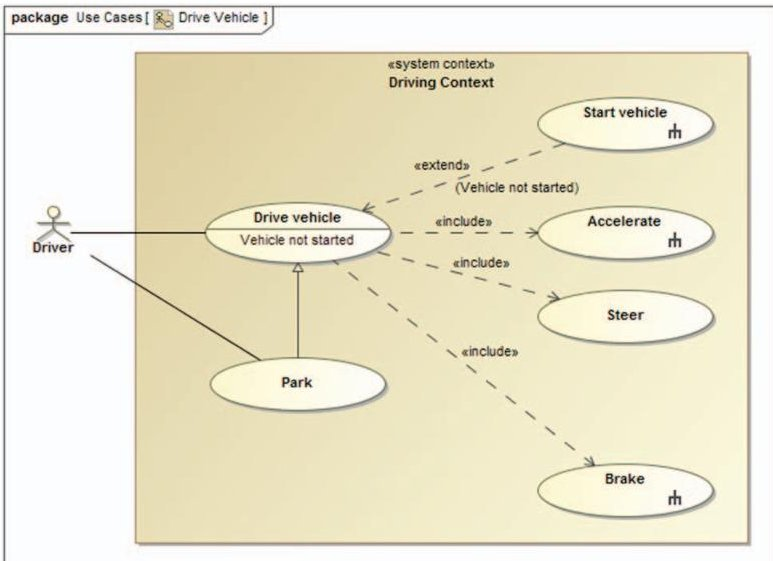
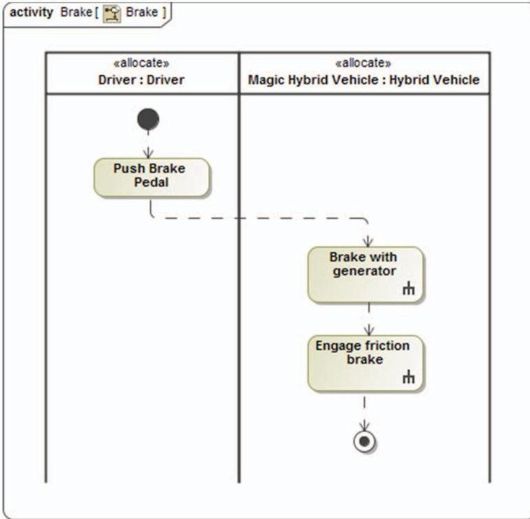
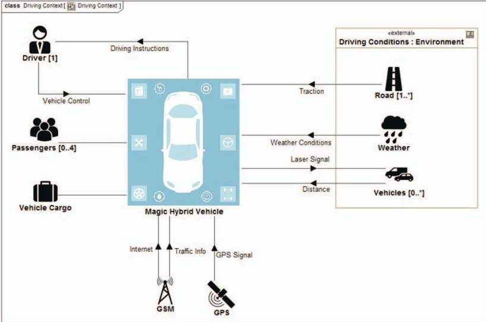
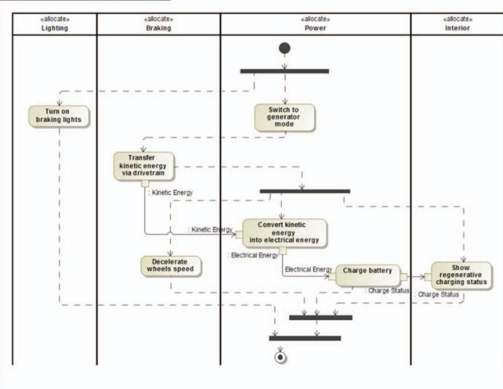
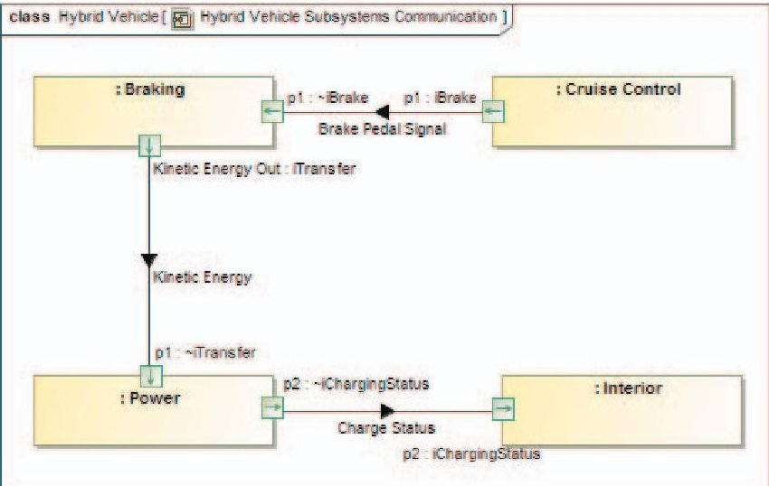

<!-- PDF_PAGE: 1 -->

# MBSE Driven Approach for Defining Problem Domain

Donatas Mazeika $ ^{1,2} $ , Aurelijus Morkevicius $ ^{1,2} $

$ ^{1} $Department of Information Systems

Kaunas University of Technology

Kaunas, Lithuania

donatas.mazeika@ktu.edu, aurelijus.morkevicius@ktu.lt

Aiste Aleksandraviciene $ ^{2} $

$ ^{2} $Solutions Department

No Magic Europe

Kaunas, Lithuania

aiste.aleksandraviciene@nomagic.com

Abstract—This paper continues introduction of the MBSE Grid framework. As the name reveals, the framework is intended for model-based systems engineering (MBSE). MBSE is an emerging approach that applies modeling to support complex system requirements, design, analysis, and verification and validation activities. Being a synthesis of widely known MBSE methodologies (IBM Harmony, OOSEM, etc.) and frameworks (DoDAF, NAF, etc.), the MBSE Grid proposes an unambiguous workflow for modeling systems by iterations going from the highest to the lowest layers of abstraction. This paper mainly focuses on the Concept and Problem definition layers, describing in detail each step of the workflow in the range of these two layers and revealing presentation artifacts each step produces, also, giving clues for elements traceability. The case study demonstrates and proves adaptability of the MBSE Grid on a real-world problem domain using MagicDraw CASE tool.

Keywords—MBSE; SysML; MBSE Grid; Methodology; Framework

## I. INTRODUCTION

When you choose MBSE, your journey towards the rewarding paradigm shift (from documents to model-based systems engineering) only begins. The next step to ensure successful MBSE implementation is choosing suitable enablers. Nowadays, MBSE is enabled by Systems Modeling Language (SysML). However, though SysML is a very powerful modeling language [1], [2], it is neither a framework, nor a method. SysML provides neither guidelines nor recommendations on the modeling process. Thus, you must choose one more MBSE enabler-a methodology, which gives you hints on how to start modeling your system, how to create the structure of the model, what views to build, what artefacts to deliver and in what sequence [3], [7]. As [4] clearly states, the modeling language must be combined with some methodology to become useful.

Other MBSE enablers, such as project personnel, modeling tool, and standard techniques, are important as well [1], [2], but they are not discussed in this paper.

Reference [3] was the first to introduce a new approach for MBSE - the MBSE Grid. This is a framework organized in a Zachman style matrix [5], where columns represent four aspects (also known as pillars) of systems engineering, rows mean layers of abstraction (also known as viewpoints), and cells represent different views of system's model. The idea of

MBSE Grid was born after analyzing various MBSE methodologies (such as IBM Harmony, OOSEM, Vitech) and enterprise architecture frameworks (EAF) for systems engineering (such as DoDAF/MODAF, TOGAF, NAF) and applying them on real-world projects of systems engineering. In comparison to these methodologies and frameworks, the MBSE Grid proposes a simplified approach for modeling with SysML and gives unambiguous guidelines for the modeling process.

While [3] briefly describes the entire framework cell by cell, this paper mainly focuses on the Concept and Problem layers of abstraction, that is, two upper rows of the matrix representing definition of the problem domain and initial system requirements. Precise definition of requirements is one of the most important and critical phases in complex systems design [6], [7]. As [8] asserts, more than 80% of all system or product defects are inserted in the requirements definition stage of product development.

The paper also discloses the improvements and adjustments applied to the framework after it was adopted in the real-world projects.

This paper is organized as follows: in Section 2, related works are analyzed; in Section 3, the approach for defining problem domain is proposed; in Section 4, the application of the proposed approach is described; in Section 5, conclusions are drawn and future goals are revealed.

## II. RELATED WORKS

The full-scale review of MBSE methodologies and frameworks is provided in [3], and this section focuses on the comparative analysis of the MBSE Grid and MBSE methodologies (such as IBM Harmony, OOSEM, Vitech, SYSMOD) and EAFs (such as DoDAF/MODAF, TOGAF, NAF).

The workflow suggested by the IBM Harmony consists of iterations through the phases of the requirements analysis, system functional analysis, and design synthesis [9]. The workflow proposed by the MBSE Grid is iterative as well each layer of abstraction considers the same four aspects of systems engineering: system requirements, behavior, structure, and parametrics.

<!-- PDF_PAGE: 2 -->

The main activities of OOSEM (Object-Oriented Systems Engineering Methodology) are Analyze Needs, Define System Requirements, Define Logical Architecture, Synthesize Allocated Architectures, Optimize and Evaluate Alternatives, and Validate and Verify Systems. Model artefacts they deliver correspond to the essential cells of the MBSE Grid, for example, the Analyze Needs activity gathers stakeholder needs as well as elicits system goals and objectives, the Define Logical Architecture activity produces the assembly of system components. In systems engineering, the main activities of OOSEM are performed using several iterations [4]. So they are in the workflow suggested by the MBSE Grid.

Vitech MBSE Methodology consists of four main domains: source requirements (originating requirements, issues and decisions, risks), behavior (system behavior models, inputs/outputs, control/sequencing, and performance requirements), architecture (system architecture, components, interfaces, and allocated requirements), validation and verification (analysis, verification methods, test plans) [11]. Modeling in iterations, so called levels, helps to elaborate system specification. Domains (all except the validation and verification domain) and levels of the Vitech MBSE Methodology correspond to the pillars and abstraction layers of the MBSE Grid.

SYSMOD (Systems Modeling Toolbox) uses SysML as modeling language and proposes these phases of the system model development: project's context description; requirement's collection; system's context modeling; system's use case and process modeling; system's structure and state modeling; collection of the domain's knowledge. The MBSE Grid uses SysML as modeling language as well and proposes similar modeling phases.

The idea of analyzing a system by iterations, that is, layers of abstraction or viewpoints, also originates in many popular enterprise architecture frameworks, such as DoDAF [12], MODAF [13], NAF, and Zachman [5]. As [3] states, these EA frameworks, especially the ones in harmony with MBSE, provide a couple of viewpoints: one to define the problem domain and other to provide the solution for it, such as operational and systems viewpoints in DoDAF, logical and resources viewpoints in NAF and MODAF, business and engineer views in Zachman framework. As the synthesis of these EAF, the MBSE Grid has both viewpoints. Plus, it recommends to detach the Concept layer from the Problem definition layer in order to consider the user's perspective.

MBSE Grid successfully adapts the ideas of certain models from the above mentioned EAFs. For example, the idea of the system context view (showing how the system interacts with the environment in the high level of abstraction) originates in DoDAF, High-Level Operational Context model [12], [13].

In conclusion, all the mentioned MBSE methodologies encounter several common issues: model complexity and unclear relations between different levels of abstraction. The EAFs are irreplaceable for building enterprise architectures, but not systems, thus, they are too complex for systems engineers. In comparison, the MBSE Grid clearly describes the workflow of the system modeling process in all layers of abstraction. It

also ensures the quality of the model by allowing to define clear relations between different layers of abstraction, as it is required in [14]. Following the MBSE Grid, systems engineers are released form complex modeling, which is inevitable when using any of the above mentioned EAF. Our framework is fully compatible with MagicDraw CASE tool, which supports SysML.

## III. AN APPROACH FOR DEFINING PROBLEM DOMAIN

The initial MBSE Grid approach guides how to specify four main aspects of systems engineering (requirements, system structure, system behavior, and parameters) and how to manage different layers of abstraction. This section discloses the adjustments applied to the framework after it was adopted in the real-world projects and also concretizes the pillars of the Concept and Problem abstraction layers.

## A. Upgrade from the initial MBSE grid phase

After applying the MBSE grid [3] on several real-world projects, a few adjustments were made to refine the framework. In the scope of this paper only the adjustments applied to the Concept and Problem layers of abstraction are discussed.

First, we identified that there are several different stakeholders, and the end user is one of them. This is the reason why the User Needs cell was renamed to Stakeholder Needs. Second, we recognized that the requirements cell in the Problem layer of abstraction cannot be named Systems Requirements, as systems requirements is solution-driven information captured under the Component Requirements cell at the Solution layer of abstraction. Third, we did not find use of the Measurements of Effectiveness cell in the Problem layer of abstraction in real-world projects. As a result, we merged the Measurements of Effectiveness cell in the Concept layer with the cell in the Problem layer. The updated version of the grid is depicted in Fig.1.

## B. Defining Concept layer

Concept definition layer is the first step towards identifying and specifying the problem that the system should solve. This layer consists of three cells as well as shares one cell, the Measurements of Effectiveness, with the problem layer. All the cells of this layer are explained below.

<table border="1"><tr><td></td><td colspan="4">Pillar</td></tr><tr><td></td><td></td><td>Requirements</td><td>Behavior</td><td>Structure</td><td>Parametrics</td></tr><tr><td rowspan="4">Layer of Abstraction</td><td>Concept</td><td>C1
Stakeholder Needs</td><td>C2
Use Cases</td><td>C3
System Context</td><td rowspan="3">C4-P4
Measurements
of Effectiveness</td></tr><tr><td>Problem</td><td>P1
Goals &amp;
Objectives</td><td>P2
Functional Analysis</td><td>P3
Logical Subsystems
Communication</td></tr><tr><td>Solution</td><td>S1
Component
Requirements</td><td>S2
Component
Behavior</td><td>S3
Component
Assembly</td><td>S4
Component
Parameters</td></tr></table>

Fig.1. MBSE Grid

C1 Stakeholder Needs. The cell represents information gathered from all the stakeholders of the system. This

<!-- PDF_PAGE: 3 -->

information includes primary user requirements, government regulations, policies, procedures, etc. While the user needs could be captured by using various techniques, such as interviews, questionnaires, focus groups [15], as well as studying other stakeholder documents written in their own format, the information elicited in this cell is raw and does not need to be specially rewritten, which is very important to realize. The later refinements in the model make these stakeholder needs structured and formalized.

C2 Use Cases. In this cell, functional stakeholder needs are refined with use case specifications. This includes use case scenarios defining the flow of events inside the use case as well as additional important information, such as prerequisites, constraints. The final results of this cell are:

- Functional use cases that provide measurable value to the user are defined.

- Use cases are divided into different contexts.

- Flow of actions on how the system interacts with user are specified.

C3 System Context. The cell shows how the system interacts with the actors, external and internal environment, etc. System context is modeled in the high level of abstraction. The purpose of this cell is to identify high level interfaces needed for the system to communicate with its environment. The context diagram usually is supplemented with various images related to a system, so the result could be presented to stakeholders, including even those who are incapable of reading models.

C4-P4 Measurements of Effectiveness. This cell represents non-functional stakeholder needs or objectives for the system expressed in numerical format. Measurements of Effectiveness (MoE) are a traditional term widely used in systems engineering and describing how well a system carries out a task within a specific context [16]. In this abstraction layer it serves as the high level key performance indicators that would be automatically checked when the Solution layer is specified.

## C. Defining Problem layer

Problem definition layer deepens the completed concept layer. This layer consists of the following activities: gathering goals and objectives from the systems engineer's perspective; defining expected functional scenarios; identifying logical subsystems and communications between them. These activities are represented as cells in the second row of the MBSE Grid. The goal of the Problem layer is answering what must be delivered, but not defining the system design. The problem definition should not cover physical system architecture. One problem definition later could have multiple variants of solutions (Physical layer models).

P1 Goals and Objectives. This cell handles entries of system goals and objectives. While the C1 cell represents stakeholder needs in unrefined and plain language, the goals and objectives should follow agreed guidelines or standards. Goals are long-term and global statements that explain what systems engineers' want to achieve and objectives define

specific, quantifiable, time-sensitive strategies or implementation steps to attain the identified goals [17].

P2 Functional Analysis. This cell focuses on functional use cases identified in the Concept layer. While the flow of actions in the C2 cell specifies an interaction between the system and the user, functional analysis describes the flow of actions between internal subsystems. In other words, the primary flow of actions is decomposed to logical system functions. This activity of grouping and connecting functions is the primary source for the P3 cell.

P3 Logical Subsystems Communication. This cell shows connections between logical subsystems. Control and object flows identified in the P2 cell serves as a basis for logical interfaces. Functional groups from P2 represent the logical subsystems.

## D. Traceability

Traceability could be considered as resource and time consuming ability of following the usage of an artifacts throughout the system development process [18]. MBSE tools help to manage difficulty of this process [1], and the MBSE Grid guides what kind of relationships to use. There is traceability between every intersection of two cells. Between layers it is a vertical traceability and between pillars it is a horizontal one. Additional cross-cutting relationships could be added for more specific traceability. This helps to maintain model when the changes arise, to do impact analysis, etc.

## IV. CASE STUDY

This case study follows the MBSE Grid approach introduced in [3] to describe the concept and problem of a hybrid plug-in gas/electric powered vehicle. The model of the case study is based on SysML 1.3 and created with MagicDraw CASE tool.

## Concept definition of hybrid vehicle

The first step of defining the concept of the system is to elicit and specify stakeholder needs. This is the primary information captured from stakeholders. Also this step includes regulations, policies, principles, and internal guidelines that are related to the system. The SysML requirement artefact should be used to store the gathered stakeholder needs. In this case study, two stakeholder needs are selected for further analysis:

- SN1: Regenerative braking - The vehicle should be charging while braking.

- SN2: Plug-In charge - I want to plug the vehicle into my house current and charge it.

The functional stakeholder needs should be analyzed and refined in the Use Cases cell of the MBSE Grid. Following the best practices of the MBSE Grid, every SysML Use Case Diagram should be created considering the context, where the use case is performed. The Regenerative braking need is used in the context of driving, while the Plug-In charge is used in the context of power source. Diagram of the Drive Vehicle use cases is presented in Fig. 2. This diagram displays use cases of the hybrid vehicle in the context of driving.

<!-- PDF_PAGE: 4 -->

## Fig. 2. Use Case diagram of Drive Vehicle

The use case primary and alternative flows of actions are captured in a form of SysML Activity or Sequence diagrams. In this case study, the SysML Activity Diagram is selected as further refinement of the Brake use case. The diagram is displayed in Fig. 3. The swimlanes represent actor of a use case and the system as a "black-box". Then the flow of actions the user performs with a system is shown.

Fig. 3. Activity diagram of Brake

System context captures how the system under design interacts with its environment. Contexts' representations are created with SysML Internal Block diagrams. Any system may have several different contexts, each for one system usage. This system has several contexts as well. These are driving vehicle, maintaining vehicle, charging vehicle, etc. The vehicle driving context is presented in Fig. 4.

Fig.4. Driving context

The last step in the Concept layer is definition of Measurements of Effectiveness. SysML Block Definition Diagram of a block with «moe» value properties represent nonfunctional stakeholder goals expressed in numerical format. In this case, the following MoEs were defined for the hybrid vehicle block:

- «moe» /Stopping distance : distance [meter]

- «moe» /Battery charging time : time [minute]

- «moe» /Distance on full charge : distance [kilometer]

## Problem definition of hybrid vehicle

Problem definition should start from gathering and defining goals and objectives from the systems engineer's perspective. The selected main goal of the hybrid vehicle is as follows:

- GL1: Hybrid Vehicle - Build a vehicle that combines an internal combustion engine and one or more electric motors to move the vehicle.

Goals should be understood as general guidelines that explain what the system must do. In most cases, these are longterm ones. Objectives should be defined for every goal. Objectives specify strategies or implementation steps to achieve the identified goals. Unlike goals, objectives should be more specific, measurable, and have a due date. The identified objectives for hybrid vehicle case study are as follows:

- OJ1: Emission - The vehicle shall meet Ultra-low Emissions vehicle (ULEV) standards defined by law.

- OJ2: Braking - The vehicle shall have the same or better braking performance compared to the vehicles of the same class.

- OJ3: Fuel Consumption - The vehicle shall have the best in the market fuel economy compared to the vehicles of the same class.

Functional analysis is the second activity in the problem definition layer. Here a flow of actions is specified for each use case identified in the Use Cases cell at the Concept definition layer. More detailed SysML Activity diagrams should be used to show functions that would be performed by the system.

<!-- PDF_PAGE: 5 -->

Action flows definition requires and stimulates the identification of logical subsystems; this enables the grouping of system functions by the subsystems. Logical subsystems should be represented as swimlanes in activity diagram.

The case study goes deep into the Brake with generator use case where the flow of actions and logical subsystems are represented in Fig. 5. The subsystems identified for the Brake with generator use case are as follows: Lightning; Braking; Power; Interior. These subsystems should be understood as supposed or "likely to be" components of the prepared system, but they are not mandatory. The logical subsystems in this layer and the components in the lower (solution) layer of the abstraction may vary.

Fig. 5. Activity diagram of Brake with generator

The identified logical subsystems and connections between them should be expressed in the Logical Subsystems Communication cell. While the SysML Block Definition Diagram helps to define subsystems as blocks with interface blocks, the SysML Internal Block Diagram allows to show assembly view ("white-box") of the entire system. These two SysML artefacts could be used as the source for producing the Interface Control Documents (ICD) [19].

The partial subsystems communication of the hybrid vehicle is presented in Fig. 6. Four logical subsystems identified during the functional analysis in P2 cell are connected with each other via logical interfaces. The logical interfaces at this layer of abstraction are not part of material and should be expressed by using SysML 1.3 concept of proxy ports [20].

The final step of specifying problem domain is to supplement the C4-P4 cell with non-functional objectives in a form of value properties with «moe» stereotype. The Concept and Problem layers are defined at this point and the next big step of Solution layer should be started. However, the following Solutions layer is not presented in this paper.

Fig. 6. Communication of Hybrid vehicle subsystems

The point of attention should be considered into traceability. The relations used in this case study are: direct SysML relationships, element's metaproperty, and composition. Stakeholder needs are refined by use cases. For this purpose the SysML Refine relationship is used. System context serves as a subject of use case (element's metaproperty relation). The Hybrid vehicle block owns Measurements of Effectivenes (composition relation). The Problem layer traceability starts from deriving goals and objectives from user needs. Then call behavior actions decompose a higher-level behavior from the C2 cell into a set of behaviors in P2. Behaviours from the P2 cell allocate structure, in other words activity partitions in the P2 cell represent the part properties in the P3 cell.

## V. CONCLUSIONS AND FUTURE WORKS

Though there is a plenty of MBSE methodologies and frameworks available in the market nowadays, the majority of them are exclusively conceptual and cannot be unambiguously applied in practice. In contrast to them, the MBSE Grid proposes a simplified framework, which clearly defines the modeling process, reveals what models should be produced going from the highest to the lowest abstraction layers of the system analysis and design, and gives rules for managing relations among these layers. Successful adoption of this framework on real-world projects [3] proves its relevance. The case study provided in this paper is a simplified, partial demonstration of the MBSE Grid adaptability on a real-world problem domain using MagicDraw CASE tool.

Since this paper focuses on the Concept and Problem layers of abstraction, leaving the Solution layer aside, the next paper that promotes the MBSE Grid will come up with details of the last layer. Plus, we will continue spreading the knowledge about the MBSE Grid in the systems engineering community and applying the framework on the real-world projects in order to identify gaps and defects of the approach and improve it. All the improvements and adjustments will be introduced in upcoming papers as well.

Our long-term goal is extending the proposed framework to support the full model lifecycle management, including its creation, usage, and configuration governance. For this, a few more pillars will be added to the framework core: one for

<!-- PDF_PAGE: 6 -->

safety standards support, one for system variants to perform the trade-off analysis, and one for verification and validation analysis.

## REFERENCES

[1] J. A. Estefan, "Survey of Model-Based Systems Engineering (MBSE) Methodologies", INCOSE MBSE Initiative, May 23, 2008.

[2] J. S. Topper, N. C. Horner, "Model-Based Systems Engineering in Support of Complex Systems Development," Johns Hopkins Apl Technical Digest, vol. 32, no. 1, 2013.

[3] A. Morkevicius, L. Bisikirskiene, N. Jankevicius, "We Choose MBSE: What's Next?", Proceedings of the Sixth International Conference on Complex Systems Design & Management, CSD&M 2015, pp. 313, 2015.

[4] P. Pearce, M. Hause, "ISO-15288, OOSEM and Model-Based Submarine Design", 2008.

[5] J. A. Zachman, "A framework for information systems architecture", IBM Syst. J., vol. 26, no. 3, pp. 276-292, 1987.

[6] A. Gregoriadesa, J. Hadjicostia and others, "Human requirements validation for complex systems design", 6th International Conference on Applied Human Factors and Ergonomics (AHFE 2015) and the Affiliated Conferences, AHFE 2015.

[7] A. Morkevicius, N. Jankevicius, "An approach: SysML-based automated requirements verification", Systems Engineering (ISSE), vol., no., pp.92-97 [2015 IEEE International Symposium, 28-30 Sept. 2015].

[8] I. F. Hooks and K. A. Farry, "Customer-centered products: Creating successful products through smart requirements management", New York: AMACOM, 2001.

[9] H. P. Hoffmann. (2014). "IBM Deskbook" . [online]. Available at: http://www01.ibm.com/support/docview.wss?uid=swg27023356&aid=1 [Accessed 4 Feb. 2016].

[10] International Council on Systems Engineering, INCOSE Systems Engineering Handbook, v.3.2, Seattle, WA, USA (2010).

[11] Vitechcorp.com. (2016). STRATA MBSE Methodology. [online]. Available at: http://www.vitechcorp.com/solutions/strata.shtml [Accessed 4 Feb. 2016].

[12] Department of Defence, "DoD Architecture Framework Version 2.0 Volume 2: Architectural Data and Models Architect's Guide", 2009.

[13] OMG, Unified Profile for the DoDAF and MODAF, Needham, MA, 2009.

[14] S. A. Bernard, "An Introduction to Enterprise Architecture", Bloomington, Indiana: Author House, 2004.

[15] A. Knauss, D. Damian, K. Schneider, "Eliciting Contextual Requirements at Design Time: A Case Study", DOI: 10.1109/EmpiRE.2014.6890117, Conference: International Workshop on Empirical Requirements Engineering 2014.

[16] D. M. Buede, "The Engineering Design of Systems: Models and Methods", John Wiley & Sons, Inc., New York, NY, 1999.

[17] Iowa State University. (2009). Creating a Mission Statement, Setting Goals and Developing Strategies. [online]. Available at: https://www.extension.iastate.edu/agdm/wholefarm/html/c5-09.html [Accessed 10 Feb. 2016].

[18] A. Goknila, I. Kurtevb, K. V. D. Bergc, "Generation and validation of traces between requirements and architecture based on formal trace semantics", Journal of Systems and Software, Volume 88, February 2014.

[19] T. L. Sergent, A. L. Guennec, "Data-Based System Engineering: ICDs management with SysML", ERTS2, 2014.

[20] Model-Based-Systems-Engineering (2013). SysML Full Ports versus Proxy Ports. [online]. Available at: http://model-based-systemsengineering.com/2013/09/23/sysml-full-ports-versus-proxy-ports/ [Accessed 12 Feb. 2016].