<!-- PDF_PAGE: 1 -->

# Modeling of Lithium-Ion Battery Degradation for Cell Life Assessment

Bolun Xu, Student Member, IEEE, Alexandre Oudalov, Andreas Ulbig, Member, IEEE, Goran Andersson, Fellow, IEEE, and Daniel S. Kirschen, Fellow, IEEE

Abstract-Rechargeable lithium-ion batteries are promising candidates for building grid-level storage systems because of their high energy and power density, low discharge rate, and decreasing cost. A vital aspect in energy storage planning and operations is to accurately model the aging cost of battery cells, especially in irregular cycling operations. This paper proposes a semiempirical lithium-ion battery degradation model that assesses battery cell life loss from operating profiles. We formulate the model by combining fundamental theories of battery degradation and our observations in battery aging test results. The model is adaptable to different types of lithium-ion batteries, and methods for tuning the model coefficients based on manufacturer's data are presented. A cycle-counting method is incorporated to identify stress cycles from irregular operations, allowing the degradation model to be applied to any battery energy storage (BES) applications. The usefulness of this model is demonstrated through an assessment of the degradation that a BES would incur by providing frequency control in the PJM regulation market.

Index Terms—Batteries, energy storage, life estimation, power system economics.

## NOMENCLATURE

<table border="1"><tr><td>$f_{c},f_{t}$</td><td>Linearized degradation model for cycle aging and for calendar aging.</td></tr><tr><td>$f_{d},f_{d}^{\mathrm{cyc}}$</td><td>Linearized degradation model the general form, and the per-cycle form.</td></tr><tr><td>$f_{d}^{t},f_{d,1}$</td><td>Linearized degradation rate per unit time and per cycle.</td></tr><tr><td>$f_{L}^{\mathrm{cyc}}$</td><td>Actual degradation rate per cycle.</td></tr><tr><td>i</td><td>Index of cycles.</td></tr><tr><td>L,L_{\mathrm{cal}},L_{\mathrm{cyc}}</td><td>The overall, calendar, and cycle life of batteries.</td></tr><tr><td>N</td><td>Number of cycles.</td></tr><tr><td>n</td><td>Indicator for full or half cycles.</td></tr><tr><td>$S_{\delta},S_{\sigma},S_{T},S_{t}$</td><td>Stress factor model for cycle depth of discharge, cycle average state of charge, cell temperature, and time.</td></tr></table>

$ T_{c}, T_{\mathrm{ref}} $ Cell temperature and its reference point.

$ t, t_{c} $ Time, and time per cycle.

$ \alpha_{\mathrm{sei}}, \beta_{\mathrm{sei}} $ Coefficients for the SEI model.

$ \delta $ Cycle depth of discharge.

$ \sigma, \sigma_{\mathrm{ref}} $ Cycle average state of charge and its reference point.

$ k_{[...]} $ Coefficients in stress factor models.

Battery degradation models can be classified into theoretical models and empirical models. Theoretical degradation studies [11] - [16] usually focus on the loss of lithium ions and other active materials. These models provide detailed explanations of the various degradation mechanisms and how they are affected by the use and condition of the battery. However, at the planning stage one can only predict the operating pattern of BES, and no information is available on the detailed cell conditions. Theoretical studies linking operation-level observations to the molecular-level degradation processes are still insufficient [17], [18]. It is therefore difficult to directly correlate the charging and discharging patterns with the molecular-level processes occurring inside the battery cells.

## I. INTRODUCTION

Empirical models are more convenient to incorporate with storage planning and operations studies [19]-[23]. Each of these empirical degradation model is tailored for a specific BES application, where the BES operating region is narrow and a model based on some degradation experiments can achieve a satisfactory accuracy. Empirical models are limited by the underlying experimental data. A model developed for a particular application scenario may therefore not be applicable

LITHIUM-ION batteries are prime candidates for electric vehicle (EV) and grid storage applications [1], because of their high power density and higher cycle life compared to other battery types [2], [3]. In addition, the manufacturing cost of lithium-ion batteries is expected to continue to decrease. Because of the increasing interest in applications of battery energy storage (BES) for energy arbitrage [4], frequency control [5], [6], voltage support [7], peak shaving [8], and as a demand response resource in data centers and smart buildings [9], [10], accurate methods for value assessment are needed. A key factor in the operational planning of BES is the operating cost, a majority of which stems from the degradation of battery cells. A model that formulates the degradation process as a function of battery operations is therefore critical to account for the battery operating cost.

<!-- PDF_PAGE: 2 -->

to another. For example, empirical battery degradation models for EV often assume a regular daily charging pattern. Such a model is unlikely to be applicable to predict the performance of a battery used for frequency regulation, where the BES follows a stochastic charging and discharging signal. Obtaining an accurate empirical model of battery degradation therefore requires that operation-specific battery aging experiments be performed for each new application. Such tests take months or even years and would have to be performed in advance using expensive test facilities.

To get around these difficulties, this paper proposes a semiempirical battery capacity degradation model intended for offline battery life assessments. The model combines theoretical analyses with experimental observations, and provides a model that is accurate not only within the operating region covered by the experimental data, but is also applicable to other operating conditions.

Capacity fading in battery cells due to charging and discharging is similar to the fatigue process of materials subjected to cyclic loading [11], [18], [24]. Each cycle causes an independent stress, and the loss of battery life is the result of the accumulation of all cycles. Millner [25] developed an analytical cycle-based model based on Zhurkov's crack propagation theory [26] and the Arrhenius relationship [12]. Building on this basis, we incorporate the theory of solid electrolyte interphase (SEI) film formation with our experimental observations and decouple the degradation process into a non-linear model and a linearized model. In addition, we implement the rainflow cycle-counting algorithm [27], [28] to quantify cycles in the battery's state of charge (SoC) profile. This algorithm is widely used for fatigue analysis and has been applied to battery cycle analysis in [29]-[31].

Along with the proposed degradation model, this paper describes a method for tuning the model coefficients based on battery calendar and cycle life test data typically provided by most battery cell manufacturers. Using this tuning procedure, BES owners can adapt the proposed degradation model to the specific lithium-ion battery cells that they have purchased, and perform life assessments for any type of BES application.

Section III describes the structure of the model, including the linear and nonlinear aging property of lithium-ion batteries. Section III introduces the linearized degradation model and the stress models. Section IV illustrates the cycle identification method. Section V presents a set of model parameters derived from LMO battery degradation test data, and Section VI demonstrates an example of using the model to assess the operational value of a battery energy storage system in a grid-level application. Section VII discusses these results and concludes.

## II. MODEL STRUCTURE

The degradation rate of battery cells depends not only on external stress factors such as charging, discharging, time, and temperature, but also on its current state of life. Battery degradation is therefore a nonlinear process with respect to time and stress cycles, which complicates the analysis of test results and the predictive modeling of the aging process. We therefore propose a degradation model which combines a nonlinear

component and a linear component. The nonlinear component models the SEI film formation and thus the effect of battery life on the degradation. Separating this effect allows the development of a linear model of the different stress factors

## A. Calendar and Cycle Aging

Battery aging consists of calendar aging and cycle aging [11], [18], [24], [25], [32]. Calendar aging reflects the battery's inherent degradation over time, the rate of which is affected by the temperature and the SoC of the battery. Calendar aging $ L_{\mathrm{cal}} $ over a period of time t can therefore be expressed as a function of the average SoC $ (\bar{\sigma}) $ and the cell temperature $ (\bar{T}_{c}) $ :

$$
L _ {\mathrm {c a l}} = f _ {t} \left(t, \bar {\sigma}, \bar {T} _ {c}\right).
$$

Cycle aging is the life lost each time the battery cycles between charging and discharging. We describe the i th cycle by its depth of discharge $ \left( \delta_{i}\right) $ , the average SoC of that cycle $ \left( \sigma_{i}\right) $ . and the average cell temperature $ T_{c,i} $ . Since we model each cycle as a single stress event independent of the others, the accumulated degradation is the sum of the capacity reduction caused by each cycle [33]. The cycle aging $ L_{\mathrm{cyc}} $ is then expressed as follows:

$$
L _ {\mathrm {c y c}} = \sum_ {i} ^ {N} n _ {i} f _ {c} \left(\sigma_ {i}, \delta_ {i}, T _ {c, i}\right),
$$

where N is the number of cycles identified in the operation, and $ n_{i} $ indicates whether cycle i is a full or half cycle, and is used to incorporate the rainflow cycle-counting algorithm. Section IV describes the method we adopted to identify cycles from irregular operations. Calendar aging and cycle aging are linear degradation processes with respect to the number of cycles and can be expressed as a function $ f_{d} $ of t, $ \delta, \sigma $ , and $ T_{c} $ :

$$
f _ {d} \left(t, \delta , \sigma , T _ {c}\right) = f _ {t} \left(t, \bar {\sigma}, \bar {T} _ {c}\right) + \sum_ {i} ^ {N} n _ {i} f _ {c} \left(\delta_ {i}, \sigma_ {i}, T _ {c, i}\right).
$$

When the battery has not been operated, N=0 and the degradation consists only of calendar aging. We can write the $ f_{d} $ as a function with respect to the degradation occurred in one unit time:

$$
f _ {d} = t f _ {t} \left(1, \bar {\sigma}, \bar {T} _ {c}\right).
$$

For simplicity, we denote $ f_{t}(1,\bar{\sigma},\bar{T}_{c}) $ as $ f_{d}^{t} $ to represent the life lost in one unit time.

When battery operation consists of repeated cycles with the same DoD and average SoC, we combine the calendar and cycle aging models and recast Eq. (3) into a function $ ( f_{d}^{\mathrm{cyc}} ) $ that is linear with respect to number of cycles

$$
f _ {d} ^ {\mathrm {c y c}} \left(t, \delta , \sigma , T _ {c}, N\right) = N \left(f _ {t} \left(t _ {c}, \sigma , T _ {c}\right) + f _ {c} \left(\delta , \sigma , T _ {c}\right)\right),
$$

where $ t_{c} $ is the duration of one cycle. Note that when all cycles are the same, the average temperature and SoC of a single cycle are the same as those of the entire operation, therefore $ \bar{T}_{c}=T_{c} $ and $ \bar{\sigma}=\sigma $ , and the temperature and SoC inputs of $ f_{t} $ and $ f_{c} $ are the same. Eq. (5) can be rewritten to simplify the cycling aging as accumulated cycling life damage

$$
f _ {d} ^ {\mathrm {c y c}} \left(t, \delta , \sigma , T _ {c}, N\right) = N f _ {d} ^ {\mathrm {c y c}} \left(t, \delta , \sigma , T _ {c}, 1\right).
$$

<!-- PDF_PAGE: 3 -->

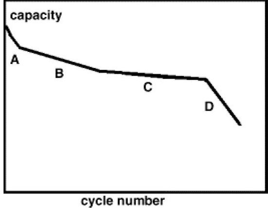

Fig. 1. General capacity degradation behavior of lithium-ion batteries [15].

For simplicity, we denote $ f_{d}^{\mathrm{cyc}}(t,\delta ,\sigma ,T_{c},1) $ as $ f_{d,1} $ to represent the life lost in one cycle.

## B. Modeling of SEI Film Formation

The proposed calendar and cycle aging models suggest that the degradation rate is the same as long as the cycles are the same. However this is not what we observed in lithiumion battery degradation experiments. The degradation rate of lithium-ion battery is not a linear process with respect to number of cycles, battery aging tests (Fig. 1) have shown that in cycling tests the degradation rate is significantly higher during the early cycles than during the later cycles, and then increases rapidly when reaching the end of life (EoL). This observation indicates the degradation rate of lithium-ion batteries depends on its current life state. We incorporate the battery life (L) into the model and express the actual per-cycle degradation rate $ ( d L / d ( C y c l e ) ) $ as a function $ ( f_{L}^{\mathrm{c y c}} ) $ of L and the linear degradation rate over one cycle $ f_{d}^{\mathrm{c y c}} $

$$
\frac {d L}{d (C y c l e)} = f _ {L} ^ {\mathrm {c y c}} \left(L, f _ {d} ^ {\mathrm {c y c}}\right),
$$

where L is normalized between zero and one, with L=0 indicating a new battery. Battery end of life is typically defined as the point at which the battery only provides 80% of its rated maximum capacity, i.e., L=0.2.

The first factor contributing to the non-linearity of the degradation rate is that this rate is proportional to the number of active lithium ions left in the battery [25]. This can be expressed as follows:

$$
f _ {L} ^ {\mathrm {c y c}} \left(L, f _ {d} ^ {\mathrm {c y c}}\right) = (1 - L) f _ {d} ^ {\mathrm {c y c}} \left(t, \delta , \sigma , T _ {c}, 1\right),
$$

and the battery life is obtained by integrating the equation with respect to L,

$$
L = 1 - e ^ {- \sum_ {n} f _ {d} ^ {\mathrm {c y c}} \left(t, \delta , \sigma , T _ {c}, 1\right)} = 1 - e ^ {- f _ {d}}.
$$

However this relationship does not model the fast-aging stage at the early cycles. While this fast rate of early degradation might be caused by various mechanisms, a major cause is the formation of the Solid Electrolyte Interphase (SEI) film. When a new battery starts to operate, a certain amount of active lithium ions are consumed to form this film [11], [18], [34]. The rate at which this film is formed decreases when a stable film has been formed [35], [36]. To

model this theory, we assume that a certain portion of the battery's active material is consumed in the transient stage to form the SEI film. The formation rate is inversely proportional to the SEI film already formed, and stops when a stable SEI has been formed (steady-state stage).

Let $ \alpha_{\mathrm{sei}} $ be the portion of the charge capacity irreversibly consumed during the SEI film formation. The total normalized battery capacity is then divided into two portions: the SEI portion $ \alpha_{\mathrm{sei}} $ , and the rest that fades at a rate proportional to the battery life $ (1-\alpha_{\mathrm{sei}}) $ . We model the SEI formation process similarly to Eq. (9) but at a different linearized rate $ f_{\mathrm{sei}} $ , and model the battery life as a two-exponential function:

$$
L = 1 - \alpha_ {\mathrm {s e i}} e ^ {- f _ {\mathrm {s e i}}} - \left(1 - \alpha_ {\mathrm {s e i}}\right) e ^ {- f _ {d}},
$$

The parameter $ \alpha_{\mathrm{sei}} $ appears to be highly dependent on the design of the battery. The authors of [37] - [39] concluded that $ \alpha_{\mathrm{sei}} $ depends on the specific surface area of the graphite as well as on the layer formation conditions and that the value of $ \alpha_{\mathrm{sei}} $ varies from 3% to 8%. Other studies [16], [40] concluded that $ \alpha_{\mathrm{sei}} $ can reach values up to around 16%. The aging rate of SEI is dependent on the composition of the electrolyte used [41], [42], as well as on the cell temperature [43], [44] and battery operation reactions such as the interactions between the positive and negative electrodes [11]. Since usage and temperature also contributes to SEI formation, we will assume that $ f_{\mathrm{sei}} $ is proportional to $ f_{d} $:

$$
f _ {\mathrm {s e i}} = \beta_ {\mathrm {s e i}} f _ {d},
$$

Eq. (10) therefore becomes

$$
L = 1 - \alpha_ {\mathrm {s e i}} e ^ {- \beta_ {\mathrm {s e i}} f _ {d}} - \left(1 - \alpha_ {\mathrm {s e i}}\right) e ^ {- f _ {d}}.
$$

Eq. (12) only applies to a fresh battery with $ L=0 $ , it is suitable in planning studies where the entire battery life is assessed. To apply the model to a used battery, the current battery life must be obtained. Because lithium-ion batteries have a very fast initial degradation rate, for most used batteries, the SEI film formation period is finished and the battery life is near or below 0.9. In such cases Eq. (12) can be simplified by assuming the current battery life $ L^{\prime} $ and neglecting the SEI film formation stage.

$$
L = 1 - \left(1 - L ^ {\prime}\right) e ^ {- f _ {d}}.
$$

Eq. (13) can be used when on-site battery life diagnostic is possible. In such cases the battery life can be constantly updated and Eq. (13) used as a tool to predict the battery's degradation for upcoming operations.

## C. Evaluating SEI Parameters

Most battery degradation test results record the faded capacity versus cycle number (cycling aging tests) or time (calendar aging tests) at specified ambient condition and operation pattern. Rewriting Eq. (12) to apply the SEI model to cycling test data:

$$
L = 1 - \alpha_ {\mathrm {s e i}} e ^ {- N \beta_ {\mathrm {s e i}} f _ {d, 1}} - (1 - \alpha_ {\mathrm {s e i}}) e ^ {- N f _ {d, 1}},
$$

A fitting algorithm can then be used to fit the values of $ \alpha_{\mathrm{sei}} $ $ \beta_{\mathrm{sei}} $ , and $ f_{d,1} $ in Eq. (14) to the experimental degradation data.

<!-- PDF_PAGE: 4 -->

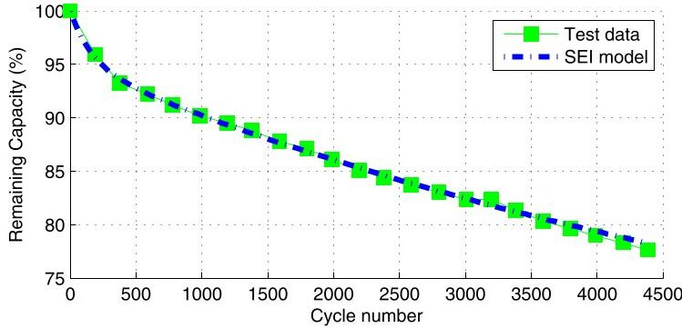

Fig. 2. An example of degradation curve and the fitting of the SEI model.

Similarly, calendar test data can be fitted to the following equation to obtain $ f_{d}^{t} $

$$
L = 1 - \alpha_ {\mathrm {s e i}} e ^ {- t \beta_ {\mathrm {s e i}} f _ {d} ^ {t}} - \left(1 - \alpha_ {\mathrm {s e i}}\right) e ^ {- t f _ {d} ^ {t}},
$$

Fig. 2 illustrates this data and this parameter fitting procedure.

## III. STRESS FACTOR MODELS

The linearized degradation rate, $ f_{d} $ obtained by fitting Eq. 12 to any battery life test curve (Fig. 2 for example), is the degradation rate after the dependence on battery life has been removed. This linearized degradation rate therefore depends only on the operation of the battery, as described by the number of cycles, the State of Charge (SoC), the Depth of Discharge (DoD), the cell temperature, and the elapsed time.

The temperature effect on degradation has been well studied [12], [25], [45] and is modeled as a stress factor that accelerates the ongoing degradation process. We formulate both the calendar aging and the cycle aging as processes that are accelerated by the temperature stress model $ S_{T} $

$$
f _ {c} \left(\delta , \sigma , T _ {c}\right) = S _ {\delta , \sigma} \left(\delta , \sigma\right) S _ {T} \left(T _ {c}\right),
$$

$$
f _ {t} \left(t, \sigma , T _ {c}\right) = S _ {t, \sigma} \left(t, \sigma\right) S _ {T} \left(T _ {c}\right),
$$

where $ S_{\delta,\sigma} $ and $ S_{t,\sigma} $ are mixed stress factor models. The influence of stress factors such as current (C-rate), DoD and average SoC on the degradation has not yet been explained satisfactorily [18]. In our approach, we neglect the C-rate effect because the battery current is linked to the cell temperature and DoD. The SoC level affects the calendar aging rate, while the average cycle SoC affects the cycle aging rate [11], [25]. Therefore we model the SoC as an accelerating factor similar to temperature:

$$
f _ {c} \left(\delta , \sigma , T _ {c}\right) = S _ {\delta} (\delta) S _ {\sigma} (\sigma) S _ {T} \left(T _ {c}\right),
$$

$$
f _ {t} \left(t, \sigma , T _ {c}\right) = S _ {t} (t) S _ {\sigma} (\sigma) S _ {T} \left(T _ {c}\right).
$$

In this formulation, cycles and time are modeled as actual factors that reduce the life of the battery, while SoC and temperature influence the rate of degradation. The model uses a reference point of SoC and temperature, at which the stress model has a value of one, indicating that the degradation rate are unaffected at the reference condition. The SoC and temperature stress model in the cycling aging and the calendar aging are the same, while the inputs are different. The cycling aging

model uses the average SoC and temperature of each identified cycle, while the calendar aging model uses the average SoC and temperature over the entire operation period.

For cycling aging tests, we represent the degradation over one cycle $ f_{d,1} $ as

$$
f _ {d, 1} = \left[ S _ {\delta} (\delta) + S _ {t} \left(t _ {c}\right) \right] S _ {\sigma} (\sigma) S _ {T} \left(T _ {c}\right).
$$

For calendar aging tests, if we set $ \delta $ to zero, $ f_{d,t} $ in Eq. (15) becomes

$$
f _ {d, t} = S _ {t} (t) S _ {\sigma} (\sigma) S _ {T} \left(T _ {c}\right).
$$

The following sections propose stress models and illustrates the procedure used to calculate the model parameters.

## A. Temperature Stress Model

The stress model for temperature is derived from Arrhenius' equation, which models the temperature dependence of the rate of a chemical reaction [12], [45]:

$$
S _ {T} (T) = e ^ {k _ {T} \left(T - T _ {\mathrm {r e f}}\right) \cdot \frac {T _ {\mathrm {r e f}}}{T}},
$$

where $ k_{T} $ is the temperature stress coefficient, and $ T_{\mathrm{ref}} $ is the reference temperature in degree Kelvin. A reasonable value for the reference temperature is 293K or $ 25^{\circ} C $ , which is the temperature at which most calendar aging experiments are performed.

To determine the value of $ k_{T} $ , calendar aging test data at different temperatures but the same SoC can be used. Given two data sets $ (t_{A},H_{A}) $ and $ (t_{B},H_{B}) $ measured at different cell temperatures $ T_{A} $ and $ T_{B} $ , Eq. (15) can be used to obtain the linearized degradation rate of the test data curve. We denote the degradation rate of the test data curve measured at the temperature $ T=T_{A} $ as $ f_{d,t[T=T_{A}]} $ , then it follows that

$$
\frac {S _ {T} \left(T _ {A}\right)}{S _ {T} \left(T _ {B}\right)} = \frac {f _ {d , t \left[ T = T _ {A} \right]}}{f _ {d , t \left[ T = T _ {B} \right]}}.
$$

If we select a temperature as reference, we can write:

$$
S _ {T} \left(T _ {A}\right) = \frac {f _ {d , t} \left[ T = T _ {A} \right]}{f _ {d , t} \left[ T = T _ {\mathrm {r e f}} \right]}.
$$

The value of $ k_{T} $ is obtained by applying an exponential fit to the temperature series and corresponding $ S_{T} $ values.

While Arrhenius' equation indicates that the degradation rate decreases with temperature, this relationship does not hold for low temperatures. The metallic lithium reacts with the electrolyte and may contribute to accelerated aging [11]. Low temperatures also increase the battery's impedance and decrease its performance [46]----[48]. The authors of [49] show that $ 2 0^{\circ} C $ is a dividing line between high and low temperature behaviors, because the battery's impedance drops with temperature as long as the temperature remains above $ 2 0^{\circ} C $ , but increases if the temperature drops below $ 2 0^{\circ} C $ . The calendar aging test data used in this research indicates that the degradation rate at $ 1 5^{\circ} C $ is smaller than at $ 2 0^{\circ} C $ . However, since no data was available for temperatures lower than $ 1 5^{\circ} C $ , it is recommended to use the proposed temperature stress model only for batteries operating above $ 1 5^{\circ} C $ .

<!-- PDF_PAGE: 5 -->

## B. SoC Stress Model

We adopt the SoC stress model from [25]:

$$
S _ {\sigma} = e ^ {k _ {\sigma} \left(\sigma - \sigma_ {\mathrm {r e f}}\right)},
$$

where $ k_{\sigma} $ is the SoC stress coefficient, $ \sigma_{\mathrm{ref}} $ is the reference SoC level, which is usually selected around 0.4 to 0.5. To determine the value of $ k_{\sigma} $ , calendar aging test data for different SoC levels and a similar method for determining $ k_{T} $ can be used. The value of $ S_{\sigma}(\sigma_{A}) $ can then be obtained from test data as follows:

$$
S _ {\sigma} \left(\sigma_ {A}\right) = \frac {f _ {d , t [ \sigma = \sigma_ {A} ]}}{f _ {d , t [ \sigma = \sigma_ {\mathrm {r e f}} ]}}.
$$

This stress model indicates a higher degradation rate at high SoC level and a lower rate at lower SoC levels, matching the Tafel relationship. This is in line with the experimental data obtained in this work and results from other researchers [11], [50]. However, although a low SoC does not increase capacity fading rate directly, it increases the impedance and power fading [11], [51], therefore low SoC levels will accelerate cycle aging rates. This effect is not modeled in this work, but should be incorporated in operation optimizations.

## C. Time Stress Model

After removing the life-dependence and other stress factors the time stress model is a linear function of time:

$$
S _ {t} (t) = k _ {t} t.
$$

Once the temperature and SoC stress model coefficients $ ( k_{T} $ and $ k_{\sigma} $ ）have been determined, $ k_{t} $ can be easily calculated using the results of calendar aging tests:

$$
k _ {t} = \frac {f _ {d , t [ T = T _ {A} , \sigma = \sigma_ {A} ]}}{t S _ {T} \left(T _ {A}\right) S _ {\sigma} \left(\sigma_ {A}\right)},
$$

where $ f_{d,t}[T=T_{A},\sigma=\sigma_{A}]$ denotes that the linearized degradation rate is obtained at the condition $ (T=T_{A},\sigma=\sigma_{A}) $ , and t is the duration of the calendar aging test.

## D. DoD Stress Model

The DoD stress model is a critical part of the degradation model because it determines the degradation caused by one cycle under the reference conditions. The DoD stress model is very dependent on the lithium-ion battery type. Because the available theoretical studies quantifying the relationship between cycle DoD and the amount of capacity fade are insufficient, most DoD stress models nowadays are empirical. Although linear DoD stress models are commonly incorporated in optimization models [22], [52], it is widely accepted that the cycle DoD has a nonlinear impact on degradation. For the same amount of energy processed by a battery, a higher cycle DoD leads to a more severe damage. Nonlinear DoD stress models from the literature can be grouped into two classes: exponential models $ ( S_{\delta,e} ) $ [25], [53]

$$
S _ {\delta , e} (\delta) = k _ {\delta , e 1} \delta \exp \left(k _ {\delta , e 2} \delta\right),
$$

and quadratic models $ ( S_{\delta, q} ) $ [18], [19]

$$
S _ {\delta , q} (\delta) = k _ {\delta , q 1} \delta^ {k _ {\delta , q 2}},
$$

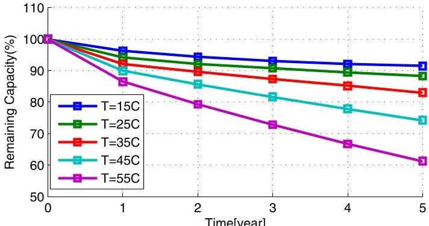

(a) Calendar aging with varying temperature at 50% SoC.

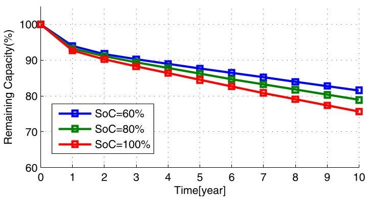

(b) Calendar aging with varying SoC at $ 2 5^{\circ} C $

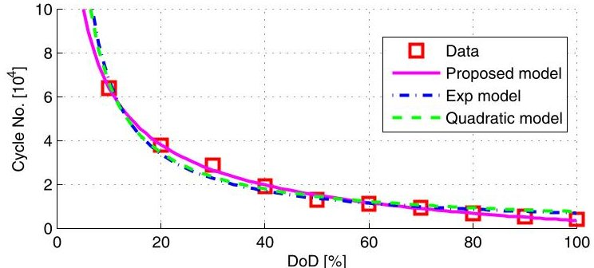

(c) Cycle life before reaching 80% EoL at reference conditions.

where all $ k^{\prime} s $ are model parameters. These models are either purely empirical or derived based on theoretical assumptions. In either case, the coefficients are determined by fitting test data.

We can obtain DoD stress data by conducting experiments under the designed reference condition, or use the proposed temperature, SoC, and time stress model to eliminate all other stress factors from the degradation data. Given a set of cycling aging test data, the linearized degradation rate of one cycle under specified conditions, denoted as $ f_{d,1}[\delta=\delta_{A},\sigma=\sigma_{A},T=T_{A},t_{p}=t_{p,A}]$ , can be obtained from Eq. (14). Given the other stress models developed in Section III-A-III-C, the DoD stress model $ S_{\delta} $ can be calculated using (20) as follows:

$$
S _ {\delta} \left(\delta_ {A}\right) = \frac {f _ {d , 1 \left[ \delta = \delta_ {A} , \sigma = \sigma_ {A} , T = T _ {A} , t _ {p} = t _ {p , A} \right]}}{S _ {T} \left(T _ {A}\right) S _ {\sigma} \left(\sigma_ {A}\right)} - S _ {t} \left(t _ {p , A}\right).
$$

The DoD stress model can then be obtained by fitting a curve to the data set $ (\delta_{A}, S_{\delta}(\delta_{A})) $

DoD stress models from the literature do not provide a satisfactory fit to the LMO battery data. In particular, these models tend to over-estimate the LMO battery life at high cycle DoD.

<!-- PDF_PAGE: 6 -->

Considering that none of these model is designed specifically for LMO batteries, we propose a new empirical DoD stress model:

$$
S _ {\delta} (\delta) = \left(k _ {\delta 1} \delta^ {k _ {\delta 2}} + k _ {\delta 3}\right) ^ {- 1},
$$

where $ k_{\delta 1}, k_{\delta 2}, $ and $ k_{\delta 3} $ are empirical coefficients. This model achieves a R-squared value of 0.993 in data fitting, while the R-squared value for the exponential model is 0.958, and 0.967 for the quadratic model. Fig. 3c shows the DoD test data and the curve fitting results.

The proposed model is similar to the quadratic DoD model, but introduces a new constant $ k_{\delta 3} $ . In our fitting results, $ k_{\delta 1} $ has a positive value while $ k_{\delta 2} $ and $ k_{\delta 3} $ have negative values. Compared to exponential and quadratic models, the proposed model predicts lower cycle life at low DoD cycles. This modeling difference is a result of different lithium-ion battery types. Lithium-ion batteries with different electrode materials differ significantly in their aging mechanisms and cycle life. Compared to the Li(NiMnCo)O $ _{2} $ battery studied in [54] and the LiFePO $ _{4} $ battery studied in [25], LMO battery degradation not only leads to capacity fading but also greatly increases the cell resistance, causing LMO batteries to have shorter cycle lives [34]. The difference in aging mechanism is possibly the reason why the proposed model provides a better fit compared to the exponential and the quadratic models.

Note that the proposed DoD stress model only applies to LMO batteries. For other types of lithium-ion batteries, one should select an appropriate DoD stress model based on the battery type and the test data.

## IV. MODEL APPLICATION TO IRREGULAR CYCLES

The linearized model described by Eq. (3) evaluates battery capacity loss from a series of cycles, each with different cycle parameters such as DoD, average SoC, temperature. Identifying directly the number of cycles, the DoD and the average SoC of each cycle is difficult from a SoC profile resulting from irregular battery operation. We therefore adopt the rainflow cycle-counting algorithm [27], [28] that is widely used in fatigue studies and has been applied to battery cycle analysis in [29] - [31]. This algorithm make possible the application of Miner's rule [33] to assess the fatigue life, and is also applicable to damage accumulation processes such as battery degradation.

The input to this algorithm [55] is the SoC profile, and it outputs the following results: 1) cycle amplitude; 2) cycle mean value; 3) cycle number (0.5 for a half cycle, or 1 for a full cycle); 4) cycle begin time; 5) cycle end time. We convert the rainflow counting results into the stress factors described in Eq. (3): 1) the DoD of the i th cycle $ \delta_{i} $ which is twice the i th rainflow cycle amplitude; 2) the average SoC of the i th cycle $ \sigma_{i} $ which is the i th rainflow cycle mean value; 3) the average cycle temperature of the i th cycle $ T_{c,i} $ which is calculated as the mean temperature between the start and end times of the i th rainflow cycle; 4) the average profile SoC $ \bar{\sigma} $ is the mean value of the rainflow cycle mean values; 5) the average profile temperature $ \bar{T}_{c} $ is the mean value of the temperature profile. Fig. 4 shows an example of the counting results.

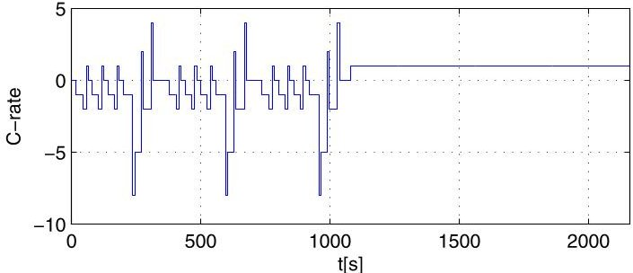

(a) Example DST C-rate profile.

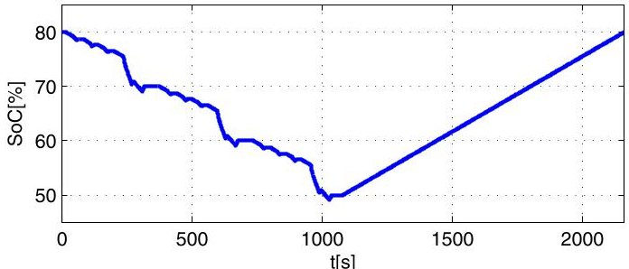

(b) Example DST SoC profile.

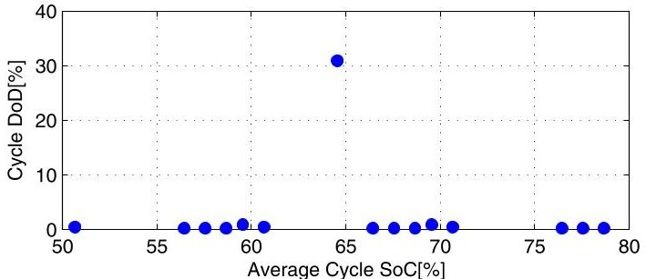

(c) Distribution of counted cycles.

Fig. 4. The DST profile and rainflow cycle counting example.

## V. EXAMPLE MODEL PARAMETERS

## A. Model Parameters

The proposed degradation model requires at least two sets of data to obtain the model parameters: the battery calendar aging test data with specified SoC and temperature, and the battery cycle life data with specified DoD and temperature. Examples of these data curves are shown in Fig. 3. The cycle life data are normalized to the reference condition. Table I shows a set of model coefficients tuned using LMO battery degradation test data from the same manufacturer.

## B. Dynamic Stress Test Cycling

In addition to the calendar and cycle aging test data, the manufacture provided a set of Dynamic Stress Test (DST) battery test results in order to illustrate the battery's performance in mixed-cycle operations. For each test, the cell first starts at a set SoC level and the DST profile is applied repetitively until the set stop level is reached. The cell is then recharged back to the starting level at a 1 C-rate to finish one test cycle. Fig. 4a shows a DST C-rate example consisting of three consecutive DST profiles. The resulting change in SoC is shown in Fig. 4b. Fig. 4c shows the identified cycles as a distribution of cycle DoDs with respect to the average cycle SoC.

<!-- PDF_PAGE: 7 -->

TABLE I DEGRADATION MODEL PARAMETERS

Nonlinear Degradation Model

<table border="1"><tr><td>$\alpha_{\mathrm{sei}}$</td><td>5.75E-2</td><td>$\beta_{\mathrm{sei}}$</td><td>121</td></tr><tr><td colspan="4">DoD Stress Model</td></tr><tr><td>$k_{\delta1}$</td><td>1.40E5</td><td>$k_{\delta2}$</td><td>-5.01E-1</td></tr><tr><td>$k_{\delta3}$</td><td>-1.23E5</td><td></td><td></td></tr><tr><td colspan="4">SoC Stress Model</td></tr><tr><td>$k_{\sigma}$</td><td>1.04</td><td>$\sigma_{\mathrm{ref}}$</td><td>0.50</td></tr><tr><td colspan="4">Temperature Stress Model</td></tr><tr><td>$k_{\mathrm{T}}$</td><td>6.93E-2</td><td>$T_{\mathrm{ref}}$</td><td>25℃</td></tr><tr><td colspan="4">Calendar Aging Model</td></tr><tr><td colspan="2">$k_{\mathrm{t}}$</td><td colspan="2">4.14E-10/s</td></tr></table>

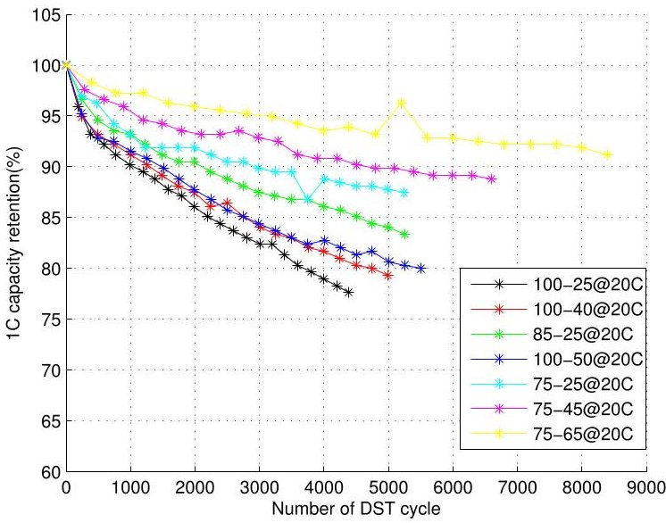

(a) Original DST Data.

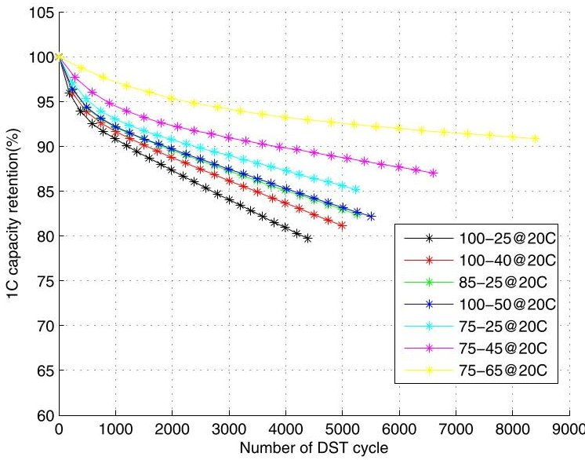

(b) Reproduced DST Data.

Fig. 5. Comparison of actual data and model reproduction.

We repeated the DST test in simulations to reproduce the SoC profile and the average cell temperature. For cell temperature, we use a simple thermal model derived from [56], the simulated average cell temperature was $ 2 1^{\circ} C $ , 1 degree higher than the test room temperature. The aging curves are calculated based on the reproduced profile and using the proposed degradation model and the rainflow cycle-counting algorithm.

Fig. 5a shows the test data. Fig. 5b shows the reconstructed degradation curve for the DST test. The legend in both figures indicates the starting and ending SoC percentage for each test curve and the test room temperature. These results show that the reconstructed profile is very close to the experimental data. The percentage error between the data and the estimation is 14%, corresponding to a $ \pm 3\% $ capacity estimation error at 80% end of life (20% of the capacity is lost, the actual remaining capacity is between 77% to 83%). Such error is reasonable due to the absence of the original SoC profile of the DST test and detailed test procedures.

The major difference between the test data and model estimations occurs in the first few hundreds cycles, where a strong nonlinearity is apparent. In particular, the three test cases starting at 100% SoC, represented by the black (100-25), red (100-40), and dark blue (100-50) curves in Fig. 5c, show a very fast degradation rate during the early cycles. This early degradation causes an obvious gap between the dark blue curve and the green curve (85-25) in the test data. This phenomenon is possibly due to cell over-voltages caused by high SoC during cycling. However, due to the lack of experimental data and lab testing records, we are unable to model and identify the excessive life damage induced by over-voltage. Nevertheless, utilizing the SEI model described in Eq. (14), we are able to remove the effect of early degradation and extract the linearized degradation rate. Our linearization shows that the dark blue case and the green case have the same linearized degradation rate. This result is also correctly reproduced by the proposed model, which show that the dark blue curve coincides with the green curve in Fig. 5b.

## VI. MODEL APPLICATION CASE STUDY

The purpose of the proposed degradation model is to estimate the capacity fading that would arise from actual battery operation, and therefore assess the BES degradation cost. In particular, we developed the proposed model to assess the value of BES in providing frequency regulation. In this study, we investigate the induced capacity losses of a BES participating in PJM's frequency regulation market.

The secondary frequency control signal in this market is split into a dynamic control signal (RegD) and a traditional control signal (RegA). The dynamic signal is the high-pass filtered part of the area control error, which has a larger signal ramp rate and a smaller energy deviation, and is designed for fast-responding units [57]. With the newly introduced two part offer policy, regulation payments are determined based on the unit's reserve capacity as well as its performance in following the control signal. The performance of each regulation provider is evaluated based on the correlation, delay, and precision of its response to the regulation signal. Fast-responding units, such as BES, can be very competitive in this market.

Providing regulation services requires the commitment of a minimum amount of energy capacity, which is measured in MWh/MW, or hours [58]. We consider the cases of a BES providing RegD service with a committed capacity of less than one hour and of another BES providing RegA service with a committed capacity larger than one hour. In both cases, we

<!-- PDF_PAGE: 8 -->

TABLE II

COMPARISON OF THE DEGRADATION OF DIFFERENT LITHIUM-ION BATTERY TYPES WHEN PROVIDING FREQUENCY REGULATION IN THE PJM SYSTEM

<table border="1"><tr><td>Regulation type</td><td colspan="4">PJM RegD</td><td colspan="4">PJM RegA</td></tr><tr><td>Assessment cases</td><td>Case 1</td><td>Case 2</td><td>Case 3</td><td>Case 4</td><td>Case 5</td><td>Case 6</td><td>Case 7</td><td>Case 8</td></tr><tr><td>BES energy capacity (MWh/MW)</td><td>0.25</td><td>0.50</td><td>0.75</td><td>1.00</td><td>1.00</td><td>2.00</td><td>3.00</td><td>4.00</td></tr><tr><td>Performance score</td><td>0.90</td><td>0.96</td><td>0.99</td><td>0.99</td><td>0.81</td><td>0.86</td><td>0.90</td><td>0.92</td></tr><tr><td>LMO battery capacity loss(%)</td><td>1.60</td><td>0.96</td><td>0.76</td><td>0.66</td><td>0.63</td><td>0.41</td><td>0.34</td><td>0.31</td></tr><tr><td>LFP battery capacity loss(%)</td><td>0.75</td><td>0.35</td><td>0.26</td><td>0.22</td><td>0.39</td><td>0.25</td><td>0.21</td><td>0.20</td></tr><tr><td>NMC battery capacity loss(%)</td><td>1.56</td><td>0.54</td><td>0.32</td><td>0.24</td><td>0.70</td><td>0.38</td><td>0.30</td><td>0.26</td></tr></table>

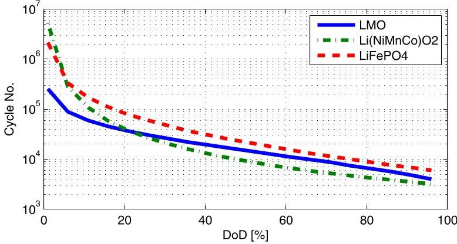

Fig. 6. Comparison of cycle life for different types of lithium-ion batteries adjusted to reference conditions.

evaluate the capacity that they will lose if they were to provide these services seamlessly for one month, assuming that an SoC control scheme [5], [59] maintains the SoC level in accordance with the storage energy capacity.

We assume that all battery cells are identical, that there are no losses from the battery management system (BMS) and the power electronics, and that the BMS has ideal control over all battery cells. We use a simplified resistive circuit model [49] to simulate a single battery cell with 1.1 Ah nominal capacity and a 3.3 V nominal voltage. The number of cells in the BES is calculated by dividing the MWh capacity by the nominal cell energy capacity (V-Ah). The power extracted from each cell is calculated by dividing the BES output power by the number of battery cells. The cell current is calculated by dividing the cell output power by the cell's terminal voltage, and the cell SoC is calculated by integrating the output current. Because the corresponding C-rates are mostly below one, we assume that the cooling system of the BES maintains a fixed cell temperature of $ 2 5^{\circ} C $

We considered three DoD stress models to represent three types of lithium-ion batteries: the proposed LMO model, the exponential model for Lithium Iron Phosphate (LFP) batteries [25], and the quadratic model for Lithium Nickel Manganese Cobalt Oxide (NMC) batteries [18], [54]. A cycle life comparison of the three batteries is shown in Fig. 6, all models were adjusted to the reference condition $ ( 2 5^{\circ} C $ cell temperature, 50% average SoC). In each simulation, cycles are identified by applying using the rainflow counting algorithm to the SoC profile.The faded capacity is calculated using the linear aging model of Eq. (3). The capacity lost is assessed

with the three battery models considering both calendar and cycle aging. In addition to the degradation, we calculate the average performance score of the regulation response.

This performance score increases with the BES energy capacity because more energy is available to be stored and injected into the grid. In battery degradation, we can identify a converging trend in the capacity loss when the BES energy capacity increases. This is because cycles have smaller DoD and the cycle aging becomes slower. In very large BES, the cycle aging approaches zero, leaving only the calendar aging. As the BES size decreases, the degradation is more severe, but does not necessarily lead to a higher cost because the numbers of battery cells involved are different. For example, when providing 1 MW RegD, the absolute amount of capacity lost in Case 1 with a LMO battery is 4 kWh, while in Case 4 the loss is 6.6 kWh. In the battery type comparison, LFP shows the longest cycle life. Other studies [34], [60] have also shown that LFP cells have longer cycle life compared to other types of lithium-ion batteries. Yet this result does not lead to the conclusion that LFP cells are the best choice for frequency regulation because battery types also differ in efficiency, energy density, and production cost. In this case study, we only provide an assessment of the capacity loss aspect. In actual operations, one must also consider the performance, the cooling, the efficiency, as well as the purchase and replacement cost of battery cells.

## VII. CONCLUSION

This paper proposes a battery degradation model that can estimate capacity fading in irregular battery operation. Several fundamental theories of battery degradation, including the Arrhenius relationship and the SEI film formation, are considered in the design of this model. While the parameters derived in this paper were obtained from experimental data with a specific battery type, the proposed model and the parameter tuning method can be applied to model degradation in other types of lithium-ion batteries. In particular, we propose a new empirical DoD stress model that best fits our LMO battery cycle test data. The case study demonstrates that by using different DoD stress models, the proposed degradation model can be applied to LFP and NMC batteries. The life loss of these three types of lithium-ion batteries are compared when under a scenario where they provide frequency regulation in the PJM market.

<!-- PDF_PAGE: 9 -->

The SEI model includes the life-dependence characteristic of battery degradation, and serves as a tool for linearizing aging curves. Test data and studies from the literature have shown that the formation rate of SEI films varies greatly between cells, even cells of the same type. Because experimental errors cannot be eliminated due to the limited size of the data set, it is difficult to model the SEI film formation accurately. The SEI model is suitable for estimating battery life at the planning stage. In actual BES operations, battery life should be constantly updated using on-site diagnostics.

The model can be further improved in several aspects. One is to introduce other stress factors, such as current magnitude (C-rate), over-voltage, and low-SoC. These factors are highly coupled with the stress factors considered in the proposed model. Delicate experiments must be designed to decouple the effect of these inter-related factors for accurate modeling. The adopted rainflow algorithm is not causal and can only be applied off-line over a recorded SoC profile, making it unsuitable for real-time evaluations. Future work is thus required to develop a real-time degradation estimator for degradation-limiting controllers.

## REFERENCES

[1] D. Wu, C. Jin, P. Balducci, and M. Kintner-Meyer, "An energy storage assessment: Using optimal control strategies to capture multiple services," in Proc. IEEE Power Energy Soc. Gen. Meeting, Denver, CO, USA, 2015, pp. 1-5.

[2] A. Oudalov, T. Buehler, and D. Chartouni, "Utility scale applications of energy storage," in Proc. IEEE Energy Conf. (ENERGY), Atlanta, GA, USA, 2008, pp. 1-7.

[3] H. Ibrahim, A. Ilinca, and J. Perron, "Energy storage systems Characteristics and comparisons," Renew. Sustain. Energy Rev., vol. 12, no. 5, pp. 1221-1250, 2008.

[4] H. Pandzić, Y. Wang, T. Qiu, Y. Dvorkin, and D. S. Kirschen, "Nearoptimal method for siting and sizing of distributed storage in a transmission network," IEEE Trans. Power Syst., vol. 30, no. 5, pp. 2288-2300, Sep. 2015.

[5] B. Xu, A. Oudalov, J. Poland, A. Ulbig, and G. Andersson, "BESS control strategies for participating in grid frequency regulation," in Proc. 19th IFAC World Congr., Cape Town, South Africa, 2014, pp. 4024-4029.

[6] Y. J. Zhang, C. Zhao, W. Tang, and S. H. Low, "Profit maximizing planning and control of battery energy storage systems for primary frequency control," IEEE Trans. Smart Grid, vol. PP, no. 99, pp. 1-1.

[7] L. Wang et al., "Coordination of multiple energy storage units in a low-voltage distribution network," IEEE Trans. Smart Grid, vol. 6, no. 6, pp. 2906-2918, Nov. 2015.

[8] D. Gayme and U. Topcu, "Optimal power flow with large-scale storage integration," IEEE Trans. Power Syst., vol. 28, no. 2, pp. 709-717, May 2013.

[9] H. Chen, Z. Liu, A. K. Coskun, and A. Wierman, "Optimizing energy storage participation in emerging power markets," Proc. 6th Int. Green Comput. Conf. Sustain. Comput. Conf. (IGSC), Las Vegas, NV, USA, 2015, pp. 1-6.

[10] Y. Shi, B. Xu, B. Zhang, and D. Wang, "Leveraging energy storage to optimize data center electricity cost in emerging power markets," in Proc. ACM Int. Conf. Future Energy Syst., 2016, Art. no. 18.

[11] J. Vetter et al., "Ageing mechanisms in lithium-ion batteries," J. Power Sources, vol. 147, nos. 1-2, pp. 269-281, 2005. [Online]. Available: http://www.sciencedirect.com/science/article/pii/S0378775305000832

[12] G. Ning and B. N. Popov, "Cycle life modeling of lithium-ion batteries," J. Electrochem. Soc., vol. 151, no. 10, pp. A1584-A1591, 2004.

[13] G. Ning, R. E. White, and B. N. Popov, "A generalized cycle life model of rechargeable li-ion batteries," Electrochim. Acta, vol. 51, no. 10, pp. 2012-2022, 2006.

[14] M. Safari, M. Morcrette, A. Teyssot, and C. Delacourt, "Multimodal physics-based aging model for life prediction of li-ion batteries," J. Electrochem. Soc., vol. 156, no. 3, pp. A145-A153, 2009.

[15] R. Spotnitz, "Simulation of capacity fade in lithium-ion batteries," J. Power Sources, vol. 113, no. 1, pp. 72-80, 2003.

[16] Q. Zhang and R. E. White, "Capacity fade analysis of a lithium ion cell," J. Power Sources, vol. 179, no. 2, pp. 793-798, 2008.

[17] K. Smith, J. Neubauer, E. Wood, M. Jun, and A. Pesaran, "Models for battery reliability and lifetime," presented at the Battery Congr., 2013, pp. 15-16.

[18] I. Laresgoiti, S. Kabitz, M. Ecker, and D. U. Sauer, "Modeling mechanical degradation in lithium ion batteries during cycling: Solid electrolyte interphase fracture," J. Power Sources, vol. 300, pp. 112-122, Dec. 2015.

[19] M. Koller, T. Borsche, A. Ulbig, and G. Andersson, "Defining a degradation cost function for optimal control of a battery energy storage system," in Proc. IEEE Grenoble Powertech Conf., Grenoble, France, 2013, pp. 1-6.

[20] O. Erdinc, B. Vural, and M. Uzunoglu, "A dynamic lithium-ion battery model considering the effects of temperature and capacity fading," in Proc. Int. Conf. Clean Elect. Power, 2009, pp. 383-386.

[21] S. B. Peterson, J. Apt, and J. F. Whitacre, "Lithium-ion battery cell degradation resulting from realistic vehicle and vehicle-to-grid utilization," J. Power Sources, vol. 195, no. 8, pp. 2385-2392, 2010.

[22] M. A. Ortega-Vazquez, "Optimal scheduling of electric vehicle charging and vehicle-to-grid services at household level including battery degradation and price uncertainty," IET Gener. Transm. Distrib., vol. 8, no. 6, pp. 1007-1016, Jun. 2014.

[23] A. Hoke, A. Brissette, D. Maksimović, A. Pratt, and K. Smith, "Electric vehicle charge optimization including effects of lithium-ion battery degradation," in Proc. IEEE Veh. Power Propulsion Conf. (VPPC), Chicago, IL, USA, 2011, pp. 1-8.

[24] J. Wang et al., "Cycle-life model for graphite-LiFePO $ _{4} $ cells," J. Power Sources, vol. 196, no. 8, pp. 3942-3948, 2011.

[25] A. Millner, "Modeling lithium ion battery degradation in electric vehicles," in Proc. IEEE Conf. Innov. Technol. Efficient Rel. Electricity Supply (CITRES), Waltham, MA, USA, 2010, pp. 349-356.

[26] S. N. Zhurkov, "Kinetic concept of the strength of solids," in Proc. ICF1, Sendai, Japan, 1965, pp. 1167-1184.

[27] M. Matsuishi and T. Endo, "Fatigue of metals subjected to varying stress," Japan Soc. Mech. Eng., pp. 37-40, Dec. 1968.

[28] S. D. Downing and D. F. Socie, "Simple rainflow counting algorithms," Int. J. Fatigue, vol. 4, no. 1, pp. 31-40, 1982.

[29] R. Dufo-Lopez and J. L. Bernal-Agustin, "Multi-objective design of PV-wind-diesel-hydrogen-battery systems," Renew. Energy, vol. 33, no. 12, pp. 2559-2572, 2008.

[30] S. Mishra, M. Pecht, T. Smith, I. McNee, and R. Harris, "Remaining life prediction of electronic products using life consumption monitoring approach," in Proc. Eur. Microelectron. Packag. Interconnect. Symp., Kraków, Poland, Jun. 2002, pp. 136-142.

[31] M. Chawla, R. Naik, R. Burra, and H. Wiegman, "Utility energy storage life degradation estimation method," in Proc. IEEE Conf. Innov. Technol. Efficient Rel. Electricity Supply (CITRES), Waltham, MA, USA, 2010, pp. 302-308.

[32] M. Kassem et al., "Calendar aging of a graphite/LiFePO_4 cell," J. Power Sources, vol. 208, pp. 296-305, 2012.

[33] M. A. Miner, "Cumulative damage in fatigue," J. Appl. Mech., vol. 12, no. 3, pp. 159-164, 1945.

[35] M. C. Smart et al., "Improved performance of lithium-ion cells with the use of fluorinated carbonate-based electrolytes," J. Power Sources, vol. 119, pp. 359-367, Jun. 2003.

[36] H. J. Santner et al., "Acrylic acid nitrile, a film-forming electrolyte component for lithium-ion batteries, which belongs to the family of additives containing vinyl groups," J. Power Sources, vols. 119-121, pp. 368-372, Jun. 2003.

[37] S. S. Choi and H. S. Lim, "Factors that affect cycle-life and possible degradation mechanisms of a li-ion cell based on $ \mathrm{L i C o O_{2}} $," J. Power Sources, vol. 111, no. 1, pp. 130-136, 2002.

[38] P. Novák et al., "The complex electrochemistry of graphite electrodes in lithium-ion batteries," J. Power Sources, vols. 97-98, pp. 39-46, Jul. 2001.

[39] J. Li, E. Murphy, J. Winnick, and P. A. Kohl, "The effects of pulse charging on cycling characteristics of commercial lithium-ion batteries," J. Power Sources, vol. 102, nos. 1-2, pp. 302-309, 2001.

[40] V. Srinivasan and J. Newman, "Discharge model for the lithium iron-phosphate electrode," J. Electrochem. Soc., vol. 151, no. 10, pp. A1517-A1529, 2004.

<!-- PDF_PAGE: 10 -->

[41] G. E. Blomgren, "Electrolytes for advanced batteries," J. Power Sources, vols. 81-82, pp. 112-118, Sep. 1999.

[42] F. Joho et al., "Key factors for the cycling stability of graphite intercalation electrodes for lithium-ion batteries," J. Power Sources, vols. 81-82, pp. 243-247, Sep. 1999.

[43] A. M. Andersson, K. Edström, and J. O. Thomas, "Characterisation of the ambient and elevated temperature performance of a graphite electrode," J. Power Sources, vols. 81-82, pp. 8-12, Sep. 1999.

[44] G. Amatucci, A. Du Pasquier, A. Blyr, T. Zheng, and J.-M. Tarascon, "The elevated temperature performance of the $ \mathrm{L i M n_{2} O_{4}} $ /C system: Failure and solutions," Electrochim. Acta, vol. 45, nos. 1-2, pp. 255-271, Sep. 1999.

[45] B. Y. Liaw et al., "Correlation of Arrhenius behaviors in power and capacity fades with cell impedance and heat generation in cylindrical lithium-ion cells," J. Power Sources, vols. 119-121, pp. 874-886, Jun. 2003.

[46] B. Ratnakumar, M. Smart, L. Whitcanack, and R. Ewell, "The impedance characteristics of Mars Exploration Rover Li-ion batteries," J. Power Sources, vol. 159, no. 2, pp. 1428-1439, 2006.

[47] C.-K. Huang, J. S. Sakamoto, J. Wolfenstine, and S. Surampudi, "The limits of low-temperature performance of li-ion cells," J. Electrochem. Soc., vol. 147, no. 8, pp. 2893-2896, 2000.

[48] S. S. Zhang, K. Xu, and T. R. Jow, "The low temperature performance of li-ion batteries," J. Power Sources, vol. 115, no. 1, pp. 137-140, 2003.

[49] L. Lam, P. Bauer, and E. Kelder, "A practical circuit-based model for Liion battery cells in electric vehicle applications," in Proc. IEEE 33rd Int. Telecommun. Energy Conf. (INTELEC), Amsterdam, The Netherlands, 2011, pp. 1-9.

[50] M. Safari, M. Morcrette, A. Teyssot, and C. Delacourt, "Life-prediction methods for lithium-ion batteries derived from a fatigue approach I introduction: Capacity-loss prediction based on damage accumulation," J. Electrochem. Soc., vol. 157, no. 6, pp. A713-A720, 2010.

[51] K. Amine et al., "Factors responsible for impedance rise in high power lithium ion batteries," J. Power Sources, vols. 97-98, pp. 684-687, Jul. 2001.

[52] A. Hoke, A. Brissette, D. Maksimović, A. Pratt, and K. Smith, "Electric vehicle charge optimization including effects of lithium-ion battery degradation," in Proc. IEEE Veh. Power Propulsion Conf. (VPPC), Chicago, IL, USA, 2011, pp. 1-8.

[53] S. Drouilhet et al., "A battery life prediction method for hybrid power applications," in Proc. AIAA Aerosp. Sci. Meeting Exhibit, Reno, NV, USA, 1997, pp. 1-14.

[54] M. Ecker et al., "Calendar and cycle life study of Li (NiMnCo) $ \mathrm{O}_{2} $ -based 18650 lithium-ion batteries," J. Power Sources, vol. 248, pp. 839-851, Feb. 2014.

[55] A. Nieslony. (2003). Rainflow Counting Algorithm. [Online]. Available: http://www.mathworks.com/matlabcentral/fileexchange/3026

[56] S. J. Drake et al., "Measurement of anisotropic thermophysical properties of cylindrical li-ion cells," J. Power Sources, vol. 252, pp. 298-304, Apr. 2014.

[57] PJM Manual 12: Balancing Operations. Accessed on Nov. 1, 2015. [Online]. Available: http://pjm.com/~/media/documents/manuals/m12.ashx

[58] B. Xu, Y. Dvorkin, D. S. Kirschen, C. A. Silva-Monroy, and J.-P. Watson, "A comparison of policies on the participation of storage in U.S. frequency regulation markets," in Proc. IEEE PES Gen. Meeting, Boston, MA, USA, 2016, pp. 1-6.

[59] T. Borsche, A. Ulbig, M. Koller, and G. Andersson, "Power and energy capacity requirements of storages providing frequency control reserves," in Proc. IEEE Power Energy Soc. (PES) Gen. Meeting, Vancouver, BC, Canada, 2013, pp. 1-5.

[60] F. Croce et al., "A novel concept for the synthesis of an improved LiFe PO4 lithium battery cathode," Electrochem. Solid State Lett., vol. 5, no. 3, pp. A47-A50, 2002.

Bolun Xu (S'14) received the B.S. degree in electrical and computer engineering from the University of Michigan, Ann Arbor, USA, and Shanghai Jiaotong University, Shanghai, China, in 2011, and the M.Sc. degree in electrical engineering from the Swiss Federal Institute of Technology, Zürich, Switzerland, in 2014. He is currently pursuing the Ph.D. degree in electrical engineering with the University of Washington, Seattle, WA, USA. His research interests include energy storages, power system operations, and power system economics.

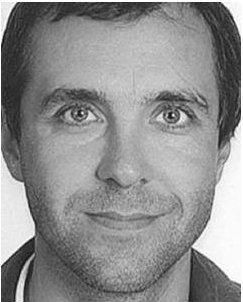

Alexandre Oudalov received the Ph.D. degree in electrical engineering from the Swiss Federal Institute of Technology of Lausanne, Lausanne Switzerland. Since 2004, he has been with the ABB Corporate Research Center, Switzerland, where he is currently a Senior Principal Scientist. He also represents Switzerland in CIGRE Study Committee C6 focused on distribution systems and dispersed generation. His research interests include power system economics, integration of distributed generation, energy storage control and optimization, and distribution grid automation.

Andreas Ulbig (S'08-M'14) was born in Halle, Germany, and grew up in Berlin. He received the M.Sc. degree from Supélec, Paris, in 2006 the Dipl.-Ing. degree in engineering cybernetics from the University of Stuttgart, in 2007, and the Ph.D. degree from Power Systems Laboratory, ETH Zurich, Switzerland, in 2014. After a traineeship with the Research and Development Department of RTE, the French TSO, Versailles, and an academic stay with Caltech (Control and Dynamical Systems), Pasadena, CA, USA, he worked at the International

Energy Agency, Paris, France, from 2007 to 2008. In 2008, he joined the Power Systems Laboratory, ETH Zurich. He spent Spring and Summer of 2012 as an Academic Visitor with PNNL (Advanced Power & Energy Systems), Richland, WA, USA, and the University of California (Energy and Resources Group), Berkeley, CA, USA. His research interests are power and energy system modeling, RES grid integration, ancillary services, energy storage, and operational flexibility of power systems.

Göran Andersson (M'86-SM'91-F'97) received the M.S. and Ph.D. degrees from the University of Lund, Sweden, in 1975 and 1980. In 1980, he joined ASEAs, now ABBs, HVDC Division, Ludvika, Sweden, and in 1986, he was a Full Professor in electric power systems with KTH (Royal Institute of Technology), Stockholm, Sweden. Since 2000, he has been a Full Professor in electric power systems with ETH Zurich (Swiss Federal Institute of Technology), where he also heads the Power System Laboratory. His research interests include power systems dynamics and control, power markets, and future energy systems. He was a recipient of the IEEE PES Outstanding Power Educator Award 2007 and of the George Montefiore International Award 2010. He is a fellow of the Royal Swedish Academy of Sciences and the Royal Swedish Academy of Engineering Sciences.

Daniel S. Kirschen (M'86-SM'91-F'07) received the electrical and mechanical engineering degree from the Universite Libre de Bruxelles, Brussels, Belgium, in 1979, and the M.Sc. and Ph.D. degrees from the University of Wisconsin, Madison, WI, USA, in 1980 and 1985, respectively. He is currently the Donald W. and Ruth Mary Close Professor of Electrical Engineering with the University of Washington, Seattle, WA, USA. His research interests include the integration of renewable energy sources in the grid, power system economics, and power system security.

