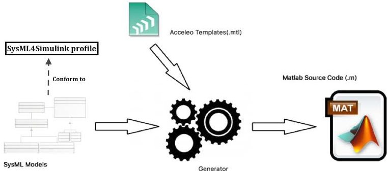
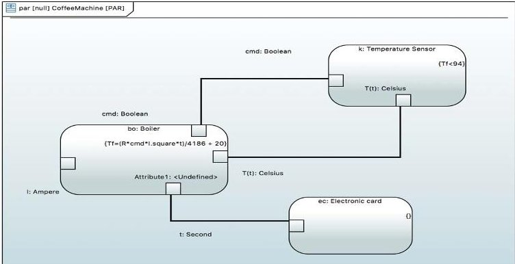
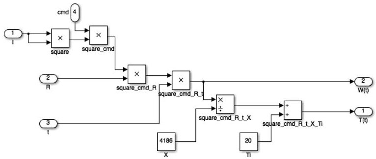
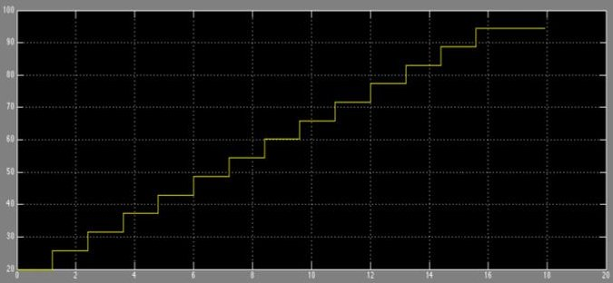

<!-- PDF_PAGE: 1 -->

# Integrating SysML with simulation environments (Simulink) by model transformation approach

Bassim Chabibi $ ^{*} $ , Abdelilah Douche $ ^{\dagger} $ , Adil Anwar $ ^{\ddagger} $ , and Mahmoud Nassar $ ^{\S} $

IMS, SIME laboratory,

ENSIAS, Rabat Mohamed V University Rabat, Morocco

*Email: bassim.chabibi@um5s.ac.ma

$ ^{8} $Email: nassar.ensias@gmail.com

SIWEB,

EMI, Rabat Mohamed V University

Rabat, Morocco

$ ^{\dagger} $Email: a.douche@fsr.um5a.ma

$ ^{ \ddagger} $Email: anwar@emi.ac.ma

Abstract—In system-level design, descriptive system models seem to be insufficient in order to perform a system verification which fulfils various stakeholders' requirements. This fact is accentuated by the increasing complexity of system engineering projects and, as a consequence, the difficulties to deal with both their coordination and traceability. Even if SysML (System Modeling Language) is considered as a flexible and standard tool for system engineering, using only descriptive models are insufficient for system behavior verifications. To deal with this concern, simulation environments (i.e. MATLAB/Simulink) allow verifying if the system preliminary design satisfies requirements or not. As a consequence, various research works have been centered on combining the potential of both SysML modeling and simulation tools. This paper proposes an integration approach based on metamodeling and model transformations to generate Simulink models from SysML diagrams. This approach is handled by models and modern techniques of MDE (ModelDriven Engineering).

Keywords—System engineering, MDE, Model transformation, SysML, profiles, simulation, Simulink.

## I. INTRODUCTION

A system can be seen as an artifact created by humans that consists of components or blocks that pursue a common goal that cannot be achieved by each of the single elements [1]. Systems engineering (SE) is a multidisciplinary scientific approach aimed to develop solutions in response to the requirements of different stakeholders [2].

Constrained by the objectives of multiple stakeholders and the large quantities of design information, system engineering projects are becoming more and more complex. In order to help engineers to deal with this increasing complexity, MBSE (Model-Based Systems Engineering) has become an accepted approach for designing complex systems as it allows solving systems engineering problems by expressing multiple views that can transform stakeholders' requirements into detailed specifications with the aid of models [3].

Aiming to provide simple however effective constructs for modeling a large range of systems engineering problems, SysML allows defining high-level connections that exist between requirements, the structure and the behavior of a system. However, SysML descriptive models alone are insufficient for system behavior verifications. As a consequence, system engineers use simulation tools to conduct systems behavior analysis.

As a result, many research works have been done in order to explore how to combine SysML potential of describing systems at a high level of abstraction and simulation capabilities regarding behavior verification. Animated by the same motivation, we have performed, in an early work [4], a taxonomy of some of the most used simulation environments (i.e. Simulink, SystemC, VHDL, Modelica) and their capabilities. In this paper, we propose an automated integration approach from SysML modeling to Mathworks Simulink tool. According to [5], there are two approaches that allow coupling UML/SysML and MATLAB/Simulink models: co-simulation and combination based on a common underlying executable language.

The proposed approach in this paper is based on cosimulation. The main objective of this approach is to generate a MATLAB/Simulink code from SysML models in order to conduct system behavior verification through simulations. To this end, a SysML4Simulink profile has been proposed to perform models transformation between SysML and Simulink.

This paper is organized as follows: Section 2 introduces the passage from SysML to MATLAB/Simulink. In Section 3, an illustrative example, used to demonstrate the integration approach, is studied before concluding and presenting our perspectives.

## II. PASSAGE FROM SYSML TO SIMULINK

The integration approach proposed in this paper is based on a MATLAB/Simulink code generator from SysML models. This code generator consists on several model-oriented tools as EMF $ ^{1} $ (Eclipse modeling Framework) project that allows modeling and code generation facility for building tools and other applications based on a structured data model. Moreover, the graphical editing tool Papyrus $ ^{2} $ has been adopted to provide

<!-- PDF_PAGE: 2 -->

a complete support to SysML modeling and, thus, to ensure model-based system engineering. Regarding the transformation from SysML models to MATLAB code, it consists on Acceleo $ ^{3} $ language which is an Eclipse implementation of the OMG MOF2Text Transformation Language (MTL) [6].

Figure 1 depicts the main elements that allow conducting MATLAB code generation based on Acceleo tool. Acceleo templates (.mtl) are used to define transformation rules performed on SysML source models. These latter are conformant to a "SysML4Simulink" profile extended with new and adequate stereotypes in order to ensure a better mapping between SysML and Simulink.

Fig. 1: MATLAB code generation approach

## A. SysML4Simulink profile

Through its diagrams, SysML allows describing requirements, structure and behavior to provide a complete description of a system, its components and its environment. As we are interested by simulating system structure, the SysML4Simulink profile modeling is performed through three diagrams: Block Definition Diagram (BDD), Internal Block Diagram (IBD) and Parametric Diagram (PD). Moreover, SysML4Simulink profile has been enriched with three stereotypes in order to ensure an effective mapping between SysML and Simulink constructs:

"SimulinkConstant" stereotype: As SysML does not allow the distinction between variables and constants, this stereotype that inherits SysML property is used to indicate that a value remains constant at each simulation run.

"SimulinkBlock" stereotype: It is particularly useful for describing interactions between the components in terms of simulation tools, but can also be used to describe the components themselves, if necessary.

"SimulinkContentBlock" stereotype: Its role is to encompass the whole system.

## B. SysML2Simulink transformation

The first step in our transformation process is to specify transformation rules from SysML to Simulink by defining a mapping between SysML and Simulink constructs. Table I summarizes the mapping applied for the transformation from SysML to Simulink.

TABLE I: SysML and Simulink constructs mapping

<table border="1"><tr><td>SysML</td><td>Simulink</td><td>Note</td></tr><tr><td>SimulinkContentBlock</td><td>Block(system)</td><td>SimulinkContentBlock turns into the complete Simulink system</td></tr><tr><td>SimulinkBlock</td><td>Subsystem block</td><td>Each part of a SysML SimulinkContentBlock is modeled with a Simulink Subsystem block</td></tr><tr><td>FlowPort</td><td>Input/Output block</td><td>SysML FlowPorts are modeled with Simulink Input and Output Blocks</td></tr><tr><td>Constraint Block</td><td>dynamic equation</td><td>SysML constraints are modeled in Simulink using dynamic equations</td></tr><tr><td>Connectors</td><td>Lines</td><td>Used to connect ports, SysML connectors are modeled in Simulink lines</td></tr></table>

The mapping applied is then used to create Acceleo templates. The latter are texts containing spaces in which source model information will be placed. As illustrated in Figure 1, MATLAB code generator is based on both SysML4Simulink profile and Acceleo templates. Once the SysML model that conforms to SysML4Simulink profile is achieved, it is sent as input to the code generator. The latter transforms each element of SysML source model into its equivalent as it has been defined in Acceleo templates. At the end, executable MATLAB code in the form of script files (.m) is obtained to be used to generate Simulink model through MATLAB application. As it will be shown in the next section, the Simulink model obtained is conform to SysML source model.

## III. AN ILLUSTRATIVE EXAMPLE

In order to illustrate SysML modeling and explain in details the proposed integration approach, a coffee pod machine system is designed for the application of our transformation process. Its operating principle can be summarized as follows: When the user presses the coffee preparation button, a water pump starts pumping water from the tank through a flowmeter. Once at the water pump, water is compressed and fed to the solenoid valve and then to the boiler. Water temperature in the boiler is controlled by a temperature sensor attached to it and the value is generally between $ 9 8^{\circ} $ and $ 1 1 0^{\circ} \mathrm{C} $ . The water coming out of the boiler passes through a compression chamber where the pod is placed. Water infused through the pod and coffee starts to flow. When the flowmeter has finished measuring the water needed to fill the requested cup, it sends a signal to the solenoid valve to shut off the water and the vibration pump stops pumping.

The coffee machine boiler is used to heat water increasingly with time through the use of a resistance. In this context, the operating principle of the coffee machine boiler is based on the Joule's law. The temperature of 1Kg of water needs 4186J to be raised by $ 1^{\circ}\mathrm{C} $ . As a fact, to heat 1Kg of water from $ T_{i} $ （initial temperature $ = 20^{\circ}\mathrm{C} $ ）to $ T_{f} $ （final temperature $ \leq 98^{\circ}\mathrm{C} $ ）, the following formula is applied:

$$
T _ {f} (t) = T _ {i} + \left(R. I ^ {2} / 4 1 8 6\right). t
$$

I, R and t represent respectively current intensity, resistance and time.

The Parametric Diagram, shown in Figure 2, is made with SysML4Simulink profile. This diagram illustrates some

<!-- PDF_PAGE: 3 -->

elements of the whole system that will allow us to keep track of temperature variation. For lack of space, we do not provide the corresponding BDD and IBD.

Fig. 2: Parametric diagram of the coffee machine boiler

In order to apply the transformation process of our proposed approach, SysML model of the studied system is sent as an input of the MATLAB code generator. The output of this latter is script files (.m) that contain executable MATLAB code. Once imported in a MATLAB application, the generated script files are executed to obtain the equivalent Simulink model.

Fig. 3: Simulink model of the coffee machine boiler

The coffee machine boiler represents a part of the studied system (modeled as a SysML SimulinkBlock in the BDD source model). After the transformation process, this construct becomes a Simulink subsystem block (Figure 3) whose behavior is described through the mathematical formula above.

Fig. 4: Simulation for temperature values monitoring

As we aim studying water temperature variation through time, as described by the mathematical formula

above, we have performed a simulation by using the obtained Simulink model. Since the studied coffee machine power is equal to 800W and initial water temperature is estimated to $ 0^{\circ} \mathrm{C} $ , the final water temperature varies through time as illustrated in Figure 4. We can notice that the temperature value does not overstep $ 98^{\circ} \mathrm{C} $ . This observation allows inferring that the temperature sensor has prevented the boiler to heat water beyond the permitted values.

## IV. CONCLUSION AND PERSPECTIVES

In this paper, we have presented our integration approach based on model transformation profile to generate Simulink models from SysML source models.

The proposed integration approach is based on MDE principles. It consists on SysML modeling of a system by means of SysML4Simulink profile that was extended with special stereotypes. The passage from SysML to Simulink is guaranteed by a transformation process whose rules are defined through the establishment of mapping between SysML and Simulink constructs. Through SysML2Simulink transformation, an executable MATLAB code is generated from SysML source diagrams and used to perform Simulink models that will allow conducting simulations in order to verify system behavior.

Nevertheless, at the time of writing this paper, our integration approach remains unidirectional since we have not yet define the passage from Simulink models to SysML models. We are working to establish this passage to benefit fully of the potentials and strengths of combining SysML and Simulink.

This paper represents an important step in our research works. Indeed, we are studying how to bridge the gap between SysML and several simulation environments including MATLAB/Simulink through a model-driven integration platform, based on MDE principles, that ensures bidirectional transformation between these environments and SysML. To this end, we intend to define an abstract model that will link the two approaches in addition to a SysML modeling methodology in order to take advantage of the potential offered by these two approaches.

## REFERENCES

[1] Tim Weilkiens. Systems engineering with SysML/UML: Modeling, Analysis, Design. Morgan Kaufmann, Heidelberg, 2006.

[2] Sanford Friedenthal, Alan Moore, and Rick Steiner. A practical guide to SysML: the systems modeling language. Morgan Kaufmann, Waltham, MA, 2012.

[3] Mohd Azizi Abdul Rahman and Makoto Mizukaw. Model-Based Development and Simulation for Robotic Systems with SysML, Simulink and Simscape Profiles. International Journal of Advanced Robotic Systems, page 1, 2013.

[4] Bassim Chabibi, Adil Anwar, and Mahmoud Nassar. Towards an alignment of sysml and simulation tools. In 12th ACS/IEEE International Conference on Computer Systems and Applications AICCSA, 17-20 nov 2015.

[5] Yves Vanderperren and Wim Dehaene. From UML/SysML to Matlab/Simulink: current state and future perspectives. In Proceedings of the conference on Design, automation and test in Europe: Proceedings, pages 93-93. European Design and Automation Association, 2006.

[6] OMG Adopted Specification. A uml profile for marte, beta 1. A UML Profile for MARTE, Beta 1, 2007.