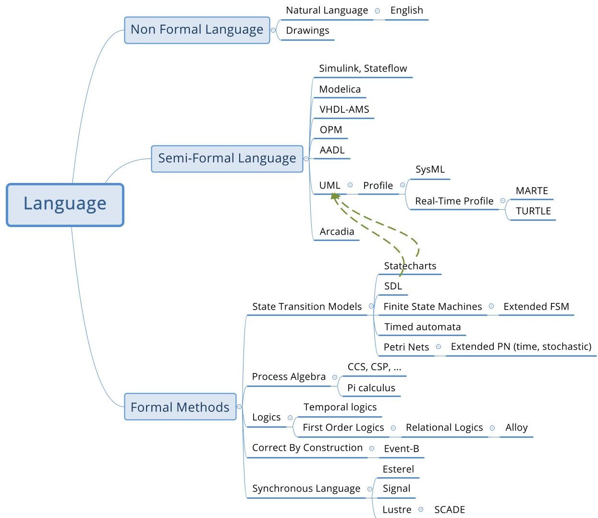
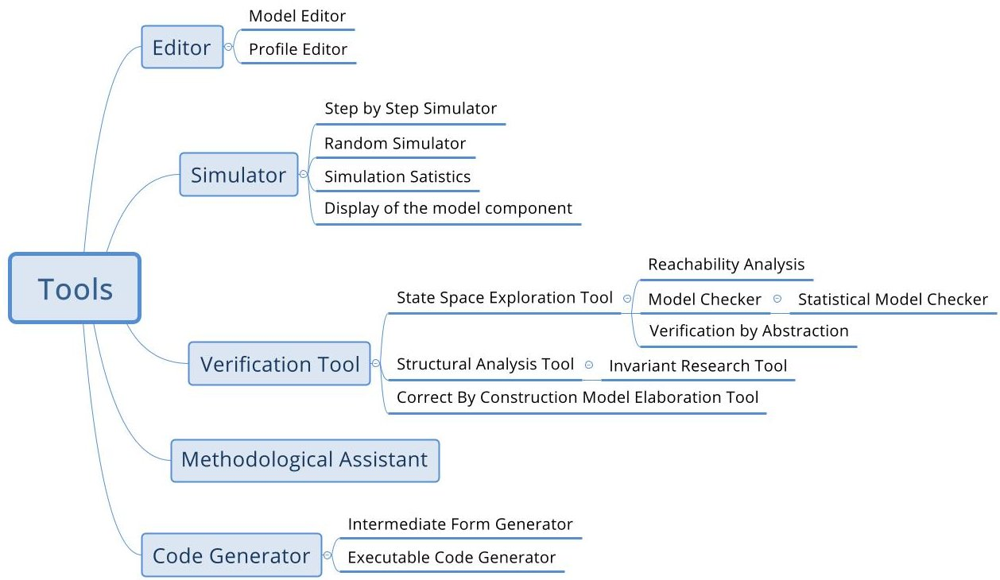
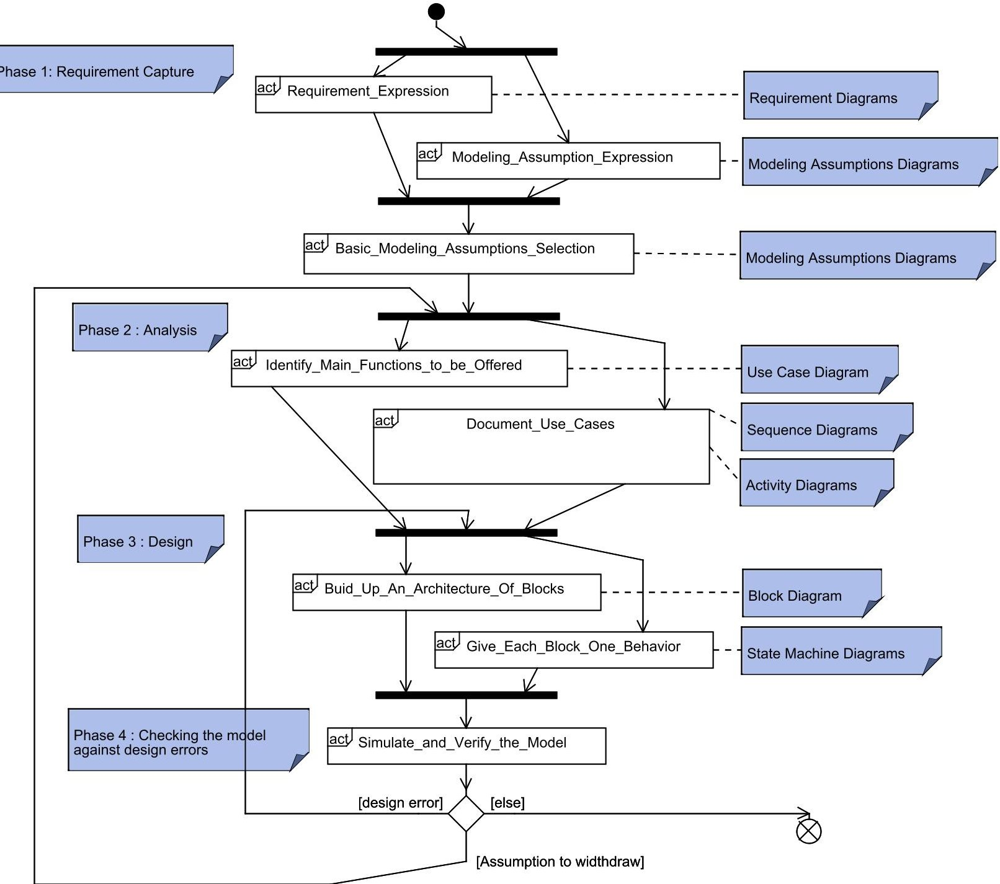
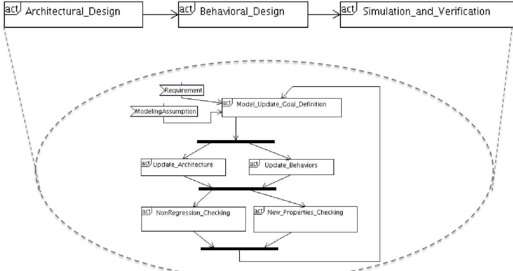
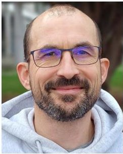
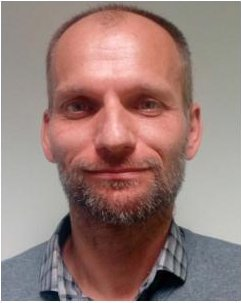

<!-- PDF_PAGE: 1 -->

Received 6 October 2022, accepted 3 November 2022, date of publication 14 November 2022, date of current version 22 November 2022. Digital Object Identifier 10.1109/ACCESS.2022.3222387

SURVEY

# A Taxonomy of MBSE Approaches by Languages, Tools and Methods

PIERRE DE SAQUI-SANNES $ ^{ID} $ , (Member, IEEE), ROB A. VINGERHOEDS, (Member, IEEE), CHRISTOPHE GARION $ ^{ID} $ , AND XAVIER THIRIOUX

ISAE-SUPAERO, Université de Toulouse, 31013 Toulouse, France

Corresponding author: Pierre de Saqui-Sannes (pdss@isae-supaero.f)

This work was supported by the Defense Innovation Agency (AID) of the French Ministry of Defense through the Research Project CONCORDE under Grant 2019 65 0090004707501.

ABSTRACT Systems engineering has gained in maturity over the last decades and started a transition from document-centric approaches to Model-Based Systems Engineering (MBSE). Several papers have discussed the benefits and potential, but also the limitations, of using MBSE, based on literature surveys and analyze feedback from academia and industry. The current paper explores a complementary avenue and aims at giving students and industry practitioners a set of keys and decision criteria to select MBSE languages, tools and methods. Languages, tools and methods are categorised and selection criteria are proposed for a panorama of languages that goes beyond SysML and other techniques commonly associated with MBSE. In addition, research avenues for the future of MBSE are identified. The discussion relies on the authors' experience in teaching and using system engineering and MBSE in both academia and industry, as well as on the experience shared within the framework of Concorde, a French project dedicated to drone systems design methodologies.

INDEX TERMS MBSE, formal methods, method, modeling tools, safety-critical systems, SysML, systems engineering.

## I. INTRODUCTION

Systems engineering (SE) has initially relied on a document-centric approach. Whether documents are commonly accepted for conveying information, their scattering among the stakeholders (project management, marketing department, and manufacturing department, just to mention a few) hampers the sharing of consistent information. Starting from identified limits and pitfalls of document-centric systems engineering, amongst others the scattering of information, the potential ambiguity in the descriptions, and the absence of a good possibility to perform verification and validation based on such documents, solutions have been investigated and MBSE has opened up promising avenues for systems engineers [1]. With no intent to be exhaustive, application domains of MBSE include railway [2], [3], nuclear plants [4], aircraft operability [5], drones [6], and lunar exploration [7].

The associate editor coordinating the review of this manuscript and approving it for publication was Claudia Raibulet $ ^{1D} $ .

The expected benefits of MBSE include a better management of the requirements, a reduced ambiguity, and the possibility of performing a formal verification and validation process. Over the past few years, several papers have analyzed feedback reports from users of MBSE approaches. These papers mostly confirm the benefits of MBSE [1], [6], [8], [9], [10], [11], [12], [13], and less frequently mitigate these benefits [14], [15], [16], [17], [18]. Much rather than to reopen discussions on the pros and cons of MBSE, the purpose of the current paper is to place itself in a context where the switch to MBSE was already decided by a company or research institute and to address the selection of languages, tools and methods. The objective of this paper is indeed to categorize the languages, tools and methods in order to give students and industry practitioners the keys to select MBSE languages, tools and methods that meet their professional and learning requirements.

In terms of languages, the MBSE acronym has regularly been associated with SysML [19], the Systems

<!-- PDF_PAGE: 2 -->

Modeling Language standardized by OMG (Object Management Group) with the support of INCOSE (International Council for Systems Engineering). SysML is a graphic and semi-formal modeling language that applies to a broad variety of systems. As far as real-time and critical software-intensive systems modeling are concerned, several limitations of SysML have been identified in terms of expression power and semantics, leading to extended versions of SysML [6], [11] that bridge the gap between SysML and the world of formal methods. The latter are mathematically grounded and enable formal checking of models against design errors, early in the design trajectory of systems.

The expected benefits of MBSE are not only to master the complexity of the systems under design, but also to offer a support throughout the life cycle of these systems. The maturity and user-friendliness of tools is a key enabler for MBSE development. MBSE tools include models editors, simulator and formal verification software enabling checking of models against design errors, code generators, and test sequence generators.

Last but not least, the success of transitioning to MBSE and acceptance in industry heavily depends on methods guiding systems designers in the way of using the modeling languages and tools.

This paper aims at addressing each of these three categories (language, tools, methods) so to evaluate where we are today. Then the paper continues to see where the new challenges are and how MBSE can be used to address them. The paper is organized as follows. Section II surveys papers that offer surveys on MBSE. Section III presents and categorizes several modeling languages commonly used in MBSE. Section IV then surveys different tools, both commercially available and tools in research status. Section V continues to present methods. Section VI identifies research directions. Finally, Section VII concludes the paper.

## II. RELATED WORK

Over the past decade, a high number of papers have included the MBSE acronym in their title or abstract. Such an abundant literature has open avenues for other papers that survey and categorize MBSE approaches. The word "taxonomy", which appears in the current paper's title, was first used in [20] where Monteiro, Gil and Rocha categorize MBSE approaches in terms of system specification repositories, system execution models, and design automation models. The current paper proposes a taxonomy that differs from [20] and insists on the theoretical background of the surveyed languages and tools, for instance in terms of languages' paradigm and semantics, and theory behind formal verification tools. Further, the taxonomy proposed by the current paper relies on the authors' experience in teaching MBSE and not exclusively on paper-reading based feedback.

In [21] Madni and Sievers analyze the motivations for MBSE adoption and identifies system architecture, information search and requirement management, and communication and collaboration as key issues. The authors of [21]

further confirm that a model abstracts a system and conveys a viewpoint. They further underline the importance of verification and validation, and this is another common point with the current paper. Another similarity lies in a classification in terms of languages, tools and methods even though the number of languages, tools and methods surveyed in [21] remains lower than the number of languages, tools and methods surveyed by the current paper. In terms of MBSE tools, the current paper presents a greater number of tools than [21] does, and addresses them in more technical terms, for instance when the current paper categorizes verification tools and code generators. In terms of methods, [21] focuses discussion on pattern-based, template-driven and feedbackenabled approaches. Finally [21] identifies future research directions with subjects as various as augmenting MBSE with descriptive and analytic models of humans, models complexity management, digital twin development, and MBSE methods that cover the full system life cycle. The current paper also addresses these issues and enlarges discussion.

In [22] Basnet, Bahootoroody, Chaal and Valdez Blanda enumerate criteria for selecting modeling languages and present a decision-making framework that integrates the end-users' opinion in the selection process. The authors of [22] identify several comparison criteria. Examples include structural modeling in terms of elementary block composition, behavioral modeling in terms of state or exchanged messages, traceability among several parts of the model, amount of resources for modeling, and difficulty in creating, interpreting and managing models at the appropriate abstraction level. Application of the aforementioned selection criteria is focused on the SysML and OPM modeling languages. Unlike the current paper, [22] surveys modeling languages independently of any tool and method and ignores several families of languages, e.g., formal methods, which are addressed in the current paper. The later further surveys tools and methods.

In [23] Azad, Sint, Zeman, Jungreitmayr, Wahl, Wenigwieser, and Kretschmer discuss a framework for MBSE tool selection ad rely discuss on user needs. Unlike the current paper, [23] focuses discussion on a limited number of diagrammatic modeling languages such as UML, SysML and BPMN. Further, MBSE tools are individually compared, thus ignoring possibilities to interface MBSE tools with external ones, in particular to implement formal verification (e.g., model checking) of models. By contrast, the current paper surveys formal verification tools and open doors for joint use of MBSE tools with tools developed by for other paradigms, e.g., MBSA [24] and MDAO [25].

In [26] Akundi, Ankobiah, Mondragon and Luna convey an industry point of view of what MBSE is and discusses MBSE adoption challenges. The approach developed in [26] is complementary to the one in the current paper in the sense that [26] mostly relies on interview of industry practitioners where the current paper surveys tools, as well as languages and methods, by essentially relying a literature review augmented by the authors' experience in teaching MBSE.

<!-- PDF_PAGE: 3 -->

## III. LANGUAGES

In the same way as programming languages, or also spoken languages for that matter [27], modeling languages are defined by their syntax and their semantics. Languages can roughly be categorized into three categories:

- Non-formal languages,

- Semi-formal, usually diagrammatic languages, and

- Languages based on formal methods endowed with a formal semantics, enabling formal proofs.

Figure 1 gives some more insight in this categorisation. Different types of languages are shown, that will be more detailed in the next sub-sections, with the exception of non-formal languages that are not addressed in the current paper. Two green arrows indicate that several features of SDL and Statecharts have been introduced into UML 2.0.

## A. SEMI-FORMAL LANGUAGES

This sub-section first surveys main graphic and semi-formal modeling languages. Then it focuses on UML and SysML, two standardized modeling languages frequently associated with the concept of MBSE, followed by a discussion on Arcadia/Capella and AADL.

## 1) TAXONOMY

One can see a large number of semi-formal modeling languages that are used at the moment. The following enumeration categorizes them:

- SDL (Specification and Description Language) [28] and its companion standard MSC (Message Sequence Charts) have been developed for protocols and communicating systems;

- VHDL-AMS (VHSIC Hardware Description Language), a hardware description language, with analog and mixed-signal extensions), used mainly for electronics systems, in particular those systems implemented on FPGA cards [29];

- Mathworks languages (Matlab, Simulink, Stateflow et Simscape) [30] originally developed for control systems modeling, but increasingly used for systems development;

- Modelica, dedicated to mechatronic systems [31];

- AADL (Architecture and Analysis Description Language) [32], dedicated to embedded architectures description;

- UML [33] and its related languages such as SysML [19], widely applicable modeling languages used in SW and Systems Engineering;

- OPM Object Process Methodology [34], a systems modeling paradigm that integrates system structure and behavior.

Besides these generic modeling languages, there are also DSML (Domain Specific Modeling Languages) that specifically address a particular application domain. The remainder of this sub-section focuses particularly on languages owing a broader application domain.

## 2) FROM UML TO SysML

UML (Unified Modeling Language [33]) is an international standard at OMG (Object Management Group). UML was originally designed with software modeling and development in mind and results from efforts to federate best practices in use among software engineers. UML supports use-case-driven analysis and object-oriented design. Its object orientation enables modeling software in UML before coding in Java or C++ (just to mention a few).

As much as the UML standard defines a notation, there is no specific method associated to it, no specific approach of using it. The lack of tool specification and associated methods in the standard makes this language to have a large application domain. The concept of "profile" allows for customising UML for a specific application domain by improving the language's expression power and formalizing its semantics as a prelude to developing tools.

The increasing development of real-time systems has stimulated research work on real-time UML profiles [35]. Many of such profiles have seen the light of day and OMG has standardized one of them: MARTE (Modeling and Analysis of Real Time and Embedded systems). MARTE was applied to avionics development [36]. Another example is TURTLE [37], a real-time profile that bridges the gap between UML and formal methods. TURTLE was the first UML profile supported by the free software TTool [38], which has now become a SysML tool.

Like UML, SysML is a notation defined independently of any tool or associated method. The UML, and therefore software-oriented, heritage of SysML has regularly been questioned. At the time of writing this paper, version 2 of SysML is in preparation [39], but not yet standardized.

The current version 1.6 of SysML enables covering the requirement capture, analysis and design steps in the life trajectory of systems. SysML particularly extends UML with a requirement diagrams enabling requirement expression and categorization, as well as requirement traceability with respect to other analysis and design diagrams. Analysis is use-case-driven and documented by scenarios and flow charts. Decisions taken during the requirement capture and analysis steps will help populating the design diagrams that model a block architecture of the system and the behaviors of the blocks. Joint use of MBSE stricto sensu and Multi-Disciplinary Analysis and Optimisation techniques (MDAO) may also help taking design decisions and therewith populating the SysML diagrams [40].

## 3) ARCADIA/CAPELLA

Today's flagship of alternatives to SysML is the Arcadia/Capella approach. This approach and associated tool were developed with the support of the Thales company as an open source solution for systems modeling. The Arcadia method leaves room to understanding user needs. It defines an architecture among the stakeholders. Design decisions can be validated and justified to make integration and verification and validation (V&V) of the system easier [4].

<!-- PDF_PAGE: 4 -->

FIGURE 1. Modeling languages.

The Arcadia method is organised in four successive engineering analysis and design steps with increasing levels of detail, distinguishing needs expression (perspectives 1 and 2) from solution expression (perspectives 3 and 4):

1) Operational Analysis: what the users of system need to accomplish,

2) System Analysis: what the system has to accomplish for the users,

3) Logical Analysis: how the system will work to fulfill expectations, and

4) Physical Analysis: how the system will be developed and built.

In [4], the authors customize the Arcadia method to distinguish between System Analysis and Logical Analysis.

- Systems Analysis includes two tasks:

1) Stakeholders and interfaces identification states how the system interacts with the stakeholders.

2) Identification of internal functions to make it sure the system will implement these functions in the way it interacts with the stakeholders.

1) Transformation of external functions into internal, less complex ones to specify how the functions of system will be implemented.

- Logical analysis defines the requirements to be applied to the sub-systems and components that will actually be built. Logical analysis is made up of three tasks:

2) Allocation of international functions and their requirements to a reference architecture.

3) Elicitation of dynamic scenarios to check the design against operational scenarios and appreciate the exhaustiveness of that design. This includes verification of how existing functions and requirements do specify the behavior that is expected for the sub-systems of the system.

Whereas the basic form of the Arcadia/Capella approach and associated tool offers an open-source solution for systems modeling and engineering, in practice, analyzing models and generating code often requires additional, not open-source, tools, such as for example for the joint use of Capella and Simulink [41].

The Arcadia/Capella approach and SysML are two competing approaches [14], but bridges between the two can be found [42].

## 4) AADL

AADL (Architecture and Analysis Description Language) [32] has been introduced for modeling and analysis

<!-- PDF_PAGE: 5 -->

of embedded, real-time systems, such as IMA (Integrated Modular Avionics) systems implemented in modern aircraft. AADL describes a system as an assembly of components that may be software, hardware or composite components (a component may itself be described by an assembly of components).

AADL allows one to describe complex architectures made up of software applications modeled in terms of "processes", themselves modeled in terms of tasks modeled by "threads". The applications produce and consume "data". They are allocated on hardware components such as "processors", "devices", "bus", and "memory".

AADL enables topological description of systems in terms of connection and allocation between components. Each component may be assigned a set of behavioral characteristics termed as "properties." The interest of such modeling approach lies in the capacity to capture the concrete architecture of the system and to check it against against schedulability properties, correct transmission of messages and hardware dimensioning (e.g., memory capacity).

## B. FORMAL LANGUAGES

The term "formal methods" denotes a family of languages, techniques and tools that rely on a strong mathematical background and permit application of proofs [43] when safety is an issue. Formal methods specifically apply to critical systems [44], and more particularly to life critical ones, such as transport systems [2], [45]. They also find application to systems that cannot be prototyped many times at reasonable cost, such as for example satellites.

Formal languages have a clearly defined syntax and a formalized semantics. The expected benefits of using formal methods include early detection of design errors in the life cycle of systems and software. It is possible to categorize formal methods depending on whether their application requires a posteriori validation of models, or not.

Formal methods such as Event-B [3], [46] require to build models through a succession of iterative refinements. Good properties satisfied at refinement (n) are by construction preserved at refinement (n+1). Event-B falls in the category of formal methods that implement a correct by construction paradigm.

A limited number of formal methods implement the correct by construction approach and its refinement techniques. A majority of formal methods require a posteriori validation. The model is built up and subsequently checked against a set of requirements and properties. The verification may lead to modify the model and check it again until the expected requirements and properties are satisfied.

Formal methods that require a posteriori validation may be categorized as follows:

- Models relying on a state/transitions paradigm. Examples include Extended Finite State Machines, Petri nets [47], timed automata [48] and Q-models [49].

- Process algebra, such as CCS (Calculus of Communicating Systems [50]) and CSP (Communicating Sequential Processes [51]). Their native composition operator enables decomposition of complex systems or pieces of software into elementary bricks.

- Logics. Linear, temporal and deontic logics are examples of logics enabling formal specification of properties.

Among formal logics, Floyd-Hoare logics [52], [53] have been regularly used for the specification and verification of imperative programs. It gave birth to the concept of contractbased design [54]. This approach was recently been extended to formal specification of components [55], [56] and therefore used in a MBSE context.

Over the past decade, formal verification has increasingly been associated with model transformation, for instance, to generate analysis models, i.e. models that enable to analyze the system from one particular point of view or models that can be used on execution platforms [57], [58]. Inside the Coq proof assistant, CoqTL [59] is a Domain Specific Language (DSL) that specifies models and model transformations, the latter being formally proved.

The group of synchronous languages [60], [61] were introduced in early 1980s to answer needs to specify industrial command/controls systems. They rely on mathematical concepts enabling formal management of programs compilation. Time is handled in the form of a sequence of instants where each instant represents one execution of the system's reaction.

With the so-called "synchronous hypothesis", computations are carried out at dates that are abstracted by the designer inside one logical instant, as soon as these computations are completed before a next instant starts. Such an approach has been implemented by three families of languages:

- Equation-based synchronous languages such as LUSTRE [62], LUCID-Synchrone [63] and PRELUDE [64].

- Imperative synchronous languages, such as ESTEREL [65].

- Graphic languages, such as SCADE [10] that is based on Lustre and primarily applies to critical software modeling.

The world of formal methods is not completely separate from the world of semi-formal languages. For example, UML grounds in both Statecharts and SDL. On the other hand, the concept of "UML profile" allows to enhance the expression power of UML and to formalize semantic variation points that exist in the OMG standard [33]. Examples of real-time UML profiles include TURTLE [37] that is supported by the free software TTool [38].

## IV. TOOLS

MBSE tools offer various, complementary capabilities: models edition, checking of models against design errors using simulation and formal verification, automatic or semi

<!-- PDF_PAGE: 6 -->

FIGURE 2. Categorisation of MBSE Tools.

automatic generation of executable code from models, and test generation from models.

Model editors can be implemented as far as the syntax of the modeling language is clearly expressed, for instance in the form of a meta-model (which is the case for UML [33]. Papyrus [66] is an example of free UML editor that implements the metamodel defined in [33].

## A. SIMULATION AND FORMAL VERIFICATION

Model simulators combine user-guided and random explorations of models to support early debugging of the models and subsequent in-depth exploration of the state space of the same models. Whatever the style of modeling language, for instance an imperative style or a state/transition one, a simulator enables inspection of the model's components, activation of simulation progress (e.g., by transition firing), and display of the simulation coverage.

Formal verification relies on mathematics rather than "by chance" exploration. For instance, reachability analysis computes a reachability graph representing all the valid execution paths and states the system can take/reach starting from its initial state. The state explosion risk has regularly been cited as the major limitation of reachability analysis with as consequence making the reachability graph computation infeasible. An optimized state space exploration and hash-functions-based implementation of the graph's states help reducing the risk of not completing the graph generation process [67].

Model checking generalizes application of exhaustive exploration of models state space. Fisman and Pnuelli define model checking as the method by which a desired behavioral property of a reactive system is verified over a given system (the model) through exhaustive enumeration (explicit or implicit) of all the states reachable by the system and the

behaviors that traverse through them [68]. The model checker is catered with a model of the system and a formal expression of the properties to be verified. The model checker processes the model and the properties, and outputs a "yes/no" answer stating whether the property is verified or not. The model checker also traces execution paths that lead to property violations. The tool must indeed help the system designer with the interpretation of the verification results with respect to the system model.

Stochastic simulation has recently been getting attention within the framework of model verification. In [69], the authors apply stochastic simulation techniques, in particular the Monte Carlo method, to avionic control-command systems. This approach makes it possible to select the best action and the best node to visit in order to optimize a reward function. Since the approach relies on Monte Carlo simulation, the price of that efficiency is a loss of exhaustivity when compared to formal verification.

## B. CODE GENERATION IN A MBSE CONTEXT

As far as MBSE is concerned, code generators accept a model as input, and output a code that may be either the entry of a formal verification tool or an executable code developed for a target processor. Example of tools offering both verification and code generation capabilities are as follows:

- Matlab/Simulink Mathworks. Beyond its capabilities for simulating and tuning control-command laws for avionics systems, it also allows code generation targeting C/C++ for various hardware platforms, through the Embedded Coder plugin.

- SCADE [70] whose code generator is qualified with respect to the DO-178C standard that serves as reference to aeronautics industry.

<!-- PDF_PAGE: 7 -->

- Ocarina [71], which supports the AADL language [72]. Its code generator can generate C and ADA source code, the ADA output being specifically compatible with the SPARK-ADA suite [73] used for formal verification of code.

Both verification-oriented and execution-oriented code generators need to be validated. Validation by testing is a tedious task since code generators are programs turning programs (or models) into other programs. Therefore, code generation processes need to include Verification and Validation activities. Depending on the criticality level required of the systems under development, V&V may constrain code generation. In practice, if the generated software artifacts (classes, procedures, files, etc.) need to be traced by these V&V activities, a reviewer can precisely relate these artifacts to the design choices made at the MBSE level. This deeply impacts the process of code generation by restraining applicable code optimizations, as elementary and otherwise pervasive as code inlining.

Instead of an extended code generation process with verification activities, a "correct-by-design" approach may be used to intertwin the development of the code generator and its correctness proof. The work on correct by construction code generators was pioneered by the development of Geneauto [74] for a subset of the Simulink language (Stateflow). Several phases of the Geneauto generator were proven correct by design [75], [76]. The current undisputed summit along this approach is the Velus code generator from Lustre to C [77], the resulting C code being semantically conform, by design, to the initial Lustre model.

## C. TEST SEQUENCE GENERATION

Simulation and formal verification enable checking of models against design errors early in the life cycle of systems and contribute to reduce testing. Nevertheless, testing remains an important activity in system development. Test sequence generation has extensively been discussed in the literature [78], sometimes associated with model checking [79], [80].

Tests sequence generation first depends on the type of testing.

- Conformance testing tests whether an implementation conforms its specification or not.

- Given two or several implementations that passed conformance tests, Interoperability testing check whether these two implementations can interact, communicate and cooperate.

- Robustness testing tests the capacity for a system to meet certain properties in uncertain environment.

- Performance testing enables measuring response time of systems depending on the ways these systems are stimulated.

1) Test executability. Given a state/transition model, the constraints associated to the transitions traversed by a

Test sequence generation requires addressing the following issues:

test case must be satisfied by the variables used in the test case.

2) Fault model. The model must characterize all the faults one expects to meet at the time of testing the system. Examples of faults include output, transfer and temporal faults [80].

3) Test fault coverage. The capacity to detect faults on implementations is an important criterion for comparing test generation techniques that share one fault model in common.

4) Conformance relation. It makes sense to conformance testing and requires a common, formal, modeling language to represent the system and the implementation.

As far as networked systems are concerned, test sequence generation may refer to IS 9646 standard to use Point of Control and Observation. TTCN (Testing and Test Control Notation [81]) enables test sequence expression, especially for networked systems.

Finally, the capacity of testing a system heavily depends on design. Design for testability remains a key issue.

## D. COMPARISON BETWEEN MBSE TOOLS

To conclude the survey of MBSE tools, this sub-section compares MBSE tools and distinguishes between SysML tools (Table 3) and tools developed for modeling languages other than SysML (Table 4).

## V. METHODS

The languages and tools identified by previous sections need to be associated with a method. This section categorizes methods and focuses discussion in particular on methods associated with SysML.

## A. CATEGORIES OF METHODS

A survey of the literature indicates that methods can be categorized as follows.

- A method compliant with a systems engineering standard (such as for example ANSI EIA632 [82], IEEE 1220 [83] and IEC 15288 [84]).

- A method compliant with a standard from the aeronautical world (such as for example ARP 4754A [85] a standard discussed in [86]).

- A method associated with a specific modeling tool (such as for example [6] that associates SysML and the free software TTool [38] with a method that applies to a broad variety of real-time systems).

- A method M1 integrated to another method M2 that was not developed for implementing a MBSE approach (such as for example [87] that integrates SysML and the free software TTool into the STPA method (STPA was developed by MIT and stands for Systems Theoretic Process Analysis), or Formose, a French project where SysML is associated with KAOS [3]).

<!-- PDF_PAGE: 8 -->

<table border="1"><tr><td></td><td>Cameo</td><td>Entreprise Architect</td><td>Papyrus</td><td>Rhapsody</td><td>TTool</td></tr><tr><td>Need Expression(outside comments)</td><td>no</td><td>no</td><td>no</td><td>no</td><td>no</td></tr><tr><td>Requirement Expression</td><td>yes</td><td>yes</td><td>yes</td><td>yes</td><td>yes</td></tr><tr><td>Requirement database management</td><td>no</td><td>no</td><td>no</td><td>via DOORS</td><td>no</td></tr><tr><td>Requirement traceability</td><td>yes</td><td>yes</td><td>no</td><td>yes</td><td>yes</td></tr><tr><td>Use case driven analysis</td><td>yes</td><td>yes</td><td>yes</td><td>yes</td><td>yes</td></tr><tr><td>Design can be simulated</td><td>yes</td><td>yes</td><td>no</td><td>yes</td><td>yes</td></tr><tr><td>Design can be formally verified</td><td>yes</td><td>no</td><td>no</td><td>yes</td><td>yes</td></tr><tr><td>Verification against safety properties</td><td>no</td><td>no</td><td>no</td><td>yes</td><td>yes</td></tr><tr><td>Verification against security properties</td><td>no</td><td>no</td><td>no</td><td>no</td><td>yes</td></tr><tr><td>Continuous vs. Discrete time</td><td>D</td><td>N/A</td><td>D</td><td>D</td><td>D</td></tr><tr><td>Verification results are explained</td><td>yes</td><td>no</td><td>no</td><td>yes</td><td>yes</td></tr><tr><td>Code generator</td><td>no</td><td>yes</td><td>no</td><td>yes</td><td>yes</td></tr><tr><td>Traceability</td><td>yes</td><td>yes</td><td>no</td><td>yes</td><td>yes</td></tr><tr><td>Test sequence generation</td><td>no</td><td>no</td><td>no</td><td>no</td><td>yes</td></tr></table>

FIGURE 3. MBSE tools for SysML modeling language.

<table border="1"><tr><td></td><td>Capella</td><td>B Tool</td><td>Ansys&amp;SCADE SuiteArchitect&amp;Test</td><td>TASTE</td><td>MathWorksSimulinkStateflow</td><td>Polychrony</td></tr><tr><td>Need Expression(outside comments)</td><td>no</td><td>no</td><td>no</td><td>no</td><td>no</td><td>no</td></tr><tr><td>Requirement Expression</td><td>no</td><td>no</td><td>no</td><td>yes</td><td>no</td><td>no</td></tr><tr><td>Requirement database management</td><td>no</td><td>no</td><td>no</td><td>yes</td><td>no</td><td>no</td></tr><tr><td>Requirement traceability</td><td></td><td>no</td><td>no</td><td>yes</td><td>no</td><td>no</td></tr><tr><td>Use case driven analysis</td><td>yes</td><td>no</td><td>no</td><td>yes</td><td>no</td><td>no</td></tr><tr><td>Correct by construction paradigm</td><td>no</td><td>yes</td><td>no</td><td>no</td><td>no</td><td>no</td></tr><tr><td>Design can be simulated</td><td>yes</td><td>yes</td><td>yes</td><td>yes</td><td>yes</td><td>yes</td></tr><tr><td>Design can be formally verified</td><td>yes</td><td>yes</td><td>yes</td><td>yes</td><td>yes</td><td>yes</td></tr><tr><td>Verification against safety properties</td><td>yes</td><td>no</td><td>yes</td><td>yes</td><td>yes</td><td>yes</td></tr><tr><td>Verification against security properties</td><td>no</td><td>no</td><td>no</td><td>no</td><td>no</td><td>no</td></tr><tr><td>Continuous vs. Discrete time</td><td>D</td><td>C&amp;D</td><td>D</td><td>D</td><td>C&amp;D</td><td>D</td></tr><tr><td>Verification result are explained</td><td>no</td><td>yes</td><td>yes</td><td>yes</td><td>no</td><td>yes</td></tr><tr><td>Code generator</td><td>no</td><td>yes</td><td>yes</td><td>yes</td><td>yes</td><td>yes</td></tr><tr><td>Documented code</td><td>no</td><td>no</td><td>no</td><td>yes</td><td>yes</td><td>no</td></tr><tr><td>Traceability</td><td>no</td><td>yes</td><td>no</td><td>yes</td><td>no</td><td>yes</td></tr><tr><td>Test sequence generation</td><td>no</td><td>no</td><td>no</td><td>yes</td><td>no</td><td>yes</td></tr><tr><td>Test coverage</td><td>no</td><td>no</td><td>no</td><td>yes</td><td>no</td><td>yes</td></tr></table>

FIGURE 4. MBSE tools for modeling languages other than SysML.

## B. A METHOD ASSOCIATED WITH SysML AND TTool

In [88] a method associated with SysML and TTool can be sketched as follows (see also Figure 5, which depicts the method in the form of a SysML activity diagram):

- Requirement capture.

- Expression of modeling assumptions stating how the SysML model simplifies reality.

- Use case driven analysis identifies the main functions to be offered by the system. Use cases are documented by scenarios and flow charts.

- Design both in terms of architecture and behaviors of the blocks the architecture is made up of.

- Simulation and formal verification for checking the SysML model against design errors and compliance to requirements.

Figure 6 addresses the design step of the method shown by Figure 5 and focuses on incremental modeling of the architecture along with the behaviors associated with the blocks the architecture is made up of. Incremental modeling is a key enabler to managing complex systems, such as for example UAVs (Unmanned Aeronautical Vehicles) in unknown or partially known environments. One starts from a model that highly simplifies the real system and step by step alleviates restrictions (and takes new requirements into account) to come up with a model that eventually gets sufficiently close

<!-- PDF_PAGE: 9 -->

FIGURE 5. SysML activity diagram depicting the method associated with SysML and TTool.

to the real system. When a (n-1) version of the model is upgraded to next version, non-regression tests are required to check whether the properties holding at (n-1) step still hold at step (n).

For each version of the model, it is recommended to use simulation and formal verification following the 3-step process sketched below:

1) The model is debugged using a simulator.

2) Core mechanisms are exhaustively analyzed relying on formal verification techniques. For example, considering a local area network managed by a tokenbased policy, a core mechanism to be verified would be: unicity of the token that grants permission to send frames on the network.

3) Intensive simulation on a model that integrates the previously verified core mechanisms and add features

that make the model closer to the real system, but do not need or cannot be verified (e.g., because of the state explosion problem).

The method discussed so far highlights the importance of simulation and formal verification for checking design errors early in the life cycle of systems. Simulation and formal verification apply to the architecture and behaviors elaborated during the design step. How to populate the architectural and behavioral design diagrams is therefore a key issue. An avenue to explore relies on joint use of MBSE and MDAO (Multi-disciplinary Analysis and Optimization) approaches [40]. In parallel to requirements and use cases elicitation, it is possible to carry out engineering analysis techniques that will guide design decisions in terms of architecture [89] or drone battery optimization [25].

<!-- PDF_PAGE: 10 -->

## FIGURE 6. Incremental modeling.

As usual, managing multi-domain models rises up coherence problems [90].

## VI. RESEARCH DIRECTIONS

## A. LANGUAGES

In order to enhance MBSE processes, a first natural step is to enhance the descriptive power of the input language so that systems designers can model their problems with more details and higher fidelity. But language and method designers must not paint themselves into a corner by simply piling up features on top of features, resulting in a bloated and to a large extent unmanageable and unfathomable language, from users and designers' perspectives altogether. This would end up reproducing the fate of the so-called 'pivot' languages. While we acknowledge the importance of adding features to keep up with users needs, we also strongly advocate an evolution of MBSE languages towards more abstract and specification-oriented ways of modeling.

In our opinion, the kind of evolution we promote is tightly coupled with the ability of MBSE tools to support it and fill in the gap between a more high-level description and the low-level details of an executable (or at least simulable) target. We discuss this point in Section VI-B. Concretely speaking, this evolution could address the several following points:

- In terms of expressive power, we may add the possibility to specify:

- Deadline, periodicity, and WCET as examples of real-time constraints.

- Complex synchronization or concurrent structures, and suspend/resume mechanisms.

- Various features of communication protocols between components such as FIFO, causal, buffered, diffusion versus point-to-point, maximum delays, and data freshness.

- To steer away from early concerns about how data is stored and where it is located, that may lead to over-commitment to not so carefully informed choices, we encourage the primary use of event-oriented descriptions, as can be found in use-case or sequence diagrams. Synthesis of class diagrams from the latter has already been experimented [91] and much effort has to be put in that direction.

## B. ELABORATING MODELS

In terms of model developers assistance, elaboration of models is also an issue. Elaboration of models is a complex intellectual process. Feedback from industry practitioners and MBSE lecturers suggests that developers of SysML models often stumble on the same problem: thinking about the system before modeling it, e.g., in SysML. Solutions may be found using mind maps [92]. With their graphic form and rather flexible way of organizing ideas, mind maps turn out to be a good candidate to help thinking about the system. Other avenues may be explored with the support of ontologies [93].

Also, in the never-ending journey of integrating more aspects into modeling languages, a substantial effort must be devoted to prevent users' attention getting clogged by

<!-- PDF_PAGE: 11 -->

irrelevant parts or features of a model. It involves efficient pruning or masking techniques implemented in model editing tools to help users focus on interesting parts.

When the evolution of MBSE languages enables them to take more specification into account, i.e. such an evolution enables a more declarative style of modeling, tools will need to somehow propose automated synthesis of an executable refined model, to explore feasibility or even deal with optimization concerns as regards model complexity, memory footprint, communication delays, contention, etc. Some of these abilities may already exist in research prototypes and tools still not mature enough to handle industrial use cases. MBSE tools must exploit to the users' advantage the degree of freedom provided by rich but abstract models.

Finally, an interesting direction would be to try to reproduce the achievements of machine-learning tools that help completing user provided code sketches, such as Microsoft's Codepilot. At the model level, a tool that helps users completing partial descriptions, based on a library of MBSE projects with similar requirements and objectives, would be a great asset in MBSE activities. It has to be explored whether such a library could in principle exist and how an AI tool exploiting this library may be devised.

## C. DOCUMENTING MODELS

Looking at sharing models, concurrent approaches, etc., an important issue with models may be phrased as follows: "When sharing a model with another person, how long does the latter need to understand the main features of the system described by the model?" (or as far as teaching is concerned, how long does a professor need to understand the models created by his or her students or trainees?) Answering these questions clearly raises a model documentation problem. Investigations are needed to come up with document templates for one or several modeling language.

## D. FORMAL VERIFICATION TOOLS

Formal verification of models can be seen on two points of view: the properties to be verified and the verification engine.

Expressing the properties to be verified by a system remains a key issue in formal verification. Efforts have to be done to optimize formal verification, for instance by relying on dependency graphs [94] that contribute to reduce the state space to explore when checking a model against one or several properties. It is also important to keep in mind that systems may be checked not only against safety properties but against securities properties as well.

In terms of verification engine, it is worth being noticed that the verification tools surveyed by the current paper powerfully address the control part of the system. The surveyed verification tools offer little opportunities to verify the data part of the system. As an example, let us consider a communication system modeled in SysML. SysML verification tools offer nice features for verifying the temporal ordering of exchanged messages, as well as temporal constraints satisfaction. By contrast, they do not offer any facilities for verifying

the semantics or the consistency of the data conveyed by the messages.

Finally, a powerful verification tool is not useful and will be soon left aside by potential users if it is not granted with great abilities to explain verification outcomes. It first requires producing a verification diagnosis in terms of model components, events and user data, not in terms of the verification tool internal representation. This problem occurs quite often since many verification activities begin by translating a model and its specification into a foreign verification language dedicated to a specific tool. Then, the valuable information computed must be carried back to the original model, which can be a tedious task in the absence of any guarantee on the translation. To alleviate this task, it is worthwhile to provide a reference formal semantics of the modeling language, a kind of lingua franca, which users and verification tools alike must adhere to. This reference semantics also serves as a basis to obtain a trustworthy simulation engine or code generator.

A fine way to present such complex verification results is to couple them with interactive graphical simulation abilities and additionally to allow model pruning and masking to get rid of irrelevant details. Also, in order to cope with limitations of such tools, it is important to exchange information about the model under scrutiny between verification tools, test suite generation and execution tools.

## E. METHODOLOGICAL ASSISTANTS

Adoption of MBSE has been hampered by the lack of mature and high quality tools [13]. Examples of issues include scalability and assistance in applying methods. Recent papers have confirmed the interest of methodological assistants [95], [96], [97] as a complement to model editors, simulators, formal verification tools, code generators, and test sequence generators. The authors of the current paper support the idea of improving methodological assistants relying on Artificial Intelligence techniques, in particular Case Based Reasoning based on libraries of models.

Among many ways of assisting model designers, giving an assessment on the quality of models is an issue. Let us, e.g., consider what happens with SysML tools. Simulation tools enable debugging of activity and state machines diagrams, and help systems designers improving their models. By contrast, the same SysML tools merely offer editing capabilities for requirement and use case diagrams. We may need tools that evaluate the complexity of the diagrams and come up with recommendations in terms of model sharing and teamworking. Complexity may be evaluated using metrics, possibly in connection with guidelines. Complexity may also been evaluated by analyzing dependencies between several elements in a diagram or between the many diagrams a model is made up of.

The quality of models further depends on the various 'facets' of the system that are addressed by the model. For instance, all systems are subject to failures and their users make inadvertent and intentional errors. A method associated with a language and its support tools should therefore

<!-- PDF_PAGE: 12 -->

encourage systems designers to not limit their models to nominal behaviors but to systematically include degraded situations and human errors made by end users or maintenance crews.

## F. ENSURING SEAMLESS CONNECTION FROM GENERALISED MBSE TOOLS TO SPECIALISED REAL-TIME SYSTEMS ANALYSIS TOOLS

Whilst the introduction of model-based systems engineering, addressing managing systems complexity and reducing the uncertainty associated with the design process, in industry can present interesting results, their actual use, taking full advantages of all possibilities of verification and validation, code generation, etc. is taking still some time [98]. There is a need for new approaches that "support systems that allow the information and data associated with products to be developed and sustained through the product life-cycle". This shift in development processes focus utilizes a more complex series of interfaces and necessitates a shift from previous dominant document-based approaches for the facilitation of communication, management of development risks, quality, process, and business productivity, as well as knowledge transfer.

One of the reasons leading to this situation lies in the difficulties to properly connect different tools between each other. Indeed, when transforming one model into another, the question arises on:

- How to ensure that eventual changes in the "other" model can be fed back to the original model

- Where to store eventual additional information that was maybe not necessary for the original model, but critical to the new model

- How to keep it all coherent and consistent.

In addition, if for each model a developer needs to start from scratch on the development of a model, for a given system development a lot of time and effort is devoted to each of the models, potentially on different tools, with as risk a loss of coherence between the tools and a loss of motivation for the developers. Whereas the potential advantages are clearly defined (amongst others by [16]), and include enhanced communications, reduced development risks, improved quality, increased productivity, and enhanced knowledge transfer, it remains difficult to get the use of different tools accepted with at each time starting from scratch, which makes the topic of seamless connection of tools an important one.

When looking at guaranteeing response times, different analysis approaches exist and have been mentioned in this paper. The proper connection of model-based systems engineering tools to such analysis tools is a focus point. Temporal constraints for specific (embedded) systems are often already known in the earliest stages of the design, but can become more apparent during subsequent design phases. In order to guarantee a seamless work over the stages, good information passing between the different phases and different tools is necessary. A particular focus in this respect concerns the

analysis of asynchronously functioning systems, particular case that includes amongst others air traffic control, control of drone systems, complex vehicle control, etc.

## VII. CONCLUSION

Model Based Systems Engineering has been largely discussed in the literature in the form of theory, practical feedback and surveys, and focuses on languages, tools, and methods.

Work on MBSE was pioneered in the context of UML (and other related approaches such as OMT before) and extended on subjects as various as meta-modeling, model transformation, and model management. The development of real-time UML profiles has stimulated research work on bridging the gap between graphic, semi-formal modeling languages and formal methods. Avenues have thus been opened for reuse of formal verification techniques and code generators initially developed for formal methods.

MBSE can be seen on three points of view: languages, tools and methods. Over the past three decades, much work has been published on modeling languages and tools, looking for the best languages and the more efficient or user-friendly tools. With the advent of semi-formal modeling languages standardized on consensus (e.g., SysML) and with the variety of formal methods for application domains that need them, mature tools have been developed. In this paper, it is claimed that method remains an issue that remains insufficiently addressed by tools, with the notable exception of the Arcadia/Capella approach.

Many issues remain to be explored in terms of languages, tools and methods to promote transitioning to MBSE in industry. In terms of language, extension mechanisms of SysML and tools such as Papyrus [66] enable definitions of modeling languages with enhanced expression power. These languages usually enable expression of safety properties and rarely offer constructs to express liveness properties.

Engineers and students need to think about the system before creating a model. Developing a system, be it a product, a service, or an organisation, passes several life cycle phases. The first stage in a system's life cycle, the concept stage, focuses on understanding the implications of a system's mission and core functionality. In [92] it is argued that mind maps may be the support of this first step, a step to be carried before creating a SysML of the system under design. Mind maps offer a support to orient thinking about the system before selecting one or several modeling languages.

The previous section has outlined directions for future research on MBSE. In the context of the current, final conclusions we further underline the need to make and keep MBSE open to and interacting with other modeling paradigms. Solutions to improving MBSE in terms of languages, tools and methods are to be looked for outside the MBSE community. For instance, by associating MBSE and MBSA [24] and by bridging the gap between the MBSE and MDAO communities [25].

<!-- PDF_PAGE: 13 -->

Last but not least, the authors of the current paper point out the importance of education for the success of MBSE adoption. Efforts may be guided towards the following directions.

Of prime importance is the development of a body of knowledge to include MBSE in SE programs. Students and practitioners need to be trained to develop critical thinking about the model developed by themselves and by others. The same students and practitioners need to bee offered coaching programs to accompany them through their professional life at various steps accounting on their experience in implementing MBSE on real-size examples.

The concern is not only on the course content but the way of teaching it. Over the past two decades, a rich collection of slide-based supports have been developed and partly made publicly available. It is commonplace to say that not everything can be explained relying exclusively on slides and white papers. Video supports need to be developed, in particular in the form of short videos often termed as 'capsules'. For instance, students and practitioners need to clearly define the boundary of the system to be modeled; for instance, to decide whether modelling an entire system or solely its software controller.

## REFERENCES

[1] M. Chami and J.-M. Bruel, "A survey on MBSE adoption challenges," in Proc. INCOSE EMEA Sector Syst. Eng. Conf., Berlin, Germany, Nov. 2018, pp. 1-16.

[2] H. Maurice Ter Beenk, S. Gnesil, and A. Knapp, "Formal methods for transport systems," Int. J. Softw. Tools Tech. Transf., vol. 20, pp. 237-241, Jun. 2018.

[3] S. Fotso, R. Laleau, H. Barradas, M. Frappier, and A. Mammar, "A formal requirements modeling approach: Application to rail communication," in Proc. 14th Int. Conf. Softw. Technol., Prague, Czech Republic, 2019, pp. 170-177.

[4] J. Navas, P. Tannery, S. Bonnet, and J.-L. Voirin, "Bridging the gap between model-based systems engineering methodologies and their effective practice—A case study on nuclear power plants systems engineering," INCOSE, vol. 21, no. 1, pp. 17-20, 2018.

[5] S. S. Manikar, P. de Saqui-Sannes, J. Jezégou, P. Asseman, and A. E. Bénard, "A formal framework for modeling and prediction of aircraft operability using SysML," in Proc. 34th Eur. Simul. Model. Conf., Toulouse, France, 2020, pp. 1-8.

[6] L. Apvrille, P. de Saqui-Sannes, and R. Vingerhoeds, "An educational case study of using SysML and TTool for unmanned aerial vehicles design," IEEE J. Miniaturization Air Space Syst., vol. 1, no. 2, pp. 117-129, Sep. 2020.

[7] J. Rimani, S. Lizy-Destrez, J. C. Chaudemar, and N. Viola, "MBSE approach applied to lunar surface exploration elements," in Proc. Model Based Space Syst. Soft. Eng., Sep. 2020, pp. 1-4.

[8] B. Selic and S. Gérard, Modeling and Analysis of Real-Time and Embedded Systems With UML and MARTE. Amsterdam, The Netherlands: Elsevier, 2014.

[9] A. K. Reilley, J. S. Edwards, S. R. Peak, and N. D. Mavris, "Model-based systems engineering: An emerging approach for modern systems," IAAA Space Forum, vol. 19, pp. 111-169, Sep. 2016.

[10] T. L. Sergent, F.-X. Dormoy, and A. L. Guennec, "Benefits of model based system engineering for avionics systems," in Proc. Embedded Real-Time Soft. Syst., Toulouse, France, 2016, pp. 1-8.

[11] R. Baduel, M. Chami, J.-M. Bruel, and I. Ober, "SysML models verification and validation in an industrial context: Challenges and experimentation," in Proc. Eur. Conf. Modeling Found. Appl., Toulouse, France, Jun. 2018, pp. 132-146.

[12] S. Wolny, A. Mazak, C. Carpella, V. Geist, and M. Wimmer, "Thirteen years of SysML: A systematic mapping study," Softw. Syst. Model., vol. 19, no. 1, pp. 111-169, Jan. 2020.

[13] A. Bucchiarone, J. Cabot, R. F. Paige, and A. Pierantonio, "Grand challenges in model-driven engineering: An analysis of the state of the research," Softw. Syst. Model., vol. 19, no. 1, pp. 5-13, Jan. 2020.

[14] S. Bonnet, J. Voirin, D. Exertier, and V. Normand, "Not (strictly) relying on SysML for MBSE: Language, tooling and development perspectives: The arcadia/capella rationale," in Proc. Annu. IEEE Syst. Conf., Apr. 2016, pp. 1-6.

[15] J. Gregory, L. Berthoud, T. Tryfonas, A. Rossignol, and L. Faure, "The long and winding road: MBSE adoption for functional avionics of spacecraft," J. Syst. Softw., vol. 160, Feb. 2020, Art. no. 110453.

[16] K. Henderson and A. Salado, "Value and benefits of model-based systems engineering (MBSE): Evidence from the literature," Syst. Eng., vol. 24, no. 1, pp. 51-66, Jan. 2021.

[17] Q. Wu, D. Gouyon, and E. Levrat, "Maturity assessment of systems engineering reusable assets to facilitate MBSE adoption," IFAC-PapersOnLine, vol. 54, no. 1, pp. 851-856, 2021.

[18] M. Di Maio, T. Weilkiens, O. Hussein, M. Aboushama, I. Javid, S. Beyerlein, and M. Grotsch, "Evaluating MBSE methodologies using the FEMMP framework," in Proc. IEEE Int. Symp. Syst. Eng. (ISSE), Sep. 2021.

[19] Systems Modeling Language, OMG, Dec. 2019. [Online]. Available: https://sysml.org/./res/docs/specs/OMGSysML.v1.6.19.11.01.pdf

[20] P. J. Monteiro, J. S. P. Gil, and M. R. Rocha, "A taxonomy for model-based systems engineering," in Proc. 41st Comp. Inf. Eng. Conf., Aug. 2021, pp. 1-8.

[21] A. M. Madni and M. Sievers, "Model-based systems engineering: Motivation, current status, and research opportunities," Syst. Eng., vol. 21, no. 3, pp. 172-190, May 2018.

[22] S. Basnet, A. Bahootorooody, M. Chaal, O. A. Valdez Banda, J. Lahtinen, and P. Kujala, "A decision-making framework for selecting an MBSE language—A case study to ship pilotage," Expert Syst. Appl., vol. 193, May 2022, Art. no. 116451.

[23] A. Khandoker, S. Sint, G. Gessl, K. Zeman, F. Jungreitmayr, H. Wahl, A. Wenigwieser, and R. Kretschmer, "Towards a logical framework for ideal MBSE tool selection based on discipline specific requirements," J. Syst. Softw., vol. 189, Jul. 2022, Art. no. 111306.

[24] N. Nguyen, F. Mhenni, and J.-Y. Choley, "A study on SysML and AltaRica models transformation," in Proc. IEEE Int. Syst. Conf. (SysCon), Aug. 2020, pp. 1-6.

[25] O. Aiello, O. Poitou, J.-C. Chaudemar, and P. Saqui-Sannes, "Sizing a drone battery by coupling MBSE and MDAO," in Proc. 11th Eur. Congr. Embedded Real Time Syst., Toulouse, France, Jun. 2022, pp. 31-42.

[26] A. Akundi, W. Ankobiah, O. Mondragon, and S. Luna, "Perceptions and the extent of model-based systems engineering (MBSE) use—An industry survey," in Proc. IEEE Int. Syst. Conf. (SysCon), Apr. 2022, pp. 1-7.

[27] A. Church, "Carnap's introduction to semantics," The Phil. Rev., vol. 52, no. 3, pp. 298-304, May 1943.

[28] (Nov. 4, 2022). ITU-T-Z.100. Specification and Description Language. [Online]. Available: http://handle.itu.int/11.1002/1000/14048

[29] (2008). IEEE. VHDL. (Nov. 4, 2022). [Online]. Available: https://www.vhdl-online.de/

[30] (2020). Matworks. Mathworks-Languages. (Nov. 4, 2022). [Online]. Available: https://fr.mathworks.com/

[31] (2008). Modelica Association. (Nov. 4, 2022). [Online]. Available: https://www.modelica.org/

[32] H. Mkaouar, B. Zalila, J. Hugues, and M. Jmaiel, "A formal approach to AADL model-based software engineering," Int. J. Softw. Tools Technol. Transf., vol. 22, no. 2, pp. 219-247, Apr. 2020.

[33] Unified Modeling Language Version 2.5, OMG, Dec. 2017. [Online]. Available: https://www.omg.org/spec/UML/2.5.1/PDF

[34] L. Li, N. L. Soskin, A. Jbara, M. Karpel, and D. Dori, "Model-based systems engineering for aircraft design with dynamic landing constraints using object-process methodology," IEEE Access, vol. 7, pp. 61494-61511, 2019.

[35] A. Gherbi and F. Khendek, "UML profiles for real-time systems and their applications," J. Object Technol., vol. 5, no. 4, p. 149, 2006.

[36] K. Zhang, J. Wu, C. Liu, S. S. Ali, and J. Ren, "Behavior modeling on ARINC 653 to support the temporal verification of conformed application design," IEEE Access, vol. 7, pp. 23852-23862, 2019.

[37] L. Apvrille, J.-P. Courtiat, C. Lohr, and P. de Saqui-Sannes, "TURTLE: A real-time UML profile supported by a formal validation toolkit," IEEE Trans. Softw. Eng., vol. 30, no. 7, pp. 473-487, Jul. 2004.

[38] (2022). TTool. (Nov. 4, 2022). [Online]. Available: https://ttool.telecomparis.fr/

<!-- PDF_PAGE: 14 -->

[39] (2020). OMG. SysML v2. [Online]. Available: https://mbse4u.c om/2020/10/17/new-incremental-sysml-v2-release-2020-09/

[40] J.-C. Chaudemar and P. de Saqui-Sannes, "MBSE and MDAO for early validation of design decisions: A bibliography survey," in Proc. IEEE Int. Syst. Conf. (SysCon), Apr. 2021, pp. 1-8.

[41] C. Duhil, J.-P. Babau, E. Lepicier, J.-L. Voirin, and J. Navas, "Chaining model transformations for system model verification: Application to verify capella model with simulink," in Proc. 8th Int. Conf. Model-Driven Eng. Softw. Develop., 2020, pp. 279-286.

[42] N. Badache and P. Roques, "Capella to SysML bridge: A tooled-up methodology for MBSE interoperability," in Proc. 9th Eur. Congr. Embedded Real Time SoftandSyst., Toulouse, France, 2018, pp. 1-11.

[43] M. Edmund Clarke and M. Jeannette Wing, "Formal methods: State of the art and future directions," Dept. Comput. Sci., Carnegie-Mellon Univ., Pittsburgh, PA, USA, Tech. Rep. CMU-CS-96-178, 1996.

[44] S. P. Nanda and E. S. Grant, "A survey of formal specification application to safety critical systems," in Proc. IEEE 2nd Int. Conf. Inf. Comput. Technol. (ICICT), Mar. 2019, pp. 296-302.

[45] A. Ferrari, F. Mazzanti, D. Basile, and M. H. ter Beek, "Systematic evaluation and usability analysis of formal methods tools for railway signaling system design," IEEE Trans. Softw. Eng., vol. 48, no. 11, pp. 4675-4691, Nov. 2021.

[46] J.-R. Abrial, Modeling in Event-B: System and Software Engineering. Cambridge, U.K.: Cambridge Univ. Press, 2010.

[47] (2020). TINA. Time Petri Net Analyzer. (Nov. 4, 2022). [Online]. Available: http://projects.laas.fr/tina//

[48] (2022). UPPAAL. (Nov. 4, 2022). [Online]. Available: http://www.up paal.org/

[49] L. Motus and M. G. Rodd, Timing Analysis of Real-Time Software. New York, NY, USA: Pergamon, 1994.

[50] R. Milner, Communication and Concurrency. Upper Saddle River, NJ, USA: Prentice-Hall, 1989.

[51] A. R. C. Hoare, Communicating Sequential Processes. Upper Saddle River, NJ, USA: Prentice-Hall, 1985.

[52] C. A. R. Hoare, "An axiomatic basis for computer programming," Commun. ACM, vol. 12, no. 10, pp. 576-580, 1969.

[53] R. W. Floyd, "Assigning meanings to programs," Math. Aspects Comput. Sci., vol. 19, nos. 19-32, p. 1, 1967.

[54] B. Meyer, "Applying 'design by contract,' Computer, vol. 25, no. 10, pp. 40-51, Oct. 1992.

[55] A. Benveniste, B. Caillaud, H. Elmqvist, K. Ghorbal, M. Otter, and M. Pouzet, "Multi-mode DAE models-challenges, theory and implementation," in Computing and Software Science (Lecture Notes in Computer Science), vol. 10000, B. S. Gerhard and J. Woeginger, Eds. Heidelberg, Germany: Springer, 2019, pp. 283-310.

[56] A. Benveniste, B. Caillaud, D. Nickovic, R. Passerone, J.-B. Raclet, P. Reinkemeier, A. Sangiovanni-Vincentelli, W. Damm, T. Henzinger, and K. G. Larsen, "Contracts for systems design: Theory," Inria Rennes Bretagne Atlantique, Rennes, France, Res. Rep. RR-8759, Jul. 2015.

[57] D. Calegari and N. Szasz, "Verification of model transformations: A survey of the state-of-the-art," Electron. Notes Theor. Comput. Sci., vol. 292, pp. 5-25, Mar. 2013.

[58] M. Amrani, B. Combemale, L. Lucio, G. M. K. Selim, J. Dingel, Y. L. Traon, H. Vangheluwe, and J. R. Cordy, "Formal verification techniques for model transformations: A tridimensional classification," J. Object Technol., vol. 14, no. 3, p. 1, 2015.

[59] M. Tisi and Z. Cheng, "CoqTL: An internal DSL for model transformation in COQ," in Proc. 11th Int. Conf. Theory Pract. Model Transform., vol. 10888. Toulouse, France: Springer, Jun. 2018, pp. 142-156.

[60] A. Benveniste, P. Caspi, A. Stephen Edwards, N. Halbwachs, P. Guernic, and R. D. Simone, "The synchronous languages 12 years later," Proc. IEEE, vol. 91, no. 1, pp. 64-83, Jan. 2003.

[61] C. André, "Comparing programming styles in synchronous languages (in French)," Tech. Rep. RR-2005-13, I3S, Sophia-Antipolis, France, Jun. 2005.

[62] N. Halbwachs, P. Raymond, and C. Ratel, "Generating efficient code from data-flow programs," in Proc. 3rd Int. Symp. Program. Lang. Implement. Logic Program., Passau, Germany, 1991, pp. 207-218.

[63] M. Pouzet, "Lucid synchrone, version 3. Tutorial and reference manual," Orsay, France, Tech. Rep. hal-03090137, 2006.

[64] J. Forget, "A synchronous language for critical embedded systems with multiple real-time constraints," Ph.D. thesis, Université de Toulouse- ISAE-SUPAERO, Toulouse, France, Nov. 2009.

[65] F. Boussinot and R. de Simone, "The ESTEREL language," Proc. IEEE, vol. 79, no. 9, pp. 1293-1304, Sep. 1991.

[66] M. Theobald, L. Palladino, and P. Virelizier, "About DSML design based on standard and open-source-REX from SAFRAN tech work using Papyrus-SysML," in Proc. Mil. Oper. Res. Soc. 86th Symp., Monterey, CA, USA, 2018, pp. 1-6.

[67] J. G. Holzmann, "The model checker spin," IEEE Trans. Softw. Eng., vol. 23, no. 5, pp. 1-17, May 1997.

[68] D. Fisman and A. Pnueli, "Beyond regular model checking," in Proc. 21st conf. Found. Soft. Techno. Theor. Comp. Sci., vol. 2245, 2001, pp. 156-170.

[69] R. Delmas, T. Loquen, J. Boada-Bauxell, and M. Carton, "An evaluation of Monte-Carlo tree search for property falsification on hybrid flight control laws," in Proc. 12th Int. Workshop onNumerical Softw. Verification, vol. 11652, M. Zamani and D. Zufferey, Eds. Heidelberg, Germany: Springer, Jul. 2019, pp. 45-59.

[70] T. L. Sergent, "SCADE: A comprehensive framework for critical system and software engineering," in Integrating System and Software Modeling (Lecture Notes in Computer Science), vol. 7083. Berlin, Germany: Springer, 2011.

[71] J. Hugues and C. Garion, "Leveraging Ada 2012 and SPARK 2014 for assessing generated code from AADL models," in Proc. ACM SIGAda Annu. Conf. High Integrity Lang. Technol., M. Feldman and S. T. Taft, Eds. Portland, OR, USA: ACM, 2014, pp. 39-46.

[72] H. P. Feiler, B. Lewis, and S. Vestal, "The SAE avionics architecture description language (AADL) standard: A basis for model-based architecture-driven embedded systems engineering," in Proc. ERTS, 2006, pp. 1-9.

[73] B. M. Brosgol, C. Dross, and Y. Moy, "Tutorial: A practical introduction to formal development and verification of high-assurance software with SPARK," in Proc. IEEE Cybersecurity Develop. (SecDev), Tysons Corner, VA, USA, Sep. 2019, pp. 1-2.

[74] A. Toom, T. Naks, M. Pantel, M. Gandriau, and I. Wati, "Gene-auto: An automatic code generator for a safe subset of simulink/stateflow and Scicos," in Proc. ERTS, Toulouse, France, 2008, pp. 1-10.

[75] N. Izerrouken, X. Thirioux, M. Pantel, and M. Strecker, "Certifying an automated code generator using formal tools: Preliminary experiments in the geneauto project," in Proc. Eur. Congr. Embedded Real-Time Soft., Toulouse, France, 2008, pp. 1-10.

[76] N. Izerrouken, O. S. Y. Kai, M. Pantel, and X. Thirioux, "Use of formal methods for building qualified code generator for safer automotive systems," in Proc. 1st Workshop Crit. Automot. Appl. Robustness Saf. (CARS), Valencia, Spain, 2010, pp. 53-56.

[77] T. Bourke, L. Brun, and M. Pouzet, "Mechanized semantics and verified compilation for a dataflow synchronous language with reset," Proc. ACM Program. Lang., vol. 4, pp. 1-29, Jan. 2020.

[78] R. Dssouli, A. Khoumsi, M. Elqortobi, and J. Bentahar, "Testing the control-flow, data-flow, and time aspects of communication systems: A survey," Adv. Comp., vol. 107, pp. 95-155, Jan. 2017.

[79] E. Villani, R. P. Pontes, G. K. Coracini, and A. M. Ambrósio, "Integrating model checking and model based testing for industrial software development," Comput. Ind., vol. 104, pp. 88-102, Jan. 2020.

[80] W. Elkholy, M. El-Menshawy, J. Bentahar, M. Elqortobi, A. Laarej, and R. Dssouli, "Model checking intelligent avionics systems for test cases generation using multi-agent systems," Expert Syst. Appl., vol. 156, Oct. 2020, Art. no. 113458.

[81] (Nov. 4, 2022). TTCN-3. The Testing and Test Control Notation. [Online]. Available: http://www.ttcn-3.org/index.php/about/introduction

[82] EEIA632—Process for Engineering a System, ANSI, GEIA, Arlington, VA, USA, 2003.

[83] IEEE Standard for Application and Management of the Systems Engineering Process, Standard 1220-2005, IEEE, 2005.

[84] Ingénierie des Systèmes et du Logiciel—Processus du Cycle de vie du Système, Standard ISO/IEC/IEEE 15288:2015, ISO, 2015.

[85] ARP4754A: Guidelines for Development of Civil Aircraft and Systems, SAE, Warrendale, PA, USA, 2010.

[86] S. Zhu, J. Tang, J.-M. Gauthier, and R. Faudou, "A formal approach using SysML for capturing functional requirements in avionics domain," Chin. J. Aeronaut., vol. 32, no. 12, pp. 2717-2726, Dec. 2019.

[87] F. G. R. de Souza, J. de Melo Bezerra, C. M. Hirata, P. de Saqui-Sannes, and L. Apvrille, "Combining STPA with SysML modeling," in Proc. IEEE Int. Syst. Conf. (SysCon), Aug. 2020, pp. 1-8.

[88] P. de Saqui-Sannes, L. Apvrille, and A. Rob Vingerhoeds, "Checking SysML models against safety and security properties," J. Aerosp. Inf. Syst., vol. 18, pp. 1-13, Dec. 2021.

<!-- PDF_PAGE: 15 -->

[89] P. Leserf, P. de Saqui-Sannes, and J. Hugues, "Trade-off analysis for SysML models using decision points and CSPs," Softw. Syst. Model., vol. 18, no. 6, pp. 3265-3281, 2019.

[90] S. Missaoui, F. Mhenni, J.-Y. Choley, and N. Nguyen, "Verification and validation of the consistency between multi-domain system models," in Proc. Annu. IEEE Int. Syst. Conf. (SysCon), Apr. 2018, pp. 1-7.

[91] L. Apvrille, P. de Saqui-Sannes, and F. Khendek, "Real-time UML synthesis from sequence diagrams," (in French) in Proc. Colloque Francophone sur l'Ingénierie des Protocols (CFIP), Apr. 2005.

[92] P. de Saqui-Sannes, R. A. Vingerhoeds, N. Damouche, E. Razafimahazo, O. Aiello, and M. Cietto, "Mind maps upstream SysML v2 diagrams," in Proc. IEEE Int. Syst. Conf. (SysCon), Apr. 2022, pp. 1-8.

[93] J. Gray and B. Rumpe, "On the relationship between models and ontologies," Softw. Syst. Model., vol. 21, no. 4, pp. 1271-1272, Aug. 2022.

[94] L. Apvrille, P. De Saqui-Sannes, O. Hotescu, and A. Calvino, "SysML models verification relying on dependency graphs," in Proc. 10th Int. Conf. Model-Driven Eng. Softw. Develop., 2022, pp. 1-8.

[95] E. Aquino, P. de Saqui-Sannes, and R. Vingerhoeds, "A methodological assistant for use case diagrams," in Proc. 8th Int. Conf. Model-Driven Eng. Softw. Develop., 2020, pp. 1-11.

[96] G. Mussbacher, B. Combemale, J. Kienzle, S. Abrahão, and A. Ali, "Opportunities in intelligent modeling assistance," Soft. Syst. Model., vol. 19, pp. 1-7, Sep. 2020.

[97] M. Savary-Leblanc, X. Le-Pallec, and S. Gerard, "A modeling assistant for cognifying MBSE tools," in Proc. ACM/IEEE Int. Conf. Model Driven Eng. Lang. Syst. Companion (MODELS-C), Oct. 2021, pp. 630-634.

[98] G. Detlef, S. S. Cordero, R. A. Vingerhoeds, B. Sullivan, M. Rossi, Y. Brovar, Y. Menshenin, C. Fortin, and B. Eynard, "MBSE-PLM integration: Initiatives and future outlook," in Proc. 19th IFIP Int. Conf. Product Lifecycle, Jul. 2022, pp. 1-10.

PIERRE DE SAQUI-SANNES (Member, IEEE) received the Ph.D. and Habitation (Supervise Researches) (H.D.R.) degrees in computer science. He is currently a Full Professor in model-based systems engineering at ISAE-SUPAERO, Universite de Toulouse, France. He heads the Critical Systems Design and Analysis Research Group, Department of Complex Systems Engineering. His research interests include model-based systems engineering, SysML, formal

verification of models, and aerospace systems modeling.

ROB A. VINGERHOEDS (Member, IEEE) is currently a Full Professor in systems engineering and the Head of the Department of Complex Systems Engineering, ISAE-SUPAERO, Universite de Toulouse, France. His research interests include systems engineering and architecture model-based systems engineering, concept design the integration of project management and systems engineering, and artificial intelligence techniques. He became over time a key topic in his career as a

Systems Engineer. He is also the Deputy Editor of the International Journal of Systems Engineering.

CHRISTOPHE GARION received the Eng. degree in computer science and the M.Sc. and Ph.D. degrees in artificial intelligence from ISAE-SUPAERO. He is currently an Assistant Professor in computer science at ISAE-SUPAERO, Universite de Toulouse, France. His research interests include formal verification compilation, and knowledge representation.

XAVIER THIRIOUX received the degrees in applied mathematics and in computer science from the Engineering School ENSEEIHT, the M.S. and Ph.D. degrees in computer science from Toulouse-INP, Universite de Toulouse, and the Habilitation degree from Toulouse-INP. From 2001 to 2019, he was an Assistant Professor at ENSEEIHT. He is currently a full professor position at ISAE-SUPAERO, Universite de Toulouse. His research interests include formal

methods, verification, compilation, and proof assistants.

