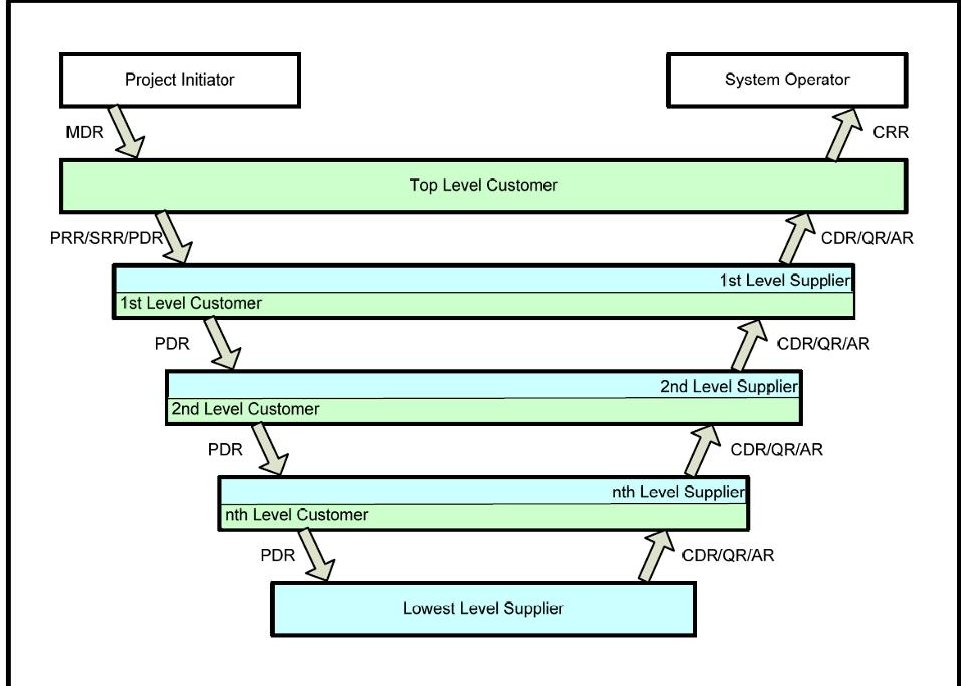
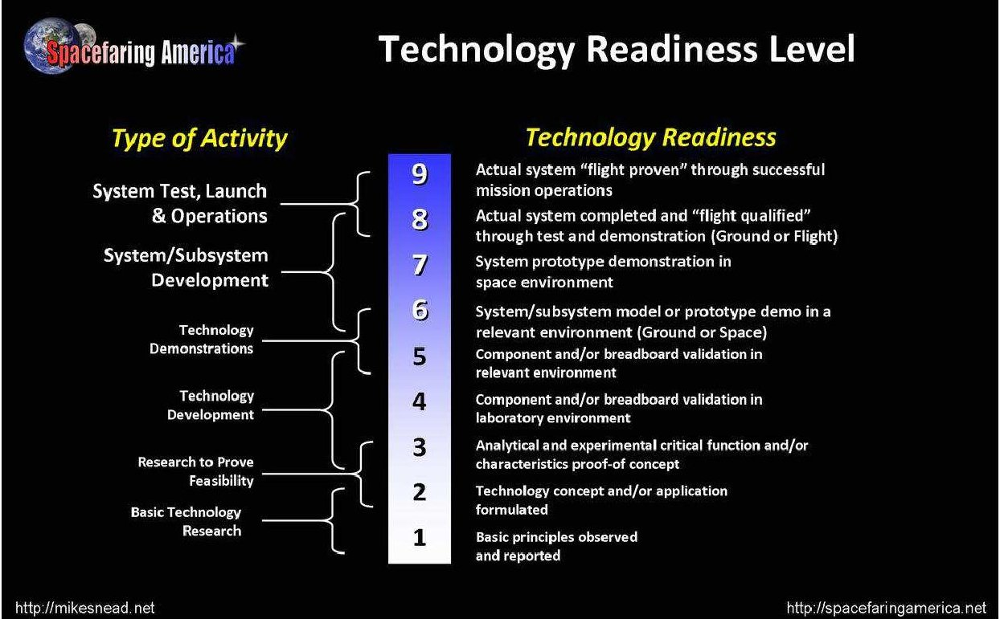
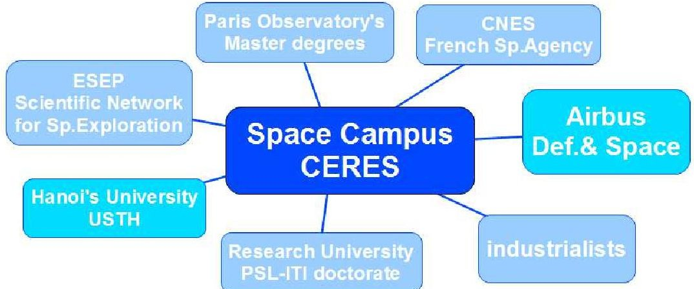
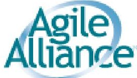
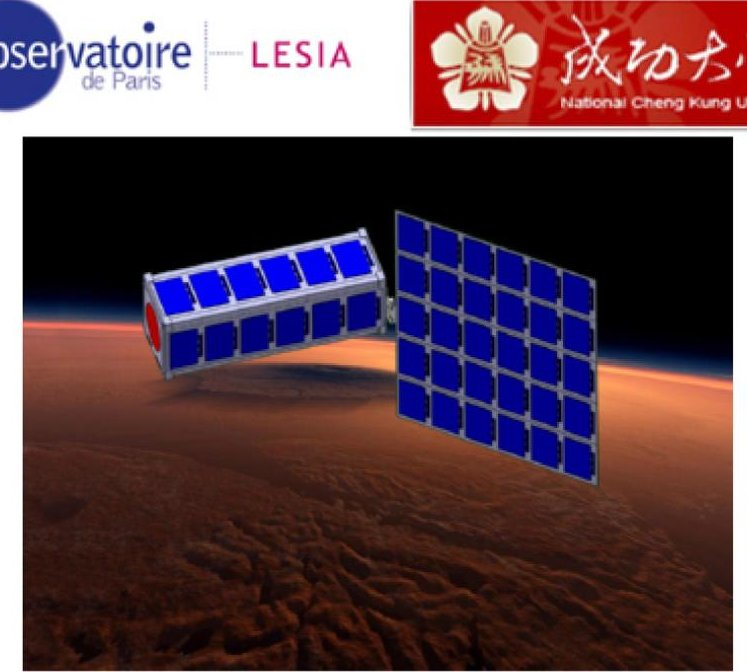
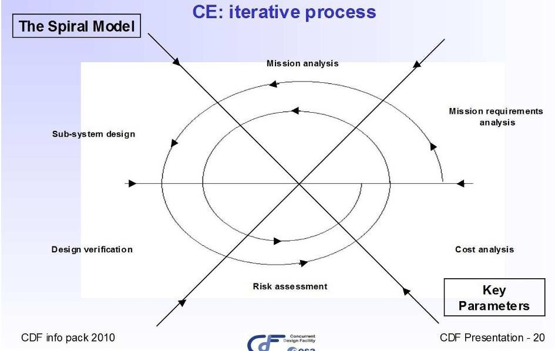
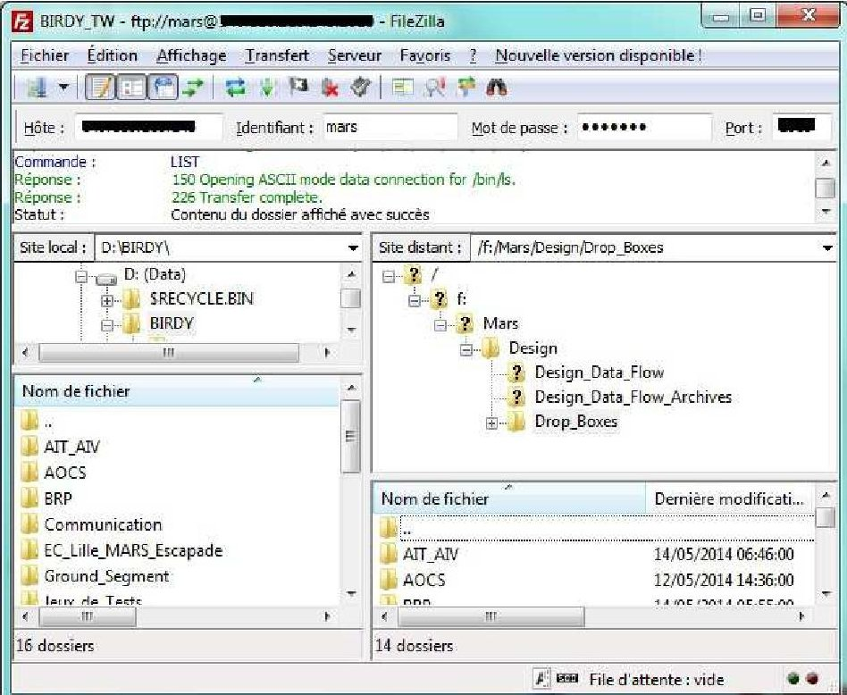
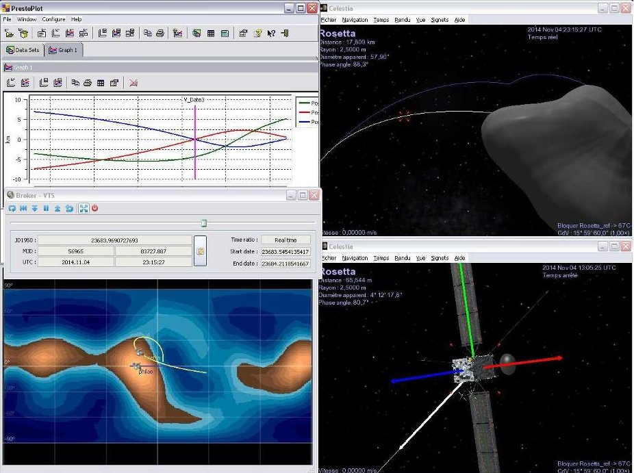

<!-- PDF_PAGE: 1 -->

# The Paving Stones: initial feed-back on an attempt to apply the AGILE principles for the development of a CubeSat space mission to Mars

Boris Segret, Alain Semery, Jordan VannitsenBenoit Mosser Jiun-Jih Miau, Jyh-Ching Juang Florent Deleflie $ ^{d,e,f} $

$ ^{a} $Laboratoire d'Etudes Spatiales et d'Instrument Astrophysique, (LESIA), Observatoire de Paris, Meudon, France National Cheng Kung University, Department of Aerotics and Astronautics, Tainan, Taiwan National Cheng Kung University, Department of Elical Engineering, Tainan, Taiwan Institut de Mecanique Celeste et de Calcul des Ephides (IMCCE) Observatoire de Paris, Paris, France Centre National de la Recherche Scientifique (CNRS), France Université Pierre et Marie Curie, Paris, France

## ABSTRACT

The AGILE principles in the software industry see well adapted to the paradigm of CubeSat missions involve students for the development of space missionse well-known engineering and program processes visited on the example of an interplanetary CubeSat mission that has been developed by several team students in various countries and at various educational levels sin2/2013. The lessons learned at adapting tradition mission methods are emphasized and they produce a metapicture of paving stones.

Keywords: CubeSat, Space campus, Paris Observatory, NCKIRESEAGILE manifesto

## 1. AGILE: FROM SOFTWARE INDUSTRY TO SPACE PROJECTS

The level of quality management in space projewith their reviews and tools like the "V-cycle" artde TRL indicator, is high due to their natural complexityowadays the CubeSat technology is expanding hyaipd aims at helping students build their satellites. Beyond educational value, are the CubeSats serious catesidor subsystem qualification or even for science? The Paris Obstory is familiar with large space missions, so space campus CERES has been established to incubate this new ofsmall space missions. Indeed students perowitcost missions with a quick development but they also oiduce new risks to be managed. Furthermore theeaia cycles are not adapted to the traditional phases andweife space projects. New engineering methods mustge.

The AGILE principles come from the software industry an attempt to decrease the constraints of operation procedures and to increase the responsiveness customer. We decided to apply the AGILE principle BIRDY, a scientific CubeSat project. BIRDY involves mainlyents from the Paris Observatory and the Taiwan university NCKU for various durations on many engineering w packages. It is an ideal methodological prototype CERES to set an operational adaptation of the AGILE principle a space project with many actors and topics.

CERES is an "incubator" where experts and students design a new CubeSat from scratch in concu engineering from the mission profile up to the integration. Aady one engineering cycle was completed for BIRD2013 using ESA's Spiral Model as a central method. Some less were learned and the second engineering cycle stated in April 2014 under AGILE principles. We first instal a shared workspace and defined some roles for students. Then we set up a process for iterations called the "lasting from 1 to 3 weeks each. At the middle's second cycle, we can provide some initial feedback and every student involvement is seen as a unique stone that place project like a handwork pavement. The project management is notren and a third engineering cycle for BIRDY will last in September 2014 with new students starting from results of the previous cycle. It will also be opportunity to transfer the feedback from BIRDY to new CubeSatents that are just starting at Paris Observatory campus CERES.

<!-- PDF_PAGE: 2 -->

# 2. STUDENTS IN CHARGE OF SPACE PROJECTS?

## 2.1 Space projects have a high level of complexity

Space projects have a natural complexity that coates first, from a hostile environment. The launch itself is brutal and requires the payload to resist to shocks and vibration This short period of time is also dirty while payload requires to keep clean, with a risk of out-gassing from materials that could condensate on cold surfaces optical systems. Once in space the system is exposed to extreme atmoses that must be controlled with a smart coating of coolers, heaters with the orientation strategy, is exposed to radiations that can darken optases (UV) and affect the electronic components and the whole balance of the spacecraft.

The complexity comes from the limited resources that make the design always tricky. The factor in the cost of a launch (which is one of the primary costs space mission) is due to the mass. The volumenited under the launcher fairing and eventually deployment systems necessary and increase the risks of failure. Energy, most often, is produced from solar arrays, depending on available solar flux, on eventual eclipses and the orientation strategy. The science data to bring back to the E (with eventual needs to receive commands) reqi data-link system and a communication strategy to be combined the other functions. Finally, the needs toentithe spacecraft (Attitude and Determination Control, ADC) and often perform an Orbit Correction Maneuver (OCM) reqi additional on-board systems and in most casespulsion system.

The planetary protection is an international treaty may introduce special requirements in the sys and in the mission profile. Furthermore, at the initiative ofance, a new French law, the "Space Operations',Lwould be internationally adopted to manage all new debris space and decrease the number of the existing these very desirable rules make requirements on the desighe end of the mission and, consequently, on passivategies in case of failures.

figure 1: the "Review life cycle" indicates the various reviews that take place in the developmentspace project under the "V-cycle" approach by the European Space Agency (ECSS 2009, [1])

The number and the complexity of all the requirements managed under a methodological approach the "V-cycle" for European space projects. A number of events at different stages make possible to assess the degree of fulfillment all over the project develop. These reviews mean a large production of deeds and a detailed process to approve all the documents.

The complexity usually prevents students from being huge of space projects. The high level of duplication is fully justified by the high level of complexity of aditional space projects that are funded or preduby many actors in agencies, space research laboratories and industry CubeSat technology, however, makes the process much simpler and is a serious opportunity to manage space projects under new and easier rules.

<!-- PDF_PAGE: 3 -->

## 2.2 Increasing the "Technology Readiness Level" (TRL)

The "Technology Readiness Level" (TRL) is a way assess the risks of subsystems and space projects can easily see that due to the level of requirements, spac ections are usually expensive, in terms of design as in terms of tests and documentation. Then it is worth re-using demonstration that a sub-system works well place for other projects. The TRL is an international standard to aim. It ranks from 1 to 9, with a challenging stone between 5 and 7 when it goes to testing in space environment.

figure 2: Technology Readiness Level is an international standard to rank the technologies and subsystems before relying on them in space projects (illustration available on web by Spacefaring America)

Traditionally the space agencies fund the space laboratories to develop technologies befording the space missions that could use these technologies. On other hand space agencies want to limit the risk the selected space missions and they only accept payloads with a high at the time of a selection (typically TRL>5) then it is up to the laboratories or industries to be funded for the department of their technology before applying for concrete space mission. Here is a second huge interest for low-CosseSats to increase the TRL of key subsystem store missions.

## 2.3 CERES, space campus for scientific and TRL-orienteCubeSats

While in the past CubeSats were only associated educational goals, they are more and more associate high scientific payback for a very affordable finance effort. In 1999 the California Polytechnic State University (Cal Poly) and the Stanford University developed the CubeSatifications to help universities building the spacecraft. The CubeSat standard (www.cubesat.org) makes the dandelion of satellites, especially by Universities cheaper and faster than usual space programmes. In Francespace agency (CNES, Centre National d'Etudes Spatial) now supports a dozen of universities in educationaleab projects.

The Paris Observatory hosts several space researchatories, with LESIA and IMCCE (co-authors),dagrants master's and doctoral degrees in space research and engineering. Hence it is the right place establish CERES acronym in French for "student center for space and exploration". Our first CubeSat projectOGMS-SA" has started in 2012 and focuses on the TRL increase new system. It is one of the 50 CubeSats within European "QB50" program that intends to launch the 50 CubeSat once in low Earth orbit for a multi-site silicone measurement of the Earth's thermo-sphere. In 2018, CubeSat projects have started and CERES should date up to 5 CubeSat projects as of 2014.

CERES intends to promote the CubeSat technology and Science applications mainly produced byents who are managed by experts from various origins. CERES hosted by the Paris Observatory within the Research University "Paris Sciences et Lettres" (PSL) and has partime academic environment (French and Vietnameseities), in

<!-- PDF_PAGE: 4 -->

the industry (including Airbus Defence and Space) in the scientific space sector through the Laboratory of Excellence "ESEP" (network of 9 space research laboratories for space exploration) and the French agency CNES.

figure 3: Paris Observatory's space campus CERESpartners, as of 2014

With the increasing number of CubeSat projects RES, the stake has become to adapt the traditi engineering methods and to transfer the feedback from one Cathesject to the other ones.

Scientific or TRL-oriented CubeSats being producestudents require specific skills:

- some usual skills in space projects are well mastery space laboratories: design for hostile environment, with limited resources and by multiple partners, most in an international consortium

- small missions are new but designing small, small quick solutions is the core-competence of the sp research laboratories

- however some necessary skills are new: producing platform in addition of the payload (the platform usually taken in charge by the industry), facing scale time development, adapting to the turn of students, to their lack of experience and to the academic cycles.

The stake is to develop, capitalize and share theeskills, in order to keep a high level of qtyand reliability.

## 3. AGILE IMPLEMENTATION FOR AN INTERPLANETARY CUBESAT

## 3.1 The AGILE manifesto

The software industry reacted in the '90s to the and procedural development methods. According tPrié ([2]) the reaction was due to three main trends making much pressure on the contracts: more and motionale" for everything, too much to be done without being adab the software product itself, and too rigidplings.

This reaction resulted in the published AGILE masto in 2001 that has listed 12 concrete principles manage software developments. The manifesto is now promote the Internet by the AGILE Alliance (logo ingire 4), a non-profit organization claiming "we follow these priples".

## figure 4: AGILE Alliance logo, http://agilemanifesorg/principles.html

There are several AGILE methods based on the same principles of the AGILE manifesto. For the need our space projects we have been inspired by the "eXtreme Paroging" (XP) method and the "Scrum" method.

<!-- PDF_PAGE: 5 -->

All methods claim they are based on:

- a full functional software is delivered early (eventually with low performances and even fictive functions) and it will be frequently upgraded and deployed to the users,

- the individuals are at the center of the development plan and they self-organize their teams and the work,

- a minimum number of documents are written, the main driver being to "maximize the content", the process and the content are continuously improved by the feedback and the re-factoring

## 3.2 BIRDY, an interplanetary CubeSat at CERES

BIRDY (Segret et al., 2014 [3]) stands for "Bleeping Interplanetary Radiations Determination Yo-yo" and is one of the CubeSat projects at CERES.

BIRDY is a project of the space research laboratory LESIA at the Paris Observatory, well experienced in major space missions. BIRDY is a good candidate to test new methods for CERES as it is relatively complex, involves numerous actors and is still not committed to be delivered before a specific deadline. In addition, several new projects are still at an early stage (mission analysis) and will benefit from a feedback after several engineering cycles for BIRDY.

figure 5: Design concept of BIRDY flying by Mars, an interplanetary 3-Unit CubeSat project led by the space research laboratory LESIA at the Paris Observatory, with its partner in Taiwan, the National Cheng Kung University (NCKU)

The goal is to contribute to the understanding of Space Weather by gathering observational data from the interplanetary medium. The scientific payload measures energetic particles while flying from the Earth to Mars, flying by Mars and then back to the Earth on a free-return trajectory. The payload is specified and taken in charge by a PhD student of the Taiwanese "National Cheng Kung University" (NCKU), major partner in BIRDY. The IMCCE, member of the Paris Observatory, will provide expertise and support for the navigation system.

The mission profile anticipates an injection of the CubeSat on the interplanetary trajectory to Mars as a piggy-back of a host mission launched to Mars. Then the main velocity impulse is provided by the host mission. Once jettisoned, the CubeSat is fully autonomous and cannot receive any command nor transmit any data to the Earth directly. It can perform very limited OCM with a small electrical propulsion. There is an on-board optical navigation system, a "planet tracker" inspired by the star tracker concepts extended to planets to estimate the CubeSat's location and decide an eventual OCM. The ground segment consists in a mission preparation tool to compute the free-return trajectory based on the host's trajectory and to compute and store all necessary navigation data in the CubeSat's memory prior to the launch. Once in Mars vicinity BIRDY will transfer its data to an orbiter there for a data-relay to the Earth. The engineering challenge of the mission consists in the autonomous navigation system that must drive the CubeSat on the exact desired flyby of Mars, and is made of two segments: a mission preparation tool and a flight software.

<!-- PDF_PAGE: 6 -->

## 3.3 Two engineering cycles

The project has started in 02/2013 with a preliminary analysis of a possible mission profile, with ideal small studies by interns at M1/M2 level during the following suram

## First cycle without AGILE

A first engineering cycle was held from 09/2013to2014 and involved 9 students in 3 locationstudents in the Paris Observatory's Master for space engineering, M2 level in a French Engineering College (EL) and the PhD student at NCKU acting as the instrument science About 600 hours of study and 4 reports were pre-size some major subsystems.

The central method was to apply ESA's Spiral Mode the expected mission profile. The cycle was did in two periods:

- the first three months were dedicated to build analysis tools and identify key indicatorsthe design,

- the last three months allowed teleconferences on We (Cisco) to perform a common analysis based on the Spiral Model and two full iterations of the SpiModel were possible.

figure 6: ESA's Spiral Model approach for mission analysis at the "Concurrent Design Facility" in the Netherlands.

The technical referent for this period was the probmanager alone (author of this paper). Expects the laboratories were invited to small technical meetings when theents faced specific difficulties (functional lysis, datalink, onboard electronics).

This first cycle helped prepare the second engin cycle and highlighted three main difficulties should be inherent to the involvement of students:

1) At the beginning, every team deeply misunderstand the problem. By chance, an intermediary study was requested and the misunderstandings could be stored in the second part (Spiral Model).

2) Students do not have any serious engineering rience as they are at M2 level. Then "everythingew" to them: the space mission context (space environment, trojanagement, quality assurance, test-minded)the scientific, engineering or reporting tools as well. As a reusierious amount of their time is used to discovers context, the tools and their justification (for instance the differenbetween a specification and a presentation desli

3) the heterogeneity among the studies rapidly (approach, analysis, written reports, spreads) even with 9 students only. In the run of a design phase it isounmanageable in the very short term.

To summarize, the involvement of students is cheapit requires much more time for them,permit their huge motivation for the project, and this involvement does not turn into much more time in managing. Even the best case, the "front-management" is quickly unsustainable delegation is not installed within the students themselves.

<!-- PDF_PAGE: 7 -->

## Second cycle with an AGILE approach

A second engineering cycle has been planned from 2004 to 08/2014 and has involved 18 students pursuing internships for most of them: the PhD student at KNCthree M2 interns at IMCCE and NCKU, two M1 stands at LESIA and NCKU, seven L3 students at the Ecole Lille (ECL, France, is similar to a University college) and five L3 students at NCKU.

BIRDY's development plan anticipates the production of 8 models: a Structural and Thermal Model (STM), ProtoFlight Model (PFM) based on a reduced mission Geostationary Transfer Orbit (GTO) and the Flight Model (FM1) to go to Mars. The STM is under the possibility of the 7-student team at ECL. In parallax workpackages have been identified by the project managing the design of the 3 models with 2 profiles, 5 "technological bricks" (scientific payload, grousegment, navigation, Test-Integration-Validationcom), a special work for Outreach and the Product & Quality Assurance

All these work-packages are mandatory for the Cabot not all work-packages could be address the second cycle due to the availability of students with so skills, and not with other necessary skills. Frostance, we have had skills in mechanics and scientific computing but skills in electronics available yet. As well, so feasibility and sizing issues (phases A and B) have been on-going we have already started preparing the test integrations (phase D).

With an AGILE approach this is definitely manage to a certain point: the technical reviews (figure 1) remain the actual milestones of the project, not anymore strict development phases. Furthermore, the learned from the first cycle made us install a workspace, defies in the teams and establish an original place

figure 7: FTP access with FileZilla to BIRDY's share workspace. On the right the top folder tree of distant server.

The workspace is a shared repository on a NCKUeshat can be accessed in FTP protocol, with varisections:

- A folder with sub-folders called "drop boxes", oper designer or team of designers: the designers ar requested to upload their deliveries in their owpdboxes to be included in the reference afterbecked.

- A read-only folder for the "Design Data Flow" (DDF) a delivery is considered valuable for the project is renamed according to a common glossary, refereed and moved to the DDF. This folder contents any kind pieces of the design or of the development to specifications or technical notes, engineering software with the documentation and the test routines, design procedures, outreach products...

- A read-only archive of the previous versions of DF (one after each iteration).

<!-- PDF_PAGE: 8 -->

All these elements will be frequently upgraded this is why we talk of a "data flow" and not only a "design". Only the project management is granted a write-permission the DDF because the selection of "pieces ofde to be stored, the names that are given and the place to them are a strategic way to manage the home and the progress of the project.

New roles have been defined in the project:

- In addition of the project manager, the system reengi and the instrument scientist, all students know a technical referent, who is often a student at an academic level or can be the PhD manager at UNOK the project manager himself depending on the necessary available skills. The technical referent has commit on the technical consistency of a delivery. He/she major link for the progressive consolidation with the use of the "Confidence Level" (CL) explained below.

- The "Chairman" is named to manage one full iteration between two engineering meetings. He/she is angeh of the meeting agenda, the analysis and the dianops on the deliveries during the iteration, meeting animation and reporting, and the approval and storage of all acceptable deliveries. The Chairmankislyi the system engineer, its deputy (an M2 intern in the second cycle) or the project manager.

- The "Tracker", inspired by the AGILE XP method,incharge of the prevention of human risks due communication within the teams. He/she reports project manager only. This role has appeared to probe the health of the project.

- The "Testman", also inspired by the AGILE XP method in charge of testing the project, its composition (that must be easy to test), and to advise the design improving the things to make the tests always accurate, useful and usable by others.

This workspace and these roles are associated with original process during the engineering cycle:

1) a "Run" is a period of time with a specific gowle call it a "metaphor", starting at a meeting lasting until the next meeting or the second next, thus during 2 to 3 weeks aim of the metaphor is to concentrate forts on a specific aspect of the project. We have planned 4 metaphris may be too many) for this engineering cycle named "Birdy's world" to focus on the CubeSat's or project's coninent and their external interfaces, "Birdy's body the shape of the CubeSat as well as its internal interfaces,dyBs tweeting" for the functional links between systems of all kinds, and "Birdy's fly" to make everything work with aner increasing efficiency.

2) the Chairman of the Run requests every design deliver their "pieces of design" in their dropxes before a deadline, say a Tuesday, and to update their personal-maps". The road-map is the breakdown schedule of the work-package of a team, that is managed by themselves. It is also a dialog tool with technical referent. The road-map represents a commitment by the design their own suggestions of achievement in the of the current metaphor for the next run. Thus, it is the decision of a designer to suggest whatshoe done next.

3) on the next day after the deadline, Wednesday,Chairman analyses the deliveries (typically 100.20 different files of every kind were delivered each time) andots to the designers when things should and doubtproved. The Chairman prepares the meeting for the next daytries to solve most of the issues before the mgeOf course it is not possible to assess the pertinence of a resistmore question of understanding the consistand the approval checks of the deliveries.

4) on the Thursday, everybody attends a telecombery WebEx that lasts 1H30. The Chairman reviews problematic deliveries with the designers, allocation for a designer to present a topic of interdiscusses the feedback on the just past Run and details the new and the metaphor.

5) on the Friday ideally, but it may take more time Chairman decides what "pieces of design" go to the DDF, rename and move these pieces, and notify the teahen the new Chairman (if changed) takes in changetew iteration.

The first month was to install the workspace and explain the roles and the process. Then 4 iterations were performed in the two first months and the engineering cysletill on-going. More than one hundred files was submitted each time and most of the students have now taken into tokes. It has been possible to consolidate the specifications: from an initial version of the DDF (the software industry could define it as a "data circulation model")ewow have gone to the increase of the "performance" of the variousents.

<!-- PDF_PAGE: 9 -->

## Reliability: "Confidence Level" vs. feasibility

A confusion can likely take place with this way to ("delivering first, then improving"): if something is delivered, and moreover if it is moved to the DDF, then it may seen as a final and correct result. Of course it

We have an operational criteria to assess this issue in the project, the "Confidence Level" (CL)the criteria is tracked for every "piece of design" by the "QualAssurance" team. It may cover a single assumption result or a full topic (typically a full specification). It consists in ranking from 0 to 4 every assumption suite

0: the assumption or result is not assessed instefortinence

1: it is assessed by the designer and a review of technical referent is requested

2: it is reviewed and approved by the technical and can be submitted to an internal review(all designers concerned by it)

3: an internal review has approved the assumption

4: it has been demonstrated

If one could visualize the CL with a color from red), to orange (2), yellow (3) and finally green),(then the project would progressively turn to a full green over time.

Another criteria that concerns the "feasibility" the project and of the mission has still to be lemented in the process. Indeed, with an AGILE approach, we geeany full functional "system" but for space project the level of performance must be "sufficiently high". Then theidence level is not enough. However, the track of the feasibility (and the associated management of targets) should be addressed in the next engineering. Both the confidence level and the feasibility together should to assess the reliability of the design.

## Next step in the AGILE approach

The next engineering cycle in 2014-2015 shouldupnew software tools developed and provided by SNEsupport a common description of the requirements of a project in phase 0. These tools are:

- "IDM-CIC" to build the requirements in a colaborat way within a single shared XML file. The format fulfills an Engineering Design Model standard byAE(ECSS-ETM-10-25A);

- "IDM View" that displays the basic 3D elements used by IDM-CIC in a 3D display engine;

- "VTS-CIC" that displays an animated 3D model as from the XML file and the mission profile described under a CCSDS protocol for the positions and velocities the attitudes and the sapce environment.

figure 8: screen of VTS-CIC by CNES (tool developed the "Centre d'Ingénierie Concourante" at CNES-Toscou

<!-- PDF_PAGE: 10 -->

## 4. LESSONS LEARNED

Of course we are still at the very beginning of engineering approach and the feedback is still. However the presented method already helps manage situati build be frequent with the CubeSat projects:

- The early deliveries make clear any misunderstandery early, provided that the project manageruses on a team who is late at delivering its first result this is a direct consequence of the AGILE approach the way, it seems that the first deliveries of a justified student is very likely to be... wrong!

- The confidence level, with the technical referen who play an important role, are key factors to the frontmanagement sustainable. At the opposite, the lack technical referent for every designer makes results rely on the project manager alone which is a sin that quickly accumulates many mistakes in theigh.

- The specific roles of "Chairman", "Tracker" and "steman" are good ways to share responsibilities involved students. Moreover the Tracker has apperable very valuable at preventing some crises.

- The shared workspace to gather all "pieces of design a strategic place to manage the project, robots coherence as a collaborative effort by numerous and eventually re-orient the priorities. It is seen as the master piece of the management.

Hence the AGILE methods, with a specific adaptation the CubeSat technology, appear very promising produce reliable low-cost space missions even for scientificTRL-oriented applications.

A major difference with a traditional space project the management of the development stages the AGILE approach is promising at simplifying without endangg the projects. Indeed a space project usualy quests successive distinct phases. For instance, the "epo( mission analysis) must be completed before going to the "phases B, C" (design), and the phase B must identify and use the manpower before starting. For CubeSjeqtso we have to go as we can with the available students in the academic cycles. Furthermore we cannot commit or fulfillment of a work-package before the allocated academic period has finished, a part of the job may be notsfied and the development plan is continuously re-planned.

The process must change to involve students, opposite, in order to keep the low-cost advantage CubeSats. As a result, the planning must keep some flexibilike singular stones on a handwork pavementents build the project as they go through it. Under these conditions CubeSat technology may be an opportunity forew paradigm in designing space missions.

## ACKNOWLEDGMENTS

The work was partially supported by the Laboratory Excellence ESEP and the "Investissements d'avenFrance, by the National Science Council, Taiwan under grant 102-2627-E-006-001 and by the Ministry of Sciences and Technology, Taiwan and the French Representative of Taipei, France through the 2014 ORCHID programme.

## REFERENCES

[1] "Space project management", European Cooperation Space Satndardization, ESA-ESTEC, ECSS-M-ST 10C Rev.1, 6 March 2009.

[2] "Processus de conception de SI - Méthodes AGI(French, lecture support), Yannick Prié, Département Informatique, Faculté des Sciences et Technologiuniversité Claude Bernard Lyon 1, France, 20112201

[3] Segret B. et al., "BIRDY: an interplanetary Cube to collect radiation data on the way to Mars back to prepare the future manned missions", SPIE Astronaut Telescopes and Instrumentation, 9150-58, Pigeon Montreal, Canada, June 23, 2014.