<!-- PDF_PAGE: 1 -->

# PROCEEDINGS OF SPIE

SPIEDigitalLibrary.org/conference-proceedings-of-spie

# Model-based system engineering approach for the Euclid mission to manage scientific and technical complexity

Jose Lorenzo Alvarez, Harold Metselaar, Jerome Amiaux Gonzalo Saavedra Criado, Luis Gaspar Venancio, et al.

Jose Lorenzo Alvarez, Harold Metselaar, Jerome Amiaux, Gonzalo Saavedra Criado, Luis M. Gaspar Venancio, Jean-Christophe Salvignol, René J. Laureijs, Roland Vavrek, "Model-based system engineering approach for the Euclid mission to manage scientific and technical complexity," Proc. SPIE 9911, Modeling, Systems Engineering, and Project Management for Astronomy VII, 99110C (18 August 2016); doi: 10.1117/12.2231373

Event: SPIE Astronomical Telescopes + Instrumentation, 2016, Edinburgh, United Kingdom

<!-- PDF_PAGE: 2 -->

# Model-based system engineering approach for the Euclid mission to manage scientific and technical complexity

Jose Lorenzo Alvarez $ ^{*a} $ , Harold Metselaar $ ^{a} $ , Jerome Amiaux $ ^{b} $ , Gonzalo Saavedra Criado $ ^{a} $ , Luis M. Gaspar Venancio $ ^{a} $ , Jean-Christophe Salvignol $ ^{a} $ , René J. Laureijs $ ^{a} $ , Roland Vavrek $ ^{c} $

$ ^{a} $European Space Agency, ESTEC, Keplerlaan 1, 2201 AZ Noordwijk;

$ ^{b} $CEA/Service d'Astrophysique, Orme des Merisiers Bat.109, 91191 Gif sur Yvette, France;

$ ^{c} $European Space Agency / ESAC, Villanueva de la Cañada,E-28692 Madrid, Spain

## ABSTRACT

In the last years, the system engineering field is coming to terms with a paradigm change in the approach for complexity management. Different strategies have been proposed to cope with highly interrelated systems, system of systems and collaborative system engineering have been proposed and a significant effort is being invested into standardization and ontology definition. In particular, Model Based System Engineering (MBSE) intends to introduce methodologies for a systematic system definition, development, validation, deployment, operation and decommission, based on logical and visual relationship mapping, rather than traditional 'document based' information management.

The practical implementation in real large-scale projects is not uniform across fields. In space science missions, the usage has been limited to subsystems or sample projects with modeling being performed 'a-posteriori' in many instances. The main hurdle for the introduction of MBSE practices in new projects is still the difficulty to demonstrate their added value to a project and whether their benefit is commensurate with the level of effort required to put them in place.

In this paper we present the implemented Euclid system modeling activities, and an analysis of the benefits and limitations identified to support in particular requirement break-down and allocation, and verification planning at mission level.

Keywords: mbse, model based, simulation, SysML, systems, requirements, Euclid

## 1. INTRODUCTION

Euclid is the second medium class mission (M2) of the European Space Agency (ESA) Cosmic Vision program. Its primary goal is to determine the nature and distribution of dark matter and dark energy using two main cosmological probes: Weak Lensing (WL) and Galaxy Clustering (GC) [1]. This objective is planned to be achieved conducting a survey of more than $ 1 5, 0 0 0 \mathrm{~ d e g}^{2} $ of the extragalactic sky, performed by a single spacecraft with a 1.2 m entrance pupil telescope, equipped with a visible imager (VIS) [3] and a near infrared spectrophotometer (NISP) [4]. The WL probe involves the measurement of galaxy shear of a large number of sources, driving performance requirements beyond traditional image quality and sensitivity, to include also ellipticity, Point Spread Function (PSF) stability and control of any systematic bias that could introduce errors in the cosmological signal of interest. The required level of residual errors depends not only on the performance of the telescope, instruments, spacecraft pointing, etc., but also to a significant extent, on calibration data, external data (from other space and/or ground missions) and science data processing algorithms performance. These different contributors are developed by and under the responsibility of different entities both within ESA project and its direct contractors, and as part of a Euclid Consortium composed of institutions across different nations.

<!-- PDF_PAGE: 3 -->

The complex interrelationship between the different contributors to the system performance and the number of involved stakeholders, led early on to the decision to adopt a Model Based Systems Engineering (MBSE) approach in Euclid to control requirement flow-down, architecture selection, verification and operations definition. Specifically, System Modeling Language (SysML) [5] was selected to build a representation of the system and capture the complete traceability of the mission break-down, from science objectives to verification and full life-cycle planning.

This is, the first full application of MBSE in an ESA science project in development and it has generated an important number of lessons learned and recommendations for modeling in future missions.

The paper is organized as follows: section 2 introduces the concept of complexity as perceived by the Euclid project context and it describes the needs that lead to the selection of a MBSE approach. Section 3 provides an overview of SysML application for Euclid and the project specific ontology and model organization. Section 4 details the requirements, architecture, verification and operations modeling approach for the mission. Finally section 5 looks critically at the experience to date of the MBSE introduction in the Euclid mission, it draws initial lessons learned and it summarizes the activities in the future.

## 2. COMPLEXITY DEFINITION, QUANTIFICATION AND MANAGEMENT

## 2.1 The Euclid mission context

As briefly described in the introduction section, Euclid is a space-based optical/near-infrared survey mission designed to investigate the nature of dark energy, dark matter and gravity by observing their signatures on the geometry of the Universe. As per any mission deeply based on a theoretical field (cosmology in this case) the mission goals as expressed by the stakeholders are quite far from a physical system specification and implementation. The bridging of this gap is performed in early phases of the project (Phase A/B0 in ESA used development cycle definition) by both the science community and the engineering groups in an iterative process of refinement of stakeholder requirements and needs. Along this process, a great number of assumptions and considerations are made to refine and converge on the wording of requirements and in a set of mission architecture choices (single or multiple spacecrafts, split between data processing on orbit and on-ground, synergies with existing missions/data, etc). The collection and maintenance of the complete set of assumption and justifications for the chosen selections is the responsibility of the mission Systems Engineering function. It usually takes the form of a set of reports, spreadsheets, simulations, code snippets, etc., that, -in the best of cases- are collectively compiled in a Requirements/Design Justification File. This paper based approach is in many cases sufficient to maintain control of the system and requirements interactions and relationships. However, as the number of interrelating elements and/or parameters grows, the efficiency of this concept decreases at a fast rate. Additionally the risks of missing interactions and propagating errors based on non-uniqueness of data representation increases significantly.

It can be questioned then what is the (fuzzy) boundary that defines a system as complex enough to be at risk with this traditional approach. The term complexity should be subcategorized between the informal use, reflecting perceived complexity and the formal definition as used in complex system theory. In this paper we refer loosely to complexity in our context, as the reflection of a system that has three components: 1) multiple configured elements, 2) multiple actors and 3) a high number of non-trivial interactions. We provide below our definition for each of these components and examine them under the perspective of the Euclid mission:

1) Multiple configured elements: in the mission system engineering function for Euclid, configured elements are considered to be anything that has clear definition, boundaries and relations with respect to other configured elements. Obvious examples are the different mission architecture hardware elements(Spacecraft and subsystems), the launcher, the ground stations, etc. However, in this definition, non-physical elements are included, mainly requirements, constraints, tests and analysis. The Euclid mission top-level architecture [2] includes a single spacecraft, the ground station network (GSN) and the ground segment both for operational, and for science data processing (Figure 2-1).

<!-- PDF_PAGE: 4 -->

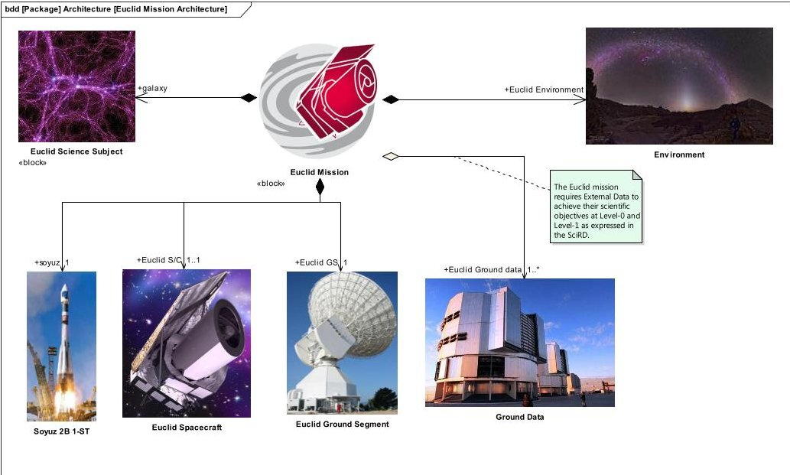

Figure 2-1 - Euclid Top Level Mission architecture

Up to this level, the structure is standard in most space missions. If we look at the mission context (Figure 2-2), and one level deeper in the mission product tree decomposition (Figure 2-3), other elements that must be accounted for are as follows: Euclid requires external data from ground surveys and/or other space missions to achieve the mission scientific goals; the survey definition is in itself part of the architecture linked to requirements and imposing constraints on the system; the science ground segment is composed of a number of science data centers (SDCs) and Organizational Units (OUs) that work in coordination to process the data; the calibration tasks and needs are part of the flow-down and require to maintain links with the requirements and adequate hardware products, etc...

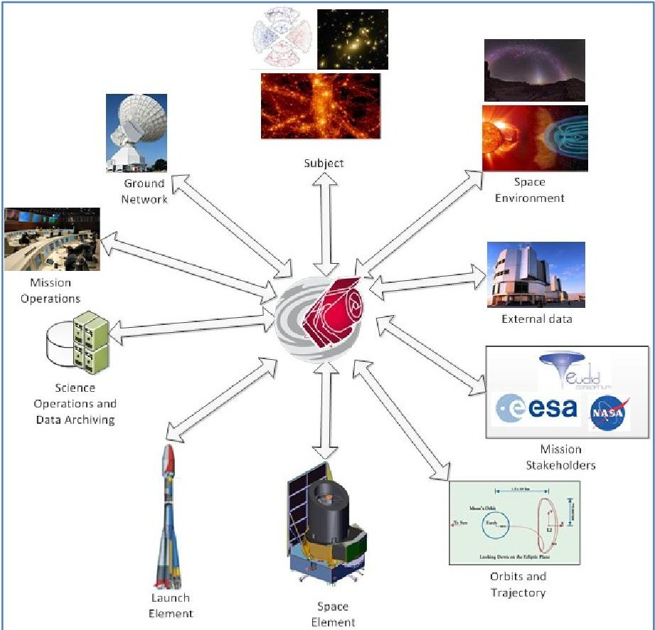

Figure 2-2 - Euclid Mission Context

<!-- PDF_PAGE: 5 -->

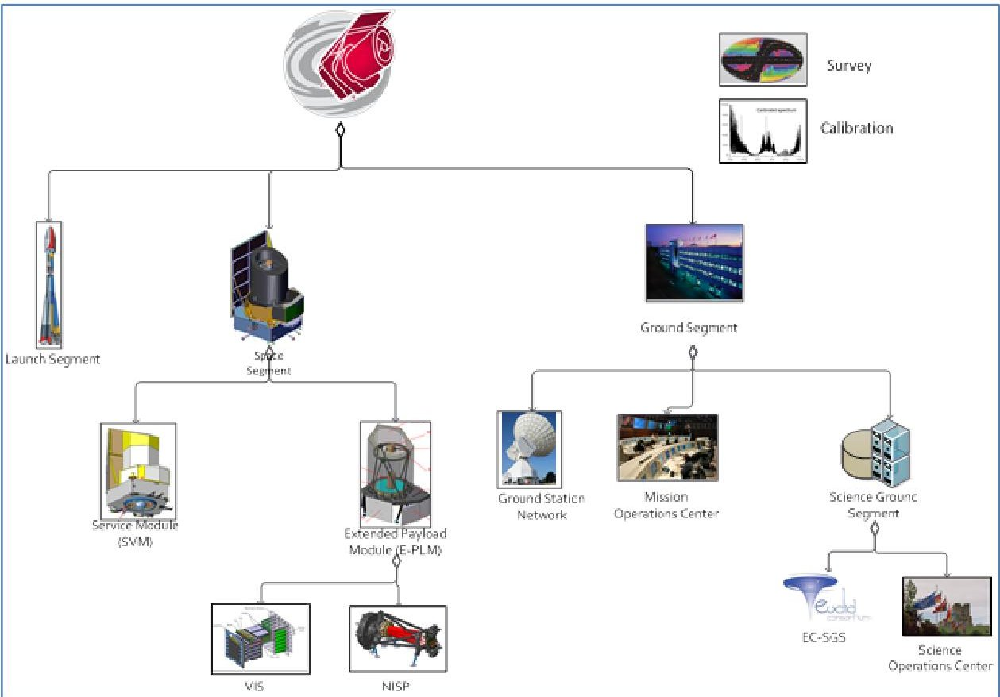

Figure 2-3 - Euclid Mission architecture

Similarly, in initial phases, evaluation of the top-level science needs and objectives led to a set of 20 level-1 science requirements (Figure 2-4). Level-1 requirements are still expressing science needs and must be translated further into engineering requirements. So, only at the mission level a significant number of configured elements can be easily listed without delving in the lower layers of the system architecture.

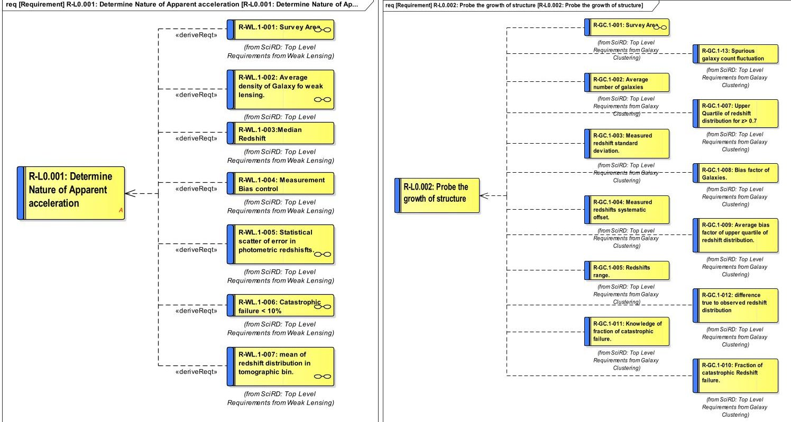

Figure 2-4 - Level-1 Euclid science requirements (Weak Lensing (left), Galaxy Clustering (right))

<!-- PDF_PAGE: 6 -->

2) Multiple actors: We define, for the purpose of this paper, actors as any entity with an active participation in the definition, design, implementation or control of the Euclid system. Those are traditionally also referred to as active stakeholders. In the scope of a mission like Euclid, the number of entities and interactions between them is very large, and also variable in time. As a first instance, there is the ESA project and the Euclid Consortium. The ESA project includes the development team, the operations group and the science operations team, located in three different sites. The Euclid Consortium (EC) [6], is an organization that brings together teams of researchers in several fields (physics, astrophysics, astronomy) and engineers, management, etc who work in public institutions and contribute to the mission. It is composed of around 1200 members in more than 120 laboratories spread among 15 countries. To ESA and the EC we have to add the industrial partners under contract to ESA that develop and manufacture the space segment. All-in-all, hundreds of groups with different levels of interaction and relationships whose interfaces must be tracked and managed. In addition, in the structure of organizations like ESA and the industrial prime contractors, traditionally there is a split between the teams performing the initial study in the early phases, the implementation and commissioning of the operational system, the operations and the science exploitation during the operational lifetime. Ensuring the adequate transfer of information and historical rationale for selections that had taken place in the past is fundamental to perform informed decisions at all stages of the mission.

3) High number of non-trivial interactions: In the term non-trivial interactions, we agglutinate all relationships between configured elements that are not obvious for most space system engineers. Although this is a loose and generic statement the essence refers to those relationships that pose a risk of being overlooked if not properly documented. The clearest examples are in the interrelationship between requirements. Requirement traceability typically links elements based on a parent-child relationship, where a child requirement is derived logically, by means of an analysis of budgeting from the parent. This is well mastered and controlled either in documentation or using traceability tools like DOORS $ ^{\circled{R}} $ . However, in many instances, a derivation depends on the value of another system parameter, an architecture choice, etc. Those links should be clearly controlled to maintain adequate consistency of the system.

## 2.2 Model Based Systems Engineering for Euclid

The nature of complexity as described in the previous section, led to the needs to: 1) be able to map and trace relationships between configured elements of different types (requirements, hardware components, tests, analysis, etc), 2) maintain a unique definition and representation of elements, 3) work collaboratively and 4) ensure configuration control. All those points brought the mission system engineers at ESA and the Euclid Consortium to consider introducing a model based approach for Euclid.

The International Council of System Engineering (INCOSE) defined MBSE, as "the formalized application of modeling to support system requirements, design, analysis, verification and validation activities beginning in the conceptual design phase and continuing throughout development and later life cycle phases." [7]. Since that definition given in the Systems Engineering vision for 2020 (published in 2007), the MBSE field has evolved and becomes a reality in many industries, as recognized in the Systems Engineering vision update for 2025 [8], published in 2014.

Several examples are available of application of MBSE in Space programs are available ([9], [10]), although mostly applied in the early concept definition phases. Particularly interesting to the Euclid mission, are the examples for astronomic ground observatories described in [11] and [12].

The mission system engineering team decided to create a model of the Euclid mission using System Modeling Language (SysML) [5]. SysML is a standardized graphical modeling language created to support system level visualization of requirements, architectures, interfaces, verification and behavior. SysML was developed by extending a part of the Unified Modeling Language (UML) used in software engineering. Selection of SysML over other available languages

<!-- PDF_PAGE: 7 -->

and methodologies was based solely on the experience of the members of the system team at the time. In section 5, we reflect in general over the selection and over the lessons learned in the Euclid experience to date.

## 3. EUCLID MBSE APPROACH

## 3.1 Euclid modeling framework

The Euclid System Engineering Model is built to represent the System from the different points of view required to define, design, and verify the Euclid system while keeping track of rationales, justifications and supporting analyses.

The selection of what views to be included in the model is addressed in different domains by the creation of Architecture Frameworks (AFs). Frameworks are standardizations of the system representations. The definition and creation of system frameworks is addressed by the ISO/IEC/IEEE 42010:2011 standard. Some of the best known AFs are DoDAF (USA Dept of Defense AF), MoDAF (UK Ministry of Defence AF), TOGAF (Open Group AF) and Zachman Framework, but many others are available based on the ISO standard above (for a nice survey of available AFs see [13]). In ESA, the ESAAF (European Space Agency AF) has been created as a modeling methodology to support decision making in System-of-systems (SoS) design and integration. It is based on existing methodologies while adding space domain specific concepts.

The Euclid model is the first attempt to apply an MBSE approach at mission level for a major science project under development in ESA. Therefore, we deliberately limited the scope of modeling and decided to implement a subset of the typical views present in most AFs, without fully adhering to a particular one. As such, only the relevant modelization to the SE group was included. The model was organized in the following views (Figure 3-1):

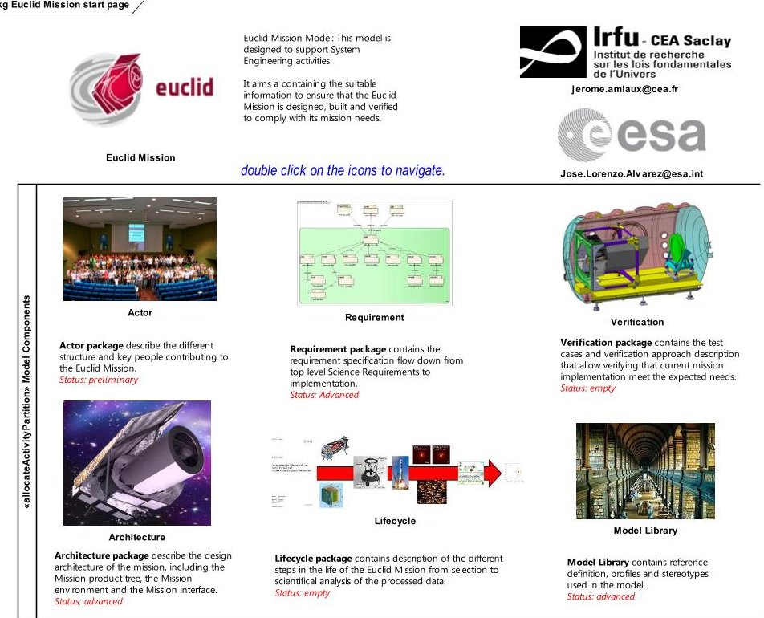

Figure 3-1 - Euclid Model Views

- Requirements view: Modeling of Euclid requirements, including traceability, budgeting, justification and change control

- Architecture view: Modeling of architecture and structure of the Euclid system, including interaction and interconnection between elements, characteristics, models, etc

- Verification view: Modeling of system verification logic, including activities, levels and flows, etc.

<!-- PDF_PAGE: 8 -->

- Lifecycle view: Modeling of operational and data flows for the Euclid system, including operational timelines, data transmission and communication flows, etc.

For each of those views, an specialization $ ^{1} $ of the modeling elements and diagrams available in SysML has been done for the needs of the Euclid mission and is described in more detail in section 4.

## 3.2 Model tool selection, usage, distribution and organization

The Euclid System Engineering Mission Model is created and maintained by the ESA and European Consortium (EC) Mission System Engineering group. To allow collaborative work and access to the model to the different groups involved in the ESA project, a deployment based on a version controlled server repository located at the ESA Science Operations Center (ESAC) is set-up.

The Euclid modeling approach has been adopted by:

- ESA Project Mission System Engineering group.

- EC Mission System Engineering group.

- ESA Science Ground Segment

- EC NISP team

- EC-Science Group Segment team

- EC Calibration group

For the Euclid Project the selected SysML model implementation tool is Enterprise Architect by Sparx Systems (www.sparxsystems.com).

The Prime contractor and the VIS instrument team perform requirement control and maintenance using DOORS $ ^{\circ} $ . The link between the IBM Rational DOORS $ ^{\circ} $ databases and the System Engineering model is performed through a manual importer to allow full requirement traceability to element level with the Spacecraft provided elements.

For visualization outside of the Enterprise Architect tool, a HTML export is created to allow external review and usage.

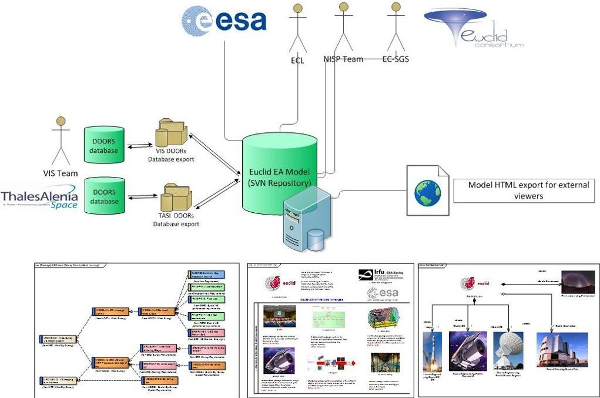

Figure 3-2 - Euclid System Engineering Model deployment

<!-- PDF_PAGE: 9 -->

## 4. EUCLID MODELING DETAILS

## 4.1 Requirements modeling

The requirements for the Euclid mission are modeled using SysML requirements objects, with specific tailoring and expansion to cover the needs identified by Euclid. This is made possible by the extension mechanism available in SysML through the use of profiles. A dedicated Euclid profile (Figure 4-1) was created including stereotypes $ ^{2} $ to expand the metadata available for requirements and to model i) justifications, ii) implementation choices in architecture definition, iii) properties to be maintained in the Euclid Mission Database (MDB [14]), and (iv) issues. In addition, representation schemes (coloring and marking) were defined to visually highlight requirements status and applicability (Figure 4-2).

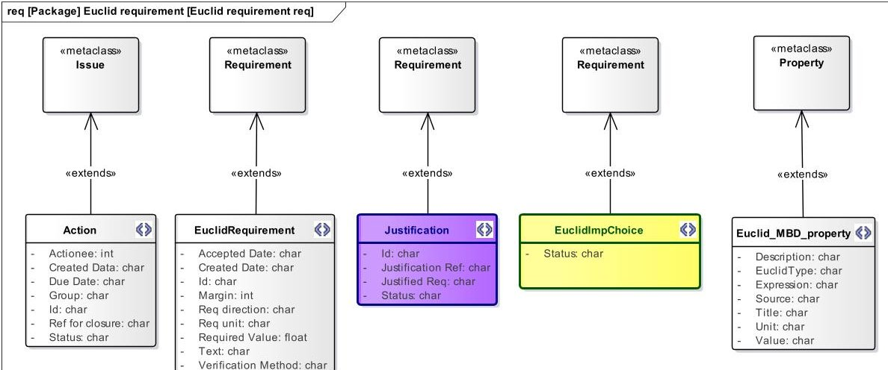

Figure 4-1 - Euclid requirement profile

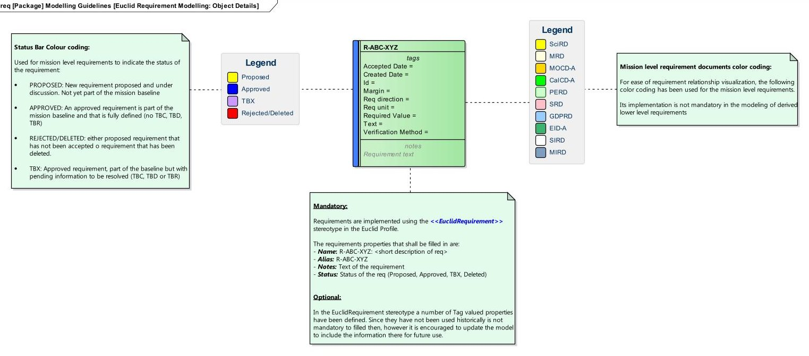

Figure 4-2 - Euclid Requirement representation and metadata

<!-- PDF_PAGE: 10 -->

Apart from the objects themselves, a set of relationships needs to be established to have clear modeling rules. SysML offers several options, and most tools do not introduce limitations in the type of links and relationships between

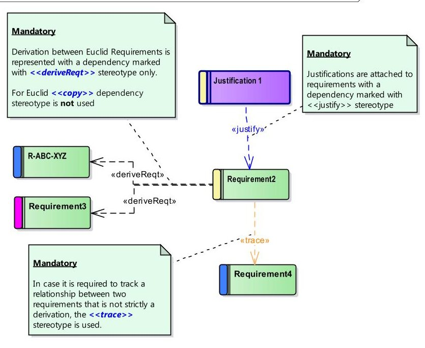

elements. In view of this and to limit the risk of inconsistency in the models, we choose to restrict the links to a small set of logical relationships: deriveReqt (to represent flow-down link of requirements), justify (to link justification descriptions to requirements), trace (to maintain a link between related requirements, where a change of either end of the link will affect the other, but that are not directly related through derivation). These rules are documented in the model in informational diagrams accessible to all the model users, as shown in Figure 4-3.

Figure 4-3 - Requirement diagram object relations

This set of relationships allows a complete modeling of the requirements at different levels, from stakeholders needs and mission constraints to spacecraft, ground processing and launcher elements. Figure 4-4 shows an example of a requirement diagram, illustration the flow-down of a mission level requirement across different levels of the decomposition with associated justification and verification information (see section 4.3)

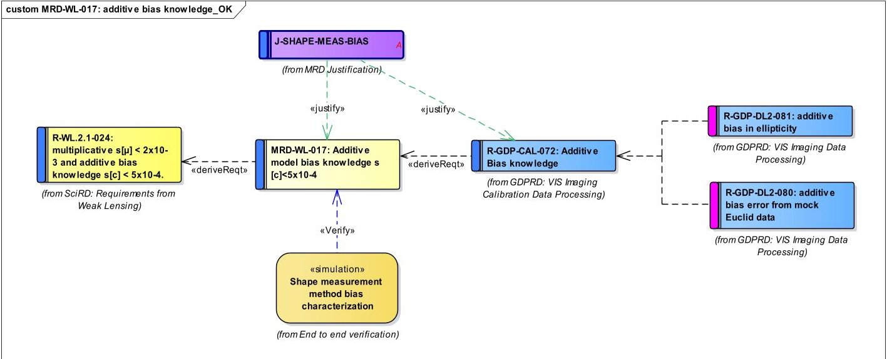

Figure 4-4 - Requirement flow-down example: SysML requirement diagram.

The final element to be considered in the management of requirements is how to maintain and trace changes. Although in theory this can be done through the use of version control on the model elements, in reality the management of changes in projects needs to be addressed in a different manner. Requirements are applicable to different entities at various levels of the flow-down, which have a specific relationship to the mission lead. In Euclid for example, the spacecraft is under the responsibility an industrial entity, bound to the ESA with a contractual relationship; on the other hand, the instruments and the science ground segment are provided by the Euclid Consortium, a group of institutions across Europe funded by national agencies. This implies that changes can be requested by different entities and need to follow a formal process including assessment of impact across the system (not only technically but also programmatically, in terms of cost and schedule). Because of this, we selected to use a Change element (Figure 4-5) to model requirement

<!-- PDF_PAGE: 11 -->

change requests and their status. An association relationship was selected to link requirements and changes in order to represent semantically that a requirement at any given time is composed also by the changes under assessment. All the changes applicable to a requirement are traced and maintained. This allows to reconstruct historically the decisions taken along the development and the implications across the system.

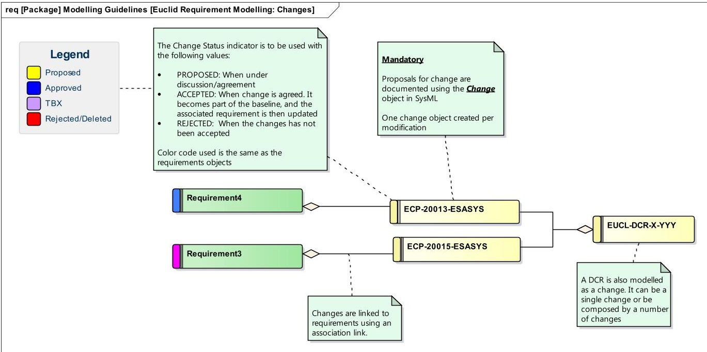

Figure 4-5 - Change object and relationships with the requirement elements: SysML requirements diagram

## 4.2 Architecture modeling

The system architecture defines the structure and behavior of the system, i.e. the organization of the system, its constituents, and their relationships to each other and to the environment.

The block is the fundamental modular unit for describing system structure in SysML. A block can be virtually anything, e.g. some logical or physical entity, a person, hardware, software etc. Blocks have properties which are the structural features of a block. Structure is specified in terms of hierarchy and interconnection as well as characterization expressed as properties.

The block definition diagram (BDD) is used to specify the features of blocks and their structural relationships with other blocks. Composition hierarchies (whole-part relationships) and classification hierarchies are used to express structural aspects of the system. The BDD corresponds in most cases with the product tree.

As examples of Euclid usage, Figure 4-6 shows the top-level BDD with the mission architecture, including physical elements (Spacecraft, launcher), a logical entity (Environment, science subject) and data (External data). Figure 4-7 displays a high-level decomposition of the Electrical Power System (EPS). Euclid EPS is composed of the Power Conditioning and Distribution Unit (PCDU), the Li-on battery and the Sunshield/Solar Array (SSH).

In the different representations in BDDs, it can be selected whether to make internal properties of the blocks visible (as in Figure 4-7) or not depending on the intended diagram usage. Also, graphical representations can be used to ease the visualization and improve interpretation, as shown in Figure 4-6.

<!-- PDF_PAGE: 12 -->

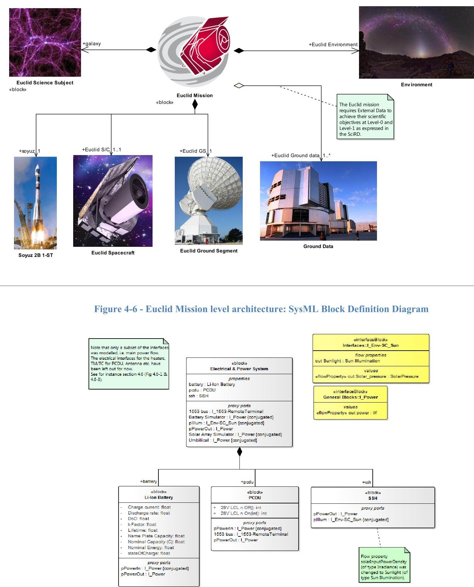

Figure 4-7 - Electrical and Power System: SysML Block Definition Diagram

The internal block diagram (IBD) is used to show the connections between parts of a block. For Euclid we distinguish four types of IBDs, representing certain views or perspectives of a stakeholder on (parts of) the system: 1) Power View 2) Thermal View, 3) Signal View and 4) Mechanical View. In some instance, however, additional "mixed" views are

<!-- PDF_PAGE: 13 -->

selected to display in a diagram some information related to a particular scope of need. Figure 4-8 shows a sample IBD with the system interfaces at top mission level, including both spacecraft signal interfaces and launcher mechanical interfaces.

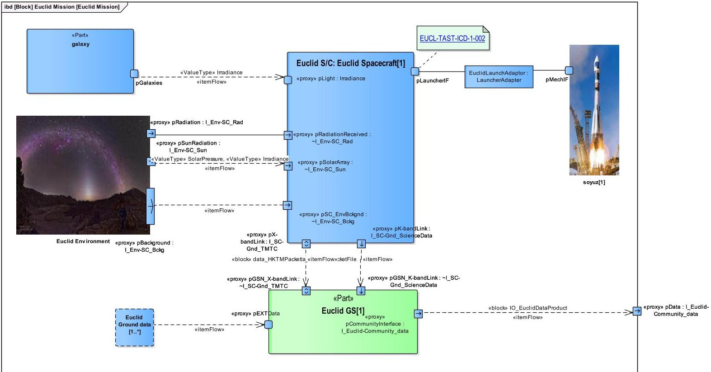

Figure 4-8 - Euclid Spacecraft level nominal interfaces (partial): SysML Internal Block Diagram $ ^{3} $

Modeling interfaces is one of the most critical aspects of system modeling. There are many ways of modeling interfaces in SysML and the approaches reported to date in the available applications of the standard are quite mixed. On Euclid we are modeling interfaces using ports. A port represents an access point on the boundary of a block. We have lately adopted the approach introduced in SysML version 1.3 [5], which includes the concept of Proxy Ports (virtual entry point of a system that represents an interface embedded in a subsystem or lower level of decomposition element) and Full Ports (which represent a physical/logical element existing at the boundary of a system). Proxy Ports are typed by InterfaceBlocks and Full Ports are typed by Blocks. The blocks used to type ports have flow properties specifying the direction of the flow (in/out/inout) as well as the type of item that flows in or out of the block. Examples of the type of items that flow are torque, electricity, data, etc. Ports are connected using connectors and the items that actually flow across a connector can be modeled using so-called Item Flows.

On Euclid we combine flows, ports and connectors/item flows to model the interfaces. Figure 4-9 shows a sample Signal View for the Euclid Spacecraft. Different types of signals flow between the different subsystems and are color coded in the diagram. Light enters the system via the telescope which focuses it and splits it spectrally between the two instruments: VIS and NISP. From the instruments, collected images already digitized are transmitted to the Service Module (SVM), that finally transfers them to the boundaries of the system through the antennas for transmission to the ground.

<!-- PDF_PAGE: 14 -->

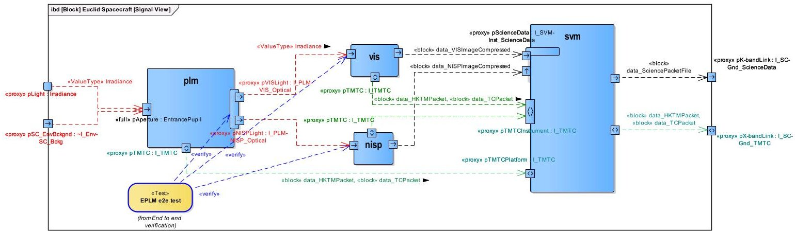

Figure 4-9 - Euclid Spacecraft Signal View: SysML Internal Block Diagram

Figure 4-10 shows how the parts of EPS are interconnected. It clearly portrays the three parts and how they interface. By using the arrows on the ports the flow can easily be followed. Interfaces for verification purposes (e.g. umbilical connection) have also been modeled.

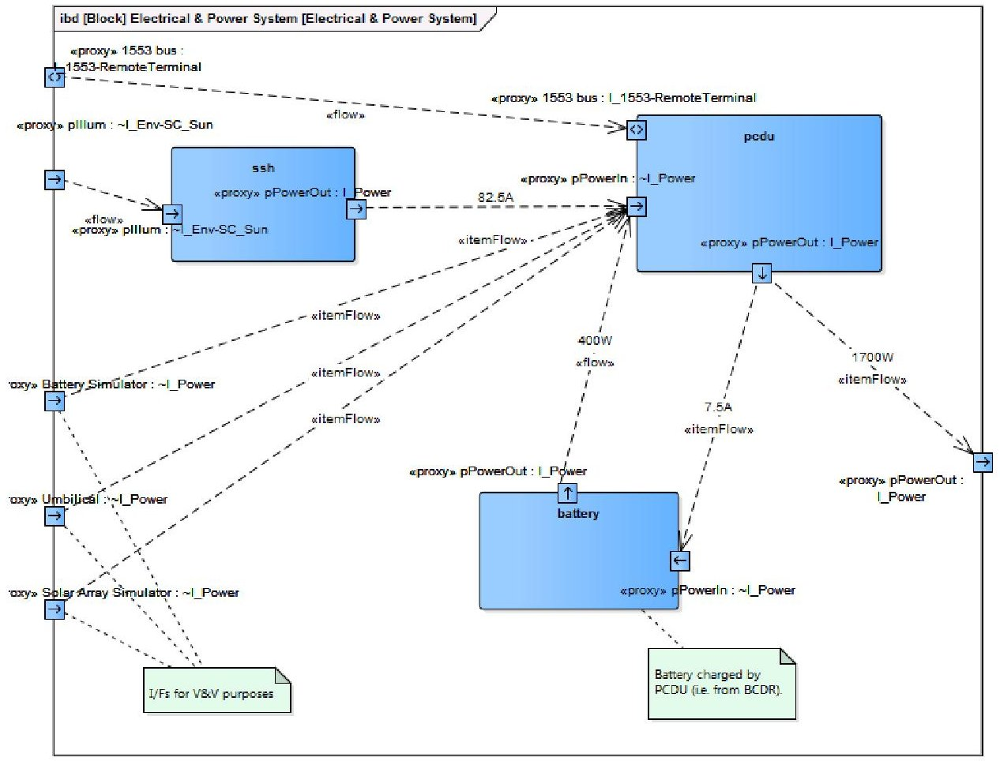

Figure 4-10 - Euclid Spacecraft Electrical & Power System (EPS) Power View: SysML Internal Block Diagram

## 4.3 Verification modeling

For the modeling of the verification approach and organization we use primarily SysML Activities. Verification activities are categorized in the Euclid SysML implementation with custom stereotypes Review of Design, Test, Analysis and Inspection, in line with the applicable verification standards for the mission.

<!-- PDF_PAGE: 15 -->

To build up the verification, these activities are systematically linked to both requirements (as shown in Figure 4-4) and system architectural elements (systems and interfaces as shown in Figure 4-11) by means of a custom dependency labeled as Verify and shown as blue dashed arrows in the diagrams. The structure and relationship between the identified verification tasks is then grouped into activity trees $ ^{4} $ as shown in the example in Figure 4-12.

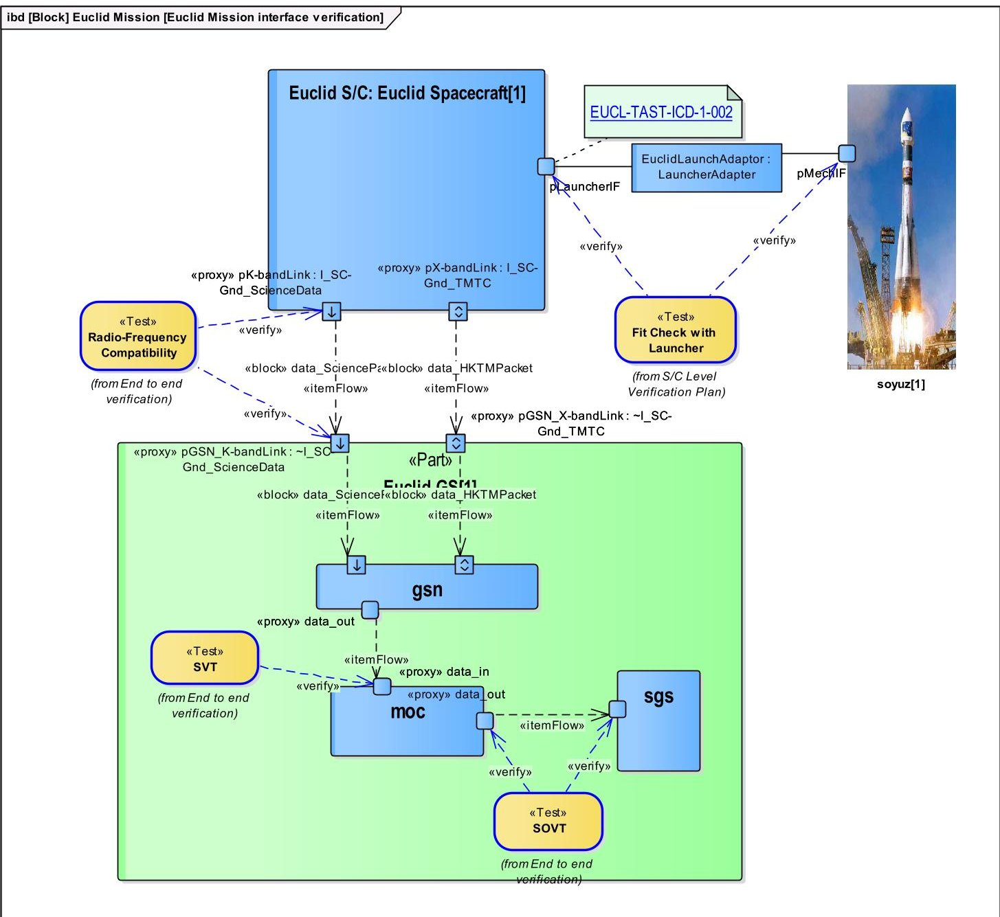

Figure 4-11 - Spacecraft interfaces with verifications associated to interfaces: SysML Internal Block Diagram

<!-- PDF_PAGE: 16 -->

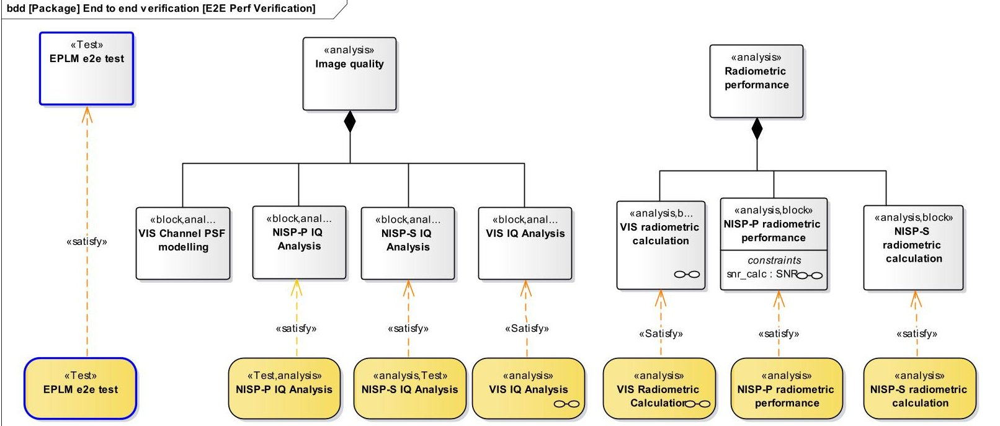

Figure 4-12 - Euclid End to end performance verification activity tree: SysML Block Definition Diagram.

Finally, each verification activity is developed individually in the form of activity diagrams. As examples, Figure 4-13 shows the internal definition of the analysis activity "VIS Radiometric Calculation" and Figure 4-14 displays the flow of integration and test task for a development model of the NISP instrument. Activity diagrams allow to represent the logic and flow of activities as well as the input and output parameters required.

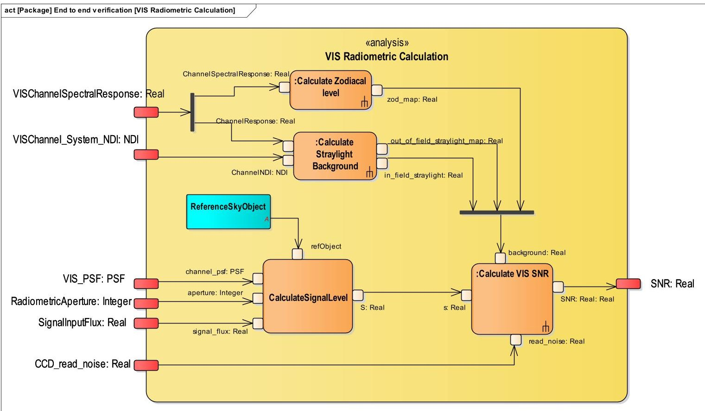

Figure 4-13 - Performance radiometric analysis verification in VIS channel: SysML Activity diagram

<!-- PDF_PAGE: 17 -->

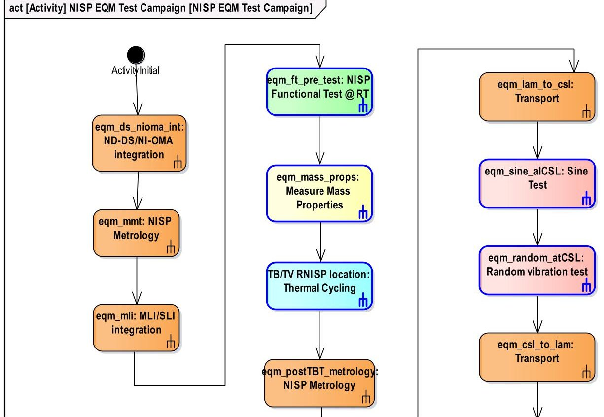

Figure 4-14 - NISP development model test campaign (partial): SysML Activity Diagram

This three-step process allows to ensure completeness and progress monitoring and control of the verification definition. Automated checks are introduced in the model (using the available tool specific features) to generated reports of requirements and architectural elements missing verification links.

## 4.4 Operations and behavior modeling

Finally, the behavior and operability of the system is currently being implemented in the model. We use two SysML diagrams for that purpose: (i) State diagrams to represent system modes and transitions (Figure 4-15) and (ii) sequence diagrams to display the exchange of data and messages between the different subsystems (as shown in the example VIS operational sequence in Figure 4-16).

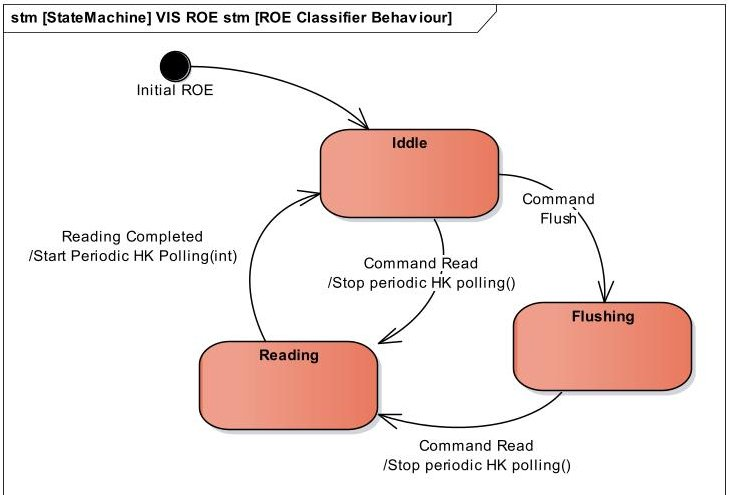

Figure 4-15 - VIS Read-out electronics mode: SysML State diagram

<!-- PDF_PAGE: 18 -->

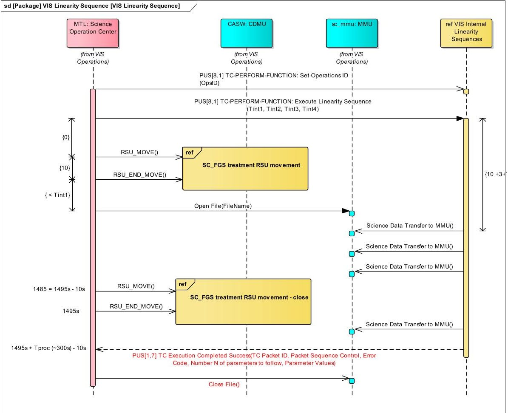

Figure 4-16 - VIS instrument operational sequence example: SysML Sequence diagram

## 5. LESSONS LEARNED AND FUTURE WORK

The modeling endeavour for Euclid started at the end of Phase B1 in 2012, one year before the Mission System Requirements Review (MSRR). Currently the mission is already deep into the implementation phase and the four years of experience on the use of a MBSE approach has already raised a number of lessons learned that can be of use both for the continuing Euclid modeling effort as well as for new projects.

In the next bullets, we summarize what we consider the main recommendations:

- Modeling as System thinking lighthouse: Modeling is not merely a graphical representation of systems and relationships for presentations. The process in itself forces to define and follow a structured approach for classifying and evaluating the system. The need to establish links and architectures also structures thinking.

- Define and document a clear modeling approach: the effort for modeling is shared across multiple actors in a system. It is important to define clear rules for the specific usage. This has proven to be very important and challenging in the Euclid experience. Languages like SysML and the tools we selected are in general quite open and even allow to perform semantically illegal links in models. For the future, we aim to develop tools to automatize the verification of modeling consistency and adequacy.

<!-- PDF_PAGE: 19 -->

- Start early: A model built up from the initial stages of the project allows maintaining knowledge. Particularly, knowledge transfer between project phases (and different teams) is identified as a high risk component specially in large and lengthy projects - both for ground and space - as it is the case in astronomy.

- Identify what you need to model: For Euclid, a significant number of iterations were required to realize to which level it is required to model. One could make representations from the mission level down to the fasteners in electronic boxes. Identifying clearly (i) what is the use of the model, (ii) who will use it, and (iii) what would provide a benefit to the system if modeled is an essential step before going too deep into the task. One needs to model one layer of system decomposition at a time and limit the scope to the level required to meet the model objectives.

- Sharing and usage: The Euclid model is currently being used at mission level mostly by a reduced number of system engineers in ESA and the Euclid Consortium. Increasing the usage across the team (Prime contractor and other engineers in the teams) requires a simplification of the interface to hide the complexity of the tool. For the mission level reviews, a HTML export was provided to members external to the project and was considered very useful in particular in the evaluation of the requirement traceability in the Mission System Requirements Review.

In general, we consider that the level of control of relationships between the system components, requirements and information achieved with the model would have been very difficult to maintain with a document based approach. As we advance in the program, the amount of information continues to grow and the need shifts to the verification tasks including potential deviations from the designed baseline due to implementation and hardware limitations or problems. At this stage we are already experiencing the benefits of a complete system representation. It is allowing us to perform a fast assessment of impact of changes and non-compliances.

In the next period, the focus on the modeling activities will move to the completion of the operational aspects, the ground data processing and the verification completeness assessment.

## 6. CONCLUSIONS

The Euclid project decided to introduce a MBSE approach to tackle the complexity of the applicable science needs and organization. This is the first time this is performed in an ESA Science mission and the objective is also to extract sufficient return of experience to evaluate the benefits and additional work required for a full introduction of MBSE into standard practices.

Over the last four years of usage, it has become clear that without the aid of the model it would have been very difficult to maintain the same level of control and consistency in Euclid. This is particularly the case for requirements management and justification control, due to the large gap between the needs expressed by science and their translation into implementable engineering requirements.

Future work will focus on completing the operations and verification modeling with the aim to converge at the end of the project in a set of clear recommendations and guidelines for MBSE application in future ESA missions.

## REFERENCES

[1] Laureijs, R. et al., "Euclid Definition Study report", ESA report ESA/SRE(2011)12, arXiv:1110.3193 (2011)

[2] Racca, G., et al., "The Euclid Mission Design", Proc. SPIE 9904-19 (2016)

[3] Cropper, M. et al., "VIS: the visible imager for Euclid", Proc. SPIE 9904-20 (2016)

<!-- PDF_PAGE: 20 -->

[4] Maciaszek, T., et al., "Euclid Near Infrared Spectro Photometer instrument concept and first test results at the end of phase C", Proc. SPIE 9904-22 (2016)

[5] “SysML Open Source Specification Project”, SysML v1.3, http://sysml.org/docs/specs/OMGSysML-v1.3-12-06-02.pdf

[6] “Euclid Consortium”, http://www.euclid-ec.org/

[7] INCOSE, "Systems Engineering Vision 2020", INCOSE-TP-2004-004-02, v 2.03, http://oldsite.incose.org/ProductsPubs/pdf/SEVision2020_20071003_v2_03.pdf, (2007).

[8] INCOSE, "A world in motion. Systems Engineering Vision 2025", http://www.incose.org/docs/default-source/aboutse/se-vision-2025.pdf, 2014

[9] Kaslow, D., et al. "Developing and distributing a cubesat model-based systems engineering (MBSE) reference model", $ 31^{\mathrm{st}} $ Space Symposium, Colorado Springs (CO), USA (2015).

[10] Kretzenbacher, M., et al., "Model Based Systems Engineering (MBSE) Applied Through a SysML Model to the Mascot Asteroid Lander," in Proceedings of the 64th International Astronautical Congress (IAC), Beijing, China, (2013).

[11] Claver, F., et al. "Using SysML for MBSE analysis of the LSST system", Proc. SPIE 7738, Modeling, Systems Engineering, and Project Management for Astronomy IV, 77381D (2010);

[12] Karban, R., et al. "Model Based Systems Engineering for Astronomical Projects", Proc. SPIE 9150 (2014).

[13]“Survey of Architecture Frameworks”, http://www.iso-architecture.org/42010/afs/frameworks-table.html

[14] Vavrek, R., et al. "Mission-level performance verification approach for the Euclid space mission", Proc. SPIE 9911-3 (2016)