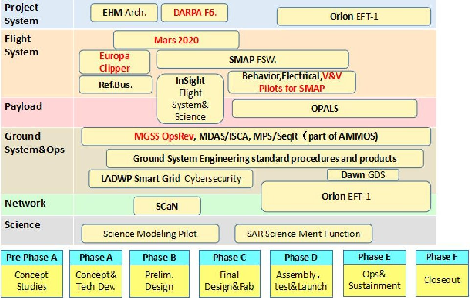
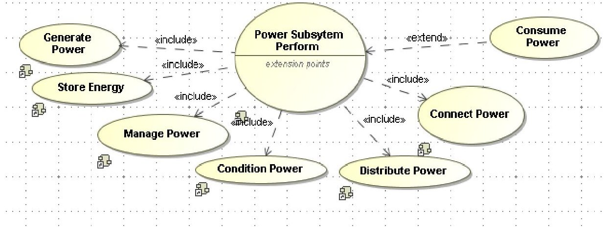
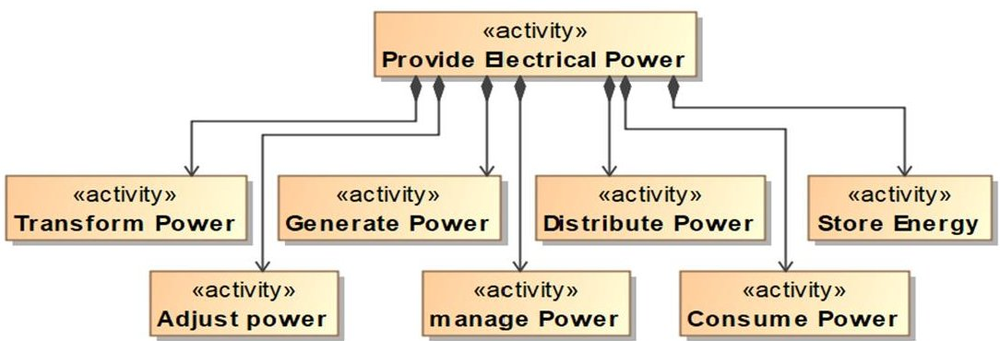
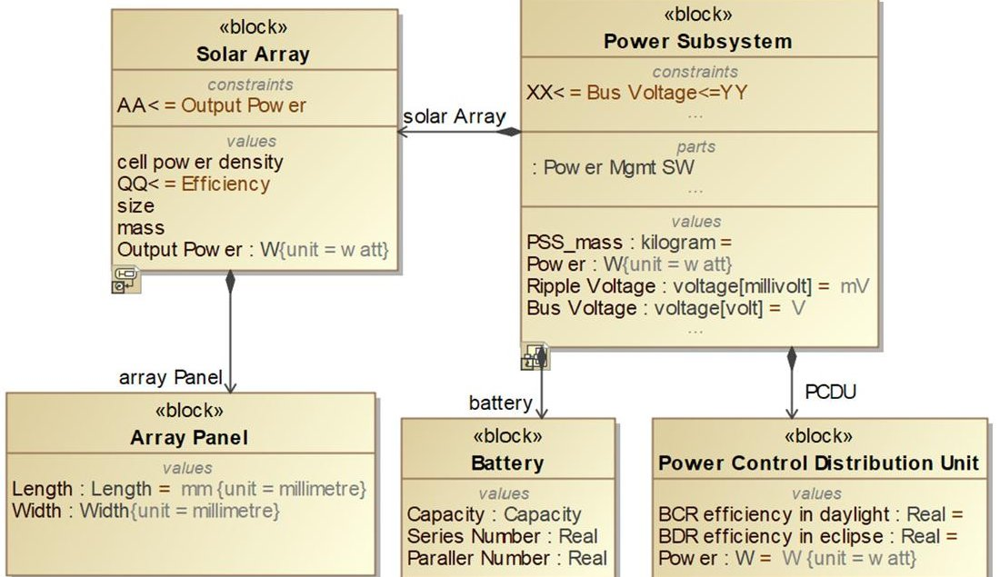
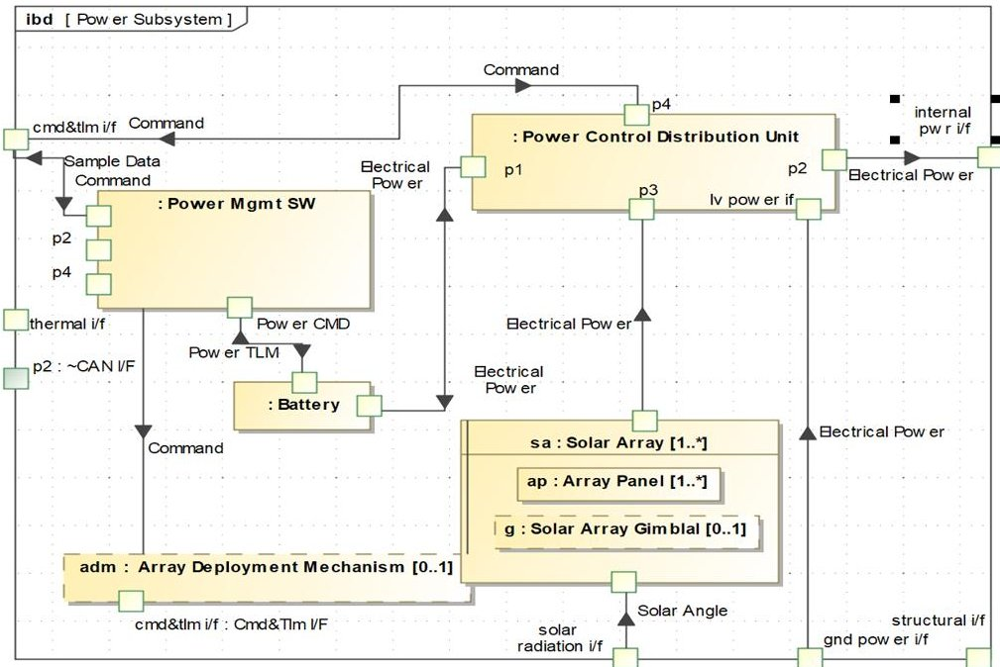
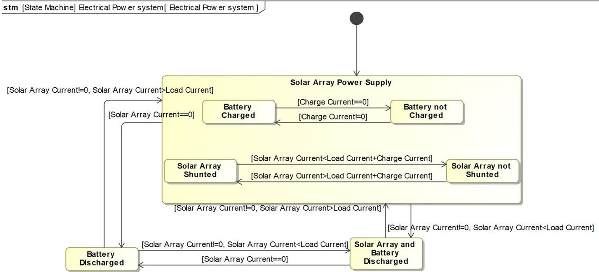
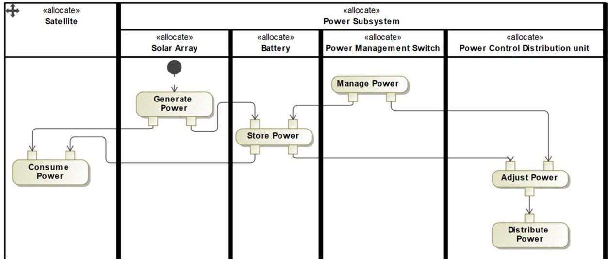
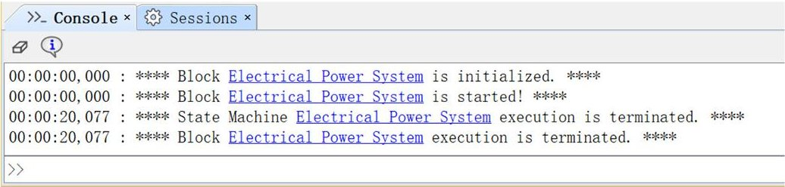

<!-- PDF_PAGE: 1 -->

# Research on Function Analysis and Architecture Design Method of Satellite Electrical Power System Based on SysML

Lele Wang $ ^{*a} $ , Pengyu Liu $ ^{a} $ , Yuanmo Liu $ ^{a} $ , Xiangyi Meng $ ^{a} $ , Xiaodong Jia $ ^{a} $

$ ^{a} $ DFH satellite Co.Ltd. Beijing 100094, China

$ ^{*} $ Corresponding author: yzdoublele@163.com

## ABSTRACT

In the design of the satellite electrical power system (EPS), there is a large amount of complicated design information, which cannot be effectively tracked and correlated in the form of documents when it is iterated by different designers. In addition, there are risks of low communication efficiency and quality problems. Model-based system engineering (MBSE) is an effective solution to these problems. This paper adopts the MBSE method, based on the system modeling language (SysML), to analyze the functional requirements and architecture design of the satellite EPS, and at the same time to model and design the energy balance analysis. This will not only achieve efficient information expression and data transmission, but also provide a fundamental guarantee for the thoroughness of the EPS development process in satellite. This new EPS design mode has greatly improved the communication and efficiency of the design.

Keywords: Mode-based system engineering (MBSE); electrical power system (EPS); functional analysis; architecture design;

## 1. INTRODUCTION

As a significant subsystem of satellite, the performance of power supply and distribute system directly determines the operation of the whole satellite. In the process of satellite design, massive design information with complex correlations will be generated, from the overall development requirements to the realization of EPS products and then to the on-orbit operation $ ^{[1]} $ . At present, these information is mainly stored and managed in the form of documents, which leads to the inconsistency of system parameter states in different documents from time to time, leading to many security risks.

MBSE is an effective solution to these problems. It starts from the demand stage, and realizes the product system design through the continuous evolution and iterative increase of the model rather than the document. Through the structured definition of the model, it can clearly express the requirements of all aspects in the early stage of product design, and a large number of unreasonable design schemes can be found through simulation in the early stage of design $ ^{[2-3]} $ . At the same time, due to the uniqueness of the model, it also provides a unified and unambiguous design information exchange tool for all parties $ ^{[4-7]} $ .

## 1.1 Improve designer communication efficiency

The smallest object of document based system engineering method is document. The information required by users is scattered in a large number of documents, so it is difficult to find it. The first mock exam based on SysML whose graphical symbols are written in character is more acceptable than the document. These model is intuitive and image, which would ensure the integrity of information. In the process of iteration, different designers can easily understand the same model, and can improve the communication and understanding efficiency among different designers.

## 1.2 Traceable and standardized system architecture

The traditional EPS architecture is mainly implemented in documents, but the lack of information or misunderstanding occurs in the process of information transmission frequently. In particular, when it comes to some innovative designs, we need to conduct correct and complete demonstrations, design the system architecture in a targeted manner, decompose the index requirements of the sub-systems to lower levels, and the entire delivery process must be controlled and traceable. Using the MBSE method, the relationship between the models will be continuously established during the work process. Through these relationships, traceability and correlation analysis can be realized, and the overall analysis of the electrical power system structure and the control of the technical status can be further completed.

<!-- PDF_PAGE: 2 -->

## 1.3 Explore the integrated process of design verification

Compared with the traditional design process, MBSE method emphasizes the analysis and transmission mode in the working process, and also considers design and verification. By establishing the relationship between verification model, requirement model and functional model, MBSE method could ensure that all indicators of the system meet the verification requirements.

## 1.4 Explore innovation points of system demonstration in the initial stage

As a high reliability equipment, EPS equipment is difficult to innovate in product design or equipment manufacturing, and the innovation points of disruptive design often appear in the stage of function analysis or demand analysis. This stage does not involve product manufacturing, which leads to the low cost of innovation. Therefore, using MBSE method to strengthen the research on demand acquisition and new functional analysis mode is conducive to the development of innovative mode in the whole EPS, so as to achieve the purpose of cost reduction and efficiency increase.

## 2. RESEARCH STATUS AROUND THE WORLD

As early as at the INCOSE international seminar in 2007, INCOSE defined MBSE as "the formal application of modeling to support the requirements, design, analysis, verification and validation activities of the system. These activities begin at the conceptual design stage and continue to the whole development and later life cycle stages", and put forward the MBSE vision for the first time at the meeting. According to the methodology of MBSE, the system requirements engineer is an important link in the whole development. The first step of the system design process is to define stakeholder expectations and determine the control baseline, generate technical requirements, determine the control baseline, and convert the technical requirements into design schemes to meet the stakeholder expectations determined by the control baseline. Therefore, foreign related industries actively and widely carry out the application of MBSE to the projects. MBSE has become a hot spot in the research and application of system engineering in recent years.

At the same time, foreign scholars have conducted in-depth research on MBSE theory and modeling methods. In order to support MBSE method, they have launched standardized system modeling language, standardized symbols and semantics $ ^{[8]} $ . Software providers are actively developing relevant support platforms by developing MBSE infrastructure, including basic elements of ontology, repeatable modeling tool support for comprehensive modeling method and document generation method, which can analyze quick schemes, improve product quality and efficient communication.

Figure.1 MBSE application scope

In China, some domestic enterprises, especially some aerospace enterprises have carried out in-depth research and practice from typical links such as task analysis, scheme demonstration, demand decomposition and tracking, automatic testing and so on. They also achieved positive results. By analyzing the task profile and functional requirements at the system level, the function allocation is carried out according to the task characteristics, the function block diagram and

<!-- PDF_PAGE: 3 -->

function tree are listed, the main performance index requirements are put forward, and the requirement decomposition model is formed.

## 3. SYSTEM FUNCTION ANALYSIS

Function analysis is the behavior analysis of the function in the expected scenario. By defining the operation characteristics of the function and analyzing the main work content, the upper level functions are decomposed into functions at different levels step by step. Thereby designer can systematically propose functional requirements and internal/external functional interfaces.

## 3.1 Task context analysis

When analyzing the function of the EPS, it is necessary to analyze its working environment and the interaction relationship between other stakeholders. From the perspective of the whole satellite, it is to analyze the timing, interaction sequence, constraints and content between stakeholders such as EPS and other subsystems. For the EPS, various scenarios need to be considered in the analysis process to describe the situation under different environments and operation modes. For example, the battery is discharged in the umbra, and the solar cell arrays need not only to supply power to the load, but also to charge the battery in the light. Use case diagram is a black box view of the system. It refines the requirements of satellite system which is a collection of functional requirements or scenarios and focuses on the purpose of the system. Use cases can be used as an important organizational form of requirement expression. It can establish complete functional use cases and operation scenarios, which is great significance to the functional analysis of electrical power system.

Through the functional analysis of the electrical power system under different working environments and modes, the following seven main functions are obtained: power generation, storage, management, condition, distribution, power supply, etc. Figure 2 shows the functional requirements of the EPS.

Figure.2 Use cases of EPS functional requirements

## 3.2 Functional decomposition

The function decomposition generally adopts the activity diagram of SysML depends on the modeling purpose and model granularity. When an action is decomposed into an action, it does not need to be further decomposed. This action means that there can be a structure to implement or carry the functional behavior, that does not need to be decomposed down. The granularity of top-level activities should generally indicate the system in a clear way. The granularity of main activities and bottom activities shall be refined to meet the analysis requirements of modeling, so as to support function allocation, cross-link analysis, etc.

According to the analysis of the functional requirements of EPS, the granularity of the model is focus on the equipment level, which means the function is decomposed into equipment index in electrical power system. In this paper, the Block Definition Diagram (BDD) is used to reflect the hierarchical relationship of function decomposition, which is a useful supplement to the function decomposition relationship represented by the activity diagram. Figure 3 shows the function decomposition of EPS.

<!-- PDF_PAGE: 4 -->

Figure.3 Functional decomposition of EPS

As a significant subsystem, the functional requirements and constraints of EPS determine the operation scheme to meet the requirements of mission objectives. Therefore, it is necessary to explore the requirements that can truly reflect the mission objectives of the whole satellite. It can also actively include the mission objectives in the analysis process when defining the satellite electrical power system in details. System function analysis can more clearly express the system characteristics, so as to carry out more practical analysis and make better and wiser decisions.

## 4. SYSTEM ARCHITECTURE DESIGN

The focus of EPS architecture design is to equip functional requirements into the actual architecture structure. Each structure in the design is captured by the relationship between model elements. Finally, the system design results are clear in the forms of system digital model architecture. The incremental iterations are carried out to transform the black box view completed in the early stage into a white box view. In fact, architecture design allocates use cases to system functions, while functional analysis allocates requirements to system use cases.

## 4.1 EPS architecture

In accordance with the top-down design principle, the architecture is constructed through the description of EPS application scenarios, including the EPS and all other related elements, such as electricity consumption demand, orbit, space environment, signal transmission channel, etc.

The operation functions of EPS on orbit are described as follows:

(1) Primary power supply is provided for the on-board equipment during the launch phase;

(2) The output power of the power supply must meet the requirements to ensure the normal operation of the on-board equipment during lifetime;

(3) In light, the excess electrical energy will be provided for battery charging as the output power of solar arrays is greater than loads. Otherwise when the output power of the solar cell cannot meet the load demand, the battery will discharge and jointly supply power to the load with the solar arrays;

(4) During umbra, the battery would be the only electric energy source for on-board equipment;

(5) It is also mainly responsible for the management and control of the primary power supply, including the regulation of the main bus voltage, the management of battery charge and discharge, the provision of transformation required by other subsystem and interfaces for telemetries and remote control required by satellite;

According to the operation functions in orbit, EPS is divided into three modules: energy storage module, energy source module, power distribution and regulation control module. On the activity diagram, the operations of the space system module are assigned to the device parts that make up it. The system architecture diagram of EPS is shown in Figure. 4 below.

<!-- PDF_PAGE: 5 -->

Figure.4 System architecture of energy subsystem

Due to the architectural design carried out on the base of functional requirements analysis, the data and information flow exchanged between each equipment must be known. The internal interface module diagram can clearly represent the interaction information between the research object and the external interaction object, not only reflect the functional interface information but also reflect the functional architecture during the logical validation of the architecture design, simultaneously. The energy flow and information flow interface relationship within EPS which has been executed successfully is shown in Figure. 5.

Figure.5 Interface relationship between energy flow and information flow in EPS

## 4.2 Architecture verification

Stated-based behavior could reflect a good indication of the system behavior and the functions during operation, so judging the correctness of the architecture by the state transition of the behavior is a very effective method. The system state can be clearly seen through the model execution, thus verifying the system architecture. However, there are certain

<!-- PDF_PAGE: 6 -->

differences between EPS and common power system which includes the need to judge the difference in the orbit environment, such as light and umbra, to determine the working state of different functional modules.

Figure.6 State machine diagram of EPS operation

Referring from the figure 6 above, during the light period, the output power of solar-arrays is supplied to loads and charged to batteries simultaneously when the output current of solar-array is greater than load currents in light. When the output current of solar-array is greater than the sum of the load currents and charging current, the redundant energy will be shunted after charging and power supply. When the output current of solar-arrays is less than load currents, the loads will be supplied by the joint-power supply consisted of solar-arrays and batteries. Since the solar-arrays have no output power in umbra, the system is fully switched to battery power supply state.

We take the function analysis of EPS as the input, and use the methods of allocation swim-lane which also allocate the matrix to map the function to the logical architecture. The BDD of SysML is used to express the hierarchical relationship of logical components. As the functional architecture expands layer by layer, it is necessary to consider which logical component carries the functional node in the functional architecture. The execution result of swim-lane map is used to verify the correctness of architecture logic. Figure 7 shown below is the swim-lane map of the logical architecture and functions of the EPS.

Figure.7 Swim-lane map of logical architecture and function of EPS

The final step in state behavior-based EPS architecture validation is the compilation of the model. There is no error and warning found which illustrates the correctness of the architecture design.

<!-- PDF_PAGE: 7 -->

Figure. 8 Compile results for state behavior-based EPS architecture validation

This kind of the architecture design has been applied to the EPS design of a remote sensing satellite in the sun synchronous orbit which effectively improves the efficiency of design information transmission and system function interaction.

## 5. ENERGY BALANCE ANALYSIS

## 5.1 Energy balance analysis requirements

As an important part of satellite, to determine whether the EPS can provide enough energy to meet the normal operation of satellite in orbit life cycle, energy balance analysis is an important index to measure the design of EPS. Therefore, it is necessary to calculate and evaluate the energy balance of EPS. Energy balance analysis and calculation is an essential and important means to verify the function and architecture design of electrical power system. The purpose is to output the design key parameters characterizing the performance of electrical power system in one orbit under given input conditions, and give the energy balance in combination with the load working mode, so as to verify the correctness of the design.

The EPS demand model can operate independently as a separate model or as a part of the system level task analysis. The energy balance calculation, as a part of the EPS demand model, is expressed in the form of parameter calculation in the MBSE model to complete the result calculation under different input parameters as the system level trade-off analysis parameters.

## 5.2 Energy balance analysis modeling

Energy balance analysis mainly uses the requirements of energy balance analysis to calculate the parameters such as battery discharge capacity, output power of solar arrays. Therefore, the parameter diagram of SysML can be used for simulation calculation, and the calculation results can be dynamically displayed in the form of dynamic curve diagram.

The modeling process is mainly designed according to the following process:

(1) The formula in MBSE modeling requirements of electrical power system requirements is encapsulated as a constraint block;

(2) Create the energy balance analysis module and the value attribute needed in the analysis;

(3) Create a parameter diagram for the energy balance analysis module, and bind the value attribute with the parameters in the constraint block;

(4) Use the simulation function of parameter diagram to create an example of analysis module. Through simulation calculation, the calculated dynamic simulation results are displayed by using user interface with SysML.

Energy balance analysis is proposed as a means to verify the system design results and all design results will be brought into the energy scale analysis model for verification. If the design results cannot meet the requirements of energy balance, the design parameters need to be readjusted to meet the balance requirements. If the design results can meet the requirements of energy balance, it is necessary to pay attention to the energy abundance and discharge depth under different working conditions and scenarios through the output curve, which will help the design trade-off of EPS and prevent over design. Figure 9 below is an example of an energy analysis model.

<!-- PDF_PAGE: 8 -->

<table border="1"><tr><td colspan="2">《block》
Power Analysis Models</td></tr><tr><td colspan="2">parts</td></tr><tr><td>depth of discharge</td><td>Depth of discharge</td></tr><tr><td>solar cell array final output power</td><td>Solar cell array final output power</td></tr><tr><td>energy redundancy</td><td>Energy redundancy</td></tr><tr><td>initial output power of solar array</td><td>Initial output power of solar array</td></tr><tr><td>charging power</td><td>Charging power</td></tr><tr><td>battery pack discharge capacity</td><td>Battery pack discharge capacity</td></tr><tr><td>minimum rated current of battery pack</td><td>Minimum rated current of battery pack</td></tr></table>

Figure.9 Energy balance analysis model

## 6. CONCLUSION

This paper uses a model to design the entire EPS function and architecture, which will cause huge changes to the working mode and design process, and achieve efficient information expression, data management and data transmission. At the same time, it can also provide a fundamental guarantee for the up-and-down connection of the EPS development process in satellite. By establishing multilevel associative design relationships, downstream designs can be automatically updated when upstream requirements change. In addition, modeling can also be verified by the design logical results, thereby speeding up the design iteration cycle, improving design efficiency, and avoiding under-design or over-design.

## REFERENCES

[1] QIAN X S.On system engineering[M]. Shanghai Jiaotong University Press, 2007.

[2] KASLOW D, ANDERSON L, ASUNDI S. Developing a CubeSat Model-Based System Engineering Reference Model-interim status[C]// Aerospace Conference, IEEE, 2015.

[3] LIU Y S, JIANG Y Q, GAO S M.Model-driven modeling for system design of complex product:A survey[J].China Mechanical Engineering, 2021, 21(6):741-749.

[4] KERNSCHMIDT K, FELDMANN S, VOGEL-HEUSER B. A model-based framework for increasing the interdisciplinary design of mechatronic product systems[J].Journal of Engineering Design,2018,29(11),617-643.

[5] YILDIRIM U, CAMPEAN F, WILLIAMS H.Function modeling using the system state flow diagram[J]. Artificial Intelligence for Engineering Design Analysis and Manufacturing,2017, 31(4):413-435.

[6] ARANTES M, BONNARD R, MATTEI A P, et al. General Architecture for Date Analysis in Industry 4.0 using SysML and Model Based System Engineering[C]. The 12th Annual IEEE International System Conference.IEEE,2018.

[7] RASHID M, ANWAR M W. A systematic investigation of tools in model based system engineering for embedded systems[C].System Engineering Conference.IEEE,2016.

[8] WANG K S, YUAN J H, CHEN H T, PU H B. Research and practice of model-based system engineering method in foreign countries[J]. Aerospace China,2012,11:52-57.