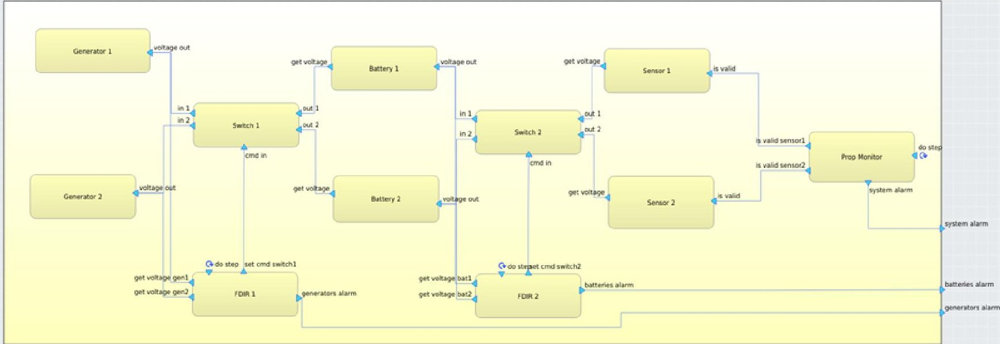
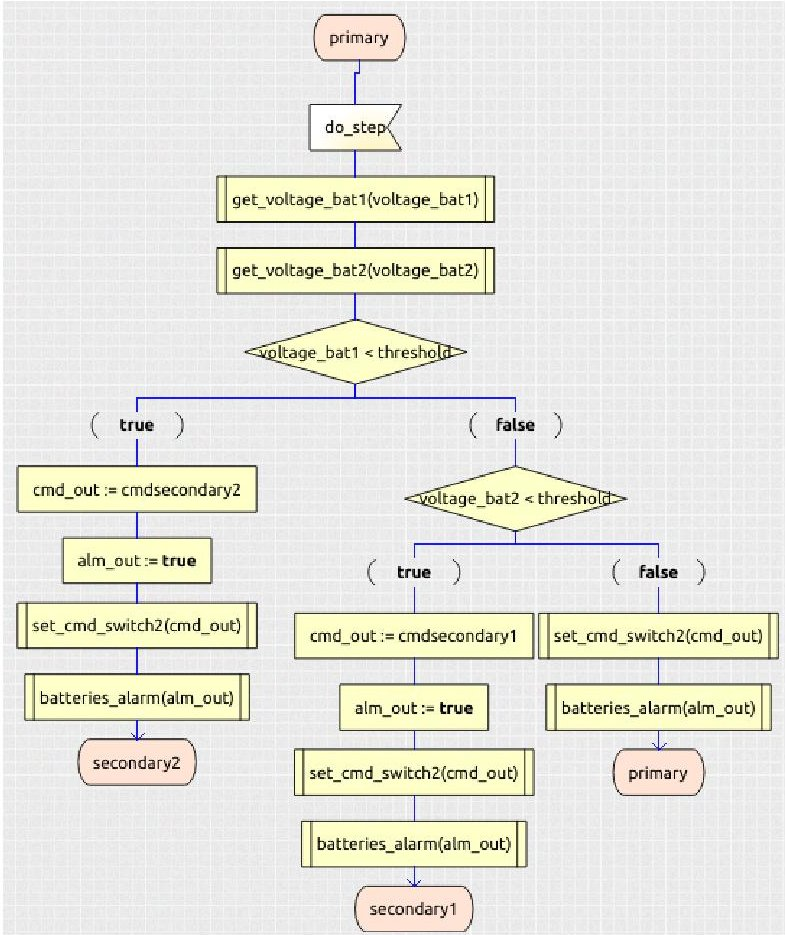
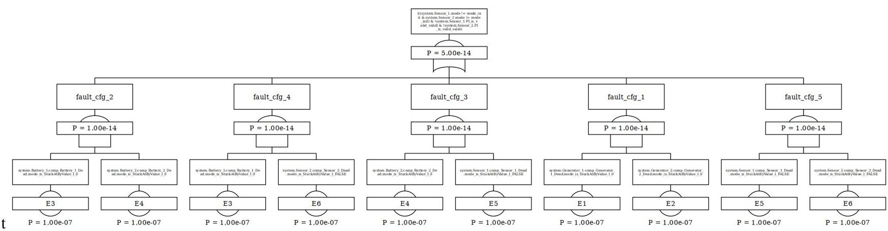

<!-- PDF_PAGE: 1 -->

# COMPASTA: Integrating COMPASS Functionality into TASTE

A. Bombardelli, A. Bonizzi, M. Bozzano, R. Cavada, A. Cimatti, A. Griggio, M. Nazaria, E. Nicolodi, S. Tonetta, G. Zampedri

Fondazione Bruno Kessler, Via Sommarive 18, 38123 Trento, Italy; email: bozzano@fbk.eu

## Abstract

TASTE is a tool chain dedicated to the design and implementation of embedded, real-time systems, developed under the initiative of the European Space Agency (ESA). It consists of various tools, which support model-based design of embedded systems, automatic code generation, deployment and simulation. TASTE is based on several specification languages, in particular it uses AADL for the architectural design, whereas the behavior of SW components can be specified in SDL and other languages.

TASTE currently lacks a comprehensive support for performing early verification and assessment of the design models. COMPASTA is an ESA study that aims at filling this gap, by integrating into TASTE the formal verification functionality of COMPASS, a tool for model-based HW SW co-Engineering developed in a series of ESA studies. COMPASTA extends TASTE by providing the possibility to model the behavior of HW components using SLIM, a dialect of AADL supported by COMPASS. Moreover, it offers capabilities such as library-based specification of HW faults, automatic fault injection, contract-based design, functional verification and safety assessment, fault detection and identification analysis.

Keywords: AADL, SDL, TASTE, COMPASS.

## 1 Introduction

TASTE [1,2] is a model-based software engineering design environment dedicated to embedded, real-time systems, which has been actively developed by ESA since 2008. Specifications are written in different languages, such as AADL [3] (for the architectural specification) and SDL [4] (for the behavioral specification). TASTE includes various other tools, such as editors, viewers, and code generators. TASTE has been adopted as a glue technology and for system deployment in several projects, see e.g. [5,6,7].

COMPASS [8,9,10] is a tool for System-SW Co-Engineering developed in a series of ESA studies from 2008 to 2016. Specifications are written in SLIM, a dialect of AADL. COMPASS supports model-based verification techniques, based on model

checking, such as requirements analysis, contract-based analysis, fault specification, functional verification, safety and dependability assessment, fault detection and identification analysis. COMPASS is based on the ocra [11], nuXmv [12] and xSAP [13] verification back-ends.

COMPASTA is an ESA study (2021-2022) that aims at integrating the formal verification functionalities of COMPASS [8,9,10] into TASTE [1,2]. COMPASTA extends TASTE by supporting model-based specification of both SW and HW components, fault injection, and a full set of formal analyses, based on model checking. The goal of the analyses is to formally validate the system model, before the system is deployed to the target HW. Thus, COMPASTA makes TASTE a comprehensive and coherent end-to-end tool chain, that covers system design and development SW implementation, deployment and testing.

## 2 The COMPASTA Workflow Exemplified

COMPASTA extends the TASTE workflow by providing additional functionalities which are complementary with respect to the ones available in TASTE. TASTE is a tool for model-based SW engineering, focusing on SW design, deployment and implementation. COMPASTA, on the other hand, extends TASTE by providing the possibility to model HW components and their faults, to perform fault injection, and to carry out several formal analyses (e.g., requirements validation, contract-based design, functional verification, safety and dependability assessment) on the complete formal model (including both HW and SW). The goal of COMPASTA is to enable early validation of the design model, before the SW is implemented and deployed to the target HW.

We illustrate the COMPASTA workflow in a simple running example, shown in Fig.1, modeling a redundant power system.

The example consists of HW components (batteries, generators, sensors, and switches) and SW components (the FDIR components). Generators provide power to batteries, which in turn provide power to sensors. In case of a fault of a generator or a battery, the lines connecting generators, batteries and sensors can be reconfigured. For instance, in case of a fault of one battery, the remaining battery can be used to power both sensors. FDIR components perform a re-configuration by sending a command to the corresponding switch component.

<!-- PDF_PAGE: 2 -->

Figure 1: A power system example.

The system is modeled using the graphical user interface of TASTE. Fig. 1 shows the Interface View (architecture) of the system, i.e. the blocks corresponding to the components, and the connections (provided and required interfaces) between the components. TASTE uses AADL to generate an internal representation of the Interface View.

SW components (FDIRs in our example) can be modeled using the SDL language. For instance, Fig 2 shows an excerpt of the code for FDIR_2. It periodically reads the input voltages of the two batteries and, in case the output voltage of either of them is under a given threshold, it sends a command to the Switch_2 component to change from primary mode to a secondary mode.

HW components can be modeled in SLIM, a dialect of AADL, which extends AADL by providing the possibility, among other things, to specify behavioral models in the form of state machines, and to specify faults and fault injections. We show below some sample code for the Battery_1 component. The given transition causes the output voltage of the battery to decrease by 1, when the input voltage is below 10.

**system implementation** Battery_1.others

-- BATTERY SUBCOMPONENTS

**subcomponents**

-- DELAY FOR TIMESTEPS

delay: **data** clock;

-- BATTERY STATES

**states**

init : **initial state**;

base: **state while** (delay <= 1);

-- BATTERY STATE TRANSITIONS

**transitions**

-- INIT

init -[

**then** voltage_out.voltage := 12

]-> base;

-- BATTERY DISCHARGES BY 1V

base -[

**when** delay >= 1

**and** get_voltage.voltage < 10

Figure 2: Sample SDL code for FDIR_1.

and voltage_out.voltage >= 1

then delay := 0;

voltage_out.voltage := voltage_out.voltage - 1

]-> base;

[...]

end Battery_1.others;

The SDL and SLIM models are translated by COMPASTA into the language supported by the verification back-ends, which are run to carry out the formal analyses. The translation performed

<!-- PDF_PAGE: 3 -->

Figure 3: An example Fault Tree.

by COMPASTA is based on the definition of the semantics of the input languages (based on the standards [3,4] and on the COMPASS semantics for SLIM), and of the semantics of the communication between HW and SW (defined in COMPASTA, and compatible with the TASTE communication semantics).

Fault definitions can be picked from a library, and automatically injected into the system model, e.g., a fault injection can model a permanent "stuck-at-zero" fault of the "voltage_out" signal of a battery. This is specified via the following fault injection specification:

system implementation Battery_1.others properties

FaultInjections => (

[ Description => "Dead";

 Fault_Model => "StuckAtByValue_I";

 Fault_Dynamics => "Permanent";

 Probability => "1.e-7";

 DataInput => "voltage_out.voltage";

 DataVarout => "voltage_out.voltage";

 DataTerm => "0";

 ]

);

end Battery_1.others;

Model checking can be used to verify functional properties. For instance, the following property (specified using a property pattern from COMPASS):

"Globally, it is always the case that sensor1.valid and sensor2.valid holds"

states that the outputs of both sensors are always valid (which is the case when the sensors are powered and they are not failed. COMPASTA can automatically generate and display artifacts such as traces (e.g., a counterexample trace, when a property is violated). Moreover, COMPASTA can automatically generate artifacts such as Fault Trees. Fig. 3 shows an example Fault Tree for the property corresponding to the outputs of both sensors being invalid.

When the formal model has been validated, the standard TASTE workflow can be used for the implementation of the SW components. To this aim, first HW components must be replaced

with corresponding interface components, that represents the SW layer realizing the communication between SW and HW. Then, the deployment of the SW components (binding of the SW to the target HW platform(s)) is specified. Finally, TASTE can then be used to generate the executable code for the target platform(s) and to test and simulate the final implementation.

## 3 Conclusions and Future Work

COMPASTA is an ESA-funded study whose goal is to extend the TASTE toolset with formal verification and assessment functionality, creating a comprehensive and coherent tool chain that covers architectural and functional design, system-level safety assessment, and deployment of the embedded software. In the proposed workflow, system, safety, and software engineers share the same models and use them in an iterative process, supported by various analyses that increase the confidence in the internal and external consistency of the system, and the overall quality of the final product.

The integration is based on a view where the COMPASS backends are split from the COMPASS front-end and integrated in other model-based design environments such as TASTE. On the same lines, ocra, nuXmv, and xSAP have been integrated into CHESS for a SysML-based design [14], while FBK is working on the integration of such back-ends into CAMEO and on the prototype support for SySML-V2.

## Acknowledgments

This work was funded by ESA-ESTEC under Contract No. 4000133700/21/NL/GLC/kk.

## References

[1] J. Hugues, L. Pautet, B. Zalila, P. Dissaux, and M. Perrotin, "Using AADL to build critical real-time systems: Experiments in the IST-ASSERT project," in Proc. ERTS, 2008.

[2] "TASTE web page." https://taste.tools/.

[3] SAE, "Architecture Analysis & Design Language (AADL)," 2022. SAE document AS5506D.

<!-- PDF_PAGE: 4 -->

[4] International Telecommunication Union, "ITU-T Z.100. Specification and Description Language - Overview of SDL-2010," 2021.

[5] "ADE: Autonomous Decision Making in Very Long Traverses."

[6] "MOSAR: Modular Spacecraft Assembly and Reconfiguration."

[7] R. Cavada and A. Cimatti and L. Crema, and M. Roccabruna and S. Tonetta, "Model-Based Design of an Energy-System Embedded Controller Using Taste," in Proc. FM 2016, vol. 9995 of LNCS, pp. 741-747, 2016.

[8] M. Bozzano, H. Bruintjes, A. Cimatti, J.-P. Katoen, T. Noll, and S. Tonetta, "COMPASS 3.0," in Proc. TACAS 2019, 2019.

[9] M. Bozzano, A. Cimatti, J.-P. Katoen, P. Katsaros, K. Mokos, V. Nguyen, T. Noll, B. Postma, and M. Roveri,

"Spacecraft Early Design Validation using Formal Methods," Reliability Engineering & System Safety, vol. 132, pp. 20-35, 2014.

[10] M. Bozzano, A. Cimatti, J.-P. Katoen, V. Nguyen, T. Noll, and M. Roveri, "Safety, Dependability and Performance Analysis of Extended AADL Models," Computer Journal, vol. 54, no. 5, pp. 754-775, 2011.

[11] "ocra web page." https://ocra.fbk.eu.

[12] "nuXmv web page." https://nuxmv.fbk.eu.

[13] "xSAP web page." https://xsap.fbk.eu.

[14] A. Debiasi, F. Ihirwe, P. Pierini, S. Mazzini, and S. Tonetta, "Model-based Analysis Support for Dependable Complex Systems in CHESS," in MODELSWARD, pp. 262-269, SCITEPRESS, 2021.