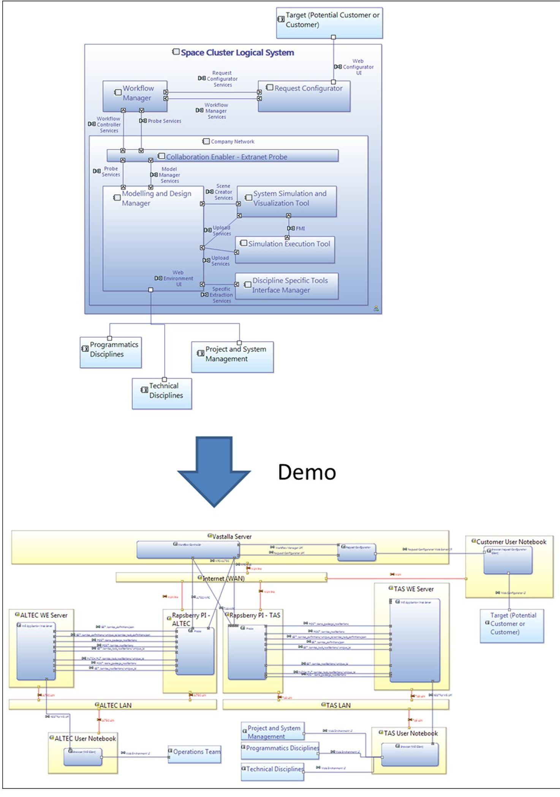
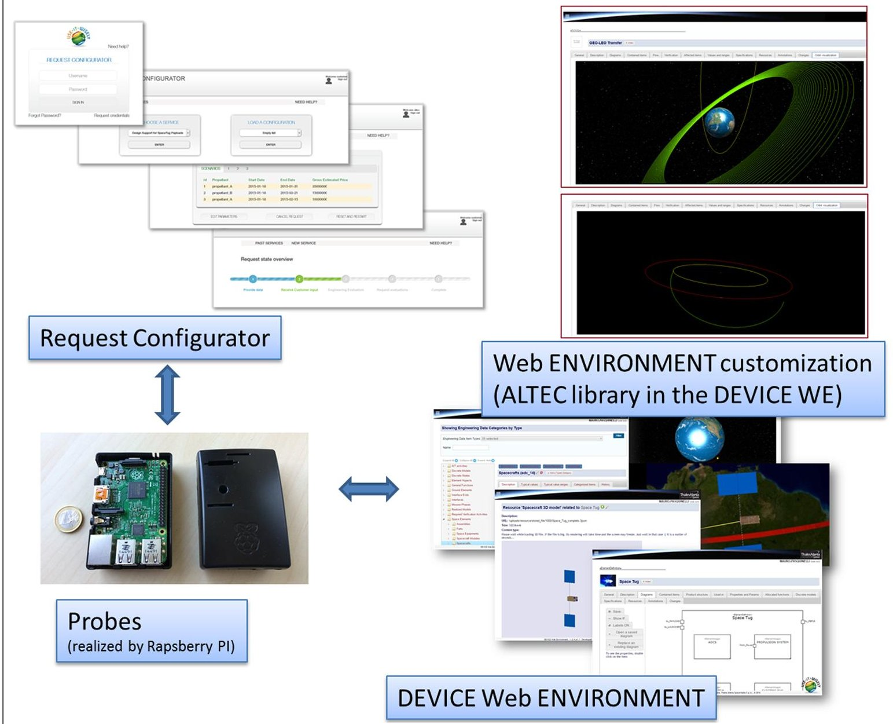
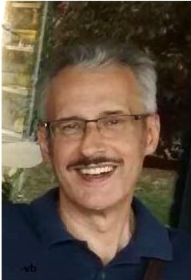
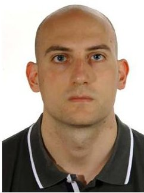

<!-- PDF_PAGE: 1 -->

# Modelling and collaboration across organizations: Issues and a solution

Mauro Pasquinelli $ ^{1} $ , Valter Basso $ ^{1} $ , Lorenzo Rocci $ ^{1} $ Michele Cencetti $ ^{2} $ , Carlo Vizzi $ ^{2} $ and Stefano T Chiadò $ ^{3} $

Concurrent Engineering: Research and Applications 2018, Vol. 26(1) 33-42 The Author(s) 2017 Reprints and permissions: sagepub.co.uk/journalsPermissions.nav DOI: 10.1177/1063293X17727045 journals.sagepub.com/home/cer

## Abstract

This article describes the results of the space cluster of the Use-it-wisely project, which is investigating new business models implementing continuous product-service adaptation through a sequence of small innovative steps in six key industry sectors (clusters): energy, machinery, space, office workspace, vehicles manufacturing and shipbuilding. Six independent cluster developments and a common platform compose the main output. The space cluster (composed by TAS-I, ALTEC and Vastalla) researches a quick response through the use of model-based and simulation-based processes enabled by distributed environments across different organizations. TAS-I and ALTEC study the use of a web-based environment, a model-based tool and virtual reality and its interfaces with potential customers, using an internal project as reference case, including space and ground segments. Vastalla studies and develops the infrastructure able to connect different environments in different networks, including a customer front-end. This article shows the identified issues on collaboration with model-based approaches and the expected benefits.

## Keywords

model-based system engineering, spacecraft design, modelling and simulation, customer front-end, interdisciplinary engineering, model-based engineering, collaborative engineering, workflow, engineering as a service, virtual reality, workflow management

## The Use-it-wisely project

The Use-it-wisely (UIW) (2016) project is a European Union research project, funded under the Framework Programme 7, running from 2013 to 2016. The project team is composed of 20 partners with different types of expertise (from engineering to business experts, from IT experts to hardware manufacturers) and working in very different fields including energy, machinery, space, office workspace, vehicles, shipbuilding, academia research and exploitation.

The main objective of each cluster is to enhance its capability of responding to rapidly changing markets, business environment and business goals, being able to respond quickly to upgrades in products and services Especially during the first half of the project, each cluster addressed different issues and a different dimension of the problem. The continuous contamination between clusters gave the possibility to all the partners to have a complete overview comprising: ideation cycle and creativity, modelling complexity of organizations and business change impacts (e.g. to include new manufacturing paradigms such as circular economy), human-centred

design and system usability, modelling and simulation to enhance system and interdisciplinary engineering use of virtual reality, augmented reality and three-dimensional (3D) scanning to enhance the product data availability and usage, collaboration and creation of communities of practice.

Each cluster analysed its own sector and developed its own solutions and at the end of the project (planned for the end of 2016) each development is demonstrated among the relevant stakeholders. Transversal activities have been conducted to align and disseminate practices, ideas and approaches between the different partners. Three main topics have been defined as transversal:

<!-- PDF_PAGE: 2 -->

1. The system model, intended as multi-disciplinary and modelling not only the product but also actors and services (Actor-Product-Services).

2. The adaptation mechanism, based on knowledge and skills of all actors involved in the system.

3. The interactive collaboration distributed environment, where all the actors work out the adaptation steps.

The six clusters investigated not only different industrial sectors but also different lifecycle phases. As an example, the nuclear cluster concentrates on the maintenance phase, the space and shipbuilding cluster the design phase, the vehicles (trucks manufacturing) the assembly and manufacturing phase. Some cluster reviewed at high level the whole lifecycle, such as the furniture cluster with a revision with respect to the circular economy approach, and some cluster conceived the upgrades of existing products such as the mineral and shipbuilding clusters.

## Issues in modelling and collaboration across entities

Adaptation to customer demand, continuous upgrade of provided services and products, and especially a quicker response to the customer are needed to cope with the future space economy. Such objectives in the UIW project have been analysed by the space cluster in terms of improvement of capabilities and efficiency of the technical work.

Space industry deals with complex products in a complex industrial organization which often includes the customer; customer is in the design, verification and, naturally, operations loops with its engineering scientific and high-tech capabilities.

Customers may take decisions based on many key factors, for example, political constraints (e.g. geographical return for member states in case of the European Space Agency), soundness of the solution, costs, schedule and risks. In case of a commercial customer, the ability to quick respond with an appropriate solution, giving the highest possible confidence that it is meeting the related needs is essential. More complex the proposed solution is, more of the following issues may appear:

- Understanding of real needs and constraints. The expressed needs and constraints may be incomplete or provided without a clear rationale (for instance, providing costly constraints which can be drastically reduced with alternative concepts).

- Feedback capture. The customer feedback is essential to provide quicker and alternative solution or to improve future products/services.

- Traceability. The customer and user needs shall be traced to the technical solution and their changes shall be clearly identified and their impact traced in the technical solution, as well as kept for future evolution of the product.

- Such need coming from a customer-supplier relationship can be further broken down into technical team level requirements:

- Be able to respond in a quick way to a customer (or potential customer) request or a customer change, while (1) being able to manage complex technical issues in a distributed team, (2) being able to manage a large amount of technical data in a distributed team and (3) being able to keep the required level of quality and risks.

- Be able to present clearly the technical solution to a potential customer, showing clearly the advantages with respect to competitors, while (1) being able to provide information at different level of details, (2) being able to clearly support any proposal for change to the customer showing the advantages and (3) being able to be supported by clear, complete and visual means to show the solution and related operations (e.g. using simulation and 3D graphics).

Many of the above-mentioned needs are meant to be solved by many initiatives in the field of model-based system engineering (MBSE), such as the current European space domain efforts (e.g. with the CDF or Engineering Data Repository approaches described in ECSS-E-TM-10-23A (European Cooperation for Space Standardization (ECSS), 2011) and ECSS-E-TM-10- 25A (ECSS, 2010) technical memorandum and related data models), to OMG efforts and to the THALES corporate level initiatives, for example, Capella (Polarsys, 2016). They are expected to provide advantages in terms of technical (and project) data management and some of them are already used and proved to bring the promised advantages.

In the experience we gained with model-based environments in the latest years, and through the discussions held during the UIW project, one of the main issues is the interoperability of environments and the security requirements compliance. This includes mainly four issues, with related solutions:

- Data compatibility: to be solved using data semantics and well-defined and generic interfaces.

- Workflow realization: to be solved using dedicated tasks definition and realization managers, through a concept of services-based exchange between different entities.

<!-- PDF_PAGE: 3 -->

- Data security: to be solved thanks to adequate data semantics and dedicated processes that shall allow a filtered exchange of information, with a clear identification of what is exiting from the company network perimeter.

- Cost and maintainability of the IT infrastructure: to be solved by a cheaper integration between tools (not only in terms of development, but mainly in terms of maintainability). Mapping shall not be based on tool versions or custom formats, but mapping to common semantic data models or custom data structures defined at user level (and not at tool vendor level).

- A simplified operational scenario has been defined to keep the analysis simple without loss of generality, and it comprises the following entities:

- The (potential) customer technical team: in charge to provide the needs, evaluate technically the solution or proposed changes, and buying eventually the solution.

- The solution provider technical team: managing for the whole industrial team the solution and being the main interface to the customer, analysing its needs and understanding the final user needs through the interface with the customer.

- The supplier technical team: it is a supplier of the solution provider, in the loop to elaborate the solution.

A demonstrative case is used in support. It is based on the future provision of a today unconventional space-to-space re-utilizable product: a sort of taxi service in space, to move a spacecraft from one position (orbit) to another, while providing also other servicing options. Such concept is typically called Space Tug, and in this case it is assumed to be proposed as service to a commercial customer, which shall decide to use this service or not, according to its own requirements.

It is really important to underline that such case is freely derived from a national project in order to have a clear idea of the consistency of the approach in comparison with a real study involving Thales Alenia Space and ALTEC (and several other partners), but with no direct connection with such project: data and ideas described in this article are not derived from such project, and when data or concepts are proposed or depicted in images, they are just demonstrative. The usage in the actual project is planned for the last months of 2016 (therefore not included in this article).

Such case has been defined and used because it includes the higher level of complexity and it is briefly described, divided by entities:

## Customer:

- Commercial customer: not constrained by political decisions or national budget allocation, harsh worldwide competition.

- Needs: (1) understand if the proposed solution is effective, valid and advantageous; (2) be supported during its design phase to derisk eventually the interface with the overall Space Tug system; and (3) be supported during operations.

- Solution provider:

- Provides the Space Tug which will provide Inspace Services: the Tug shall interface with the customer system or a dedicated interface shall be provided, and related operations shall be coordinated.

- Services provided:

- Engineering/Project Services provided to a potential customer during the preliminary design phase: to decide if the in-space service is suitable to its needs.

- Engineering/Project Services provided to a customer during the design phase: to support any evaluation or to support potential changes and upgrades.

- Engineering/Project Services provided to a customer during the operations: to support the operations and the potential anomaly investigations or upgrade of the requested services.

- Supplier:

- Provides the Ground Segment and the Ground Operations team and manages operations.

- Services provided:

- Engineering/Project Services provided to the solution provider, to complement the space segment solution with the ground part and related operations.

- Engineering/Project Services provided to the customer to support operations.

Based on the above scenario, and using the demonstrative data set, a demonstration of collaboration among the different actors have been implemented in a dedicated tool chain, performing a preliminary validation of the feasibility and of the benefits/limits of the approach.

## The studied solution: modelling web-based services, probes

The solution is a federated environment, where each of the actors belonging to the previously described operational entities can work in a distributed model-based environment which fits their organization and their

<!-- PDF_PAGE: 4 -->

needs, in their own company networks. The different networks are then connected using dedicated interfaces. Such a federated environment is based on the following assumptions:

- Each environment is web-based, meaning that the models can be accessed through dedicated services available on the company network (with the related security restrictions). It is already the case of some commercial or custom tools, but the current trends are to move towards such types of solutions. The ESA OCDT WSP is an example of web-based services provider in a local network.

- Any technical discipline is able to profit from such system-level environment to retrieve the information needed from the other disciplines and to provide the needed information at system level to the other entities.

- The web-based environment shall be semantically unique, that is, the data can be retrieved, inserted and processed univocally by a human operator or by an automated routine programmed by an operator, independently from the originator/owner of the data. ECSS-E-TM-10-23A technical memorandum is describing the current effort in the European space domain to proceed towards an interoperable space systems data repository. The data exchange between different repositories is not currently detailed neither in the methodology nor in the related reference data model. An extension has been studied for this purpose (introducing engineering services, actors, disciplines, etc.).

- Figure 1 shows the logical architecture of the solution. For the sake of simplicity, the MBSE interdisciplinary and distributed environment is depicted only at the solution provider side, and it can be replicated many times (i.e. many probes can be connected to the workflow manager, managing the iteration between all the industrial actors) and includes the following:

- Modelling and Design Manager. This functional block manages system models, simulation models and service processes. It is needed to support the interdisciplinary work between people, but also between tools (Discipline-specific tools) through dedicated adapters. This functional block also includes the definition of Engineering or Project Services to be provided to a customer.

- System Simulation and Visualization Tool. This functional block is needed to support the visualization of the product, of the activities and of the simulation results.

- Simulation Execution Tool. This functional block is needed to provide system-level simulation,

integrating discipline-level simulations or providing early simulation at system level.

- Extranet Probe. This functional block is the gatekeeper assuring a safe flow of data and enabling the collaboration.

On Customer side, we have the need to be able to perform a request according to the provided services. The Request Configurator is able to configure itself based on the engineering services provided by the other environments connected to the workflow manager. With respect to the current process, where the customer requires a proposal according to a Statement of Work (bid pull), the approach here is to provide to the customer the possibility to access to engineering services (offer push) already pre-configured (e.g. assessment of a mission and design support) with defined tasks, inputs and outputs and models to be exchanged. It could also be used to control the typical bid process. The engineering services are defined using a pre-defined data model, which is agnostic with respect to the system modelling approach, the file formats and the industrial set-up. Such data models have been transformed into data exchange formats (in this case, we use JSON, JavaScript Object Notation, for the web-based interfaces).

Furthermore, we have some services which have to be provided globally (e.g. workflow management) which could be allocated to a third party, such as an IT services provider, that is, the Workflow Manager that orchestrates the flow of information between all the different actors, and all the additional typical IT tools (not indicated in the logical architecture) such as communication tools or repositories.

This functional architecture is then translated into a physical architecture, that is, in actual tools and applications, used in the UIW project to provide a final demonstration.

Figure 1 shows the deployment of the different functional blocks and instances of the tools implemented considering only the modelling part and related data flow. The picture is not meant to explain details, but to show the main physical blocks (yellow), where the tools implementing the functional architecture are deployed (blue). The tools have been implemented adapting existing frameworks or developing new tools (but on top of existing web-based frameworks). Exchanges between tools have been designed with a common data model for the definition of the workflow and of the services, but the contained information data models should only be known by the source and target applications (and related probes) of any service data exchange. Configuration of the different objects exchanged is then managed in each site, but with common references, while the exchanges (i.e. deliveries) are managed by the workflow manager.

The result is the usage of:

<!-- PDF_PAGE: 5 -->

Figure I. Logical architecture and partial physical architecture of the demonstration.

<!-- PDF_PAGE: 6 -->

Figure 2. Examples from demonstration software and hardware.

- Server deployed on the Internet (managed by Vastalla in the demo) with Request Configurator (web application) and Workflow Manager (web application).

- Probes (small physical devices managed by Vastalla) in each network (TAS, ALTEC).

- Server deployed in the TAS company network with Web Environment (WE, implementing the modelling, interdisciplinary data and design manager, with TAS-related plugins and interfaces with simulation/analysis) and the Virtual Environment (VERITAS, to visualize the mission and the product and prepare media for the customer).

- Server deployed in the ALTEC company network with the DEVICE Web Environment with ALTEC-related plugins and interfaces.

Customers can access a web application that act as a bridge between them and the suppliers. This web

application is called Request Configurator, shown in Figure 2. On this web application, customers can login, request new quotations for an array of commercial Space services, review past requests, order a commercial Space service and so on. This web application is closely connected to other software modules that form the backbone of the IT infrastructure that allow a smooth relationship with the customers.

Customers are in-the-loop. This means that they are informed in real time about the current state of their requests. Furthermore, they can exchange relevant information allowing the suppliers to correctly quote the requested service.

All requests, past and present, are managed by the Workflow Manager. This software component traces all the states in which requests are along the workflows. These workflows differ from one another of course depending on the particular commercial Space service being requested. The Workflow manager is a software

<!-- PDF_PAGE: 7 -->

based on application programming interfaces (APIs) that is automatically configured (on the fly dynamic configuration) by the Web Environment. The Workflow Manager has been designed as an open software that integrates easily with other software components by way of pre-defined APIs.

The Web Environment (Figure 2) is the software component that manages the interdisciplinary project data, manages the collaboration inside the technical team and, among its tasks, generates the workflows for the commercial Space services. Dialogue between the Workflow Manager and the Web Environment is mediated by the Probes, small devices that act as gatekeepers of the communication flows between the Intranet part of the global infrastructure architecture and the common Workflow Manager. The probes are very small devices (approximately the size of a cigarettes pack as shown in Figure 2) that have the capability to filter the traffic over IP going through them in order to only let pass the legitimate traffic toward the Workflow Manager. They run on Rapsberry Pi devices. Raspberry Pi is a trademark of the Raspberry Pi Foundation (Rapsberry Pi Foundation, 2016).

The Web Environment is part of the TAS DEVICE (Distributed Environment for Virtual Integrated Collaborative Engineering) Architecture (Pasquinelli et al., 2014a), which also comprises the Virtual Environment (VERITAS) and the adapter to the discipline-specific tools. For this demonstration, a CAD adapter is used, called RAP (Retrieve cAd Parameters). Modelica (Modelica Association, 2016) is used for the demonstration as language for the low fidelity system-level simulation, using OpenModelica (Open Source Modelica Consortium, 2016) or Dymola (Dassault Systemes, 2016) to execute the code.

The Web Environment is a model-based and webbased operational prototype developed by TAS. The space system data modelling approach is inspired by the current European space domain efforts and especially ECSS-E-TM-10-23A and ECSS-E-TM-10-25A.

The Web Environment follows the principles described in section Data modelling (and related subparagraphs) of the ECSS-E-TM-10-23A for modelling, and it is inspired by the related data modelling experienced during the ESA Virtual Spacecraft Design (Eisenmann et al., 2012), the ESA MARVELS (Pasquinelli et al., 2014b) studies, internal studies, the OCDT interface with the Collaborative System Modelling tool (Gorlani et al., 2014) and completed by the UIW project (e.g. complementing with engineering services definitions). Relevant extensions have been presented together with related studies. The resulting conceptual data model have been studied to be compatible with the aforementioned tools, and it is currently studied to be compatible with the ARCADIA/Capella method.

Such approaches have been extended so to enable a social-technical network of people and tools collaborating on a technical solution. The Web Environment is not currently available outside of the consortium, but contacting the main author it is possible to contribute in its development and have a local distribution in case of collaboration agreements. It can be easily extended and customized according to the needs. Related libraries can be deployed on the local server enhancing the capabilities of the tool, but not requiring any intervention of the client side. It was done for ALTEC, with specific mission-related 3D visualization directly from the browser to enhance the understanding of the mission by all the project team members, as shown in Figure 2. The upper screenshot of the figure shows how a numerically computed orbit can be represented while the lower image visualizes examples of Keplerian orbits. The 3D scene is generated from the data that can be retrieved from database. In particular, a specific orbit can be approximated by analytical function during the preliminary project phases and then detailed with a numerical solution as design proceeds. Javascript routines have been implemented to read the values of analytical solutions, if available, and then create the corresponding conics. At the same time other Javascript routines have been integrated to read numerical solutions from ASCII files which have been previously associated with the activity itself. Such ASCII files can be the export from mission analysis tools, such as STK or (as in the reference case) a Modelica-based simulation toolset able to provide assessment in early phases (Pasquinelli et al., 2014a). The visualization for both the analytical and numerical solutions is managed through the same tab of the user interface within the 'Activities' definition area. Orbits are visualized if analytical parameters or numerical solutions are available, otherwise the corresponding tab does not show a 3D scene. An example of an orbital representation is provided in Figure 2. Both analytical solution (conics) and numerical solution can be represented through the same interface.

This approach allows a more effective management of information but such a philosophy requires a wellformalized System Data Model which is the key element of the application. Nothing prevents from the extension/application of the same library for the management of other kind of System information, paving the way for a better user experience and a reduction of the error-prone process of data exchange and interpretation.

## Results and conclusion

The application of MBSE methodology is not only helpful during the design phases but it can also be used

<!-- PDF_PAGE: 8 -->

during the operational scenario of a Space system (Cencetti, 2014). In particular, a model-based approach allows a better organization of the information that characterizes the execution of a particular space mission. The definition of a structured data pattern can help to manage the information and ensure a more straightforward connection with the product baseline.

Space Cluster's objective was to build a Model-Based Collaborative Environment for collaboration through the whole lifecycle and technical activities involving potential customers and the industrial consortium.

The components of this architecture show the processes and tools developed by the Space Cluster within the UIW project. The main achievements of such upgrade process can be summarized as follows:

- It is possible to show how the logical architecture has been implemented into the physical architecture and the interoperability of the tools.

- The service requested by the user can be composed by several tasks defined in the Web Environment. A task is used to manage the flow of info or to give to the customer the feedback of the current status, since it is possible to associate data and potential statuses to each task.

- Tasks can be visualized in tree map in order to make easier the management and understanding of the service.

- The connection between the Request Web Configurator (RC) and the probe has been defined and tested successfully, and the Workflow Manager has made possible to manage the flow of data and information between the probe and the RC.

- All the actors involved in the process have been successfully involved. ALTEC Mission Control has been implemented and defined in the Web Environment.

- The tools that are part of the prototype have been integrated quite quickly.

The purpose of the demonstration phase is to create an end-to-end process in order to validate the tools and the related methodologies, while acquiring a feedback by the end users and the process stakeholders.

There are three main aspects where benefits have been demonstrated: support software development and maintenance, user experience and potential impacts on the project.

With respect to software aspects, the methodology chosen for Request Configurator, Workflow Manager and Probes allows for easy integration of different components by way of APIs. Furthermore, the maintenance of the software components is easier leveraging on existing and widespread programming frameworks.

Working by way of APIs make it possible to extend quite easily the features of the software components, provided they are designed from day 1 with APIs in mind.

The methodology used for the development of the Engineering distributed architecture, that is, web-based tool for collaboration, visual supports (VR and inbrowser 3D/2D visualization), web API's for interfaces model-to-tools and use of data models and libraries for semantics, allowed the development, modification and integration of a complex environment using a rapid prototyping approach and quick evaluation of outcomes.

With respect to user experience, at a first glance, typically the user is afraid of a new tool and a new methodology. The feedback gained from a preliminary dry run of the demonstration (the complete demonstration is planned a month ahead to the conclusion of this chapter) showed a great interest by the participants and the user interface and process is felt comfortable and seen as potentially improving efficiency in the daily work. The main aspects which have been appreciated are listed below:

- The availability of all the information in an easily accessible place, saving time to look for data or to be sure that the current data is the latest. In late phases of the project, this is typically well established with current processes which strictly control the baselines and the changes, but in early phases and for quick upgrades such processes are typically too expensive. A methodology as the one presented is expected to bring a new perspective in this sense.

- The easy way to present information for any type of user (visual 3D/2D data and tables available in the browser) allows a clear understanding by all the team in a glance.

- The possibility to have a more controlled iteration with external entities is seen as a big improvement in a field which is particularly critical in these days (due to security limitations).

- The possibility to have a direct and controlled link with many customers is seen as potentially improving the relationships, not only during the upgrade or order process but also to store the experience and not to forget the customer feedback in the future.

Visualization capabilities can also be used to support data exploitation and graphical elements can be generated on the basis of data available from the system model. In this way, information can be exchanged in a more straightforward manner.

The application of such type of methodology and architecture is expected to improve the Concurrent Engineering capabilities in a company, especially using the current web and virtual technologies which allow the interaction by many users on the same data items. The connection between different engineering

<!-- PDF_PAGE: 9 -->

disciplines, designers and analysts, as well as system engineering managers have been experienced, but the neutral data exchange and the neutral visualization means are expected to allow an easier interaction between industrial levels and between project phases (the actor-product-service data model has been experienced in the UIW project also for different project phases and domains, for example, for maintenance of turbines). From an industrial process viewpoint the possibility to let different types of expertise to access to the same data set, and the definition of the workflow considering the engineering activities as a service, allow the definition and implementation of services, increase the possibility to increase the effectiveness of this concurrent process, with the automation of some recurrent activities (e.g. transformation/mapping of models). The results described in this article have been part of the UIW project demonstration and dissemination at the end of 2016. A Community of Practice (CoP) has been set up (UIW, 2016) to allow additional partners from any industrial domain to collaborate with the project objectives, contributing or taking profit of the experience of the current partners.

## Declaration of conflicting interests

The author(s) declared no potential conflicts of interest with respect to the research, authorship and/or publication of this article.

## Funding

The author(s) disclosed receipt of the following financial support for the research, authorship, and/or publication of this article: The study was funded under the European Commission's Seventh Framework in the project Use-it-wisely (609027) "Innovative continuous upgrades of high investment product-services". The author is grateful to all researchers and company representatives who have contributed to and supported the work presented in this publication.

## References

Cencetti M (2014) Evolution of model-based system engineering methodologies for the design of space systems in the

advanced stages of the project. PhD Thesis, Politecnico di Torino, Torino.

Dassault Systemes (2016) CATIA system engineering Dymola. Available at: http://www.3ds.com/productsservices/catia/products/dymola/

Eisenmann H, Fuchs J and Basso V (2012) ESA virtual spacecraft design, demonstration of feasibility of MBSE approach for European space programs. In: 5th international workshop on systems and concurrent engineering for space applications (SECESA 2012), Lisbon, 17-19 October.

European Cooperation for Space Standardization (ECSS) (2010) ECSS-E-TM-10-25A. Engineering design model data exchange (CDF), 20 October (And related data model; requires registration). Available at: http://ocdt. esa.int (accessed 29 July 2016).

European Cooperation for Space Standardization (ECSS) (2011) ECSS-E-TM-10-23A. Space system data repository, 25 November (With related data model; requires registration). Available at: http://www.vsd-project.org (accessed 29 July 2016).

Gorlani M, Tosetto A, Basso V, et al. (2014) Moving to a collaborative 3D system manager. In: 6th international conference on systems and concurrent engineering for space applications (SECESA 2014), Stuttgart, 8-10 October.

Modelica Association (2016) Website. Available at: https:// www.modelica.org (accessed 29 July 2016).

Open Source Modelica Consortium (2016) OpenModelica website. Available at: https://www.openmodelica.org (accessed 29 July 2016).

Pasquinelli M, Basso V, Ferraris S, et al. (2014a) Collaborative model-based methodology applied to a complex conceptual study. In: 6th international conference on systems and concurrent engineering for space applications (SECESA 2014), Stuttgart, 8-10 October.

Pasquinelli M, Gerbaz D, Fuchs J, et al. (2014b) Model-based approach for the verification enhancement across the lifecycle of a system. In: 6th international conference on systems and concurrent engineering for space applications (SECESA 2014), Stuttgart, 8-10 October.

Polarsys (2016) Capella website. Available at: http://www. polarsys.org/capella (accessed 29 July 2016).

Rapsberry Pi Foundation (n.d.) Home page. Available at: https://www.rapsberrypi.org (accessed 29 July 2016).

Use-it-wisely (UIW) (2016) Use it wisely project consortium website. Available at: https://use-it-wisely.eu (accessed 29 July 2016).

## Author biographies

Mauro Pasquinelli graduated in Aerospace Engineering at Politecnico di Torino, where he also obtained a PhD in Aerospace Engineering. He has been working at Thales Alenia Space since 2006 in the research and developments related to system engineering processes through the lifecycle (requirements management, design, verification, architecture design, test effectiveness), interdisciplinary data flows and model-based system engineering. He is currently a system engineer and architect for spacecraft phase A/B studies. He is Modelling Methods and Tools specialist in the Thales Alenia Space expertise community.

<!-- PDF_PAGE: 10 -->

Valter Basso graduated in Computer Science at Torino University. He joined Thales Alenia Space in 1989, working on Requirements Verification and SW Verification at AIV department. Since 2005 he joined the Engineering Department for Engineering Process Optimisation applying Concurrent/Collaborative/MBSE/VR/AR methodologies/technologies, following internal R&D, or driven by customers (agencies) or co-funded projects within national or European initiative. He is today responsible of the Concurrent System Modeling unit which manages the COllaborative System Engineering (COSE) Centre that contains a Virtual Reality Laboratory and a Concurrent Design Facility.

Lorenzo Rocci graduated in Aerospace Engineering at Politecnico di Torino. He joined Thales Alenia Space in 2001, working in the Mechanical System department. After collaboration with Assembly, Integration and Testing group, he joined the Collaborative System Engineering (COSE) Centre in 2006 working in the research and developments activities related to Virtual/Augmented Reality and Concurrent Engineering. He also manages the COSE centre infrastructure and related S/W and H/W platforms.

Michele Cencetti graduated in Aerospace Engineering at Politecnico di Torino, Italy, in 2010 with a thesis on modelling, simulation and optimization of thermal control logic for multi-functional structures. He holds a PhD degree in Aerospace Engineering from Politecnico di Torino in collaboration with the Engineering & Advanced Programs/COSE Centre of Thales Alenia Space Italia on Model-based System Engineering Modeling and interface with Multidisciplinary Design Optimization techniques. Since January 2014, he is working in ALTEC Spa as Operations Engineer on Permanent Multipurpose Module of the International Space Station program with focus on thermal-structure subsystems.

Carlo Vizzi graduated in Computer Science Engineering at Politecnico di Torino, Italy, in 2008. He worked in the Collaborative System Engineering Centre at Thales Alenia Space from 2007 to 2012, in the field of Virtual/Augmented Reality. He joined ALTEC in 2012 as Responsible of ALTEC VR-Lab, in the Technology Research, Advanced Projects & Studies department, using Virtual and Augmented Reality to enable new methods and techniques, but also collaborating as industrial partner and leader in several European Commission FP7/ H2020 projects (Use-it-wisely, CROSSDRIVE, WEKIT).

Stefano T Chiadò is the sole director at Vastalla, an ISO 9001:2008 certified company he established in 2008 that offers IT consulting services, software development and IT systems activities with great emphasis on IT security. Previously, Stefano held different IT roles in other companies and institutions. A PhD drop-out, Stefano has been responsible for many R&D projects in Space and IT sectors through all their lifecycle from the concept phase going to operational coordination and finally successfully achieving targets.