<!-- PDF_PAGE: 1 -->

# A coordination method for concurrent design and a collaboration tool for parametric system models

Dominik Knoll and Alessandro Golkar

Concurrent Engineering: Research and Applications 2018, Vol. 26(1) 5-21 $ \textcircled{c} $ The Author(s) 2017 Reprints and permissions: sagepub.co.uk/journalsPermissions.nav DOI: 10.1177/1063293X17732374 journals.sagepub.com/home/cer SAGE

## Abstract

This work presents a method and a tool for conducting conceptual design studies for projects such as a space exploration mission and a satellite constellation in a concurrent manner in both time and space, while taking into account the structure of the system to design and the dependencies between the system's constituting elements. Design work is parallelized to reduce the time required to converge to a solution for a preliminary design, which includes the system architecture, its detailed requirements, and its costs. The multidisciplinary team of designers works in colocation to leverage effective direct human interaction for discussing design trade-offs quickly. While this is practice in space agencies for mission feasibility studies, a common methodology was not described so far. Our work proposes a method for the coordination of discipline experts and the sequence of activities performed during conceptual design studies, which use integrated parametric system models. Our method reduces the number of design iterations by applying a design structure matrix clustering algorithm to the system model and deriving a schedule for the design session. We also describe the tool Concurrent Engineering Data Exchange Skoltech we developed for collaborative work on the parametric system models and serve as an instrument for research on complex system design methodologies. The tool features a fast synchronization mechanism for the concurrent work of multiple design experts, and it supports our coordination method for concurrent design studies. The tool was published as open-source software, so other researchers can use it and build upon it. We used our tool and applied the method to two case studies of preliminary satellite designs and tested them with groups of students of a satellite engineering class and researchers from our institute. Throughout the experiments, we recorded information about user interactions and collected user feedback for the evaluation of the coordination method and the collaboration tool. Both method and tool demonstrated their validity in our experimental setting.

## Keywords

## Introduction

collaborative engineering, conceptual design, concurrent design, design research, model-based systems engineering

System and product development is a complex process, requiring expertise on all technical aspects as well as the entire lifecycle of the product. In order to cope with complexity, systematic approaches were developed over the last decades (De Weck et al., 2011). Systems engineering (SE) according to the systems engineering handbook is "an interdisciplinary approach and means to enable the realization of successful systems" (Wiley, 2015). The practice of SE was focused on the generation of different kinds of engineering artifacts, most of them being text documents and technical drawings. Currently, there is a paradigm-shift going on in engineering, moving away from documents to more and more models as primary engineering artifacts. The

model-based systems engineering (MBSE) approach is gaining more and more popularity (INCOSE, 2007) and is complementary to standard product development and product lifecycle management (PLM) approaches.

Space agencies have adopted the concurrent approach to do conceptual design and mission feasibility studies. Concurrent conceptual design applies the ideas of MBSE and takes advantage of multidisciplinary teams of experts closely collaborating in a single

<!-- PDF_PAGE: 2 -->

physical facility with appropriate modeling tools to improve the quality and decrease the cost of preliminary design studies. In practice, the time spent for a preliminary design study has decreased from 69 months to 3-6 weeks, which paved the success of concurrent conceptual design for complex space systems (Bandecchi et al., 2000; Di Domizio and Gaudenzi, 2008). This type of concurrent conceptual design process within dedicated facilities is applied more and more in the space industry and beyond for early concept validation and feasibility studies.

To contribute to the diffusion of this successful engineering methodology through education, research, and industry cooperation, a concurrent design facility was established at the Skolkovo Institute of Science and Technology (Skoltech) (Golkar, 2014). This facility required a collaboration tool and it was decided to build an independent but interoperable tool of our own. Since process and tools are usually tightly connected, we performed a literature review and expert interviews to gain detailed understanding of the concurrent conceptual design process as practiced by space agencies. In parallel, we found ourselves frequently advocating concurrent conceptual design to a broader audience. Therefore, we decided to distill a guideline on how such concurrent design studies are conducted.

Besides this, we wanted to improve the efficiency of concurrent conceptual design studies for complex space systems, meaning the time spent to produce consolidated system models. First, the collaboration tool should be as lean as possible and reduce the time spent on exchanging information between discipline models. Second, the process should be optimized by reducing the number of design iterations necessary to consolidate design solutions.

The remainder of this article is structured as follows: a literature review exposes related background literature relevant to this work. The approach is explained in sections "A generic concurrent conceptual design process" and "A collaboration tool for concurrent conceptual design." This is followed by section about the performed case studies applying the method and the collaboration tool. Finally, this article presents conclusions and outlines future work.

## Literature review

This section reviews two topics relevant to our work: MBSE and concurrent conceptual design in the context of space mission feasibility studies.

## MBSE

The International Council on Systems Engineering (INCOSE) defines MBSE as "the formalized application

of modeling to support system requirements, design analysis, verification, and validation activities beginning in the conceptual design phase and continuing throughout development and later lifecycle phases." (INCOSE 2007:15) Applying MBSE to a product development process requires a modeling method, a modeling language, and tools.

A modeling method describes which design activities to perform, what engineering artifacts to produce, and how they are denoted. Several methods have been proposed, such as Object-Oriented Systems Engineering Method (OOSEM) by INCOSE and Object Management Group (OMG) (Wiley, 2015), Harmony by Rational (Hoffmann, 2011), and Object Process Method (OPM) by Dori (2011). Each of these methods indicates a certain modeling language to denote the model. "The Object-Oriented Systems Engineering Method (OOSEM) integrates a top-down, model-based approach that can be used with ... SysML to support the specification, analysis, design, and verification of systems" (Friedenthal et al., 2014: 11). The system modeling language (SysML) (Object Management Group, 2013) was developed based on unified modeling language (UML) (Object Management Group, 2005), which was successfully applied in software engineering. Models denoted in SysML can describe requirements, structure, and behavior, but they do not support simulation and analytics (Friedenthal et al., 2014). Different software vendors are offering tools for the creation of models, managing versions of models, and collaboration on models. Tools also exist which allow connecting descriptive models, analytic models made with different software, for example, MBSEPak (Phoenix Integration, 2016), or Cameo Simulation Toolkit (No Magic, 2016). Nonetheless, interoperability is still a stumbling block for tight collaboration (Ferreira, 2012: 63).

Any real-world engineering project requires the collaboration of multiple engineers. In the past, transferring work from one engineering team to another meant moving paper documents. With the increasing digitalization, paper documents were replaced by digital files. Today's technology allows to share digital artifacts and has different engineering teams work on them simultaneously, and engineering practice has incorporated the vision of collaborative engineering.

## Concurrent conceptual design

For complex projects which require significant financial investment for their implementation and operation, and at the same time bear significant risks, companies, and agencies thoroughly perform conceptual and preliminary designs. This is part of the SE approach, which tries to control cost knowing that the cost to correct design flaws is much less in the formulation phase of a project (Krueger et al., 2011:15).

<!-- PDF_PAGE: 3 -->

The conceptual or preliminary design of complex engineering products (such as space missions) requires the participation of multiple disciplines, including engineers focused on particular parts as well as manufacturers and operation specialists. In order to shorten the duration of design studies, space agencies have adopted the concurrent engineering approach (Bandecchi et al., 1999). Concurrent engineering was first introduced as a management approach for defense acquisition projects (Winner et al., 1988) and later introduced in aeronautical and space industry. Concurrent engineering also made large impact in the automotive, electronics, and computer industry in particular by supporting integrated product development spanning over different disciplines and lifecycle phases (Prasad, 1995, 1996). By today, the methodology of concurrent engineering is applied to conceptual design also in various industries and gets combined with multidisciplinary design optimization (MDO) (Reysset et al., 2015; Safavi et al., 2016).

The use of the concurrent engineering approach in the conceptual design phase had its origins in the NASA Jet Propulsion Laboratory—Team X (Casani and Metzger, 1995). Today, it defines itself as "a cross-functional multidisciplinary team of engineers that utilizes concurrent engineering methodologies to complete rapid design, analysis, and evaluation of mission concept designs" (Caltech, 2015). At NASA Goddard Space Flight Center, there is an analogous Integrated Mission Design Center (IMDC) (Karpati et al., 2003). Similarly, other agencies, companies, and universities have their own concurrent design facilities, for example, CDF at the European Space Research and Technology Centre (ESTEC) (Bandecchi et al., 2000), Concurrent Engineering Facility (CEF) at the German Space Agency (Romberg and Braukhane, 2008), Centre d'Ingenierie Concourante (CIC) at French National Centre for Space Studies (Bousquet et al., 2005), CDC at the Aerospace Corporation (Aguilar et al., 1998), Student Concurrent Design Environment (SCDE) at the Technical University of Lisbon (Silveira, 2009), Concurrent Engineering Design Laboratory (CEDL) at Skoltech (Golkar, 2014). The way space agencies do concurrent conceptual design, and they apply all seven concurrency principles (namely parallel work group, parallel product decomposition, concurrent resource scheduling, parallel processing, minimize interfaces, transparent communication, and quick processing) as described in Prasad (1999), but instead of virtual teams they bring people together in a designated design facility. This is to leverage effective direct human communication for design tradeoffs. As explained later, the duration of mission feasibility studies is typically limited to a few weeks.

For concurrent conceptual design, people with expertise in different fields are put together in a collaborative workspace to design in parallel and closely coordinate to effectively achieve cohesive and feasible product or

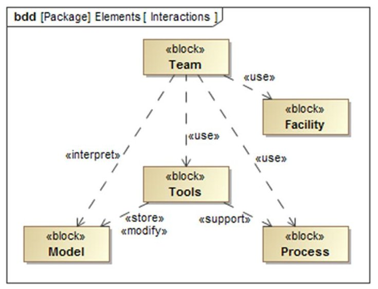

Figure I. Concurrent conceptual design—elements and interactions.

system designs. It relies on the following five key elements: a process, a multidisciplinary team, an integrated design model, an infrastructure, and a facility (Bandecchi et al., 2000). Since "infrastructure" and "facility" might be mistakenly interchanged, we prefer to replace "infrastructure" with tools, meaning in particular software, whereas hardware is meant to be part of the "facility." A corresponding definition is found in Karpati et al. (2003). Figure 1 shows these elements and their primary interactions in a SysML block definition diagram.

The first and primary resource for concurrent design is a team of people, engineers with appropriate discipline expertise, and capability to work in a collaborative setting. Different parts or aspects of the systems are assigned to different experts on the team, while a system engineer leads the team through the design process and coordinates the teamwork (Braukhane and Romberg, 2011; Wall et al., 1999). According to these authors as well as interviewed concurrent design practitioners, people are the most vital element of concurrent design. Their expertise, capability of engineering judgement, and negotiation bring the real benefit to this method.

The model represents the system to be designed encompassing the structure, configuration, and design parameters. For the sizing of a system and its subsystems, it is common to use parametric models. Subsystem models can encapsulate analytic or behavioral models, but appear to the system simply as a mapping of input to output parameters. A proper description of the data model for the case of a satellite system design is given in Di Domizio and Gaudenzi (2008). European space agencies and companies have elaborated a technical memorandum, which contains a unique data model for design studies. The quasi standard ECSS-E-TM-10-25A (European Cooperation for Space Standardization (ECSS), 2010) is vendor

<!-- PDF_PAGE: 4 -->

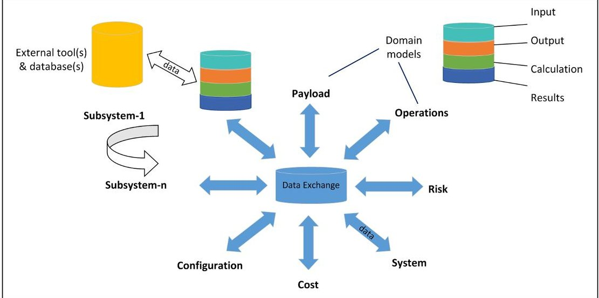

Figure 2. Tool architecture—a central data exchange connecting all domain models, adapted from Bandecchi et al. (2000).

independent and should guarantee interoperability between different tools, such as generic and domain-specific design software used by engineers of various disciplines. Data exchange tools implementing such a standard enable collaboration among disciplines, and at best interact with domain-specific models or tools. This architecture is shown in Figure 2, adapted from Bandecchi et al. (2000).

The architecture shown in Figure 2 has been implemented for European Space Agency (ESA) in the Open Concurrent Design Tool (OCDT) (ESA, 2014), which use is limited to ESA member states. The commercial version of it called Concurrent Design Platform (CDP) (Fijneman and Matthyssen, 2010). For a similar purpose, the German Aerospace Agency (DLR) developed Virtual Satellite (VirSat) (Schaus et al., 2010), and the Jet Propulsion Laboratory developed Open Model Based Engineering Environment (OpenMBEE) (NASA JPL, 2016) (see Table 1 in Appendix 1 for a comparison of commonly used tools for conceptual design studies in space agencies). For the operations of our Concurrent Engineering Design Laboratory (CEDL), as well as doing research on the methodology of concurrent conceptual design itself, we decided to build our own tool: Concurrent Engineering Data Exchange Skoltech (CEDESK) (Skoltech, 2017), which is described in more detail in the section "A collaboration tool for concurrent conceptual design."

The process of preliminary design studies for space missions has, according to Bandecchi et al (2000), as principal inputs mission requirements and constraints as well as study requirements and produces study results (S/C Design, S/C Configuration, Launcher, Risk, Cost, etc.). After preparation, the study is performed in so called design sessions. In these design sessions, the participating design experts join in collocated collaborative work, to discuss and evaluate design

options and communicate design decisions. According to the size and complexity of the project and the availability of the required experts, the sessions are scheduled over the duration of one or more weeks (Braukhane and Romberg, 2011). In between the design sessions, the discipline experts also work on their respective part of the project, in order to postprocess or prepare for design sessions. We did not find detailed evidence in the literature about the actual process how concurrent design sessions are run. Hence, we developed our method, based on the interview with experts6 who had participated in mission design studies in ESA and NASA, as well as our own experience in conceptual design studies.

Finally, a concurrent design facility is the place for people to carry out design studies. It is equipped with hardware for visualization and communication of intermediate engineering results and face-to-face discussion. The concurrent design facilities in ESA/ESTEC are described in more detail in Bandecchi et al. (2000), and the facility in our institute is described in Golkar (2014, 2016).

## A generic concurrent conceptual design process

The early stages of system design involve concept development and creative problem solving. The concurrent design approach engages multidisciplinary teams to work in an integrative way. To make most efficient use of the time allocated for a concurrent design study, we consider that the design could benefit of a method guiding that process.

The design process needs to take into account the dependencies between the system's parts. As a consequence, the method should focus on facilitating orderly collaboration of discipline experts in order to tackle all

<!-- PDF_PAGE: 5 -->

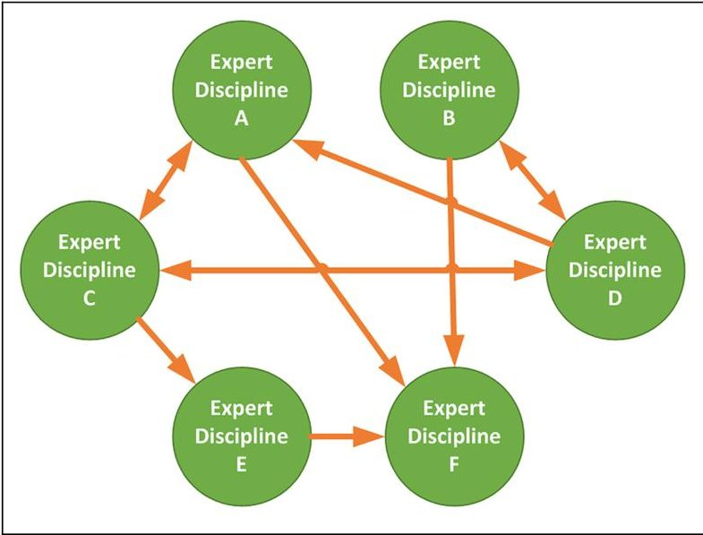

Figure 3. People interaction throughout a concurrent design study.

interactions between the parts they are responsible for. This need for communication could be represented in a network, as for example in Figure 3.

In current practice, the facilitation of a concurrent design study is entrusted to a team leader who has working experience as a system engineer and eventually already participated in concurrent design studies. The personal and professional skills of the team leader largely influence the design study's outcome. Hence, the proposed method should support the team leader in his function to coordinate the above-mentioned interaction of people.

People design concurrently, meaning that their work tends to overlap, but due to the dependencies among the disciplines, changes to the design need be communicated one at a time. Hence, there are two different perspectives: (1) from a people's perspective, the disciplines work in parallel. (2) From the model perspective, the design decisions are taking place in a temporal sequence.

A measure for parallelization of work is the degree of concurrency, which is the ratio of the amount of time tasks overlap to the entire duration of all tasks (Prasad, 1999). To maximize the degree of concurrency, different

methods have been proposed, based on the assumption of known task duration and fixed information need and availability (Hu et al., 2003; Srour et al., 2013). In the context of concurrent conceptual design, the design tasks of the disciplinary experts consist in refining the system model, and assumptions on duration and information need or availability are hard to make.

Our proposed method aims to guide the interaction of people collaborating on the design, while keeping a consistent record of the design decisions taken. Going forward, we concentrate on the model perspective, while trying to support the collaboration among people.

From the practice described in the literature (Bandecchi et al., 2000; Braukhane and Romberg, 2011; Karpati et al., 2003) and reported by people who had participated in concurrent design studies, we extracted a generic model of the concurrent design process. This description can serve as a guideline for participants rather than a strict ruleset. We identified three logical levels of activities carried out during the process: at top level, there is the entire study, at an intermediate level, there is the single design iteration, and at the bottom level, there is the single discipline contributing to the design. As shown in Figure 4, each level covers a different time scale. The study includes one or more design iterations. Each design iteration consists of a sequence of design decisions taken by discipline experts, which lead to a consolidated system design.

## Level 3—the study

For a customer, a concurrent design starts with the analysis of customer needs and ends with a report showing solution concept and system requirements. For the system engineer leading the design study, the process can be structured in a sequence of activities which can be depicted in an activity diagram (Figure 5):

Preparation. Once a customer has expressed his need to perform a concurrent design study, the preparation starts with (1) collecting and documenting mission requirements, (2) identifying study constraints (budget, technology, confidentiality), (3) allocation of resources

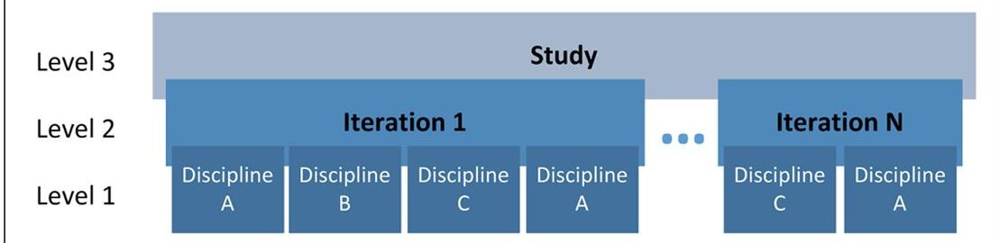

Figure 4. The logical levels of activities during a design study.

<!-- PDF_PAGE: 6 -->

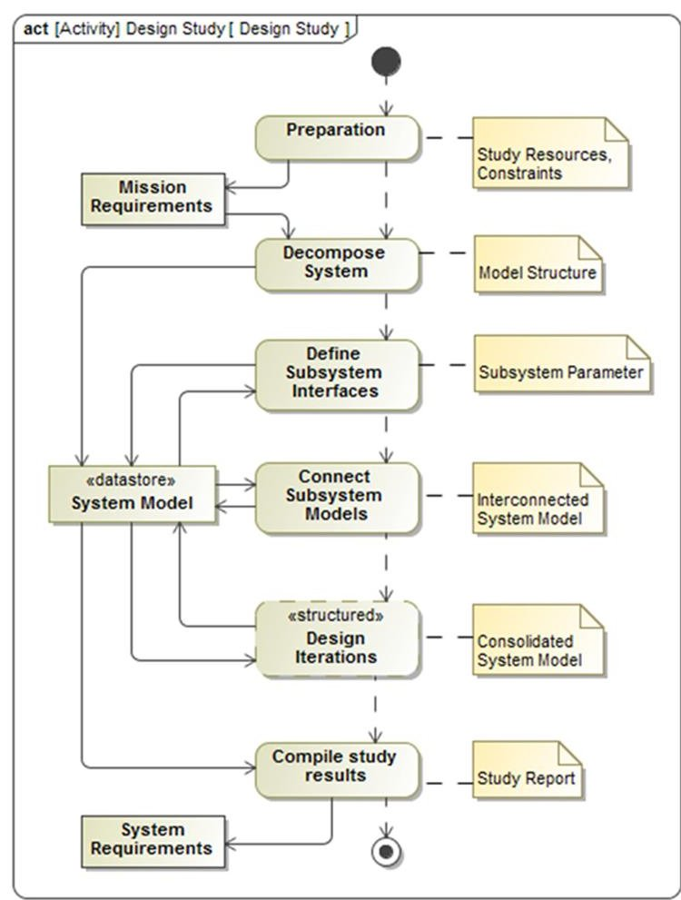

Figure 5. The overall process of a concurrent design study.

(people and facility time). The decision on which experts to involve is related to an approximate decomposition of the system and allocation of system functions to subsystems. At the end of the preparation (or start of the design study), a first joint meeting of the full design team is held together with representatives of the customer. The purpose of the meeting is to clarify the mission requirements and the role of each study participant.

System decomposition. Based on the high-level functions, the system has to fulfill; subsystems are identified and assigned to discipline experts present in the team. The structure of the system is elaborated and stored in a system model.

Connecting subsystem models. After each discipline expert subsystem has defined its input and output parameters for the subsystem, he tries, together with the team lead, to identify the source for each input. When starting with new models from scratch, this is a nontrivial task. It happens that for certain parameters, no other subsystem is yet providing that parameter as an output, and it must be decided which discipline shall produce and own it. For some inputs, no other source can be identified, and the value can be determined freely by the discipline expert. It also happens that more than one subsystem claims to produce a certain

output, and it must be decided which discipline shall produce and own it and the other disciplines take it as an input. In this step, the subsystem model interfaces are refined in order to be able to interconnect them.

Design iterations. The core of the design study is the concurrent design iterations. The goal of each iteration is to consolidate the design by making sure all input parameters take values which are correspondent to the mission requirements or to the output values produced by other subsystems. Dependency relationships of subsystems are transitive and can form cycles, wherefore iterative redesign of subsystems is necessary. (For example, S2 depends on S1, S3 depends on S2, and S1 depends on S3. This means that after designing S1, S2, and S3, the outcomes of S3 may require a change to S1 again.) The process of a full design iteration is described in the next section. Throughout the design study, an arbitrary number of design iterations can occur, and they operate on a repository which keeps the state of the system model.

Compile study report. In conclusion of a conceptual design study, one or more resulting system designs, which were evaluated to satisfy the mission requirements, need to be documented and characterized according to common or mission-specific performance measures (e.g. mass, cost, risk, schedule). For the continuation of the project, in case of approval of the results of the design study, the system requirements contained in the documentation will serve as starting point for the detailed design phase.

## Level 2-design iteration

The process of running a single design iteration is depicted in Figure 6(a). From a system model with interconnected subsystem models, the dependencies among disciplines can be derived and represented as a design structure matrix (DSM) (Eppinger and Browning, 2012). We use a weighted DSM, where the weight is determined by the number of parameters linking two subsystems. This representation allows to apply different algorithms to determine an optimal sequence for updating one subsystem after the other and was successfully applied to integrated concurrent engineering (Avnet and Weigel, 2010; Chen, 2005; Yassine and Braha, 2003). An example of calculating the sequence using the DSM algorithm on a concrete system model is given in the case studies.

Based on this sequence, one discipline is taken at a time and the responsible expert is asked to update his subsystem model. The internals of this action are described in a separate procedure in the next section. After that, depending on whether the subsystem's output parameter values have changed, the sequence is

<!-- PDF_PAGE: 7 -->

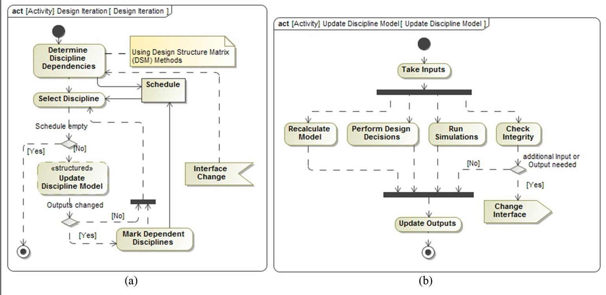

Figure 6. (a) Process of a single design iteration and (b) the process of updating a discipline model.

updated or not. So only if the numerical outputs changed by more than 10% (typical margin for conceptual design studies), the disciplines which depend on them are added to the sequence again. In case the update of a discipline model led to changes of subsystem interfaces and thereby also dependencies, the sequence needs to be recalculated. Once there are no more disciplines on the schedule, it means the integrated system model has converged and represents a feasible design and the iteration is finished.

## Level 1discipline design decision

A discipline expert updating a subsystem model performs a simple sequence of activities, depicted in Figure 6(b). First, the input values which are connected to other subsystems need to be updated. Depending on the kind of model, the designer either executes a calculation, runs a simulation, performs decisions based on prior knowledge or they perform a combination of them. After that, all the subsystem's output parameters are updated.

In parallel, the expert checks the model for integrity, and in case additional input or output parameters are needed, the interface is modified accordingly. Changes to the parameters are reflected in the shared system model.

## A collaboration tool for concurrent conceptual design

We analyzed tools referenced in the literature about concurrent engineering in conceptual design as practiced by space agencies. The result of this comparative analysis is

compiled in Table 1 in Appendix 1. The major differences are specialization on certain lifecycle phases and the focus and level of abstraction of parametric models. Fortin et al. (2017) found out that only around 20% of the parameters in conceptual design describe geometry. Models used in the conceptual design of space systems primarily describe the system's behavior; hence, tools deal little with geometry. Differently, product data or product lifecycle management (PDM/PDM) tools have their strength in supporting design and manufacturing and hence manage geometric models. Tools for multidisciplinary design optimization (MDO) are kind of agnostic to the nature of the parameters and use them as a means for analysis and optimization. Ultimately, there are SE tools, which are used to make models describing the system decomposition structure and subsystem interactions.

For the purpose of conceptual design and feasibility studies, we decided to collocate our tool in the group of concurrent conceptual design tools, with the goal of connecting different engineering disciplines. Based on the experience with existing data exchange tools, we derived the following key requirements for our own tool: user friendliness, easy synchronization, data compatibility, and integration with third-party engineering tools. Moreover, it should serve the double purpose of supporting conceptual design and feasibility studies in CEDL and enabling research on the concurrent design methodology.

We conceived our tool to focus on its primary function: exchange parametric model information between discipline experts. Different from VirSat for example we decided not to include visualization of basic three-

<!-- PDF_PAGE: 8 -->

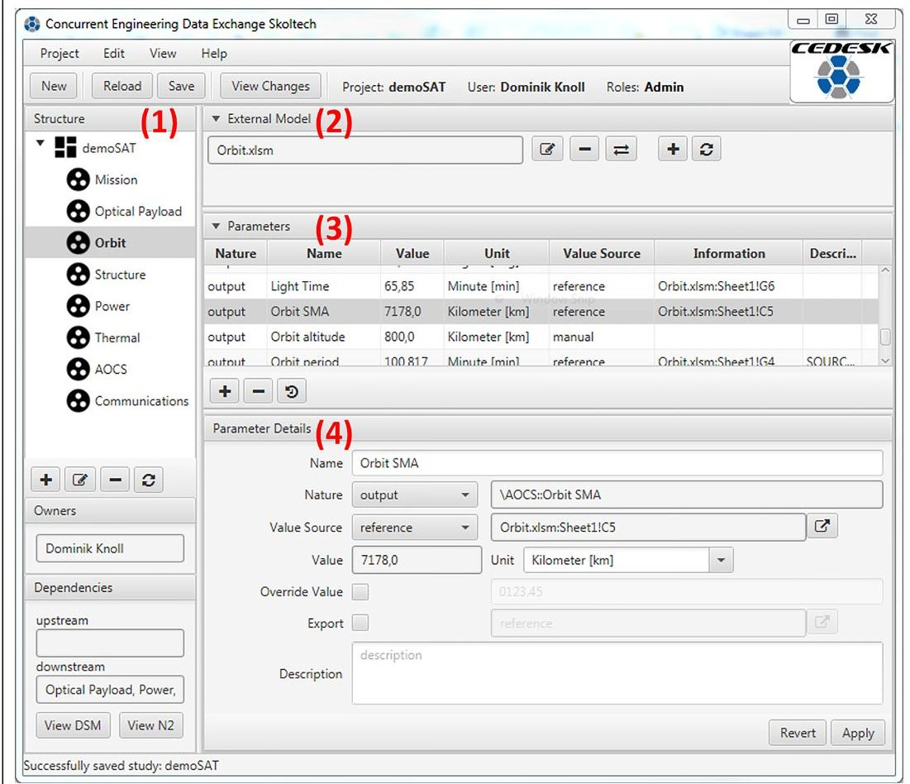

Figure 7. The main screen of CEDESK.

dimensional geometry. And different from ConCORDE or CDP we decided not to use Excel $ ^{\textcircled{2}} $ as primary user interface for the interaction with the system model. To allow direct interaction with third-party engineering tools typically installed as desktop applications, we decided not to use a web interface, while Valispace did.

State-of-the-art PLM tools enable to leverage knowledge accumulated in an organization by managing models in a way to facilitate their reuse. Such knowledge-based engineering approach is particularly advantageous when system designs can be generated based on models available for a product family (Prasad and Rogers, 2005). So far we did not include knowledge management capability into CEDESK, but we plan to add the possibility to store, search, and instantiate models from a component library as laid out in Fortin et al. (2017).

CEDESK is built according to a client-server architecture. The server part embodies the central model repository and consists of a relational database and the client is a desktop application. The application is implemented in Java $ ^{TM} $ in order to be able to run on all major desktop platforms, such as Windows $ ^{®} $ , MacOS $ ^{TM} $ , and Linux $ ^{TM} $ . Multiple clients can connect to a server at the same time and work on the same model. Model synchronization is built on top of atomic database

transactions. The data storage relies on a MySQL $ ^{\mathrm{TM}} $ (Oracle, 2016) database and the client application uses the Hibernate $ ^{\mathrm{TM}} $ Object Relational Mapping (Redhat, 2014) framework to store models in the database. The user interface is built with JavaFX $ ^{\mathrm{TM}} $ technology. Moreover, CEDESK makes use of various open-source libraries for logging, access to workbook files, spreadsheet-like user interface components, and handling of graph data structures.

## CEDESK user interface

The client is the primary user interface for the user to access the central study repository and interact with the model. Similar to many collaborative design tools, with CEDESK, users load a project from the repository, operate on a local working copy, and store it back to the repository when needed. Figure 7 shows a screenshot of the application's main window. At the top, the name of the current study, the logged-in user, and his active roles are displayed. According to the roles, a user is assigned; he can modify or only view a subsystem, its parameters, and external models.

The user interface consists of four major parts enabling the user to work with the system model (see numbers in Figure 7). (1) A structure tree for the systems hierarchical decomposition. The buttons allow to

<!-- PDF_PAGE: 9 -->

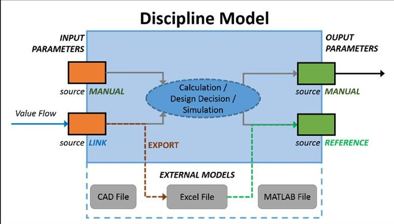

Figure 8. The structure and information flow in a parametric discipline model in CEDESK.

add, modify, and delete model nodes. The screenshot shows the model of satellite "demoSAT" and its subsystems. (2) A list of external models belonging to a model node. External models (files of third-party tools) can be attached, detached, and opened with the respective tool directly from there with the respective buttons. In the screenshot, an Excel workbook "Orbit.xslm" is attached to the subsystem "Orbit" selected on the left. (3) A list of parameters belonging to a model node. The buttons on the bottom allow to add a new parameter, remove an existing parameter, and see the version history of a parameter. (4) An area for parameter details, which also allows for immediate editing. In particular, this editor allows to create a link to another parameter or to set up the reference to external models.

There is the possibility to clone a study by exporting the full system model to an XML archive and re-importing it with a new name. This can save the time for building the model for similar conceptual design studies. A feature invisible to the user, but of interest to the researcher, is the logging of user activities, such as loading and saving the model as well as modifications to the model structure and parameters.

## Modeling capabilities

The data model in CEDESK is structured according to ECCS-E-TM-E-10-25A, as much as it concerns parametric system models. The primary model entities represent the system structure, its parameters, units of measures, links between parameters, users, and roles.

A study is composed of a system model, which is a tree structure of model nodes. A node represents the parametric model of and engineering discipline or a system component. Each model node contains a set of parameters and a set of external models. External models encapsulate files made by third-party engineering tools. Parameters can be of nature: input, internal, or

output. Parameters have a value and can be associated with a unit of measure.

Figure 8 shows how parametric models work in CEDESK: values of input parameters are fed into a calculation, a simulation or a human design decision and values for output parameters are produced.

An input parameter can obtain its value either from manual setting or from a link to another subsystem's parameter. Actually, only output parameters are visible to other subsystems and can be linked. An output parameter can obtain their value from manual setting or from a reference to an external model. In the example shown in Figure 7, the parameter obtains its value from a reference to a specific cell from the Excel workbook "Orbit.xlsm:Sheet1!C5." Whenever the value of a parameter is obtained from a link or an external model, there is an option to override the value. This is useful at the beginning of the concurrent conceptual design, when a discipline engineer works with assumptions before being provided with calculated values by another discipline. Finally, a parameter can also export its value to an external model (e.g. to a cell of an Excel spreadsheet).

## Collaboration

To enable multiple users work on a project, CEDESK also furnishes a user management and allows the assignment of users and roles. Fast turn-around in collaboration is facilitated by notifications to the user, whenever changes have been stored to the model repository. Changes made by other team members or the user's own unsaved changes can be reviewed in a dedicated window (see Figure 9(a)).

For the purpose of access control, model nodes can be associated with roles, and roles associated with users. All changes to parameters are recorded and a full version history is kept. The data gathered this way can be used in future work analyzing of the history of design decisions using statistical methods for determining the sensitivity of design parameters.

An important goal of CEDESK is to support the team leader in coordinating the design effort. A special view allows to visualize the dependencies among subsystems in a DSM style. The cells of the matrix in Figure 9(b) list the names of the output parameters which pass values to other subsystems. The interface also allows the user to generate input for a DSM clustering algorithm to be run in MATLAB $ ^{\textcircled{R}} $ using a library implemented by Thebeau (2001).

## Case studies

The tool and the coordination method have been put to test in two different case studies, conducted in our

<!-- PDF_PAGE: 10 -->

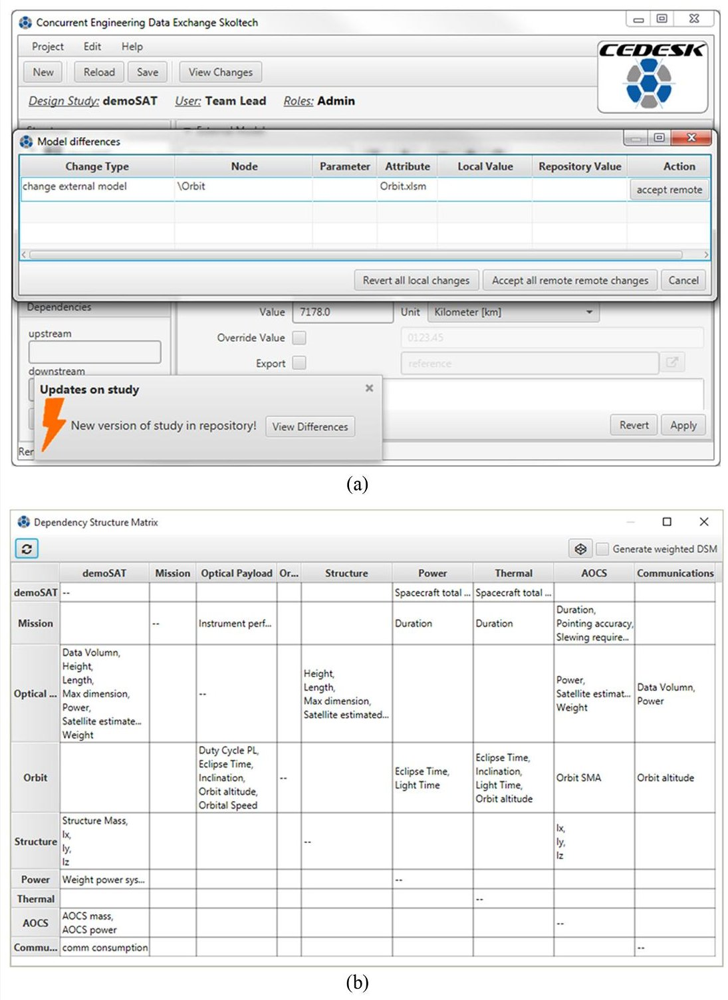

Figure 9. (a) The application showing a notification about changes made to the model by collaborators and possibility to review these changes. (b) A visualization of the subsystem dependencies in the form of a DSM.

institute's concurrent design facility. Both studies dealt with coceptual design of satellites and the participants were MSc and PhD students, with background in computer science, energy and space engineering.

## Pilot project

This case study was carried out during the Space Mission Design course, taught by Alessandro Golkar at Skoltech in autumn 2015. Two groups of nine students were given a task to design a constellation of satellites made of Earth observation and communication satellites. The goal for the mission was to complement and

improve the current capabilities of the European Copernicus program. The students were introduced into the philosophy of concurrent conceptual design and instructed to apply it to their course project using CEDESK.

The project took about 2 months and we made the following observations:

Tool validation. A positive side effect of this pilot project was that it has put CEDESK to test in a real collaborative team setting. After a demo and instructions on the functionality of the tool, the students were supported throughout their project by the tool author.

<!-- PDF_PAGE: 11 -->

Both teams organized autonomously, defined the system breakdown structure, and assigned roles to team members. For all subsystems, the students created sizing spreadsheets in Excel following the reference project in the space mission analysis and design book Wertz et al., 2011). Then they added all parameters in the tool and connected them to the spreadsheets. In a next step, they established the links between parameters of various subsystems and compiled mass and power budgets from all the subsystems. After that, they ran several design iterations in order to consolidate the overall system design. The models were checked by the course instructor and the resulting designs positively validated against similar satellite systems.

Usability and process support. The users quickly understood the advantage of using CEDESK for the collaboration on a system model made of separate but interconnected subsystems. Users told us positive feedback like "it helped us connecting our models," "it helped us to clarify the interfaces," as well as negative feedback like "we needed first to learn to use the tool, before we experienced a real benefit," "we faced problems with some malfunction." Potential for improvement was identified in the usability of the tools interface to Excel workbooks, because users need to follow a workflow in order to obtain the expected results. This problem also indicated that the entire concurrent design process needs guidance. A tool accompanied by a manual is not sufficient, but it needs to be embedded into a process. This led us to the development of the process guideline and informed our second case study.

Concepts exploration. The students were rather exploring different advanced technologies than starting from existing spacecraft. For the observation satellite, the suggested form factor was a 3/6U CubeSat. Moreover, the payload was assumed to be a multispectral imager and the inter-satellite link between observation and communication satellites was intended to be laser based.

Ever changing interfaces. While the system decomposition was a quite straight forward task, the definition of the interfaces among the subsystems and between observation and communication satellite was a tough challenge. As a result, changes were made to the interfaces throughout the entire design study.

Multi-system projects. The two groups of students worked on two spacecrafts which only together fulfill the mission goals. Initially, they started with two separate studies in CEDESK, but they realized that there are interdependencies in the design which the tool cannot handle across study boundaries. As a workaround, the students decided to merge the two systems models into a single study, with some subsystems belonging to the observation satellite and others to the

communication satellite. To overcome this flaw of CEDESK, a study should be able to contain more than one system. This could address a real need of many space missions when beside space segment also ground station and launcher should be considered in the concurrent conceptual design.

## Demonstration project

This project was initiated for building capacity in Skoltech and to develop the baseline of an integrated satellite model for further studies in our concurrent design facility. On this occasion, we tested the tool as well as the coordination method.

The mission requirements for this project (demoSAT) were set to consolidate a conceptual design of an earth observation satellite with optical payload and using Excel-based sizing models founded on FireSAT reference design from SMAD (Wertz et al., 2011). The design study started from a previously built system architecture, where susbsystem models and interfaces were already defined.

For this design study, we recruited volunteers to support our research project and assigned them design disciplines according to their prior knowledge. We decided to start from a partially predefined system model and the study was limited to only three design sessions, but the participants already knew the concurrent design approach, only an introduction to the mission and our specific method were needed.

In preparation for the design sessions, the dependency information contained in the system model was used to derive a DSM, where the matrix entries were the number of linked parameters. To this matrix, the DSM clustering algorithm was applied. Figure 10 shows the original DSM (left) and the clustered DSM (right). The dots in the diagram represent the connections between subsystems, while dot size and color encode the connection strength, according to the color map shown on the right.

The clustering algorithm first of all provides a preferable sequence in which to update the subsystem models, shown in the order they are listed in the clustered DSM. This sequence was used for the design process as described above. The algorithm places the subsystem "Orbit" on the top left of the matrix, because several other subsystems depend on its outputs. On the other hand, the subsystem "demoSAT" is placed at the bottom right of the matrix, because it contains the systems mass and power budget which depends on inputs from several other subsystems. The clusters show groups of subsystems that have tighter coupling and therefore, iterations should be done first within the cluster. Feedbacks from a subsystem to previous ones are shown by dots below the diagonal. Such feedbacks

<!-- PDF_PAGE: 12 -->

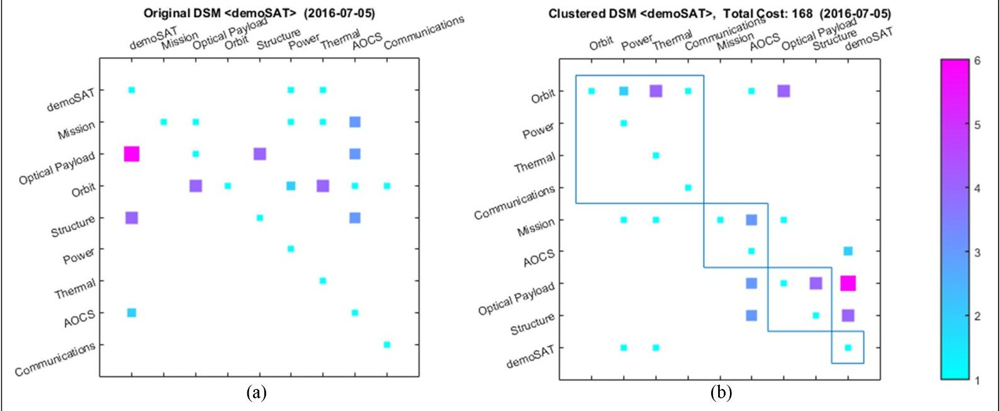

Figure 10. (a) The DSM, where dot size and color represent the number of connecting parameters and (b) DSM clustering algorithm groups stronger connected subsystems.

in this project are beyond the boundaries of clusters. This means that changes in one cluster lead to a reiteration over the entire previous cluster.

The following observations were made during the design study:

Dependency changes. During the design study, it happened that a subsystem required additional inputs from another subsystem. The modifications of the model in CEDESK were quick to make, but the introduction of new dependencies also requires to recalculate the schedule. We saw that a new schedule can differ significantly from a previous one.

Limited concurrency. Due to a transitory bug in CEDESK, structural changes on the model such as adding a parameter could not be merged into the working copy of any other participant, and changes on the working copy needed to be discarded and redone. This malfunctioning discouraged the participants and limited the work that can be done concurrently.

Unfortunately, time limitations did not allow to conclude the design study with a consolidated system design. Moreover, we realized during the design process that the given system to design requires more domain expertise. Future work will address this issue by a more accurate setup of the design experiment.

## Future work

Integrating the design process into the collaboration tool seems to be a promising lead for further investigation. The process we have described should be

accessible from within the tool. While showing the currently active design step with a short description, it also allows the team leader also to advance to the next step. Switching to the next design step also adapts the modeling interface to the specific needs of that step. Figure 11 illustrates such a guide integrated into the tool. The impact of such a guide and the degree of guidance useful to speed up the design study will be subject to further research.

Our work so far has indicated that the information about subsystem dependencies encoded in the system model can be utilized to derive a schedule for the design process. For better support of the design process, a more comprehensible graphical representation in the form of an N-square diagram is derived from the system model.

Boxes represent subsystems and the dependencies are denoted by arrows. In order to show the dynamism during design iterations, changes to parameters which have not yet be incorporated by a dependent subsystem are highlighted by colored arrows. It should help the team leader to show visual hints on which subsystems need to be updated, and see the up-to-date optimal sequence of subsystems. Figure 12 illustrates a dynamic process view as part of the collaboration tool. In the future we plan to verify experimentally that such a guide helps reducing the time needed for a single design iteration.

The current DSM-based sequencing algorithm considers the number of parameters as connection weight. This does not take into account that certain input parameters have more influence on a subsystem than others. In the specific case that a subsystem model is encoded

<!-- PDF_PAGE: 13 -->

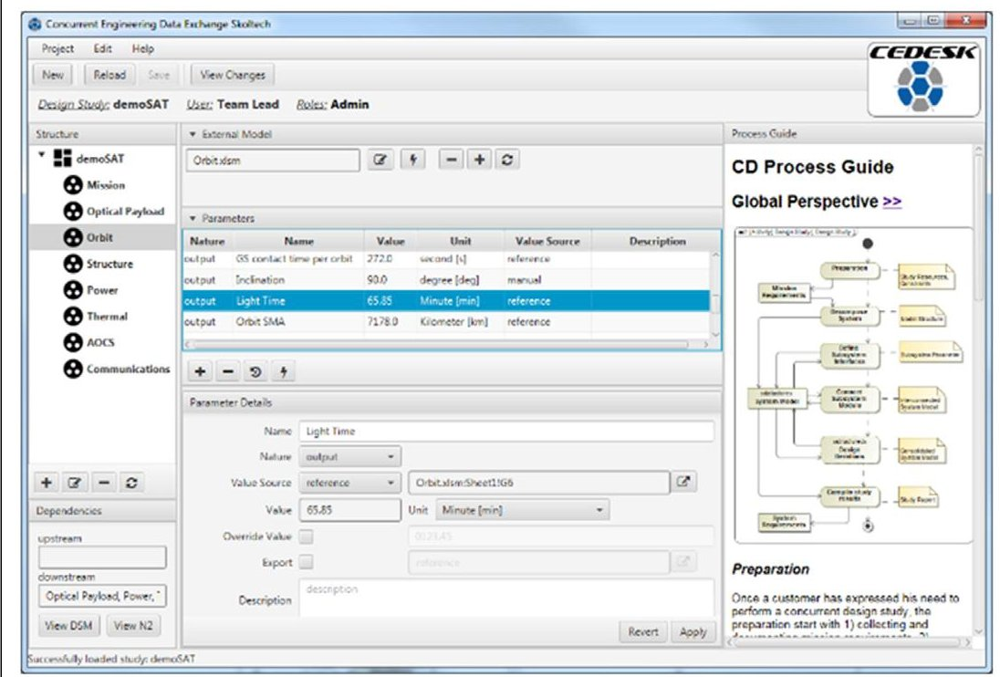

Figure 11. The user interface with an incorporated process guide.

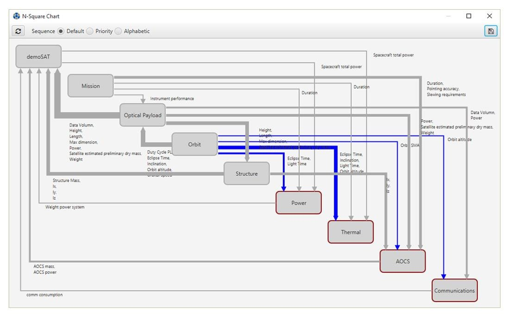

Figure 12. Adynamic N-square chart highlighting changes being propagated.

in a mathematical model (a function mapping input parameters to output parameters), the modeling tool can recalculate the subsystem model to determine the sensitivity for each input parameter. In a more general case, the parametric model's sensitivity could be extrapolated with machine learning techniques using the model's version history as training data, as proposed by Ferreira (2012), which we consider worthy for further investigation. Once the sensitivity values are obtained, they would serve as more realistic weights for

the DSM. If there are dependencies with little weight, it means they are less likely to cause recalculation. Taking into account these weak rather than uniform dependencies, the schedule for the design steps is simplified and less design iterations are required. Alternatively, the iteration-likelihood as presented by Shapiro et al. (2015) could be used. This would contribute to increase the efficiency of concurrent design studies and shall allow to develop more different design options within the timeframe of a design study.

<!-- PDF_PAGE: 14 -->

## Conclusion

Concurrent design has become a widely adopted engineering methodology, in particular in the conceptual and preliminary design phase. Space agencies and companies apply concurrent conceptual design to evaluate mission concepts in an effective manner. Certain aspects of concurrent design, such as the data model, the tools, or the facility, have got more attention in academic literature so far. We found that the design process and its connection with tool support have been considered very little. The success of concurrent design sessions primarily depends on the skills and experience of the system engineer leading the study.

In our work, we provide a description of the concurrent design process at the three different levels: the study, a design iteration, and a discipline. This description serves as guideline for the conduction of design studies and informed the development of a collaborative engineering tool. We also presented the tool itself with its features to support parametric system models and the support for the design process.

Case studies of preliminary spacecraft design were performed using the collaboration tool and the proposed method to coordinate the design session. The tool demonstrated its capability to create a functional system model, interconnect subsystem models in the form of sizing spreadsheets, and enable collaboration and concurrent work. Beside the case studies, we were able to demonstrate our tool to concurrent engineering practitioners who affirmed that it fits well the primary purpose of exchanging model information in a collaborative work setting. The feedback of the participants in the case studies also has confirmed the suitability of the proposed coordination method for carrying out a concurrent design study.

Engineering design is a complex phenomenon and it would be beneficial to apply the research methodology of descriptive and prescriptive studies as described in (Blessing and Chakrabarti, 2009). Hence, we recognize the lack of quantitative measures to test our hypotheses in our work. Experiments with A/B tests in controlled settings shall be performed to check whether a proposed improvement to the design tools or processes shows the expected outcome.

The case studies we were able to run have limited similarity with design studies in space agencies or companies, due to different levels of expertise of participants and not validated spacecraft design models. Using the mission concepts of existing spacecraft for our experimental design studies would allow to compare the outcome of our design studies with the known spacecraft design.

## Acknowledgements

The authors would like to acknowledge the help of all the Master's students who attended the Skoltech space mission design course and agreed to serve as beta testers of the collaboration tool. Our gratitude also goes to the colleagues from the research group who volunteered as participants for a case study of concurrent design. Finally, we would like to thank Prof. Clement Fortin for the valuable insights into industrial engineering practice as well as good suggestions for the conceptualization of our design research.

## Declaration of conflicting interests

The author(s) declared no potential conflicts of interest with respect to the research, authorship, and/or publication of this article.

## Funding

The author(s) received no financial support for the research, authorship, and/or publication of this article.

## References

Aguilar JA, Dawdy AB and Law GW (1998) The aerospace corporation's concept design center. INCOSE International Symposium 8(1): 776-782.

Avnet MS and Weigel AL (2010) An application of the design structure matrix to integrated concurrent engineering. Acta Astronautica 66(5-6): 937-949.

Bandecchi M, Melton B and Ongaro F (1999) Concurrent engineering applied to space mission assessment and design. ESA Bulletin. Available at: http://www.esa.int/esapub/bulletin/bullet99/bande99.pdf

Bandecchi M, Melton B, Gardini B, et al. (2000) The ESA/ ESTEC concurrent design facility. In: Proceedings of the EUSEC, pp. 329-336. Available at: http://swe.ssa.esa.int/ TECEES/spweather/esa_initiatives/spweatherstudies/ CDF study/cdf paper.pdf

Blessing LTM and Chakrabarti A (2009) DRM: A Design Research Methodology. London: Springer.

Bousquet PW, Sire J and Vigeant F (2005) Concurrent engineering at CNES. In: 56th international astronautical congress of the international astronautical federation, the international academy of astronautics, and the international institute of space law, Fukuoka, Japan, 17-21 October, pp.1-11.

Braukhane A (2015) Evolution of the European concurrent design tool for space-based system-of-systems studies. In: AIAA SPACE 2014 conference and exposition, Pasadena, CA, 31 August-2 September, pp. 1-12.

Braukhane A and Romberg O (2011) Lessons learned from one-week concurrent engineering study approach. In: Proceedings of the 17th international conference on concurrent enterprising (ICE 2011), Aachen, 20-22 June.

Caltech (2015) Jet Propulsion Laboratory—Team X. Available at: http://jplteamx.jpl.nasa.gov/ (accessed 22 July 2016).

<!-- PDF_PAGE: 15 -->

Casani EK and Metzger RM (1995) Reengineering the project design process. Acta Astronautica 35(Suppl. 1): 681-689.

Chen S-J (Gary) (2005) An integrated methodological framework for project task coordination and team organization in concurrent engineering. Concurrent Engineering: Research and Applications 13(3): 185-197.

Dassault Systems (2016) ENOVIA. Available at: https:// www.3ds.com/products-services/enovia/.

De Weck OL, Roos D and Magee CL (2011) Engineering Systems: Meeting Human Needs in a Complex Technological World. Cambridge, MA: The MIT Press.

Di Domizio D and Gaudenzi P (2008) A model for preliminary design procedures of satellite systems. Concurrent Engineering: Research and Applications 16(2): 149-159.

DLR (2016) Virtual Satellite 3, Institute of Simulation and Software Technology. Available at: https://software.dlr.de/p/virsat/home/ (accessed 18 July 2017).

Dori D (2011) Object-process Methodology: A Holistic Systems Paradigm. New York: Springer.

European Space Agency (ESA) (2014) Open concurrent design tool. Available at: https://ocdt.esa.int/ (accessed 20 June 2016).

Eppinger SD and Browning TRR (2012) Design Structure Matrix Methods and Applications. Cambridge, MA: MIT Press.

European Cooperation for Space Standardization (ECSS) (2010) ECSS-E-TM-10-25A: Engineering design model data exchange (CDF), Noordwijk. Available at: http:// ecss.nl/hbstms/ecss-e-tm-10-25a-engineering-design-modeldata-exchange-cdf-20-october-2010/

Ferreira IML (2012) Enhancing the Conceptual Design Phase of Complex Engineering Systems with an Integrated Methodology and Support Tools. Lisboa: Instituto Superior Técnico. Available at: http://in3.dem.ist.utl.pt/edam/docs/ 2012-thesis-Ivo-Ferreira.pdf

Fijneman M and Matthyssen A (2010) Application of concurrent design in construction, maritime, education and other industry fields. In: Proceedings of the 4th international workshop on system & concurrent engineering for space applications (SECESA 2010), Lausanne, 9 June.

Fortin C, Mcsorley G, Knoll D, et al. (2017) Study of data structures and tools for the concurrent conceptual design of complex space systems. In: IFIP 14th international conference on product lifecycle management, Seville, 9-12 July.

Friedenthal S, Moore A and Stiner R (2014) A Practical Guide to SysML: The Systems Modeling Language. 3rd ed. Amsterdam; Boston, MA: Morgan Kaufmann.

Golkar A (2014) Concurrent engineering design laboratory: pioneering concurrent engineering in the Russian Federation. In: 6th international systems & concurrent engineering for space applications conference (SECESA), Stuttgart, 8- 10 October.

Golkar A (2016) Lessons learnt in the development of a concurrent engineering infrastructure. In: 26th annual INCOSE international symposium, Edinburgh, 18-21 October.

Hoffmann H-P (2011) System Engineering Best Practices with the Rational Solution for Systems and Software Engineering. NY, USA: IBM Software GroupIBM Corporation Software GroupRoute 100 Somers.

Hu J, Liu J and Prasad B (2003) A constraint-driven execution plan for maximizing concurrency in product development. Concurrent Engineering: Research and Applications 11(4): 301-312.

INCOSE (2007) Systems Engineering Vision 2020 (ed. HIE Crisp). Seattle, WA: International Council on Systems Engineering.

Karpati G, Martin J, Steiner M, et al. (2003) The integrated mission design center (IMDC) at NASA Goddard space flight center. In: IEEE aerospace conference proceedings (IMDC), Big Sky, MT, 8-15 March, pp. 3657-3667. New York: IEEE.

Krueger M, Walden CD and Hamelin ERD (2011) Systems Engineering Handbook. San Diego, CA: International Council on Systems Engineering (INCOSE).

Kulkarni T, DeBruin K, Nelessen A, et al. (2016) A model based systems engineering approach towards developing a rapid analysis and trades environment. In: AIAA space, Long Beach, CA, 13-16 September.

NASA JPL (2016) Open Model Based Engineering Environment. Available at: http://www.openmbee.org/

No Magic (2015) MagicDraw. Available at: https://www.nomagic.com/products/magicdraw (accessed 18 July 2017).

No Magic (2016) Cameo simulation toolkit. Available at: http:// www.nomagic.com/products/magicdraw-addons/cameo- simulation-toolkit.html (accessed 19 November 2016).

Object Management Group (2005) Unified Modeling Language (UML) 2.0. Available at: http://www.omg.org/spec/ UML/ (accessed 19 November 2016).

Object Management Group (2013) OMG SysML. Available at: http://www.omgsysml.org/ (accessed 14 March 2016).

Oracle (2016) MySQL. Available at: https://www.mysql.com/

Phoenix Integration (2015) Modelcenter. Available at: http:// www.phoenix-int.com/product/modelcenter-integrate/ (accessed 18 July 2017).

Phoenix Integration (2016) MBSEPak. Available at: http:// www.phoenix-int.com/product/mbsepak/ (accessed 18 July 2017).

Prasad B (1995) Concurrent Engineering Fundamentals: Integrated Product and Process Organization, vol. 1. Upper Saddle River, NJ: Prentice Hall.

Prasad B (1996) Concurrent Engineering Fundamentals, Volume II: Integrated Product Development. 1st ed. Upper Saddle River, NJ: Prentice Hall-PTR.

Prasad B (1999) Enabling principles of concurrency and simultaneity in concurrent engineering. Artificial Intelligence for Engineering Design, Analysis and Manufacturing 13(3):185-204.

Prasad B and Rogers J (2005) A knowledge-based system engineering process for obtaining engineering design solutions. In: International Design Engineering Technical Conferences and Computers and Information in Engineering Conference, Volume 3: 25th Computers and Information in Engineering Conference, Parts A and B, Long Beach, California, USA, 24-28 September 2005, pp. 477-488. ASME: Design Engineering Division and Computers and Information in Engineering Division.

Redhat (2014) Hibernate ORM. Available at: http://hibernate.org/orm/

<!-- PDF_PAGE: 16 -->

Reysset A, Budinger M and Mare J-C (2015) Computer-aided definition of sizing procedures and optimization problems of mechatronic systems. Concurrent Engineering: Research and Applications 23(4): 320-332.

RHEA-Group (2015) CDPTM—Concurrent Design Platform. Available at: http://www.rheagroup.com/products/cdp/ (accessed 20 June 2016).

Romberg O and Braukhane A (2008) Status of the concurrent engineering facility at DLR Bremen. In: German aerospace congress (IDM). Available at: http://elib.dlr.de/56028/1/ Status_of_the_Concurrent_ Engineering_Facility_at_DLR_Bremen.pdf

Safavi E, Tarkian MO, lvander J, et al. (2016) Implementation of collaborative multidisciplinary design optimization for conceptual design of a complex engineering product. Concurrent Engineering: Research and Applications 24(3): 251-265.

Schaus V, Fischer P, Lüdtke D, et al. (2010) Concurrent engineering software development at German aerospace center-status and outlook. In: 4th international workshop on system & concurrent engineering for space applications, Lausanne, 13-15 October.

Shapiro D, Hamraz B, Sommer AF, et al. (2015) Investigating the impact of changes in iteration-likelihoods on design process performance. Concurrent Engineering: Research and Applications 23(3): 250-264.

Silveira VJD (2009) Development of a concurrent design facility based on ESA CDF: application to aircraft design. Master's dissertation, Technica de Lisboa, Lisbon.

Skoltech (2017) CEDESK—Concurrent Engineering Data Exchange Skoltech. Available at: https://cedesk.github.io/

Srour IM, Abdul-Malak M-AU, Yassine AA, et al. (2013) A methodology for scheduling overlapped design activities based on dependency information. Automation in Construction 29:1-11.

Thebeau RE (2001) Knowledge management of system interfaces and interactions from product development processes. Master's thesis, Massachusetts Institute of Technology, Cambridge, MA.

Valispace (2017) Valispace. Available at: http://www.valispace.com/ (accessed 18 July 2017).

Wall SD, Smith DB and Koenig LJ (1999) Team structures and processes in the design of space missions. In: IEEE aerospace conference, pp. 35-42. New York: IEEE.

Wertz JR, Everett DF and Puschell JJ (2011) Space Mission Engineering: The New SMAD (Space Technology Library). Hawthorne, CA: Microcosm Press.

Wiley J (2015) INCOSE Systems Engineering Handbook: A Guide for System Life Cycle Processes and Activities. 4th ed. Hoboken, NJ: Wiley.

Winner RI, Pennell JP, Bertrand HE, et al. (1988) The Role of Concurrent Engineering in Weapons System Acquisition Alexandria, VA: Institute for Defense Analyses.

Yassine A and Braha D (2003) Complex concurrent engineering and the design structure matrix method. Concurrent Engineering: Research and Applications 11(3): 165-176.

## Author biographies

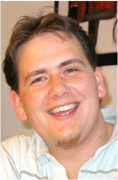

Dominik Knoll is a graduate student and research fellow at Skolkovo Institute of Science and Technology (Skoltech) in Moscow, Russian Federation. He received his B.Sc. and M.Sc. in Applied Computer Science from University of Salzburg in 2007, with a thesis on Autonomous Robotics and Neural Networks Control. Afterwards, he worked in IT business in different roles including that of a Software Engineer in several countries (Austria, Italy, Switzerland, Russia). In 2015 he started a PhD in the field of Systems Engineering in the Skoltech Space Center. His research interests include model based systems engineering, concurrent design methodology, and related tool support.

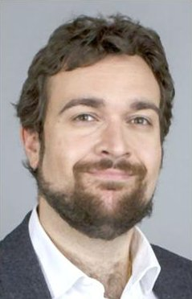

Alessandro Golkar is Vice President of Concurrent Engineering at Airbus CTO in Toulouse France, and Associate Professor at the Skolkovo Institute of Science and Technology. Alessandro served as a consultant for the European Space Agency and was a Research Fellow and Visiting Independent Advisor at the NASA Jet Propulsion Laboratory. He holds a Ph.D. degree in Aeronautics and Astronautics from the Massachusetts Institute of Technology, and Bachelor's and Master's degrees in aerospace engineering from the university of Rome "La Sapienza". His previous work includes collaboration with NASA HQ, NASA JPL, ESA (ESTEC and ESRIN), and BP plc. He is a Senior Member of the American Institute of Aeronautics and Astronautics, and an FAA licensed private pilot.

<!-- PDF_PAGE: 17 -->

Table I. Comparison of tools for conceptual design in aerospace.

Appendix I

<table border="1"><tr><td>Group</td><td>PLM tool</td><td>MDO tool</td><td colspan="2">Systems engineering tools</td><td colspan="5">Concurrent conceptual design tools</td></tr><tr><td>Tool</td><td>ENOVIA(2014)</td><td>Model Center11.2</td><td>MagicDraw18</td><td>OpenMBEE</td><td>IDM</td><td>VirSat3</td><td>OCDT</td><td>\CDP3</td><td>Valispace</td><td>CEDESK</td></tr><tr><td>References</td><td>(Dassault Systems,2016)</td><td>(Phoenix Integration,2015)</td><td>(No Magic,2015)</td><td>(Kulkarniet al.,2016;NASAJPL,2016)</td><td>(Bousquet et al.,2005)</td><td>(DLR,2016;Schaus et al.,2010)</td><td>(Braukhane,2015;ESA,2014)</td><td>(Fijneman and Matthyssen,2010;RHEA-Group,2015)</td><td>(Valispace,2017)</td><td>(Fortin et al.,2017)</td></tr><tr><td>Aspect</td><td></td><td></td><td></td><td></td><td></td><td></td><td></td><td></td><td></td><td></td></tr><tr><td>Multi-user support</td><td>Yes