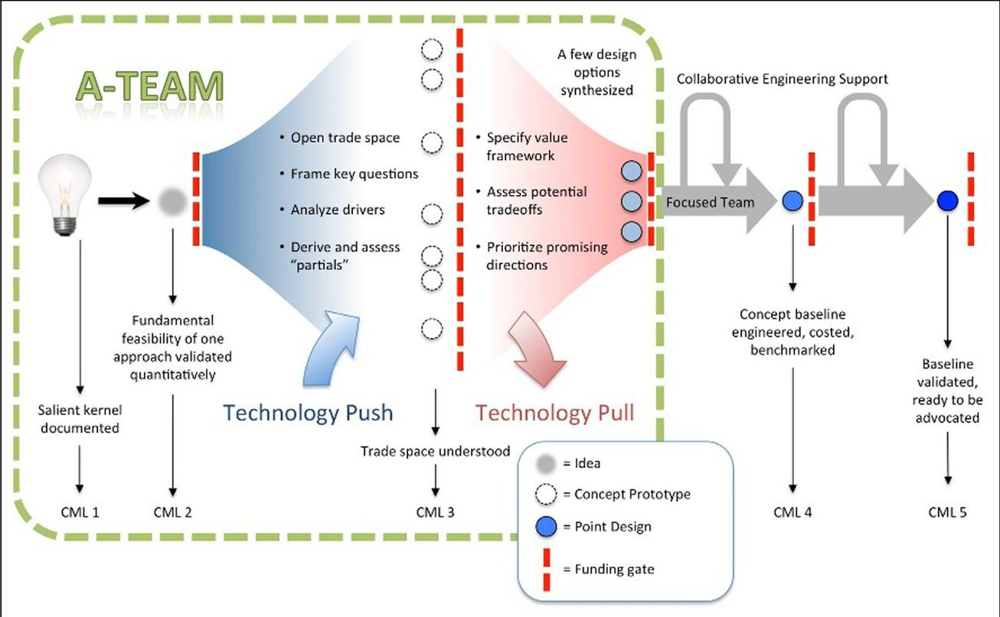
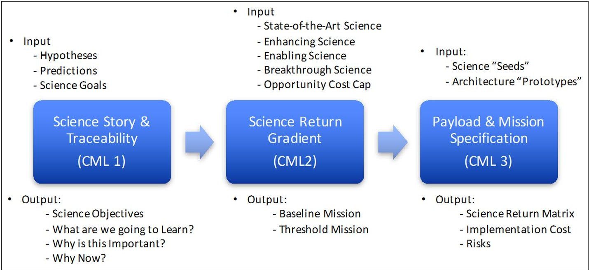
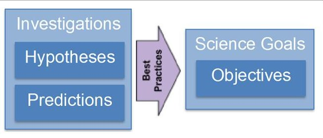
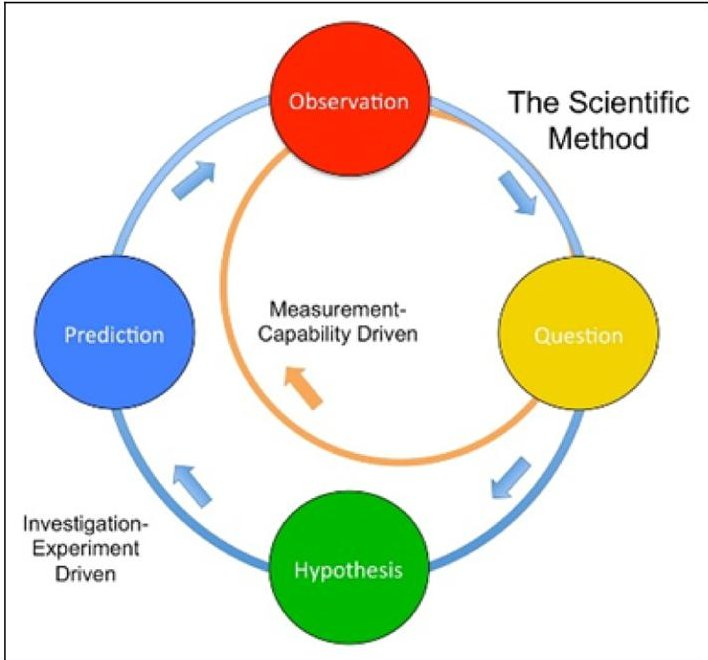
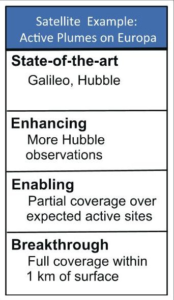
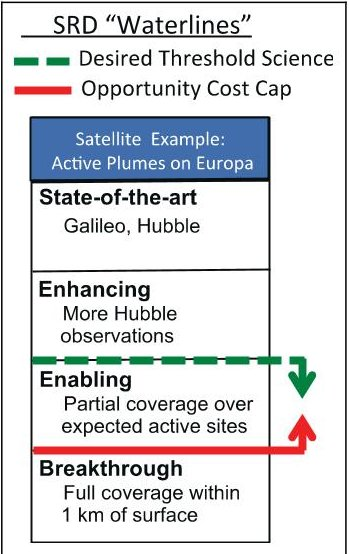
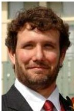
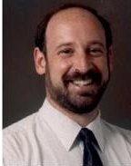
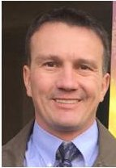

<!-- PDF_PAGE: 1 -->

# Exploring the science trade space with the JPL Innovation Foundry A-Team

John K Ziemer, Randii R Wessen and Paul V Johnson

Concurrent Engineering: Research and Applications 2018, Vol. 26(1) 22-32 $ \textcircled{c} $ The Author(s) 2017 Reprints and permissions: sagepub.co.uk/journalsPermissions.nav DOI: 10.1177/1063293X17740406 journals.sagepub.com/home/cer $ \textcircled{S} $ SAGE

## Abstract

The Jet Propulsion Laboratory Innovation Foundry has established a new approach for exploring, developing, and evaluating early concepts with a group called the Architecture Team. The Architecture Team combines innovative collaborative methods and facilitated sessions with subject matter experts and analysis tools to help mature mission concepts. Science, implementation, and programmatic elements are all considered during an A-Team study. In these studies, Concept Maturity Levels are used to group methods. These levels include idea generation and capture (Concept Maturity Level 1), initial feasibility assessment (Concept Maturity Level 2), and trade space exploration (Concept Maturity Level 3). Methods used for exploring the science objectives, feasibility, and scope will be described including the use of a new technique for understanding the most compelling science, called a Science Return Diagram. In the process of developing the Science Return Diagram, gradients in the science trade space are uncovered along with their implications for implementation and mission architecture. Special attention is paid toward developing complete investigations, establishing a series of logical claims that lead to the natural selection of a measurement approach. Over 20 sciencefocused A-Team studies have used these techniques to help science teams refine their mission objectives, make implementation decisions, and reveal the mission concept's most compelling science. This article will describe the A-Team process for exploring the mission concept's science trade space and the Science Return Diagram technique.

## Keywords

innovation foundry, science, concept maturity levels, formulation, innovation

## Introduction

In June of 2011, a new collaborative engineering approach for early concept formulation began in the Jet Propulsion Laboratory (JPL) Innovation Foundry (Sherwood and McCleese, 2013), 6 months later becoming the "A-Team" (Ziemer et al., 2013). Responding to a need for exploring mission architecture-level trades (Leising et al., 2010), the Architecture Team (A-Team) precedes Team X (Sherwood et al., 2007; Wall, 1999) in a sequence of concurrent engineering teams at JPL that can be used to mature a concept from a "cocktail napkin" level idea to a complete mission point design. The A-Team efficiently explores the science, implementation, and programmatic trade space in early concept formulation. Small, facilitated groups of experts generate innovative ideas, quantitatively assess feasibility, and discover key sensitivities in the trade space through collaborative analysis and use of advanced methods and tools. The A-Team process builds off the experience within JPL and other recent approaches to early

concept formulation (Hihn et al., 2011) including best practices of the JPL Innovation Foundry, Project Systems Engineering & Formulation Section, Team Eureka, and the Rapid Mission Architecture Team (Moeller et al., 2011) (NASA (2010)).

The A-Team is a focal point for innovative formulation approaches and people within JPL. It relies on a large background of study resources, creative thinkers and "grey beard" scrutinizers, advanced tools, and Subject Matter Experts (SMEs) with both breadth and depth in experience and expertise. The A-Team is designed to be a rapid and efficient process taking

<!-- PDF_PAGE: 2 -->

approximately 6 weeks (the entire process can be as short as just a few days or as long as up to 3 months) and costing the equivalent of a work-month of a fulltime employee or less. Studies begin with detailed planning and client review followed by study sessions, analysis work, and reporting. The staffing on each study is customized to the study goals and objectives, and it is addressed early in the A-Team process. Studies are generally half-day or whole-day events and conducted over a series of days with focused agendas that are moderated by a trained facilitator. Preliminary results and knowledge capture are available within hours of each session, and a final report is generally available 2 weeks later.

One of the biggest challenges facing early concept development is understanding the gradient in science return versus various available mission scenarios and payload options. Oftentimes, major areas of scientific inquiry have already been prioritized by science groups, including the National Research Council's Decadal Studies in Astronomy, Solar System, and Earth Science. Yet science teams continue to struggle, especially in competitive mission solicitations, to capture the right amount of scope that's achievable within the cost constraints of the opportunity. Often the desire to completely and comprehensively study a science area in just one mission (after all, true mission opportunities are rare) drives teams to take on too much, providing requirements that are unachievable within the resources of the opportunity without inducing unacceptable risk. Alternatively, science teams can seek to reduce risk using an established instrument, but have not thought through the traceability and key aspects of the science question to justify its use. Both scenarios lead to bad assumptions at the beginning of the concept development that can then ripple through implementation option choices, potentially preventing what would have been a good science investigation from being selected.

The purpose of this article is first to provide some additional background and summary of the A-Team process, tools, people, and facilities. We then focus on the A-Team methodology for overcoming the barriers of defining the science scope well at the early concept development stage. This includes understanding the science story and traceability and then examining the gradient in science return versus key characteristics of observables, developing the right payload and mission requirement specification through examining the science and implementation trade space.

## A-Team background

The A-Team has now conducted over 150 studies focusing on mission science goals, technology infusion,

architecture studies, and future strategic directions. In all cases, collaborative, facilitated discussion has led to efficient exploration of feasibility and the major trades. The high-level objectives for the A-Team are to provide:

- A facilitated process for building, analyzing, exploring, understanding, synthesizing, and communicating concepts quickly at low cost.

- A specialized and custom group of JPL-leaders in innovative methods and technical expertise.

- A center for intellectual honesty that can act as a trusted agent without an agenda.

- A safe and productive environment to disassemble assumptions, mature ideas, and solve hard problems.

- A way to bring concepts "into the box" or push them "out of the box" by design, advanced methods, and managing the conversation.

- An infusion path for strategic science and technology into early formulation.

- A focus point in a growing history and network of people, ideas, and concepts in early formulation.

## A-Team study methods and tools

A-Team methods and tools are aligned with the Concept Maturity Level (CML) scale (Wessen et al., 2009, 2010, 2013), including idea generation and capture (CML 1), initial feasibility assessment (CML 2), and trade space exploration (CML 3), as shown in Figure 1. This convenient alignment allows the tools and methods to correspond to the work that needs to be conducted to mature a concept at each CML. For example, a discussion on a CML 1 idea might include brainstorming, while a CML 3 discussion might focus on generating concept "seeds" or "prototypes" for exploring the trade space. Furthermore, the A-Team costing tools have a gradually increasing number of input parameters for each CML as more information becomes known about the concept. Outputs have gradually decreasing uncertainty corresponding to the CML: showing cost estimates of analogous mission at CML 1, notional cost "bins" at CML 2, and cost broken down by the highest-level work breakdown structure (WBS) elements in CML 3. More discussion of A-Team methods and tools related to CMLs can be found in Ziemer et al. (2013).

## A-Team study staffing and roles

Each A-Team study has a client that funds the study and generally a client lead that desires to have the study completed well and primarily represents the client's as

<!-- PDF_PAGE: 3 -->

Figure 1. The A-Team develops concepts through Concept Maturity Levels 1-3.

well as their own interests. For example, a client might be a formulation program office with a science principal investigator (PI) or team as a client lead. The A-Team management group works with the client team to agree on a set of study goals and objective and finds a study lead that plans the study, handles most of the logistics, and is responsible for the final report. All A-Team studies also have a facilitator to plan the session agenda and carry out the activities that will lead to achieving the study objectives, as well as an assistant study lead to help synthesize information and work directly with the study lead. Finally, each A-Team study includes SMEs in specific areas that are required based on the study objectives and scope. Oftentimes, SMEs can be other, outside scientists, instrument specialists, and technologists. This virtual team, which is created uniquely for each study, is guided through facilitated study sessions. More in-depth discussion of A-Team processes and roles can be found in Ziemer et al. (2013).

## A-Team facilities and infrastructure

Along with unique people, methods, and tools, A- Team studies are conducted in a facility at JPL called "Left Field." Left Field is designed to be configurable for each study, that is, as a meeting room for presentations, an open space for brainstorming, many small separated collaborative areas, or customized for individual study needs. The A-Team infrastructure also includes the Foundry Furnace, a new model-based systems engineering tool set including a repository for

building and deploying analytical tools, a storehouse for study methods and result documentation, and an analogous concept search capability with configuration and access control built-in. All A-Team studies use a web-based wiki format to capture information in each study session and provide a workspace for ideas to get organized.

## A-Team science workshops

One of the original goals for the creation of the A-Team in 2012 was to be able to work with PIs to examine the science that drives our early concept formulation and its impact to the mission and flight system requirements and design. Two years ago, the director of the Foundry and JPL Chief Scientist, Dan McCleese, challenged the A-Team leadership to develop new processes, methods, and tools to help PI-led concept teams with their science objectives and traceability, which were receiving major and minor weaknesses over many proposal campaigns. Out of the first 100 A-Team studies, half have had science as either the main focus (37 studies) or the secondary focus (13 studies). Many of these studies have been in the form of "Science Workshops," 2-3 full day working meetings with science teams coming together, often for the first time, to discuss the concept's science objectives in detail.

The structure of these workshops often includes four half-day sessions, potentially with a half-day break included depending on the science team's availability which matures their science concept from CML 1 to 2,

<!-- PDF_PAGE: 4 -->

Figure 2. A work flow diagram for maturing an early formulation science mission concept. The science evolves from a single goal to a matrix of science as a function of return, cost, and risk.

and maybe even 3. The first session generally focuses on the science story with many short presentations from the science team members and activities to help develop traceability to National Aeronautics and Space Administration (NASA) science goals. The second session begins to examine potential science investigations where it is made clear not to assume any implementation path. The third session then focuses on developing science return diagrams (described more in detail later in this article), and the fourth session finally goes into implementation details that fit the scope of the desired science investigation(s) and opportunity resources. With this experience, we now believe we have a good methodology to develop the Science Story (CML 1), Investigation Scope (CML 2), and Science Return (CML 3) for Earth, Solar System, and Astrophysics missions. The remainder of this article is organized into three sections, addressing the methodology for each science-focused CML (see Figure 2).

## Science at CML 1: the science story and traceability

1. Link the science goal to NASA goals, decadal, and science working group goals and objectives answer, "Why is this important?"

While CML1 really doesn't have any requirements for concept maturity (usually talked about as an idea on a cocktail napkin), there are things that can be done to flesh out a science concept before feasibility (CML2) is assessed. Specifically, we want to develop and understand a logical set of claims that lead to traceability and a story:

2. Show the "undiscovered country" and that we can indeed increase our knowledge with a good investigation—answer, "What is missing in our understanding?"

3. List the obstacles and show how they will be overcome—answer, "How will you fill the gap?"

4. Show what the results will look like and could mean after overcoming obstacles, and what can we expect—answer, "What are you going to learn?"

5. Lead to a solution that covers all previous claims answer, "How exactly are you going to do this and why this way?"

While the science team is explaining their concept, the A-Team members build these series of claims, take note of the rationale, and organize the evidence that can be constructed and will be required for the science story. The claims are a logical argument progression, where at least the last claim should contain the assertion that the approach chosen by the science team (instrument, platform, etc.) is the right way to complete the science argument or story. As the claims progress, we almost progress from left to right on the normal Science Traceability Matrix (STM). We also begin to build the requirements and capture the rationale for why each decision is made. We will now describe each step in more detail.

## The first claim: significance and setting the stage

This is analogous to Act 1 in a three-act story: the introduction and setting the stage. In under one page, the reader/reviewer must care about this concept and begin to have empathy for your story. This claim must appeal

<!-- PDF_PAGE: 5 -->

to a broad audience and answers WHY?—Why is this important? Why now? Why is this issue critical?

Example—"Changes in temperature and precipitation alone are not enough to explain the larger than expected current global measurements of snow/ice mass-loss."

The first claim is not at necessarily the highest level of science goals (i.e. finding life on other planets), but it must be a claim that is broad enough to bring the audience in, but narrow enough to begin to focus the audience on the particular concept. This is still too early for the more detailed level of science objectives—they come later—this is more like an "elevator pitch."

Getting just the right level is a balance between making a claim that's either somewhat controversial or critically important, but also must have enough evidence to show that it's really true. Claim 1 often points to a bigger question than a single mission can address, but does not rise to the level of a "decadal class goal" or lofty NASA goal. The link should be self-evident and will appear later in the STM itself.

## The second claim: the reason why there is a story at all

This claim introduces the main character (the mission/ instrument) and provides evidence that we should "trust" this character with tackling the big issue identified in the first claim. This claim helps to build empathy and create even more desire from the audience for the main issue to be resolved by the main character. Oftentimes, this claim contains the hypothesis that will be tested during the mission.

Example—"The amount of solar heat flux is a major contributor to melting, but is not accurately included in almost all global climate models."

## The third claim: where expectation meets reality

This is analogous to Act 2 of a three-act story: the journey. This claim really frames what the main character will contribute in more detail. There could be obvious (and not so obvious) obstacles for the main character to overcome, and this claim provides the evidence for the audience to feel that the main character will be successful. Oftentimes, this level of claim (or set of claims) contains more details on the specific science objectives for the mission. In fact, you may have multiple "Third Claims" in the science story if there are multiple, separate science objectives.

Example—"Contaminants on the surface and within the snow along with snow grain size drive albedo absorption, and the amount of melting for significant global regions."

## The fourth claim: "The Nugget"

This is nearing the climax of the science story. It should definitely show the main character overcoming the biggest obstacle (e.g. why this hasn't been done before and how it will revolutionize the field) and have a bit of a prediction flavor to it. This claim gets into the measurement objective and how the main character will overcome the challenges laid out in the previous claims.

Example—"To understand the global loss of snow/ ice mass, we must measure albedo at multiple wavelengths to understand what is driving it contaminants or grain size."

The fourth claim can have more of a "prediction" flavor, meaning the evidence for the hypothesis should point "this way" because we finally have the measurement capability to answer the question.

## The fifth claim: the obvious ending

The fifth claim is analogous to Act 3 of a three-act story: the resolution. It is a logical progression that actually ends up at the concept measurement itself. This contains the real observations and measurements, maybe some measurement requirements, or even instrument requirements. Often this claim shows the key reason why the main character was (or will be) successful—their "tick." At the end, the character says "I did it!" and if it's done correctly, the audience thinks, "We did it!"

Example—"Impurities of a magnitude to explain the additional observed melting cannot be seen with existing data sets; we need the high resolution/fidelity of global-scale measurements of snow/ice spectra with a hyper-spectral imaging camera to accurately measure albedo."

## For all claims provide evidence and rationale for the key arguments

Every claim should have rationale on why the science team thinks this is the case, and evidence to back it up. While later claims may, in fact, require the mission to be executed to substantiate completely, there should

<!-- PDF_PAGE: 6 -->

Figure 3. It is critical that the science objective be derived from a logical and self-consistent hypothesis and prediction pair.

still be some shred of evidence that points in this same direction/approach.

Often the science team will make (or hide) a claim as if it's obvious, but there might not be enough evidence (or no evidence) to back it up, or the claim itself is not quantitative enough to know whether or not it's true. For example, "Measuring X will improve our models," which must also answer how would it improve models and by what figure of merit? This is really when (toward the middle of the science story) these claims become the hypothesis for the investigation, which then point to the science objectives and requirements (see Figure 3). Frequently more analysis is required to provide evidence for the claims. Care must be taken that this activity is performed soon enough to provide the analysis and even have it go through peer review prior to proposal submission. Finally, as an exercise, for each claim, the team should develop a counter claim and be ready for that counter argument, if it's important.

## Technique for capturing the science story

Usually at the beginning of a science-focused A-Team study, a number of scientists will present on the main science focus, what is known about the different aspects of the main science question, and what else needs to be known. While there may be multiple "smaller" questions, the trick for Claim 1 is to find a single "big" question the concept will address.

During the presentations, the study lead and assistant study lead write down any claim they think might be one of the types of claims above. There may be multiple claims at the same level that could even distract from the main message, that is, "Our measurement will also provide X," even though it does not assist in the investigation. There will also likely be missing claims, or missing evidence to back up the claims, or holes in the flow of the logic that need to be filled. In these cases, the facilitator works with the science team to come up with the appropriate claims at the necessary levels and organize them. The key is to have the full

logical flow, a complete story, through all three acts. In fact, these particular claim descriptions might not be the best for any given concept—flexibility is key, but the logic of the claims getting to the final proposed measurement is critical.

## End products for CML I: the science story

These are the final products the A-Team produces related to the science for the mission concept at CML 1:

1. Key science goal discussed with team for consensus and written down (start of "fact sheet").

2. A white paper outline is populated with basic claim information, graphics, and so on.

3. CML 1 cost framework and mission analogous/ state of the art mission list generated.

4. Key next steps and critical questions identified.

## Science at CML 2: science return gradient

CML 2 is focused on high-level feasibility. Any options that are "close" should be kept, but any options that are obviously out of scope or violate some law of physics should be set aside. During a CML 2 session, we turn the claims we came up within the CML 1 session into science investigations by identifying science questions, hypotheses, predictions, and observables.

For each science question, we establish a Science Return Diagram (SRD) with state-of-the-art (SOA), enhancing, enabling, and breakthrough levels. Looking at the set of SRDs, one for each investigation or objective, we examine key science drivers and requirements, linking key science drivers to mission architectures and requirements along with technology options. We work to identify the opportunity landscape, constraints, and best practices for being successful within that opportunity. We examine cost for feasibility and identify key cost drivers. We then go back to the science questions and SRDs to determine where the concept fits within opportunity landscape (identify so-called water lines).

In some cases, we actually outline the science section of the proposal, potentially along with other sections at a high level, and fill in as much material as we have from the study. This also includes developing initial "boundary object" graphics that help the team understand their own full concept story. Eventually, these will turn into keystone graphics in the proposal. Finally, we discuss key programmatic constraints, perform a strengths, weaknesses, opportunities, and threats (SWOT) analysis, and discuss win themes, death threats, and next steps to getting to a feasible concept.

<!-- PDF_PAGE: 7 -->

Figure 4. Measurement capability-driven science concepts can often short-circuit the scientific method and produce a science story that does not "hang together."

## Hypothesis-driven investigations

As mentioned previously and shown in Figure 4, often having an existing instrument with known capabilities is the driver for a desired science mission. In those cases, the STM frequently gets built from science measurements to objectives to science goals instead of a flow from science goals to objectives and then measurements. This often leads to the idea of generating great volumes of "useful" data, but without direct links to the hypothesis that will be tested or the prediction that will be confirmed. While this approach may indeed provide new discoveries, the objectives of most competitive science proposals must be more focused and definitive in the science they plan to achieve. All too often, the measurement capability-based proposal does not rise to the level needed to convince science reviewers of the importance of the science that will be collected. This leads to proposal weaknesses and a low probability of getting selected.

For the A-Team at CML 2, we begin with formulating science questions that then derive an associated hypothesis. If the CML 1 activities were performed previously, many of these hypotheses have already been formed and recorded. The key for CML 2 is to make sure the hypotheses are testable within the scope of the opportunity. To do that, we examine what key parameters will we need to observe, for how long, and over what spatial and time scales. For example, a science question might be, "Does Europa have any geyser-like plumes similar to Enceladus?" A hypothesis would be "Europa has plumes that erupt every orbit, but only close to the surface." To determine if this hypothesis is correct, a prediction is made which can be observed.

This prediction must contain more detailed physical parameters. In our example, the key observables might be the plume scattered light and mass of the particulates. Time scales might be as short as minutes to as long as Europa's orbital period around Jupiter or an orbital timing issue with the spacecraft itself. Spatially, the plumes might be small enough and close to the surface as to be unobservable unless within 10 km of the surface.

Already, by going through a formal scientific process at this stage, we have uncovered key drivers for the mission. Perhaps more importantly, these discussions generally elucidate the science team's assumptions and gaps in analysis. For our example, has anyone modeled what an Enceladus-like plume on Europa would look like? What evidence do we have that they currently exist? These questions can form the basis for a rich discussion in session that ultimately ends up with a much more useful investigation description.

## Constructing the science return diagram

Now that key observables, including spatial and temporal scales have been identified (perhaps even somewhat quantified without knowing how the measurement will be made), we can begin to see what is required to confirm or deny the hypothesis. It is critical for the science team to understand that, while it may be too challenging to do so, we must understand how well these observables and scales must be measured and characterized.

In the A-Team, we have found that four levels are useful for examining the quality of measurement that is required in an investigation. These levels are: SOA, enhancing, enabling, and breakthrough science (see Figure 5). Each of these levels will be described below in more detail.

SOA. What missions have already contributed to our understanding for this investigation? For our Europa example, what did the Galileo Mission provide? What about the Hubble Space Telescope? What missions might be going to Europa that could also contribute to this investigation? Looking at the critical parameters (e.g. closest approach range to the surface of Europa), quantitatively assess how well the previous or known future mission has done or will do. In the group discussion answer, is it enough? Why not?

Enhancing. If you could augment the previous SOA missions by just changing one thing, what would it be? It could be more surface coverage, higher resolution, or a better instrument (as long as exactly what makes it better is identified). What key parameter are you trying to improve, and why? How much do you need to

<!-- PDF_PAGE: 8 -->

improve it, and why didn't the previous mission just make this improvement? Again, looking at the critical parameters, quantitatively assess what they would have to be to just slightly improve our understanding of the hypothesis and why. For our Europa example, this could mean more Hubble observation time of Europa, or if Galileo had just gotten a little closer to the surface, then we would have an enhancing science level.

Breakthrough. In the conversation flow, we intentionally skip the enabling level and move straight onto the breakthrough level of science return. For this level, again without considering any implementation, answer what it would take to absolutely confirm or deny the hypothesis. For example, if you wanted to confirm that there is a plume on Europa, it might require a probe that gets within 1 km of the surface, has full coverage, and both a high-resolution infrared (IR) spectrometer and a wide range in situ mass spectrometer that operate for a full Jovian year. Of course, all of these requirements would be incredibly difficult to meet; however, just having the science team discuss them points again to the critical parameters and most importantly why the certain values of them are traceable to achieving the science objectives/closing the hypothesis. In this way, there is a trend and connection now between the three levels: SOA, enhancing, and breakthrough. Constructing the final enabling level is now simply a matter of understanding where you should be on the observable characteristic continuum and why.

Enabling. This is the sweet spot for most science missions. What observation characteristics would enable the science team to make new conclusions about the proposed investigation? While it may not completely close out or confirm the hypothesis (again, that's the breakthrough level), it significantly improves our understanding. For our example, this could mean simply obtaining either the IR spectrometry or the mass spectrometry, but not both. It could mean getting closer to the surface at areas that are expected to be more active, but not having the full surface coverage.

This science return level usually has the richest discussion as the science team itself struggles to agree on what value for each critical parameter would be acceptable as "enabling new science." Discussing this level last generally frees up people's assumptions and preconceived desires. This technique also avoids the trap of "well, this is the best this instrument can do" since implementation options have not yet been discussed.

Figure 5. The SRD technique allows science team members to understand the full science gradient for their particular science question.

Figure 6. In this example, the SRD technique focuses the mission concept on enabling science. This dictates the caliber of science instruments and even the Co-Is for this concept. Once identified, the enabling science must be explored to identify spatial and temporal requirements within this science bin.

## Adding thresholds and "water lines"

Now that four science return levels have been created and quantified, two markers can be added to the table chart, or graph where the science team feels there is a threshold for the science return, below which is not worth doing the mission, and another at where it is feasible to afford the implementation required to make the observations (see Figure 6). The threshold for science return is typically "below" the enhancing level, while the implementation costs and risks may eliminate the breakthrough level. But this is key—as long as there

<!-- PDF_PAGE: 9 -->

is still overlap between these two markers, there is a traceable solution for the science team.

End products for CML 2: the science return gradient. These are the final products the A-Team produces related to the science for the mission concept at CML 2:

1. All potential investigations described in detail, with some prioritization along with full SRDs and "water lines."

2. Provide an outline of science section for proposal, filled in with material from study, and the start of boundary objects (graphics, tables, figures, etc.) are sketched out.

3. CML 2 cost analysis completed (including cost bin and uncertainty), based on analogous missions with guidelines and key cost drivers identified to help fit within opportunity.

4. Key mission requirements and potentially feasible mission architectures with strengths, weaknesses, and risks are identified and linked to levels in science return diagrams.

5. Technology infusion options are investigated for feasibility, including identification of Technology Readiness Levels (TRL) and development plan; a technology pull report can be generated, if applicable.

6. Strategic overview of win themes and death threats, SWOT analysis at a high "full concept" level including development of "on ramp/off ramp" map and a detailed action item list of next steps to create a feasible concept.

## Science at CML 3: payload and mission specification

Assuming the SRDs are complete, we now build up so-called science "seeds" (payload option sets) along with architecture/flight system implementation "prototypes" (including mission design), all linked to SRDs. There may be more than one science seed that can fit with each design prototype, and vice versa. The key here is to combine them in various ways to learn more about the trade space and where potential boundaries exits. This building of seeds and prototypes should be expected to be iterative with multiple options investigated and set aside before reaching the final optimal configuration or keeping a handful of options to fall back on in case the concept must change in the future.

Next, we identify key trades and perform analysis (creating a master equipment list (MEL), power equipment list (PEL), etc.) along with building up a "science value matrix" (SVM). The SVM actually evaluates and

weights each objective numerically along with how well the objective can be achieved with the given architecture. This provides a quantitative metric to examine relative science return/value versus implementation cost and risk.

During CML 3 activities, we also outline all other proposal sections in more detail and finalize the Boundary Objects (graphs, figures, tables, etc.) that should now include descriptions of trades and outcomes. Other aspects of management and strategy are also discussed including the proposed development schedule for the mission, any make/buy decisions, the common heritage versus engineering development versus technology planning status, and finally any partnership/contribution options. All of these are also linked to the various science seeds and prototypes, and each goes through a CML 3 level cost estimate. The key in this part of the session is to identify risks for all options early while there is time for mitigation or removal steps. It is critical to remove options where possible and prioritize others. Previous strategic material generated in the CML 2 study is also reviewed and updated if necessary.

## Summary

The A-Team is a recent addition to the JPL Innovation Foundry capabilities for early concept formulation. A-Team studies provide one proven and accessible way for the Earth, Solar System, and Astrophysics Program Directorates to establish early concept feasibility and to explore and understand the critical elements of the trade space. The A-Team has become a reliable and configurable process where people, ideas, and concepts come together in new ways that help foster innovation.

Since its inception in mid-2011, there have been over 150 A-Team studies conducted with an ever-growing rate, up to approximately 1 study per week during the summer of 2013. To date, PI and client response has been strong and affirming. The Foundry has and will continue to invest in developing the A-Team process methods, tools, and facilities to improve the quality of study results, decrease study time, and improve the awareness and communication of study results.

## Acknowledgements

The authors would like to acknowledge Alfred Nash, Kelley Case, and Dan McCleese of the Jet Propulsion Laboratory for their assistance and guidance in developing the A-Team science methods and tools. This research was carried out at the Jet Propulsion Laboratory, California Institute of Technology, under a contract with the National Aeronautics and Space Administration. $ \textcircled{c} $ 2016. California Institute of Technology. Government sponsorship acknowledged.

<!-- PDF_PAGE: 10 -->

## Declaration of conflicting interests

The author(s) declared no potential conflicts of interest with respect to the research, authorship, and/or publication of this article.

## Funding

The author(s) received no financial support for the research, authorship, and/or publication of this article.

## References

Hihn J, Chattopadhyay D, Karpati G, et al. (2011) Aerospace concurrent engineering design teams: current state, next steps and a vision for the future. In: Proceedings of the AIAA space 2011 conference and exposition, Long Beach, CA, 27-29 September, paper no. AIAA 2011-7238. Reston, VA: AIAA.

Leising CJ, Sherwood B, Adler M, et al. (2010) Recent improvements in JPL's mission formulation process. In: Proceedings of the 2010 IEEE aerospace conference, Big Sky, MT, 6-13 March, paper no. IEEEAC paper 1318. New York: IEEE.

Moeller RC, Borden C, Spilker T, et al. (2011) Space missions trade space generation and assessment using the JPL Rapid Mission Architecture (RMA) team approach. In: Proceedings of the 2011 IEEE aerospace conference, Big Sky, MT, 5-12 March, paper no. IEEEAC paper 1599. New York: IEEE.

NASA (2010) Planetary science decadal survey: JPL rapid mission architecture (RMA)—Enceladus study final

report, April. Available at: https://sites.nationalacademies.org/cs/groups/ssbsite/documents/webpage/ssb_059319.pdf

Sherwood B, Adler M and Wheeler R (2007) The new team X: concurrent engineering advancement at JPL. In: Presentation at the 58th international astronautical congress, Hyderabad, India, 24-28 September.

Sherwood B and McCleese D (2013) JPL Innovation Foundry. Acta Astronautica 89:236-247.

Wall S (1999) Reinventing the design process: teams and models. In: Proceedings of the IAF, specialist symposium novel concepts for smaller, faster & better space missions Redondo Beach, CA, 19 April.

Wessen RR, Adler M, Leising CJ, et al. (2009) Measuring the maturity of robotic planetary mission concepts. In: Proceedings of the AIAA space 2009 conference and exposition, Pasadena, CA, 14-17 September, paper no. AIAA 2009- 6824. Reston, VA: AIAA.

Wessen RR, Adler M, Leising CJ, et al. (2010) Measuring the maturity of robotic planetary mission concepts II. In: Proceedings of the SpaceOps 2010 conference, Huntsville, AL, 25-30 April, paper no. AIAA 2010-2034. Reston, VA: AIAA.

Wessen RR, Borden C and Ziemer JK (2013) Space mission concept development using concept maturity levels. In: Proceedings of the AIAA space 2013 conference, San Diego, CA, 10-12 September. Reston, VA: AIAA.

Ziemer JK, Ervin J and Lang J (2013) Exploring mission concepts with the JPL Innovation Foundry A-Team. In: Proceedings of the AIAA space 2013 conference and exposition San Diego, CA, 10-12 September.

## Author biographies

John K Ziemer has worked at the Jet Propulsion Laboratory for over 15 years and is currently the Concept Innovation Methods Chief in the JPL Innovation Foundry program office. In that role, John leads the "A-Team," an innovative concept generation and early development group within the Foundry. He is also the Payload Systems Engineer and Cognizant Engineer for the ST7 Colloid Micro-Newton Thruster (CMNT) technology demonstration mission. Throughout his career, he has helped develop and test many micropropulsion systems including colloid thrusters, field emission electric propulsion (FEEP) thrusters, pulsed plasma thrusters (PPTs), magnetoplasmadynamic (MPD) thrusters, vacuum arc thrusters (VATs), and laser ablation thrusters (LATs). John received a BSAE from the University of Michigan, and an MA and PhD in Mechanical and Aerospace Engineering from Princeton University.

Randii R Wessen has been an employee of the California Institute of Technology's Jet Propulsion Laboratory since 1984. Randii is currently the A-Team Lead Study Architect in JPL's Innovation Foundry. Prior to this he was the Navigator Program System Engineer, the Telecommunications & Mission Systems Manager for the Mars Program, Manager of the Cassini Science Planning & Operations Element, the Galileo Deputy Sequence Team Chief, and the Voyager Science Sequence Coordinator for the Uranus & Neptune encounters. Randii received his Bachelors of Science in both Physics & Astronomy from Stony Brook University, a MS in Astronautics from the University of Southern California, and a PhD in Operations Research from the University of Glamorgan, Wales, United Kingdom. He co-authored the books "Neptune: the Planet, Rings and Satellites" and "Planetary Ring Systems."

<!-- PDF_PAGE: 11 -->

Paul V Johnson has been employed as a scientist at the Jet Propulsion Laboratory, California Institute of Technology since 2003. Currently, he is the Supervisor of the Planetary Ices Group in JPL's Science Division and has been a core member of the A-Team since 2014. In the later role, he has served primarily as a Study Lead. Paul's research interests include studying the photochemistry of cryogenic ices relevant to understanding the surfaces of icy Solar System bodies using infrared and ultraviolet and infrared spectroscopies. He also studies electron-atom/molecule collisions, and their subsequent emissions, relevant to understanding processes in upper planetary atmospheres and astrophysical plasmas using electron energy-loss and electron-impact induced emission spectroscopies. Paul received both his Bachelor of Science (Honours) in Physics and his PhD in atomic/molecular physics from the University of Manitoba.