<!-- PDF_PAGE: 1 -->

# CREATE/ERS: Department of Defense acquisition reform through resilient engineering and virtual prototyping in a digital environment

Journal of Defense Modeling and Simulation: Applications, Methodology, Technology 2019, Vol. 16(4) 357-371 $ \textcircled{c} $ The Author(s) 2017 DOI: 10.1177/1548512917745606 journals.sagepub.com/home/dms SAGE

Douglass E Post $ ^{1} $ , Owen J Eslinger $ ^{2} $ , Scott M Sundt $ ^{1} $ and Megan Holland $ ^{2} $

## Abstract

The USA faces a multitude of threats to its national security and international interests in an era of exponential technology growth and unprecedented access by anyone with a smartphone. Traditionally, the acquisition of US defense systems has relied on sequential methods of conceptual design and development. While successful in the past, these methods are time consuming and in danger of creating vulnerability gaps that could limit or constrain US response options. The challenge is clear. Either the US Department of Defense (DoD) evolves the way it plans, develops, buys, and manufactures new weapons systems, or it cedes the high ground to a rapidly changing global environment. Adapting and expanding advances in high performance computing (HPC), developing and employing complex physics-based software tools for high fidelity modeling and simulation, and implementing a vision that combines these elements with other processes are critical enablers the DoD is pursuing. This paper describes the synergy of three major DoD efforts designed to address needs in the areas of acquisition program development and execution: the DoD High Performance Computing Modernization Program (HPCMP) (the DoD HPCMP began as an Office of the Secretary of Defense program in 1992; in October 2011, leadership transferred to the Assistant Secretary of the Army for Acquisition, Logistics and Technology; the US Army Corps of Engineers Engineer Research and Development Center manages the program, https:// www.hpc.mil/index.php) Computational Research and Engineering Acquisition Tools and Environments program; the Engineered Resilient Systems program; and the DoD Digital Engineering vision.

## Keywords

Acquisition, computationally based engineering, Computational Electromagnetics, computational fluid dynamics, Computational Research and Engineering Acquisition Tools and Environments, Design Environment, Engineered Resilient Systems, finite element analysis, high performance computing, High Performance Computing Modernization Program, modeling and simulation, physics-based prototyping, supercomputing

## 1. Introduction

The USA faces multiple threats to national security and its international interests in an era of exponential technology growth and unprecedented access to information. Traditionally, the US Department of Defense (DoD) has relied on sequential methods of development and production to acquire defense systems. Although successful in the past, these empirically based methods of "design, build, test, repeat" increase acquisition time and can no longer keep up with the increasing complexity of modern weapon systems

<!-- PDF_PAGE: 2 -->

resulting from rapid advances in technology. This results in late discovery of design flaws, immature technology issues, and system integration problems, leading to costly rework and redesign that contribute substantially to cost overruns, schedule delays, and performance shortfalls. They also do not provide the agility needed to adapt quickly to meet a changing operational and threat environment.

The challenge is clear: either the DoD evolves in the way it develops, buys, and manufactures new weapon systems, or it will cede the high ground to a rapidly changing global environment. We suggest the answer lies in adapting and expanding advances in high performance supercomputing, developing and employing complex physics-based software tools for high fidelity modeling and simulation, and implementing a vision and framework that combine these elements with other processes. The result should be an agile and adaptable production lifecycle that meets the needs of combatant commanders around the world.

To address threats and halt the repercussions of a closing technology advantage, the DoD has introduced three synergistic efforts over the past 10 years, designed to improve and streamline acquisition program development and execution:

- the High Performance Computing Modernization Program (HPCMP) Computational Research and Engineering Acquisition Tools and Environments (CREATE) (hereafter referred to as CREATE) program;

- the Engineered Resilient Systems (ERS) program; and

- the DoD Digital Engineering framework.

The HPCMP, managed by the US Army Corps of Engineers (USACE) Engineer Research and Development Center (ERDC), provides supercomputing services (supercomputers, networks, and software services) to the DoD science and technology (S&T), test and evaluation (T&E), and acquisition engineering communities, including research and development (R&D) efforts. The HPCMP includes five computer centers with more than 10 high performance computers and total computing power of about 30 PetaFLOPS $ (10^{15} $ Floating Point Operations/second). The computers are refreshed every four years. Some 300 user groups (approximately 2400 active users) at more than 150 DoD sites are connected to HPCMP computing centers by the Defense Research and Engineering Network (DREN), a high-speed, high-bandwidth secure network.

The HPCMP provides software services and support to the CREATE program, and these resources, together with subject matter experts and design engineers, provide a high performance computing (HPC) ecosystem to support R&D, including portions of the DoD Digital Engineering program. The CREATE program focuses on generating

and deploying high fidelity software engineering tools using HPC platforms. This combination enables the design and analysis of complex weapon systems in a manner that is unapproachable by traditional methods.

The ERS program focuses on leveraging CREATE and other DoD S&T investments to improve efficiency during the conceptual design phase of new defense systems and throughout a system's lifecycle. This approach includes linking performance, cost, and mission effectiveness models earlier in the acquisition lifecycle than has been done in the past.

The DoD's Digital Engineering framework brings together the hard science and supercomputing hardware applications of the HPCMP and CREATE programs and the process improvement applications of the ERS program, resulting in a single, complementary computational prototyping environment.

## 2. Computational Research and Engineering Acquisition Tools and Environments program: Physics-based software tools

Since 2008, the CREATE program has been developing and deploying a suite of physics-based engineering software tools that the DoD and the defense industry use to develop computational prototypes for new weapon systems and to analyze the performance of aircraft, ships and submarines, ground vehicles, and radio frequency (RF) antennas and radars. $ ^{1-5} $ CREATE is an integral part of the HPCMP. The success of the CREATE software development process is due to its hybrid organizational structure in which CREATE workforce members are embedded with DoD Service clients. These government-owned and government-developed complex engineering software programs enable high fidelity, physics-based virtual modeling and simulation using computational fluid dynamics (CFD), finite element analysis (FEA), and other physics-based mathematical algorithms for a variety of S&T, T&E, and acquisition programs for the Defense Department.

Defense acquisition programs largely still follow empirical "design-build-test" methodology. This approach results in late discovery of design flaws, immature technology issues, and system integration problems. Rework and redesign efforts contribute substantially to cost overruns and schedule delays. $ ^{1-5} $ On the other hand, by employing a "model-analyze-build" paradigm, programs can optimize engineering designs early in the acquisition process using CREATE tools, potentially reducing costs, shortening schedules, and increasing design and program flexibility and agility. $ ^{1} $ With "model-analyze-build," programs can improve performance by reducing design flaws prior to the manufacturing phase. They have the potential to achieve

<!-- PDF_PAGE: 3 -->

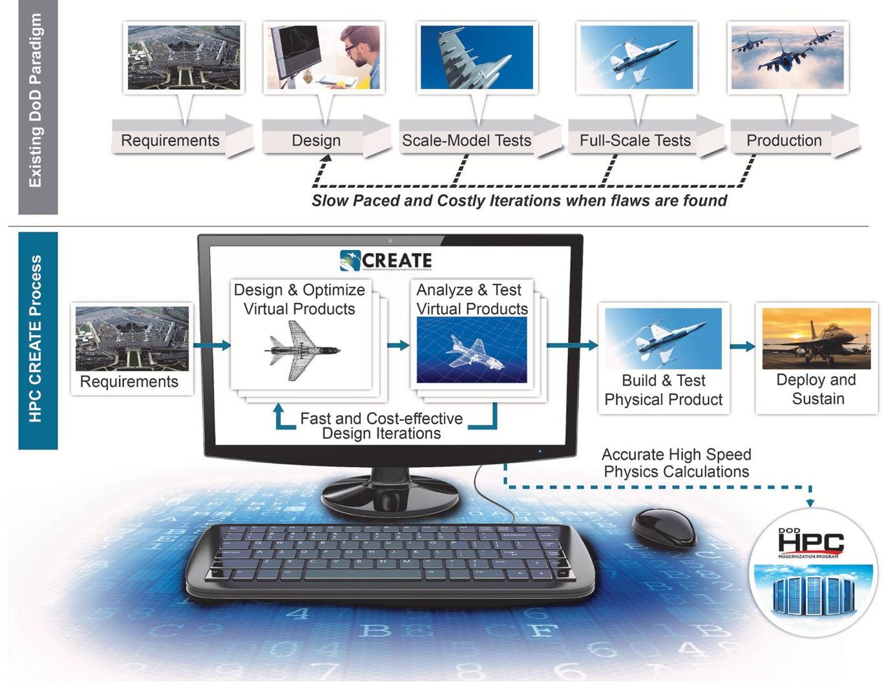

Figure 1. High Performance Computing Modernization Program (HPCMP) Computational Research and Engineering Acquisition Tools and Environments $ ^{\mathrm{TM}} $ (CREATE) optimized design process. DoD: Department of Defense.

more flexible and rapid development of engineering concepts and designs and to begin system integration earlier in the acquisition process (Figure 1).

Both the DoD ERS concept and the digital engineering environment allow for an expansion of the acceptance and adoption of CREATE tools to reduce program risk while delivering a broader design trade space for decisions in the production and sustainment of major US weapon systems. $ ^{1-4} $

CREATE tools have been developed, deployed, and supported by the DoD (both government employees and contractors) and validated with experimental data for DoD use cases. The DoD owns them and has government purpose distribution rights to all HPCMP CREATE software. The tools give DoD acquisition program engineers the ability to make independent assessments of proposed designs and contractor deliverables. They also directly assist the acquisition engineering community in growing its organic engineering capability, a DoD priority. $ ^{1-4} $

The CREATE program has been successful using an innovative business plan and hybrid management system in which core software developers are embedded within the Service R&D organizations. CREATE provides a steady

annual delivery of product development and releases focused on meeting the needs of Service R&D clients. CREATE ensures continuity of effort and flexibility for the various project areas and their respective managers for approximately 180 scientists, engineers, and code developers across the country. It also provides a critical link between the various project elements and the rest of the larger HPCMP organization, which owns and manages the five DoD Supercomputing Resource Centers (DSRCs) the CREATE program uses in software development and analysis. $ ^{4,6,7} $

As of November 2016, the CREATE program had provided physics-based software tools to more than 160 engineering organizations from the DoD, industry, academia, and other government agencies. The current CREATE program tools address five major defense procurement project areas (Figure 2):

- CREATE-AV (aviation);

- CREATE-Ships (shipbuilding);

- CREATE-RF (antenna design);

- CREATE-GV (ground vehicles); and

- CREATE-MG (meshing and geometry). $ ^{1-5} $

<!-- PDF_PAGE: 4 -->

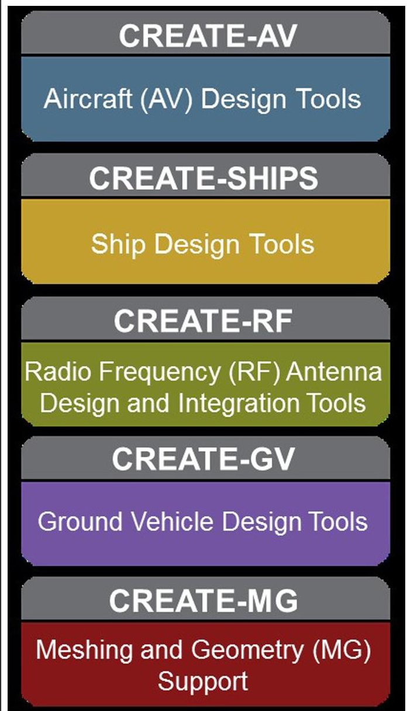

Figure 2. Computational Research and Engineering Acquisition Tools and Environments (CREATE) project areas.

From these five project areas, the CREATE program has developed a suite of 11 robust physics-based engineering software tools that perform design space exploration and assessments using the high-speed computing systems found at HPCMP's DSRCs located around the country. The combination of these engineering software tools and high-speed supercomputers offers significant modeling and simulation capabilities that were not previously available to DoD, providing enhanced capacity to accomplish virtual prototyping of major weapon system programs more efficiently than with traditional approaches.

## 2.1 CREATE-AV (aviation vehicles)

The CREATE-AV project includes elements that provide project oversight, project management, requirements gathering, computationally based engineering (CBE) software product development, product verification, validation and

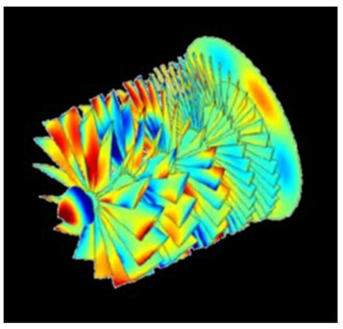

Figure 3. Modeling UFY-219 aircraft engine surface currents.

quality control, and technology transition. $ ^{1-5,8,9} $ The CREATE-AV project develops three software products:

- Kestrel for the design and high fidelity analysis of fixed-wing air vehicles;

- Helios for the design and high fidelity analysis of rotorcraft; and

- DaVinci for rapid conceptual design of aircraft.

2. 1.1 Kestrel-fixed-wing aircraft design and analysis. Kestrel provides accurate predictions of DoD air vehicle performance with a focus on the fixed-wing community. It integrates computational fluid dynamics, structural dynamics, propulsion, and control for subsonic through supersonic aircraft operation. $ ^{4,5,10.11} $ The capabilities available in Kestrel include aerodynamics (Navier-Stokes solvers and a full suite of boundary conditions and turbulence models), structural dynamics (modal models or FEA for aerostructure interactions), flight control systems (control surface movement), and propulsion (engine "cycle decks" for propulsion effects or direct engine simulation, including inlet and rotating machinery, nozzle, and moving walls) $ ^{4} $ (Figure 3). This set of capabilities is unique in the international aerospace community, allowing users to develop major innovations in the design of next-generation aeronautical weapon systems.

With Kestrel, engineers can verify designs prior to key decision points and fabrication of test articles or full-scale prototypes; plan and rehearse wind-tunnel and full-scale flight tests; evaluate planned or potential operational use scenarios; perform flight certifications (airworthiness, flight envelope expansion, mishap investigation, stores carriage and release, and so on); and generate response surfaces usable in DaVinci, flight simulators, and other environments that require real-time access to performance

<!-- PDF_PAGE: 5 -->

data. Kestrel has been applied to the analysis of more than 30 fixed-wing DoD aviation systems, including at least 10 unique unmanned aerial vehicles.

Recent impacts with Kestrel include assessing the effectiveness of static forces and moments on the F/A-18E Super Hornet, which enabled effectiveness assessments of proposed modifications to the flight control system. $ ^{11} $ Additional impacts include lifecycle support for the Air Force A-10 Warthog and database development for the Navy's E-2D Advanced Hawkeye all-weather, carriercapable, tactical airborne early warning aircraft for improved flight simulator performance assessments.

2. 1.2 Helios—rotary-wing aircraft design and high fidelity analysis. Helios is a high fidelity, full-vehicle, multiphysics analysis tool for rotary-wing aircraft. Helios can calculate the performance of a full-sized rotorcraft, including the fuselage and rotors. It can handle arbitrary rotor configurations and analyze and predict prescribed maneuvers with tight coupling of rotor aerostructural dynamics. $ ^{2-5,12} $ A highly accurate treatment of vortex shedding from rotor blade tips using adaptive mesh refinement gives Helios the unique capability to assess the interaction of these vortices with the fuselage and nearby rotor blades. Helios provides all the benefits for rotary-winged aircraft that Kestrel provides for fixed-wing aircraft.

The Army Rotorcraft program, in partnership with Boeing, used Helios to generate early-design stage predictions of helicopter performance for a proposed rotor blade upgrade of the CH-47F Chinook helicopter to achieve up to an estimated 2000 pounds improved hover thrust with limited degradation of forward flight performance. $ ^{1,3,4,5} $ This added performance significantly enhances the combat capability of the 400+ Chinooks in the Army inventory (Figure 4). The Army Joint-Multi-Role Technology Demonstrator (JMR-TD) program also recently used

Helios to provide decision data for proposals from four vendors. Helios enabled Army aviation engineers to conduct an independent analysis of contractor proposals. The Army Rotorcraft program is currently using Helios to assess H-60 tail rotor effectiveness for providing directional control of helicopters in combination with increased engine power and main rotor performance.

2. 1.3 DaVinci-conceptual aircraft design. DaVinci enables integrated, multi-fidelity, physics-based digital engineering and analysis of aerospace (fixed-wing, rotary-wing, and space access) vehicles for their entire lifecycle, including vehicle performance, effectiveness, cost, schedule thorough design space exploration, uncertainty quantification, risk assessments, and sensitivity studies. $ ^{1-5} $ DaVinci includes a capability to allow conceptual designers to quickly and intuitively build parameterized, associative, attributed models (Outline Markup Language and corresponding layout of internal structure and subsystems) necessary to feed higher fidelity analysis tools (e.g., Kestrel and Helios). $ ^{13} $ It also allows user contributions of additional capability not delivered with the product through knowledge management, model persistence, and collaboration across organization and Service boundaries.

## 2.2 CREATE-Ships (maritime vessels)

The overarching goal of the CREATE-Ships project is to develop software that enables comprehensive exploration of trade-space design options for complex maritime systems; provides confidence in the results of computational predictions in required disciplines across all phases of the acquisition process; and meets required acquisition timelines for DoD clients, primarily the US Navy. $ ^{1-5} $

The CREATE-Ships project is currently fielding four physics-based engineering software programs:

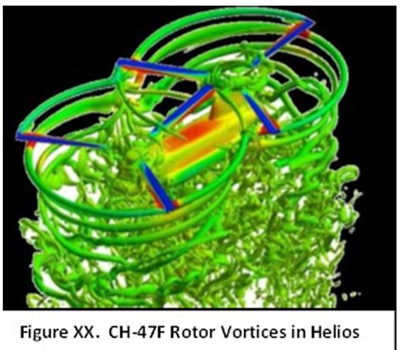

- Rapid Ship Design Environment (RSDE);

Figure 4. CH-47F rotor vortices in Helios.

- Integrated Hydrodynamics Design Environment (IHDE);

- NavyFOAM;

- Navy Enhanced Sierra Mechanics (NESM).

Each software tool has been heavily involved in recent major Navy T&E assessments, as well as major shipbuilding acquisition program design analysis efforts.

2. 2.1 Rapid Ship Design Environment. RSDE is a concept design tool that allows engineers and naval architects to assess the trade-offs inherent in designing ships to meet a spectrum of competing performance parameters (Figure 5). RSDE provides the following critical capabilities:

<!-- PDF_PAGE: 6 -->

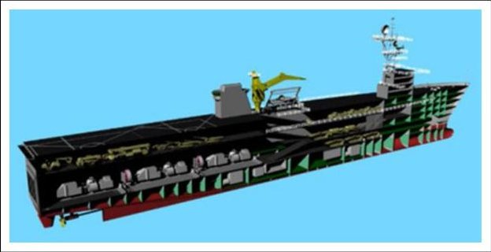

Figure 5. Rapid Ship Design Environment interface. $ ^{2} $

- generates a range of ship concept options and allows selection of optimum solutions;

- develops physics-based response surfaces to act as surrogates for full-physics analyses in the concept design process;

- performs hierarchical, multidisciplinary design optimization, in which a top-level ship-based function, for example, cost, is optimized subject to constraints at the individual discipline level. $ ^{1-5,14} $

Employing the concept of design space exploration, engineers and naval architects can provide data for decision makers on the impact of trade-offs in range, speed, armament, and aviation support on the size—and, in large measure, the costof a proposed ship concept. RSDE can generate tens of thousands of candidate ship designs with varying hullforms, including compartment and machinery arrangements. To date, RSDE has been used to enable setbased design on 10 different Navy acquisition programs, allowing down-selection of a ship design to occur earlier in the process (Figure 6).

2. 2.2 Integrated Hydrodynamics Design Environment. The IHDE product, which uses the Leading-Edge Architecture for Prototyping Systems (LEAPS) framework, is a highly automated environment that allows naval architects and hydrodynamicists to build computational models, submit "jobs" to HPC centers, and retrieve and validate results for all required areas of hydrodynamics and at all required levels of fidelity. LEAPS is used to manage geometry and analysis information and allows data sharing between several knowledge domains. IHDE uses LEAPS as a warehouse for ship model information, which provides several advantages over existing prototyping systems:

- interoperability for different activities that already use LEAPS;

- creation of a foundation of common terms across different disciplines for ship geometries and characteristics, thereby preventing translation errors; and

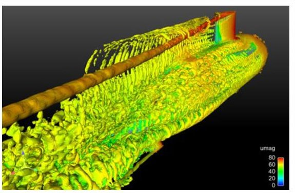

Figure 6. Submarine modeling at drift angle. $ ^{3} $

- synergy in software development and integration using a common product model that can be shared with other activities, eliminating inefficient and time-consuming resetting of the same ship modeling inputs when using different analysis methods. $ ^{1-} $ 5,15-17

The IHDE software products address all aspects of the time-to-solution issue, with the exception of the execution of hydrodynamics solvers, expected to be incorporated at a later date.

2. 2.3 NavyFOAM. The second hydrodynamics product is a high-end, full-physics code that the Department of the Navy developed and maintains. NavyFOAM is based on the OpenFOAM libraries and code architecture. To that base, several features have been added that enable simulation of the air-sea interface and other effects important for naval vessels. NavyFOAM is a fully parallelized, multiphysics, computational fluid dynamics framework developed using modern, object-oriented programming. $ ^{1-5} $ The code enables high fidelity hydrodynamic analysis and prediction of ship performance, for example resistance, propulsion, maneuvering, seakeeping, and seaway loads. It has demonstrated accuracy against experimental data for several target applications, such as resistance, propeller characteristics, hull/propulsor interaction, and six-degrees-of-freedom ship motion for underwater vehicles and surface ships (Figure 7). Offering a suite of Navier-Stokes-based flow solvers tailored to specific applications, including single- and multiphase solvers, NavyFOAM allows assessment of alternative hull and propulsor designs. With NavyFOAM, users can evaluate a ship's performance in an array of operating conditions, including subsea and surface operations. Its modularity expedites coupling with third-party software and collaborative multidisciplinary software development, and it has been applied to many naval systems including assessment of the safe operating envelope of the DDG- 1000 Zumwalt Class guided-missile destroyer, propeller designs, and the US Marine Corps Amphibious Combat

<!-- PDF_PAGE: 7 -->

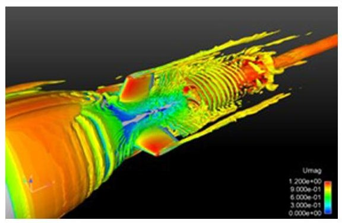

Figure 7. Submarine propulsor flow modeling.

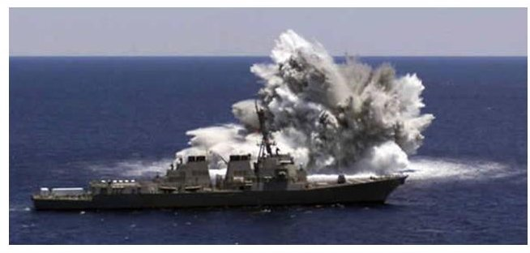

Figure 8. Live-fire test.

Vehicle. Most recently, the NavyFOAM program has supported the new Columbia Class SSBN program, using a custom physical model for flow predictions and rotatingarm simulations to better understand the underlying physics used in design decisions.

2. 2.4 Navy Enhanced Sierra Mechanics. NESM builds on the Department of Energy Sandia National Laboratory's shock analysis tool, Sierra Mechanics, to provide a means to assess ship and component response to external shock and blast using accurate HPC tools (Figure 8). NESM can reduce the time and expense required for physical shock testing of ship classes. It also improves the initial ship design process by assessing planned component installations for shock performance prior to final arrangement and installation decisions. Capabilities include structural dynamics (implicit linear-elastic solvers), solid mechanics (explicit plasticity solvers), fluid dynamics (Euler solvers), and fluid-structure interaction. The solution algorithms in NESM can exploit massively parallel computers and scale to thousands of cores, enabling efficient computer use and the ability to address full-sized naval vessels up to and including next-generation aircraft carriers and submarines (Figure 8). $ ^{1-5,16} $

NESM supports the acquisition process in several ways. The program is being used to support live-fire T&E requirements for the new Ford Class nuclear-powered

aircraft carriers. All ship classes are required to be tested for shock damage resistance. Historically, this testing has been conducted exclusively with external explosive charges. Effects were recorded and necessary alterations designed and implemented for the ship class. This process not only requires a ship to be dedicated to the lengthy test process but also requires any deficiencies in shock resistance to be retrofitted into the ship design. NESM allows for a computational assessment of shock on the ship and equipment while still in the design stage, when fixes can be incorporated prior to construction. NESM has been approved by the Navy as an alternative for costly and damaging full-ship shock trials and has also been used to support Littoral Combat Ship (LCS) live-fire T&E and the USS COLE damage validation study.

## 2.3 CREATE-RF (radio frequency antennas and radars)

As integral components of almost all DoD weapon systems, antennas and radars perform critical communication, identification, and navigation functions necessary for warfighter effectiveness and survivability. Computational Electromagnetics (CEM) tools have matured in recent years and are widely used for antenna concept exploration and design by the DoD and its contractors. This is the basic focus of effort for the CREATE-RF project. $ ^{1-5} $

CREATE-RF has developed highly accurate, maintainable, extensible, validated, and productive software tools to support rapid antenna system design and integration into various structures of interest, including air, sea, land, and space-based platforms. The project's development of state-of-the-art government-owned antenna modeling capabilities is critical to our nation's defense and represents a national asset.

The CREATE-RF project is composed of a single-code product named Scalable Engineering Tools for Radio Frequency Integration (SENTRi). SENTRi is designed to provide two principal capabilities:

- a "rapid-design tool set" that engineers can use to quickly develop various antenna concepts, and narrow the exploratory design space where tool setup and computer solution turnaround time is envisioned to be minutes (Figure 9); and

- a "high fidelity tool set" for modeling and simulating antenna electromagnetic design variables where tool setup and computer solution turnaround time is envisioned to be 16-24 hours when using high performance computers.

SENTRI is not based on a single numerical solution method, but instead uses a variety of techniques driven by

<!-- PDF_PAGE: 8 -->

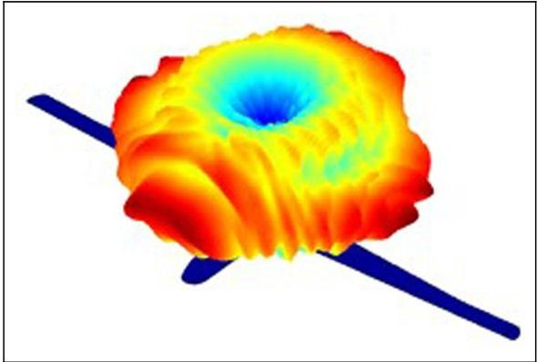

Figure 9. Unmanned aerial vehicle gain modeling using Scalable Engineering Tools for Radio Frequency Integration.

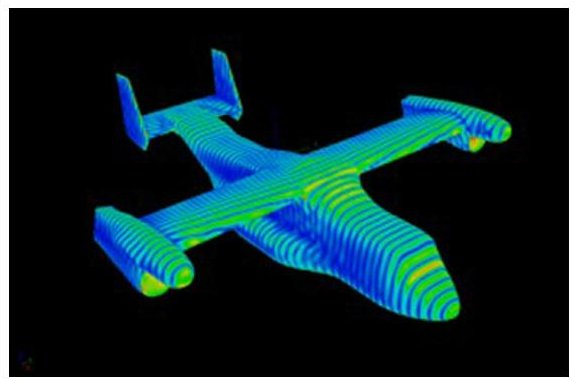

Figure 10. Electric field on CV-22 calculated by Scalable Engineering Tools for Radio Frequency Integration.

a better understanding of computational methods for electromagnetic phenomena and the need to adapt these methods for current and next-generation parallel computer architectures. The approach taken by SENTRi provides customers with the best available schemes of rapid-design space exploration and high fidelity solutions to quickly find both optimal and robust performing designs (Figure 10). By incorporating object-oriented programming techniques, software libraries, and application programming interfaces (APIs), SENTRi aids in the design and analysis of various engineering processes and allows for concurrent and semi-independent software development by multiple developers. SENTRi impacts all five of the DoD acquisition cycle's major phases, replacing most of the physical "design-build-test" engineering cycles with digital engineering simulations of "model-test build" engineering cycles.

SENTRi is a full wave electromagnetic prediction code for RF modeling of antennas, microwave circuits, and radar cross-section predictions (Figure 11). It is designed to model complex structures, including highly heterogeneous material structures with multi-scaled features. A key goal is the calculation of the simultaneous performance of multiple-antenna systems embedded on a platform. Its

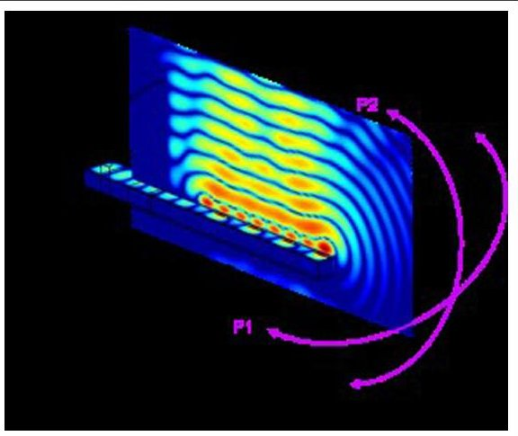

Figure 11. Leaky wave antenna modeling using Scalable Engineering Tools for Radio Frequency Integration.

electromagnetic features are based on solutions of Maxwell's equations with advanced hybrid finite element boundary-integral techniques, which provide high accuracy with the ability to solve large, complex problems. SENTRi is continually validated with DoD measurements and is being used for antenna design, antenna in situ analysis, RF signature prediction, electromagnetic interference, electromagnetic compatibility, material modeling, microwave device analysis, phased array antenna systems, and apertures. SENTRi is being used by more than 60 organizations in government and industry.

## 2.4 CREATE-GV (ground vehicles)

In early 2013, the CREATE-GV (ground vehicles) project was established within the CREATE program to develop physics-based, HPC tools to enhance ground vehicle concept design and inform requirements development. CREATE-GV provides the requisite data for trade-space analysis to positively influence cost, schedule, and performance, with significant reduction in risk for the acquisition community. $ ^{3-5} $ As its initial project charter, the CREATE-GV project is developing two software tools:

- Mercury, a physics-based HPC tool for tactical mobility with co-simulation of terrain mechanics, such as soil modeling, with vehicle systems including suspension, tire, and track options and powertrain simulation (Figure 12); and

- Mobility Analysis Tool (MAT), a model-based analysis software tool used for predicting tactical mobility for a variety of terrain conditions. MAT incorporates many factors, such as soil condition, vehicle performance and configuration, vegetation density, average surface roughness, average slope, and more. $ ^{3} $

<!-- PDF_PAGE: 9 -->

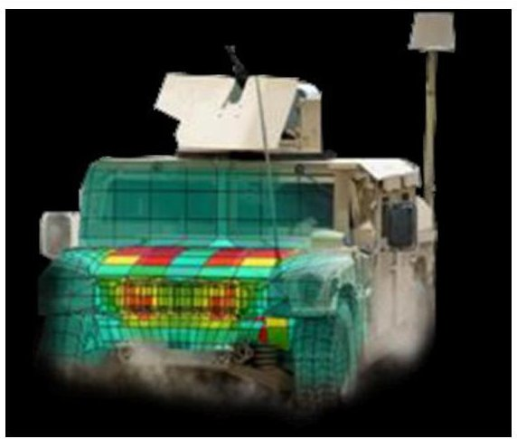

Figure 12. Engine thermal analysis using GV tools.

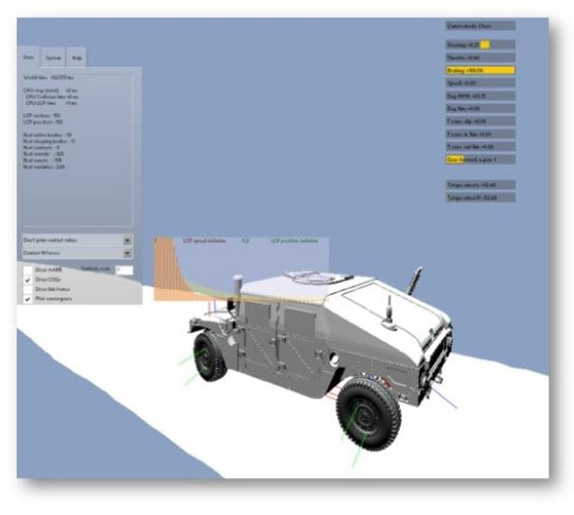

Figure 13. GV simulation providing initial ride quality tests.

A third web application, the Ground Vehicle Interface (GVI), provides intuitive access to the analysis capabilities of Mercury and MAT by subject matter experts and tradespace analysts without a requirement for extensive knowledge of underlying HPC or modeling and simulation (Figure 13).

The CREATE-GV tools have already had a significant impact in reducing design flaws while allowing for multiple design options to be tested at a fraction of the cost of traditional methods. In collaboration with the ERS program, Mercury software has been used in a trade-space analysis pilot project of the Army's Light Reconnaissance Vehicle (LRV). $ ^{3} $ Likewise, the MAT program has completed a baseline version that supports optimized tradespace analysis by allowing thousands of design iterations to be tested and synchronized with Mercury program inputs (Figure 14).

The CREATE-GV emphasizes validation and user transition by initiating pilot projects with the user

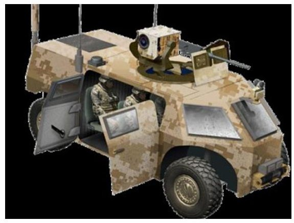

Figure 14. Conceptual light vehicle model used in GV tools for trade-space analysis.

community in the DoD and industry, using field test data sets from several ground vehicles such as the High-Mobility Multi-purpose Wheeled Vehicle and Medium Tactical Vehicle Replacement in its validation program. $ ^{3} $

## 2.5 CREATE-MG (meshing and geometry)

Formed in 2008, the CREATE meshing and geometry project meets the need for enhanced geometry and meshing tools that is shared by acquisition processes across the DoD Services.

The key to successful application of CREATE-MG tools is access to flexible geometry and meshing algorithms that enable the generation of analyzable product representations in a timely and automated manner. Existing tools for geometry and meshing lack the requisite level of automation, interoperability, and ease-of-use and require significant human intervention and calendar time to produce suitable models for analysis (Figure 15). This prevents the application of more physics-based analysis early in the acquisition process where digital engineering can have the most impact. In addition, existing tools cannot effectively use modern HPC platforms and cannot be modified easily or quickly to support diverse and rapidly changing user requirements.

CREATE-MG implemented a new approach to meshing that is based on a numerical representation of platform geometry with associated attributes. The meshes required for analysis tools are generated from the geometry, a process that can be automated, thus saving time and effort. Once the analysis tools have provided information on the performance of the platforms, those "lessons learned" can be used to modify the geometry and address problems identified by the analysis. These modifications take much less time and effort than reverse engineering the mesh. The approach allows the whole process to be automated, facilitating rapid-design optimization, and improved algorithms

<!-- PDF_PAGE: 10 -->

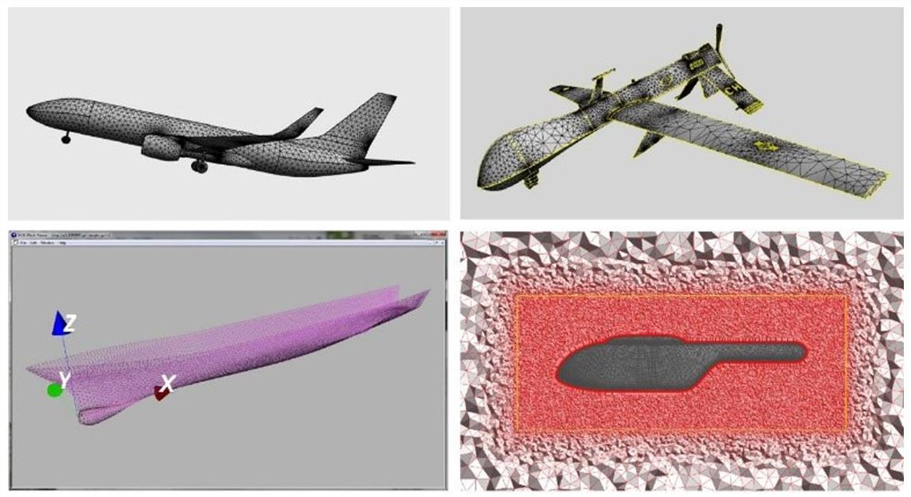

Figure 15. CAPSTONE algorithms work seamlessly in SMLib $ ^{\mathrm{TM}} $ database and discrete geometry. $ ^{18} $

are being incorporated into next-generation infrastructure and tools. The final design of core infrastructure modules, including geometry, mesh, and attribution modules, and the initial design of geometry APIs for geometry and mesh modules have been completed and named CAPSTONE. $ ^{1-5,18} $

CAPSTONE is a computer-aided design (CAD)-neutral application that provides two distinct capabilities:

- development of numerical representations of a DoD weapon system; and

- generation of a mesh from the geometry. $ ^{4} $

CAPSTONE is used by all of the other CREATE tools to generate the visual and physical design attributes of an aircraft, ship, vehicle, or antenna. CAPSTONE has an anisotropic (having a physical property that has a different value when measured in different directions), unstructured surface and volume meshing capabilities for complex geometries. $ ^{3} $ CAPSTONE generates digital representations of weapon systems that may be propagated through the acquisition process, reducing the need for paper and non-digital data to describe the evolving platform design. Because of the wide use of CAPSTONE by every CREATE engineering tool, it has had a significant impact on air vehicle, ground vehicle, and ship design applications. Notable success stories for CAPSTONE include support for the Aerostar, F/A-18E/F, T-45, and P-8 aircraft design analysis; submarine mesh design analysis for the Columbia SSBN program; and GPS antenna integration evaluations. CAPSTONE is also being used outside of the CREATE community. $ ^{2-5,18} $

## 3. Engineered Resilient Systems: Advancing modeling and simulation in support of defense acquisition

Since 2012, the DoD has worked through ERS efforts to enable more detailed engineering analyses early in the acquisition process, which has resulted in a significant increase in the number of design options examined in equal or less time than traditional methods. The ERS program and its partners have worked to bring multiple perspectives (e.g., high fidelity analyses, cost, and mission performance) into a single trade space to allow faster and better informed decisions.

The ERS program has automated engineering workflows to take advantage of advanced infrastructure, such as HPC platforms, and has facilitated the exploration and analysis of the resulting large trade spaces. The program is developing concepts, techniques, and tools that sharpen the weapon system requirements decision process before major acquisition milestones and more effectively supports prototyping and experimentation. Figure 16 illustrates the ERS process.

By empowering more informed assessments and employing an integrated digital approach, the ERS program strives to ensure that the US procures innovative weapon systems to stay ahead of its adversaries. The program delivers a powerful capability to engage at the conceptual design level, working to further broaden its reach and develop large design spaces and high fidelity capabilities for a wider range of platforms earlier in the acquisition process. Trade spaces, which form the foundation for eliminating and selecting systems and subsystems, can now be generated in hours rather than months, and are

<!-- PDF_PAGE: 11 -->

ERS Spans the DoD Acquisition Lifecycle

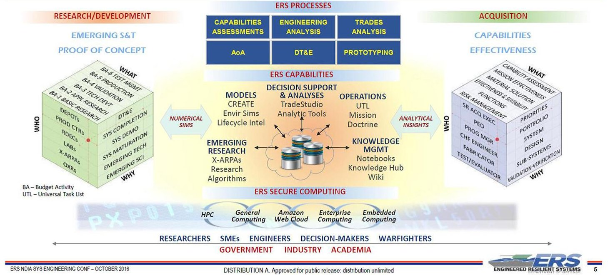

Figure 16. The Engineered Resilient Systems (ERS) process. S&T: science and technology; SMEs: subject matter experts.

thousands of times larger and hundreds of times more accurate than those created via traditional methods. ERS efforts also support the Digital Engineering goal to establish supporting infrastructure and environments to perform activities, collaborate, and communicate between stakeholders.

## 3.1 ERS tools and approach

Using both government-off-the-shelf and commercial-offthe-shelf software, the ERS team works with partners to define the design space for a proposed weapon system, set element parameters, optimize the output for trade-space creation, and analyze, narrow, and select designs. The combination of advanced physics-based modeling and trade-space analyses offers more insight than ever before into alternative decision paths, and because a variety of tools are available, users can customize analyses to solve individual needs and concerns. The process is coupled with a single open-source architecture that allows connections to industry and academia, and a computing infrastructure that includes multiple support environments. HPC sustains the process from beginning to end.

In order to achieve this vision, ERS researchers are striving to implement engineering workflows in which trade spaces can be evaluated for both performance and mission effectiveness, which will be delivered through traditional modeling and simulation software such as the US Air Force's Advanced Framework for Simulation,

Integration and Modeling (AFSIM). The change in method allows users to quickly and accurately examine designs and add or remove characteristics, such as weight or range, without a return to the lengthy high fidelity process. The reduced-order or system identification model can then be combined with simulation software such as AFSIM, bridging the gap between high fidelity modeling and mission effectiveness simulation (Figure 17).

In addition, as a result of an increase in emphasis on early acquisition timeline cost estimates across the DoD, the ERS program is attempting to produce a lifecycle cost capability that will allow users, costs analysts, and engineers to link design tools with lifecycle cost models. These cost models will have the most leverage on decisions when coupled with early engineering design, performance, and mission effectiveness models all are mainstays of this portion of development. This will also give analysts the ability to perform early costing of design solutions for initial requirements and will inform primary design and programmatic decision making. Integrated cost models will offer benefits including a full cost-informed trade space, incorporation within the design's searchable space, and the ability to quantify uncertainty propagated across the combined models.

In addition, the ERS program is aiming to provide a framework for rapid development of environmental scenarios for testing and evaluating systems in authentic, realworld conditions; ultimately, the objective is to provide environmental conditions to the warfighter anywhere in

<!-- PDF_PAGE: 12 -->

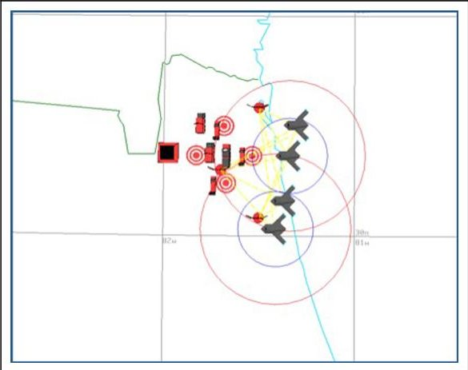

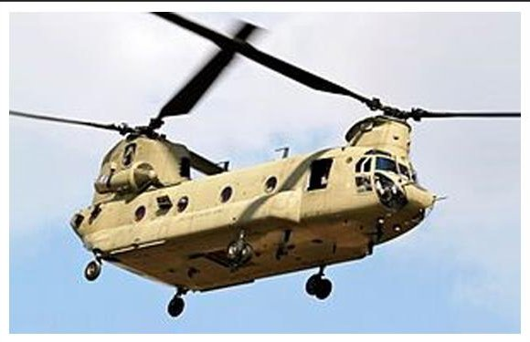

Figure 17: Advanced Framework for Simulation, Integration and Modeling image.

Figure 18. CH-47 Chinook.

the world. A framework has been implemented to handle data access and manipulation. This framework, together with the graphical user interface, allows users to easily identify sources of data with a map-based view and to perform common operations using the data. For construction of computational models, many features have been incorporated into ERS tools to allow rapid creation of the models.

## 3.2 Early CREATE and ERS success stories

The ERS program is actively working with the Armed Services on real-life acquisition problems and identifying areas where S&T can make a substantial difference early in the conceptual design phase. Leaders are seeking partnerships, ideas, and participation within the acquisition community that are mutually beneficial and align with current R&D efforts. By using world-class S&T techniques coupled with subject matter expertise, ERS can further broaden its reach and develop large design spaces and high fidelity capabilities for a wider range of platforms earlier in the acquisition process.

For example, the US Army Aviation and Missile Research, Development, and Engineering Center (AMRDEC) Aviation Engineering Directorate and an industrial partner used CREATE-AV Helios software and three million central processing unit (CPU)-hours to confirm industry predictions of isolated rotor performance. $ ^{12} $ Working with the ERS program, engineers were also able to use these high fidelity flight performance estimates for mission effectiveness predictions. For the first time, aeronautical engineers were able to verify that rotor/rotor and rotor/fuselage interactions did not adversely affect the installed performance of a proposed design for new rotors (Figure 18). As a result, the proposed rotor blade was approved to progress to the next stage of the acquisition process without further physical integration and testing.

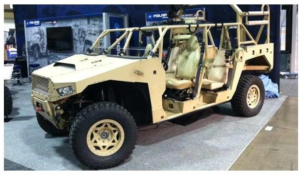

Figure 19. Army light vehicle.

This computational method of verification of system/subsystem design using the ERS trade-space toolset, CREATE-AV software, and the DoD HPCMP supercomputing systems provided the acquisition community with a proven method to reduce the timeline between system's design and fielding.

In another instance, the US Army Tank Automotive Research Development and Engineering Center (TARDEC) used CREATE-GV software and ERS methods to deliver new computational tools for combat vehicle trade-space analysis. The tools were applied to the LRV concept, and a trade-space exploration and capability demonstration was completed (Figure 19). Early results showed much of the trade-space analysis is carried out during initial CAD model development. Subsequently, the automotive engineers worked with both CAD concept developers and a warfighter with real-world mission experience to revisit the initial vehicle requirements. This collaboration enabled the team to carry out an iterative process for setting these requirements, developing concepts, and performing analyses that effectively opened up the design possibilities to allow for a true exploration of the trade space. For the LRV, engineers found that adjusting the transportability requirement allowed substantial performance gains in areas such as survivability and crew effectiveness.

<!-- PDF_PAGE: 13 -->

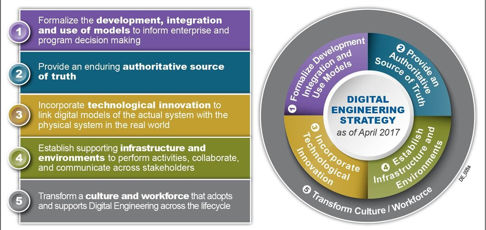

Figure 20. Department of Defense Digital Engineering strategy. $ ^{19} $

Using CREATE-Ships and ERS tools, the US Navy transformed the Small Surface Combatant (SSC) study through the use of set-based design techniques to maximize trade-space analysis of viable options. This change allowed the creation and analysis of significantly more designs than the limited number available via point-based methods. The larger set allowed the consideration of new design possibilities and the elimination of those that were not feasible. Time associated with the creation of data was also considerably shortened. Engineers produced 3.6 million designs incorporating 212 variables in only 27 min, while the point-based results of 7000 designs incorporating 16 variables took three weeks.

Although these examples represent only a portion of each program's successes thus far, updates and enhancements hold the promise of increased functionality for a variety of weapon systems. Stakeholders across the acquisition community now have a shared vision of how to digitally represent possible systems before any metal is bent.

## 4. Digital Engineering: The path forward

US technological superiority is a key element to our country's national security, both at home and abroad, and our ability to quickly and effectively design, procure, and field new equipment is critical. DoD Digital Engineering seeks to support this need for agility by promoting integrated, model-based approaches using digital environments, processes, methods, tools, and artifacts.

Digital Engineering supports the entire DoD acquisition cycle from initial planning and requirements decisions to production, deployment, and lifecycle sustainment. It also provides ecosystem links to data sources and models

across the full spectrum of acquisition program management and establishes an authoritative source of truth for scientists, engineers, analysts, and senior decision makers for weighing strategic options for warfighting forces $ ^{19} $ (Figure 20).

In contrast, the ERS program takes the broad vision of Digital Engineering and provides links within the DoD acquisition community. ERS is currently focusing on five critical areas for future efforts:

- advanced infrastructure development that provides defense organizations and industry partners with reliable and secure access to state-of-the-art hardware and software for early-design analysis decisions;

- workflow automation that provides a central clearing house for accessing ERS capabilities by scientists, engineers, analysts, and program managers for timely and accurate data analysis;

- reduced-order modeling that capitalizes on physics-based software, such as that developed by the CREATE program, to provide the advantage of high fidelity modeling during trade-space generation;

- cost modeling updates that link modeling and simulation data to discrete cost modeling early in the acquisition program cycle; and

- improved access to environmental simulation data that provides engineers and warfighters with the most realistic and accurate simulation from which to run thousands of virtual prototyping scenarios before a weapon system is even in formal production, saving time and resources formally expended in costly T&E experiments.

<!-- PDF_PAGE: 14 -->

The CREATE program is building upon its steady success of high fidelity physics-based engineering tools that meet the needs of the US defense and acquisition communities in a timely and cost effective manner. New technology areas, such as hypersonics, directed energy, future submarine design, multi-hull ship design, and unmanned and autonomous vehicle design and analysis are all prime candidates for future CREATE tool applications. The CREATE and ERS programs, as well as initiatives such as the Air Force's Digital Thread/Digital Twin program, have the potential to take full advantage of these advances as they become integral parts of the DoD acquisition engineering process.

The CREATE and ERS programs are also seeking partnerships, ideas, and participation within the acquisition community that will be mutually beneficial and align with current R&D efforts, further broadening both reach and capabilities for a wider range of platforms earlier in the acquisition process. As progress is made in focus areas and new techniques are established, these programs will provide better insight into design alternative decision paths, ultimately resulting in stronger acquisition programs across the DoD.

## Acknowledgements

The CREATE and ERS teams are grateful for discussions direction, and support by the staff of the DoD HPCMP the ERDC, the US defense industry, the Carnegie Mellon University Software Engineering Institute (SEI) and, most importantly, the Army, Navy, and Air Force engineering organizations who have hosted and participated in the CREATE and ERS programs and have been key elements of those programs' success.

## Funding

This research received no specific grant from any funding agency in the public, commercial, or not-for-profit sectors.

## References

1. Post DE. DoD HPCMP Computational Research and Engineering Acquisition Tools and Environments (CREATE) program. DoD HPC Insights, Spring 2013.

2. Newmeyer KP. HPCMP CREATE $ ^{1 \mathrm{T}} $ : the growing impact of HPC on acquisition engineering. DoD HPC Insights, Spring 2015.

3. Sundt SM, et al. HPCMP CREATE $ ^{\mathrm{TM}} $ tools continue to impact DoD acquisition programs. DoD HPC Insights, Fall 2016.

4. Post DE, et al. CREATE: software engineering applications for the design and analysis of air vehicles, naval vessels, and radio frequency antennas. Comput Sci Eng 2016; 18(1): 14-24.

5. Post DE, et al. The CREATE program: design and analysis tools for DoD weapon systems. In: Proceedings of the 54th AIAA aerospace sciences meeting, San Diego, CA, 4-8 January 2016. Reston, VA: AIAA.

6. Kendall RP, et al. A risk-based, practice-centered approach to project management for HPCMP CREATE $ ^{\mathrm{TM}} $ . Comput Sci Eng 2016; 18(1): 40-51.

7. Kendall RP, et al. Risk-based software development practices for CREATE multiphysics HPCMP software applications. Comput Sci Eng 2016; 18(6): 35-46.

8. Meakin R, et al. Development, deployment, and support of a set of multi-disciplinary, physics-based simulation software products. In: Proceedings of the 49th AIAA aerospace sciences meeting including the new horizons forum and aerospace exposition, Orlando, FL, 4-7 January 2011, pp. 1-15. Reston, VA: AIAA.

9. Hallissy BP, et al. HPCMP CREATE-AV quality assurance: lessons learned by validating and supporting computation-based engineering software. Comput Sci Eng 2016; 18(1): 52-62.

10. Morton SA and McDaniel DR. A fixed-wing aircraft simulation tool for improving DoD acquisition efficiency. Comput Sci Eng 2016; 18(1): 25-31.

11. Green B. Analysis of the stability and control characteristics of the F/A-18E super hornet using the Kestrel CFD flow solver. In: Proceedings of the 50th AIAA aerospace sciences meeting including the new horizons forum and aerospace exposition, Nashville, TN, 9-12 January 2012, pp. 1-24. Reston, VA: AIAA.

12. Hariharan N, et al. First-principles physics-based rotorcraft flowfield simulation using HPCMP CREATE-AV Helios. Comput Sci Eng 2016; 18(6): 19-26.

13. Roth G, et al. CREATE-AV DaVinci: computationally-based engineering for conceptual design. In: Proceedings of the 48th AIAA aerospace sciences meeting, including the new horizons forum and aerospace exposition, Orlando, FL, 4-7 January 2010. Reston, VA: AIAA.

14. Wilson W, Hendrix D and Gorski J. Hull form optimization for early stage ship design. Naval Eng J 2010; 122(2): 53-65.

15. Wilson W, et al. HPCMP CREATE-SH integrated hydrodynamic design environment. Comput Sci Eng 2016; 18(6): 47-56.

16. Moyer E, et al. Navy enhanced sierra mechanics (NESM): toolbox for predicting navy shock and damage. Comput Sci Eng 2016; 18(6): 10-18.

17. Delaney K, Gorski J and Katz A. Development and application for an incompressible strand solver. Comput Sci Eng 2016; 18(2): 27-34.

18. Dey S, et al. CAPSTONE: a geometry-centric platform to enable physics-based simulation and system design. Comput Sci Eng 2016; 18(1): 32-39.

19. Zimmerman P, et al. Digital engineering strategy. In: Proceedings of the annual NDIA systems engineering conference. Springfield, VA, 23-26 October 2017, pp. 1-17.

<!-- PDF_PAGE: 15 -->

## Author biographies

Dr Douglass Post is the Associate Director for the DoD HPCMP CREATE program. He is also a member of the senior technical staff at the Carnegie Mellon University SEI and an Associate Editor-in-Chief of the IEEE publication Computing in Science and Engineering. Contact him at Douglass.post@hpc.mil.

Dr Owen Eslinger is the Director of the DoD ERS program. Contact him at owen.j.eslinger@erdc.dren.mil.

Scott Sundt is the Senior Operations Director for the CREATE program. He is also a retired Navy Captain with command experience and over 30 years of active service. Contact him at scott.sundt.ctr@hpc.mil.

Megan Holland is a defense contractor with the ERS program. She can be reached at megan.m.holland @erdc.dren.mil.