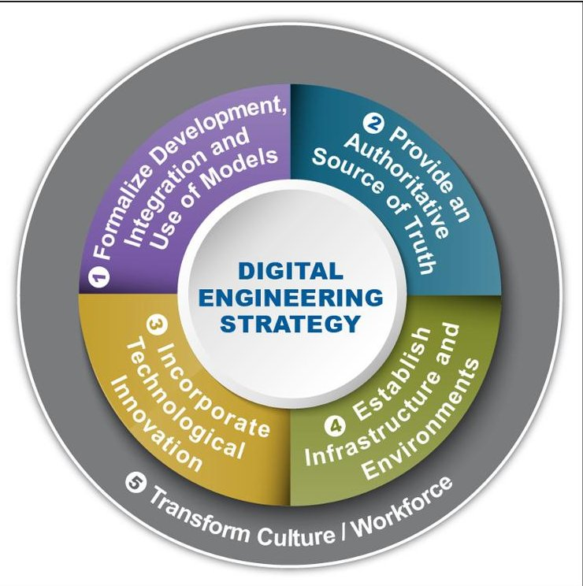
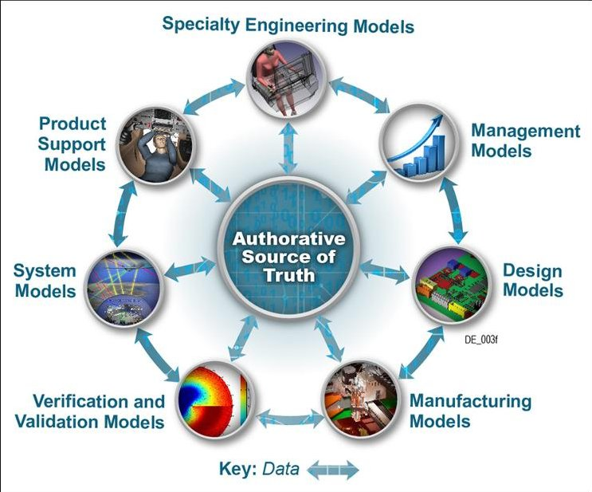
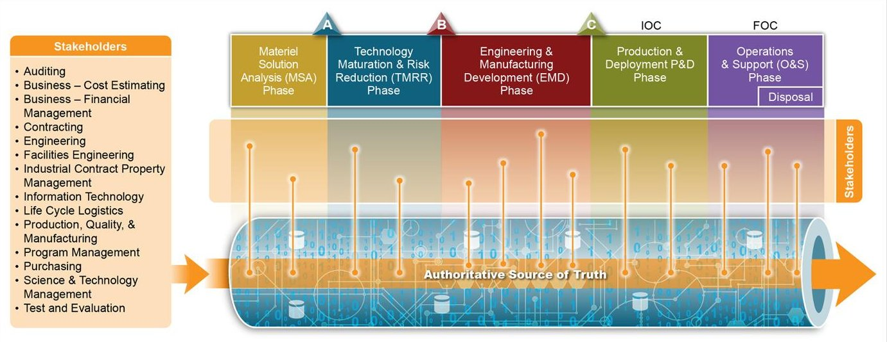
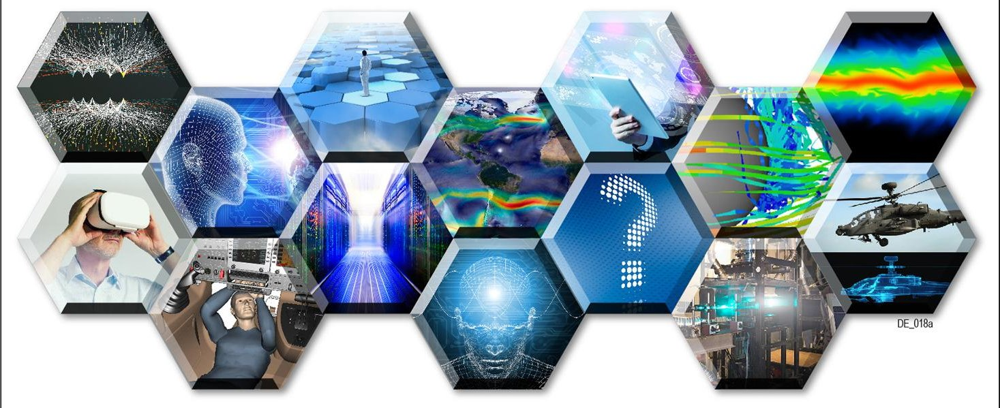
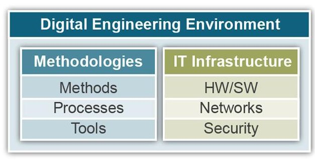

<!-- PDF_PAGE: 1 -->

# Digital engineering transformation across the Department of Defense

Journal of Defense Modeling and Simulation: Applications Methodology, Technology 2019, Vol. 16(4) 325-338 The Author(s) 2017 DOI: 10.1177/1548512917747050 journals.sagepub.com/home/dms SAGE

Philomena Zimmerman, Tracee Gilbert, and Frank Salvatore

## Abstract

A digital transformation has been implemented across a range of industries to drive affordability, agility, quality, and efficiency. Advancements in digital technologies are unleashing innovations that provide an opportunity to transform the engineering practice. Digital engineering is the Department of Defense's (DoD's) initiative to transform the way it designs, develops, delivers, operates, and sustains complex systems in a formidable and changing threat environment. It is defined as "an integrated digital approach that uses authoritative sources of systems' data and models as a continuum across disciplines to support lifecycle activities from concept through disposal." This paper sets the strategic direction for the digital engineering vision, in which five strategic goals are presented to guide DoD's transformation efforts. This paper also describes the digital engineering initiatives that are in progress across the Office of the Secretary of Defense, Air Force, Army, and Navy. While these efforts have begun to realize initial benefits, challenges and next steps are also presented in order to realize the vision.

## Keywords

Digital engineering, model-based, authoritative source of truth, technological innovation, infrastructure and environments, culture and workforce

## 1. Overview of Department of Defense digital engineering transformation

The Department of Defense (DoD) relies heavily on technological advancements, investments in research and development (R&D), robust engineering practices, and a trained and skilled acquisition workforce to meet the Nation's defense challenges. These challenges come from a variety of sources to include a pressing need to adapt quickly to meet a changing operational and threat environment, tight budgets, aggressive schedules, competition for talent and resources, the rapid pace of technology and innovation, and a risk-averse culture. $ ^{1} $

The current DoD engineering approach of acquiring major weapon systems and information technology (IT) is largely a stove-piped, linear process that can take years to conceive, design, and deliver a system. To complicate matters, the acquisition process is document-based in which a large amount of data used in acquisition activities and decisions is communicated and stored separately in disjointed and static forms (e.g., diagrams, spreadsheets, text documents, and two-dimensional [2D] drawings) across organizations, tools, and environments.

To transform these traditional practices, the DoD has established the digital engineering initiative. $ ^{2} $ By incorporating existing model-based tenets (e.g., model-based engineering (MBE), model-based systems engineering (MBSE), digital thread (DT), digital twin (DTw), model-based - X, etc.), digital engineering is defined as "an integrated digital approach that uses authoritative sources of systems' data and models as a continuum across disciplines to support lifecycle activities from concept through disposal." $ ^{3} $

By developing, integrating, and using models to connect data across all stages of the lifecycle using computer-based

<!-- PDF_PAGE: 2 -->

methods, processes, and tools (MPTs) and technological innovations (e.g., artificial intelligence, advanced analytics), digital engineering efforts have been implemented across industries to drive affordability, agility, quality, and efficiency. This has fundamentally transformed the state of practice across a range of sectors and industries, including transportation, healthcare, finance, and manufacturing. With the decreasing costs for storage, computing power, and network bandwidth, a digital engineering transformation has now become financially feasible. Furthermore, advancements in technology have set the stage for solving problems and providing capabilities that go beyond previous limitations to deliver greater value, insights, and new solutions that were not possible even a few years ago.

This article provides acquisition professionals with insight into the shift already in progress within the DoD. Section 2 introduces the DoD's vision for digital engineering through a detailed review of expectations for five strategic goals. Section 3 describes the Office of the Secretary of Defense (OSD) efforts to set the stage for digital engineering, and selected tangible examples from the Air Force, Army, and Navy's digital engineering transformation efforts. Section 4 discusses the challenges, expectations, and potential benefits of a digital engineering transformation, and Section 5 will conclude with the next steps.

## 2. Digital engineering ecosystem goals

The DoD is shifting toward a digital engineering ecosystem that will transform the culture, people, technology, infrastructure, and environments (to include MPTs). The DoD's vision for the digital engineering consists of five strategic goals (Figure 1).

1. Formalize the development, integration, and use of models to inform enterprise and program decision making. The first goal formalizes the planning, development, and use of models as an integral part of performing engineering activities as a continuum across the lifecycle. This will support consistent analysis and decision making for programs and across the enterprise.

2. Provide an enduring authoritative source of truth. This goal moves the primary means of communication from documents to digital models and data. This enables access, management, analysis, use, and distribution of information from a common set of digital models and data. As a result, authorized stakeholders have access to current, authoritative, and consistent information over the lifecycle.

3. Incorporate technological innovation to improve the engineering practice. This goal extends beyond the traditional model-based approaches to incorporate

Figure I. Digital engineering goals.

advancements in technology. Incorporating digital technologies will enable a digitally connected end-to-end (E2E) enterprise and drive innovation to transform the practice of engineering.

4. Establish a supporting infrastructure and environments to perform activities, collaborate, and communicate across stakeholders. This goal promotes the establishment of robust infrastructure and environments to support the digital engineering goals. It incorporates an IT infrastructure and advanced MPTs, as well as collaborative trusted systems that enforce protection of intellectual property, cybersecurity, and security classification.

5. Transform a culture and workforce that adopts and supports digital engineering across the lifecycle. The final goal incorporates change management and strategic communications' best practices to formulate the strategy, lead and execute the change, and support the organization's culture and workforces' transition to digital engineering.

## 2.1 Goal #1: formalize the development, integration, and use of models to inform enterprise and program decision making

The first goal is at the heart of existing model-based approaches. The National Defense Industrial Association (NDIA) defined MBE as an approach to engineering in which models: (1) are used as an integral part of the technical baseline; (2) evolve throughout the acquisition

<!-- PDF_PAGE: 3 -->

lifecycle; (3) are integrated across program disciplines; and (4) can be shared and/or reused across acquisition programs, which encompasses government and industry stakeholders. $ ^{4} $

These elements are the basis for digital engineering because models are powerful tools that can provide a rich representation of a system, phenomenon, entity, or process. In early phases of the lifecycle, models enable the exploration of the system in a virtual environment before it is actually built. Progressing to later phases, high-fidelity physics and engineering models can become indistinguishable from their physical counterparts. These models provide a mechanism to analyze, characterize, simulate, and visualize a range of systems, processes, and phenomena across disciplines.

Currently, a variety of models are used to support every phase of the acquisition lifecycle. However, they are often implemented in a stove-piped manner to support a specific purpose. In most cases, models are not sufficiently planned for as part of a program's technical plans. They are also not carried from one acquisition phase to the next, across programs, domains, or disciplines. While there are contractual, technical, and cultural reasons that contribute to developing and re-creating models from scratch for a specific purpose, this limits reuse and the cohesion that can be established from an authoritative source of truth (see Goal #2). The current practice also frequently results in continuous re-work, knowledge re-discovery, and increased costs and schedule delays. $ ^{4} $

Figure 2 illustrates a vision that grew from the International Council on Systems Engineering's (INCOSE's) Systems Engineering Vision 2025.

Formal systems modeling is standard practice for specifying, analyzing, designing, and verifying systems, and is fully integrated with other engineering models. System models are adapted to the application domain and include a broad spectrum of models for representing all aspects of systems. The use of Internet-driven knowledge representation and immersive technologies enable highly efficient and shared human understanding of systems in a virtual environment that span the full lifecycle from concept through development, manufacturing, operations, and support. $ ^{5} $

Digital engineering extends beyond traditional modelbased approaches that typically focus on a particular activity or aspect (e.g., model-based design, digital model-based manufacturing, model-based testing, model-based manufacturing, model-based X) of the lifecycle. For MBSE, the focus is on formal systems modeling across the lifecycle. The vision for digital engineering is to encompass the broad spectrum of models (Figure 2) as a continuum across the lifecycle.

Figure 2. Development, integration, and use of models.

Since there is no one model that can serve the needs of all decision makers across the lifecycle, data are integrated through a federation of models to support program and enterprise decisions. With digital engineering, beginning in the concept phase through disposal, the expectation is that models can be used as the basis for evaluating, comparing, and optimizing alternatives, and selecting the appropriate course of action. Models will be developed and integrated across the lifecycle such that various disciplines and domains concurrently operate on different aspects of the system in the virtual environment. Instead of being discarded and redeveloped, the federation of models evolves from one phase to the next. As a result, models live throughout the lifespan of the system. This also enables reuse across programs and across systems of systems.

Furthermore, the federation of digital models provides the foundation to make use of data (raw measurements), information (data processed to answer who, what, when, why questions), knowledge (appropriate collection of information), and wisdom (evaluated understanding) to develop insights for decision making. These terms are often used interchangeably, and are referred to as data herein. As shown in Figure 2, data are exchanged across models. This provides stakeholders across the extended enterprise (customers, suppliers, and non-technical domains) to use and assemble data that are needed to support decision making in their respective domains.

## 2.2 Goal #2: provide an enduring authoritative source of truth

The second goal ensures there is an authoritative source of truth for stakeholders across organizations and distributed

<!-- PDF_PAGE: 4 -->

Figure 3. Authoritative source of truth.

locations to access, manage, analyze, use, and distribute models and data. This goal builds on Goal #1 in which the authoritative source is assembled from a federation of digital models and data sources. It moves the primary means of communication from static, disconnected documents to digital models and data.

Currently, evolving configurations and baselines represent a broad spectrum of models and data. As organizations, teams, and individuals perform their assigned duties, they typically operate independently from one another. As a result, relevant models and data are often scattered across multiple stove-piped systems, applications, and shared network drives in a variety of formats. This makes it difficult to find where the information exists and to manage changes to the authoritative source.

Figure 3 illustrates an enduring authoritative source of truth, in which stakeholders have appropriate access to shared, up-to-date, and consistent evolution of models and data across the lifecycle. When changes are made, authorized stakeholders will have the ability to see the same change at the same time. The authoritative source of truth provides traceability as the system evolves throughout the lifecycle. $ ^{5} $ While document-based artifacts can be automatically generated, digital artifacts can also be produced within and generated from the authoritative source of truth. This capability includes the automatic generation of contract deliverables in views that are relevant to a particular stakeholder, and provide the basis for streamlining release and technical review processes. Digital artifacts "maintain consistency with the system and external program dependencies and provide a comprehensive view of the program and increase efficiency and confidence throughout the program's lifecycle." $ ^{6} $

Current implementations of this goal typically provide a central repository for stakeholders across distributed locations to share and exchange authoritative data. Moving toward the future of digital engineering, a single repository

may not always be necessary or feasible. The growing complexity of the volume and veracity of data that span multiple systems calls for the need to be able to access data from multiple sources versus consolidating into a central repository.

## 2.3 Goal #3: incorporate technological innovation to improve the engineering practice

Goal #3 extends beyond traditional model-based approaches to incorporate technological innovations that enable a digitally connected E2E enterprise.Models and data are central to advancements in digital technologies that will provide revolutionary capabilities. Advancements will make it possible to gain greater insights from large islands of data in real time; transform how machines communicate and collaborate with each other and humans; and improve decision making, system capabilities, and how complex and computationally intensive engineering activities are performed.

As the pace of technology continues to evolve, this goal intends to take advantage and incorporate technological innovations as they become available to improve the engineering practice. Figure 4 illustrates selected examples across a spectrum of the following digital technologies.

- Big Data and analytics: Big Data provides the ability to analyze massive and complex datasets containing a variety of data types from a multitude of sources (e.g., computers, mobile devices, sensing technologies). By processing, searching, and discovering patterns in massive amounts of data, leaders can gain greater value from the data to drive decisions and actions. This process is referred to as analytics, which makes use of the data to support

<!-- PDF_PAGE: 5 -->

Figure 4. Technological innovation.

decision making by providing deeper insights into what happened (descriptive analytics), why something happened (diagnostic analytics), predicting what can happen (predictive analytics), and exploring the best course of action among various alternatives (prescriptive analytics).

- Cognitive technologies: cognitive analytics and technologies are the next frontier of innovations that apply human-like intelligence through a wide range of innovations. These include but are not limited to artificial intelligence (to include deep learning and machine learning), semantics, speech, voice, image recognition, natural language processing, and translation to automate or augment human decisions and actions. These technologies are at the core of autonomous learning systems, human machine collaborative decision making, assisted human operations, advanced manned-unmanned system operations, and network-enabled and autonomous weapons that can operate in a future cyber/ electronic warfare environment.

- Computing technologies: new frontiers have been forged to significantly improve the effectiveness and efficiency of the infrastructure and environments. The increase in the power and speed of machines, storage, and network connectivity has spawned innovations in computing technologies to include high performance computing, advanced networking, storage, and cybersecurity technologies.

- Digital-to-physical fusion technologies: these technologies (e.g., DTw, three-dimensional (3D) printing, visualization, virtualization, augmented reality) will link the virtual and physical worlds. The expectation is that digital models of the physical asset are created in the virtual environment.

This digital copy of the physical world enables prototyping, experimenting, and testing out solutions virtually before they are delivered to the warfighter. The physical asset then ties back (e.g., through physical devices to include sensors and remote monitoring technologies) to the digital models that represent the system of interest.

## 2.4 Goal #4: establish a supporting infrastructure and environments to perform activities, collaborate, and communicate across stakeholders

The DoD's expectation for the fourth goal is intended to evolve the digital engineering infrastructure and environments to support all of the preceding goals. Currently, a wide range of organization and program-specific infrastructures and environments exist to execute DoD missions. They are complex and costly to manage, control, secure, and support because their use varies on a programby-program basis. They lack the extensibility needed to fully support the complexity of solutions being developed, they are not keeping pace with technology advancements, and they do not enable the integration of models. $ ^{7} $

To close these gaps, the DoD plans to advance its infrastructures and environments toward a more consolidated, collaborative trusted environment that delivers capabilities that keep pace with technology, enhance cybersecurity and intellectual property protections, and improve information sharing across stakeholders. The DoD will address each of the fundamental components of the infrastructure and environments shown in Figure 5.

The environment is vital as it shapes the surroundings or conditions in which the workforce will operate to

<!-- PDF_PAGE: 6 -->

Figure 5. Digital engineering infrastructure and environments. HW/SW: hardware/software.

successfully achieve the organization's missions. The environment at the program and enterprise levels will need to consider the people, technology, and the data in order to establish the foundation for successful outcomes. For the environment to be effective, data needs to be available and accessible to allow the workforce members to perform their necessary work activities. Technology facilitates the ability for the work to be performed. However, in many cases technology may not be available or approved to operate within some environments and may be a disabler to completing engineering activities.

As part of the environment, the IT infrastructure includes a collection of hardware, software, networks, and related equipment that are needed for reliable, accessible, and assured enterprise operations. As with any system, it must be resourced, planned, and designed so it is properly understood, communicated, managed, and controlled. A Modular Open Systems Approach (MOSA) is critical to ensuring that the infrastructure has the ability to adapt to innovative changes in technology while remaining costeffective in an environment of change. $ ^{8} $ The IT infrastructure will also address an enforcing protection of intellectual property, cybersecurity, and security classification.

The digital engineering infrastructure also consists of multiple engineering domain methodologies, which are a collection of integrated MPTs. The processes define "WHAT" tasks need to be done, the methods define "HOW" (techniques) tasks are performed, and the tools provide the means to implement the process and methods that enforce rigor and discipline in how work is performed and models are developed. The Digital Engineering (DE) infrastructure will provide the network, storage, and computational power necessary to run and support various MPTs and to incorporate advancements in technological innovation.

## 2.5 Goal #5: transform a culture and workforce that adopt and support digital engineering across the lifecycle

The DoD's expectation for the fifth goal takes a deliberate and systematic approach to plan, implement, and support

the DoD's digital engineering transformation. This transformation requires the DoD to move beyond the technical aspects, to address our workforce challenges: the people and the culture. Management science defines culture as the shared values, beliefs, and behaviors of an organization. $ ^{9} $ These norms and beliefs fundamentally drive how people operate and how operations are performed. While the engineering discipline tends to focus on delivering technologically superior capabilities, socio-technical systems, including the culture, have been a significant factor in the catastrophic failure of complex engineered systems throughout history. $ ^{10-13} $

Within the DoD, the current acquisition process operates as it does because of the acquisition culture, which is driven in part by public law, regulation, policy, and guidance. It is also driven by shared goals to help improve warfighting capability for national defense while keeping soldiers, sailors, marines, and airmen safe. However, the system "has a prevailing set of incentives that encourages decisions to go forward with programs before they are ready, and a willingness to accept cost growth and schedule delays as the likely by product of such decisions," $ ^{14} $ and sometimes to make decisions that do not properly balance shorter term and longer term outcomes. Studies have highlighted the impact that the acquisition culture has on causing performance shortfalls, schedule delays, and cost overruns. These studies have also concluded that transformation efforts have not been effective because they have not fundamentally changed the culture, which are those aspects that drive the behavior of the people executing the acquisition process.

To succeed at implementing digital engineering, deliberate culture and workforce efforts need to be implemented. Prototyping, experimenting, and testing out decisions and solutions virtually before they are delivered to the warfighter, using an authoritative source of truth, moving from documents to models, and new MPTs all require a change in the way the engineering community operates. This shift also extends beyond the engineering community to include the acquisition, test, cost, and sustainment communities. It also includes business entities such as contracts, legal, and finance. In addition, the shift to digital engineering is intended to allow government and industry to engage with a bidirectional exchange of digital models and data to procure weapon systems, to promote informed decisions and improve accountability and transparency in spending and performance.

The DoD has developed enablers that build on lessons learned and best practices from both change management and strategic communications. These enablers are intended to move the Department from traditional acquisition culture (as-is) to a lasting culture that promotes a digital engineering approach (to-be), while ensuring the workforce is fully aware, engaged, trained, and supported throughout

<!-- PDF_PAGE: 7 -->

the transition. The following enablers work in concert with the technical aspects described in the preceding goals.

- Strategy and implementation: identify need; articulate vision, objectives, and metrics; and execute plans.

- Leadership: enable active and committed leadership to reinforce culture, provide oversight and resources, and to remove barriers for digital engineering transformation efforts.

- Communication and engagement: identify, analyze, and engage the workforce to promote adoption and acceptance.

- Training and education: assess and provide necessary individual, organization, and leadership skills and knowledge to execute strategy and implementation plans.

- Policy and guidance: develop policy and guidance and disseminate best practices.

- Continuous improvement: measure, monitor improve, and reward successful outcomes.

## 3. Office of the Secretary of Defense and Armed Services digital engineering transformation efforts

The digital engineering transformation efforts are already in progress across the DoD. This section describes OSD's and the US Armed Services' overall vision for digital engineering, as well as key initiatives that are currently being implemented. While each of these efforts is at various stages of maturity, the OSD and the Armed Services are moving toward implementing the digital engineering goals collectively.

## 3.1 Office of the Secretary of Defense

The Office of the Deputy Assistant Secretary of Defense for Systems Engineering (ODASD(SE)) is setting the stage for digital engineering to be implemented across the DoD. The ODASD(SE) leads the Digital Engineering Working Group (DEWG) to explore, innovate, and implement the concept across engineering functions and subsequently within the Defense Acquisition System (DAS). The DEWG shares best practices across the US Armed Services, academia, and industry. $ ^{8} $ The ODASD(SE) is also collaborating with NASA to apply digital engineering practices to the NASA Sounding Rocket Program's pathfinder effort. $ ^{15} $

In a related effort, the ODASD(SE) recently led a task team on Digital Model-based Engineering (DMbE), established by the Interagency Working Group (IAWG) on Engineering Complex Systems. The task team consisted of

participants from the DoD, the Department of Homeland Security (DHS), Veterans Affairs (VA), the Federal Aviation Administration (FAA), and NASA. The team worked to define what government organizations might expect as they infuse DMbE practices into their organizations. $ ^{16} $

The ODASD(SE) is also responsible for developing policy, guidance, and education to advance the state of practice and to prepare the workforce. For the digital engineering transformation efforts, the ODASD(SE) is updating the curriculum in Defense Acquisition University (DAU) Continuous Learning Engineering Modules. The ODASD(SE) also sponsors research through the DoD Systems Engineering Research Center (SERC), a University-affiliated Research Center (UARC) of the DoD. For the digital engineering transformation efforts, the SERC is developing MPTs for organizations to use in pursuing a more holistic digital engineering approach.

The ODASD(SE) is developing a Digital System Model (DSM) taxonomy. The DSM is a "a digital representation of a defense system, generated by all stakeholders, that integrates the authoritative technical data and associated artifacts that define all aspects of the system for the specific activities throughout the system lifecycle." $ ^{3} $ This concept, along with the Air Force's DT/DTw (described in Section 3.2.1) efforts, begins to operationalize the digital engineering goals.

## 3.2 Air Force

The former Assistant Secretary of the Air Force for Acquisition (SAF/AQ), Dr Bill LaPlante, coined the term "Owning the Technical Baseline" (OTB) in 2014 to describe the vision for how Air Force Program Offices would achieve successful outcomes. $ ^{17} $ The Technical Baseline is defined as "data and information that provide the program office knowledge to establish, trade-off, verify, change, accept, and sustain functional capabilities, design characteristics, affordability, schedule, and quantified performance parameters at the chosen level of the system hierarchy." OTB is defined as "Air Force program managers and personnel have sufficient technical knowledge of their engineering development programs to ensure program success by making informed, timely, and independent decisions to manage cost, schedule, and performance risk while ensuring disciplined program execution." $ ^{18} $ OTB requires technical competence, access to engineering data, and engineering analytic capability. $ ^{18} $ The Air Force is working to make OTB the norm by revitalizing its engineering enterprise via the execution of many complementary activities.

The ODASD(SE) digital engineering concept provides a means by which the US Air Force can perform OTB digitally and provides a path for achieving the end-state

<!-- PDF_PAGE: 8 -->

vision described in the Air Force Engineering Enterprise Executive Council's (EEEC's) Strategic Plan: "To be a focused engineering enterprise with a culture of discipline and agility that enables warfighter's success." Key elements of all five Office of the Deputy Assistant Secretary of Defense (Research & Engineering) DE Strategic Goals are incorporated into current EEEC plans, and additional DE elements are expected to be included in future updates.

## 3.2.1 Digital thread and digital twin The DT is:

An extensible, configurable and component enterprise-level analytical framework that seamlessly expedites the controlled interplay of authoritative technical data, software, information, and knowledge in the enterprise data-information knowledge systems, based on the Digital System Model template, to inform decision makers throughout a system's lifecycle by providing the capability to access, integrate and transform disparate data into actionable information. $ ^{18} $

The DT provides cross-process, cross-domain connectivity/traceability; it is the means by which the data and models are accessed, queried, visualized, transformed, linked analyzed, and updated. Because the types of data available and the types of decisions being made change throughout the lifecycle, a wide range of analysis tools will need to be available in the DT.

The digital twin (DTw), another key aspect of the analytical framework, is "an integrated multi-physics, multi-scale, probabilistic simulation of an as-built system, enabled by DT, that uses the best available models, sensor information, and input data to mirror and predict activities/performance over the life of its corresponding physical twin." $ ^{19} $ A simplified way to relate the DT and DTw is that the DTw is a subset of the DT for simulating the performance/response of hardware system elements subjected to a defined set of physical/environmental boundary conditions. The DTw comes into existence when the system development lifecycle reaches the bottom of the V-diagram.

The Air Force has been deploying the DT/DTw approach through pilot studies and the development of an engineering knowledge management system. Some of the pilot studies are summarized below. More details can be found in Kraft. $ ^{20} $

3. 2.2 Product lifecycle management capability initiative. The product lifecycle management (PLM) initiative aims to provide an authoritative source of truth for managing the entire lifecycle of a product from its conception, through design and manufacturing, to service and disposal. PLM integrates people, data, processes, and business systems, and provides a product information backbone for the

extended Air Force enterprise. PLM represents a foundation for managing the Operational Safety, Suitability & Effectiveness (OSS&E) baseline throughout the lifecycle of a weapon system or asset. The intent of the product lifecycle management capability initiative (PLM-CI) is to provide a standardized, enterprise-wide PLM solution for the Air Force. The PLM initiative provides an enterprise, auditable, disciplined, standardized approach for the management of product lifecycle information (PLI). PLM is being implemented in several current Air Force efforts.

3. 2.3 A-10 wing replacement and A-10 lifecycle management. The A-10 wing replacement program leverages digital engineering by acquiring the majority of the program's data for a wing replacement, in digital format. Through this program, 30-year-old 2D drawings were converted to digital computer-aided design (CAD) models to allow for increased configuration management capabilities, risk mitigation, and reuse of validated models for the life of the wing. Because of the reuse benefits, the CAD requirements have been expanded to include other parts of the A-10 aircraft. The implementation of PLM through the A-10 PLM program, in addition to the conversion of the A-10 traditional technical data to digital format, provides the program access to: (1) over 40,000 models with product structure and relationships; (2) other data, such as master tooling packages, technical data packages, airworthiness data, and specifications, notes, and provisioning data; (3) serialized assemblies to support engineering configuration management and depot assistance workflows.

3. 2.4 Air Force Systems Engineering Resource Center. The Air Force Engineering Enterprise Strategic Plan identifies MBE and MBSE as critical enablers to support SAF/AQ's "Bending the Cost Curve," which require a robust technical toolkit. MBE and MBSE are foundational activities that can be applied throughout a system's lifecycle, allowing the Air Force to model system performance; conduct trade studies, capture, and trace requirements; and document the OSS&E baseline. With no centrally available suite of MBSE tools, program offices have been forced to buy individual licenses and host MBSE tools locally. As part of the Engineering Enterprise Strategic Plan, the Air Force is delivering state-of-the-art MBSE tools directly to engineering desktops by way of the centrally hosted, centrally funded Air Force Systems Engineering Resource Center (AFSERC) by using the Software as a Service (SaaS) model and teaming with the Navy's Systems Engineering Resource Center (NSERC). Tool categories include requirements & traceability, architecture, change & configuration management, test, management, process development, and lifecycle management.

<!-- PDF_PAGE: 9 -->

3. 2.5 Ground-based strategic deterrent. The ground-based strategic deterrent's (GBSD's) program objective is to deliver a low technical risk, affordable total system replacement of Minuteman III (MM III) to meet Intercontinental Ballistic Missile (ICBM) operational requirements through 2075. To accomplish this, the GBSD is implementing MBSE tools and practices from ground zero, in support of SAF/AQ's OTB mandate, and will be the first Air Force PLM pilot for the acquisition processes. The initial focus on the configuration of the PLM will be on document management, contract data requirement lists (CDRLs), schedule management, legacy data management, requirements management, and design data management. The goal of this MBSE and PLM strategy includes the ability of the Government to establish, trade off, verify, change, accept, and sustain functional capabilities, design characteristics, affordability, schedule, and quantified performance parameters at the chosen level of system hierarchy.

## 3.3 Army

In 2010, the US Army Materiel Command (AMC) published a Business Case Analysis (BCA) $ ^{21} $ that examined the need to manage weapon system product data throughout the entire lifecycle. The Army currently handles product data (from design through sustainment) through various stove-piped legacy systems throughout AMC. Within AMC, the Research, Development and Engineering Command (RDECOM) is composed of six major Research, Development and Engineering Centers (RDECs) and the Army Research Lab (ARL), and is focused on Army system R&D. Each RDEC/ARL, through time, has developed localized solutions using multiple systems and manual methods to process product data in support of their specific mission. This has left the Army with a multitude of non-standard processes, duplicate data, and costly Product Data System (PDS) sustainment and maintenance.

The additional lack of visibility of data in each individual system, and manual exchange of data due to interoperability shortfalls, has added to the complexity of the product data environment. The current result is a disparate product data storage environment that inhibits data accessibility and reusability across the Materiel Enterprise (ME) (e.g., Program Executive Offices (PEOs), Lifecycle Management Commands (LCMCs), Major Subordinate Commands (MSCs), and AMC internal and external stakeholders, etc.), impeding ME-level decision making and collaboration. While these discrete systems assist individual Army organizations and agencies in conducting their mission, inefficiencies in the ever-increasing need to share, update, and authenticate product data across the Army ME are mounting, and mission effectiveness is being negatively impacted.

To address these inefficiencies and challenges, AMC and RDECOM, in partnership with the Assistant Secretary of the Army (Acquisition, Logistics, and Technology) (ASA(ALT)) are undergoing a transformation that will enable the sharing of information across the ME, increasing data accessibility, reusability, and collaboration, while reducing data redundancies and inconsistencies. The Army seeks to address the five DE Engineering Ecosystem goals through a common Product Data Management (PDM) solution being implemented across the Army. In addition, RDECOM is on the leading edge of expanding this solution to incorporate Digital "model-based" engineering in its use for the Army. $ ^{17} $ These efforts are summarized in the following paragraphs.

3. 3.1 Lifecycle Product Data Management and enterprise Product Data Management. With Lifecycle Product Data Management (LPDM)/enterprise Product Data Management (ePDM), programs will manage data about each component of a weapon system using a PDM approach that holistically captures the system throughout its lifecycle. The Army's goal is to provide enhanced mission system support to AMC's engineering and logistics communities with an authoritative source of truth and agile LPDM/ePDM system. The initiative is intended to provide the ME with an E2E integrated solution that manages Army weapon system and End Item (EI) data throughout the lifecycle.

The ePDM system will provide the engineering data allowing the full implementation of LPDM. ePDM is a RDECOM initiative, which supports the Army Business Strategy (ABS) 2017-2021. $ ^{22} $ ePDM creates the infrastructure and environments needed to manage all of the information related to a product across the lifecycle and the product's multiple stakeholders. The ePDM system is intended to help Program Managers (PMs) reduce time to fielding, improve quality through the use of DE data and modeling tools, foster prototyping, track and predict costs, and implement technology opportunities. $ ^{23} $

3. 3.2 Armaments Virtual Collaborative Environment. One finding to date is the significant role that data, data exchange, and data management will play in the realization of the DE goals. RDECOM's ePDM initiative will work with the US Army Armament Research, Development and Engineering Center (ARDEC) Armaments Virtual Collaborative Environment (AVCE) program. It is envisioned as a product development infrastructure and environments to overcome the extensive development time and capitalize on technological innovation, providing highly interdependent, technical, and soldier-oriented solutions to address the ever-changing and adaptive threats of tomorrow's battlefield. The integrated Model-based Engineering Environment (iMBE-E) is an element of this effort and

<!-- PDF_PAGE: 10 -->

specifically seeks to develop an objective framework that allows for integration and use of models across domain-specific model and simulation capabilities. The payoff includes rapid response to emerging soldier technology needs (including analytical vigor), increased collaboration across internal and external organizations, improved trade space analysis with data-driven decision making, and the control of lifecycle cost.

3. 3.3 Manufacturing technology. RDECOM has widened its aperture to include additional DE efforts that can be used to enhance the envisioned overall PDM efforts. The ultimate goal is to develop a system using fully annotated models as the 3D product master, and maximizing their use throughout the lifecycle. For example, design engineers can produce fully annotated 3D models, which are then provided to depots, allowing them to directly drive Computer-aided Machines (CAMs), quickly update training or repair manuals, or assist the Defense Logistics Agency (DLA) to ensure the acquisition of correctly configured parts.

DE manufacturing technology (ManTech) efforts include the Net-Centric Model-Based Enterprise (NCMBE) and the Accelerated and Adaptive Army Fabrication Enterprise (A3FABE), which were active from FY11 to FY17. The types of projects include MBE Application in Engineering and Product Development, MBE Application in Manufacturing Process Optimization, Quality Assurance, and MBE Application in Procurement and Contracting. $ ^{24} $ To demonstrate these capabilities, ManTech has recently partnered with Rock Island Arsenal (RIA) through the Net-Centric MBE Phase 2 (NCMBE2) program. The NCMBE2 program seeks to define, develop, and demonstrate MBE technologies and processes within the Army's organic base and private industry to reduce acquisition costs, risks, and lead times by expanding Army capabilities in MBE techniques to capture, standardize, and reuse tech data across disciplines and lifecycle milestones. Another ManTech program is Additive Manufacturing (aM), which develops Advanced Manufacturing (AM) processes and technological innovation supporting fabrication of aerospace quality components for the T700 engine. This engine is common to both the Army UH-60 Black Hawk and the AH-64 Apache helicopters. Projected cost benefits are US$12.3M, with a return on investment (ROI) of 1.9:1 (based on the output drive assembly housing). $ ^{25} $

3. 3.4 Modular Active Protection System. The Modular Active Protection System (MAPS) program is using a MBSE approach to manage its requirements, architecture, and interfaces. The goal of the MAPS is to define standard interactions between sensing, controlling, and countermeasure

elements, in order to modularize Active Protection System (APS) technology. Platform integrators may select Modular APS Framework (MAF)-compliant subsystems that are best suited for their mission profile and anticipated threat set.

The MAPS program strategy involves developing the MAF within the Reference Architecture (RA) model, and incorporating technological innovation to use the physical and virtual demonstrations as a mechanism to obtain feedback from the MAF. The RA outlines the complexities of APS (e.g., functions, messages, states, behaviors, and subsystem arrangement) with full traceability to the program's requirements, safety, and cybersecurity constraints. This RA contains the superset of Modular APS information, which is the foundation for configuring a specific APS instantiation within a Design Model. Numerous Design Models can be developed, integrated, and used from the single RA model. Several Design Models are planned, each of which will provide insight into the MAF, resulting in an operationally relevant and technically feasible architecture.

The investment in model-based techniques to manage the technical aspects of the MAF has been beneficial. It provides an authoritative source of truth for stakeholders such that information can be quickly queried to produce views, diagrams, tables, and documentation that can be produced based on different source models. This approach streamlines updates so a change made to one element automatically propagates throughout the rest of the model. The strong participation of the RDECOM Integrated Product Team (IPT) members and industry partners, in contributing their expertise to the MAF RA models and design models, is key to the success of MBSE on the MAPS program.

3. 3.5 Future Vertical Lift (FVL) program is a Joint Service program for the DoD's fleet of vertical lift aircraft. FVL entered into the Materiel Solution Analysis (MSA) phase in October 2016. Models will be developed, integrated, and used across the lifecycle of the aircraft, from requirements through to sustainment. Initial efforts began with modeling the stakeholder and system requirements. These requirements are linked to an architecture model based on well-defined design patterns and Joint Common Architecture (JCA) Mission Level Capabilities (MLCs). Components can be built and virtually integrated into a platform-independent Architectural System Integration Laboratory (A-SIL) for very early, iterative, and rapid risk reduction prototyping, which enables the early discovery of problems before the physical processes and products are developed. The architecture-centric model serves as the IPT's authoritative source of truth and is used for technical reviews. This establishes a basis for tracing the lifecycle data to the design that supports test planning, manufacturing, and sustainment. Embedded into

<!-- PDF_PAGE: 11 -->

the aircraft's monitoring system, a DTw model representing an integrated multi-physics probabilistic simulation of an as-built part can mirror the life of its corresponding physical system. These modeling efforts seek to improve reliability and performance, reduce certification tests, and reduce manufacturing costs.

## 3.4 Navy

In 2016, the Chief of Naval Operations (CNO) established a task force to identify how the Navy could address interoperability issues and move to make better use of the data it collects. Task Force Netted Navy (TF2N) ran until September 2016, and out briefed to Navy leadership in mid-October. The task force found that while the Navy has a rich history of operations in the information domain, dating back to the Battle of Midway, the Navy remains a largely industrial organization known for the size and might of its capital ships, submarines, and aircraft. Platforms are absolutely essential for a global Navy of significance, yet they alone will not win future maritime competitions. To secure competitive advantage, the Navy must combine the physical and digital domains to improve mission outcomes, reduce program costs, and increase workforce productivity and satisfaction. This path is necessary to meet the call in the Navy's Design for Maintaining Maritime Superiority to strengthen naval power at and from the sea by advancing and ingraining information warfare in all Navy missions.

A principal recommendation from the Task Force was the establishment of the Navy Digital Warfare Office (DWO), under the Deputy Chief of Naval Operations for Information Warfare (OPNAV N2N6), to identify how the Navy could improve integration, interoperability, and human-machine teaming among its systems within and across mission areas. TF2N observed the Navy had taken advantage of technology advances and falling costs for hardware, sensors, computing, storage, and bandwidth that made it easier to collect and share information. The Navy had not, however, widely implemented the corresponding digital and analytic environments to turn those large volumes of data into knowledge, and the knowledge into better decisions and actions regarding how the Navy operates, maintains, and designs its force. The DWO will work across stakeholders and mission areas to coordinate digital approaches. Examples of the efforts are summarized in the following paragraphs.

3. 4.1 CVN-78 3D ship model. As the Ford-class Carrier was under design, the lead Systems Command and Program Office opted to take a fundamentally different approach to the shipbuilding plan. They funded and used a 3D digital model of the ship for planning and deconfliction of cable

runs, heating, ventilation, and air conditioning (HVAC) ducting, piping, and other elements. While the cost of the effort was underestimated, as it was the first of its kind within the Navy, the outcomes included the following: reduction in the ship's force and embarked staffs (#1 Key Performance Parameter for the ship); reduced man-hours for construction based on reduced parts, work and re-work, and ease of assembly; and increased sortie generation rate based on flight deck modeling and simulation. Also, with the existence of the ship 3D model the Navy may find additional advantages over the ship lifecycle.

3. 4.2 Electronic Product Lifecycle Maintenance. A number of Navy Systems Commands efforts are under way to optimize maintenance actions. These efforts use digital approaches but in general involve collecting physical/digital sensor data over time, correlating with part or component failures, and identifying how the processes can be improved. One lesson learned is that while identifying analytics to answer leadership questions is critical, having clean and well understood data is also critical. Understanding the data environment, sources, data stores, and management processes is a first step to any digital engineering endeavor.

3. 4.3 Systems Engineering Transformation. Naval Air Systems Command (NAVAIR) launched the Systems Engineering (SE) Transformation initiative in fall 2015. This initiative aims to transform current engineering methods for how weapon systems are specified, developed, and verified. The objective is to significantly compress the system development cycle time. SE Transformation formalizes the use of models as a standard practice for specifying, analyzing, designing, and verifying systems. System Models are adapted to the application domain to include a broad spectrum of digital models for representing all aspects of systems. Extensive use of Internet-driven knowledge representation and immersive technologies are intended to enable highly efficient and shared human understanding of systems in a virtual environment that spans the full lifecycle from concept through to development, manufacturing, operations, and support.

The SE Transformation addresses more challenging trends in weapon system development. These trends include the ever-increasing system complexity driven by exponential growth in system connectivity, interdependency, and information flow; the expanded system security vulnerabilities due to the increased dependence on networked systems; and the need to compress development timelines because of the increased pace of change, warfighter expectations, and rapidly evolving threats.

The SE Transformation initiative at NAVAIR is led by a senior executive, and the execution is being conducted

<!-- PDF_PAGE: 12 -->

by a diverse SE Transformation team. The current execution includes incremental capability deliveries in the areas of Integrated Modeling Environment, Policy & Process, Workforce & Culture, and Pilots/Experiments/ Demonstrations. The end-state is planned to be achieved at end of 2020. More recently, NAVAIR expanded the digital transformation initiative and launched the Capability-Based Acquisition (CBA) initiative. CBA encompasses I&I, SE Transformation, Capability-Based Test & Evaluation (T&E), and Business Process digital transformation. The aim is to build the DT through all the elements of the acquisition process to significantly enhance our ability to develop and deploy capable weapon systems in a very compressed development cycle time.

3. 4.4 Submarine Warfare Federated Tactical Systems. MBSE serves as the primary integration mechanism that provides an authoritative source of truth for federated system of systems (SoS) information architecture, including interface definition across multiple combat system variants and submarine classes. The two-year initiative to introduce MBSE to Submarine Warfare Federated Tactical Systems (SWFTS) began in 2011 with the transition to a modelbased process involving approximately 2700 interface requirements.

The initial focus was on providing the model-based generation of SWFTS interface artifacts composed of large sparse matrices and manually edited spreadsheets. The legacy process relied on a document-centric approach rather than a data-centric model-based approach. The large size of the artifacts along with the manual process - using only limited automation - created vulnerabilities in quality control. For example, artifacts included matrices as large as a $ 3 0 9 6 \times 2 0 0 $ ,249 files of interface code including 520 classes.

The SWFTS model contains data on subsystems, interfaces, requirements, networks, internet protocols (IPs), switches, and access lists. Interfaces are modeled abstractly from respective configurations, allowing commonality to be introduced across all modeled data. The resulting structure allows for the model to undergo continuous enhancement and refinement by providing flexibility to respond to SoS engineering challenges.

Interface artifacts, baselines, and change request history are modeled, with added granularity that distinguishes between development and production to automatically provide only the subset of model artifacts required for the end purpose. A robust set of nested configurations is provided allowing progression through submarine classes down to 70+ individual submarine hulls. Engineered elements are modeled at their highest level of commonality and flowed down to lower level configurations. Digital artifacts are

produced from the model in multiple common formats (e.g., MS Excel. XML, HTML), and support workflow by providing difference-analysis reports highlighting changes to all participants. The rich set of data relationships and behaviors resident in the model lends well to the generation of visualization products that enhance SE collaboration across the federation. These can entail views tailored to a particular subsystem by providing high-level functional descriptions and summary interface diagrams. Alternatively, a service's thread view can be automatically generated to provide a high-level service description and summary E2E data flow diagrams.

Results of the ROI case study analysis demonstrated that transition of this legacy process to MBSE provided an 18.4% reduction in the touch labor required for the interface baseline management process. However, the benefits extend beyond the transformation to fundamentally improved processes for the federation SoS. This includes automated generation of more consistent interface definition artifacts tailored to the needs of the SE process. The approach provides automated data validation and integrity validation and maximizes commonality of design implementations between submarine classes by highlighting inconsistencies and facilitating their elimination. More importantly, however, the model has provided an authoritative source of truth for SoS design that improves the capability to manage SE complexity. The model also facilitates better shared technical understanding among SWFTS federation program participants, particularly for key E2E strings and functionally integrated capabilities. It provides the necessary traceability among capability, requirement, function, and deployment - capturing details often lost to tribal knowledge answering "why/what/ when/who/how?" regarding implementations of complex SoS designs.

3. 4.5 Additional pilots. The CNO has asked Navy leadership for additional areas where digital engineering efforts could have immediate value. Additional pilots are being prioritized based on their outcomes. The efforts include the following: evaluating leading indicators to prevent destructive behaviors, suicide, and other related violent behaviors in order to provide the environment for its Sailors, Marines, and civilian personnel; early DTw efforts where digital physics-based models can be used to extend the service life of major Navy platforms to allow longer transition times to newer versions; and shortening cycle time and optimizing delivery of parts based on analytics of need to forward-deployed users.

These efforts are only a sample of where the Navy is moving with digital engineering. The CNO and Navy leadership is committed to moving toward digital engineering and believes it will deliver better capability more quickly,

<!-- PDF_PAGE: 13 -->

Table I. Expectations and benefits.

<table border="1"><tr><td>Expectations(IAWG)</td><td>Digital engineering benefits</td></tr><tr><td>(1) Informed decision making,and greater insight through increased transparency</td><td> Optimizes decisions prior to live implementation Provides access to accurate,consistent,up-to-date information for decisions Provides rich visualization and reporting capabilities</td></tr><tr><td>(2) Enhanced communication</td><td> Stakeholders across various organizations and distributed locations work from an authoritative source of truth Provides a shared understanding of the system Multiple views are generated from the same source to address different stakeholders&#x27; concerns Impacts to changes can be quickly evaluated,and updates and traceability can be automatically propagated</td></tr><tr><td>(3) Increased understanding for greater flexibility/adaptability in design</td><td> Models reduce misinterpretations and provide increasingly accurate results Provides rigorous traceability within and between as-designed,as-built,as-maintained,as-operated baselines Provides insight into how elements of the design can be added,replaced,removed,and integrated</td></tr><tr><td>(4) Increased confidence that the capability will perform as expected</td><td> Enables prototyping,experimenting,and testing of solutions virtually before they are delivered to the warfighter Provides systematic and rigorous exploration of trade space Provides early and continuous verification and validation so defects,risks,and issues can be discovered up-front</td></tr><tr><td>(5) Increased efficiency</td><td> Automation and autonomy Enhances historical knowledge capture and reusability of existing models to reduce redundancy and re-work Enables rapid assessment of effects of changes</td></tr></table>

IAWG: Interagency Working Group.

more securely, and for lower cost than the industrial document-based approaches of the last century.

## 4. Challenges, expectations, and benefits

This paper has described a vision for digital engineering across the DoD. There are a number of challenges with executing each of the goals, some of which include the following: integrating, verifying, validating, and using models; instantiating an authoritative source of truth across the lifecycle; developing a secure IT infrastructure, methodologies, and environments; and overcoming organizational cultural hurdles. $ ^{16,26} $ In spite of these challenges, digital engineering holds great promise. The IAWG task team identified five expectations associated with infusing digital engineering. $ ^{16} $ Table 1 summarizes the benefits for each of these expectations, which have been illustrated in the examples in this paper.

## 5. Conclusion

The demand to transform traditional engineering practices in developing and acquiring systems is "necessary to meet new threats, maintain overmatch, and leverage technology advancements." $ ^{1} $ The current state of practice is largely a

stove-piped, linear document-based process that is often slow and arduous. This paper presented the DoD's vision for digital engineering, which will transform the way complex systems are designed, delivered, and sustained in a formidable and changing threat environment. The five goals have been defined and presented to establish the foundation to support and enable the Service components to go forward in planning, training, and implementing a tailored digital approach in their respective organizations. With recognition from leadership and current guidance, a shift is already under way within the DoD and the Service Components. The ODASD(SE) is now drafting Digital Engineering Strategy, which will describe several focus areas and implementation objectives for the Department in order to improve how we design, develop, prototype, assess, and acquire weapon systems using digital engineering methods, processes, and tools.

## Acknowledgments

The ODASD(SE) team is grateful for SE leadership, Engility contractor team, DEWG Tiger Team, SERC, and our Air Force, Army, Navy, and industry partners. They have been instrumental in shaping this paper and advancing digital engineering across the DoD.

<!-- PDF_PAGE: 14 -->

## Funding

This research received no specific grant from any funding agency in the public, commercial, or not-for-profit sectors.

## References

1. Baldwin K. Model-based systems engineering: enabling the digital engineering practice in the department of defense. Getting It Right: The Quarterly Newsletter of Mission Assurance, 27 February 2017, 1, 3.

2. ODASD(SE). Digital engineering. Department of Defense, http://www.acq.osd.mil/se/initiatives/init_de.html (2 June 2017, accessed 11 December 2017).

3. Department of Defense Defense Acquisition University. Glossary of defense acquisition acronyms and terms. Defense Acquisition University Press, https://dap.dau.mil/ glossary/pages/3384.aspx (accessed 11 December 2017).

4. NDIA Systems Engineering Division M&S Committee. Final report of the Model Based Engineering (MBE) subcommittee. National Defense Industrial Association (NDIA), 2011.

5. Systems Engineering Vision 2025 Project Team of the International Council of Systems Engineering (INCOSE). A world in motion - systems engineering vision 2025. The International Council on Systems Engineering (INCOSE), San Diego, 2014.

6. Department of Defense (DoD). Department of Defense instruction (DoDI) 5000.02: operation of the defense acquisition system. DoD, 2015.

7. DoDCIO. DoD IT environment: way forward to tomorrow's strategic landscape. Washington, D.C.: DoD, 2016.

8. Zimmerman P, Gilbert TW, Alexander TP, et al. OSD engineering enterprise: digital engineering & modular open systems initiatives. In: NDIA SE division meeting, Washington, D.C., 2016.

9. Steen EVd. On the origin of shared beliefs (and corporate culture). RAND J Econ 2010; 41:614-678.

10. Gehman HW. Columbia Accident Investigation Board: Report Vol. 1. Washington, DC: US Government Printing Office, 2003.

11. Kudritzki J and Corning A. Examining and learning from complex system failures. Uptime Institute, 2015.

12. Hall JL. Columbia and Challenger: organizational failure at NASA. Space Policy, 2003.

13. BKCASE Editorial Board. The guide to the systems engineering body of knowledge (SEBoK). Vol. 1.8. Hoboken, NJ: Stevens Institute of Technology Systems Engineering Research Center, 2017.

14. GAO/NSIAD-93-15. Weapons acquisition: a rare opportunity for lasting change. Genenal Accounting Office, 1992.

15. Weiland KL and Holladay J. Model-based systems engineering pathfinder: informing the next steps. In: 27th annual INCOSE international symposium (IS 2017), Adelaide, July 2017. Hoboken, NJ: Wiley.

16. Model-Based System Engineering (MBSE) Infusion Task Team.Digital model-based engineering: expectations, prerequisites, and challenges of infusion, 2017.

17. LaPlante WA. Owning the Technical Baseline - a key enabler. Defense AT&L Magazine, July-August 2015, 18-20.

18. Friedenthal S, Moore A and Steiner R. A practical guide to SysML (third edition): the systems modeling language. Waltham: MK/OMG Press, 2015.

19. Windham J. 3D intelligent technical data in DoD. In: 2017 MBE summit, Gaithersburg, 3-6 April 2017. Gaithersburg, MD: NIST.

20. Kraft EM. The US Air Force digital thread/digital twin - life cycle integration and use of computational and experimental knowledge. In: scitech 2016 conference, San Diego, CA, 4-8 January 2016. Reston, VA: ARC.

21. Owning the technical baseline for acquisition programs in the U.S.Air Force: a workshop report. 2015.

22. Department of the Army, Army business strategy (ABS) 2017-2021, Office of Business Transformation, 2017.

23. Haduch T. RDECOM charts the way ahead for systems engineering. Army Technology, 2015.

24. Carter R. A3FAB and NCMBE tech transfer. In: MBE summit, Gaithersburg, 3-6 April 2017. Gaithersburg, MD: NIST.

25. M.AVN.2015.01 160130. Direct digital manufacturing for helicopter engines, SAALT portfolio: air strategic thrust: current systems. ManTech, 2015.

26. Lyons KM. Model-based systems engineering (MBSE) guidance for government-acquired programs. The Aerospace Corporation, El Segundo, 2016.

## Author biographies

Ms Philomena Zimmerman is currently the Deputy Director for Engineering Tools and Environments, within the Office of the Deputy Assistant Secretary of Defense, Systems Engineering.

Dr Tracee Walker Gilbert is the founder and Chief Executive Officer at System Innovation, and she is the digital engineering contractor lead for the ODASD(SE).

Frank Salvatore is a Senior Systems Engineer and Technical Fellow for the Engility Corporation. He is the Digital Engineering Training, Policy and Guidance contractor lead for the ODASD(SE).