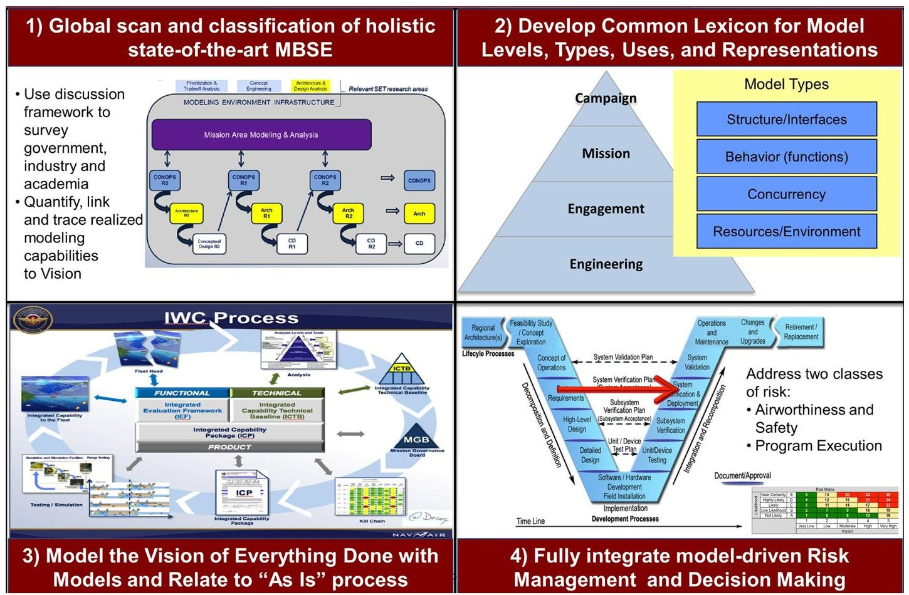
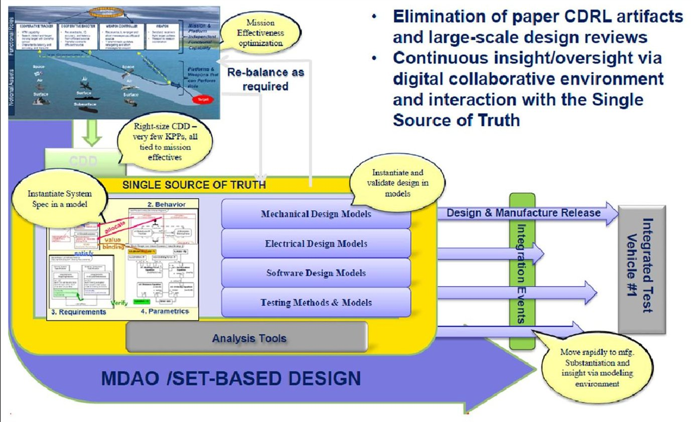
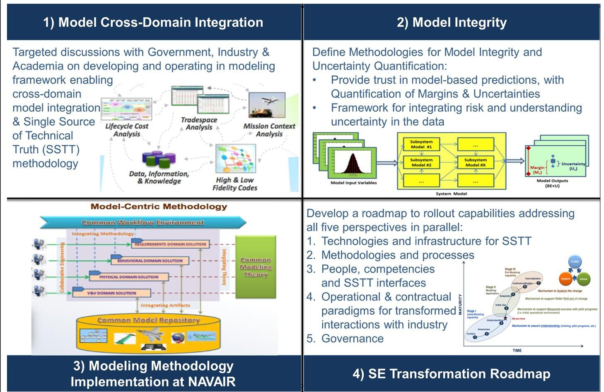
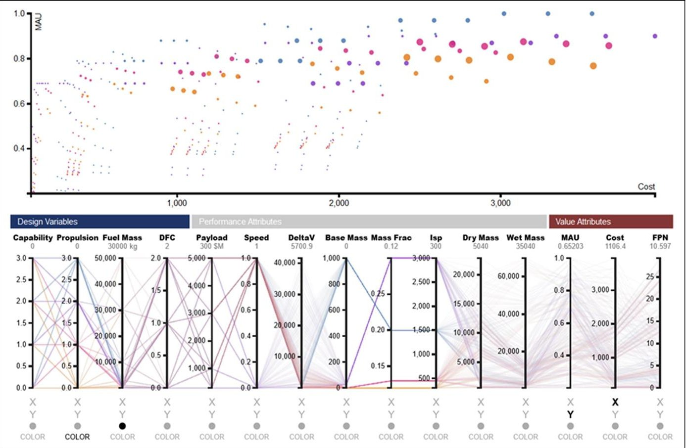
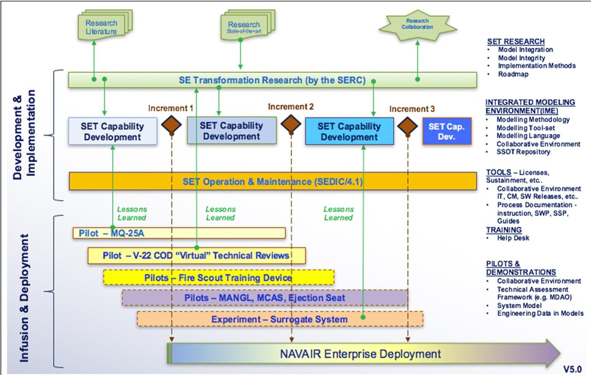
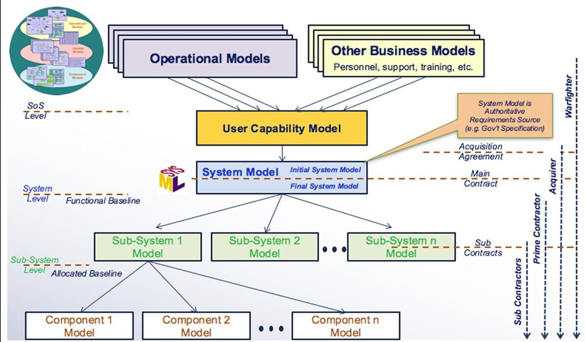

<!-- PDF_PAGE: 1 -->

# Transforming systems engineering through digital engineering

Journal of Defense Modeling and Simulation: Applications, Methodology, Technology 2019, Vol. 16(4) 339-355 $ \textcircled{c} $ The Author(s) 2018 DOI: 10.1177/1548512917751873 journals.sagepub.com/home/dms SAGE

Mary A Bone $ ^{1} $ , Mark R Blackburn $ ^{1} $ , Donna H Rhodes $ ^{2} $ David N Cohen $ ^{3} $ , and Jaime A Guerrero $ ^{3} $

## Abstract

This article describes Department of Defense (DoD) Systems Engineering Research Center (SERC) efforts leading to and supporting the DoD Digital Engineering (DE) initiative. Topics include the SERC's initial collaboration with Naval Air Systems Command (NAVAIR) in 2013 as well as ongoing SERC DE research. The article also identifies future research needed to continue to develop the DE ecosystem for system of systems acquisition, which will require rapidly changing mission strategies to address ever-evolving threats.

## Keywords

Digital engineering, model centric engineering, single source of truth, multidisciplinary design optimization, digital thread

## I Introduction

In 2013, the Naval Air Systems Command (NAVAIR) initiated an effort through the Department of Defense (DoD) Systems Engineering Research Center (SERC) to explore the technical feasibility of a radical transformation of NAVAIR systems engineering and acquisition practices to use more advanced and holistic approaches to model-based systems engineering (MBSE). To facilitate common understanding during the research NAVAIR transitioned to the term "model-centric engineering" (MCE), which it characterized as an overarching digital approach for integrating different model types with simulations, surrogates, systems, software, hardware, and components at different levels of abstraction and fidelity across disciplines throughout the lifecycle.

This article provides a high-level overview of 4 years of digital engineering (DE) transformation exploratory research conducted at multiple SERC universities, mainly Stevens Institute of Technology. For discussion in this article, the research will be split into Phase I (2013-2016) and Phase II (2016-publication date). Although each research topic will be mentioned only briefly in this article, the references provide additional information and detail. The main focus of the article will be the overarching DE research performed by Stevens Institute of Technology,

but supporting DE research performed at MIT will also be discussed to provide a full picture of the DE research landscape.

The next section discusses Phase I, which led to the current DE framework along with other supporting research that is needed to holistically transform to DE. Section 3 discusses Phase II of the research and how it relates to the five Office of Deputy Assistant Secretary of Defense for Systems Engineering (ODASD(SE)) goals. Both phases used the exploratory research method. In both phases the approach to explore the research question was to refine the question into four unique challenge areas. The four challenge areas were selected to holistically address the research question, better understand concepts, help establish future research task priorities, and help form

<!-- PDF_PAGE: 2 -->

a basis for future conclusive research. $ ^{1} $ The article finishes by providing a list of future research tasks to enable the transformation.

The NAVAIR/SERC research team began Phase I by inviting industry, government, and academia representatives to discuss "the most advanced and holistic approach to MCE you use or have seen used." The resulting discussions focused on the state-of-the-art MCE at the time. Organizations discussed concepts using terms including model-based engineering (MBE), $ ^{2} $ MCE, $ ^{3} $ integrated model-centric engineering (IMCE), $ ^{4} $ interactive model-centric systems engineering (IMCSE), $ ^{5} $ model-driven development (MDD), model-driven engineering (MDE), $ ^{6} $ and model-based enterprise, $ ^{7} $ the last of which focuses on manufacturability. The feature common to all was a focus on using models in place of more traditional, static engineering artifacts and documents.

The discussions allowed the SERC and NAVAIR researchers to gain a common understanding of the current state of MCE among the different sectors. This shared understanding has been pivotal in working through the concept that has become DE, defined by the DoD as "an integrated digital approach that uses authoritative sources of system data and models as a continuum across disciplines to support lifecycle activities from concept through disposal." $ ^{8} $

The researchers determined that current technology, with some innovation, could enable DoD's transformation to a DE ecosystem across the full systems engineering (SE) lifecycle. Research topics that emerged from the initial discussions included a common "model" lexicon, modeling the DE "vision" (everything done in models), risk and model integrity, modeling methods, and "single source of truth" (SST).

In Phase II of the research, the SERC identified major differences DE offers compared with current SE practice:

(1) Continuous insight/oversight through a SST requires data to be shared among all stakeholders in the system lifecycle, eliminating the need for paper contract data requirements list (CDRL) artifacts and large-scale design reviews.

(2) Design is integrated and validated in models before a full physical system development using set-based design and multidisciplinary design, analysis, and optimization (MDAO).

(3) Mission effectiveness optimization is performed using continuous feedback from the SST.

(4) Requirements become tradeable to enhance the key performance parameters (KPP).

During Phase II, the DoD began working a parallel effort to generate a high-level comprehensive set of goals

for a DE transformation in the DoD. The ODASD(SE) formalized five goals:

Goal 1. Formalize the development, integration, and use of models to inform enterprise and program decisionmaking.

Goal 2. Provide an enduring authoritative source of truth.

Goal 3. Incorporate technological innovation to improve the engineering practice.

Goal 4. Establish a supporting infrastructure and environment to perform activities, collaborate, and communicate across stakeholders.

Goal 5. Transform a culture and workforce that adopts and supports DE across the lifecycle.

Through these goals the DoD is working to realize the benefits found in Phase I and identified at a government industry DE forum conducted by the SERC and the Office of the Under Secretary of Defense in May of 2016: $ ^{9} $

- Improved acquisition- Digital deliverables could improve the government's understanding of a project's status and risk along with allowing a project to validate the contractor's deliverables.

- Improved efficiency and effectiveness-A SST would reduce time and effort in the performance of existing tasks.

- Improved communication; better trade-space exploration; reduced risk-Using ontology-based information models to translate and extract useful information among a variety of models and model types could allow for improved communication among specialists. This would enable DoD's goal (Goal 4) to establish a supporting infrastructure and environment to perform activities, collaborate and communicate across stakeholders.

- Improved designs and resulting systems and solutions- Being able to understand the impact of requirement and/or design decisions early could help improve the overall system design and identify adverse consequences of the design before committing to a design choice. This would enable the DoD goal (Goal 1) to formalize the development, integration and use of models to inform enterprise and program decision-making through an authoritative source of truth.

## 2 Phase I - setting DE transformation into motion

NAVAIR set the DE transformation into motion by asking the SERC to answer the research question: Is it technically

<!-- PDF_PAGE: 3 -->

Figure 1. Four challenges to assess technical feasibility of "doing everything with models."

feasible to have a radical transformation of SE through a more advanced and holistic approach to MBSE? Since this was a new research area without previous conclusive results, the researchers chose the exploratory research method to approach the problem. The goal of exploratory research was to better understand both the radical SE transformation and holistic MBSE approaches. Therefore four challenge areas, shown in Figure 1, were chosen to explore. These challenge areas are discussed in the following sections.

## 2.1 State-of-the-art MBSE

The first challenge area in Phase I was to globally scan and classify the holistic state-of-the-art of MBSE. MBSE was changed to MCE because as the research progressed it was determined MBSE was not broad enough to define the goals of the research since MBSE included only "models" and the research scope includes all digital content. The SERC researchers accomplished the first challenge by conducting over 29 unstructured interviews, 31 working sessions, and several follow-up discussions that continue to date. The discussions were across industry, government and academia where the organization was asked: "Tell us about the most advanced and holistic approach to MCE

you use or have seen used." The topics and characteristics that were brought up by the organizations in the interviews, working sessions, and follow-ups were captured in a matrix. This matrix allowed researchers to compare the organizations and common topics across them. Figure 2 shows a truncated view of the captured results. The full results, which were captured in a larger matrix, $ ^{10} $ were used to assess the current state of MCE.

A partial summary of the data analysis captured in this first challenge area of research is presented in Figure 2. The matrix provided evidence of traceability to different instances of organizational use and their possible impacts/ relationships on characteristics, such as: performance, integrity, affordability, risk, and methodologies within a SST. Some of the organizations names in Figure 2 are either abstracted by only identifying the organizations domain or replaced by a letter due to confidentiality agreements. The full matrix found in Blackburn et al. was instrumental for explaining the breadth of the research findings. $ ^{10} $

The first notable finding of globally scanning and classifying the holistic state-of-the art MCE throughout industry (both commercial and government) was that MCE is in use and adoption appears to be accelerating with more integration of computational capabilities, models, software,

<!-- PDF_PAGE: 4 -->

<table border="1"><tr><td></td><td colspan="9">Instances where discussed(not exhaustive)</td><td colspan="5">Characteristics</td><td colspan="5">From Kickoff Briefing</td></tr><tr><td>Discussion Topics(not exhaustive)</td><td>NASA/JPL</td><td>A</td><td>B</td><td>C</td><td>Altair</td><td>GE</td><td>Sandia</td><td>DARPA META(VB)</td><td>DARPA META(BAE)</td><td>Model Center</td><td>Automotive</td><td>CREATE</td><td>Performance</td><td>Integrity</td><td>Affordability</td><td>Risk</td><td>Methodology</td><td>Single Source of Tech Truth</td><td>Prioritization&amp;Tradeoff Analysis</td><td>Concept Engineering</td><td>Architecture&amp;Design Analysis</td><td>Design&amp;Test Reuse&amp;Synthesis</td><td>Active System Characterization</td><td>Human-System Integration</td></tr><tr><td>Modeling CONOPS</td><td>X</td><td></td><td></td><td></td><td></td><td></td><td></td><td></td><td></td><td></td><td></td><td></td><td></td><td></td><td></td><td>X</td><td>X</td><td>X</td><td></td><td>X</td><td></td><td></td><td>X</td><td></td></tr><tr><td>Modeling Patterns</td><td>X</td><td></td><td></td><td></td><td></td><td></td><td></td><td></td><td>X</td><td></td><td></td><td></td><td></td><td>X</td><td></td><td>X</td><td>X</td><td>X</td><td></td><td>X</td><td>X</td><td>X</td><td>X</td><td></td></tr><tr><td>Multi-Physics Modeling and Simulation</td><td></td><td>X</td><td>X</td><td>X</td><td>X</td><td></td><td></td><td>X</td><td>X</td><td></td><td>X</td><td>X</td><td>X</td><td>X</td><td></td><td></td><td></td><td></td><td></td><td>X</td><td>X</td><td>X</td><td>X</td><td>X</td></tr><tr><td>Multi-Discpline/Domain Analysis and Optimization</td><td>X

Figure 2. Traceability and scope of data collection. $ ^{1 0} $

hardware, platforms, and humans-in-the loop (see Figure 2). Through the interviews the researchers found that efforts of these adoptions are being supported by both industry and DoD leadership.

The second result of this NAVAIR challenge area was through demonstrations provided to the research team. The demonstrations showed mission-level simulations are being integrated with system simulation, digital assets and aircraft products providing cloud-like services enabled by the industrial internet. $ ^{10} $ There were demonstrations of one-, two-, and three-dimensional modeling and simulations with a wide array of solvers and visualization capabilities, and an immersive cave automated virtual environment. The researchers witnessed the successful results of platform-based approaches directly focused on speed-to-market, and more. This second finding changed the perspective of the research from having to drive an MCE transformation to only needing to apply support and remove roadblocks for MCE to become widely adopted.

## 2.2 Common lexicon

The second research challenge area was to develop a common lexicon for things related to models, including model types, levels, uses, representation, visualizations, etc. Early

in the research it became clear that confusing and overlapping terminology was hindering advancement and understanding of MCE so a lexicon of over 700 categorized and defined "model" related terms was developed (e.g., MBE, MBSE) using available authoritative sources (standards, published literature, etc.). The lexicon was reviewed by the research team, external stakeholders, and sponsors. $ ^{11,12} $ The lexicon is currently informally published online by the SERC researchers. $ ^{11} $ The results of having a shared lexicon helped the researchers move forward with common meaning of words which led to more constructive discussions.

## 2.3 Model the DE vision

The third challenge under the initial research effort was to model the NAVAIR DE vision and also to relate it to the "as is" and airworthiness processes of NAVAIR. This challenge was to assure the stakeholders that the new DE process would cover everything that was required of the current process. In addition, it also provided a type of map to those "as is" process activities and artifacts that could be replaced or subsumed through new DE methods and automation, like the elimination of paper CDRL artifacts and large-scale design reviews of CDRLs (see Figure 3). The research effort started by identifying the artifacts that

<!-- PDF_PAGE: 5 -->

Figure 3. Digital engineering framework. $ ^{1 4} $

are collected to support the NAVAIR Systems Engineering Technical Review (SETR) process. The team categorized approximately 330 artifacts (primarily documents), which were represented in a model. $ ^{13} $ For artifacts that were not well defined, subject matter experts (SMEs) were consulted to better understand the information that may need to be captured in a DE approach. $ ^{12} $ The findings from this challenge led to the following four observations: $ ^{10} $

(1) The DE "to-be" process models should be adapted to match the nature of the workforce.

(2) Some processes should remain adaptive and fluid to be effective, while others such as risk could be more prescriptive and rigorous methods.

(3) The focus should be on the result of the process, the data and information, and not simply the process requiring well-defined method, which is inherently what MCE should do and support.

(4) Knowing who produces what and when plus describing the data in a common language may be more valuable than knowing "how."

The "vision" concept was framed as a 10-year end state. The concept evolved into Figure 3 as the research matured.

## 2.4 Risk management integration into DE framework

The fourth research challenge was to integrate a risk management framework with the "to-be" DE vision at

NAVAIR. The research team explored strategies, methods, and tools for a risk-based framework that aligned with the DE vision framework. While there are many classes of risks to manage, for NAVAIR there are fundamentally two: (1) airworthiness and safety (most critical in technical feasibility assessment) and (2) program execution (cost, schedule, and performance).

During the research, two views of MCE acquisition with respect to risk were identified: first, risks introduced by modeling deficiencies and risks reduced by enhanced use of modeling; second, the ability of models to predict or assess risks (i.e., modeling for uncertainty quantification (UQ) in acquisition and in the use of models). MCE acquisition is the current term used to describe the acquisition process that would be enabled by the DE transformation and is still being researched. With respect to risk the DE transformation must address the question that arose out of this challenge: "If we are going to rely more heavily on DE with an increasing use of modeling and simulations, how do we know that models/simulations used to assess "performance" have the needed "integrity" to ensure that the performance predictions are accurate (i.e., can we trust the models)?" This question is further addressed in Phase II.

The preceding paragraphs provided a short review of the Phase I research. The discussion shows that as the exploratory research was conducted the understanding of DE progressed. This led to more refined research questions and DE topics requiring further investigation. The

<!-- PDF_PAGE: 6 -->

Figure 4. Digital engineering transformation Phase II. $ ^{1 4} $

overarching finding of Phase I was that the current state of-the-art of MCE indicates it is technically feasible to transform SE at NAVAIR to DE. Based on the results from the unstructured interviews and working groups, DE can increase the probability of achieving a reduction in acquisition time. The DE transformation goals, Goals 1-5 in Section 1, have been identified as the needs to achieve this reduction. The current assumption is that the five goals must be achieved to realize a reduction. The results of the first phase and a thorough description of the findings can be found elsewhere. $ ^{10} $

## 3. Phase II - the DE transformation expansion

The DE research was broadened in scope in 2016 to support both NAVAIR and Army Armament Research, Development and Engineering Center (ARDEC). For purposes of the article, this combined research will be called Phase II or the second phase. The second phase is currently in progress, so results are limited regarding the research tasks. This expansion was due to the value these organizations recognized in the results of the first phase. $ ^{10,12} $ While

the research in Phase I focused on NAVAIR, the results are applicable to organizations performing SE. ARDEC has been able to leverage the Phase I research results and start more detailed research into a DE transformation to address the needs of their organization. The Phase II research is exploratory and structured similar to the first phase with four challenge areas (see Figure 4) that are refined or new from Phase I. These Phase II challenge areas continue to address the original research question from Phase I (see Section 2). The ARDEC research is similar but with slightly modified challenge areas aligned to their organization needs.

## 3.1 Model cross-discipline integration

The first NAVAIR challenge area for Phase II, similar to the first ARDEC challenge area, was to research the current state-of-the-art: model cross-discipline integration with underlying SST. This research area relates directly to two of the DoD DE transformation goals to inform enterprise and program decision-making (Goal 1) and establishing a SST (Goal 2). This research was an extension to the findings of the first challenge in Phase I. Understanding the impacts related to cross-discipline integration

<!-- PDF_PAGE: 7 -->

throughout the lifecycle will be a key enabler and challenge to DE.

Traditionally the cross-discipline implications surface during integration and test, which is typically late in the lifecycle, and changes can be costly. Finding problems early is a key enabler to DE providing full potential value, including a reduction in acquisition time. Currently, the solutions are often believed to be better standards for tool integration, but tools continually change and the integrations become brittle. $ ^{15} $ Newer approaches based on data interoperability as a means of sharing information using standards and tool neutral approaches are emerging as better approaches that are made possible by technologies enabling a SST. This is the approach being pursued by both NAVAIR and ARDEC in the SERC research, $ ^{16,17} $ and by NASA/JPL. $ ^{4} $ This approach is seen as technical feasible due to the current state of big data and data analytics such as that demonstrated by IBM Watson technology. $ ^{18} $

Investigative research has shown that transformation to a tool-agnostic DE ecosystem will require ability to: (1) reliably exchange data between multiple forms of tools and media; (2) computationally infer and reason about the data; (3) perform consistency and completeness checks on data; and (4) transform the data to needed formats or units. The research conducted at NAVAIR and reported in Blackburn et al., $ ^{14} $ along with research performed for ARDEC, has determined that semantic technology will be a key enabler to DE by achieving these four needs. As defined by Cambridge Semantics, $ ^{19} $ semantic technology is "a fairly diverse family of technologies that have been in existence for a long time and seek to help derive meaning from information. Some examples of semantic technologies include natural language processing (NLP), data mining, artificial intelligence (AI), category tagging, and semantic search."

At the center of some of these technologies are ontologies. An ontology is a semantic conceptualization for a domain with the associated relationships. The current advantage of an ontology is that it can be represented in the standard language OWL (Web Ontology Language, actually OWL2), which allows open and standard tools to be used to store, update, delete, query, and reason about consistency and completeness of data. Current research continues to investigate semantic technology for tool agnostic development and management of digital artifacts to support SST.

The success of semantic technology in other fields, like biology, has already demonstrated its ability to advance the practice. It has been shown that "Ontologies speed genetic discovery by allowing researchers to quickly find and compare data from multiple sources." $ ^{20} $ This result is similar to what is desired in the proposed DE ecosystem, to speed system discovery by allowing engineers to

quickly find and compare system data from multiple sources across the system lifecycle.

An ontologist in the development of the successful gene ontology, Dr. Barry Smith, recently presented "engineering ontology landscape" where he listed 11 ontology development efforts over the past 5 years in engineering and SE using the basic formal ontology (BFO) as the upper level ontology. $ ^{21} $ Also the research team found encouraging ontological work regarding SE being performed in Europe. $ ^{22,23} $

Currently there are also at least two independent working groups that are being organized to develop open source SE related ontologies, the Industrial Ontology Foundry (IOF) and the Semantic Technology for Systems Engineering (ST4SE). Research is being conducted to investigate if an instantiation of the ontologies and supporting environment, developed at NASA/JPL, $ ^{24} $ can be modified and/or developed to support the DE framework (Figure 3) at NAVAIR and ARDEC.

## 3.2 Model integrity

The second Phase II challenge area was to research model integrity - developing and accessing trust in model and simulation predictions. This challenge area was derived from the results of Phase I where multiple organizations performing state-of-the-practice DE stated "trusting" models and validating models was still a hurdle. The integrity of models cuts across multiple DE transformation goals as it allows for trusted decision-making (Goal 1), provides the authority factor in the SST (Goal 2), and the workforce trusting the models integrity is known to be important to adoption (Goal 5). Model integrity, as used here, means to understand margins and uncertainty in what models and associated simulations "predict" or in other words when/how can models and associated analysis results be trusted. The key research questions were:

(1) Which models assess system performance and which models assess system integrity? How are these types of models validated for their respected assessments?

(2) Currently, how can "integrity" be accomplished when the situation involves federations of models that are not integrated?

(3) How do we achieve continuous hierarchical and vertical flow enabled by models and iterative refinement through trade space analysis, concept engineering, and architecture and design analysis?

Through interviews with Sandia National Laboratory it was found that they have advanced approaches for supporting UQ to enable risk-informed decision-making. $ ^{25} $ Their methods and tooling address the subjects of margins,

<!-- PDF_PAGE: 8 -->

sensitivities, and uncertainties. The information they provided reflects on the advanced nature of their efforts and continuous evolution through modeling and simulations capabilities that operate on some of the most powerful high-performance computing (HPC) resources in the world. Sandia discussed HPC capabilities, methodologies on quantification of margins and uncertainty (QMU), an enabling framework called Design Analysis Kit for Optimization and Terascale Applications (DAKOTA) Toolkit, $ ^{26} $ and the need and challenge of model validation and simulation qualification. $ ^{27} $ Sandia also discussed the movement toward a common engineering environment (similar to the DE) that makes these capabilities pervasively available to their entire engineering team. Their capabilities provide substantial evidence for the types of capabilities that should be part of the DE risk framework.

It is also recognized that part of model integrity and effective DE will depend upon effective user interaction with models and overall user trust in models. This research relates to the DE fifth goal of transforming a culture and workforce that supports DE across the lifecycle. A separate and ongoing research project, being performed at MIT, used an interview-based research method to explore several questions:

(1) How and why do individuals interact with models?

(2) To what degree are decisions made with models today?

(3) How is trust in models developed?

Questions then arise as to what engenders such trust. For example, the degree of necessary transparency is an open consideration. For a given role it may be desirable for non-essential detailed information to be hidden, while increasing levels of "transparency" may engender trust in the individual who needs to examine inner workings of the model. Further, trust is likely increased when uncertainty in model output is apparent, as framed by specific context/use.

Empirical studies are needed to understand the many facets of human decision-making in DE environments. Currently, an exploratory study is underway to investigate the three research questions. $ ^{28} $ Interim findings indicate a number of technological and social factors are involved in model-centric decision-making, and several key attributes influencing trust were identified. $ ^{29} $ Findings of the study and related investigations are informing the derivation of a set of preliminary guiding principles for effectiveness of human-model interaction.

## 3.3 Modeling methodologies to enable DE

The third challenge area task was modeling methodologies aligning with the roll out of technologies defined under the

Phase II Challenge 4 (see Section 3.4). Challenge 3 attempts to find the best modeling methods to systematically produce the information needed to accomplish Challenge 1 of Phase II (see Section 3.1). The research used extensive informal discussions about a broad spectrum of tools and organizations documented in the RT-141 final report to understand the current MCE methods associated with the most advanced and holistic modeling approaches. $ ^{12} $

The researchers have participated in numerous meetings, reviewed research papers, even attended presentations by representatives of companies that sell modeling tools that all describe it is critical to do several things before "buying tools." For example, Matthew Hause provides a list of things not to do when adopting MBSE in his presentation. $ ^{30} $ A key point from the list involves the need for organizations to (1) understand what needs to be produced with the modeling tool and (2) the modeling method for using the tools. $ ^{30} $ The second point, regarding modeling methods, was expressed by organizations during the discussions and is a key finding of this research.

With the key finding that the modeling method was important to adoption the research set out to identify "better practices" for MCE adoption related to modeling methods. Some of these "better practices" identified in this research are as follows:

(1) Information that is produced or analyzed through models to support decision-making in an organization needs to be identified before selecting a MCE tool.

(2) Modeling methods need to be developed and put into place to enable the modeling tools to work in a more efficient manner.

(3) Increase organizational focus on cross-discipline modeling methodologies to ensure tool usage produces complete and consistent information compliant with information captured in the SST.

(4) Include MDAO methods in the overarching organization modeling method.

(5) Embed methodological guidance in tooling, such as design patterns, reference models, etc.

A good example of embedding methodological guidance in tooling was found at NASA/JPL. $ ^{4} $ An example of failing to utilize a proper modeling method was provided by the DARPA META project and demonstrated that the effectiveness proposed by new technologies was not achieved until all models were modified to comply with a modeling method. $ ^{31} $

MDAO is a means to explore and understand the design space and its ability to identify system fitness. For example, when designing a vehicle, there is typically a trade-off between maximizing performance and maximizing efficiency of the vehicle, where calculating either of these

<!-- PDF_PAGE: 9 -->

objectives require multiple disciplinary models (geometry, weight, aerodynamics, propulsion). MDAO prescribes ways to integrate these models and explore the necessary trade-offs among the objectives to make a design decision. While the theoretical foundations of MDAO are well-established by academics, a number of barriers to practical implementation exist. Chief among these barriers are the lack of model integration, which prevents designers of one subsystem from easily assessing how changing a design variable affects the results of other subsystems' models or simulations.

The increasing computational capabilities are enabling MDAO technology. A number of tools support MDAO. These tools include both open source and commercial, such as DAKOTA, $ ^{26} $ OpenMDAO, iSight, ModelCenter, $ ^{32} $ modeFRONTIER, and others. However, there is still a need for more rigor when applying MDAO methods. The current steps for an MDAO method can be characterized as: (1) describe a workflow (scenarios) for a KPP (e.g., range, notionally similar to surveillance time); (2) determine relevant set of inputs and outputs (parameters); (3) illustrate how to use a Design of Experiments (DoE) and use analyses such as sensitivity analysis and visualizations to understand the key parameter to scope that will be used in a set; (4) illustrate optimization using solvers with key parameters and define different (key objective functions on outputs) to determine set of solutions (results often provided as a table of possible solutions); and (5) use visualizations to understand relationships of different solutions. Current applications of MDAO include developing useful surrogate models and calculating optimal and Pareto-optimal solutions. Optimization problems can be formulated with a number of different objectives by converting some objectives to targets or constraints, summing the objectives with value-based and unit-consistent weighting schemes, or multiplying and dividing objectives by one another. Surrogate models are often used to quickly simulate the behavior of a more computationally intensive simulation model, and some common methods include interpolation, response surface using regression models, artificial neural networks, kriging, and support vector machines. Finally, numerical optimization can be performed using a number of different algorithms and techniques, including gradient-based methods, pattern search methods, and population-based methods. Each of these different MDAO techniques has been found to be more suitable to different applications and part of the future research will be to identify and demonstrate best practices and suggested principles for the DE framework using MDAO.

3. 3.1 Interactive model trading. Under the DE paradigm, decisions will be made by individuals and teams using models and model-generated information such as MDAO.

Current investigations, at MIT, explore various dimensions of enabling model-informed decisions which traces back to Goal 1. A case demonstration method has been used to investigate model-trading and choice under uncertain futures to address the research question "How can interactive model trading enable resilient systems decisions?" Results of the study, showing the importance of performing model-trading in early decision-making under uncertainty include several cases. $ ^{33,34} $ These cases include trading of value models (e.g., utility) and evaluative models (e.g., cost). The research indicates that decision-making, particularly when involving situations with incomplete and uncertain information, benefits from a model-trading approach.

3. 3.2 Interactive visualization technologies for enabling decisionmaking. DE opens new possibilities for interacting with large data sets using state-of-the-art visualization technologies. New research, at MIT, is addressing the question "How can visual analytics be used in systems decisions involving complexity and large volumes of data?" It explores the use of interactive visualization to enhance existing trade space exploration analytic methods under alternative contexts (present ability to perform such analysis is limited due to legacy computing environments and static representations. DE has the potential to leverage interactive visualization because prior visual analytics research has demonstrated that when performing exploratory analysis, like early-phase system concept selection, an analyst can gain deeper understanding of data, which can lead to improved decision-making, as well as approaches to visualize complex datasets.

Curry and Ross investigated interactive visualization through a combined research approach using prototyping, case application, and designed experiments. $ ^{35} $ Figure 5 shows a new visualization demonstration prototype compact representation of multi-dimensional data, which can be interactively filtered via the parallel coordinate plot below the scatterplot. Such a linked representation has be shown to accelerate the discovery of patterns of relationships among multivariate data. It also allows an analyst to quickly interrogate key features of the dataset, exploring design trade-offs along the Pareto front and within the trade space more generally.

## 3.4 Roadmap to DE ecosystem

The final task of Phase II was to define the SE transformation roadmap. To realize the benefits of the DE transformation various studies and findings were brought together into an aligned roadmap that addressed:

- technologies and their evolution;

- how people interact through digitally enabled technologies and new needed competencies;

<!-- PDF_PAGE: 10 -->

Figure 5. Visualization demonstration prototype. $ ^{28} $

- how methodologies enabled by technologies change and subsume processes;

- how acquisition organizations and industry operate in a DE environment throughout the phases of the lifecycle (including operations and sustainment);

- governance within this new digital and continually adapting environment.

The results of the Phase I research effort along with leadership change resulted in an acceleration of the NAVAIR DE transformation, starting in March 2016, which was called the systems engineering transformation (SET). $ ^{14} $ The "roll out" strategy uses a layered incremental approach where evolving research, technologies, and workforce skills are infused into pilot programs (Figure 6). Each increment addresses some of the elements of Goals 1-5. This research provides analyses into NAVAIR enterprise capability and builds on efforts for cross-discipline model integration, model integrity, modeling methods, and pilot experiments. This is a new operational paradigm for collaboration between industry and government to develop an objective approach for continually and asynchronously assessing a maturing design using objective measure against the authoritative SST to eliminate the need for traditional reviews and CDRLs.

Also from Phase I research and refined as more research results were found during Phase II an updated visualization

of the DE framework that embraces the essence of the DE definition was generated (Figure 3). The new DE framework could allow programs to move more rapidly to manufacturing through early system verification and validation via the DE environment.

The early system verification and validation is key to resolving integration issues prior to an integration event. The DE framework allows for early verification and validation by enabling authoritative data to be used through the entire lifecycle, limiting or eliminating interoperability and integration issues at the integration event. The concept of authoritative data is that once a piece of data enters the SST it is checked against rules for that specific type of data and is also automatically checked for completeness and consistency at multiple levels, such as consistent units of measure across the system for a specific parameter or set of parameters and against requirements. Any issue found with data in the SST would be automatically identified and users/stakeholders notified. This exploratory research is fluid and ongoing, so at the time of this writing, Figure 3 represents the current state of the DE framework for NAVAIR.

The new CONOPS reflected in the DE framework (Figure 3) characterizes the plans for a new operational paradigm how industry and government can work more collaboratively from mission area analysis to manufacturing using an evolving adoption of DE tools and methods.

<!-- PDF_PAGE: 11 -->

Figure 6. Systems engineering transformation "roll out" strategy.

This concept has been socialized through many meetings with industry to explain the concepts for a new type of collaboration and to assess the impacts on the NAVAIR enterprise from both a technical and socio-technical perspective. Through this socialization and continuous research the CONOPS is being refined to incorporate and fulfill the potential of DE transformation. While the discussion in this section relates to research supported by NAVAIR, similar research is being performed for ARDEC to provide DE transformation enabling capabilities and synergistic collaboration.

Since a paradigm shift in implementing DE is away from paper documents and traditional large reviews, this section briefly discusses the new DE framework (Figure 3) for transforming to an event-driven and set-based DE approach. Starting from the upper left of Figure 3, a concept for collaborative involvement between government and industry to assess mission and System of Systems (SoS) capability analyses, where NAVAIR has the lead to:

(1) Involve industry in SoS capabilities assessments during mission-level engineering and analysis (to the degree possible).

(2) Iteratively perform trade space analyses of the mission capabilities using approaches such as

MDAO as a means to develop and verify a mission-level, model-based specification that "rightsizes" the capability description in the context of the necessary KPPs.

(3) Synthesize an initial system model characterized as a model-centric specification and associated contractual mechanism based on models or associated formalism.

Next moving down from the top left box in Figure 3 to the center it shows that at the contractual boundaries, industry will lead a process to evolve the initial system model addressing the KPPs, with particular focus on performance, availability, affordability, and airworthiness to create an initial balanced design. Industry will also be expected to apply MDAO at the system and subsystem level. There is a potential need to iterate back to rebalance the needs if the trade space analyses of the needed capabilities (e.g., system) cannot achieve the mission-level objectives; which is represented by the arrow in the center of Figure 3 from the SST going back to the top left box.

A new concept captured in this research and represented in Figure 3 is that all requirements are tradeable if they do not add value to the mission-level KPPs or the capabilities cannot be recognized in the needed time frame

<!-- PDF_PAGE: 12 -->

Figure 7. Characterizes the Boundary of Models between Government and Industry.

of system development. The asynchronous activities in creating an initial balanced design require DoD support of continuous event-driven reviews in the DE environment (or "in the model"). The reviews in the model can lead to integration events that are faster than current integration events due to fewer integration issues. The integration events are generic for all types of integration between disciplines, subsystems, systems, components, etc. For this CONOPS to succeed, government and industry must work together to support continuous insight and oversight to assess "digital evidence" and "production feasibility" with considerations for logistics, operations, sustainment, test, and evaluation.

Figure 3 also reflects on a concept of shared information captured in the SST that must include various types of cross-discipline models (e.g., mechanical, electrical, software, testing, etc.). The different aspects of the system model must trace to mission-level models.

It is common knowledge that a successful roll out of new technology or methods must be strategized and planned; therefore the DE roll out strategy has been part of this research effort and is formalizing the use of models, including: level of models, types of models, and the conceptual boundary between government models as shown in Figure 7. This concept reflects on an "initial system model" (also called acquisition model) that is part of "requirement" for a request for proposal that would be elaborated by contractors during source selection into a "final system model."

The research results from the unstructured discussions and literature review have indicated that key to the transformation involves characterizing the underlying information for contracts, logistics, operations and sustainment, and capability-based test and evaluation criteria. Part of being able to characterize this information is understanding how a maturing design increases the clarity of each aforementioned topic while the risk and uncertainty trend to zero.

A related objective in the context of the new operational model is to replace large-scale reviews such as system requirements review (SRR), system functional review (SFR), preliminary design review (PDR), etc., with continual event-driven and objective evaluation using DE information. Transformation to DE will need some type of new objective decision framework to assess evolving design maturity across the lifecycle with considerations of value to the KPPs, risk and uncertainty. A key future research question is: "What is captured in the SST that provides insight into the evolving/maturing design in order to provide effective insight/oversight?"

3. 4.1 Curation of DE environments. A separate research task, performed at MIT, was motivated by the premise that DE environments of the future, including supporting infrastructure, will require specialized leadership and competencies. This is part of the fulling Goal B. Digitized legacy information and new digital system models will provide

<!-- PDF_PAGE: 13 -->

the basis for designing and evolving systems into the future, thereby driving the criticality of models as assets and necessitating change in model-related policy and practices. Ongoing research focuses on the question "Can a curation role address key challenges and needs of designing and operating DE environments?" Reymondet et al. describe results from a literature investigation of various considerations for curation of DE environments. $ ^{36} $ The work is motivated by key challenges in present practice that inhibit the ability to benefit from DE at the enterprise level. These include legacy models, which are not widely used beyond original purpose, duplicated model efforts, reuse suffers from lack of access, trust and legitimacy, and model competency is distributed across individuals and organizations. Interim findings have been combined into a publication to raise awareness to this topic in the systems community.

Extending from the various types of curation roles and activities of other fields, the DE curator's role is envisioned to include a number of major responsibilities and support of various staff. The curation function would set and administer model-related policies and practices. The curator would ensure models and related documents are authenticated, preserved, classified and organized accordingly with metadata standards. The curator may own the data management for models and related information, or oversee the ownership by other individuals or organization. As needed, a curator would meet with individuals and teams, who will create, use and reuse digital assets, helping to determine a useful classification of both individual models and sets of models.

At the organization level, the curator may organize training and special projects. An overarching role of a curator would be to enable highly effective collaboration and communication across the myriad of involved stakeholders which relates directly the DE Goal 4. Ongoing research involving further literature review and empirical knowledge gathering is investigating the necessary roles and responsibilities to develop a curator profile, as well as gathering findings that may support the development of a self-assessment instrument for assessing DE environments.

3. 4.2 Human-model interaction. Transforming the culture and workforce for DE is Goal 5. Transforming the culture and workforce for DE begins with understanding the current state, as well as identifying enablers and barriers to successful transformation. A recent investigation, at MIT, into the current state of DE environments has confirmed the need for a more intensive investigation of human-model interaction.

Two of the overarching research questions are: (1) How do humans interact with models and model-generated information? and (2) How do humans interact with each

other through using models? Multiple approaches are used to investigate these questions through case studies, technical exchanges, and designed experiments. $ ^{24} $ While much is known about human interaction with operational systems, the cultural factors and human aspects unique to modelbased situations need to be better understood. The resulting knowledge can inform the strategy and implementation plans to support transformation. Guiding the interaction of the users of DE environments will come from understanding the specific capabilities needed and orchestrating the various activities to create and use models. This may be encoding the results as standard practices and procedures, and ultimately use automation and perhaps augmented intelligence to enhance the human activity.

3. 4.3 Cognitive and perceptual challenges. The transformation to DE, as identified in Goal 5, will require the acceptance and understanding of new technologies and new ways to perform engineering tasks. Training and education will enable this, but there is also a need to recognize and overcome any cognitive and perceptual challenges. Lacking historical data, research has investigated analogy cases to learn from similar situations. Ongoing research, at MIT, seeks to answer the question, "What are the cognitive and perceptual challenges that may arise in DE environments, and how can these be mitigated?" These analogy case studies are being pursued as a means to understand cognitive and perceptual considerations in the transition from legacy environments to those with increased abstraction and autonomy.

Desired research outcomes are observations and mitigation strategies that can be used to design DE environments and incorporated into training and education. For example, studies of the transition from traditional to glass cockpits (much like an engineer going from "workbench" to digital environment) suggest that basic awareness training on automation bias can reduce certain types of cognitive errors. $ ^{37} $ Interim research results include descriptive analogy case studies and a preliminary set of heuristics.

## 4 Summary: future research and conclusion

## 4.1 Future research

The path forward to transitioning to DE presents challenges and opportunities, both technical and sociotechnical. The modeling infrastructure for a DE environment is a critical step to enable a SST. Many tools are available, and currently no single tool or federated solution has been identified, either home grown or commercial, to span the entire system lifecycle. Table 1 includes a partial list of items to investigate, mapped to the enabling DoD transformation goals.

<!-- PDF_PAGE: 14 -->

Table I. Future research items and DoD goals for transformation to DE.

<table border="1"><tr><td>Future research areas</td><td>Goal 1. Formalize the development, integration and use of models to inform enterprise and program decision-making.</td><td>Goal 2. Provide an enduring authoritative source of truth.</td><td>Goal 3. Incorporate technological innovation to improve the engineering practice.</td><td>Goal 4. Establish a supporting infrastructure and environment to perform activities, collaborate, and communicate across stakeholders.</td><td>Goal 5. Transform a culture and workforce that adopts and supports DE across the lifecycle.</td></tr><tr><td>Cross-discipline integration of models to address the heterogeneity of the tools and environments using semantic technology</td><td>X</td><td>X</td><td>X</td><td>X</td><td>X</td></tr><tr><td>High performance computing(HPC) advancements such as(1) supporting organizing and analyzing“Big Data”and(2) programming in parallel to take advantage of HPC capabilities</td><td>X</td><td>X</td><td>X</td><td>X</td><td></td></tr><tr><td>Model integrity to ensure trust in the model predictions by understanding and quantifying margins and uncertainty</td><td>X</td><td>X</td><td>X</td><td>X</td><td>X</td></tr><tr><td>Modeling methodologies that can embed demonstrated best practices and provide computational technologies for real-time training within DE environments</td><td>X</td><td></td><td>X</td><td>X</td><td>X</td></tr><tr><td>Model composability to understand the possibilities, constraints and rulesets for composition of multiple models</td><td>X</td><td></td><td>X</td><td></td><td></td></tr><tr><td>Human-model task allocation to understand what activities are best performed by human decision makers and what can effectively be automated or augmented with model intelligence</td><td></td><td></td><td></td><td></td><td>X</td></tr><tr><td>Workforce development to understand what is needed to educate model developers, users and decision makers to work in a DE environment</td><td></td><td></td><td></td><td></td><td>X</td></tr><tr><td>MCE acquisition to understand the needed changes to acquisition and security when developing in the new DE environment</td><td>X</td><td>X</td><td></td><td>X</td><td>X</td></tr></table>

<!-- PDF_PAGE: 15 -->

## 4.2 Conclusion

This article has presented overviews of multiple SERC research tasks that cut across the five DoD DE goals. The research has determined both industry and DoD are advancing pieces of the envisioned DE ecosystem and the technology is available to bring the DE ecosystem into existence but there are still many research opportunities to fully realize the goals of a complete DE transformation.

There are at least three key enablers: (1) IT infrastructure, (2) workforce, and (3) policy to foster a new model for acquisition. IT infrastructure broadly includes all of the underlying computational technologies that have helped the Internet change our lives. These include a well-designed and secure suite of computational technologies, such as modeling and simulation, and semantic technology. The technologies could enable completeness and consistency checks of digital data from all types of media throughout multiple tools in the system lifecycle. The technology could also allow data transfer, semantic reconciliation, and reasoning about information that would promote enhanced communication across stakeholders and provide the ability for computer augmented SE decisions.

Acceptance of a DE ecosystem by the workforce will be another enabler to the DE transformation, and research suggests that education and training can make it successful. This includes demonstration of the technology to the workforce, and new DE-enabled approaches to acquisition through pilot programs which are currently being planned at NAVAIR. Finally, the DoD seems ready to make the transformation in both policy and culture to enable the DE ecosystem.

## Funding

This work was supported, in part, by the U.S. Department of Defense through the Systems Engineering Research Center (SERC) under contracts HQ0034-13-D-0004 and HQ0034-13-D-0004-0068 and H98230-08-D-0171. SERC is a federally funded University Affiliated Research Center managed by Stevens Institute of Technology.

## References

1. Cooper DR, Schindler PS and Sun J. Business research methods, http://sutlib2.sut.ac.th/sut_contents/H139963.pdf (2003, accessed 1 January 2018).

2. ARP 4761:1996. Guidelines and methods for conducting the safety assessment process on civil airborne systems and equipment.

3. Schroeder CA. A study of how model-centric engineering relates to time-to-market and agility to accommodate customer-required changes, http://scholars.indstate.edu/handle/10484/8223 (2015, accessed 28 May 2017).

4. Bayer TJ, Bennett M, Delp CL, et al. Update - concept of operations for integrated model-centric engineering at JPL http://ieeexplore.ieee.org/lpdocs/epic03/wrapper.htm?arnumber=5747538 (2011, accessed 1 July 2016).

5. Rhodes DH, Ross AM, Grogan P, et al. Interactive model-centric systems engineering (IMCSE) phase two, http://oai.dtic.mil/oai/oai?verb=getRecord&metadataPrefix=html&identifier=ADA626620 (2015, accessed 28 May 2017).

6. Blackburn MR. What's model driven engineering (MDE) and how can it impact process, people, tools and productivity, http://www.knowledgebytes.net/downloads/Whats_MDE and How Can it Impact me.pdf (2008, accessed 28 May 2017).

7. Whittenburg M. The model based enterprise and its impact on small businesses, www.acq.osd.mil/osbp/councils/marc/ resources/201103-model-based-enterprise.pdf (2011, accessed 28 May 2017).

8. Office of the Deputy Assistant Secretary of Defense. Initiatives: digital engineering, www.acq.osd.mil/se/initiatives/init_de.html (2017, accessed 9 June 2017).

9. Clifford M, Blackburn M, Verma D, et al. Model-centric engineering-insights and challenges: primary takeaways from a government-industry forum, www.sercuarc.org/wp-content/uploads/2014/05/MCE-Forum-Final-Report.pdf (2016, accessed 1 January 2018).

10. Blackburn M, Cloutier R, Witus G, et al. Transforming system engineering through model-centric engineering. Report no. SERC-2014-TR-044-2, January 2015. Hoboken, NJ: Stevens Institute of Technology.

11. Blackburn M. Model lexicon, http://markblackburn.com/MBSE/model_lexicon.html (2017, accessed 23 June 2017).

12. Blackburn M, Bone M and Witus G. Transforming system engineering through model-centric engineering. Report no. SERC-2015-TR-109, November 2015. Hoboken, NJ: Stevens Institute of Technology.

13. Vitech Corp. CORE, www.vitechcorp.com/products/core .shtml (2017, accessed 4 June 2017).

14. Blackburn M, Blake R, Bone M, et al. Transforming systems engineering through model-centric engineering. Report no. SERC-2017-TR-101, January 2017. Hoboken, NJ: Stevens Institute of Technology.

15. Broy M, Feilkas M, Herrmannsdoerfer M, et al. Seamless model-based development: from isolated tools to integrated model engineering environments. Proc IEEE 2010; 98: 526-545.

16. Blackburn M and Denno P. Using semantic web technologies for integrating domain specific modeling and analytical tools. Procedia Comput Sci 2015; 61: 141-146.

17. Shani U, Jacobs S, Wengrowicz N, et al. Engaging ontologies to break MBSE tools boundaries through semantic mediation. In: 14th annual conference on systems engineering research, Huntsville, AL, 22-24 March 2016.

18. Clabby Analytics. How IBM's Watson Analytics will transform the IT analyst community, https://nebula.wsimg.com/ 0a893754131526bab656687d9446e573?AccessKeyId=CCA A67622F6695DC4DB7&disposition=0&alloworigin=1&cm_ mc_uid=62039505769414958123294&cm_mc_sid_50200000 =1498242590&cm_mc_sid_52640000=1498242590 (2016, accessed 23 June 2017).

<!-- PDF_PAGE: 16 -->

19. Cambridge Semantics. Semantic web vs. semantic technology, www.cambridgesemantics.com/semantic-university/ semantic-web-vs-semantic-technology (2014, accessed 25 April 2017).

20. Washington N and Lewis S. Ontologies: scientific data sharing made easy. Nat Educ 2008; 1: 5.

21. Smith B. Engineering ontology landscape, http://ncor.buffalo.edu/2017/Engineering-Ontology-Landscape.pptx (2017, accessed 1 January 2018).

22. Shani U. SPRINT: software platform for integration of engineering and things, www.sprint-iot.eu/public_deliverables/D_5_11.PU.Final%20Report.pdf (2010, accessed 24 June 2017).

23. Biffl S and Sabou M (eds). Semantic web technologies for intelligent engineering applications. Cham, Switzerland: Springer International Publishing, 2016.

24. Jenkins JS. Semantically-rigorous systems engineering modeling using SysML and OWL. In: International Workshop on Systems & Concurrent Engineering for Space Applications (SECESA 2012), Lisbon, Portugal, 5th, 17-19 October 2012.

25. Newcomer J. A new approach to quantification of margins and uncertainties for physical simulation data. Report no. SAND2012-7912, September 2012. Albuquerque, NM: Sandia National Laboratories.

26. Sandia National Laboratories. Dakota: explore and predict with confidence, https://dakota.sandia.gov/ (2017, accessed 2 June 2017).

27. Romero V. Uncertainty quantification and sensitivity analysis: some fundamental concepts. In: AIAA Science and Technology Forum and Exposition (AIAA SciTech 2015), Kissimmee, FL, 5-9 January 2015.

28. Rhodes DH and Ross AM. A vision for human-model interaction in interactive model-centric systems engineering. INSIGHT 2017; 20(3): 39-46.

29. German ES and Rhodes DH. Model-centric decision-making: exploring decision-maker trust and perception of models. In: Disciplinary convergence in systems engineering research. Cham, Switzerland: Springer International Publishing, 2017, pp.813-827.

30. Hause M. How to fail at MBSE, www.incose.org/docs/default-source/texas-gulf-coast/m_hause_how_to_fail_ at_mbse.pdf?sfvrsn=2 (2013, accessed 29 June 2016).

31. Bapty T, Neema S and Scott J. Overview of the META toolchain in the adaptive vehicle make program. Report no. ISIS-15-103, 2015. Parsippany, NJ: Vanderbilt Industries.

32. Phoenix Integration. ModelCenter: the framework for model based engineering, www.phoenix-int.com/ (2017, accessed 2 June 2017).

33. Ross AM, Fitzgerald ME and Rhodes DH. Interactive evaluative model trading for resilient systems decisions. In: 14th annual conference on systems engineering research, Huntsville, AL, 22-24 March 2016.

34. Ross AM and Rhodes DH. Interactive model trading for resilient systems decisions. In: Disciplinary convergence in systems engineering research. Cham, Switzerland: Springer International Publishing, 2017, pp.97-112.

35. Curry M and Ross AM. Designing system value sustainment using interactive epoch-era analysis: a case study for on-orbit servicing vehicles. In: 14th annual conference on systems engineering research, Huntsville, AL, 22-24 March 2016.

36. Reymondet L, Rhodes DH and Ross AM. Considerations for model curation in model-centric systems engineering. In: 2016 Annual IEEE systems conference (SysCon 2016), Orlando, FL, 18-21 April 2016, pp.1-7. New York: IEEE.

37. German ES and Rhodes DH. Human-model interactivity: what can be learned from the experience of pilots transitioning to glass cockpit? In: 14th annual conference on systems engineering research, Huntsville, AL, 22-24 March 2016.

## Author biographies

Mary A. Bone is a researcher and professor at Stevens Institute of Technology. She has been involved in research relating to semantic technology solutions for transforming systems engineering, reference architectures, model centric engineering, requirements development, and developing quantifiable systems engineering metrics. She has held a variety of system engineering roles in both commercial and military industries.

Mark R. Blackburn is a professor at Stevens Institute of Technology. He has been the Principal Investigator (PI) for four years on a System Engineering Research Center research task for US Naval Air Systems Command (NAVAIR) and is also PI on US Army ARDEC on Systems Engineering Transformation through Model-Centric Engineering. He has also been PI on a FAA NextGen project and co-PI for research funded by the National Science Foundation. He developed and teaches a course on Systems Engineering of Cyber Physical Systems.

Donna H. Rhodes is a principal research scientist at the Massachusetts Institute of Technology, and director of the Systems Engineering Advancement Research Initiative (SEAri). She conducts research, teaches, and consults on model-centric methods and approaches for designing complex systems and enterprises. Dr. Rhodes is a Past President and Fellow of the International Council on Systems Engineering (INCOSE), and associate editor of the journal Systems Engineering.

David N. Cohen is currently the Director, Systems Engineering Department for NAVAIR. He formerly headed NAVAIR's new Mission Engineering & Analysis Department and serving as Tech Director for the new Integrated Warfighting Capability Enterprise Team. He has also served as the Department Head of the Air

<!-- PDF_PAGE: 17 -->

Platform Systems Engineering Department, Chief Engineer on the V-22, Chief Engineer on F-14, and led F110-GE-400 engine through development into production.

Jaime A. Guerrero is currently the Director of the Systems Engineering Development and Implementation

Center and is leading the Systems Engineering Transformation command initiative for NAVAIR. He has also served as the Mission Systems Chief Engineer on the F-35, as the Assistant Program Executive Officer for Engineering for Air 1.0 Programs, and as the Chief Engineer for the Air Combat Electronic program office, PMA-209.