<!-- PDF_PAGE: 1 -->

# An MBSE approach to support Knowledge Based Engineering application development

Akshay Raju Kulkarni $ ^{\star\dagger} $ , Darpan Bansal $ ^{\star} $ , Gianfranco La Rocca $ ^{\star} $ , Fabio Mendes Fernandes $ ^{\star} $ , Robin Augustinus $ ^{\triangle} $ and Bram Timmer $ ^{\triangle} $

$ \star $ TU Delft and $ \triangle $ GKN Fokker Elmo

$ \star $ DELFT, 2629 HS, the Netherlands and $ ^{\Delta} $ HOOGERHEIDE, 4631 RP, the Netherlands A.RajuKulkarni@tudelft.nl·D.Bansal@tudelft.nl·G.LaRocca@tudelft.nl· F.MendesFernandes@student.tudelft.nl·Robin.Augustinus@fokker.com·Bram.Timmer@fokker.com $ ^{\dagger} $ Corresponding author

## Abstract

This article proposes a novel approach to support Knowledge Based Engineering (KBE) application development based on Model-Based Systems Engineering (MBSE). In this methodology, the related knowledge is captured in a well-structured Systems Modeling Language (SysML) model, instead of (static) documents. The knowledge model is then automatically translated to application (skeleton) code using a model-to-code tool developed in this research. The proposed methodology is applied to a use case at GKN Fokker Elmo for the development of a KBE application to design Electrical Wiring Interconnection Systems (EWIS) architectures for aircraft. The results show that the proposed MBSE approach improves the knowledge acquisition process, reduces the time needed for developing new KBE applications (initial knowledge model and code skeleton) by almost 50%, and enables traceability of requirements within the KBE application and knowledge model. These benefits allow effective project-to-project knowledge transfer while mitigating the black-box effect often experienced by KBE application users. In the next phase of this research, reverse engineering capabilities will also be incorporated to enable code-to-model translation, so as to guarantee the application code and knowledge model synchronization throughout the application's lifetime.

## 1. Introduction

High-tech industries aim to constantly improve their time-to-market and cost efficiency. The front-loaded product development approach can reduce lead time, enhance competitiveness, and cut costs by developing automated design systems and knowledge bases that store consolidated knowledge, enabling quick deployment and new development processes [1,2].

Figure 1 qualitatively shows the reduction in development time that can be achieved by applying front-loading in the development of a project instead of concurrent or sequential engineering processes. Concretely, front-loading is a combination of two main tasks, namely:

- Project-to-project knowledge transfer: seeks to transfer information on problems from one project to the next similar project. This saves the time needed to solve similar problems. It also allows engineers to work on a problem at an early stage of the project/ before the start of the project [1,2].

- Rapid problem-solving: involves the use of advanced technology and design automation methods to reduce the time needed for problem-solving. For example, the use of computer-aided engineering (CAE) or KBE applications instead of physical prototyping [1,2].

In practice, the front-loading approach leverages rapid problem-solving capabilities to execute a large number of simulations to design a product (ranging from 10s to 1000s of simulations depending on the execution time) and store them in a design database. At the start of every new project, the design database is queried, and the results are used to quickly provide design solutions with accurate product performance prediction. High-tech suppliers may particularly benefit from this approach because the large design explorations aimed at filling the design database may reveal patterns or solutions worthy of presenting as proposals proactively to potential OEMs.

Knowledge Based Engineering (KBE) applications are key enablers of the front-loaded product development approach as they allow users to exploit the object-oriented programming paradigm, provide caching and dependency

<!-- PDF_PAGE: 2 -->

## MBSE APPROACH FOR KBE APPLICATIONS

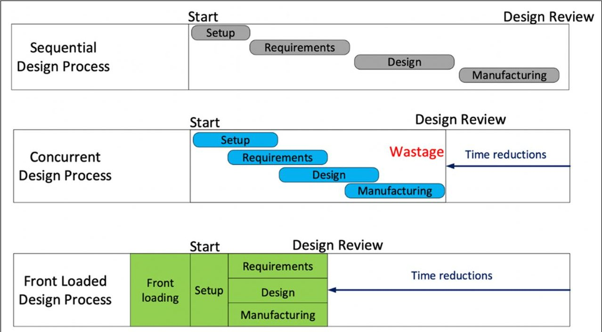

Figure 1: Effect of front-loading on improving time to market (adapted) [1]

tracking capabilities, and have tight integration with a Computer Aided Design (CAD) kernel to capture engineering knowledge into powerful automated solutions for product configuration, design space exploration, and multidisciplinary design optimization [3].

The development of a KBE application encompasses the acquisition of necessary product and process knowledge from the domain experts, which is followed by the translation of this knowledge into code using the programming language provided by the KBE system at hand. This non-trivial process requires expertise both in knowledge acquisition and modeling, as well as in code generation and verification, and generally involves a heterogeneous set of actors, such as product architects, disciplinary experts, knowledge engineers, software developers, and final KBE application users.

Several methodologies are available in the literature that attempt to formalize and improve the KBE application development process, such as Methodology and tools Oriented to Knowledge-based engineering Applications (MOKA) [4,5], CommonKADS [6] and KNOMAD [7]. MOKA is the first and possibly the most known methodology to support KBE application development. It builds on CommonKADS, which is an earlier methodology specifically targeting the development of Knowledge Based Systems (KBS), the technology ancestors of KBE systems. KNOMAD is an extension of MOKA that accounts for the life cycle management issues and multidisciplinary aspects of KBE applications.

At the core of MOKA is the definition of the KBE application life cycle, and knowledge modeling is the phase specifically supported by the proposed methodology. In this phase, knowledge is extracted from domain experts (and other resources) and then modeled according to a specific strategy. Here, the application of MOKA strongly relies on the contribution of specialized engineers, called knowledge engineers. These have the responsibility to elicit, record and validate experts' knowledge by means of models featuring different levels of formalism. The outcome consists of the so called MOKA Model, which is subsequently passed down to the software developers to program the KBE application accordingly.

The MOKA model is composed of three sub-models as shown in Figure 2 [4,5], and they are:

1. The Informal Knowledge Model is developed by the knowledge engineer using ICARE (Illustration, Constraints, Activities, Rules and Entities) forms, where the raw knowledge extracted from domain experts is recorded. These forms are stored in a dedicated Knowledge Management System for future query and retrieval. They are typically static documents and not digital models processable by a computer.

2. The Formal Knowledge Model is created by the knowledge engineer by converting the informal knowledge model into (document-based) diagrams based on the MOKA Modeling Language (MML), which is an extension of the OMG standard Unified Modeling Language (UML) $ ^{1} $

3. The Neutral Language Knowledge Model is derived from the formal knowledge model and is used to link such a model to the actual KBE application code. This neutral language knowledge model is supposed to help in the automatic conversion of MML diagrams into KBE application code.

<!-- PDF_PAGE: 3 -->

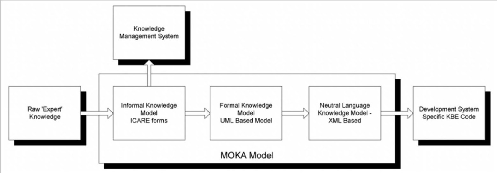

Figure 2: MOKA knowledge models [5].

Although the value of the MOKA methodology was acknowledged both in the industry and academia, and the advantages of knowledge retention and a better structured KBE application development were demonstrated, it had a number of shortcomings, limiting its application in practice.

First of all, MOKA relies on the availability of trained knowledge engineers, which is scarce, and often perceived as unsustainable for a company. Ideally, product architects or domain experts should be in a condition to prototype the KBE application themselves. At least, KBE application developers should be enabled to quickly generate and validate their applications against the needs and requirements of domain experts and KBE application end users, without the need for one extra professional figure, such as that of a knowledge engineer.

Even assuming the availability of knowledge engineers, the two-step (informal-formal) knowledge modeling approach proposed by MOKA has practical limitations. For example, the informal knowledge modeling based on the ICARE schema may not always be intuitive to domain experts as they work in terms of requirements, products, and processes. In general, domain experts view the extra effort to convert their knowledge into ICARE format as a pedagogical exercise without a significant return on the invested time.

Furthermore, no industry-accepted neutral-language knowledge model schema is available to date. Indeed, the third model proposed by MOKA neither led to any suitable standard nor to technology solutions for translating the neutral schema in KBE code. To date, the generation of KBE applications is still a manual process with no guarantee of synchronization between the knowledge model and the KBE application supposedly embedding the modeled knowledge.

As a result of these shortcomings, MOKA is rarely used in practice in its entirety. Consequently, the time required to develop KBE applications, their quality (i.e., requirement compliance & traceability, maintainability, scalability, etc.), and the eventual capability to preserve and efficiently re-use engineering knowledge (i.e., front-loading) are adversely affected.

In this paper, we propose a novel approach based on Model-Based Systems Engineering (MBSE) for the development of KBE applications, which is specifically addressing the aforementioned challenges by means of the following:

1. Development of an intuitive, single-step knowledge formalization approach, based on industry-standard SysML $ ^{2} $ to model requirements and connect them to appropriate process steps and product features (i.e., a Requirement- Product-Process Ontology as shown in Figure 3). This more streamlined approach than the ICARE-MML modeling proposed by MOKA, aims at enhancing the domain experts' involvement in the development of KBE applications, thereby improving the acceptability of generated KBE applications.

2. A solution to store knowledge in the form of digital models (and not in the form of static documents) that can be used to automatically generate the neutral language knowledge model.

3. A solution to automatically generate (part of) the KBE application code using the neutral language knowledge model. This will not only reduce the overall coding effort thereby compensating (part of) knowledge modeling time investment, but will generate KBE applications that are synchronized by design with the knowledge model and are transparent in terms of requirement-to-code traceability.

The proposed methodology is elaborated and discussed in section 2. Its applicability is demonstrated in section 3

<!-- PDF_PAGE: 4 -->

## MBSE APPROACH FOR KBE APPLICATIONS

with an industrial use-case at GKN Fokker Elmo $ ^{3} $ , followed by a discussion on how the new methodology stands with respect to the classical KBE application development process. Finally, relevant conclusions are drawn, and a plan is presented for future developments to improve KBE application development and its adoption in the front-loaded development process (section 4).

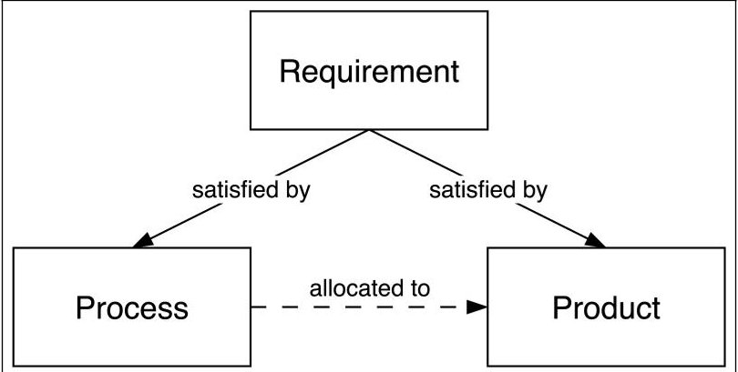

Figure 3: Relationships among Requirements, Product and Process (adapted) [8]. The requirements can either be satisfied by certain process steps, or by product features. The process steps are associated to relevant product features by using the allocation relationship from SysML.

## 2. MBSE to support KBE application development

Model-Based Systems Engineering (MBSE) is defined as, "...the formalized application of modeling to support system requirements, design, analysis, verification and validation activities beginning in the conceptual design phase and continuing throughout development and later life cycle phases [9]." Thus, MBSE is concerned with using digital models over documents for systems engineering.

This definition clearly indicates the suitability of MBSE for the solutions presented in the preceding section. Specifically, the following features of MBSE are extensively exploited in this research work:

1. MBSE allows the capture of system requirements associated with the process steps and product features (here, the system is the KBE application and the product is designed using the KBE application).

2. MBSE uses digital models over documents for information management right from the start, which prevents the tedious and error-prone task of converting document-based information into digital models at a later stage.

3. The MBSE digital models allow engineers to automatically export the knowledge into a neutral format, which can then used to generate KBE application code. This will be elaborated in section 2.3.

The following sections will discuss different aspects of the MBSE methodology for KBE application development. The motivation behind selecting SysML as the modeling language will be highlighted. In addition, a formal ontology for the knowledge model, and its mapping to the ontology of a specific KBE system (i.e. the software platform used to generate KBE applications) will be discussed. The ontology mapping will help connect the information in the knowledge model to the language/structure of the targeted KBE system and support the automatic generation of application code from the knowledge model.

## 2.1 SysML as the modeling language

The modeling language selected for the proposed MBSE methodology for KBE development is the industry standard Systems Modeling Language (SysML) which is supported and maintained by the Object Management Group (OMG) consortium. The reasons why SysML is selected in place of the MOKA Modeling Language or the other OMG standard UML (Unified Modeling Language) are multiple. First of all, the SysML targets systems engineers [10] and not software engineers as the UML. Thereby, it is naturally closer to the language spoken by product architects and designers. It removes some of the UML's software-centric restrictions and adds features such as requirement diagrams and allocation & satisfaction matrices, which enable modeling a wider range of systems, including hardware and processes. These are essential for modeling the information and relationships related to the requirements, product, and process steps shown in Figure 3.

<!-- PDF_PAGE: 5 -->

Additionally, SysML is a more compact (in terms of constructs and diagrams) and easier language to learn than UML, thereby improving the accessibility level of the proposed methodology to the targeted users, i.e. KBE developers and design domain experts. As discussed in the following sections, the proposed methodology relies even on a subset of SysML, thus requiring very limited training efforts to master it.

Lastly, SysML models can be easily converted to neutral language knowledge models using the existing capabilities of both Commercial Off-The-Shelf (COTS) and Free and Open Source Software (FOSS) modeling software (discussed in section 2.3).

## 2.2 The knowledge model ontology and its mapping to a KBE system

The formal ontology developed for the KBE application knowledge model is described in this section. The purpose of such an ontology is to define exactly how requirements, process steps, and product features must be represented in a SysML model. This will give domain experts / KBE developers a clear and structured approach for capturing the knowledge systematically in digital models.

A well-defined knowledge model ontology is also required to map it to the ontology of the targeted KBE system. Such a mapping gives a clear, one-to-one relation between elements of the knowledge model, and the elements & constructs of the programming language of the given KBE system. This is a key enabler to achieve automatic code generation. Additionally, this mapping enables the capability to check whether all elements in the knowledge model are represented in the application code (and vice versa) and requirements-to-code traceability. An overview of the ontologies and their mapping is discussed in the following sections.

## 2.2.1 The knowledge model ontology

Figure 4 shows the proposed SysML ontology to generate/maintain the knowledge model of KBE applications. The main element of the knowledge ontology is the Model. Every knowledge model must contain at least three packages, namely, Requirements, Product, and Process. A Model may also import packages from other Models, facilitating project-to-project knowledge transfer. These packages include more specific concepts, as discussed below:

1. Requirements Package: is used to represent stakeholder needs and requirements for the KBE application. Each requirement must be derived (either implicitly or explicitly) from at least one stakeholder need or another requirement and must be satisfied by Process or Product package elements. Three specific types of requirements are considered, namely physical, performance, and functional requirements [11]. The requirements are modeled using one or more requirement diagram(s) and/or table(s).

2. Process Package: is used to represent the behavior of the system (KBE application) and contains one or more Activities represented in SysML activity diagrams. Activities are composed of smaller atomic elements called Actions, which describe the tasks that must be performed by the KBE application. Activities that are performed outside the KBE application are represented with a special stereotype: « externalService ]. Actions must be allocated to Product package elements that are responsible for performing them. It must be noted that KBE applications do not need to have their behavior/process explicitly defined because it is implicitly handled by the runtime caching and dependency tracking capabilities of KBE systems (discussed in section 2.2.2). The main goal of modeling the Process of a KBE application is to increase the transparency and traceability of knowledge within the KBE application, thereby decreasing its black-box perception.

3. Product Package: is used to represent the structure of the KBE application. Packages within the Product package are composed of SysML blocks (equivalent to UML classes) that capture different system components of the KBE application (e.g. Wing, Fuselage, Mesh etc. for a KBE application for airplanes). Each block is composed of smaller atomic elements called Properties, which may depend on each other. Five specific types of Properties are considered namely Input, Attribute, Part, Action, and Method [3].

Additionally, tools external to the KBE application are also considered, and are named appropriately as "External Tool" in Figure 4. These are in turn composed of "External Functions" which can be connected to Attributes.

The Product package also contains one/more (SysML) Block Definition Diagram(s) ([bdd]) that provide an overview of the relationships between the different Blocks. Each Block should be present in (at least) one Block Definition Diagram and should contain one Internal Block Diagram ([ibd]) to represent its relationships with other blocks and their properties.

Lastly, two additional matrices (or tables) are defined in SysML to link the elements of Requirements, Process and Product packages as follows:

<!-- PDF_PAGE: 6 -->

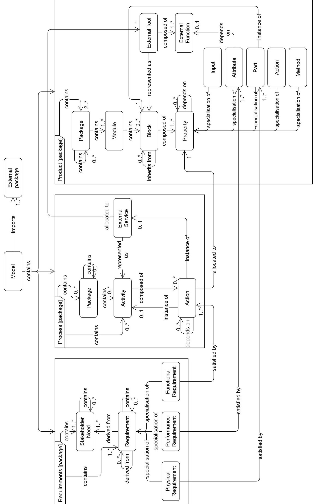

Figure 4: The proposed SysML knowledge model ontology for KBE applications.

<!-- PDF_PAGE: 7 -->

i. Satisfaction Matrix: used to specify what (part of) product or process package elements satisfy a given requirement.

ii. Allocation Matrix: to indicate the (part of) product package elements that perform the action(s) defined in the process package.

These matrices help engineers in assessing the compliance of requirements and guaranteeing that all the tasks that must be performed by a KBE application are incorporated in the source code.

## 2.2.2 Mapping the knowledge model ontology to the ParaPy KBE system

As explained in the previous sections, the capability to automatically generate code, i.e. to translate the SysML knowledge models into an executable KBE application, requires mapping the knowledge model ontology onto the KBE system ontology. Several KBE systems are available on the market, which differ in the KBE programming language they provide for app development, as well as for the integrated CAD kernels and some other features and functionalities. Nonetheless, as discussed in [12], KBE languages are very similar and make use of practically the same construct to define classes. In practice, any KBE application consists of a set of class declarations, interconnected through composition and inheritance relationships. The KBE system specifically targeted in this research is the python-based system ParaPy $ ^{4} $ . The Parapy language ontology and its mapping to the knowledge model ontology is shown in Figure 5. This choice, however, is not limiting the generality of the proposed methodology, as different KBE systems can be targeted using the previous definition of their language ontology and mapping.

As can be seen in Figure 5, only elements of the Product Package in the knowledge model ontology are required to define a mapping to all elements of the ParaPy ontology. All ParaPy-based KBE applications have an inbuilt dependency tracking mechanism ([3]) that determines the order of evaluation of various slots. Thus, an explicit mapping to elements in the Process package of the knowledge model ontology is not necessary to implement the desired behavior in the KBE application.

Since the satisfaction matrix and allocation matrices are used to link the Requirement-Product-Process packages, a clear overview of the satisfied requirements, or the activities performed by different elements of the Product package can be obtained. Thus, based on the mapping between the Product package of the knowledge model and the ParaPy ontology, and the requirement-product-process links, one can identify snippets of code that satisfy a given requirement or perform a specific task.

## 2.3 Automatic KBE application code generation from a neutral language knowledge model

An overview of the steps in the proposed MBSE methodology for getting a working KBE application starting from the knowledge capture/modelling phase is shown in Figure 6. The main components and steps in this figure are explained below:

- SysML Visual Editor: A team of domain experts and KBE developers create a formal model of the system knowledge, which follows the ontology described in section 2.2.1. This is accomplished with a SysML Visual Editor, a software tool for creating and maintaining SysML models. In this research, Magic Systems of Systems Architect (MSoSA) $ ^{5} $ by Dassault Systèmes has been selected as the Visual Editor, which is a well established COTS software.

- Neutral language system knowledge model: Once the knowledge model is sufficiently complete, it can be exported to the neutral XML Metadata Interchange (XMI) standard, developed by the Object Management Group (OMG). This means that knowledge models in this format can be opened and edited in other SysML modeling tools that support the standard.

- Translation engine: is a Python-based code generator developed in this research. It reads the system knowledge model in the XMI format, and uses the mapping between the knowledge model and the KBE system (section 5) to automatically generate KBE application code.

As discussed in the previous section, this translation engine currently only works with ParaPy. However, the use of the neutral language knowledge model and mapping strategy from the knowledge model and KBE language ontologies allows the methodology to be easily extended to other KBE languages than Parapy.

<!-- PDF_PAGE: 8 -->

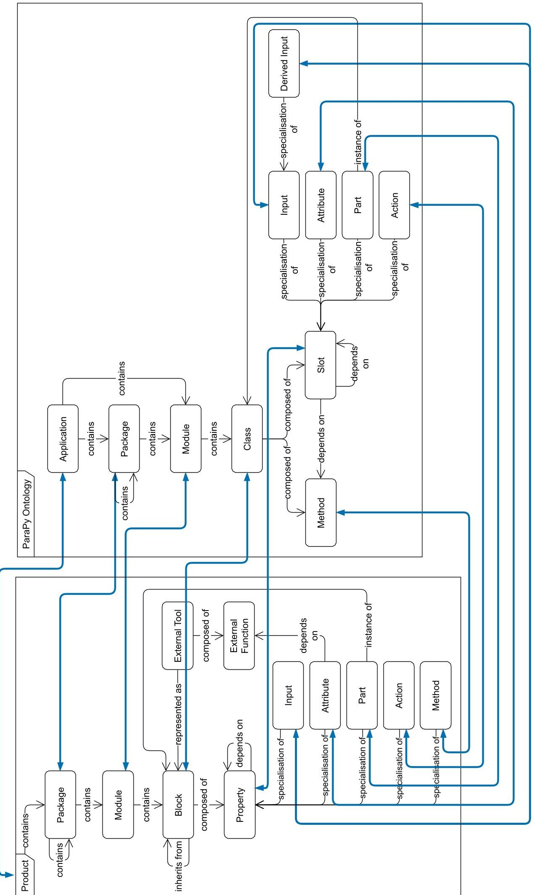

Figure 5: Mapping the knowledge model ontology to elements of the KBE system (ParaPy) ontology.

<!-- PDF_PAGE: 9 -->

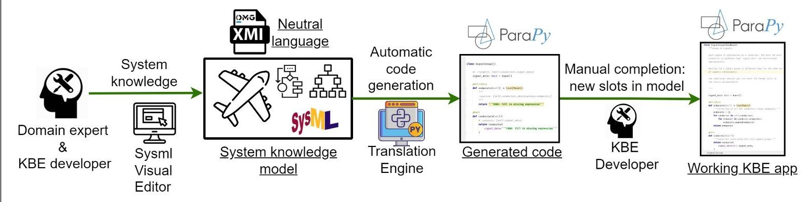

Figure 6: MBSE approach for automatic (skeleton) KBE application generation. Icons from www.flaticon.com.

- Generated code and Working KBE application: Depending on the level of detail of the system knowledge model, the translation engine can generate either a code skeleton (i.e., key classes, attributes and their relationships in a correct file structure) or a complete application code ready for use.

In the former case, KBE developers can complete the code skeleton using an integrated development environment (IDE) of their choice, such as PyCharm $ ^{7} $ . In fact, part of the coding can be more conveniently completed using an IDE with its code completion and hinting features, rather than using the basic code editor built in the SysML visual editor.

## 3. Case Study: MBSE approach for KBE application development

This section discusses the application of the proposed methodology for KBE application development to one of the industry-driven case studies within the DEFAINE project: the development of a KBE application to support the design of aircraft Electrical Wiring Interconnection Systems (EWIS) architectures. There are three goals of this case study. First, to verify and assess the applicability and effectiveness of the proposed methodology in the case of industry-grade complexity. Second, to compare the development time of the KBE application using the proposed methodology against the time required by industry experts using the traditional manual approach. Finally, to obtain comprehensive feedback from industry experts regarding the performance of the developed framework in producing a KBE application that is compliant with the set requirements. In the following subsections, the case study is introduced, which is followed by its implementation details and a discussion of the results.

## 3.1 Introduction: EWIS Architecture Modeler

EWIS design for aircraft is a complex process due to its many interrelations. Depending on the size of the aircraft, EWIS can connect thousands of sub-systems to each other, which must be realized through a compliant, light and cost-effective design. A representative EWIS design by GKN Fokker Elmo for a 100+ passenger aircraft transports almost 10000 signals, resulting in a total of approximately 50 km of wiring.

Strong interrelations with other (system) design aspects of the aircraft make EWIS design challenging, especially in the conceptual design phase, when a lot of data is still unavailable or immature. Furthermore, even if all data were available, EWIS design is labor-intensive, time-consuming and prone to manual errors. Thus, to realize (lead) time savings and reduce wastage due to errors, design automation of EWIS architecture was envisaged at GKN Fokker Elmo using a ParaPy-based KBE application called the EWIS Architecture Modeler (AM). Such automation would further support engineers in performing trade studies, design space exploration and full-blown optimization, thereby realizing the objective of front-loading.

The AM will aid in improving the reliability of conceptual EWIS design by reducing design risk and therefore enable GKN Fokker Elmo to make more competitive offerings to customers. In addition, the automation and subsequent optimization will allow tier 1 suppliers like GKN Fokker Elmo to show the effect of changes in aircraft architectural decisions on the resulting EWIS design.

## 3.2 State of practice: KBE application development process at GKN Fokker Elmo

The state of practice for KBE application development (before the implementation of the MBSE approach) at GKN Fokker Elmo typically consists of the following steps (also shown as an activity diagram in Figure 7):

<!-- PDF_PAGE: 10 -->

## MBSE APPROACH FOR KBE APPLICATIONS

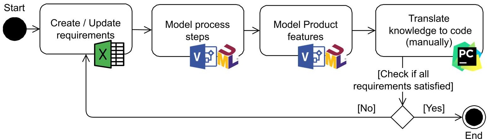

Figure 7: State of practice for KBE application development at GKN Fokker Elmo. The steps are performed by a team of domain experts and KBE developers. Note that the figure shows a generalization of the steps that are usually performed, but often the order of steps can change depending on the project and expertise of the people involved, which can make the overall knowledge acquisition process less structured/consistent.

1. The requirements of the application are modeled in Microsoft Excel $ ^{8} $ .

2. The Process and Product features are modeled in Microsoft Visio $ ^{9} $ using UML diagrams (the Process is defined using UML activity diagrams and the Product is defined using a combination of UML class diagrams and composite structure diagrams).

3. The generated product model is manually translated to KBE code using the PyCharm IDE.

It can be observed that different software systems are used to capture individual aspects of the knowledge model (i.e., requirements, product and process). Furthermore, the captured knowledge largely consists of static drawings with no link to digital models, which leads to two main challenges:

1. Identifying which requirement is satisfied by which process step or product component becomes challenging. In other words, generating a homogenized satisfaction or allocation matrix requires significant bookkeeping and is labor-intensive.

2. Maintaining consistency between the knowledge captured using static drawings and the KBE application code becomes challenging as the code is generated manually based on the drawings. Any changes made to the knowledge model (e.g., change of class structure or modifications in the encapsulated rules) after code generation cannot be updated in the code without the intervention of the developer. As a result, the incentive to keep these knowledge diagrams updated is reduced.

Thus, engineers often use these diagrams as a starting point in the KBE application development process. Subsequent changes/updates made directly to the code without updating the knowledge diagrams increase the risk of making the knowledge models obsolete. This is one of the fundamental reasons for permanent knowledge loss in case the developer is not available because deciphering knowledge rules and the intent directly from the code is challenging.

## 3.3 MBSE based KBE application development of the EWIS Architecture Modeler

To assess how effective the proposed MBSE-based approach is at overcoming the challenges discussed in the previous section, the new methodology was applied for developing the EWIS Architecture Modeler application. The key steps are shown as an activity diagram in Figure 8, and they can be summarized as follows based on the different roles:

1. Domain expert & KBE developer: A team of domain experts and KBE developers modeled the application knowledge based on the knowledge ontology (section 2.2.1) as the first step. The MSoSA SysML editor was used for all activities in this section. This involved modeling the requirements first, which was followed by making the Process and Product models in parallel, though the Process model is given an initial priority to get an overview of the engineering process being modeled by the KBE application. The allocation and satisfaction matrices were created next, and the models were updated in an iterative process to ensure that all (relevant) process steps were allocated to the Product model, and all requirements could be satisfied with the modeled information.

<!-- PDF_PAGE: 11 -->

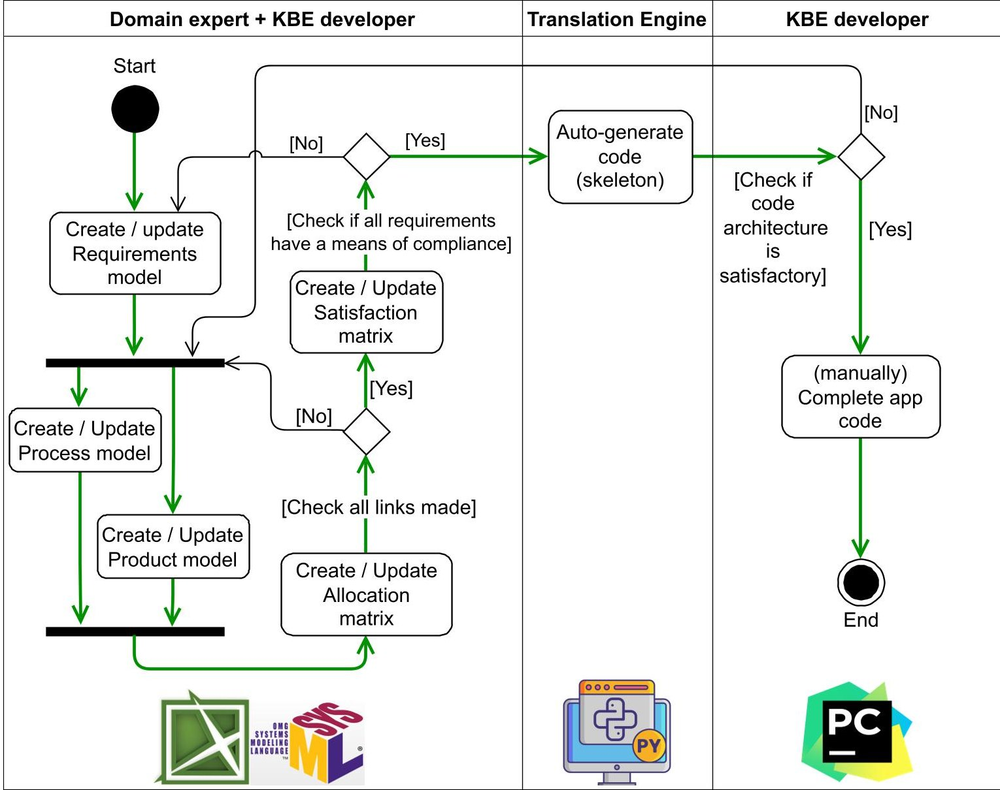

Figure 8: Activity diagram showing the main steps in the proposed KBE application development process based on MBSE. The main path is highlighted with green arrows. Activities on the left are completed in a SysML visual editor; the Translation Engine is a python based model to code generator; and the activities on the right are completed in PyCharm (IDE).

2. Translation Engine: Once the knowledge models reached acceptable quality, the KBE skeleton code was automatically generated using the translation engine.

3. KBE developer: In the last step, a team of KBE developers assessed the architecture of the generated code, and updated the knowledge models in an iterative process until a satisfactory result was achieved. Finally, the missing knowledge and rules were filled in the generated code skeleton, as shown in Figure 9. The KBE application for the AM is shown in Figure 10.

In the subsequent sections, a detailed comparison is made between the current state of practice and the MBSE-based approach for KBE application development. The comparison focuses on factors such as application development time, requirement-to-code traceability as well as the influence of the knowledge acquisition approach.

## 3.4.1 Maintainability and Scalability

## 3.4 Comparison of knowledge acquisition: State of Practice vs MBSE approach

Modern software developers use the Agile Methodology [13] in every phase of application development. This implies that they break down the project into smaller chunks (called sprints) and develop each chunk systematically. Consequently, the knowledge acquisition and the process of architecting the KBE application (i.e., constructing the product model) is also divided into a number of sprints.

<!-- PDF_PAGE: 12 -->

## MBSE APPROACH FOR KBE APPLICATIONS

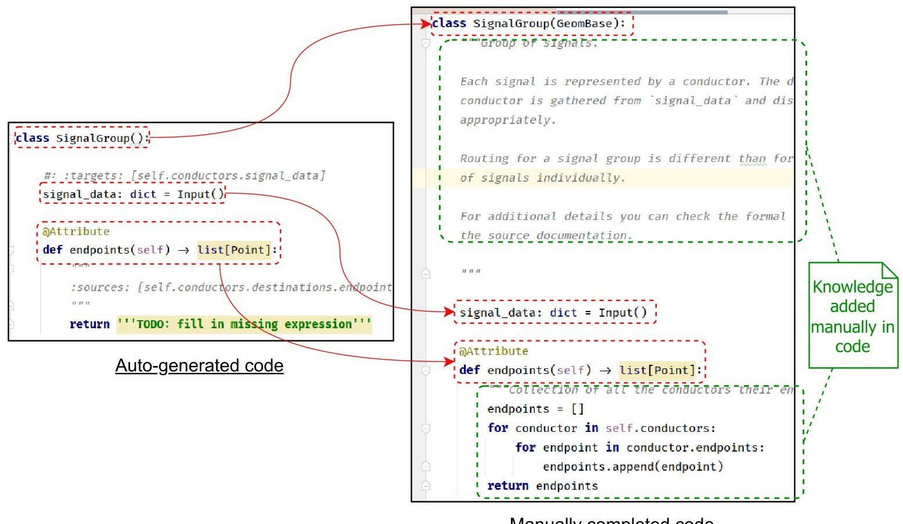

Manually completed code

Figure 9: On left: small section of auto-generated KBE application code using the Translation Engine; on right: KBE application code after adding missing knowledge/rules (highlighted in green) by a KBE developer in an IDE.

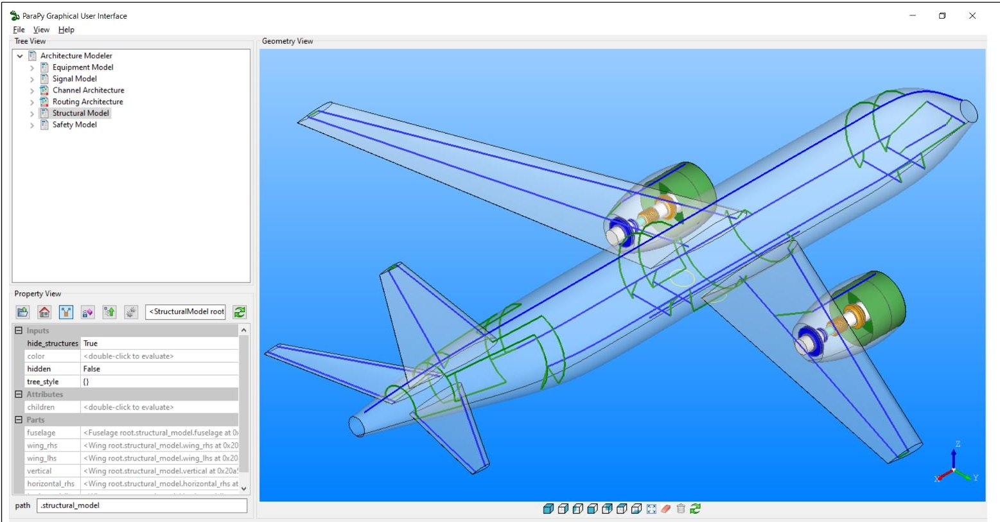

Figure 10: Screenshot showing the ParaPy GUI for the EWIS Architecture Modeler KBE application developed using the proposed MBSE based methodlogy.

Thus, the ability to add classes, inputs, attributes and parts in different phases becomes important. In the current state of practice, this activity can only be performed by the developer(s) who were instrumental in every sprint, as they understand the layout of the code. Furthermore, since the knowledge models are static, developers often prefer to directly update the code rather than spend effort on modeling the product structure.

<!-- PDF_PAGE: 13 -->

As the applications increase in size and a large number of sprints are completed, maintaining an overview of the architecture of the KBE application becomes challenging. This can lead to the development of an application with a flat product model, which is cumbersome to use and offers multiple challenges in the scalability and maintainability of code. For example, the flat product structure makes the code non-intuitive to understand (with respect to the product breakdown structure of the typical product created by the KBE application), takes a lot of time to rearrange or reorganize, and identifying repeating elements that can become standalone classes or functions becomes challenging.

In the MBSE approach, engineers have the benefit of automatic code (skeleton) generation, and the improved ability to import (parts of) previously generated knowledge models. Thus, they have the incentive to extend the knowledge model in MSoSA. The visual representation in the MBSE approach discourages engineers from adding structural components and attributes at an arbitrary location, as they can quickly grasp the overarching structure of the application. This not only guarantees that the knowledge model is updated, but also improves the code structure and quality, thereby improving the maintainability and scalability of the code.

## 3.4.2 Standardization of the knowledge acquisition approach

On comparing the two approaches, it can be deduced that the MBSE based approach helps in standardizing the knowledge acquisition process over the state of practice. The MBSE approach accomplishes this in three ways:

## i Standardization of modeling tool(s) and knowledge format(s):

In the proposed MBSE approach, all knowledge is modeled within a single software tool - the SysML visual editor. Additionally, this knowledge is stored in the neutral XMI standard. Therefore, all information can be accessed in one software tool from a single file format. This is in contrast to the numerous software tools and their respective file formats that can be used in the state of practice (Figure 7).

The experts from GKN Fokker Elmo who used MSoSA found the diagrams in the SysML editor fairly intuitive. Although building the first SysML diagrams was initially more time-consuming than using their conventional modeling systems (Excel and Visio) due to their higher complexity, these diagrams quickly become easier to understand, adjust and maintain.

## ii Addition of some specific model views:

The MBSE approach includes the creation of satisfaction and allocation matrices as critical steps of the methodology. These matrices allow an explicit link to be created between the requirements-process-product models. Furthermore, these steps can be performed semi-automatically because of the built-in capabilities of most SysML visual editors. As a result, the traceability of requirements embedded within the KBE applications becomes easier (discussed further in section 3.4.4) and the risk of non-compliance with one or more requirements is significantly reduced as the models are all linked to one another.

In contrast, in the current state of practice, the model links are defined either implicitly during code generation or are generated manually using Excel worksheets (also discussed in footnote d of Table 1). Such implicit and/or manual linking of requirements-product-process models is error-prone, labor-intensive, and time-consuming, which poses the risk of missing important activities necessary to comply with the requirements.

## iii Standardization of knowledge acquisition steps:

As stated in the description of Figure 7, the knowledge acquisition steps in the state of practice are a generalization, and are often not followed in that specific sequence. Deviations from these steps can lead to inconsistencies in the modeled knowledge, and increased modeling time.

On the other hand, the MBSE approach suggests a well-defined knowledge acquisition process (Figure 8). Following this process makes the knowledge acquisition process more consistent and complete, which in turn reduces the number of iterations needed to complete the process.

## 3.4.3 Time-study - comparing the development time of new KBE applications

A time study was conducted to compare the development time of the Architecture Modeler application using the current state of practice at GKN Fokker Elmo (section 3.2) and the MBSE approach (section 3.3). Hence, all steps shown in Figure 7 and Figure 8 were carried out for the development of AM using the current state of practice and the MBSE approach respectively.

The results of the time study are shown in Table 1, with relevant information in the table footnotes. The results of the time study revealed that the MBSE approach significantly reduced the development time of the initial knowledge model and code skeleton compared to the current state of practice. The study showed an almost 50% reduction in the time required to generate knowledge models and skeleton code using the MBSE approach. Manual translation of the models into application (skeleton) code accounted for approximately 16% of the total development time, taking

<!-- PDF_PAGE: 14 -->

## MBSE APPROACH FOR KBE APPLICATIONS

2 hours. In contrast, the automatic translation of the SysML model into the skeleton code took less than 1 minute, demonstrating the efficiency and time-saving benefits of the MBSE approach.

These improvements highlight the potential of the MBSE approach in streamlining the development process, reducing manual effort, and accelerating the generation of application code. By adopting the MBSE approach, organizations like GKN Fokker Elmo can benefit from increased productivity, shorter development cycles, and improved overall efficiency in KBE application development.

## 3.4.4 Traceability

Reducing the typical "Black-box" perception of KBE application was identified as an important challenge in the previous sections. The Requirements Traceability Tool has been developed to complement the proposed MBSE approach, which provides the traceability of requirements onto the various elements of the KBE application architecture, including direct links to the model and code elements where such requirements are encoded, thereby mitigating the typical "black-box" effect of KBE applications. Keeping a clear track of which parts of the code ensure compliance with what requirements enables easy requirement verification and eases further code development and updates.

The Requirements Traceability Tool is shown in Figure 11 for the EWIS Architecture Modeler application. Here, users can use the interface to upload a file containing the Neutral Language Knowledge Model to populate the list of all requirements in the model. Users can select any requirement in the list to find details of the requirement (i.e., ID, name, type, text, and any requirements from which it is derived), elements satisfying the requirements (from product/process models), and a code snippet that satisfies the requirement.

Table 1: Comparative time study for developing the EWIS Architecture Modeler KBE application using the proposed MBSE-based methodology vs. traditional approach

<table border="1"><tr><td>Task</td><td>Proposed MethodologyaTime[HH:MM]</td><td>Traditional ApproachaTime[HH:MM]</td></tr><tr><td>1. Create Requirements Modelb</td><td>00:30</td><td>00:30</td></tr><tr><td>2. Create Process Modelc</td><td>03:00</td><td>04:00</td></tr><tr><td>3. Create Product Modelc</td><td>03:00</td><td>04:00</td></tr><tr><td>4. Link Process to Product</td><td>00:10</td><td>01:30d</td></tr><tr><td>5. Link Process/Product to Requirements</td><td>00:10</td><td>00:45d</td></tr><tr><td>6. Translate the SysML model to KBE code(skeleton)e</td><td>00:01</td><td>02:00</td></tr><tr><td>TOTAL</td><td>06:51</td><td>12:45</td></tr></table>

a. The tasks performed using the proposed methodology were performed by a master thesis student at the Delft University of Technology, and those performed using the traditional approach were performed by a KBE engineer at GKN Fokker Elmo.

b. The requirements model created using the traditional approach consisted only of a Microsoft Excel worksheet. Conversely, the requirements model created using the proposed methodology consisted of both tabular data, and a requirements diagram. The diagram was generated (semi-)automatically from the tabular data, offering an additional view of the model.

c. The time difference between the two approaches lies in the fact that the modeling tool used in the proposed methodology (MSoSA) offers certain functionalities that make the modeling process faster than the modeling tool used in the traditional approach (Microsoft Visio). For instance, these include the ability to automatically arrange/update diagram layout based on the type of diagram, and a link between elements in the model across diagrams, making it faster to refactor information. Furthermore, Visio does not enforce any UML/SysML well-formedness rules as well as MSoSA, which leads to errors in the model requiring re-work/ extra time to make consistent models.

d. The times presented for the traditional approach are estimates, as these tasks are not actually performed in the traditional approach. However, performing these tasks is essential to guarantee traceability of requirements and processes to the KBE application code, and for a fair comparison to the proposed methodology. In order to perform these tasks in the traditional approach, tables would have to be manually created in Excel. It is important to consider that these tables are static and disconnected from the models, unlike the matrices that are automatically created (and updated) in the proposed methodology. Thus, in the traditional approach, any changes made in the models would have to be manually propagated to the Excel tables, a process which is highly time-consuming and error-prone.

e. The SysML model to be translated contained a total of 27 blocks. Out of these, 12 contained an average of 5 ParaPy slots (of type Inputs, Attributes, and Parts), while the remaining 15 were left empty (i.e., contained no slots).

## 3.5 Current Limitations of MBSE approach: Towards round-trip engineering

In its current state, the MBSE approach proposed in this paper is limited to generating skeleton code from the knowledge model. This code is then manually completed by the KBE application developer. However, if modifications are made to the knowledge model at this point, and the code is generated again, the code that was manually added is lost. Furthermore, if the architecture of the application is modified by the KBE developer directly in the IDE, the Knowledge Model and KBE application become inconsistent.

<!-- PDF_PAGE: 15 -->

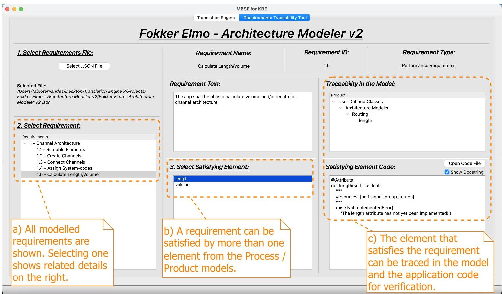

Figure 11: The Requirements Traceability Tool interface.

To prevent this loss of knowledge or inconsistencies, capabilities are needed to generate/update the knowledge model from application source code, which is often referred to as reverse engineering [14]. Reverse engineering will be useful in formalizing the manually added code in the knowledge model, as well as to extract knowledge from existing KBE applications, developed without any formal knowledge modeling. This is particularly useful to enable project-to-project knowledge transfer.

Going one step further, a "round-trip engineering" capability can be developed, which can leverage the code generation and reverse engineering capabilities to keep the application code and knowledge model synchronized. Such a capability will ensure that existing knowledge models can be updated when changes are made to the application code, and vice versa.

## 4. Conclusions and Outlook

Front-loading is crucial for maintaining competitiveness, reducing costs, and minimizing lead time in engineering processes. Knowledge-Based Engineering (KBE) serves as a key enabler for effective front-loading. However, the manual process of gathering, organizing, and translating knowledge into application code poses a significant bottleneck in KBE application development. This results in long development times and a lack of transparency on how the application code complies with the original requirements, leading to a general black-box perception of the KBE application. Existing KBE development methodologies, such as MOKA, have severe shortcomings that strongly limit their use in practice.

To address these challenges, a new methodology based on Model-Based Systems Engineering (MBSE) has been proposed. This methodology offers several key solutions, including the use of a formal ontology for the knowledge model based on SysML, and the adoption of digital models in place of traditional documents. Moreover, the methodology involves exporting the knowledge model in a neutral XMI format and utilizing an in-house developed "model-to-code" translation engine that leverages the mapping between the knowledge model ontology and the KBE system ontology to automatically generate application code.

The methodology was applied to a use case of realistic complexity at GKN Fokker Elmo: the development of a KBE application for generating aircraft Electrical Wiring Interconnection System (EWIS) architectures. The new development process was compared to the state of practice at this tier 1 supplier. The results demonstrate the practicality of the proposed methodology and its benefits in terms of the improved knowledge acquisition process, significant time reduction in KBE application development (almost 50% less time to generate the initial knowledge model and skeleton

<!-- PDF_PAGE: 16 -->

code), the maintainability and scalability of code and the traceability of requirements within the KBE application and knowledge model.

In the future, the reverse-engineering capability will be added to the proposed MBSE approach that will enable the automatic generation of the knowledge model from the application code. This will improve front-loading by enabling project-to-project knowledge transfer from legacy projects. When used with the translation engine described in this paper, reverse engineering will ensure that the knowledge model and application code remain synchronized (enabling round-trip engineering) throughout the application's lifetime.

## 5. Acknowledgments

The research presented in this paper has partially been performed in the framework of the DEFAINE (Design Exploration Framework based on AI for froNt-loaded Engineering) project $ ^{10} $ and has received funding from ITEA 3 programme.

## References

[1] A. Raju Kulkarni, G. La Rocca, T. van den Berg, and R. van Dijk. A knowledge based engineering tool to support front-loading and multi-disciplinary design optimization of the fin-rudder interface. In Aerospace Europe 6th CEAS Conference, volume 680, 2017.

[2] S. Thomke and T. Fujimoto. The effect of "front-loading" problem-solving on product development performance. Journal of Product Innovation Management: An International Publication of the Product Development & Management Association, 17(2):128-142, 2000.

[3] G. La Rocca. Knowledge based engineering: Between AI and CAD. review of a language based technology to support engineering design. Advanced engineering informatics, 26(2):159-179, 2012.

[4] Moka Consortium. Managing engineering knowledge: MOKA: methodology for knowledge based engineering applications. Professional Engineering Publ., 2001.

[5] S. Preston, C. Chapman, M. Pinfold, and G. Smith. Knowledge acquisition for knowledge-based engineering systems. International Journal of Information Technology and Management, 4(1):1, 2005.

[6] G. Schreiber, B. Wielinga, R. de Hoog, H. Akkermans, and W. Van de Velde. CommonKADS: A comprehensive methodology for KBS development. IEEE expert, 9(6):28-37, 1994.

[7] R. Curran, W. J. C. Verhagen, M. J. L. van Tooren, and T. H. van der Laan. A multidisciplinary implementation methodology for knowledge based engineering: KNOMAD. Expert Systems with Applications, 37(11):7336- 7350, November 2010.

[8] B. Yu and H. Zhao. A semantic ontology of requirement-product-process-resource for modeling of product lifecycle information. In The 19th International Conference on Industrial Engineering and Engineering Management, pages 319-330. Springer, 2013.

[9] INCOSE. Systems Engineering Vision 2020. 2007.

[10] S. Wolny, A. Mazak, C. Carpella, V. Geist, and M. Wimmer. Thirteen years of sysml: a systematic mapping study. Software and Systems Modeling, 19:111-169, 2020.

[11] S. Friedenthal, A. Moore, and R. Steiner. A practical guide to SysML: the systems modeling language. Morgan Kaufmann, 2014.

[12] J. Sobieszczanski-Sobieski, A. Morris, and M. nan Tooren. Multidisciplinary design optimization supported by knowledge based engineering. John Wiley & Sons, 2015.

[13] P. Abrahamsson, O. Salo, J. Ronkainen, and J. Warsta. Agile software development methods: Review and analysis. arXiv preprint arXiv:1709.08439, 2017.

[14] S. Rugaber and K. Stirewalt. Model-driven reverse engineering. IEEE Software, 21(4):45-53, 2004.