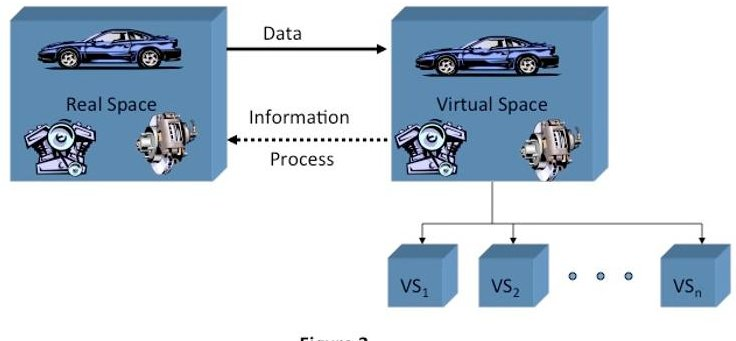
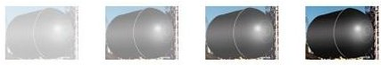
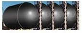

<!-- PDF_PAGE: 1 -->

# Digital Twin: Mitigating Unpredictable, Undesirable Emergent Behavior in Complex Systems (Excerpt)

Dr. Michael Grieves and John Vickers

## III. The Digital Twin Concept

While the terminology has changed over time, the basic concept of the Digital Twin model has remained fairly stable from its inception in 2002. It is based on the idea that a digital informational construct about a physical system could be created as an entity on its own. This digital information would be a "twin" of the information that was embedded within the physical system itself and be linked with that physical system through the entire lifecycle of the system.

## Origins of the Digital Twin Concept

The concept of the Digital Twin dates back to a University of Michigan presentation to industry in 2002 for the formation of a Product Lifecycle Management (PLM) center. The presentation slide, as shown in Figure 3 and originated by Dr. Grieves, was simply called "Conceptual Ideal for PLM." However, it did have all the elements of the Digital Twin: real space, virtual space, the link for data flow from real space to virtual space, the link for information flow from virtual space to real space and virtual sub-spaces.

## Conceptual Ideal for PLM

Dr. Michael Grieves, University of Michigan, Lurie Engineering Center, Dec 3, 2001

The premise driving the model was that each system consisted of two systems, the physical system that has always existed and a new virtual system that contained all of the information about the physical system. This meant that there was a mirroring or twinning of systems between what existed in real space to what existed in virtual space and vice versa.

<!-- PDF_PAGE: 2 -->

The PLM or Product Lifecycle Management in the title meant that this was not a static representation, but that the two systems would be linked throughout the entire lifecycle of the system. The virtual and real systems would be connected as the system went through the four phases of creation, production (manufacture), operation (sustainment/support), and disposal.

This conceptual model was used in the first executive PLM courses at the University of Michigan in early 2002, where it was referred to as the Mirrored Spaces Model. It was referenced that way in a 2005 journal article (Grieves 2005). In the seminal PLM book, Product Lifecycle Management: Driving the Next Generation of Lean Thinking, the conceptual model was referred to as the Information Mirroring Model (Grieves 2006).

The concept was greatly expanded in Virtually Perfect: Driving Innovative and Lean Products through Product Lifecycle Management (Grieves 2011), where the concept was still referred to as the Information Mirroring Model. However, it is here that the term, Digital Twin, was attached to this concept by reference to the co-author's way of describing this model. Given the descriptiveness of the phrase, Digital Twin, we have used this term for the conceptual model from that point on.

The Digital Twin has been adopted as a conceptual basis in the astronautics and aerospace area in recent years. NASA has used it in their technology roadmaps (Piascik, Vickers et al. 2010) and proposals for sustainable space exploration (Caruso, Dumbacher et al. 2010). The concept has been proposed for next generation fighter aircraft and NASA vehicles (Tuegel, Ingraffea et al. 2011, Glaessgen and Stargel 2012) $ ^{1} $ , along with a description of the challenges (Tuegel, Ingraffea et al. 2011) and implementation of as-builts (Cerrone, Hochalter et al. 2014).

## Defining the Digital Twin

What would be helpful are some definitions to rely on when referring to the Digital Twin and its different manifestations. We would propose the following as visualized in Figure 4: Digital Twin Types Digital Twin Prototype (DTP)

Digital Twin (DT)- the Digital Twin is a set of virtual information constructs that fully describes a potential or actual physical manufactured product from the micro atomic level to the macro geometrical level. At its

- Digital Twin Instance (DTI)

- Digital Twin Aggregate (DTA)

Figure 4

<!-- PDF_PAGE: 3 -->

optimum, any information that could be obtained from inspecting a physical manufactured product can be obtained from its Digital Twin. Digital Twins are of two types: Digital Twin Prototype (DTP) and Digital Twin Instance (DTI). DT's are operated on in a Digital Twin Environment (DTE)

Digital Twin Prototype (DTP) - this type of Digital Twin describes the prototypical physical artifact. It contains the informational sets necessary to describe and produce a physical version that duplicates or twins the virtual version. These informational sets include, but are not limited to, Requirements, Fully annotated 3D model, Bill of Materials (with material specifications), Bill of Processes, Bill of Services, and Bill of Disposal.

Digital Twin Instance (DTI) - this type of Digital Twin describes a specific corresponding physical product that an individual Digital Twin remains linked to throughout the life of that physical product. Depending on the use cases required for it, this type of Digital Twin may contain, but again is not limited to, the following information sets: A fully annotated 3D model with General Dimensioning and Tolerances (GD&T) that describes the geometry of the physical instance and its components, a Bill of Materials that lists current components and all past components, a Bill of Process that lists the operations that were performed in creating this physical instance, along with the results of any measurements and tests on the instance, a Service Record that describes past services performed and components replaced, and Operational States captured from actual sensor data, current, past actual, and future predicted.

Digital Twin Aggregate (DTA) - this type of Digital Twin is the aggregation of all the DTIs. Unlike the DTI, the DTA may not be an independent data structure. It may be a computing construct that has access to all DTIs and queries them either ad-hoc or proactively. On an ad hoc basis, the computing construct might ask, "What is the Mean Time Between Failure (MTBF) of component X." Proactively, the DTA might continually examine sensor readings and correlate those sensor readings with failures to enable prognostics.

Digital Twin Environment (DTE)- this is an integrated, multi-domain physics application space for operating on Digital Twins for a variety of purposes. These purposes would include:

Predictive - the Digital Twin would be used for predicting future behavior and performance of the physical product. At the Prototype stage, the prediction would be of the behavior of the designed product with components that vary between its high and low tolerances in order to ascertain that the as-designed product met the proposed requirements. In the Instance stage, the prediction would be a specific instance of a specific physical product that incorporated actual components and component history. The predictive performance would be based from current point in the product's lifecycle at its current state and move forward. Multiple instances of the product could be aggregated to provide a range of possible future states.

<!-- PDF_PAGE: 4 -->

Interrogative - this would apply to DTI's as the realization of the DTA. Digital Twin Instances could be interrogated for the current and past histories. Irrespective of where their physical counterpart resided in the world, individual instances could be interrogated for their current system state: fuel amount, throttle settings, geographical location, structure stress, or any other characteristic that was instrumented. Multiple instances of products would provide data that would be correlated for predicting future states. For example, correlating component sensor readings with subsequent failures of that component would result in an alert of possible component failure being generated when that sensor pattern was reported. The aggregate of actual failures could provide Bayesian probabilities for predictive uses.

## The Digital Twin Model throughout the Lifecycle

As indicated by the 2002 slide in Figure 3, the reference to PLM indicated that this conceptual model was and is intended to be a dynamic model that changes over the lifecycle of the system. The system emerges virtually at the beginning of its lifecycle, takes physical form in the production phase, continues through its operational life, and is eventually retired and disposed of.

In the create phase, the physical system does not yet exist. The system starts to take shape in virtual space as a Digital Twin Prototype (DTP). This is not a new phenomenon. For most of human history, the virtual space where this system was created existed only in people's minds. It is only in the last quarter of the $ 20^{\mathrm{th}} $ century that this virtual space could exist within the digital space of computers.

This opened up an entire new way of system creation. Prior to this leap in technology, the system would have to have been implemented in physical form, initially in sketches and blueprints but shortly thereafter made into costly prototypes, because simply existing in people's minds meant very limited group sharing and understanding of both form and behavior.

In addition, while human minds are a marvel, they have severe limitations for tasks like these. The fidelity and permanence of our human memory leaves a great deal to be desired. Our ability to create and maintain detailed information in our memories over a long period of time is not very good. Even for simple objects, asking us to accurately visualize its shape is a task that most of us would be hard-pressed to do with any precision. Ask most of us to spatially manipulate complex shapes, and the results would be hopelessly inadequate.

However, the exponential advances in digital technologies means that the form of the system can be fully and richly modeled in three dimensions. In the past, emergent form in complex and even complicated system was a problem because it was very difficult to insure that all the 2D diagrams fit together when translated into 3D objects.

<!-- PDF_PAGE: 5 -->

In addition, where parts of the system move, understanding conflicts and clashes ranged from difficult to impossible. There was substantial wasted time and costs in translating 2D blueprints to 3D physical models, uncovering form problems, and going back to the 2D blueprints to resolve the problems and beginning the cycle anew.

With 3D models, the entire system can be brought together in virtual space, and the conflicts and clashes discovered cheaply and quickly. It is only once that these issues of form have been resolved that the translation to physical models need to occur.

While uncovering emergent form issues is a tremendous improvement over the iterative and costly two-dimensional blueprints to physical models, the ability to simulate behavior of the system in digital form is a quantum leap in discovering and understanding emergent behavior. System creators can now test and understand how their systems will behave under a wide variety of environments, using virtual space and simulation.

Also as shown in Figure 3, the ability to have multiple virtual spaces as indicated by the blocks labeled $ \mathrm{V S}_{1} \dots \mathrm{V S}_{n} $ meant that that the system could be put through destructive tests inexpensively. When physical prototypes were the only means of testing, a destructive test meant the end of that costly prototype and potentially its environment. A physical rocket that blows up on the launch pad destroys the rocket and launch pad, the cost of which is enormous. The virtual rocket only blows up the virtual rocket and virtual launch pad, which can be recreated in a new virtual space at close to zero cost.

The create phase is the phase in which we do the bulk of the work in filling in the system's four emergent areas: PD, PU, UD, and UU. While the traditional emphasis has been on verifying and validating the requirements or predicted desirable (PD) and eliminating the problems and failures or the predicted undesirable (PU), the DTP model is also an opportunity to identify and eliminate the unpredicted undesirable (UU). By varying simulation parameters across the possible range they can take, we can investigate the non-linear behavior in complex systems that may have combinations or discontinuities that lead to catastrophic problems.

Once the virtual system is completed and validated, the information is used in real space to create a physical twin. If we have done our modeling and simulation correctly, meaning we have accurately modeled and simulated the real world in virtual space over a range of possibilities, we should have dramatically reduced the number of UUs.

This is not to say we can model and simulate all possibilities. Because of all the possible permutations and combinations in a complex system, exploring all possibilities may not be feasible in the time allowed. However, the exponential advances in computing capability mean that we can keep expanding the possibilities that we can examine.

<!-- PDF_PAGE: 6 -->

It is in this create phase that we can attempt to mitigate or eradicate the major source of UUs-ones caused by human interaction. We can test the virtual system under a wide variety of conditions with a wide variety of human actors. System designers often do not allow for conditions that they cannot conceive of occurring. No one would think of interacting with system in such a way- until people actually do just that in moments of panic in crisis.

Before this ability to simulate our systems, we often tested systems using the most competent and experienced personnel because we could not afford expensive failures of physical prototypes. But most systems are operated by a relatively wide range of personnel. There is an old joke that goes, "What do they call the medical student who graduates at the bottom of his or her class?" Answer, "Doctor." We can now afford to virtually test systems with a diversity of personnel, including the least qualified personnel, because virtual failures are not only inexpensive, but they point out UUs that we have not considered.

We next move into the next phase of the lifecycle, the production phase. Here we start to build physical systems with specific and potentially unique configurations. We need to reflect these configurations, the as-builts, as a DTI in virtual space so that we can have knowledge of the exact specifications and makeup of these systems without having to be in possession of the physical systems.

So in terms of the Digital Twin, the flow goes in the opposite direction from the create phase. The physical system is built. The data about that physical build is sent to virtual space. A virtual representation of that exact physical system is created in digital space.

In the support/sustain phase, we find out whether our predictions about the system behavior were accurate. The real and virtual systems maintain their linkage. Changes to the real system occur in both form, i.e., replacement parts, and behavior, i.e., state changes. It is during this phase that we find out whether our predicted desirable performance actually occurs and whether we eliminated the predicted undesirable behaviors.

This is the phase when we see those nasty unpredicted undesirable behaviors. If we have done a good job in ferreting out UUs in the create phase with modeling and simulation, then these UUs will be annoyances but will cause only minor problems. However, as has often been the case in complex systems in the past, these UUs can be major and costly problems to resolve. In the extreme cases, these UUs can be catastrophic failures with loss of life and property.

In this phase the linkage between the real system and virtual system goes both ways. As the physical system undergoes changes we capture those changes in the virtual system so that we know the exact configuration of each system in use. On the other side, we can use the information from our virtual systems to predict performance and failures of the physical systems. We can

<!-- PDF_PAGE: 7 -->

aggregate information over a range of systems to correlate specific state changes with the high probability of future failures.

As mentioned before, the final phase, disposal / decommissioning, is often ignored as an actual phase. There are two reasons in the context of this topic why the disposal phase should receive closer attention. The first is that knowledge about a system's behavior is often lost when the system is retired. The next generation of the system often has similar problems that could have been avoided by using knowledge about the predecessor system. While the physical system may need to be retired, the information about it can be retained at little cost.

Second, while the topic at hand is emergent behavior of the system as it is in use, there is the issue of emergent impact of the system on the environment upon disposal. Without maintaining the design information about what material is in the system and how it is to be disposed of properly, the system may be disposed of in a haphazard and improper way.

## References:

Caruso, P., D. Dumbacher and M. Grieves (2010). Product Lifecycle Management and the Quest for Sustainable Space Explorations. AIAA SPACE 2010 Conference & Exposition. Anaheim, CA.

Cerrone, A., J. Hochalter, G. Heber and A. Ingraffea (2014). "On the Effects of Modeling As-

Manufactured Geometry: Toward Digital Twin." International Journal of Aerospace Engineering 2014.

Glaessgen, E. H. and D. Stargel (2012). The digital twin paradigm for future nasa and us air force vehicles.

AAIA 53rd Structures, Structural Dynamics, and Materials Conference, Honolulu, Hawaii.

Grieves, M. (2005). "Product Lifecycle Management: the new paradigm for enterprises." Int. J. Product Development 2(Nos. 1/2): 71-84.

Grieves, M. (2006). Product Lifecycle Management: Driving the Next Generation of Lean Thinking. New York, McGraw-Hill.

Grieves, M. (2011). Virtually perfect : Driving Innovative and Lean Products through Product Lifecycle Management. Cocoa Beach, FL, Space Coast Press.

Piascik, R., J. Vickers, D. Lowry, S. Scotti, J. Stewart. and A. Calomino (2010). Technology Area 12: Materials, Structures, Mechanical Systems, and Manufacturing Road Map, NASA Office of Chief Technologist.

Tuegel, E. J., A. R. Ingraffea, T. G. Eason and S. M. Spottswood (2011). "Reengineering Aircraft Structural Life Prediction Using a Digital Twin." International Journal of Aerospace Engineering 2011.