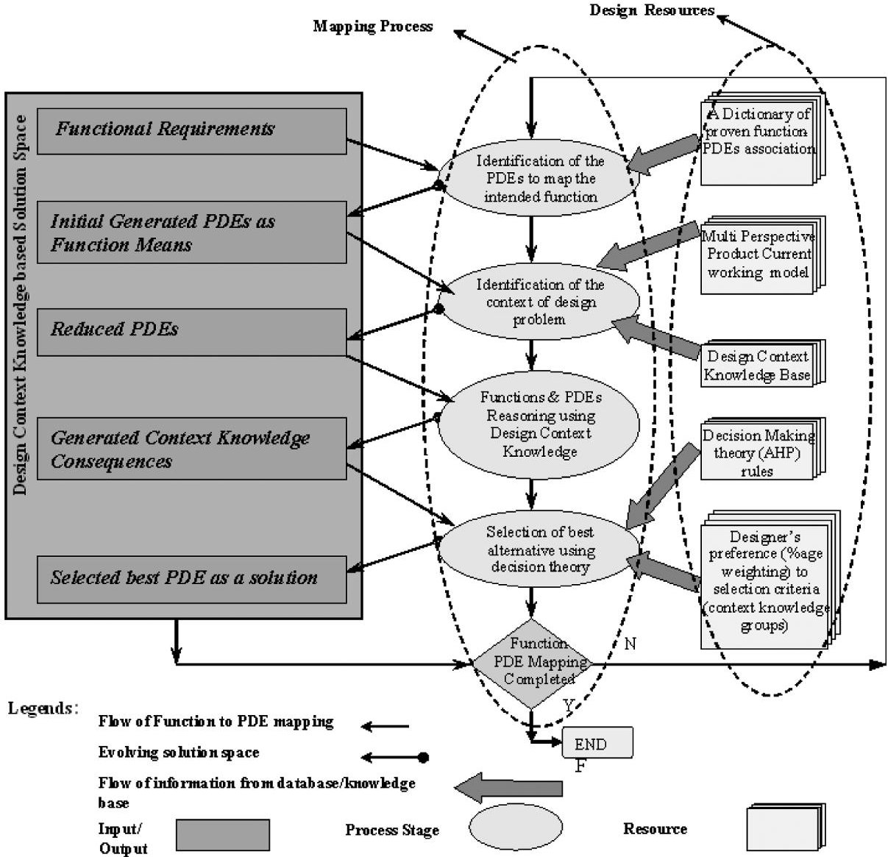
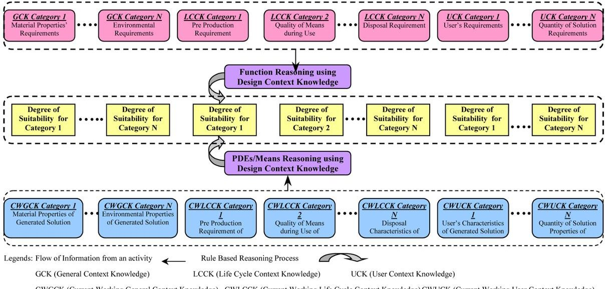
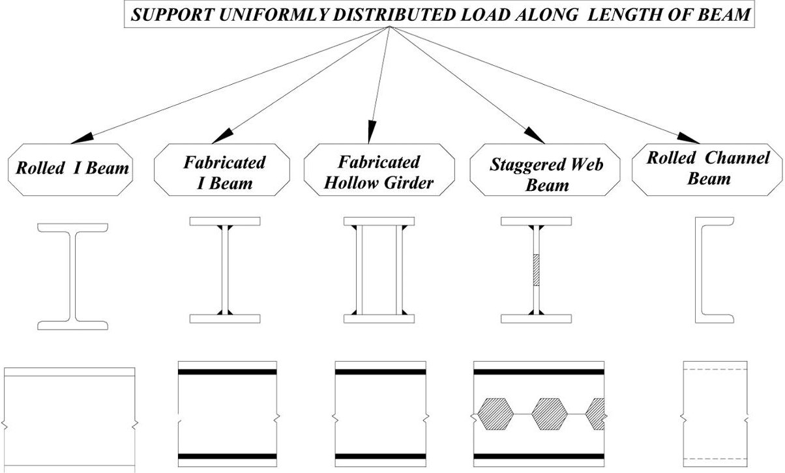

<!-- PDF_PAGE: 1 -->

# Application of context knowledge in supporting conceptual design decision-making

## Fayyaz U. Rehman and Xiu-Tian Yan $ ^{*} $

Department of Design, Manufacture

and Engineering Management,

University of Strathclyde,

James Weir Building,

75 Montrose Street, Glasgow G1 1XJ, UK

Fax: +44141 552 0557

E-mail: fayyaz.rehman@solent.ac.uk

E-mail: x.yan@strath.ac.uk

*Corresponding author

Abstract: Conceptual design is the most important phase of the product life cycle, as the decisions taken affect the downstream phases in terms of product cost, quality and function. This research takes a holistic design approach by presenting the context knowledge of a design problem for designers to make an informed decision. The design context knowledge is formalised and a new model and corresponding computational framework is proposed to support conceptual design decision making. A case study for the proof of the concept shows that design context knowledge can be used to support proactively an informed and effective decision making in concept selection.

Keywords: conceptual design; decision-making; context knowledge; product life cycle.

Reference to this paper should be made as follows: Rehman, F.U. and Yan, X-T. (2011) 'Application of context knowledge in supporting conceptual design decision-making', Int. J. Product Development, Vol. 13, No. 1, pp.47-66.

Biographical notes: Fayyaz Rehman is a Senior Lecturer in the School of Engineering, Maritime and Construction of Southampton Solent University (UK). He graduated in Mechanical Engineering from the University of Engineering and Technology (Pakistan) in 1995. He has over five years industrial experience of working as a mechanical/structural designer both in UK and overseas. In 2000, he obtained his MSc in Computer Aided Engineering Design from the University of Strathclyde (UK) and PhD from the same university in 2006. He worked as Project Coordinator on a European Commission Funded Project at the University of Strathclyde. He is a Chartered Engineer and a member of Institution of Engineering Designers, UK. His research interests are functional reasoning in mechanical design, concurrent engineering, systems integration and design decision support.

Xiu-Tian Yan, PhD, BEng, CEng, FIMechE, MIET (MIEE), FHEA, is a Reader, Postgraduate Courses Director at Strathclyde University, UK. He received his PhD from Loughborough University of Technology in 1992. His research interests include computer support mechatronic systems design using AI techniques, mechatronic design, knowledge-intensive product modelling and simulation, and life cycle oriented design synthesis. He has

<!-- PDF_PAGE: 2 -->

published over 150 papers in the international journals and conferences in these fields. He is Vice Chairman of the Mechatronics Forum. He is a Fellow of the Institution of Mechanical Engineers, Chartered Engineer and member of Institution of Engineering and Technology.

## 1 Introduction

Conceptual Design is a stage of the design process in which problems are identified, functions and specifications are laid out and appropriate solutions are generated through the combination of some basic building blocks using some working principles (Navinchandra, 1992; French, 1985). Conceptual Design is commonly seen to be the most important phase of the design process (Roozenburg and Eekels, 1995), because the decisions made here will have a strong impact on all subsequent phases of the design process. A weak concept can never be turned into an optimum detailed design. In addition, the main functions of the conceptual design stage are to generate and evaluate broad solutions, given the specification, which provides a suitable start-up point for embodiment design and detail design.

Conceptual design is a dynamic activity, which should be undertaken in the context of external world and therefore any decisions made by the designer have implications on different stages of the product life cycle as well as on the external world, which comprises environment of the product in which it operates and users of the product. It is, therefore, necessary for the designers to be aware of the consequences (Andreasen and Olesen, 1990; Borg and Yan, 1998) of their decisions made at the conceptual design stage not only on the later life phases of the product but also on the whole context of the design problem under consideration, i.e., the external world, life phases, environment of the product and users of the product. A review of existing methods and associated frameworks (Rehman and Yan, 2007) argue that there is a need not only to identify the whole context and all contextualised information/knowledge of design but also to formalise it in some structured form and present it for designer's consideration early during the synthesis stage of the design, i.e., when the decision-making takes place at the conceptual design stage. A good understanding of design context knowledge is essential for successful design and any design-support system should investigate as to how the design context knowledge and information can be used to provide effective support. Hence, it is essential to identify, understand the role and utilise design context knowledge to support the conceptual design stage. This research (Rehman, 2006) addresses this problem by proposing, implementing and evaluating a computational framework for supporting decision-making at the conceptual design stage. This paper describes about the formalism of the design context knowledge, corresponding computational framework developed to support decision-making and a case study in detail to highlight the effectiveness of approach. Section 2 discusses the importance of conceptual-design-decision-making on later life-cycle stages of the product. Section 3 of the paper explains in detail about the idea of 'Context' in design and the new meaning and formalism of 'Context' proposed by the authors. Section 4 describes the developed model/framework as the core of this research. Section 5 explains in detail a case study of design decision-making using the proposed model to prove and highlight the effectiveness of the approach. The final section of the paper concludes the paper by

<!-- PDF_PAGE: 3 -->

commenting on the overall usefulness of developed approach in supporting conceptual design decision-making.

## 2 Decision-making at the conceptual design stage

Decision-making and design are so intertwined that it has been suggested that the entire decision-making can be viewed as design (Simon, 1969). The design concept evaluation and selection undertaken while exploring solution space makes the conceptual design stage a decision-intensive process (Mistree and Smith, 1993; Starvey, 1992; Joshi, 1991). Decisions are made on various aspects of the product being designed (Duckworth and Baines, 1998) and typical decisions involve selection of working principles and corresponding concepts and solutions. Furthermore, some decisions, which seem appropriate for one life-cycle requirement, can pose problems on other life-cycle phases (Hubka and Eder, 1988). This implies that the part of a decision taken within one life phase (e.g., product design) affects the type, content, efficiency and progress of activities within other life phases (e.g., assembly, manufacturing and use). For example, a decision of using countersink head screws instead of snap fit to assemble two parts will result in different design, manufacture and maintenance approaches and techniques. Therefore, designers need to be aware of consequences of their decisions early at the conceptual design stage to undertake an effective and informed life-cycle-oriented decision-making.

## 2.1 Decisions' consequence awareness

Design decisions are associated with consequences (Andreasen and Olesen, 1990; Duffy and Andreasen, 1993), which can either be intended or unintended and either good or problematic (Borg and Yan, 1998) and have the ability to influence the performance of other life-cycle phases in terms of measures such as cost and time (Hubka and Eder, 1988). Gero (1998) argued that the conceptual design process is a sequence of situated acts. He calls this concept situatedness, i.e., the notion that addresses the role of the context knowledge in engineering design. This implies that conceptual design is a dynamic activity, which should be undertaken in the context of an external world and therefore any decisions made by the designer have implications on the external world, which comprises the product operational environment and users of the product. It is, therefore, necessary for the designers to be aware of the consequences of their decisions made at the conceptual design stage not only on the later life phases of the product but also on the whole context of the design problem under consideration, i.e., the external world, life phases, operational environment and users of the product.

## 3 Context in design

There are many uses for the word 'Context' in design, and information/knowledge described as 'Context' is also used in several ways. One dictionary (Oxford, 1998) definition of context is the set of facts or circumstances that surround a situation or event.

<!-- PDF_PAGE: 4 -->

To date, some researchers have only provided a contextual framework to explore relationships between the design context and design practice, giving no systematic consideration to the implications of all context knowledge on decision-making at the conceptual design stage. For example, Maffin (1998) has presented a contextual framework to explore the relationships between the design context and design practice. Design context is captured in terms of a company's unique internal and external attributes (i.e., its organisation, markets, products, production process, suppliers, local and global environment), its strategic policies and the key features of the specific projects. Hales (1993) has presented a contextual model, which incorporates environmental influences at the macroeconomic, microeconomic, and corporate and project levels by using pre-developed checklists to allow the designer to assess the impact of these influences on the design project. Dorst and Hendriks (2001) investigated the role and importance of design context in practical designing by studying the interactions and influences of various stakeholders, which they referred 'context parties' such as design team, design project managers, clients, suppliers and design agency on the practical designing of the product. Sudarsan et al. (2005) developed a product-information-modelling framework for Product Life-cycle Management (PLM). The framework used a core product model to capture the design context in the form of product and design rationale, assembly and tolerance information at different life-cycle stages of the product. Shahare and Gurumoorthy (2007) argued that context is the frame of mind defined by an individual designers' Meta knowledge and beliefs that are active at that particular instance, invoked to characterise an entity. Kim et al. (2007) presented an approach to improve design reuse through actively delivering the information that a designer will need for subsequent tasks in different contexts so that he or she is aware of available information. Charlton and Wallace (2000) summarised design context interpreted by some researchers as follows:

- "the life cycle issue(s), goal(s) or requirement (s) being addressed by the current part of the product development process: e.g., safety; usability; assembly

- the function(s) currently being considered as an aspect of the product: e.g., transmitting a torque; acting as a pressure vessel

- the physical surroundings with which a part of the product can interact, including either internal or external aspects of the product's environment; e.g., the components in a hydraulic system; the temperature of the operating environment; the manufacturing environment; aspect of the surrounding landscape reflected in an architectural design".

These examples clearly indicate that the use of 'Context' in engineering design is limited to the consideration of only some aspects such as socio-economic pressures on designer, environmental influences and company's policies. There is not a single piece of work representing the holistic view of design 'Context' to support effective decision-making at the conceptual design stage. This research refers 'Context' as a knowledge having information about surrounding factors and interactions, which have an impact on the design and the behaviour of the product and therefore the design decision-making process, which result in design solutions at a particular moment of time in consideration. Therefore, the Design Context Knowledge can be defined as the related

<!-- PDF_PAGE: 5 -->

surrounding knowledge of a design problem at a given moment in time for consideration (Rehman and Yan, 2004).

## 3.1 Design context knowledge formalism

The review of existing methods and frameworks (Rehman and Yan, 2007) indicated that the lack of the consideration of design context knowledge and its implications during the decision-making is due to the lack of understanding and non-availability of a proper formalism of the design context knowledge. On the basis of the adopted definition, this research has proposed and implemented a classification to structure the design context knowledge for a systematic use. The research formalises design context knowledge in six different groups. These groups are Life-Cycle Group, User-Related Group, General-Product-Related Group, Legislations and Standards Group, Company Policies and Current Working Knowledge (Zhang, 1998) (i.e., partial solution information generated up till current stage of the design process for a given problem). Design context knowledge formalised in first five groups is of static nature and it can be further classified into different categories of knowledge depending on the nature of design problem and design domain under consideration so that it is easy to use this knowledge in decision-making. However, as first three groups are generic in mechanical design domain and can be used in any design organisation, this research has classified these three groups into 10 different categories of context knowledge (Rehman and Yan, 2004). This identification stems from the work done by the authors and other researchers in the areas of design synthesis for multi-X as well as product life-cycle modelling (Yan et al., 2002; Borg and MacCallum, 1997; Borg et al., 1999). The work (Yan et al., 2002; Borg and MacCallum, 1997; Borg et al., 1999) done earlier by authors illustrates the significance of generation of Life-Cycle Consequences (LCCs) on different life-cycle phases (design, manufacturing, assembly, dispose) of product in the form of positive and negative implications owing to the selection of a particular design solution. The work reported in this paper built further on previous work by considering consequences related to not only different life-cycle phases but also the user of product and the environment in which the product works/operates. Therefore, a more holistic and wider view of design problem is considered by formalising design context knowledge into different categories and using them in supporting decision-making at the conceptual design stage. It is noted that these categories of context knowledge are by no means exhaustive. There could be even more knowledge groups/categories that should be considered depending on the nature of a design problem under consideration, however in metal component design particularly in sheet metal component design, these categories can be used to explore fully the knowledge important for consideration at the conceptual design stage. These categories are briefly summarised here.

## 3.1.1 User requirements/preferences

This category of context knowledge deals with the users of the product and is defined as the knowledge about the requirements/preferences of the users of the product. This type of knowledge is important to understand the intended users of the product and their preferences about the product. Reasoning using product user requirements can help the designer to gain an insight into the user preferences in the selection of a particular solution, which would be considered as more suitable for the users. An example could be

<!-- PDF_PAGE: 6 -->

a requirement of a smaller size of handle bar of an iron or a kettle for the female user group.

## 3.1.2 Product/components' material properties

This category of context knowledge is defined as information related to product's material properties and includes general material specifications of the components like type of material, specification, strength, durability, allowable stress and hardness, etc. Providing timely information to the designer using background reasoning about material properties would help the designer in selecting those solutions that are structurally feasible.

## 3.1.3 Quality of means/solution during use

It is defined as the measure/degree of fulfilling the intended function by a solution in different working environment/conditions. This also implies how much a selected solution deviates from desired behaviour owing to the quality of the solution and the influence of working environment. This knowledge could be the suitability of the selected solution to different working conditions like high-temperature environment, increased vibration and shock/impact load application. An example of this type of knowledge is a lack of consideration of the impact of high temperature on the slack in a friction belt, which will be significantly high when compared with one at the ambient temperature environment.

## 3.1.4 Pre-production requirement

This category of context knowledge is defined as the information required to prepare the material (i.e., cut material to correct size, straightening the stock, cut edges and so forth) before a component is manufactured or bought in if any required. This type of context knowledge is normally referred as Life cycle more specifically context knowledge in the form of life phase system's constraints. Reasoning using pre-production requirements involves evaluating and comparing time and cost required incurred on pre-production processes and bought in components for different solutions. This is an important source of knowledge about the constraints that manufacture/assembly systems impose on design decisions of a solution product. Designers are often unaware of these limitations, and as design decisions become more related to other factors, it is very difficult, if possible, for designers to foresee these potential decision consequences. Through the use of these LCCs, it is possible to remind designers proactively the potential consequences of their decisions. An example is the requirement for the use of shielding flux as well as the preparation of edges before welding two sheet metal plates.

## 3.1.5 Production requirement

Production requirement is defined as the knowledge about actual manufacturing/production requirements for a solution. For example, a sheet metal base slot-fit solution requires a rectangular slot on female part and a double $ 9 0^{\circ} $ bend on male part. This type of knowledge is important for designer not only to analyse the ease of manufacturing of a specific feature on the component but also to compare the cost incurred in manufacturing

<!-- PDF_PAGE: 7 -->

each of these features, thus giving support to the designer in selecting solutions that involve less manufacturing time and low manufacturing cost.

## 3.1.6 Post-production requirement

Post-production requirement is described as a special process that is needed after manufacturing/inscribing a solution on the component. An example of such a requirement could be retightening of a specifically designed nut in case of Hole-fastener as solution to an 'Assembly' function between two products during service/use. Reasoning using this type of context knowledge generates consequences about life phase systems (Maintenance/Service) and helps designer in avoiding unintended problematic/costly consequences. The consequence in this example could be the time and cost of equipment incurred in retightening of nuts. Therefore, it is necessary to compare the time required and the cost of equipment that would occur during use, maintenance and service phase of a product among all the potential solutions to select the low cost and short lead-time solution.

## 3.1.7 Production equipment requirement

The knowledge related to Production Equipment Requirement comes under the category of life-cycle context knowledge and deals with knowledge of Tooling/Machines required to manufacture a particular solution on a component. Timely prompting designer about the type and cost of machine/tooling that would require manufacture/realise a selected solution will help in making a cost-effective decision as more costly and increased number of machines will increase the overall lead-time and product cost. An example could be the use of fine blanking dies for high surface finish in punching/blanking operation of sheet metal components instead of ordinary dies, which are less costly, but requires a secondary (trimming) operation to get high surface finish of products.

## 3.1.8 Quantity of product required

Quantity of product/component required is an important factor in selecting a particular manufacturing solution to realise a certain function. The quantity of product directly affects the selection of production method because an expensive production method can result in high quality better selling mass manufactured product. Therefore, higher equipment cost can be justified if return from the profit of mass produced components is sufficiently high. Therefore, the information about quantity of product is necessary at conceptual design stage to select a suitable manufacturing solution, which can be cost-effective.

## 3.1.9 Achievable production rate

Time required and level of difficulty to manufacture different features varies considerably. Therefore, it is necessary to consider the achievable production rate of each solution using the selected production equipment before making a final decision to go ahead with the selected design solution. Higher achievable production rate will reduce not only the lead-time of the product, but also the production overhead costs thus reducing the overall product cost. It is clear that the achievable production rate

<!-- PDF_PAGE: 8 -->

should be used to help evaluate design solutions, which affect the lead-time and production cost.

## 3.1.10 Degree of available quality assurance techniques

A selection of a solution with high degree of available quality assurance techniques helps in avoiding accidents or breakdowns owing to performance of solution during use. This results into low maintenance cost as well reduced time in maintenance/repair work. An example of this type of information is the availability of non-destructive testing methods such as X-ray and ultrasound techniques to determine the strength of a metal joint during its operation/use phase.

These 10 categories of context knowledge can be used for reasoning to provide decisions' consequence awareness to the designer at the conceptual design stage. The conceptual design process is modelled as the transformation between three different information states (Welch and Dixon, 1992), which are function, behaviour and form of means/solution alternatives. This implies that conceptual design can be interpreted as function to means mapping process during which decision-making takes place regarding the selection and evaluation of different design alternatives. Since a framework explains the interactions of these three important elements (function, behaviour and form of solutions/means), this research proposes a new function to means mapping model, which uses these 10 categories of design context knowledge to support conceptual design decision-making.

## 4 Function to means mapping model

Conceptual design process involves deriving implementable functions by decomposing them into finer resolutions, identifying means to realise them and evaluating those means by reasoning using the existing and new knowledge/information against evaluation criteria.

Observing the product from the constructional point of view (Andreasen and Hansen, 1996) gives a product breakdown structure (product, assembly, subassembly, component and feature) each of which requires designing and therefore calling as Product Design Elements (PDEs) (Borg et al., 1999). A PDE at component building level is a reusable design information unit (element) representing a potential solution means for a function requirement. Of relevance to this definition and looking from the viewpoint of component construction, a more commonly used term manufacturing feature is considered to be an information element defining a region of interest within a product.

## 4.1 Design-context-knowledge-based function to PDE mapping model

To support decision-making at the conceptual design stage, a new generic function to PDE mapping process model is proposed here in this research (Rehman and Yan, 2003), which uses design context knowledge to support decision-making as shown in Figure 1.

<!-- PDF_PAGE: 9 -->

Figure 1 Function to PDE mapping model

The model consists of three groups of information or activities. The first group (i.e., the left-hand column of the shaded rectangular box) is called the Design-Context Knowledge-Based Solution Storage and models a solution space in which the new decision made from an earlier design stage becomes the output to support the subsequent stage of the function to PDE mapping process. The second group (i.e., the right-hand column of multiple square blocks) is called Design Resources and consists of resources to support the decision-making. These include a database, a library of functions, a function means association dictionary, a design context knowledge base, Analytic Hierarchy Process (AHP) (Saaty, 1990) rules, which a decision is making method and designer preferences through which knowledge/information is input to different stages of the function to PDE mapping process. The third group (i.e., the central column of the oval-shaped blocks) is called the Design-Context-Knowledge-Based Mapping Process and describes the four stages of function to PDE mapping process, which is detailed here.

<!-- PDF_PAGE: 10 -->

## 4.2 Working of the model

The function to means mapping process takes place in four stages. At every stage during the function to means mapping process, the designer uses the inputs from the solution space and the design resources and generates new potential solution(s) thereby evolving the design solution.

During the first stage, the designer takes the Functional Requirements and a Dictionary of Proven Function-PDEs association as inputs, which result in Initial Generated PDEs as output. At the second stage, the designer takes these Initial Generated PDEs and searches for suitable models from the Multi-Perspective Product Current Working Model library. This Current Working Model and the Design Context Knowledge Base are used to identify the exact context of the design problem, i.e., functional requirements and solution information in different contexts. The design context knowledge base also facilitates the designer to reduce the initial set of PDEs into a reduced sub-set of PDEs, which do not comply with the physical properties as defined in the functional requirements. During the third stage, the designer takes this reduced set of PDEs as inputs and performs function and PDEs reasoning simultaneously using the design context knowledge to generate Context Knowledge Consequences as the output of this stage as shown in Figure 2.

Figure 2 Consequences generation through reasoning process (see online version for colours)

At the final stage of the model, the designer uses the Generated Context Knowledge Consequences, AHP rules and the Designer's Preference as the reasoning engine and performs decision-making by selecting the best solution, which not only fulfils the functional requirements, but also caters for the whole context of the design problem under consideration. This life-cycle awareness is performed, by timely prompting the designer about these consequences, thereby providing proactive decision-making support to the designer.

AHP is selected as the chosen decision-making methods because of its following merits:

<!-- PDF_PAGE: 11 -->

- AHP can be used for both quantitative and qualitative subjective information analysis

- Since the desired problem of decision-making in this research requires pair-wise comparison (i.e., the chosen PDE selection problem requires pair-wise comparison of each PDE alternative against other PDEs), the use of AHP method seems appropriate

- This method provides comparison of not only different design alternatives against design criteria but also different design criteria against designer's preferences

- By virtue of adopting the AHP as decision-making method, it is possible to take into account criteria with different levels of description, i.e., hierarchical ranking of a criterion from the top to the bottom level is possible.

This whole process of function to PDE/means mapping spanning these four stages should be iterated for all functions in a given design problem, until all functions are realised by selecting the best solutions as described earlier. At this stage, function to PDE mapping is completed for a design problem.

## 5 Case study of structural component selection

A case study of supporting conceptual design of a structural component using design context knowledge background reasoning is presented in this section. The case study is about to identify suitable PDEs/solutions to a functional requirement and then evaluate and select the best solution using context knowledge reasoning using different functionalities of the system.

## Functional Requirement

The functional requirement is to "Support Uniformly Distributed Load Along Length of Beam".

## Conceptual Solutions

On the basis of the functional requirements, the following five conceptual solutions are generated/proposed (Figure 3).

These are different types of beams and with different cross sectional shapes and manufactured through different processes. A brief description of these solutions is

- Rolled I-Beam is manufactured through rolling process and a stock/ingot of material is fed through consecutive rolling mills to achieve the required shape

- Fabricated I-Beam is manufactured by welding two flange plates with web plate using either continuous or intermittent fillet welding

- Fabricated Hollow Girder is manufactured by welding two flange plates with two web plates using welding

<!-- PDF_PAGE: 12 -->

- Staggered Web Beam is manufactured by cutting the web plate in a staggered fashion and then welding the opposite edges of web plate to increase the depth of web plate and subsequently welding it with flange plates

- Rolled Channel Beam is manufacture through rolling process and has Channel C cross sectional shape.

Figure 3 Functional requirement and corresponding generated solutions

## 5.1 Generated context knowledge and reasoning

Context knowledge for the design problem under consideration is generated for each of the 10 categories of context knowledge. As soon as these five means/solutions selected, context consequence knowledge/information is generated regarding each one of these means/solutions in each one of the 10 categories of context knowledge. The context knowledge generated in this case study is taken from different sources of beam/structural design references. The information generated in each context knowledge category is analysed and reasoned to assign degrees of suitability from 0 to 5 as shown in Figure 4(a) and 4(b) in 10 different categories. The higher the degree, the more suitable is the solution regarding the category under consideration. The degrees of suitability are assigned based on this study. The fewer the problematic consequences, the higher the degree of suitability. The scale and range of degrees of suitability are set as shown here:

Absolutely high=5; Very high=4; High=3; Low=2; Very low=1; Not suitable=0.

<!-- PDF_PAGE: 13 -->

Figure 4 (a) Degree of suitability of a solution to a particular context knowledge category for 1st five categories

1- USER REQUIREMENT

- Support Uniformly distribute load of 200 kg/M

- Length should be 10 M

<table border="1"><tr><td>FEATURE</td><td>CONTEXT/CONSEQUENCE KNOWLEDGE</td><td>DEGREE OF SUITABILITY</td></tr><tr><td>Rolled 1 Beam</td><td>Can be used for all types of loading</td><td>5</td></tr><tr><td>Fabricated 1 Beam</td><td>Can be used for all types of loading</td><td>5</td></tr><tr><td>Fabricated Hollow Girder</td><td>Can be used for all types of loading</td><td>5</td></tr><tr><td>Staggered Web Beam</td><td>Can be used for all types of loading</td><td>5</td></tr><tr><td>Rolled Channel Beam</td><td>Can be used for all types of loading</td><td>5</td></tr></table>

2- COMPONENT MATERIAL PROPERTIES/CONSUMPTION

ASTM A-36 Structural Steel as material of Beam

PRE-PRODUCTION REQUIREMENT {PREPARATION OF MATERIAL (S)}

QUALITY OF MEANS

DURING USE

(DEGREE OF FULLFILLING

INTENDED FUNCTION IN

DIFFERENT CONDITIONS)

5- PRODUCTION REQUIREMENT (ADDITIONAL ITEMS/COMPONENTS)

- Capable of withstanding/absorbing shock load due to earthquake

- Capable of withstanding/absorbing lateral wind load

- Capable of withstanding load in high temperature conditions

- Cost/Ease of preparing components (Less time to prepare)

<table border="1"><tr><td>FEATURE</td><td>CONTEXT/CONSEQUENCE KNOWLEDGE</td><td>DEGREE OF SUITABILITY</td></tr><tr><td>Rolled 1 Beam</td><td>Can be used for all types of materials, Low material consumption</td><td>5</td></tr><tr><td>Fabricated 1 Beam</td><td>Can be used for all types of materials, High material consumption</td><td>4</td></tr><tr><td>Fabricated Hollow Girder</td><td>Can be used for all types of materials, Very high material consumption</td><td>3</td></tr><tr><td>Staggered Web Beam</td><td>Can be used for all types of materials, low material consumption</td><td>5</td></tr><tr><td>Rolled Channel Beam</td><td>Can be used for all types of materials, low material consumption</td><td>5</td></tr></table>

<table border="1"><tr><td>FEATURE</td><td>CONTEXT/CONSEQUENCE KNOWLEDGE</td><td>DEGREE OF SUITABILITY</td></tr><tr><td>Rolled 1 Beam</td><td>Medium shock load resistant, high temperature resistant</td><td>4</td></tr><tr><td>Fabricated 1 Beam</td><td>Medium shock load resistant, low temperature resistant</td><td>3</td></tr><tr><td>Fabricated Hollow Girder</td><td>Very High shock load resistant, low temperature resistant</td><td>4</td></tr><tr><td>Staggered Web Beam</td><td>Very High shock load resistant, low temperature resistant</td><td>4</td></tr><tr><td>Rolled Channel Beam</td><td>Low shock load resistant, high temperature resistant</td><td>3</td></tr></table>

<table border="1"><tr><td>FEATURE</td><td>CONTEXT/CONSEQUENCE KNOWLEDGE</td><td>DEGREE OF SUITABILITY</td></tr><tr><td>Rolled 1 Beam</td><td>No preparation is required</td><td>5</td></tr><tr><td>Fabricated 1 Beam</td><td>Edge preparation of sheets is required</td><td>4</td></tr><tr><td>Fabricated Hollow Girder</td><td>Edge preparation of sheets is required</td><td>4</td></tr><tr><td>Staggered Web Beam</td><td>Edge preparation as well as cutting of sheets is required</td><td>2</td></tr><tr><td>Rolled Channel Beam</td><td>No preparation is required</td><td>5</td></tr></table>

<table border="1"><tr><td>FEATURE</td><td>CONTEXT/CONSEQUENCE KNOWLEDGE</td><td>DEGREE OF SUITABILITY</td></tr><tr><td>Rolled 1 Beam</td><td>No additional item required</td><td>5</td></tr><tr><td>Fabricated 1 Beam</td><td>Low quantity of welding rods and filler material is required</td><td>4</td></tr><tr><td>Fabricated Hollow Girder</td><td>High quantity of welding rods and filler material is required</td><td>3</td></tr><tr><td>Staggered Web Beam</td><td>Very high quantity of welding rods and filler material is required</td><td>2</td></tr><tr><td>Rolled Channel Beam</td><td>No additional item required</td><td>5</td></tr></table>

<!-- PDF_PAGE: 14 -->

Figure 4 (b) Degree of suitability of a solution to a particular context knowledge category for last five categories

POST PRODUCTION

REQUIREMENT {SPECIAL

PROCESS (S) REQUIRED}

- Less costly post processing

PRODUCTION EQUIPMENT

REQUIREMENT/COST (TOOLING

/MACHINE COST REQUIRED)

<table border="1"><tr><td>FEATURE</td><td>CONTEXT/CONSEQUENCE KNOWLEDGE</td><td>DEGREE OF SUITABILITY</td></tr><tr><td>Rolled I Beam</td><td>Quenching in oil is required</td><td>5</td></tr><tr><td>Fabricated I Beam</td><td>Longitudinal Straightening under press is required</td><td>4</td></tr><tr><td>Fabricated Hollow Girder</td><td>Longitudinal Straightening under press is required</td><td>4</td></tr><tr><td>Staggered Web Beam</td><td>Longitudinal as well as lateral Straightening under press is required</td><td>3</td></tr><tr><td>Rolled Channel Beam</td><td>Quenching in oil is required</td><td>5</td></tr></table>

QUANTITY OF PRODUCT REQUIRED

<table border="1"><tr><td>FEATURE</td><td>CONTEXT/CONSEQUENCE KNOWLEDGE</td><td>DEGREE OF SUITABILITY</td></tr><tr><td>Rolled 1 Beam</td><td>Medium costly rolling machines required</td><td>5</td></tr><tr><td>Fabricated 1 Beam</td><td>High costly submerged arc welding machines required</td><td>4</td></tr><tr><td>Fabricated Hollow Girder</td><td>High costly submerged arc welding machines required</td><td>4</td></tr><tr><td>Staggered Web Beam</td><td>High costly submerged arc welding machines required</td><td>4</td></tr><tr><td>Rolled Channel Beam</td><td>Medium costly rolling machines required</td><td>5</td></tr></table>

ACHIEVABLE PRODUCTION RATE OF SELECTED MEANS

<table border="1"><tr><td>FEATURE</td><td>CONTEXT/CONSEQUENCE KNOWLEDGE</td><td>DEGREE OF SUITABILITY</td></tr><tr><td>Rolled I Beam</td><td>Can be used for any quantity</td><td>5</td></tr><tr><td>Fabricated I Beam</td><td>Can be used for medium quantity</td><td>4</td></tr><tr><td>Fabricated Hollow Girder</td><td>Can be used for low quantity</td><td>3</td></tr><tr><td>Staggered Web Beam</td><td>Can be used only for very low quantity</td><td>2</td></tr><tr><td>Rolled Channel Beam</td><td>Can be used for any quantity</td><td>5</td></tr></table>

DEGREE OF

AVAILABLE QUALITY

ASSURANCE TECHNIQUES

<table border="1"><tr><td>FEATURE</td><td>CONTEXT/CONSEQUENCE KNOWLEDGE</td><td>DEGREE OF SUITABILITY</td></tr><tr><td>Rolled 1 Beam</td><td>High production rate</td><td>5</td></tr><tr><td>Fabricated 1 Beam</td><td>Medium production rate</td><td>4</td></tr><tr><td>Fabricated Hollow Girder</td><td>Low production rate</td><td>3</td></tr><tr><td>Staggered Web Beam</td><td>Very low production rate</td><td>2</td></tr><tr><td>Rolled Channel Beam</td><td>High production rate</td><td>5</td></tr></table>

<table border="1"><tr><td>FEATURE</td><td>CONTEXT/CONSEQUENCE KNOWLEDGE</td><td>DEGREE OF SUITABILITY</td></tr><tr><td>Rolled 1 Beam</td><td>Visual anticipation of deflection as well as strain gauges are available</td><td>5</td></tr><tr><td>Fabricated 1 Beam</td><td>Visual anticipation of deflection as well as strain gauges are available</td><td>5</td></tr><tr><td>Fabricated Hollow Girder</td><td>Visual anticipation of deflection as well as strain gauges are available</td><td>5</td></tr><tr><td>Staggered Web Beam</td><td>Visual anticipation of deflection as well as strain gauges are available</td><td>5</td></tr><tr><td>Rolled Channel Beam</td><td>Visual anticipation of deflection as well as strain gauges are available</td><td>5</td></tr></table>

<!-- PDF_PAGE: 15 -->

## 5.2 Relative weighting and numerical rating

The relative weighting among 10-design knowledge criterion (preference of one criterion over other) can be done by giving percentage weighting out of 100 for each category. In this case study, the relative weightings as designer's preference are shown in Table 1.

Table 1 Relative weighting among 10 different design context knowledge criteria

<table border="1"><tr><td>Criteria</td><td>Weighting(%)</td></tr><tr><td>User requirement</td><td>15</td></tr><tr><td>Component material properties/consumption</td><td>10</td></tr><tr><td>Quality of means during use(degree of fulfilling intended function in different conditions)</td><td>10</td></tr><tr><td>Pre-production requirement{preparation of component(s)}</td><td>20</td></tr><tr><td>Production requirement(additional items/components)</td><td>15</td></tr><tr><td>Post-production requirement{special process(s) required}</td><td>10</td></tr><tr><td>Production equipment requirement/cost(tooling/machine cost required)</td><td>10</td></tr><tr><td>Quantity of product required</td><td>2.5</td></tr><tr><td>Achievable production rate of selected means</td><td>5</td></tr><tr><td>Degree of available quality assurance techniques</td><td>2.5</td></tr><tr><td>Consolidated rating of each alternative</td><td>100</td></tr></table>

The assignment of numerical rating to each of design alternatives under each context knowledge criterion category is done by converting degree of suitability of each alternative described in the previous section into weighting factor. This is done by using the comparison scales defined in decision-making theory AHP. The AHP is a method that arranges all decision factors in hierarchical structure, which descends from an overall goal to criteria, sub-criteria and finally to the alternatives, in successive levels. The decision-maker is required to create matrices for the pair-wise comparisons for the alternatives' performances using conversion scales against each criterion. These scales are shown in Figure 5. The ratings of alternatives using these scales for each context knowledge category are shown in Figure 6(a) and (b).

## Figure 5 Comparison scales to convert degree of suitability

1: Both criteria of equal importance

3: Left weakly more important than top

5: Left moderately more important than top

7: Left strongly more important than top

9: Left absolutely more important than top

1/3: Top weakly more important than left

1/5: Top moderately more important than left

1/7: Top strongly more important than left

1/9: Top absolutely more important than left

<!-- PDF_PAGE: 16 -->

Figure 6 (a) Rating of alternatives using AHP scales for first five context knowledge categories with last five columns showing normalised values for each design alternative

<table border="1"><tr><td colspan="10">Rating of Alternatives on User Requirement</td></tr><tr><td>ALTERNATIVES</td><td>ROLLED IBEAM</td><td>FABRICATED IBEAM</td><td>FABRICATED HOLLOW GIRDER</td><td>STAGGERED WEB BEAM</td><td>ROLLED CHANNEL BEAM</td><td>ALTERNATIVES</td><td>ROLLED IBEAM</td><td>FABRICATED IBEAM</td><td>FABRICATED HOLLOW GIRDER</td><td>STAGGERED WEB BEAM</td><td>ROLLED CHANNEL BEAM</td></tr><tr><td>ROLLED IBEAM</td><td>1</td><td>1</td><td>1</td><td>1</td><td>1</td><td>ROLLED IBEAM</td><td>0.200</td><td>0.200</td><td>0.200</td><td>0.200</td><td>0.200</td></tr><tr><td>FABRICATED IBEAM</td><td>1</td><td>1</td><td>1</td><td>1</td><td>1</td><td>FABRICATED IBEAM</td><td>0.200</td><td>0.200</td><td>0.200</td><td>0.200</td><td>0.200</td></tr><tr><td>FABRICATED HOLLOW GIRDER</td><td>1</td><td>1</td><td>1</td><td>1</td><td>1</td><td>FABRICATED HOLLOW GIRDER</td><td>0.200</td><td>0.200</td><td>0.200</td><td>0.200</td><td>0.200</td></tr><tr><td>STAGGERED WEB BEAM</td><td>1</td><td>1</td><td>1</td><td>1</td><td>1</td><td>STAGGERED WEB BEAM</td><td>0.200</td><td>0.200</td><td>0.200</td><td>0.200</td><td>0.200</td></tr><tr><td>ROLLED CHANNEL BEAM</td><td>1</td><td>1</td><td>1</td><td>1</td><td>1</td><td>ROLLED CHANNEL BEAM</td><td>0.200</td><td>0.200</td><td>0.200</td><td>0.200</td><td>0.200</td></tr></table>

<table border="1"><tr><td>ALTERNATIVES</td><td>ROLLED I-BEAM</td><td>FABRICATED I-BEAM</td><td>FABRICATED HOLLOW GIRDER</td><td>STAGGERED WEB BEAM</td><td>ROLLED CHANNEL BEAM</td><td>ALTERNATIVES</td><td>ROLLED I-BEAM</td><td>FABRICATED I-BEAM</td><td>FABRICATED HOLLOW GIRDER</td><td>STAGGERED WEB BEAM</td><td>ROLLED CHANNEL BEAM</td></tr><tr><td>ROLLED I-BEAM</td><td>1</td><td>3</td><td>5</td><td>1</td><td>1</td><td>ROLLED I-BEAM</td><td>0.283</td><td>0.290</td><td>0.263</td><td>0.283</td><td>0.283</td></tr><tr><td>FABRICATED I-BEAM</td><td>1/3</td><td>1</td><td>3</td><td>1/3</td><td>1/3</td><td>FABRICATED I-BEAM</td><td>0.094</td><td>0.097</td><td>0.158</td><td>0.094</td><td>0.094</td></tr><tr><td>FABRICATED HOLLOW GIRDER</td><td>1/5</td><td>1/3</td><td>1</td><td>1/5</td><td>1/5</td><td>FABRICATED HOLLOW GIRDER</td><td>0.057</td><td>0.032</td><td>0.053</td><td>0.057</td><td>0.057</td></tr><tr><td>STAGGERED WEB BEAM</td><td>1</td><td>3</td><td>5</td><td>1</td><td>1</td><td>STAGGERED WEB BEAM</td><td>0.283</td><td>0.290</td><td>0.263</td><td>0.283</td><td>0.283</td></tr><tr><td>ROLLED CHANNEL BEAM</td><td>1</td><td>3</td><td>5</td><td>1</td><td>1</td><td>ROLLED CHANNEL BEAM</td><td>0.283</td><td>0.290</td><td>0.263</td><td>0.283</td><td>0.283</td></tr></table>

Rating of Alternatives on Quality of Means During Use (Degree of Fulfilling Intended Function in Different Conditions)

<table border="1"><tr><td>ALTERNATIVES</td><td>ROLLED IBEAM</td><td>FABRICATED IBEAM</td><td>FABRICATED HOLLOW GIRDER</td><td>STAGGERED WEB BEAM</td><td>ROLLED CHANNEL BEAM</td><td>ALTERNATIVES</td><td>ROLLED IBEAM</td><td>FABRICATED IBEAM</td><td>FABRICATED HOLLOW GIRDER</td><td>STAGGERED WEB BEAM</td><td>ROLLED CHANNEL BEAM</td></tr><tr><td>ROLLED IBEAM</td><td>1</td><td>3</td><td>1</td><td>1</td><td>3</td><td>ROLLED IBEAM</td><td>0.273</td><td>0.273</td><td>0.273</td><td>0.273</td><td>0.273</td></tr><tr><td>FABRICATED IBEAM</td><td>1/3</td><td>1</td><td>1/3</td><td>1/3</td><td>1</td><td>FABRICATED IBEAM</td><td>0.091</td><td>0.091</td><td>0.091</td><td>0.091</td><td>0.091</td></tr><tr><td>FABRICATED HOLLOW GIRDER</td><td>1</td><td>3</td><td>1</td><td>1</td><td>3</td><td>FABRICATED HOLLOW GIRDER</td><td>0.273</td><td>0.273</td><td>0.273</td><td>0.273</td><td>0.273</td></tr><tr><td>STAGGERED WEB BEAM</td><td>1</td><td>3</td><td>1</td><td>1</td><td>3</td><td>STAGGERED WEB BEAM</td><td>0.273</td><td>0.273</td><td>0.273</td><td>0.273</td><td>0.273</td></tr><tr><td>ROLLED CHANNEL BEAM</td><td>1/3</td><td>1</td><td>1/3</td><td>1/3</td><td>1</td><td>ROLLED CHANNEL BEAM</td><td>0.091</td><td>0.091</td><td>0.091</td><td>0.091</td><td>0.091</td></tr></table>

Rating of Alternatives on Pre-Production Requirement {Preparation of Component(s)}

<table border="1"><tr><td>ALTERNATIVES</td><td>ROLLED IBEAM</td><td>FABRICATED IBEAM</td><td>FABRICATED HOLLOW GIRDER</td><td>STAGGERED WEB BEAM</td><td>ROLLED CHANNEL BEAM</td><td>ALTERNATIVES</td><td>ROLLED IBEAM</td><td>FABRICATED IBEAM</td><td>FABRICATED HOLLOW GIRDER</td><td>STAGGERED WEB BEAM</td><td>ROLLED CHANNEL BEAM</td></tr><tr><td>ROLLED IBEAM</td><td>1</td><td>3</td><td>3</td><td>7</td><td>1</td><td>ROLLED IBEAM</td><td>0.356</td><td>0.366</td><td>0.366</td><td>0.280</td><td>0.356</td></tr><tr><td>FABRICATED IBEAM</td><td>1/3</td><td>1</td><td>1</td><td>5</td><td>1/3</td><td>FABRICATED IBEAM</td><td>0.119</td><td>0.122</td><td>0.122</td><td>0.200</td><td>0.119</td></tr><tr><td>FABRICATED HOLLOW GIRDER</td><td>1/3</td><td>1</td><td>1</td><td>5</td><td>1/3</td><td>FABRICATED HOLLOW GIRDER</td><td>0.119</td><td>0.122</td><td>0.122</td><td>0.200</td><td>0.119</td></tr><tr><td>STAGGERED WEB BEAM</td><td>1/7</td><td>1/5</td><td>1/5</td><td>1</td><td>1/7</td><td>STAGGERED WEB BEAM</td><td>0.051</td><td>0.024</td><td>0.024</td><td>0.040</td><td>0.051</td></tr><tr><td>ROLLED CHANNEL BEAM</td><td>1</td><td>3</td><td>3</td><td>7</td><td>1</td><td>ROLLED CHANNEL BEAM</td><td>0.356</td><td>0.366</td><td>0.366</td><td>0.280</td><td>0.356</td></tr></table>

Rating of Alternatives on Production Requirement (Additional Items/Components)

<table border="1"><tr><td>ALTERNATIVES</td><td>ROLLED IBEAM</td><td>FABRICATED IBEAM</td><td>FABRICATED HOLLOW GIRDER</td><td>STAGGERED WEB BEAM</td><td>ROLLED CHANNEL BEAM</td><td>ALTERNATIVES</td><td>ROLLED IBEAM</td><td>FABRICATED IBEAM</td><td>FABRICATED HOLLOW GIRDER</td><td>STAGGERED WEB BEAM</td><td>ROLLED CHANNEL BEAM</td></tr><tr><td>ROLLED IBEAM</td><td>1</td><td>3</td><td>5</td><td>7</td><td>1</td><td>ROLLED IBEAM</td><td>0.374</td><td>0.398</td><td>0.349</td><td>0.304</td><td>0.374</td></tr><tr><td>FABRICATED IBEAM</td><td>1/3</td><td>1</td><td>3</td><td>5</td><td>1/3</td><td>FABRICATED IBEAM</td><td>0.125</td><td>0.133</td><td>0.209</td><td>0.217</td><td>0.125</td></tr><tr><td>FABRICATED HOLLOW GIRDER</td><td>1/5</td><td>1/3</td><td>1</td><td>3</td><td>1/5</td><td>FABRICATED HOLLOW GIRDER</td><td>0.075</td><td>0.044</td><td>0.070</td><td>0.130</td><td>0.075</td></tr><tr><td>STAGGERED WEB BEAM</td><td>1/7</td><td>1/5</td><td>1/3</td><td>1</td><td>1/7</td><td>STAGGERED WEB BEAM</td><td>0.053</td><td>0.027</td><td>0.023</td><td>0.043</td><td>0.053</td></tr><tr><td>ROLLED CHANNEL BEAM</td><td>1</td><td>3</td><td>5</td><td>7</td><td>1</td><td>ROLLED CHANNEL BEAM</td><td>0.374</td><td>0.398</td><td>0.349</td><td>0.304</td><td>0.374</td></tr></table>

<!-- PDF_PAGE: 17 -->

Figure 6 (b) Rating of alternatives using AHP scales for last five context knowledge categories with last five columns showing normalised values for each design alternative

Rating of Alternatives on Post Production Requirement {Special Process (s) Required}

<table border="1"><tr><td>ALTERNATIVES</td><td>ROLLED I BEAM</td><td>FABRICATED I BEAM</td><td>FABRICATED HOLLOW GIRDER</td><td>STAGGERED WEB BEAM</td><td>ROLLED CHANNEL BEAM</td><td>ALTERNATIVES</td><td>ROLLED I BEAM</td><td>FABRICATED D I BEAM</td><td>FABRICATED HOLLOW GIRDER</td><td>STAGGERED WEB BEAM</td><td>ROLLED CHANNEL BEAM</td></tr><tr><td>ROLLED I BEAM</td><td>1</td><td>3</td><td>3</td><td>5</td><td>1</td><td>ROLLED I BEAM</td><td>0.349</td><td>0.360</td><td>0.474</td><td>0.294</td><td>0.283</td></tr><tr><td>FABRICATED I BEAM</td><td>1/3</td><td>1</td><td>1</td><td>3</td><td>1/3</td><td>FABRICATED I BEAM</td><td>0.116</td><td>0.120</td><td>0.158</td><td>0.176</td><td>0.094</td></tr><tr><td>FABRICATED HOLLOW GIRDER</td><td>1/3</td><td>1</td><td>1</td><td>3</td><td>1</td><td>FABRICATED HOLLOW GIRDER</td><td>0.116</td><td>0.120</td><td>0.158</td><td>0.176</td><td>0.283</td></tr><tr><td>STAGGERED WEB BEAM</td><td>1/5</td><td>1/3</td><td>1/3</td><td>1</td><td>1/5</td><td>STAGGERED WEB BEAM</td><td>0.070</td><td>0.040</td><td>0.053</td><td>0.059</td><td>0.057</td></tr><tr><td>ROLLED CHANNEL BEAM</td><td>1</td><td>3</td><td>1</td><td>5</td><td>1</td><td>ROLLED CHANNEL BEAM</td><td>0.349</td><td>0.360</td><td>0.158</td><td>0.294</td><td>0.283</td></tr></table>

Rating of Alternatives on Production Equipment Requirement/Cost (Tooling/Machine Cost Required)

<table border="1"><tr><td>ALTERNATIVES</td><td>ROLLED I BEAM</td><td>FABRICATED I BEAM</td><td>FABRICATED HOLLOW GIRDER</td><td>STAGGERED WEB BEAM</td><td>ROLLED CHANNEL BEAM</td><td>ALTERNATIVES</td><td>ROLLED I BEAM</td><td>FABRICATED I BEAM</td><td>FABRICATED HOLLOW GIRDER</td><td>STAGGERED WEB BEAM</td><td>ROLLED CHANNEL BEAM</td></tr><tr><td>ROLLED I BEAM</td><td>1</td><td>3</td><td>3</td><td>3</td><td>1</td><td>ROLLED I BEAM</td><td>0.333</td><td>0.333</td><td>0.333</td><td>0.333</td><td>0.333</td></tr><tr><td>FABRICATED I BEAM</td><td>1/3</td><td>1</td><td>1</td><td>1</td><td>1/3</td><td>FABRICATED I BEAM</td><td>0.111</td><td>0.111</td><td>0.111</td><td>0.111</td><td>0.111</td></tr><tr><td>FABRICATED HOLLOW GIRDER</td><td>1/3</td><td>1</td><td>1</td><td>1</td><td>1/3</td><td>FABRICATED HOLLOW GIRDER</td><td>0.111</td><td>0.111</td><td>0.111</td><td>0.111</td><td>0.111</td></tr><tr><td>STAGGERED WEB BEAM</td><td>1/3</td><td>1</td><td>1</td><td>1</td><td>1/3</td><td>STAGGERED WEB BEAM</td><td>0.111</td><td>0.111</td><td>0.111</td><td>0.111</td><td>0.111</td></tr><tr><td>ROLLED CHANNEL BEAM</td><td>1</td><td>3</td><td>3</td><td>3</td><td>1</td><td>ROLLED CHANNEL BEAM</td><td>0.333</td><td>0.333</td><td>0.333</td><td>0.333</td><td>0.333</td></tr></table>

Rating of Alternatives on Quantity of Product Required

<table border="1"><tr><td>ALTERNATIVES</td><td>ROLLED I-BEAM</td><td>FABRICATED I-BEAM</td><td>FABRICATED HOLLOW GIRDER</td><td>STAGGERED WEB BEAM</td><td>ROLLED CHANNEL BEAM</td><td>ALTERNATIVES</td><td>ROLLED I-BEAM</td><td>FABRICATED D-BEAM</td><td>FABRICATED HOLLOW GIRDER</td><td>STAGGERED WEB BEAM</td><td>ROLLED CHANNEL BEAM</td></tr><tr><td>ROLLED I-BEAM</td><td>1</td><td>3</td><td>5</td><td>7</td><td>1</td><td>ROLLED I-BEAM</td><td>0.374</td><td>0.398</td><td>0.349</td><td>0.304</td><td>0.374</td></tr><tr><td>FABRICATED I-BEAM</td><td>1/3</td><td>1</td><td>3</td><td>5</td><td>1/3</td><td>FABRICATED I-BEAM</td><td>0.125</td><td>0.133</td><td>0.209</td><td>0.217</td><td>0.125</td></tr><tr><td>FABRICATED HOLLOW GIRDER</td><td>1/5</td><td>1/3</td><td>1</td><td>3</td><td>1/5</td><td>FABRICATED HOLLOW GIRDER</td><td>0.075</td><td>0.044</td><td>0.070</td><td>0.130</td><td>0.075</td></tr><tr><td>STAGGERED WEB BEAM</td><td>1/7</td><td>1/5</td><td>1/3</td><td>1</td><td>1/7</td><td>STAGGERED WEB BEAM</td><td>0.053</td><td>0.027</td><td>0.023</td><td>0.043</td><td>0.053</td></tr><tr><td>ROLLED CHANNEL BEAM</td><td>1</td><td>3</td><td>5</td><td>7</td><td>1</td><td>ROLLED CHANNEL BEAM</td><td>0.374</td><td>0.398</td><td>0.349</td><td>0.304</td><td>0.374</td></tr></table>

Rating of Alternatives on Achievable Production Rate of Selected Means

<table border="1"><tr><td>ALTERNATIVES</td><td>ROLLED IBEAM</td><td>FABRICATED IBEAM</td><td>FABRICATED HOLLOW GIRDER</td><td>STAGGERED WEB BEAM</td><td>ROLLED CHANNEL BEAM</td><td>ALTERNATIVES</td><td>ROLLED IBEAM</td><td>FABRICATED D IBEAM</td><td>FABRICATED HOLLOW GIRDER</td><td>STAGGERED WEB BEAM</td><td>ROLLED CHANNEL BEAM</td></tr><tr><td>ROLLED IBEAM</td><td>1</td><td>3</td><td>5</td><td>7</td><td>1</td><td>ROLLED IBEAM</td><td>0.374</td><td>0.398</td><td>0.349</td><td>0.304</td><td>0.374</td></tr><tr><td>FABRICATED IBEAM</td><td>1/3</td><td>1</td><td>3</td><td>5</td><td>1/3</td><td>FABRICATED IBEAM</td><td>0.125</td><td>0.133</td><td>0.209</td><td>0.217</td><td>0.125</td></tr><tr><td>FABRICATED HOLLOW GIRDER</td><td>1/5</td><td>1/3</td><td>1</td><td>3</td><td>1/5</td><td>FABRICATED HOLLOW GIRDER</td><td>0.075</td><td>0.044</td><td>0.070</td><td>0.130</td><td>0.075</td></tr><tr><td>STAGGERED WEB BEAM</td><td>1/7</td><td>1/5</td><td>1/3</td><td>1</td><td>1/7</td><td>STAGGERED WEB BEAM</td><td>0.053</td><td>0.027</td><td>0.023</td><td>0.043</td><td>0.053</td></tr><tr><td>ROLLED CHANNEL BEAM</td><td>1</td><td>3</td><td>5</td><td>7</td><td>1</td><td>ROLLED CHANNEL BEAM</td><td>0.374</td><td>0.398</td><td>0.349</td><td>0.304</td><td>0.374</td></tr></table>

Rating of Alternatives on Degree of Available Quality Assurance Techniques

<table border="1"><tr><td>ALTERNATIVES</td><td>ROLLED I BEAM</td><td>FABRICATED I BEAM</td><td>FABRICATED HOLLOW GIRDER</td><td>STAGGERED WEB BEAM</td><td>ROLLED CHANNEL BEAM</td><td>ALTERNATIVES</td><td>ROLLED I BEAM</td><td>FABRICATED I BEAM</td><td>FABRICATED HOLLOW GIRDER</td><td>STAGGERED WEB BEAM</td><td>ROLLED CHANNEL BEAM</td></tr><tr><td>ROLLED I BEAM</td><td>1</td><td>1</td><td>1</td><td>1</td><td>1</td><td>ROLLED I BEAM</td><td>0.200</td><td>0.200</td><td>0.200</td><td>0.200</td><td>0.200</td></tr><tr><td>FABRICATED I BEAM</td><td>1</td><td>1</td><td>1</td><td>1</td><td>1</td><td>FABRICATED I BEAM</td><td>0.200</td><td>0.200</td><td>0.200</td><td>0.200</td><td>0.200</td></tr><tr><td>FABRICATED HOLLOW GIRDER</td><td>1</td><td>1</td><td>1</td><td>1</td><td>1</td><td>FABRICATED HOLLOW GIRDER</td><td>0.200</td><td>0.200</td><td>0.200</td><td>0.200</td><td>0.200</td></tr><tr><td>STAGGERED WEB BEAM</td><td>1</td><td>1</td><td>1</td><td>1</td><td>1</td><td>STAGGERED WEB BEAM</td><td>0.200</td><td>0.200</td><td>0.200</td><td>0.200</td><td>0.200</td></tr><tr><td>ROLLED CHANNEL BEAM</td><td>1</td><td>1</td><td>1</td><td>1</td><td>1</td><td>ROLLED CHANNEL BEAM</td><td>0.200</td><td>0.200</td><td>0.200</td><td>0.200</td><td>0.200</td></tr></table>

The values in each cell of matrices are then normalised and added to determine percentage numerical rating of each alternative against a particular context knowledge criterion to determine its suitability amongst all alternatives.

<!-- PDF_PAGE: 18 -->

## 5.3 Selection of best PDE/design solution

After determining relative weighting of each criterion and numerical rating of alternatives, the final task in this case study is to find the best design solution/alternative out of these five alternatives (Rolled I-Beam, Fabricated I-Beam, Fabricated Hollow Girder, Staggered Web Beam, Rolled Channel Beam). The highest added normalised value is 3089 for Rolled I-Beam as shown in Table 2. Therefore, Rolled I-Beam is the best solution out of all five alternatives.

The case study illustrated the realisation of only one solution for a selected functional requirement. To realise all functional requirements, all four stages of the model should be iterated again for each desired functional requirement, until all functions are realised by chosen/selected solutions. However, the impact on the mapping of the considered function to those solutions, which have already been mapped, still needs to be investigated as a future research direction of this research.

Table 2 Evaluation and selection of alternatives according to Analytic Hierarchy Process

<table border="1"><tr><td></td><td></td><td colspan="5">Rating of suitability of alternatives</td></tr><tr><td>Criteria</td><td>Weighting(%)</td><td>RolledI Beam</td><td>FabricatedI-Beam</td><td>Fabricatedhollow girder</td><td>Staggeredweb beam</td><td>Rolledchannel beam</td></tr><tr><td>User requirement</td><td>15</td><td>20.0</td><td>20.0</td><td>20.0</td><td>20.0</td><td>20.0</td></tr><tr><td>Component materialproperties/consumption</td><td>10</td><td>28.1</td><td>10.8</td><td>5.1</td><td>28.1</td><td>28.1</td></tr><tr><td>Quality of means duringuse(degree of fulfillingintended function in different conditions)</td><td>10</td><td>27.3</td><td>9.1</td><td>27.3</td><td>27.3</td><td>9.1</td></tr><tr><td>Pre-productionrequirement{preparationof component(s)}</td><td>20</td><td>34.5</td><td>13.6</td><td>13.6</td><td>3.8</td><td>34.5</td></tr><tr><td>Productionrequirement(additionalitems/components)</td><td>15</td><td>36.0</td><td>16.2</td><td>7.9</td><td>4.0</td><td>36.0</td></tr><tr><td>Post productionrequirement{specialprocess(s)required}</td><td>10</td><td>35.2</td><td>13.3</td><td>17.1</td><td>5.6</td><td>28.9</td></tr><tr><td>Production equipmentrequirement/cost(tooling/machine costrequired)</td><td>10</td><td>33.3</td><td>11.1</td><td>11.1</td><td>11.1</td><td>33.3</td></tr><tr><td>Quantity of productrequired</td><td>2.5</td><td>36.0</td><td>16.2</td><td>7.9</td><td>4.0</td><td>36.0</td></tr><tr><td>Achievable productionrate of selectedmeans</td><td>5</td><td>36.0</td><td>16.2</td><td>7.9</td><td>4.0</td><td>36.0</td></tr><tr><td>Degree of availablequality assurancetechniques</td><td>2.5</td><td>20.0</td><td>20.0</td><td>20.0</td><td>20.0</td><td>20.0</td></tr><tr><td>Consolidated ratingofeach alternative</td><td>100</td><td>3089</td><td>1430</td><td>1406</td><td>1237</td><td>2844</td></tr></table>

<!-- PDF_PAGE: 19 -->

## 6 Conclusions

Design context knowledge is an important source of product background knowledge and it can and should influence design decision-making, which result in design consequences. Adequately relating this knowledge and using it as a guide can lead to design solutions, which are most relevant and optimised for a given product application context. The developed function to means mapping model guides a designer not only in choosing the best solution to a given functional requirement but also informs an individual designer about the consequences of selecting a particular solution thus supporting in making an informed decision-making. Proper formalising and structuring of design context knowledge in different categories can help a designer to use this vast amount of information and knowledge in making an effective decision-making during design concept selection at conceptual design stage. By exploring the design context knowledge as shown in the presented case study, a designer can gain insights into understanding of the design problem and the solutions generated with an increasing emphasis on the product life-cycle performance for a selected functional requirement. Reasoning using context knowledge can further assist individual designers to concentrate on exploring design alternatives and generate more innovative design solutions thus reducing/eliminating the chances of redesign by considering manufacturing implications and increased costs earlier at conceptual design stage owing to the selection of a particular solution.

## References

Andreasen, M.M. and Hansen, C.T. (1996) 'The structuring of products and product programmes', Proceedings of 2nd WDK Workshop on Product Structuring, Delft University, The Netherlands, pp.14-53.

Andreasen, M.M. and Olesen, J. (1990) 'The concept of dispositions', Journal of Engineering Design, Vol. 1, No. 1, pp.17-36.

Borg, C.J. and MacCallum, K.J. (1997) 'A life-cycle consequences model approach to the design for multi-X of components', Proceedings of the 11th International Conference on Engineering Design (ICED97), Tampere, Finland, pp.647-652.

Borg, C.J., Yan, X.T. and Juster, N. (1999) 'Guiding component form design using decision consequence knowledge support', Artificial Intelligence for Engineering Design, Analysis and Manufacturing, Vol. 13, pp.387-403.

Borg, J.C. and Yan, X.T. (1998) 'Design decision consequences: key to 'design for multi-X' support', Proceedings of 2nd International Symposium 'Tools and Methods for Concurrent Engineering, Manchester, UK, pp.169-184.

Charlton, C. and Wallace, K. (2000) 'Reminding and context in design', Proceedings of Artificial Intelligence in Design, Massachusetts, USA, pp.596-588.

Dorst, K. and Hendriks, D. (2001) The Role of the Design Context: In Practice and in Design Methodology, Virtual Symposium on Designing in Context, Delft University, Delft University of Technology, 18-20 December, The Netherlands.

Duckworth, A.P. and Baines, R.W. (1998) 'An eco-design framework for small and medium sized manufacturing enterprises', Proceedings of 2nd International Symposium 'Tools and Methods for Concurrent Engineering', Manchester, UK, pp.132-141.

Duffy, A.H.B. and Andreasen, M.M. (1993) 'Design co-ordination for concurrent engineering', Journal of Engineering Design, Vol. 4, No. 4, pp.251-265.

<!-- PDF_PAGE: 20 -->

French, M.J. (1985) Conceptual Design for Engineers, Design Council, 2nd ed., Springer Verlag London.

Gero, J.S. (1998) 'Conceptual designing as a sequence of situated acts', in Smith, I. (Ed.): Artificial Intelligence in Structural Engineering, Springer, Berlin, pp.165-177.

Hales, C. (1993) Managing Engineering Design, John Wiley & Sons, New York.

Hubka, V. and Eder, W.E. (1988) Theory of Technical Systems: a Total Concept Theory of for Engineering Design, Springer-Verlag, Berlin.

Joshi, S.P. (1991) 'Decision making in preliminary engineering design', Artificial Intelligence in Engineering Design and Manufacture, Vol. 5, No. 1, pp.21-30.

Kim, S., Bracewell, R.H. and Wallace, K.M. (2007) 'Improving design reuse using context', Proceedings of International Conference on Engineering Design, ICED07, 28-31 August, Paris, France, pp.177-178.

Maffin, D. (1998) 'Engineering design models: context, theory and practice', Journal of Engineering Design, Vol. 9, No. 4, pp.315-327.

Mistree, F. and Smith, W. (1993) 'A decision-based approach to concurrent design', in Parsaei, H.R. and Sullivan, W.G. (Eds.): Concurrent Engineering-Contemporary Issues and Modern Design Tools, Chapman & Hall, London, pp.127-158.

Navinchandra, D. (1992) 'Innovative design systems, where are we and where do we go from here, Part I: design by association', Knowledge Engineering Review, Vol. 7, No. 3, pp.183-213.

Oxford (1998) The New Oxford Dictionary of English, Oxford University Press, UK.

Rehman, F. (2006) A Framework for Conceptual Design Decision Support, PhD Thesis, CAD centre, Dept. of DMEM, University of Strathclyde, Glasgow, UK.

Rehman, F. and Yan, X.T. (2003) 'Product design elements as means to realize functions in mechanical conceptual design', Proceedings of 14th International Conference on Engineering Design ICED 03, Stockholm, Sweden, p.213.

Rehman, F. and Yan, X.T. (2004) 'Conceptual design decision making using design context knowledge', CD-ROM Proceedings of 5th Integrated Design and Manufacture in Mechanical Engineering Conference, Bath, UK, pp.107-114.

Rehman, F. and Yan, X.T. (2007) 'Supporting early design decision making using design context knowledge', Journal of Design Research, Vol. 6, Nos. 1, 2, pp.169-189.

Roozenburg, N.F.M. and Eekels, J. (1995) Product Design: Fundamentals and Methods, John Wiley & Sons: West Sussex, England.

Saaty, T.L. (1990) 'How to make a decision: the analytic hierarchy process', European Journal of Operational Research, Vol. 48, pp.9-26.

Shahare, M. and Gurumoorthy, B. (2007) 'Towards defining context', Proceedings of International Conference on Engineering Design, ICED07, 28-31August, Paris, France, pp.175-176.

Simon, H.A. (1969) The Sciences of the Artificial, Massachusetts Institute of Technology Press, Cambridge, USA.

Starvey, C.V. (1992) Engineering Design Decisions, Edward Arnold, London.

Sudarsan, R., Fenves, S.J., Sriram, R.D. and Wang, F. (2005) 'A product information modeling framework for product lifecycle management', Computer Aided Design, Vol. 37, pp.1399-1411.

Welch, R.V. and Dixon, J.R. (1992) 'Representing function, behaviour and structure during conceptual design', Proceedings of ASME Design Theory and Methodology Conference, Scottsdale, USA, pp.11-18.

Yan, X.T., Rehman, F. and Borg, J.C. (2002) 'FORESEEing design solution consequences using design context information', Proceedings of the Fifth IFP Workshop in Knowledge-Intensive Computer-Aided Design, Malta, pp.18-33.

Zhang, Y. (1998) Computer-Based Modelling and Management for Current Working Knowledge Evolution, PhD Thesis, Strathclyde University, UK.