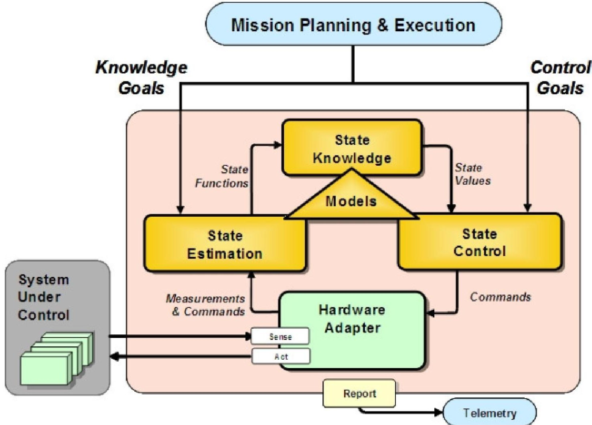
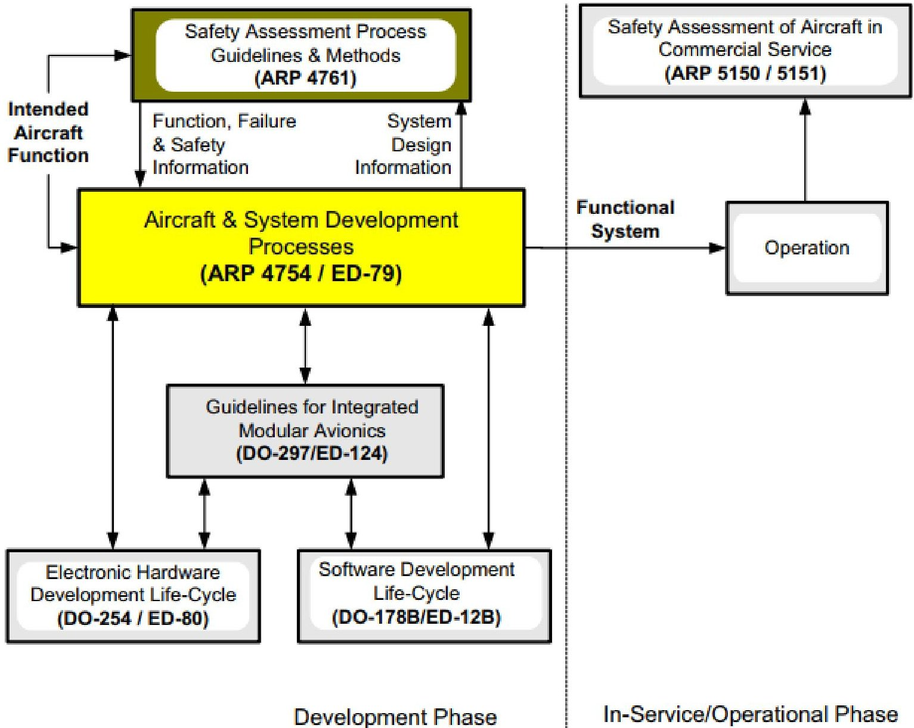
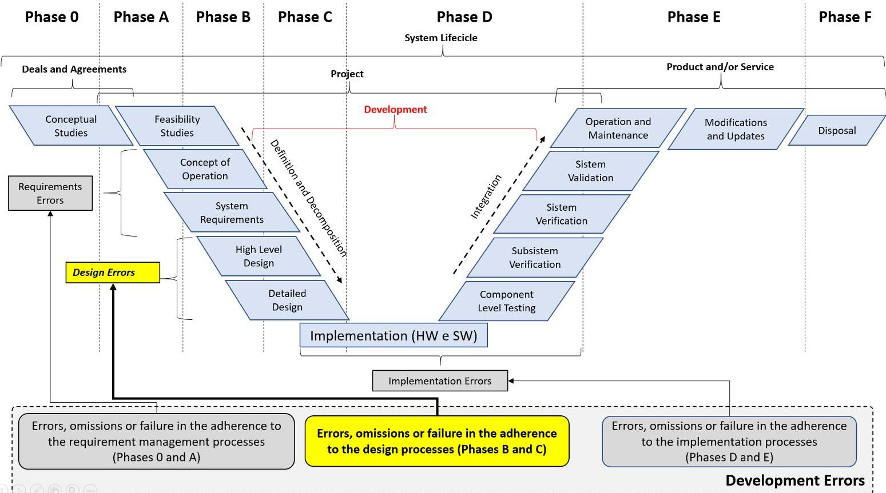
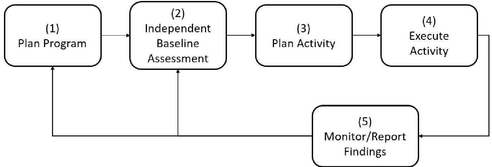

<!-- PDF_PAGE: 1 -->

ENGINEERING SCIENCES

# Model Based System Engineering (MBSE) and design assurance process in the context of mitigation of design errors during the development of highly integrated and complex aerospace systems

DOUGLAS H. WASHIO, MARCELO L. DE OLIVEIRA E SOUZA & ANA PAULA DE SÁ SANTOS RABELLO

Abstract: Over the years, aircraft and spacecraft designs incorporated highly integrated and/or complex systems that can manage complex scenarios during its operation. In addition to the inherent complexity and/or high level of integration of those systems, the development process applied to aerospace programs is also challenged by other factors: program schedule, budget, multidisciplinary teams, new industry emerging technologies, large number of different processes and procedures that guide the activities along the development life cycle, and others. Given the fact many tasks executed during the development of such systems require human interaction, that yields the introduction of design errors that can contribute to the occurrence of non-desired system behaviors during operation phase. It is already recognized by the civil aviation industry that it is unfeasible to have a deterministic test set to demonstrate that such systems are completely free of such design errors. In that context, a huge effort is applied by the industry, by using qualitative methods to mitigate the occurrence of design errors during the development phases. This paper discusses how MBSE methodology applied together with a design assurance process could prevent such design errors, and presents an analysis showing how some events in aerospace industry where a design error was one of the contributing factors could be avoided.

Key words: MBSE, Assurance, complex, design, error, system.

## INTRODUCTION

Constantly seeking for operational performance improvement (e.g., fuel burn), more efficient development techniques (e.g., Model Based System Engineering (MBSE)) and, more recently, the research for more autonomy in the flight deck operation, the aerospace industry applies the "state of the art" in terms of technology, tools, and processes. As adapted from Albano et al. (2022), one of the motivations for increased automation (and that includes the usage of complex and/or highly integrated systems,

such as full fly-by-wire flight controls system, auto flight system, flight management system, and others) in transport aircraft has been manufacturers' and operators' aim to decrease the incidence of human errors by automating more pilot actions.

In that context, all the systems elements must work (harmonically) together to make it possible that an aircraft (or a space system) safely accomplishes its intended mission. It requires a high level of integration between the elements to have accurate and precise information

<!-- PDF_PAGE: 2 -->

feeding the logics embedded in the hardware (e.g., FPGA) and software that implements the specified system functions. Besides that, as the level of integration increases, the complexity of those elements also increases as it becomes more difficult to: 1) establish the boundaries of each system, 2) use quantitative methods to evaluate the system (e.g., by establish a feasible and practical number of test cases that completely exercise all the possible operational conditions of the system under test). Concerning the software based complex and/or highly integrated systems, Leveson (2004) highlights that the software allows us to build systems with a level of complexity and coupling that is beyond our ability to control, where the interactions among the components cannot all be planned, understood, anticipated, or guarded against.

Additionally, at the same time the aerospace industry applies the "state of the art" in the system development disciplines (e.g., system engineering (SE), MBSE), many of the activities executed along the design phase are dependent on human intervention, either 1) by performing manual tasks (e.g., writing system requirements or approving technical reports); or 2) by taking decisions that may affect the activities (e.g., whether a new development must have commonality with previous program/project; or if (and which) industry guidelines the program/ project will follow. In that scenario, the valid concern exists that this dependency on human intervention yields the insertion of design errors during the development phase of such systems. In the following introductory paragraphs, this paper presents an overview of the standards, recommendations, and other documents used as reference by the civil aviation industry to support the development of aerospace systems. Further on, the paper discusses the effort already applied by the civil aviation industry (specifically

the transport category aircraft, certified under Part 25 of the FAA Code of Federal Regulations) to mitigate the risk of occurrence of design errors during the development of complex and/ or highly integrated systems. Given the fact the occurrence of design errors can expose some points of fragility in the organizations (e.g. mistakes related to project management, lack of adherence to regulatory standards), there is few (or even 'none') desire to give details to the public in general on how those design errors occurred, how they were found and how they were addressed. Additionally, very often, the solution(s) adopted to counteract a design error can also turn into some competitive advantage, due to the research effort employed by the engineering team involved in the project.

According to Topper & Horner (2013), with the increase in system complexity, MBSE techniques offer a way to capture, archive, and use information that is essential for complex system design, analysis, implementation throughout a system's life cycle. The conceptual model is a complete, coherent representation of a system and its operating domain, including interactions with other systems and with its environment. It includes the entities, their important attributes and interrelationships, how they operate and behave, and any assumptions being made about them. It provides a basis for future system analysis studies, model development, simulation efforts, system requirements definition, and program information management.

According to Estefan (2008), the application of an MBSE methodology enables modeling of the system dynamics and control structures, such as events, conditions, branching, and loops. That allows dynamic examination of the system at any stage of its development. That reduces the number of design errors during the early stages of the development. When combined, both static and dynamic testing

<!-- PDF_PAGE: 3 -->

help detect discrepancies, inconsistencies, and deviations from the intended goal of the system. As part of the dynamic testing, the simulation enables designers to track each of the system scenarios before writing a single line of code. Any detected mistake or omission is corrected at the model level, saving costly time and efforts required within the implementation level, avoiding and eliminating design errors as early as possible in the system development process and keeping the documentation up to date contribute to shortening the system's delivery time ("time-to-market").

According to Wibben & Furfaro (2015), the MBSE methodology makes the task of systems engineering more convenient, especially for large, complex projects. For such projects, the MBSE approach is very effective at minimizing errors and helping engineers develop a complete and consistent system.

One example of an MBSE methodology (State Analysis - SA), which is described with more details in Estefan (2008), is illustrated in Figure 1.

The State Analysis (SA) is a NASA (Jet Propulsion Laboratory) JPL-developed MBSE methodology that leverages a model- and state-based control architecture, where state is defined to be "a representation of the momentary condition of an evolving system," and models describe how state evolves. The SA provides a process for capturing system and software requirements in the form of explicit models, thereby helping reduce the gap between the requirements on software specified by systems engineers and the implementation of these requirements by software engineers Traditionally, software engineers must perform the translation of requirements into system behavior, hoping to accurately capture the system engineer's understanding of the system behavior, which is not always explicitly specified.

In SA, model-based requirements map directly to software.

In order to illustrate how a design error can affect a system operation, this paper brings examples of events that had a design error as a contributing factor, and it is discussed how those events could be mitigated if a Design Assurance Process (DAP) were in place during the development phase of such systems. Additionally, it is discussed the positive contribution of MBSE techniques that, if applied in conjunction with the development assurance process, can contribute to mitigate design errors potentially introduced during the early stages of the system development lifecycle, especially during the Preliminary Design (phase B) and the Detailed Design (phase C). The chosen of this lifecycle frame is reinforced by Evans et al. (2016) which states that the early stages of system development (concept, requirements and design, including validation and verification) are well covered in the literature. For the subsequent stages of the development (build, integrate, test), operation, and maintenance, there is some discussion of MBSE's support for testing, and some mention of (software) code generation from models, but overall, relatively little is said about these later lifecycle stages. For example, Evans et al. (2016) highlights some system objectives where MBSE capabilities have the potential to support assurance:

- Conformity: System conforms to design intent and performs as planned.

- Availability: System remains functional for intended lifetime, environment, operating conditions, and usage.

- Fault tolerance: System is tolerant to faults, failures and other anomalous internal and external events.

<!-- PDF_PAGE: 4 -->

ABBREVIATIONS

<table border="1"><tr><td>ANAC</td><td>Agência Nacional de Aviação Civil</td></tr><tr><td>EASA</td><td>European Union Aviation Safety Agency</td></tr><tr><td>FAA</td><td>Federal Aviation Administration</td></tr><tr><td>JPL</td><td>Jet Propulsion Laboratory</td></tr><tr><td>MBSE</td><td>Model Based System Engineering</td></tr><tr><td>NASA</td><td>National Aeronautics and Space Administration</td></tr><tr><td>RTCA</td><td>Radio Technical Commission for Aeronautics</td></tr><tr><td>SAE</td><td>Society of Automotive Engineers</td></tr></table>

## MATERIALS AND METHODS

Back in 1969, the United States Department of Defense (DoD) released the first version of the MIL-STD-882 (DoD 2012). According to Miller (1971), the standard was developed within an environment where the aircraft complexity barrier was being faced. That called for a life cycle look and a better description of what comprised a system but produced a huge number of contractual documents. Miller (1971) also states that missile and space vehicle development in the late 1950's required this approach not only because of the aforementioned complexity problem carried over and amplified from aircraft development, but also because the loss of a single vehicle became an economic and mission degradation that simply would not tolerate less than an all-out accident prevention effort. It also dictated more clearly defined documentation during the engineering phases, including safety programming, as it had been implemented a decade earlier in the aviation operational world. According to Miller (1971), the MIL-STD-882 was shaped during two decades of specific technological and managerial experience. That was enough time to demonstrate the need for such a programmed safety approach and also was seen waste of men and other resources that could have been avoided by an improved systems approach to safety.

According to the reference RTCA DO-178/EUROCAE ED-12 (RTCA 2011a), early in the 1980's it was identified the need for guidance on software development to ensure the compliance with the airworthiness requirements. The first revision of the RTCA DO-178/EUROCAE ED- 12 (RTCA 2011a) was written to satisfy this need. The document provides the aviation community with guidance for determining in a consistent manner and with an acceptable level of confidence, that the software aspects of airborne systems and equipment comply with airworthiness requirements. It discusses aspects of airworthiness certification that pertain to the production of software for airborne systems and equipment used on aircraft or engines. The document also recognizes that the guidelines are not mandated by law but represent a consensus of the aviation community.

More than three decades ago, back in 1988, the civil aviation industry already had the concern about how to ensure that complex and/or highly integrated systems implementing aircraft safety-critical functions are reasonably free of design errors that could have some consequence to the passengers transported by the civil airplanes. The Federal Aviation Administration manifested that concern in the Advisory Circular (AC) 25.1309-1A (FAA 1988), published with the purpose of describing the acceptable means for showing compliance with the certification requirements of paragraphs 25.1309(b), (c) and (d) of the Federal Aviation Regulations (FAR). The document aims to provide guidance to form the basis of the compliance demonstration for those regulation paragraphs. According to FAA (1988), the guidance was necessary due to the difficulties experienced in assessing the acceptability of some designs, especially those of systems, or parts of systems, that are complex, and/or that have a high degree of integration. In that context, the FAA (1988) defines that

<!-- PDF_PAGE: 5 -->

a system is complex if structured methods of analysis are needed for a thorough and valid safety assessment. The FAA (1988) also defines a "structured method" as very methodical and highly organized. Failure modes and effects, fault tree, and reliability block diagram analyses are examples of structured methods.

During the development of the revision B of the RTCA DO-178/EUROCAE ED-12, the industry raised the concern about the need for system-level information being used as inputs for software development process. In order to address that concern, the FAA (Federal Aviation Administration) requested the SAE (Society of Automotive Engineering) to develop a document that could define the nature and the scope of the system-level information for demonstrating regulatory compliance for highly integrated

or complex avionic systems. The Aerospace Recommended Practice ARP4754, published in 1996, was the document that resulted from that jointly effort of the certification authorities, the industry, and other stakeholders aiming to address the concerns related to the development of complex and/or highly integrated aircraft systems. The document recognizes that the increasing level of the integration between aircraft functions and the systems that implement them can bring considerable value due to that integration. On the other hand, it reinforces that the complexity yields increased possibility for errors, particularly with functions that are performed jointly across multiple systems. In a later revision of the aforementioned Advisory Circular (FAA 2002), the FAA reinforces the concern about how to ensure that such

Figure 1. Model- and State-Based Control Architecture (Estefan 2008).

<!-- PDF_PAGE: 6 -->

complex and/or highly integrated systems were developed in a way that the errors introduced during the development lifecycle are mitigated, to an acceptable level of confidence, based on the criticality associated to the aircraft functions implemented by the system being developed. The concept of complexity has not changed in the lights of the system development. However, the document brings another important concept: the "development assurance" in the context of the development of complex and/ or highly integrated systems. According to FAA (2002), "development assurance" is defined as all those planned and systematic actions used to substantiate, to an adequate level of confidence, that errors in requirements, design, and implementation have been identified and corrected such that the system satisfies its required level of safety and the applicable certification basis. The document also defines the "highly integrated systems" as the ones that perform complex and interrelated functions, particularly using electronic technology and software-based techniques.

The RTCA DO-254/EUROCAE ED-80 (RTCA 2000) is a document that provides guidance for design assurance of airborne electronic hardware from conception through initial certification and subsequent post certification product improvements to ensure continued airworthiness. It was developed based on showing compliance with certification requirements for transport category aircraft and equipment, but some parts of the guidance may be applicable to other equipment. According to RTCA DO-254/EUROCAE ED-80 (RTCA 2000), the guidance represents a consensus of the aviation community and is a collection of the best industry practices for design assurance of airborne electronic hardware. Although not officially recognized as a reference for development assurance process in the latest

revision of the AC/AMJ 25.1309 (FAA 2002), it has been largely used by the civil aviation industry.

In its latest revision (A), the ARP4754 (SAE 2010) presents updates considering the best engineering practices and the evolution of the industry over the years and also tries to address discrepancies and strengthen the relationship with other standards and documents used by the industry, for example, the ARP4761, the DO- 178 and the DO-254 as shown in the Figure 2. It also presents important considerations about the Development Assurance Process required for complex and/or highly integrated systems.

Considering the concern about the likelihood of the design errors introduced in the development phase of complex and/or highly integrated systems, Washio (2023) presented one interpretation from the latest revision "A" of the ARP4754 (SAE 2010) for the definition of design error as shown in the Figure 3. Although one can say that the design error could be introduced in any phase of the development lifecycle (and that is quite a correct assumption), for simplicity the design errors in the scope of the expanded lifecycle is reduced to the Preliminary Design (phase B) and the Detailed Design (phase C). And in that context, a design error is then defined as 1) errors, 2) omissions, or 3) failures in the adherence to the design processes applied in the system development lifecycle. Additionally, the design error is one of the causes that lead to the "development error", another important definition well established in the ARP4754 A (SAE 2010).

Once the concept of the design error is defined in the context of the development errors within the development lifecycle for complex and/or highly integrated systems, the main contribution of this paper is the discussion of what the aviation industry is already doing and, in conjunction with that, how the MBSE can contribute to prevent such design errors.

<!-- PDF_PAGE: 7 -->

Figure 2. Guideline documents covering the development and in service/operation phases (ARP4754A).

The reference Aerospace (2009) states that the aerospace industry has seminal but separate/independent efforts underway to develop approaches to discover, prevent, and correct engineering process errors or escapes earlier in the life cycle where these problems are less expensive or even possible to correct. The document also notes that a sufficient, foundational set of design assurance requirements and processes that are analogous to product quality assurance do not exist for engineering design assurance. Based on that, a multi-discipline and multi-company team formulated a risk-based design assurance process flow, which can serve as a roadmap for

aerospace programs' design assurance activities (Aerospace 2009).

Since its initial revision, the reference NASA (2014) intended to focus on the framework within which activities such as those prescribed in MIL-STD-882 (DoD 2012) are conducted, so that such activities are adequate to ensure the achievement of system-level safety performance objectives, and decision-makers are provided with sufficient information, clearly communicated, to enable them to make appropriately informed decisions concerning safety throughout the system life cycle. As such, it is the intent of the NASA (2014) to build upon, rather than replace, standards such as

<!-- PDF_PAGE: 8 -->

Figure 3. Design Error definition in the context of the development lifecycle of a complex and/or highly integrated airborne system (Washio 2023).

MIL-STD-882 (DoD 2012), by addressing NASA- specific needs that go beyond those addressed by existing documents.

As aforementioned, the later generations of aircraft require more safety-critical functions to be performed, which generally resulted in an increase in the complexity of the systems designed to perform these functions. In that scenario, it is of the essence that the potential hazards to the airplane and its occupants which could arise in the event of loss of one or more functions provided by a system or those system's malfunction must be considered, analyzed, and mitigated. And, over the years, the aerospace industry has increasingly applied a great effort in the development of very reliable, safe, robust, and mature systems. Noteworthy that the conception and development of such systems have, as primarily objective, the implementation of the essential functions so the aircraft and spacecraft can 1) accomplish their missions, 2) be compliant with required safety levels and 3)

survive in the very harsh environments that they may be exposed during its operational lifecycle.

The concern around complex aerospace systems is not something new. In 1969, the DoD released the first version of the MIL-STD-882. The standard was developed in an environment where there was also the need for a look at the life cycle level and a better description of comprised a system. Missile and space vehicles development in the late 1950's required this approach not only because of the aircraft complexity faced by the industry, but also because of the loss of a single space vehicle became an economic and mission degradation that simply would not tolerate less than all-out accident prevention effort. In 1971, two years after the release of the initial version of the MIL-STD-882, attending a request from the NASA, the former director of the NTSB wrote a paper (Miller 1971) discussing the features of the recently standard MIL-STD-882, which was, by that time, the currently best-known system

<!-- PDF_PAGE: 9 -->

safety assessment document. According to Miller (1971), the standard was shaped based on nearly two decades of technological and managerial experience. That time was enough to demonstrate the need for such a programmed approach and where seen senseless waste of men and resources that could have been avoided by an improved systems approach to safety. The latest version of the MIL-STD-882 (DoD 2012) was released in 2012.

According to the reference ARP4754A (SAE 2010), some of the biggest challenges that arise from the increased complexity and/or high level of integrity among the parts that constitute those systems and the design errors that may occur during the development phase are: 1) the difficulty to establish the boundaries of each system; 2) the fact that those design errors are not deterministic and it is not even feasible to develop a finite test suite that could exercise the system in all possible conditions in order to identify and verify the system behavior when those design errors occur; and 3) very often, the operational consequence of a system loss or malfunction caused by those design errors will depend on some other events combination that happens only under very specific system operation scenarios.

According to Topper & Horner (2013), MBSE techniques facilitate complex system design and documentation processes. Complex functionality, an increasingly common characteristic of modern systems, is difficult to address using traditional assessment techniques. MBSE enables and enhances analysis, testing, and evaluation of complex systems, which are difficult to assess using traditional analytical methodologies and tools. The reference INCOSE (2015) defines the model-based systems engineering as the formalized application of modeling to support system requirements, design, analysis, verification and validation activities beginning

in the conceptual design phase and continuing throughout development and later life cycle phases.

As adapted from INCOSE (2015), the traditional document-based approach, in which the information generated about the system is contained in documents in other artifacts (e.g., system descriptions, trade studies, analysis reports, verification plans, test procedures and test reports). And the information contained within these documents is often difficult to maintain and synchronize, and difficult to access in terms of quality (correctness, completeness, and consistency). And the MBSE emerges in contrast with that approach: much of that information is captured in system models or set of models. And the benefits of that approach are:

In the context of mission assurance for model-based development projects, Evans et al. (2016) stated MBSE growing adoption in the aerospace industry, and highlights some of the promises of the MBSE that enables more capable missions without sacrificing cost-effectiveness despite increase in system's complexity:

- Single authoritative source of truth.

- Correct by construction models.

- Scalability.

- Discipline-specific viewpoints.

- Customizable interface.

- Fully integrated design environments.

Evans et al. (2016) surveyed relevant literature to find how MBSE approaches could be applied to support (mission) assurance needs. And, based on that, we believe that, with few (or even no, depending on the discipline) adjustments, the same could be applied to design assurance in order to mitigate the occurrence the design error introduced during the system development lifecycle, especially during the Preliminary Design (phase B) and the Detailed Design (phase C).

<!-- PDF_PAGE: 10 -->

For example, Evans et al. (2016) highlights how the MBSE is applied to support assurance:

1) Representation and management of systems engineering information to ensure consistency and (some aspects of) completeness. Three areas are listed as benefiting from MBSE:

b) Representation and flow down of the requirements.

c) Representation of the architecture (leading to development of the formal documentation of that architecture in the form of Interface Control Documents and Operational Interface Agreements).

d) Capture of testing and V&V plans.

e) Support clear and concise communication between stakeholders.

f) Generation of review documentation from the shared MBSE system model (e.g., reports).

g) For example, Evans et al. (2016) cites a pilot program to evaluate the benefits of using an MBSE approach during the early phase of the Materials International Space Station Experiment-X (MISSE-X). Some of the benefits associated to the use of MBSE were: 1) consistency; 2) ease of access to complete, current information; and 3) clarity across the team.

8) Automated assistance for generating reliability artifacts.

i) Evans et al. (2016) cites the generation of FMEAs from SysML information, specifically from Sequence Diagrams (SDs) and Internal Block Diagrams (IBDs).

j) Creation of a database of components and their failure properties-their

failure modes, and (optionally) additional information such as failure rate.

Representation of and reasoning about offnominal states and behaviors.

12) Support for activities post-design.

m) For example, according to Evans et al. (2016), planning for and managing the testing activities could potentially benefit from the same MBSE principles of capturing the pertinent information in a formal representation.

n) Specifically at the software domain, that includes auto-generated code, and system tests in a virtual environment (simulation) that emulates its operating conditions.

15) Correctness of the MBSE models themselves. Since the system design information is captured in models, it is crucial that they must be correct. And here is where the design assurance practices can contribute with the MBSE methodology.

Aguilar (2012) brings some examples of errors in the design that were found through modeling:

- State flow: no active sub states; no default state.

- Missing guards in order to prevent entering unintended states.

- Not entering 'off' state when power is removed.

Wibben & Furfaro (2015) state that one of the primary benefits of MBSE over other approaches is the so-called onion-model, where the system is developed in layers beginning from the top-most level. Using the MBSE approach, the requirements development, behavior analysis, architecture development, and verification and validation information are all determined and completed prior to proceeding down to the next

<!-- PDF_PAGE: 11 -->

layer. This approach is a powerful way to break large, complex systems into more manageable pieces.

Table I presents a compilation of events (some of them leading to the complete loss of the system) that have in common a design error as one of the contributing factors.

All the examples of accidents from Table I have in common the fact that:

## RESULTS

- A design error was considered one of the contributing factors. And there was no design assurance process in place.

- In the essence, the design errors were primarily caused by an omission, or incorrect application of correct methods (e.g., lack of validation of the assumptions considered for the project), or application of wrong methods (e.g., inadequate processes).

- The design errors have some correlation with definitions and decisions from the earlier phases of the program (e.g., keep communality with previous programs).

Taking the Ariane 5 accident as a study case, and based on the investigation report (ESA 1996), many of the contributing factors (CF) from Table I that lead to the complete loss of

Table I. Examples of accidents where the design error was one of the contributing factors.

<table border="1"><tr><td>Program/Mission</td><td>Associated Design Error</td></tr><tr><td>Ariane 501</td><td>According to the investigation report(ESA1996)，the following factors were considered contributing factors considered based on the chain of the events that lead to the complete loss of the vehicle：
Lack of implementation of a protection for the data conversion in the software，leading to a fatal operand error。
Lack of definition of the time interval for the operation of one of the functions：the platform inertial alignment function remained operating after the liftoff，when it is not necessary in the Ariane 5.The operation after the liftoff is required for the Ariane 4，but not for the Ariane 5。
Missing requirements for the trajectory data of the Ariane 5 in the specification：the operand error was caused by a high and unexpected value resulting from an internal alignment function called HB(Horizontal Bias)，related to the horizontal velocity sensed by the platform.As a consequence of this lack of requirement，the realignment function was not tested under Ariane 5 flight conditions，which could detect that design error。</td></tr><tr><td>Mars Climate Orbiter(MCO)</td><td>Specification with the wrong measuring units(metrics and english units)。According to OBERG(1999)，the real concern around this error was the failure of NASA&#x27;s systems engineering,and the checks and balances in the processes，to detect the error。</td></tr><tr><td>Mars Polar Lander(MPL)</td><td>According to Leveson(2004)，spurious signal in one of the touchdown sensors，which is a characteristic of its normal operation，was not considered in the software requirements specification。</td></tr><tr><td>Titan/Centaur/Milstar</td><td>According to Leveson(2004)，the accident investigation board concluded that the mission failure of the launcher vehicle was caused by inadequate software development，testing and quality assurance processes。</td></tr><tr><td>SOHO(Solar Heliospheric Observatory)</td><td>According to Leveson(2004)，due to an omission during a modification of the command sequence used，one of the onboarding software functions was not enabled。That omission led to the disabling of a functionality in the safety mode，causing the catastrophic chain of events。</td></tr></table>

<!-- PDF_PAGE: 12 -->

the space vehicle Ariane 5 could be avoided if an adequate design assurance process were in place (and followed) and the MBSE methodology was applied during the development. Find below the analysis of each contributing factor that support that assumption:

CF#1: Lack of implementation of a protection for the data conversion in the software, leading to a fatal operand error.

Analysis: This contributing factor is a classic example of the fragility in a software development process. To mention some of the chain of events/actions that might led to this software error: 1) communality assumption not fully evaluated; 2) lack of adherence to a systematic and disciplined process to evaluate the coverage of the requirements and ensure that the Ariane 5 flight conditions were specified in the correct way; 3) missing the adherence to a design error mitigation process; lack of a robust criteria for determining which variable would need additional software level protection.

Based on the effort already required (and applied) by the civil aviation industry (especially for the Part 25 category aircrafts), it is very likely that this contributing factor could be mitigated by:

- Application (and, of course, adherence), of a process already consolidated in the industry, aiming the mitigation of design errors. Examples of this process are presented in references RTCA DO- 178/EUROCAE ED-12 (RTCA 2011a) and Aerospace (2009).

- Application (and adherence) to a systematic and disciplined process, already consolidated in the industry, for the development of complex and highly integrated systems. Example of this process is presented in reference SAE (2010).

- Establishment of a Level of Rigor adequate to the criticality allocated to the Inertial Reference System, which would imply in more stringent validation and verification (V&V) activities. Example of the definition of Level of Rigor is presented in the reference SAE (2010).

- According to Evans et al. (2016), planning for and managing the testing activities could potentially benefit from MBSE by mapping requirements to architecture and defining operational scenarios as they are being developed, the basis for defining detailed verification descriptions, success criteria, and other verification artifacts.

- Adequate Validation of the requirements of the Inertial Reference System for the Ariane 5 program. Example of a requirement validation process is presented in the reference SAE (2010).

- Execution of design reviews focused on the evaluation of the differences between the two programs considering the commonality planned to be used in the Ariane 5. Example of design reviews planning (entry criteria, scope, etc.) are described in reference NASA (2016).

- According to Evans et al. (2016), some of the benefits associated to the use of MBSE when generating the artifacts to be used in a design review are: 1) consistency; 2) ease of access to complete, current information; and 3) clarity across the team.

CF#2: Lack of definition of the time interval for the operation of one of the functions: the platform inertial alignment function remained operating after the liftoff, when it is not necessary in Ariane 5. The operation after the liftoff is required for the Ariane 4, but not for the Ariane 5.

<!-- PDF_PAGE: 13 -->

Analysis: According to the final report (ESA 1996), the inertial reference system of the Ariane 5 was essentially common to a system which is presently flying on Ariane 4. The portion of the software which caused the interruption in the inertial reference system computers is used before launch to align the inertial reference system and, in Ariane 4, also enable a rapid realignment of the system in case of a late holds in the countdown. This realignment function, which does not serve any purpose on Ariane 5, was nevertheless retained for commonality reasons and allowed the function to operate for approximately 40 seconds after the lift-off.

The reuse of the parts, or even an entire system that was already proven to be successfully developed in a past program, is not an issue per se. The big problem arises when that decision (reuse) is not evaluated properly considering all the new "variables" that might be added to the newer version of program. Based on the effort already required (and applied) by the civil aviation industry (especially for the Part 25 category aircrafts), it is very likely that this contributing factor could be mitigated by:

- Application (and, of course, adherence), to a process already consolidated in the industry, aiming at the mitigation of design errors. Examples of this process are presented in references RTCA DO- 178/EUROCAE ED-12 (2011) and Aerospace (2009).

- Application (and adherence) to a systematic and disciplined process, already consolidated in the industry, for the development of complex and highly integrated systems. Example of this process is presented in reference SAE (2010).

more stringent validation and verification (V&V) activities. Example of the definition of Level of Rigor is presented in the reference SAE (2010).

- Establishment of a Level of Rigor adequate to the criticality allocated to the Inertial Reference System, which would imply in

- According to Evans et al. (2016), planning for and managing the testing activities could potentially benefit from the MBSE by mapping requirements to architecture and defining operational scenarios as they are being developed, the basis for defining detailed verification descriptions, success criteria, and other verification artifacts.

- Validation of the assumptions used to support the reuse of the Inertial Reference System 'as is' in the Ariane 5 program. Example of the assumption validation is presented in the reference SAE (2010).

- Execution of design reviews focused in the evaluation of the differences between the two programs considering the commonality planned to be used in the Ariane 5. Example of design reviews planning (entry criteria, scope, etc.) are described in reference NASA (2016).

- According to Evans et al. (2016), some of the benefits associated to the use of MBSE when generating the artifacts to be used in a design review are: 1) consistency; 2) ease of access to complete, current information; and 3) clarity across the team.

CF#3: Missing requirements for the trajectory data of the Ariane 5 in the specification: the operand error was caused by a high and unexpected value resulting from an internal alignment function called HB (Horizontal Bias), related to the horizontal velocity sensed by the platform. As a consequence of this lack of requirement, the realignment function was not tested under Ariane 5 flight conditions, which could detect that design error.

<!-- PDF_PAGE: 14 -->

Analysis: This is a classic example of a design error that is not caused by a single actor/action. To mention some of them: 1) communality assumption not fully evaluated; 2) lack of adherence to a systematic and disciplined process to evaluate the coverage of the requirements and ensure that the Ariane 5 flight conditions were specified in the correct way; and 3) missing the establishment of a design error mitigation process.

Based on the effort already required (and applied) by the civil aviation industry (especially for the Part 25 category aircrafts), it is very likely that this contributing factor could be mitigated by:

- Application (and, of course, adherence), to a process already consolidated in the industry, aiming at the mitigation of design errors. Examples of this process are presented in references RTCA DO-178/ EUROCAE ED-12 (2011a) and Aerospace (2009).

- Application (and adherence) to a systematic and disciplined process, already consolidated in the industry, for the development of complex and highly integrated systems. Example of this process is presented in reference SAE (2010).

- Establishment of a Level of Rigor adequate to the criticality allocated to the Inertial Reference System, which would imply in more stringent validation and verification (V&V) activities. Example of the definition of Level of Rigor is presented in the reference SAE (2010).

- According to Evans et al. (2016), planning for and managing the testing activities could potentially benefit from the MBSE by mapping requirements to architecture and defining operational scenarios as they are being developed, the

basis for defining detailed verification descriptions, success criteria, and other verification artifacts.

- Adequate Validation of the requirements of the Inertial Reference System for the Ariane 5 program. Example of a requirement validation process is presented in the reference SAE (2010).

- Execution of design reviews focused in the evaluation of the differences between the two programs considering the commonality planned to be used in the Ariane 5. Example of design reviews planning (entry criteria, scope, etc.) are described in reference NASA (2016).

- According to Evans et al. (2016), some of the benefits associated to the use of MBSE when generating the artifacts to be used in a design review are: 1) consistency; 2) ease of access to complete, current information; and 3) clarity across the team.

## DISCUSSION

Attempting to understand the causes that lead to the chain of events causing some of the accidents described in Table I, Leveson (2004) brings to the light the aspects of complacency described in their investigation reports. In the reference, Leveson (2004) states that success is, ironically, one of the progenitors of accidents when it leads to overconfidence and cutting corners or making tradeoffs that increase risk. This phenomenon is not new, and it is extremely difficult to counter when it enters the engineering culture in an organization. Complacency is the root cause of most of the other accident factors described in this paper and was exhibited in all the accidents that she studied. This can be exemplified by the reuse of inertial reference system in the Ariane 5, inherited from the predecessor Ariane 4. So,

<!-- PDF_PAGE: 15 -->

one can ask: why would something that worked very well in the past not work again? To start answering that question the paper discusses an example from the Ariane 5 program.

According to the investigation report (ESA 1996), the original requirement accounting for the continued operation of the (inertial reference system) alignment software after the lift-off was brought forward more than ten years ago for the earlier models of the Ariane. However, the same requirement does not apply to the Ariane 5 and it was maintained for commonality reasons, presumably based on the view that, unless proven necessary, it was not wise to make changes in the software which worked well in the previous program. Some lessons can be learned from that:

p) When developing such complex and/or highly integrated systems (like the inertial reference system of the Ariane 5), every program has its own characteristics. In the case of the Ariane 5, the initial trajectory was different from the Ariane 4.

q) Assumptions must be validated. Engineering judgement only may not be enough. In the example of Ariane 5, why did such a critical function not have more evidence (e.g., analysis, simulation) that could support the assumption that the commonality would work fine?

r) Specifically for that requirement, it looks like the risk analysis related to that requirement was not fully considered. Otherwise, the functionality would not be implemented in the Ariane 5.

s) If a systematic and disciplined process of requirements definition, validation (and verification) was imposed to the program, there

is was good chance that the requirement could be thoroughly revised. The ARP4754A (SAE 2010) contains guidelines widely used by the civil aviation industry during the development of aircraft systems. And the reference RTCA DO-178/EUROCAE ED-12 (RTCA 2011a) has the guidelines for software development. Both documents describe techniques to be used for system (and software) requirements management.

t) Considering the decision to reuse the software (which worked well in a previous program), according to ARP4754A (SAE 2010), the maturity of a software already (successfully) used in a previous program has benefit, but it should not be assumed that they meet the requirements of the new installation. It is necessary to evaluate the data available from the previous program to determine which objectives are satisfied for the new application and which objectives require additional consideration. Even if no design changes are to be made to the system or item, the requirements to which the system or item was certificated should be validated according to the new application, and modified as necessary. Specifically for software item, the section 12 from RTCA DO- 178/EUROCAE ED-12 (RTCA 2011a) describes the considerations related to airborne software previously developed and certified.

As a matter of fact, the occurrence of errors during system development is an inherent characteristic of the human intervention. As human beings, all of us are subject to

<!-- PDF_PAGE: 16 -->

distractions, omissions, mistakes. And, as adapted from Leveson (2004), sometimes those "human weaknesses" are combined with some other external factors, such as:

- Organizational (e.g., pressure to meet schedule and budget).

- Inadequate processes.

- Diffusion of responsibility and authority.

- Poor communication channel.

- Inadequate review activities.

- Poor information flow.

When there is a combination of some of those humans plus "non-human" factors, very often the consequence is an error. And, if that error occurs during the design, due to the inherent complexity and high level of integration of the system, it may not be possible to detect and identify the design error (it may be hidden) until a very specific operational condition is reached, triggering the conditions for that error leading to a failure of the system (loss of the system or unintended function).

Considering that, at least with the techniques applied today, the human interaction plays an essential role in the complex and/ or highly integrated system development, it is of the essence the application of assurance techniques during the development of safetycritical systems, with the objective that those systems comply with the applicable requirements (functional, performance, quality, certification, and others). And, aiming that objective, the civil aviation industry already spends a huge effort, being the Aerospace Recommended Practice ARP4754A (SAE 2010) one of the more representative references in the civil aircraft industry. The latest revision of the ARP4754A (SAE 2010) comprises a big effort from the industry to mitigate the occurrence of those design errors, by establishing a very robust and mature guideline for the development of civil aircraft systems. According to the ARP4754A (SAE

2010) , the design assurance is understood as the process that provides evidence that the system was developed in a systematic and disciplined way, assuring an adequate level of confidence that the errors in requirements, design and implementation have been identified and corrected such that the system satisfies its applicable requirements. In fact, that document comprises a reaction from the industry when it was realized that the RTCA DO-178/EUROCAE ED 12 (2011a) was no longer enough to deal with the system level information flowing to the software development processes. Then, it was necessary to establish the guidelines for the system level development, mainly for the highly integrated and/or complex systems. Similarly, the reference Aerospace (2009) defines the design assurance process as the activities that have, as its objective, a truly independent assessment of the overall process for development of engineering drawings/models/analyses and specifications necessary to physically and to functionally describe the intended product, as well as all engineering documentation required to support the procurement, manufacture, test, delivery, use, and maintenance of the product.

In that context, the ARP4754A (SAE 2010) became widely used by the industry to guide the system development for civil aircraft. It collects the knowledge of experienced specialists from the aerospace industry, as well as lessons learned, and best practices related to system development. Noteworthy that the document acquired such a high level of confidence to mitigate the occurrence of development errors (including the design errors), that the civil aviation certification authorities accept the guidelines from ARP4754A (SAE 2010) as acceptable means to show compliance with certification requirements for civil aircraft (FAA 2002). Over the years, the ARP4754A (SAE 2010) became the reference for system development

<!-- PDF_PAGE: 17 -->

process, and it establishes other two standards (DO-178 and DO-254) as the references of guidelines for design assurance of software and hardware items.

Motivated by the large number of failures and anomalies in the implementation phase of space programs, mainly due to errors or omissions originated from the design phase, the aerospace industry published a document that was jointly produced by specialists from space industry players attempting to establish the guidelines for design assurance in space programs. Named of Design Assurance Guide (DAG) (Aerospace 2009), the document collects experience from recognized specialists, lessons learned, examples of design errors and propose a design assurance process with the objective of 1) minimizing project risks (which may end up in an error) or 2) address corrective actions in order to mitigate the root cause of those errors in the early stages of the program. It is important to reinforce that, according to the reference Aerospace (2009), the space industry does not apply a jointly and integrated effort to detect, prevent and correct errors in the engineering processes at the early stages of the program, when 1) the actions taken over such errors are less expensive and 2) the correction is feasible.

Additionally, according to Ramos et al. (2011), as the system's complexity and extent grow, the number of parties involved (i.e., stakeholders and shareholders) usually raises too, thereby bringing a considerable amount of points of view, skills, responsibilities, and interests to the interaction. And that is why the design assurance process plays an essential role in the development of highly integrated and complex systems, by assuring that the system development was conducted in a systematic and disciplined way, and with evidence that it meets the safety level required by the function that is implemented by the system. Ramos et al.

(2011) , reinforces that by mentioning the growing effort to integrate the systems and software engineering processes, along with hardware and human engineering processes due to the increasing criticality of software within systems and to the increasing emphasis on user-intensive systems and value generation.

For example, the DAG presented in the reference Aerospace (2009), describes a process for performing the design assurance activities and processes independent of any of the constraints of any specific organizational structure. In order to be unbiased, design assurance activities need to be performed by experts that are largely independent of the day-to-day design and systems engineering efforts to increase the likelihood that the design meets or exceeds customer expectations in function and performance. But, sometimes having experts that are truly independent (having no organizational affiliation or program involvement) of the program may not be possible. What is important is that they provide unbiased and uncompromised assessments free from any conflicts of interest with the program, such as an independent reporting path. Subject matter experts supporting the independent design assurance assessment may come from the systems engineering organization or other disciplines associated with the design. Figure 4 presents a pictorial representation of the main elements of the Design Assurance process outlined by the reference Aerospace (2009).

According to Aerospace (2009), the first step in executing the Design Assurance process on a program is to develop the design assurance program plan (1), that will establish the scope of the design assurance activities that will be executed independently of the program, but commensurate with program planning and identify specific areas of focus for mitigating program risk. The planning begins as early in

<!-- PDF_PAGE: 18 -->

Figure 4. Design Assurance process overview (Aerospace 2009).

the program life cycle as possible. This should include risk reduction and proposal activities. A key component of this step is the establishment of the program's overall risk profile, which can then be decomposed to each of the key program elements to establish guidance on what activities the design assurance team will execute based upon the specific risk the design element embodies.

Based on the guideline presented by Aerospace (2009), the second step in executing the design assurance process on a program is to perform an independent assessment (2) of risk for the program and analyze the design assurance risk. In order to have a high potential for success, design assurance risk identification needs to begin as early as possible and continue throughout the design life cycle with regular reviews and analyses of technical performance measurements, schedule, resource data, life cycle cost information, earned value management data/trends, progress against critical path, technical baseline maturity, safety, operational readiness, and other program information available to the design assurance team members.

Aerospace (2009) guideline describes the development of the activity plan (3) as the third

step in executing the Design Assurance process. Differently from the design assurance program plan (or program quality plan), the design assurance activity plan includes the "what,when, who,and how" the design assurance team will address the risks found. The activity plan will identify what specific design risks and issues will be addressed, how they will be addressed, who will be addressing them, and when they will be addressed.

According to Aerospace (2009), the fourth step in executing the DA process on a program is to perform the design assurance activity (4). The DAG describes that the design assurance activities will vary based upon the program's risk profile and classes of risks on each program. The activities may be divided into two categories: design assessment tasks and process compliance tasks.

- Design assessment tasks are those that address the risks identified in the plan. Those risks may be cost, schedule, or technical in nature. First, collect and review the related design materials. The subject matter experts should engage and interact with program design working groups. Informal discussions with design engineers, participation in the various

<!-- PDF_PAGE: 19 -->

risk boards, and attending formal design reviews are means to engage with those working groups.

- Process compliance tasks are those that address the engineering process risks identified in the program plan. The first step is to communicate to the process owner and users that a process assessment is to be performed. Next, process documentation is collected and reviewed. Objective evidence is assessed for compliance to the process documentation.

At that point of the process execution, any findings, corrective actions, lessons learned, etc., are collected for the last step of the process.

The DAG (Aerospace 2009) presents as the fifth step of the process the monitoring and reporting of the findings from the design assurance activities. At the conclusion of each design assurance activity, the results and corrective actions, if any, will be documented and communicated to the program and functional organizations as appropriate. For any activities identified as a risk, they will be monitored by the design assurance team until they are removed.

According to Dmitriev et al. (2020), the emergence of a global market for urban air mobility and unmanned aerial systems, with many players in the industry with little training and experience in the certification training or experience in the traditional processes used in civil aviation for the development of software and electronic hardware brings another concern to the industry. And, in that scenario, the usage of digital abstractions, like models, during the development of complex and/or highly integrated systems can provide a good approach for the design error mitigation during the development of complex and/or highly integrated systems. According to Ramos et al. (2011), the evolving MBSE approach is leading

the way and is expected to become a standard practice in the field of systems engineering. Ramos et al. (2011) also mentions that the model-centric approach, which main artifact is a coherent model of the system being developed contrasts with the traditional document-based. In the seeking for anticipation and mitigation design errors (e.g., error, omissions, or failures in the adherence of the design processes), the MBSE can be a powerful tool, by the application of structured and disciplined methods such as: 1) model simulation; 2) requirements traceability; 3) automated tests (which could cover several test cases); 4) integration with other elements of the system in the digital system development environment. The RTCA DO-178C/EUROCAE ED- 12 (RTCA 2011a), presents an enhancement from its predecessor by adding the RTCA DO-331/ EUROCAE ED-218 (RTCA 2011b) as a supplemental reference for model-based system development.

But MBSE has not been only a trend in the industry. According to BOEING (2017), the development of systems, comprising different engineering disciplines and stakeholders, is traditionally facilitated by document-based communication. The ever-increasing complexity of systems and demand for shorter development cycles and lower costs require a more efficient and less error-prone communication and development approach. This benefit was reflected during the development of an avionics function from one of the commercial aircraft models developed by company (the 777X), where the early integrated testing of the model in the simulator helped to verify and correct the system's interfaces and behavior, long before such testing could be achieved on the design through conventional development.

<!-- PDF_PAGE: 20 -->

## CONCLUSION

A design error is always a very sensitive subject. Either because it can expose some deficiencies or gaps within an organization, or because the solutions that are implemented to mitigate the design errors usually involve intellectual proprietary information due to the great effort applied by the industry and the state of the art of the system engineering discipline (and other correlated disciplines, like software engineering, hardware engineering) to detect, identify, prevent, or correct the design errors.

The constantly search for more efficient, more reliable, sustainable, and autonomous systems must follow (and look for continuous improvement of) the design assurance guidelines that have been guiding the development of complex and/or highly integrated systems (especially the ones used by the civil aviation industry). More recently, the trending in the urban air mobility and unmanned aerial systems with many players with little experience in the traditional civil aviation certification processes reinforces the need for the continuous effort for mitigation of design errors during the development complex and/or highly integrated systems. Additionally, the constant search for performance improvement, autonomy in flight deck operation and more efficient development tools tends to add more complexity and/or integrations to the systems. That requires a continuous effort to ensure the design errors are mitigated until an acceptable level of safety is reached. And, as discussed, the adherence to a Design Assurance Processes plays a fundamental role to reach the goal of mitigation of the design errors that could be introduced during the development of such complex and/ or highly integrated systems.

However, besides the interests on the "business side", the industry must learn (or,

better saying, keep learning) from its errors always looking for more reliable, safe, available and efficient systems. In that context, it is strongly recommended that the organizations:

- Look for continuous improvement of its engineering processes based on lessons learned from previous programs.

- Make its best engineering practices available for entire organization.

- Promote the safety culture in all the levels of the organization.

- Promote the culture of allowing the notification of error, misses, mistakes, or inadequate processes/procedures without punishment at all levels of the organization.

- Promote the culture of recording the best practices and lessons learned for use in future programs.

The MBSE methodology aims to collect, organize and model all of the information pertaining to a system and its development. As a single source of data, references to different elements of the system as well as its relationships are explicit, which help mitigating the occurrence of errors and enables automated checks in a virtual environment that is not possible with the document-based methodology.

It is noticeable the necessity to integrate the design assurance with the application of the MBSE methodology. Therefore, for future works on this matter, one recommendation is to discuss and provide more details concerning the interaction of the design assurance processes and the system development applying the MBSE methodology. For example:

- Describe how the information from the MBSE at the system level (should) flow down to item level (hardware and software).

<!-- PDF_PAGE: 21 -->

- What are the possible fragilities in the MBSE methodology that could lead to design errors.

A second recommendation is the study of how the MBSE can contribute for the design assurance process attempting to mitigate, with and acceptable level of confidence, that the design errors were mitigated, specifically concerning the correctness of the models developed. For example, Evans et. al. (2016) reinforces that challenge. One possible study would be a robust validation process for the models, analogous to the one proposed in the Section 5.4 of the ARP4754A.

## REFERENCES

AEROSPACE. 2009. TOR-2009(8591)-11. Design Assurance Guide. California, USA. 2009, 77 p.

AGUILAR M. 2012. Fault Management Using Model Based System Engineering (MBSE) Tools and Techniques. NASA Spacecraft Fault Management Workshop.

ALBANO LM, FREGNANI JATG & DE ANDRADE D. Analysis of Automation Mode Confusion with Brazilian Airline Pilots. J Aerosp Technol and Manag, v. 14.

BOEING. 2017. Developing Airplane Systems Faster and with Higher Quality through Model-Based Engineering. [Accessed 20 December 2022] Available from: https:// www.boeing.com/features/innovation-quarterly/ may2017/feature-technical-model-based-engineering. page

DMITRIEV K, ZAFAR SA, SCHMIECHEN K, LAI Y, SALEAB M, NAGARAJAN P, DOLLINGER D, HOCHSTRASSER M, HOLZAPFEL F & MYSCHIK S. 2020. A Lean and Highly-automated ModelBased Software Development Process Based on DO- 178C/DO-331. In IEEE Digital Avionics Systems Conference (DASC), 39., San Antonio. Proceedings ... , San Antonio: IEEE, p. 1-10.

DoD - DEPARTMENT OF DEFENCE. 2012. MIL-STD-882E. System Safety Standard Practice. Washington, USA, 98 p.

ESA - EUROPEAN SPACE AGENCY. 1996. Ariane 501 - Presentation of Inquiry Board report.

ESTEFAN J. 2008. INCOSE-TD-2007-003-02. Survey of Model-Based Systems Engineering (MBSE) Methodologies. Seattle, WA, USA.

EVANS J, CORNFORD S & FEATHER MS. 2016. Model based mission assurance: NASA's assurance future. In: Annual Reliability and Maintainability Symposium (RAMS). Tucson. Proceedings ..., Tucson: IEEE, p. 1-7.

FAA - FEDERAL AVIATION ADMINISTRATION. 1988. AC/AMJ 25.1309-1A. Washington, USA, 19 p.

FAA - FEDERAL AVIATION ADMINISTRATION. 2002. AC/ AMJ 25.1309 Change Draft Arsenal: Advisory Circular. Washington, USA, 99 p.

INCOSE - INTERNATIONAL COUNCIL ON SYSTEMS ENGINEERING. 2015. INCOSE-TP-2003-002-04 v.4.0: systems engineering handbook - A guide for system life cycle processes and activities. San Diego, CA, 305 p.

LEVESON NG. 2004. Role of Software in Spacecraft Accidents. AIAA J of Spacecr Rockets 41: 564-575.

MILLER CO. 1971. Requirements for System Safety Programs as Delineated by MIL-STD-882. NASA System Safety Conference. Maryland, USA.

NASA - NATIONAL AERONAUTICS AND SPACE ADMINISTRATION 2014. NASA/SP-2014-612. NASA System Safety Handbook.

NASA - NATIONAL AERONAUTICS AND SPACE ADMINISTRATION. 2016. NASA/SP-2016-6105-SUPPL. Expanded Guidance for NASA Systems Engineering. V 1.0. Washington, USA, 365 p.

OBERG J. 1999. Why The Mars Probe Went Off Course. IEEE Spectrum Magazine 36: 34-39.

RAMOS AL, FERREIRA JV & BARCELO J. 2012. Model-Based Systems Engineering: An Emerging Approach for Modern Systems. IEEE Trans. Syst., Man Cybern. Part C 42: 101-111.

RTCA - RADIO TECHNICAL COMMISSION FOR AERONAUTICS. 2000. RTCA DO-254/EUROCAE ED-80: Design Assurance Guidance for Airborne Electronic Hardware. Washington DC, 137 p.

RTCA - RADIO TECHNICAL COMMISSION FOR AERONAUTICS. 2011a. RTCA DO-178/EUROCAE ED-12: Software Considerations in Airborne Systems and Equipment Certification. Washington, DC, 140 p.

RTCA - RADIO TECHNICAL COMMISSION FOR AERONAUTICS. 2011b. RTCA DO-331/EUROCAE ED-218: Model Based Development and Verification Supplement to DO178C and DO-278A. Washington, DC, 136 p.

SAE - SOCIETY OF AUTOMOTIVE ENGINEERS. 2010. Aerospace Recommended Practice (ARP) 4754/EUROCAE ED-79 Revision A: Guidelines for Development of Civil Aircraft and Systems. Warrendale, USA, 115 p.

<!-- PDF_PAGE: 22 -->

TOPPER JS & HORNER NC. 2013. Model-Based Systems Engineering in Support of Complex Systems Development. John Hopkins APL Research and Development 32: 419-432.

WASHIO DH. 2023. Propostas de mitigação de erros de projeto (design errors) pelo detalhamento da avaliação e controle dentro um novo conjunto de processos para projeto de subsistemas e equipamentos espaciais. Dissertação de Mestrado. Instituto Nacional de Pesquisas Espaciais (INPE). (Unpublished).

WIBBEN DR & FURFARO R. 2015. Model-Based Systems Engineering approach for the development of the science processing and operations center of the NASA OSIRIS-REx asteroid sample return mission. Acta Astronautica 115: 147-159.

## How to cite

WASHIO DH, DE OLIVEIRA E SOUZA ML & DE SÁ SANTOS RABELLO AP.2023. Model Based System Engineering (MBSE) and design assurance process in the context of mitigation of design errors during the development of highly integrated and complex aerospace systems. An Acad Bras Cienc 95: e20220859. DOI 10.1590/0001-3765202320220859.

Manuscript received on October 14,2022 accepted for publication on May 28,2023

DOUGLAS H. WASHIO $ ^{1} $ https://orcid.org/0000-0002-2739-4113

## MARCELO L. DE OLIVEIRA E SOUZA $ ^{1} $ https://orcid.org/0000-0003-1309-3333

## ANA PAULA DE SÁ SANTOS RABELLO $ ^{2} $

https://orcid.org/0000-0002-6869-3216

$ ^{1} $Programa de Pós-Graduação em Engenharia e Tecnologia Espaciais/Engenharia e Gerenciamento de Sistemas Espaciais, Instituto Nacional de Pesquisas Espaciais (INPE), PGETE/CSE, Av. dos Astronautas, 1758, 12227-010 São José dos Campos, SP, Brazil

$ ^{2} $Instituto Nacional de Pesquisas Espaciais (INPE), Divisão de Sistemas Espaciais/ Coordenação Geral de Engenharia, Tecnologia e Ciência Espaciais, DISEP/CGCE Av. dos Astronautas, 1758, 12227-010 São José dos Campos, SP, Brazil

Correspondence to: Douglas Hiroyuki Washio E-mail: douglaswashio@gmail.com

## Author contributions

WASHIO, LOPES and RABELLO conceived the presented idea. WASHIO performed the literature review, proposed the study case and wrote the manuscript. LOPES and RABELLO validated and verified the entire manuscript content. All authors discussed the results and contributed to the final manuscript.

