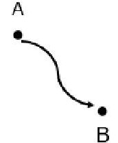
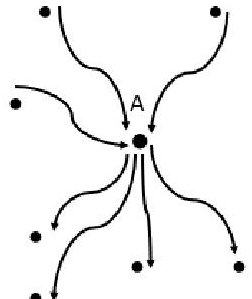
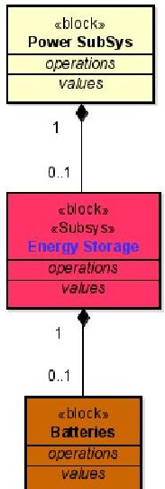
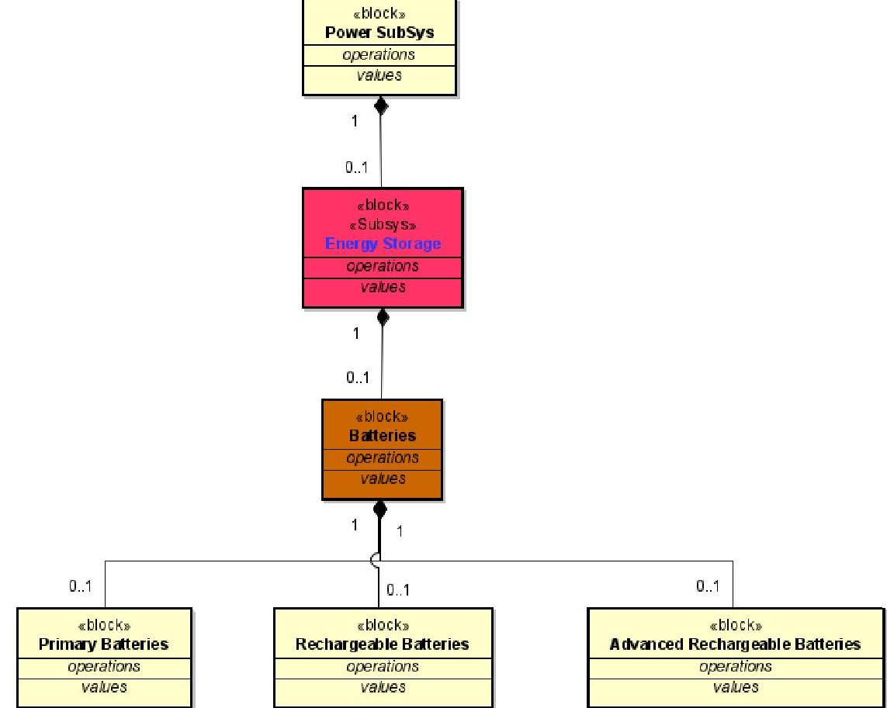
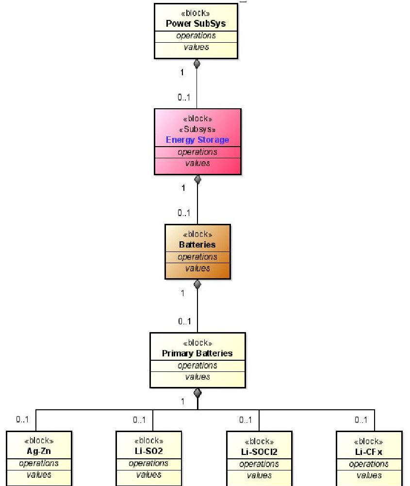
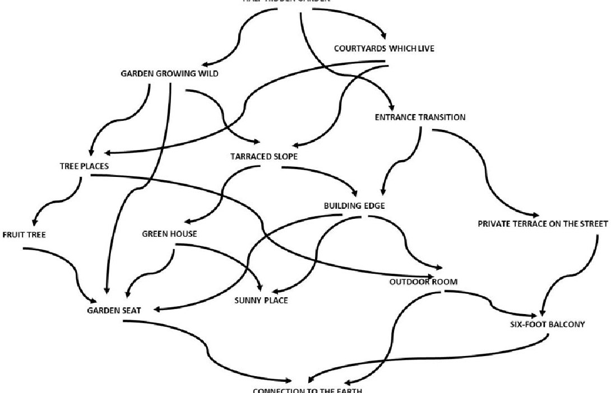
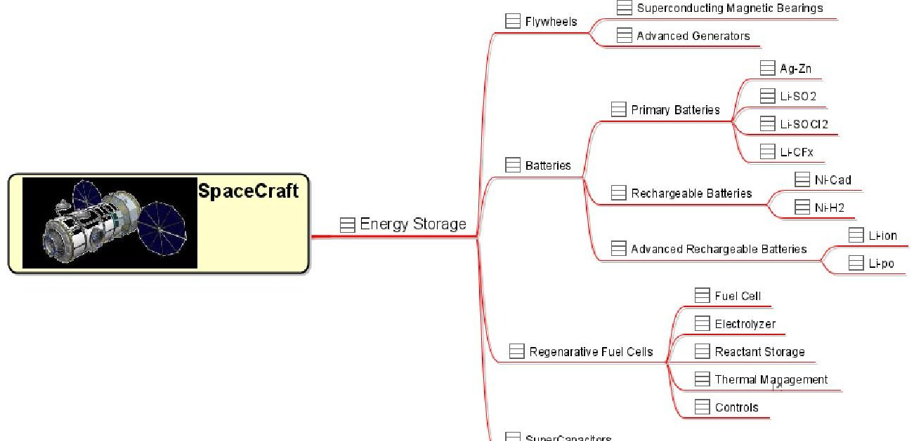
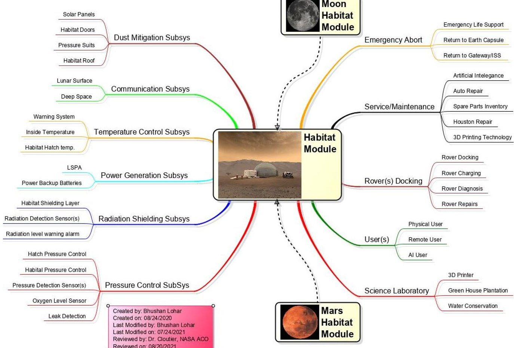
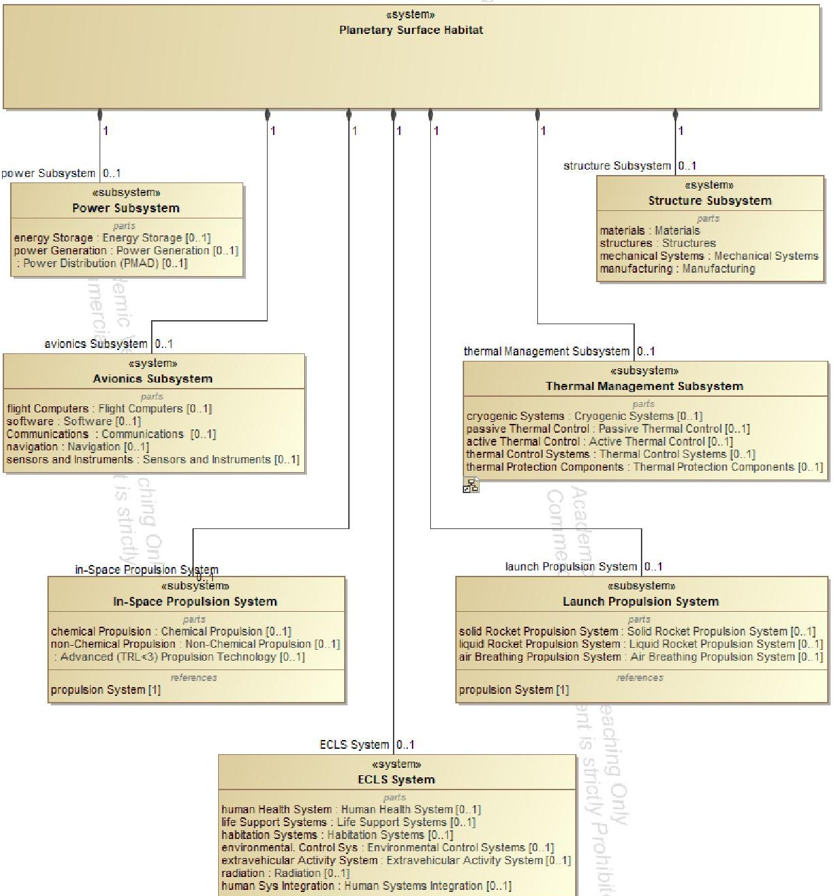

<!-- PDF_PAGE: 1 -->

Article

# Towards a Model-Based Pattern Language for New Space-Based Systems

Bhushan Lohar * and Robert Cloutier

Department of Systems Engineering, University of South Alabama, Mobile, AL 36688, U.S.A.; rcloutier@southalabama.edu (R.J.C.)

* Correspondence: brl2021@jagmail.southalabama.edu; Tel.: +01-682-313-4665 (B.R.L.)

Abstract: This paper presents an approach to the application of the Model-Based Systems Engineering (MBSE) and Model-Based Systems Architecting (MBSA) principles to develop a Model-Based Pattern Language (MBPL). It takes too long for systems engineers and architects to develop a new system from scratch, particularly new space-based systems derived from the existing space systems architectures. A pattern language is a holistic view of reusable logical model artifacts; many are interdisciplinary and introductory, if at all. The results are mostly a combination of the application-specific logical solution, which further results in the best possible overall solution. The main benefit of the pattern language is reducing the time and validation required to generate a new space-based system architecture; this approach will develop top-level requirements in the initial phase of the system development. The rationale of the methodology proposed by the paper is as follows, collect, and decompose published literature and other open-source information available on space system architectures and system models; develop SysML models for systems, subsystems, products, assembly, subassembly level, and mission-specific requirements using CAMEO SysML software. Arrange these patterns to develop a functional ontology and construct a logical architecture pattern library. This approach created, updated, and managed SysML pattern language, which evaluated the expedited new model construction. Again, our objective is to develop a logical pattern language using public domain information and evaluate patterns by constructing a new space mission concept—for example, planetary surface habitat.

Keywords: model-based system engineering (MBSE); model-based systems architecting (MBSA); model-based pattern language (MBPL); system architecture; logical architecture; SysML patterns; pattern library; systems engineering (SE); pattern language; logical decomposition

## 1. Introduction:

Patterns for architecting were first introduced by Alexander [1977] to accommodate reusable constructs for civil architectures. These constructs ranged in size from entire cities down to the rooms in a house [Alexander, 1979]. Based on Alexander's work, the notion of patterns is very scalable. The software community began adopting patterns in the form of code constructs in the 1990s [Beck, 1994] Rising [1999], followed by applying patterns to processes. Cloutier [2006] adapted the patterns

<!-- PDF_PAGE: 2 -->

construct to systems architecture, demonstrating the Perform Command and Control Pattern using IDEF0 (Icam DEFinition for Function Modeling). The Object Management Group (OMG) released version 1.0 of Systems Modeling Language (SysML) in September 2007 [OMG, 2007]. Since then, SysML has become a cornerstone for Model-Based Systems Engineering.

Model-Based Systems Engineering (MBSE) has emerged as a strategic approach to architecting and designing critical systems. While systems engineers have used models in the past IDEF0, FFBD, State machines, etc., the models were usually disconnected and, in most cases, created using disparate tools. MBSE, as practiced today, uses the SysML [OMG, 2007]. Using SysML, objects containing attributes and behaviors are identified and lined through their associations.

This manuscript provides the systematic process of developing a pattern language for systems, subsystems, products, assembly, and subassembly levels. The patterns are ordered, beginning with the top-level systems, second-level subsystems, and subassemblies, and ending with the choice of alternative components. There are two essential purposes behind this approach. The first purpose is to present each pattern connected to the second level pattern so that the user grasps the collection of seventy-four patterns as a pattern language, within which the user can create numerous combinations. Secondly, the approach provides ease and standard solutions for each pattern in such a way that users can understand and modify it without losing the original purpose of new space system development.

The research consists of three main exercises focused on developing a logical pattern library for NASA to adopt as it "becomes more model-based." Below is the in-detail explanation of the exercises. Some parts of all three exercises occurred in parallel because there is a sequential dependency between them.

## 1.1 Pattern Library as a Pattern Language

Alexander defined his collection of patterns as a language [The Timeless Way, 1977] in that the patterns complemented one another. The pattern language is like the language English, which can be a medium for prose or a medium for poetry; The difference between prose and poetry is not that they use different languages, but the same language is used differently. In his book "A Pattern Language," [Alexander, 1977] says he spent years formulating this language; hoping that when a person uses it, he will be so impressed by its power and so joyful in its use that he will understand again, what it means to have a living language of this kind.

Cloutier [2006] extended this notion into a Perform Command and Control Pattern Language; using patterns in system architecting may provide the foundation for a more common lexicon leading to improved communications between the various stakeholders while enhancing the R&D efficiency of complex development programs. Other disciplines that have adopted patterns chose one of the pattern forms already used by the software community, which originated from the Alexandrian form. However, systems architects may need different or additional information than that required by a software engineer to implement a pattern. Systems architecture patterns may also enable the implementation of common design features across systems (reuse), leading to enhanced R&D efficiency and lower ownership costs through reduced efforts concerning system testing, integration, and maintenance. [Cloutier, 2006, 2005, 2005a, 2005].

<!-- PDF_PAGE: 3 -->

In this research, the authors extended the same notions by defining how to mine patterns from the public domain knowledge. The authors developed a working-level space system pattern language from the commonalities found in the existing space system architectures. This paper follows the methodologies explained by Alexander and Cloutier. Secondly, this research utilized the notion of "Documenting Patterns;" Cloutier [2006] states that it takes an experienced systems architect to know what can be abstracted and how to abstract that information in a meaningful way so that it is reusable. Once documented, as the software community found, patterns provide a common communication medium between engineers and architects. Alexander [1977: 782-784] spent three pages explaining the importance of documenting patterns. The outcome of this research is documented, called Pattern Library (PL).

## 1.2 Logical Decomposition

Logical decomposition is the system engineering process for creating the detailed functional requirements that enable NASA programs and projects to meet stakeholder expectations. This process identifies the "what;" the system should achieve that at each level to enable a successful project. Logical decomposition utilizes functional analysis to create a system architecture and decompose top-level (or parent) requirements and allocate them down to the lowest desired levels of the project [NASA SE Handbook Rev2].

Decomposition of the information starts with mining open-source documents. This effort included compiling and constructing system architecture models and dozens of examples from the literature, giving close details on how to decompose the mission functions into logical architectures. The exercise included an in-depth survey of open-source models and published literature by gathering relevant source material, including complete systems models. The research covered diversified sources of examples and assembled them to support constructing a library of commonly occurring functions and model elements; The pilot test used the following examples:

- Outer planet robotic science mission (e.g., Europa Clipper).

- Human lunar lander (e.g., Apollo).

- Human Mars base (e.g., Mars One).

- Earth-observing CubeSat (e.g., INCOSE's CubeSat model).

- Launch vehicle (e.g., Saturn V rocket).

Initial literature surveys identified alternative approaches to perform functional analysis, and authors collaborated with the NASA mission architects to evaluate their applicability to the design team's standard process.

## 1.3 Functional Analysis Library and Patterns

This section derived a generic "starter" functional pattern library using the Object Management Group Systems Markup Language (OMG SysML) by reading the literature and then constructing a SysML model from the description; This became the system-level model. Subsystems were each modeled as individual SysML model files and saved with precise names. As this process continued exploring new articles on new platforms, the authors identified common subsystem functionality and thereby common models, those identified as patterns. New functionality identified in a further reading

<!-- PDF_PAGE: 4 -->

that did not appear earlier was added to the subsystem model as necessary. As the SysML models matured, it became easier and faster to capture architectures described in new articles as part of the literature search.

This research categorized SysML models into three primary levels. The first is the top level, also referred to as the system level. The next level is the subsystem level, and the final level is the product/subassembly/assembly level; Combine all three levels to construct a complete architecture pattern. Or parts of the pattern can be used independently and either combined with other patterns in the library or used as a standalone to be combined with new work. This work is an extension of prior work performed in which systems architecture patterns as "a high-level structure, appropriate for the major components of a system. It expresses the relationship between the context, a problem, and a solution, documenting attributes and usage guidance. Patterns are time-proven in solving problems similar in nature to the problem under consideration" [Cloutier, 2006, p.107, 2005c, 2005b].

## 1.4 Contribution to the Body of Knowledge

This article presents the process, methodology, and challenges of developing a pattern library. This manuscript is the result of NASA Advances Concept Office (ACO) funded research intended to address the question: "Is it possible to develop an architectural pattern library that helps systems engineers, system architects, and mission architects to develop a logical architecture of proposed new space systems with a short-lived development timeframe and complex system requirements?"

The pattern library development uses the General MBSE approach and the decomposition methodology from the NASA SE handbook. The general modeling approach started by decomposing existing missions and systems information; This research was limited in terms of scope, application, and methodology. The main benefit of the pattern language is reducing the time and validation required to generate new system architecture; with this approach, new system requirements can be developed in the initial phase of the system development. On the other hand, it does not matter if the new system requirements are defined or not; because the purpose of a pattern language is to rapidly create new system architecture to support the mission definition and generate the system requirements once this approach is complete.

Finally, this paper studies the research problem from the systems engineers' perspective and does not consider other points of view. Overall, this article is an excellent initial step in developing a pattern library using pattern language. This study suggests further research to create a logical architecture pattern language framework for architecting new space systems. Also, this research shows that further research is required to study the application of pattern libraries in other domains such as aeronautical, shipbuilding, automobile, and other large-scale heavy industries. The article follows the following structure: Section 2 presents a literature review, including the most relevant topics for the development of this article. Section 3 elaborates the pattern language methodology and develops the pattern library. Section 4 presents the discussion of the results from the pattern library and its usage, followed by generating new space system architecture using the relevant patterns from the library. Section 5 concludes the proposal, future application, adoption into different industries, and further research of the pattern library.

<!-- PDF_PAGE: 5 -->

## 2. Literature Review

This section discusses the most relevant topics for developing and using the model-based pattern language.

## 2.1 Patterns

There are different definitions of the word pattern, and they are context-specific; according to the Oxford English Dictionary, pattern means "an arrangement or sequence regularly found in comparable objects" [OED Online 2022]. An engineering definition is "to make or design (anything) by, from, or after, something that serves as a pattern; to copy; to model; to imitate."

"Model-based systems engineering (MBSE) is the formalized application of modeling to support system requirements, design, analysis, verification, and validation activities beginning in the conceptual design phase and continuing throughout development and later life cycle phases." [INCOSE-TP-2004-004-02, Sep 2007]. In recent years, the digital modeling adoption across the industries has led to increased adoption of MBSE. In Feb 2019, NASA noted that industry and government have increasingly embraced MBSE to keep track of system complexity. It allows the engineer to represent the system in a comprehensive computer model allowing for better traceability, tracking, and information consistency [Wheatcraft L. 2021].

The Systems Modeling Language (SysML) is a general-purpose modeling language for systems engineering applications, which supports the specification, analysis, design, verification, and validation of a broad range of systems and systems-of-systems. The SysML addresses the holistic and interdisciplinary modeling of technical systems. It is based on Unified Modeling Language (UML) and extends the language by further aspects [Friedenthal, 2012; Object Management Group, 2018].

## 2.2 Pattern language

The engineering community attributes Christopher Alexander as the originator and inventor of the pattern language. Alexander [1977] also portrayed a pattern language as a network of larger patterns comprised of smaller patterns. Alexander [1979] offered a pattern language as a collection of individual patterns that are complimentary for designing a house for one person. The collection of patterns chosen to design a house for a person may include Workplace Enclosure, Window Place, Bed Alcove, Dressing Room, and Your Own Home Conversely. The approach to developing the house for an older or incredibly young person is different according to the pattern for Old Age Cottage or Teen Ager's Cottage. This paper describes the similar hierarchy of the patterns and their interdependent nature; no pattern is an isolated entity. Each pattern can exist globally, only to the extent supported by other patterns. The larger pattern embeds it, the pattern of the same size that surrounds it, and the smaller patterns embedded in it [Alexander, 1977].

Cloutier [2006] presents a uniform structure; he proposes a Solution Pattern in sixteen categories. The application of the patterns ranges from business model development and the design of the actual system to testing and validation. Weilkiens [2011] also describes Solution Patterns with the SysML methodology. According to Alexander [1979], "The people can shape building for themselves and have done it for centuries, by using languages which I call pattern language. A pattern language gives each person who uses it, the power to create an infinite variety of new and unique

<!-- PDF_PAGE: 6 -->

buildings, just as his ordinary language gives him the power to create an infinite variety of sentences."

The software engineering pattern domain uses multiple patterns to create a software architecture similar to pattern language. Beck and Johnson's "Patterns Generate Architecture" first presented this concept [Beck, 1994; Hanmer, 2004]. As defined by Alexander in his book "A Pattern Language," this order is presented as a straight linear sequence, which is essential to how the language works. It is presented and explained more fully in the next section of this article. This sequence is most important because it bases on the connection between patterns. Fowler [2003] agreed with that assessment and had his recommendation.

"When people write patterns, they typically write them in some standardized format - as befits a reference. However, there's no agreement as to what sections are needed because every author has his or her own ideas. For me, there are two vital components: the how and the when. The how part is obvious - how do you implement the pattern? The when part often gets lost. One of the most useful things I do when understanding a pattern, one I'm either writing or reading, is ask, "When would Not use this pattern?" Design is all about choices and trade-offs; consequently, there usually isn't one design approach that's always the right one to use. Any pattern should discuss alternatives and when to use them rather than the pattern you're considering." Christopher Alexander, 1979.

Rising [1999b] suggests ways to generate new patterns. The International Council on Systems Engineering (INCOSE) considered three of them for their applications: Mining by Interviewing, Mining by Teaching Patterns Writing, and Mining by Borrowing (from the literature). An example of borrowing from the literature is given in Haskins [2005]. Many forms apply to writing the patterns [Rising, 1998; Simpson and Simpson, 2006; Cloutier and Verma, 2007]. Appleton [2007] advises that "writing good patterns is exceedingly difficult. Patterns should not only provide facts (like a reference manual or user's guide) but should also tell a story that captures the experience they are trying to convey. A pattern should help users comprehend existing systems, customize systems to fit user needs, and construct new systems."

The logical architecture is an abstraction of the physical architecture; the purpose of logical architecture is to allow the systems engineer to "allocate" requirements and architectural elements without performing design. These architectural elements may later be allocated to electrical, thermal, propulsion, and other relevant commodity engineers for future design. The logical architecture model aims to create a model that will stand the test of time. Physical elements may change as technology advances, yet the logical elements and interfaces do not require updates. For instance, a communication block does not specify the specific radio or communication method but can be satisfied with a physical RF (Radio Frequency) radio or laser-based transmit/receive model. Logical architectures are depicted in Block Definition Diagrams (BDD) and Internal Block Diagrams (IBD). The BDD represents hierarchical relationships, and the IBD represents interface relationships between objects within a construct. Patterns and pattern language become the repository of workable solutions and were particularly valuable for capturing the domain expertise from an aging generation of experts [Coplien, 1996].

<!-- PDF_PAGE: 7 -->

A pattern language is a compilation of patterns that work together to solve problems in a given domain. The result of a pattern's use is not simply: our problems are solved; Instead, as patterns are applied to problems, they change the context of other problems in the domain. Those other problems require patterns for their solution and so on [Haskins 2003]. In her book [Rising 1999] describes patterns that share a common context; each pattern may add value to that context or slightly modify it, but the common context helps focus these patterns into a pattern language. Haskins [2005] stated that MBSE would be driven by the emergence and maturation of modeling languages and information exchange standards. The continuing evolution of information technology continues to be a necessary enabler of improved modeling techniques. Creating and reusing model sources, taxonomies, ontologies, and design patterns will benefit the future MBSE. Hanmer and Kocan [2004] note that the "patterns are not created from a blank page; they are mined" and building a pattern library starts with mining models that architects the patterns.

Pattern-based data structures using PBSE open new opportunities in developing pattern language; the S $ ^{*} $ patterns and S $ ^{*} $ Metamodel further enable this vision. Schindel [2005, 2013] described the PBSE approach, which leverages the power of MBSE to rapidly deliver benefits to a larger community. Projects using PBSE get a "learning curve jumpstart" from an existing pattern, increasing the benefits of its subject and enhancing that pattern with what they learn for future users.

## 2.3 Pattern Language Example

Alexander [1977] states, "The structure of a pattern language is created by the fact that individual patterns are not isolated." Each pattern then depends both on the smaller pattern it contains and on the larger patterns within which it is contained. Each pattern lies at the center of a network of connections that connects it to specific other patterns that help complete it [Alexander 1977]. Alexander [1979] provides a great example of this methodology; suppose we use a dot to stand for each pattern and use an arrow to stand for each connection between two patterns.

Figure 1. Individual Pattern Connection

This means that pattern A needs the B as a part of it, for A to be complete; and that the pattern B needs to be part of the pattern A, for B to be complete. If we draw a picture of all the patterns connected to pattern A, we see then that pattern A sits at the center of a whole network of patterns, some above it, some below it.

Figure 2. Individual Pattern Network

<!-- PDF_PAGE: 8 -->

## 3 Methodology

This section will discuss the methodology used in developing this pattern library. The work began by organizing over 180 journal papers, conference papers, and NASA websites describing space-based systems.

## 3.1 Problem definition

As mentioned in section 1, NASA was looking for an approach to create, then reuse, patterns to meet fast turn-around design explorations, which became the problem definition for the work contained in this manuscript. Develop and prove a methodology towards using patterns for fast architecting using a pattern library. This research aimed to provide a framework and methodology to document, develop, and use crucial implicit information from the existing space system architectures and mission engineering patterns.

## 3.2 Research Goals

Based on the problem statement outlined above, the research addressed the following goals:

1. Mine existing literature to identify reusable architecture and designs.

2. Capture those architecture as logical architecture elements using SysML.

3. Collect these individual SysML model elements into a logical construct (pattern library).

4. Use models from the pattern library to develop new space system architecture like deep space habitat.

The pattern library evolved very much in parallel with the literature research, and patterns have been modeled over the last year, as we have worked on the one hand to mine the open-source information to define the logical architecture pattern language and, on the other hand to architect models for individual space system patterns. The practical considerations and historical data were necessary to develop the operational level ontology. In this paper, we proposed a pattern language methodology that is extremely practical. It is a language we have extracted from our logical architecture pattern library, constructed for building new space system architectures. The main elements of this language are models called patterns; each pattern describes an essential object of the system.

The state-of-the-art approach described in the following is an essential establishment for developing a pattern library. For convenience and clarity, each pattern has the same format; First, there is the top-level "Block" with a defined "Stereotype" and secondly, its composition with a multiplicity of the following block(s).

## 3.2 Pattern Architecting

Applying the pattern language discussion from section 2.3, consider the spacecraft Energy Storage Subsystem's pattern. Figure 3 represents the hierarchical relationship between Energy Storage and batteries as part of the subsystem. By using as abstract of "batteries." While this pattern will hold true for any number of practical applications, such as an Electric Vehicle (EV) automobile, this example will be for a spacecraft.

<!-- PDF_PAGE: 9 -->

Figure 3. Energy Storage Subsystem Pattern (BDD)

But the pattern of the energy storage and the smaller pattern it contains are not enough to define the energy storage fully. Figure 4 shows batteries with a selection of primary, rechargeable, or advanced rechargeable batteries. If it were just put in the spacecraft, with no system connections, interfaces, or defining, it might be a battery for tools, lights, or running gadgets. For an architecture to be a subsystem, it has to have an "Association," "Composition" and defined "Stereotypes," with the subsystem, subassembly, and assembly level interfaces.

Figure 4. Energy Storage Subsystem and types of Batteries Pattern (BDD)

Figure 5 shows just primary batteries and the various battery type options reflected as part of the pattern. When applying the pattern (using the pattern in an architectural design), the architect will delete the options that are not considered for the final architecture.

<!-- PDF_PAGE: 10 -->

Figure 5. Power Sub-system Level Architectural Pattern

Alexander [1977] elaborated on the example of choosing the patterns for a garden that seems relevant. Figure 6 is the pattern language defined for architecting a garden pattern. For instance, define a pattern for PRIVATE TERRACE ON THE STREET and ENTRANCE TRANSITION. These two patterns can be imagined as free-floating entities, there is an enormous verity of possible relationships in these two patterns, and a variety of house and garden patterns can contain them.

Figure 6. The Structure of Language (Alexander, 1977; Chapter 16)

<!-- PDF_PAGE: 11 -->

Each pattern lies at the center of a similar network, and it is the network of these connections between patterns that creates the language. Figure 8 illustrates the pattern language for the energy storage subsystem defined by this research, in which each pattern has its place, with connections to each other.

Figure 7. Subsystem Pattern Network - Spacecraft Energy Storage Subsystem (Mindmap)

Figure 8 represents the Energy Storage pattern language using a mindmap. The links between the pattern are as much of a part of the language as the patterns themselves [Alexander 1977]. The top-level modeling starts with the deriving top-level logical (functional) model; the top-level decomposition consists of a system of systems decomposition. For example, the Avionics subsystem consists of a Controls system, data processing system, electronics and communications systems, guidance system, navigation system, sensors, and instruments.

## 3 Results and discussion

The approach recognizes that there is more to an architectural pattern than a model, so we begin with that part of the language which defines a space system architecture. Alexander [1977] states that these patterns can never be "designed" or "built" all at once; but patient, gradual growth, designed in such a way that every individual action is always helping to create or generate the larger global patterns, will slowly and surely, make a community that has these global patterns in it.

1. Avionics System: Avionics is the electrical system necessary for flight and driven by software to tell the rocket where it should go and how it should pivot the engines to keep on the right trajectory [nasa.gov]

2. Controls System

3. Data Processing System

4. Electronics and Communication System

5. Guidance System

6. Navigation System

7. Sensor and Instruments

<!-- PDF_PAGE: 12 -->

8. Multifunctional CRT Display System

9. Computer Data Bus Network

10. Internal Measurement Units

11. Environmental Control and Life Support (ECLS) System: Environmental Control and Life Support (ECLS) encompasses the process technologies and equipment necessary to provide and maintain a livable environment within a crewed spacecraft or surface habitat cabin [nasa.gov].

12. Environmental Control System

13. Air Revitalization System

14. Oxygen Generation System (OSG)

15. Water Recovery System (WRS)

16. Urine Process Assembly

17. Water Processing Assembly

18. Extravehicular Activity System (EVS)

19. Human Health System

20. Life Support System

## 21. Power System (EPS): encompasses electrical power generation, storage, and distribution. The EPS is a major, fundamental subsystem and commonly comprises a large portion of volume and mass in any given spacecraft [nasa.gov].

22. Energy Storage

23. Batteries

24. Flywheels

25. Regenerative Fuel Cells

26. Power Distribution (PMAD)

27. Power Controls

28. Distribution and Transmission

29. Power Management (FDIR)

30. Power Generation Subsystem

31. Dynamic Energy Conversion

32. Heat Source

33. Photovoltaic

## 34. Propulsion System: is a machine that produces thrust to push an object forward. On airplanes, thrust is generated by applying Newton's third law of action and reaction. A gas, or working fluid, is accelerated by the engine, and the reaction to this acceleration produces a force on the engine [nasa.gov].

35. In-Space Propulsion System

36. Advance (TRL3) propulsion Technology

37. Chemical Propulsion

38. Non-Chemical Propulsion

39. Electrical Propulsion

40. Propulsion Supporting Technologies

41. Launch Propulsion System

42. Air-Breathing Propulsion System

43. Detonation Wave Engines

44. Liquid Rocket Propulsion System

45. Solid Rocket Propulsion System

<!-- PDF_PAGE: 13 -->

46. Nozzles

47. Solid Rocket Motors

48. Robotic Systems: focuses on advanced development of sensing, perception planning, dexterity, mobility, controls, telepresence, fault tolerance, and intelligent robotics [nasa.gov].

49. Autonomous System

50. Autonomous Components

51. Human-Robot System Interaction

52. Manipulation Subsystem

53. Mobility Subsystem

54. Robotic Integration System

55. Sensing and Perception System

56. Onboard mapping System

57. Recognition System

58. Robotic Sensing System

59. State Estimation System

60. Structural System: in building construction, the means and methods of assembling and constructing structural elements of a building so that they support and transmit applied loads safely to the ground without exceeding the allowable stresses in the members [nasa.gov]

61. Manufacturing Processes

62. Materials Systems

63. Mechanical Systems

64. Structures

65. Thermal System: Thermal protection technology consists of materials and systems designed to protect spacecraft from extremely high temperatures and heating during all mission phases [nasa.gov]

66. Active Thermal Control

67. Two-Phase Thermal Control

68. Cryogenic Systems

69. Passive Thermal Control

70. Coating

71. Insulations

72. Thermal Control Systems

73. Thermal Protection Components

74. Thermal Protection Materials

All seventy-four patterns together form a language; they create a logical image of a complete spacecraft, with the power to regenerate such spacecraft in hundreds of forms, with thousands variety in all the details. It is also true that any small series of patterns from this language is itself a language for an even smaller model of the architecture. This small list of models is then capable of architecting thousands of habitats, satellites, rovers, and gateways.

<!-- PDF_PAGE: 14 -->

Figure 8. New space-based system architecture (Habitat mindmap)

The pattern language can be described as its own system. While each pattern has its own set of requirements, combining the small patterns into a larger pattern; should identify the requirements that can only be satisfied by the specific interface of the patterns.

## 4 Conclusion

Increasing competitiveness in space missions is driving the need to develop a new systems architecture within a short period with accomplishing the verification, validation, and testing requirements. Understanding customers, shareholders, and stakeholder requirements; then finding potential solutions to develop a new system is a challenging job. After creating the pattern library and using it for architecting the first logical architecture, it was clear that patterns have an interface and language.

In this framework, we gain an entirely new view of the process through which a sequence of acts of a new system generates a whole. The author Dr. Cloutier defined his mantra, "The purpose of modeling is to reason about the problem, understand the complexities, and communicate with others." It is crucial to develop and maintain a data dictionary (Ontology and Taxonomy) throughout the modeling efforts so that all diagrams have consistent naming. The authors understand that the ontology used in the patterns does not precisely match the physical architecture and NASA taxonomy, but the objective is to deliver the methodology of developing a pattern library. The lessons learned from this research are to define and generate your working level ontology and the top-level system requirements.

<!-- PDF_PAGE: 15 -->

Figure 9. New Space-Bases System Logical Architecture (Planetary Surface Habitat)

Figure 9 shows a logical architecture of the planetary surface habitat, modeled from the pattern library generated from this research. The top-level architecture suggests that a planetary surface habitat as a system will have Power, Avionics, Thermal Management, Environmental Control and Life Support, Structure, In-Space propulsion, and Launch Propulsion Systems. Then each block provides parts options that are necessary or optional for that subsystem.

Pattern libraries can be generated for the different domains such as defense systems, biomedical, aeronautical, automobile, and other large-scale heavy industries. The authors recommend that the government agencies to fund any future work; this project was a success because of NASA funding. However, efforts in the past to create a pattern library were unsuccessful because corporations view patterns as proprietary information and would not allow them to contribute to the open-source information.

The methods and tools used in this article were the Astah System Safety and CAMEO No Magic. Modeling of this type takes time, but because of the underlying semantics and syntax, it is believed that more efforts were found earlier rather than later, thereby reducing overall time and cost that would otherwise be spent if the defects

<!-- PDF_PAGE: 16 -->

are found later in the project. This project represents approximately five hundred hours of efforts conducted by the authors, yet it is nowhere near a complete pattern library that might take years to produce. However, it represents the Development of Space Systems Architectural Pattern library in SysML.

## Author Contribution:

Conceptualization, B.R.L., and R.J.C.; methodology, B.R.L., and R.J.C.; validation, B.R.L., and R.J.C.; formal analysis, B.R.L.; literature research, B.R.L.; investigation, B.R.L.; data curation, B.R.L., and R.J.C.; writing - original draft preparation, B.R.L.; writing - review and editing, B.R.L., and R.J.C.; visualization, B.R.L.; supervision, R.J.C.; MBSE and SysML guidelines, R.J.C. All authors have read and agreed to the published version of the manuscript.

## Acknowledgments:

This work was supported by NASA Marshall Spaceflight Center (MSFC), Advanced Concepts Office (ACO) under the Engineering Services and Sciences Capability Augmentation contract partnered with Jacobs Space Exploration Group (JSEG).

## Funding:

This research was funded by the Jacobs Space Exploration Group (JSEG) and Advanced Concepts Office (ACO) at NASA Marshall Space Flight Center (MSFC). NASA Prime Contract No. 80MSFC18C0011

## Conflicts of Interest:

The authors declare no conflict of interest. The views expressed in this document are those of the authors and do not reflect the official policy or position of the Jacobs Space Exploration Group (JSEG) and the NASA Marshall Space Flight Center (MSFC) Advanced Concepts Office (ACO). The strategy and implementation concepts that are defined in this paper should not be viewed as constituting a formal plan for NASA.

<!-- PDF_PAGE: 17 -->

## Bibliography

Alexander C. (1964). Notes On the Synthesis of Form, Harvard University Press, Cambridge, MA.

Alexander C. (1977). A Pattern Language, Oxford University Press, New York.

Alexander C. (1979). The Timeless Way of Building. Center for Environmental Structure, Berkeley, CA.

Alexander C. (2002). The Order of Nature: An Essay on The Art of Building and The Nature of The Universe, Book 1 The Phenomenon of Life, The Center for Environmental Structure, Berkley, CA.

Anacker H.; Dumitrescu R.; Kharatyan A.; Lipsmeier A. (2020). Pattern-Based Systems Engineering. Application of Solution Patterns in the Design of Intelligent Technical Systems. International Design Conference. https://doi.org/10.1017/dsd.2020.107. Fraunhofer IEM, Germany.

Appleton B. (2000). Patterns and Software: Essential Concepts and Terminology https://www.sci.brooklyn.cuny.edu/~sklar/teaching/s08/cis20.2/papers/appleton-patterns-intro.pdf

Bayer T. J.; Cooney L. A.; Delp C. L.; Dutenhoffer C. A.; Gostelow R. D.; Ingham M. D.; Jenkins J. S.; Smith B. S. (2010). An Operations Concept for Integrated Model-Centric Engineering at J.P.L. Aerospace Conference, 2010 IEEE, IEEE, 2010, pp. 1-14.

Beck K.; Johnson R. (1994). "Patterns Generate Architectures." Proceedings Object-Oriented Programming 8th European Conference, ECOOP '94 (Bologna, Italy, 1994) Springer-Verlag, pp. 139-149.

Coplien J. O. (1997). "Idioms and Patterns as Architectural Literature." IEEE Software Special Issue on Objects, Patterns, and Architectures.

David C.; William D. S. (2017). Utilizing MBSE Patterns to Accelerate System Verification. Presented at the 25th Annual International Symposium of INCOSE, Seattle, US-WA, 13-16 July.

ESO, (2007). "ALMA, Exploring the Universe at Millimeter Wavelengths." http://www.eso.org/sci/facilities/alma/publications/Brochure-2007.pdf

Fowler; Martin. (2003). "Patterns." IEEE Software. March/April 2003.

George C. Marshall Space Flight Center Huntsville, AL 35812 www.nasa.gov/marshal NP-2016-06-67- MSFC G-15605

Haskins C. (2003). 1.1.2 Using Patterns to Share Best Results. A proposal to codify the SEBOK. Engineering Tomorrow's World Today! INCOSE 13th Annual International Symp. Proceedings.

Haskins C. (2005). Application of patterns and pattern languages to systems engineering, Proc INCOSE 15th Annual International Symposium, Rochester, NY, July 10-13.

Hanmer R.; Kocan K. (2004). Documenting architectures with patterns. Bell Labs Tech J 9(1). 143-163. INCOSE SE Vision 2020 (INCOSE-TP-2004-004-02, Sep 2007).

Karban R.; Zamparelli M.; Bauvir B.; Koehler B.; Noethe L.; Balestra A.; (2008). Exploring Model-Based Engineering for Large Telescopes. Getting started with descriptive models. Proc. SPIE 7017, 70171I.

Laura E. H. (2015). Introduction To Model-Based System Engineering (MBSE) and SysML. Presented at the Delaware Valley INCOSE Chapter Meeting.

NASA Systems Engineering Handbook Rev2.

Nataliya S. (2020). An Introduction to Model-Based Systems Engineering (MBSE). Carnegie Mellon University Software Engineering Institute. 4500 Fifth Avenue, Pittsburgh, PA.

OED Online. Oxford University Press, June 2022. Web. 20 June 2022.

OMG Systems Modeling Language (OMG SysML), V1.0. September 2007.

Rising L. (1998). The Patterns Handbook: Techniques, Strategies, And Applications. Cambridge University Press.

Rising L. (1999b). Patterns: A Way to Reuse Expertise. IEEE Communications Magazine. V-37:4.

<!-- PDF_PAGE: 18 -->

Robert C. (2005b). Toward the Application of Patterns to Systems Engineering. Proceedings and presentation, Conference on Systems Engineering Research

Robert C. (2005c). Application of Patterns to Systems Architecting. Telelogic-Lockheed Martin & Stevens Institute of Technology.

Robert J. C.; John B.; Dinesh V. (2006). Application of Patterns to Systems Engineering and Architecting. INCOSE International Symposium. Volume 16, Issue 1, Pages 926-940.

Robert C.; Satya M. (2006). The Use of Patterns in Systems Engineering. Lockheed Martin Lockheed Martin - MS2.

Robert C.; Dinesh V. (2006). Applying pattern concepts to enterprise architecture. Journal of Enterprise Architecture. Volume 2, Issue 2, Pages 34-50.

Robert C. (2006). Applicability of Patterns to Architecting Complex Systems. Doctoral Dissertation. Stevens Institute of Technology, Castle Point on Hudson, Hoboken, NJ.

Robert C.; Dinesh V. (2007). Applying the concept of patterns to systems architecture. Wiley Subscription Services, Inc., A Wiley Company. Systems Engineering. Volume 10, Issue 2, Pages 138-154.

Robert C. (2008). Applicability of patterns to architecting complex systems: making implicit knowledge explicit. VDM, Verlag Dr. Müller

Robert C, (2019). Pattern Identification and Management Toolset. Evolving Toolbox for Complex Project Management. CRC Press.

Sanford F.; Alan M.; and Rick S. (2006). OMG Systems Modeling Language (OMG SysML) Tutorial. INCOSE 2006 Orlando, FL.

Sanford F.; Alan M.; and Rick S. (2008). A Practical Guide to SysML, The Systems Modeling Language. Morgan Kaufman Publishing, San Francisco, CA.

Sara. C. S.; David K.; Chris D.; Bjorn C.; Louise A.; Elyse F.; Brett S. G.; Leo H.; Theodore K.; (2012). Applying Model-Based Systems Engineering (MBSE) to a standard CubeSat. IEEE Aerospace Conference, 2012, pp. 1-20, DOI: 10.1109/AERO.2012.6187339.

Schindel B. MBSE Methodology Summary: Pattern-Based Systems Engineering (PBSE), Based On S*MBSE Models PBSE Extension of MBSE - Methodology Summary V1.6.1

Schindel B. (2013). Introduction to Pattern-Based Systems Engineering (PBSE): Leveraging MBSE Techniques. Article in INCOSE International Symposium June 2013.

Sebastian J. I. H.; Dianna V.; Bassem N.; Brian M. W.; Raffi P. T.; Thomas M. R.; and Brian M. (2018). A Model-based Approach to Developing the Concept of Operations for Potential Mars Sample Return. Jet Propulsion Laboratory, California Institute of Technology, Pasadena, CA.

Simpson J.; Simpson M. (2006). Foundational Systems Engineering (SE) Patterns for a SE Pattern Language. INCOSE International Symposium 16 (1).

Wheatcraft L. (2021). MBSE is Not SysML. https://resources.jamassoftware.com/model-based-systems engineering-mbse/mbse-is-not-sysml

Weilkiens T. (2011). Systems Engineering with SysML/UML: Modeling, Analysis, Design. https://www.nasa.gov/