<!-- PDF_PAGE: 1 -->

# Sun-Pointing Attitude Control Scheme for Magnetic-based Satellite

Xiwang XIA $ ^{a,b,c} $ , Yonghe ZHANG $ ^{a,b,c} $ $ ^{*} $ , Jun JIANG $ ^{a,c} $

$ ^{a} $Shanghai Engineering Center for Microsatellites/Innovation Academy for Microsatellites, Chinese Academy of Sciences, Shanghai 201203, China

$ ^{b} $University of Chinese Academy of Sciences,Beijing 100049, China $ ^{c} $Key Lab of Microsatellites, Chinese Academy of Sciences, Shanghai 201203, China

AbstractFor some low-orbit satellites, SADA (solar array drive assembly) is not necessary but steady sun-pointing is required. Magnetic-based attitude control schemes are adopted by more and more low-cost low-orbit satellites and magnetic-based sun-pointing attitude control schemes have been proposed for various satellites. For magnetic Attitude Determination and Control System (ADCS), magnetometer and magnetic torquer are the core ADCS components while sun sensor and gyro, which would be employed to determine or estimate sun vector, are important ones. Due to the underactuated characteristics, magnetic attitude control torque could not stabilize the full attitude but the two components of the attitude, simultaneously, which means that magnetic attitude control effort could orientate the solar panels to the Sun. A Lyapunov function, combining the rotational energy and sun angle, is formulated and a PD-type sun-pointing attitude control scheme is proposed to meet the requirements corresponding to sun-pointing task. Further, the effectiveness of the PD-type sun angle-based magnetic attitude control scheme, composed of proportional term, damping term and spinning term, has been verified by use of Lyapunov direct method. Simulations show that, the proposed PD-type attitude control scheme is a suitable sun-pointing scheme for magnetic satellites.

Keywords: Magnetic-based Sun-pointing Attitude Control, Underactuated Attitude Control System, Lyapunov Direction Method, PDtype Sun-pointing Attitude Control Scheme

## I. INTRODUCTION

Active magnetic attitude control schemes [1], whose reliability and performance have been fully confirmed, are developed for more and more low-cost and high-integration satellites. For these satellites running in low-earth orbits (LEOs), magnetic torquers are commonly employed as the important attitude control actuators to de-saturate the wheels or control the attitude. And the magnetic attitude control schemes are adopted as the important even the principal attitude control one for cheaper satellites. Due to its reliable, light-weight and low power, the on-board magnetometers are employed to measure the geomagnetic field vector. Magnetometer and magnetic torquer are the core components of the magnetic attitude determination and control system (ADCS). In addition, Sun sensors are employed to determine the Sun vector, which would be used to guide the sun-pointing control. When running in the shadow of the Earth, a low-cost gyro is required to estimate sun vector.

The magnetic-based attitude control torque is generated by the interaction between the geomagnetic field and the outputted dipole moment corresponding to the magnetic torquers. According to the rules of fork multiplication, the magnetic control torque is always perpendicular to the geomagnetic field vector, which means that it couldn't provide the full attitude control effort to the satellites. Though magnetic torque is under-actuated, many fully magnetic attitude control schemes [2~16] have been designed to ensure nadir pointing for the satellites. By adopting these well-design attitude control schemes, a balance between the three attitude channels could be achieved. However, this balance brought by these theoretically feasible schemes is very fragile and very sensible to the attitude error and attitude disturbance. Even a low-scale attitude error might pollute the attitude control effort easily and attitude disturbance might directly destroy the attitude control effort, too. Therefore, almost all proposed fully magnetic control schemes could not stabilize the attitude.

Nevertheless, since an arbitrary unit vector is determined by two angles, sun-pointing manner requires only two components of the attitude to be controlled. In this case, the magnetic-based control effort is effective to stable the sun-pointing manner. Some scholars have done a lot of researches on the topic of sun-pointing attitude control and have proposed the corresponding attitude control schemes [17~21]. In these sun-pointing attitude control schemes, the main controlled object is sun angle but the damping term is various. In the attitude control law proposed in Ref.[17], sun angle and its rate are picked up as the proportional term and derivative term, respectively. In the attitude control law proposed corresponding to Ref.[18], sun angle and its rate are filtered and spinning control term is added to the typical PD control law. In Ref.[19], a complex expression is adopted as the damping term and spin motion around sun vector is added. In Ref.[20], the photo-current is feedback to the attitude control law and the desired torque is composed of damping torque, sun-pointing control torque and spinning torque. In Ref.[21], the desired dipole moment is determined by the included angle between sun vector and angular velocity. Comprehensive research results show that, under the control effort of only magnetic-based control torque, the orientation of the solar panel could be controlled

<!-- PDF_PAGE: 2 -->

to point at the Sun. However, due to the existence of attitude error and disturbance, sun angle could not be stabilized at a smaller scale.

Spinning motion would generate a gyroscopic stiffness, which is benefit to enhance the attitude control capability to resist the influence induced by attitude error or attitude disturbance. For the spin satellites, control effort corresponding to the spin axis should be provided by the on-board actuators and thrusters, magnetic torquers are commonly employed. Many satellites developed in early years and several satellites developed recently adopted the common spin-stabilized attitude control scheme [21, 29~33]. Adequate attitude control schemes for spin satellites have been researched [22~28]. For magnetic sun-pointing attitude control schemes, adding a spinning control torque could generate a gyroscopic stiffness and spin motion of the satellite is benefit to orientate the solar panel to the Sun. The under-actuated axis corresponding to magnetic control torque would change along with the orbital motion and the corresponding attitude disturbance would be absorbed or depressed by the gyroscopic stiffness.

As to Ref.[18-20], the proposed sun-pointing control schemes combined PD control technique and spin motion, which could achieve sun-pointing effect. However, these schemes are designed according to engineering experience, and no literature has proposed the controllability and stability proofs of the attitude control schemes. In this paper, magnetic-based control sunpointing attitude control schemes are proposed to meet the requirements of spin-free satellites and spin satellites, and the corresponding controllability and stability proofs have been proposed. Mathematics models for attitude motion and magnetic torque are introduced in section 2. In section 3, a PD-type attitude control scheme is designed for sun pointing and the effectiveness corresponding to the proposed control scheme is proved by use of Lyapunov direct method. In the end, a set of simulation results are exhibited to verify the designed fully magnetic-based sun-pointing attitude control schemes.

## II. MATHEMATICS MODELS FOR ATTITUDE MOTION

For low-cost LEO NanoSats, active magnetic-based attitude control schemes are required and sun-pointing attitude control scheme is required, too. The corresponding ADCS components are mainly magnetometers, sun sensors and magnetic torquers.

## A. Attitude Dynamic Mathematics Model

For the momentum-free satellites, the dynamical model could be described in the following form [34],

$$
M _ {C} = I I \dot {\omega} + \omega \times (I I \omega)
$$

where $ M_{C} $ is the attitude control torque vector and II is the inertial tensor of the satellite.

When the destination angular velocity is $ \omega_{0} $ , Equation (1) could be rewritten as,

$$
M _ {C} = \Pi \frac {d \left(\omega - \omega_ {0}\right)}{d t} + \left(\omega - \omega_ {0}\right) \times \Pi \left(\omega - \omega_ {0}\right) = \Pi \dot {\omega} + \left(\omega - \omega_ {0}\right) \times \Pi \left(\omega - \omega_ {0}\right)
$$

## B. Magnetic-based Attitude Control Torque Model

For the geomagnetic field vector $ B_{b} $ and the dipole moment $ m $ , the corresponding actual control torque, named as $ M_{C} $ , is,

$$
\boldsymbol {M} _ {C} = \boldsymbol {m} \times \boldsymbol {B} _ {b}
$$

where $ B_{b} $ is the geomagnetic vector described in the body-fixed frame and m is the dipole moment corresponding to the magnetic torquers.

When the desired control torque $ M_{e} $ is determined by the adopted attitude control law, according to the relative relationships between the vectors, vector m could be solved as,

$$
m = \frac {B _ {b} \times M _ {e}}{\left\| B _ {b} \right\| ^ {2}}
$$

By substituting Equation (4) into Equation (3), the actual control torque $ M_{C} $ could be generated. Obviously, $ M_{C} $ is perpendicular to $ B_{b} $ while $ M_{e} $ is not necessarily perpendicular to $ B_{b} $ . Relationship between $ M_{C} $ and $ M_{e} $ could be described as,

$$
\boldsymbol {M} _ {C} = \boldsymbol {m} \times \boldsymbol {B} _ {b} = \frac {\left(\boldsymbol {B} _ {b} \times \boldsymbol {M} _ {e}\right) \times \boldsymbol {B} _ {b}}{\left\| \boldsymbol {B} _ {b} \right\| ^ {2}}
$$

## C. Mathematics Derivations

Along the meridian lines, the geomagnetic field changes periodically with a $ 2 \omega_{0} $ frequency, where $ \omega_{0} $ is the frequency corresponding to orbital motion. For the satellites in orbits, the change rate of the measured geomagnetic field vector is similar to $ 2\omega_{0} $ . Generally speaking, $ 2\omega_{0} $ is far below the satellite's actual angular velocity, i.e., $ 2\omega_{0} < < \omega $ . In this case, one has,

<!-- PDF_PAGE: 3 -->

$$
0 = \frac {d \boldsymbol {B} _ {b}}{d t} = \frac {\partial \boldsymbol {B} _ {b}}{\partial t} + \boldsymbol {\omega} \times \boldsymbol {B} _ {b} = \dot {\boldsymbol {B}} _ {b} + \boldsymbol {\omega} \times \boldsymbol {B} _ {b}
$$

where $ d(\cdot) / dt $ is the absolute derivative (corresponding to inertial space) and $ \partial(\cdot) / \partial t $ is the relative derivative (corresponding to orbital space).

According to the previous equation, one could get the relationship between $ \dot{B}_{b} $ , $ B_{b} $ and $ \omega $ , which could be described as,

$$
\dot {B} _ {b} = B _ {b} \times \omega
$$

In addition, the change rate of $ S_{b} $ could be approximately written as,

where $ S_{b} $ and $ S_{b}^{-} $ are the sequential measured Sun vectors and $ \Delta T $ is the sampling interval corresponding to the attitude sensors.

In a similar manner, the change rate of $ B_{b} $ could be approximately written as

$$
\dot {\boldsymbol {B}} _ {b} = \left(\boldsymbol {B} _ {b} - \boldsymbol {B} _ {b} ^ {-}\right) / \Delta T
$$

where $ B_{b} $ and $ B_{b}^{-} $ are the successive measured Sun vectors.

According to the rules of vector cross multiplication, the following equations hold.

$$
\begin{array}{l} \boldsymbol {B} _ {b} ^ {-} \times \boldsymbol {B} _ {b} = - \left(\boldsymbol {B} _ {b} - \boldsymbol {B} _ {b} ^ {-}\right) \times \boldsymbol {B} _ {b} = - \left(\dot {\boldsymbol {B}} _ {b} \times \boldsymbol {B} _ {b}\right) \Delta T = - \left[ \left(\boldsymbol {B} _ {b} \times \omega\right) \times \boldsymbol {B} _ {b} \right] \Delta T \\ \boldsymbol {S} _ {b} ^ {-} \times \boldsymbol {S} _ {b} = - \left(\boldsymbol {S} _ {b} - \boldsymbol {S} _ {b} ^ {-}\right) \times \boldsymbol {S} _ {b} = - \left(\dot {\boldsymbol {S}} _ {b} \times \boldsymbol {S} _ {b}\right) \Delta T = - \left[ \left(\boldsymbol {S} _ {b} \times \omega\right) \times \boldsymbol {S} _ {b} \right] \Delta T \\ \end{array}
$$

## III. MAGNETIC-BASED SUN POINTING CONTROL LAWS FOR SPIN SATELLITE

Since the Lyapunov function-based sun-pointing control scheme could not be suitable to every scenario, novel attitude control scheme should be proposed to further enhance the satellite's sun-pointing capability.

## A. Extended Lyapunov function

The included angle between the solar panel and the sun vector is,

$$
\varepsilon = \cos^ {- 1} \left(V _ {S} \cdot S _ {b}\right)
$$

The change rate of sun angle could be approximately written as,

$$
\dot {\varepsilon} = \left(\varepsilon - \varepsilon^ {-}\right) / \Delta T
$$

where the angles $ \varepsilon $ and $ \varepsilon^{-} $ are the successive measured sun angles, and $ \Delta T $ is the control cycle (sampling time interval).

In the previous equations, inverse cosine function has been adopted, which submerged the relationship between sun angle and the vectors, i.e., $ V_{S} $ and $ S_{b} $ . To describe sun angle $ \varepsilon $ and its changing trend simply and distinctly, one could pick up the following expression to denote the sun angle,

$$
f (\varepsilon) = \left(1 - V _ {S} \cdot S _ {b}\right)
$$

where $ f(\varepsilon)=(1-\cos \varepsilon)=2\sin^{2}(\varepsilon/2) $ and the corresponding monotonicity is consistent with that of sun angle in the range of $ [0,\pi] $ When sun angle approaches to zero, $ f(\varepsilon) $ would be approached to zero, too. While if sun angle changes to $ \pi,f(\varepsilon) $ would be close to 2. Obviously, $ f(\varepsilon) $ could be used to substitute sun angle $ \varepsilon. $

Since the magnetic-based control torque is under-actuated, sun-pointing attitude control effort may drive the satellite rotate around the sun vector. To avoid this drawback, the designed sun-pointing attitude control law should contain damping term to suppress the spin rate. B-dot damping algorithm, a classic and commonly adopted magnetic-based de-tumbling attitude control algorithm, is developed based on the fact that the kinetic energy could be reduced gradually.

In the derived process of B-dot algorithm, the classic Lyapunov function is picked up as the satellite's rotational kinetic energy J, which could be written as [34],

$$
J = \frac {1}{2} \omega^ {T} \boldsymbol {I} \boldsymbol {\omega}
$$

The control effort corresponding to B-dot algorithm is dedicated to reduce the rotational kinetic energy to a low-scale one. To orientate the solar panel pointing to the Sun, sun angles should be fed back to construct energy function. To enhance sun pointing performance, the target angular velocity should not be zero. Therefore, the corresponding Lyapunov function could be constructed as,

$$
J = \frac {1}{2} \left(\boldsymbol {\omega} - \boldsymbol {\omega} _ {0}\right) ^ {T} \boldsymbol {H} \left(\boldsymbol {\omega} - \boldsymbol {\omega} _ {0}\right) + k \left(1 - V _ {S} \cdot S _ {b}\right)
$$

where the targeted angular velocity is $ \omega_{0} $ and k is the coefficient that is used to adjust the influence of sun angle.

<!-- PDF_PAGE: 4 -->

Considering Equation (1) and Equation (7), differencing Equation (15) yields,

$$
\begin{array}{l} \frac {d J}{d t} = \frac {d}{d t} \left[ \frac {1}{2} \left(\boldsymbol {\omega} - \boldsymbol {\omega} _ {0}\right) ^ {T} \boldsymbol {I I} \left(\boldsymbol {\omega} - \boldsymbol {\omega} _ {0}\right) \right] + k \left(1 - V _ {S} \cdot S _ {b}\right) \\ = \left(\boldsymbol {\omega} - \boldsymbol {\omega} _ {0}\right) ^ {T} \left[ \boldsymbol {I I} \cdot \frac {d}{d t} \left(\boldsymbol {\omega} - \boldsymbol {\omega} _ {0}\right) \right] - k V _ {S} ^ {T} \dot {S} _ {b} \\ = \left(\boldsymbol {\omega} - \boldsymbol {\omega} _ {0}\right) ^ {T} \left[ \boldsymbol {M} _ {C} - \left(\boldsymbol {\omega} - \boldsymbol {\omega} _ {0}\right) \times \boldsymbol {I I} \left(\boldsymbol {\omega} - \boldsymbol {\omega} _ {0}\right) \right] - k V _ {S} ^ {T} \dot {S} _ {b} \\ = \left(\boldsymbol {\omega} - \boldsymbol {\omega} _ {0}\right) ^ {T} \boldsymbol {M} _ {C} - k V _ {S} ^ {T} \dot {S} _ {b} \\ \end{array}
$$

where angles $ \varepsilon $ and $ \varepsilon^{-} $ are the successive measured sun angles.

B. PD-type Sun-pointing Attitude Control Scheme

To reduce the sun angle, a PD control law could be developed as [17],

$$
\boldsymbol {M} _ {e} = M _ {m a g} \frac {\boldsymbol {V} _ {S} \times \boldsymbol {S} _ {b}}{\left\| \boldsymbol {V} _ {S} \times \boldsymbol {S} _ {b} \right\|} = \left(k _ {D} \dot {\varepsilon} + k _ {P} \varepsilon\right) \cdot \frac {\boldsymbol {V} _ {S} \times \boldsymbol {S} _ {b}}{\left\| \boldsymbol {V} _ {S} \times \boldsymbol {S} _ {b} \right\|}
$$

According the expected control torque, the desired dipole moment could be determined as,

$$
\boldsymbol {m} _ {d} = \frac {\boldsymbol {B} _ {b} \times \boldsymbol {M} _ {e}}{\left\| \boldsymbol {B} _ {b} \right\| ^ {2}}
$$

The commanded dipole moment would be limited according to the available capability. That means, when the magnitude of the obtained dipole moment is larger than the nominal one, the magnetic torquers would output the nominal dipole moment.

Generally speaking, the commands corresponding to Equation (18) could guarantee sun-pointing. Though the desired control effort has no component in $ B_{b} $ direction, the changeable $ B_{b} $ would reduce the corresponding negative influence. However, when the attitude determination accuracy is poor, the measured sun vector would be obviously deviate from the true one and. Similarly, the measured sun angles, the desired control torque and the resulted dipole moment would be more different from the desired one, which would cause the sun angle not to converge or even cause the satellite to rotate.

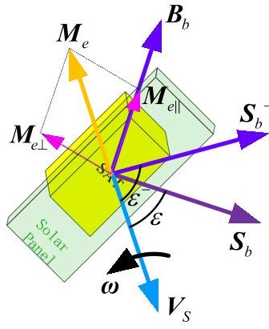

(a)

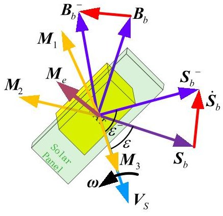

(b)

Fig. 1 Sketch of the desired control torque corresponding to the proposed PD-type attitude control laws

However, according to Equation (3) and Equation (4), the torque $ M_{e} $ determined in Equation (17), could be implemented completely due to the characteristic of the magnetic-based control scheme (illustrated in Fig. 1(a)). In this case, the component $ M_{e \parallel} $ which is parallel with $ B_{b} $ could not be implemented. When $ M_{e\perp} $ is parallel with $ V_{S} $ , the satellite would spin around the normal direction of the solar panel and sun angle would be out of control due to the corresponding gyroscopic stiffness. To avoid this, an option is to introduce another vector, which is difference from $ M_{e} $ determined in Equation (17), to the control law. In addition, to guarantee sun angle be small, spinning the satellite to a specified angular velocity is a better option for the gyroscopic stiffness would enhance the capability to resist attitude error and disturbance. Therefore, the ideal attitude control law (illustrated in Fig. 1(b)) could be proposed as,

$$
\boldsymbol {M} _ {e} = k _ {1 0} \left(1 - \boldsymbol {V} _ {S} \cdot \boldsymbol {S} _ {b}\right) \left(\boldsymbol {V} _ {S} \times \boldsymbol {S} _ {b}\right) + k _ {2 0} \cdot \left(\boldsymbol {B} _ {b} ^ {-} \times \boldsymbol {B} _ {b}\right) + k _ {3 0} \cdot \left(\boldsymbol {\omega} _ {0} - \boldsymbol {\omega}\right)
$$

where the first term is used to reduce the sun angle, the second term is adopted to provide the damping effort and the third term is added to control the angular velocity, which would enhance the gyroscopic stiffness. The coefficients, $ k_{10}, k_{20}, k_{30} $ , are positive quantities.

Even in the case that the satellite spins around $ B_{b} $ , since $ B_{b} $ changes along with the orbit, the corresponding control effort would guarantee sun-pointing quickly as usual.

In fact, the actual magnetic-based control torque $ M_{C} $ is different from the expected control torque $ M_{e} $ . The inner relationship between the two vectors could be described as,

<!-- PDF_PAGE: 5 -->

$$
\boldsymbol {M} _ {C} = \frac {\left(\boldsymbol {B} _ {b} \times \boldsymbol {M} _ {e}\right) \times \boldsymbol {B} _ {b}}{\left\| \boldsymbol {B} _ {b} \right\| ^ {2}}
$$

Substituting Equation (20) into Equation(16) yields,

$$
\frac {d J}{d t} = \left(\boldsymbol {\omega} - \boldsymbol {\omega} _ {0}\right) ^ {T} \boldsymbol {M} _ {C} - k \boldsymbol {V} _ {S} ^ {T} \dot {\boldsymbol {S}} _ {b}
$$

$$
= \left(\boldsymbol {\omega} - \boldsymbol {\omega} _ {0}\right) ^ {T} \left[ \frac {\left(\boldsymbol {B} _ {b} \times \boldsymbol {M} _ {e}\right) \times \boldsymbol {B} _ {b}}{\left\| \boldsymbol {B} _ {b} \right\| ^ {2}} \right] - k \left(\varepsilon - \varepsilon^ {-}\right) / \Delta T
$$

Let,

$$
k _ {1 0} = k _ {1} \left\| \boldsymbol {B} _ {b} \right\| ^ {2}, \quad k _ {2 0} = k _ {2} \left\| \boldsymbol {B} _ {b} \right\| ^ {2}, \quad k _ {3 0} = k _ {3} \left\| \boldsymbol {B} _ {b} \right\| ^ {2}
$$

Substituting Equation(19), Equation (22) into Equation (21), one could have,

$$
\begin{array}{l} \frac {d J}{d t} = \left(\boldsymbol {\omega} - \boldsymbol {\omega} _ {0}\right) ^ {T} \frac {\left(\boldsymbol {B} _ {b} \times \boldsymbol {M} _ {e}\right) \times \boldsymbol {B} _ {b}}{\left\| \boldsymbol {B} _ {b} \right\| ^ {2}} - k \left(\varepsilon - \varepsilon^ {-}\right) / \Delta T \\ = \frac {\left(\boldsymbol {\omega} - \boldsymbol {\omega} _ {0}\right) ^ {T}}{\left\| \boldsymbol {B} _ {b} \right\| ^ {2}} \left\{\left[ \boldsymbol {B} _ {b} \times \left(k _ {1 0} \left(\boldsymbol {V} _ {S} \times \boldsymbol {S} _ {b}\right) + k _ {2 0} \cdot \left(\boldsymbol {B} _ {b} ^ {-} \times \boldsymbol {B} _ {b}\right) + k _ {3 0} \cdot \left(\boldsymbol {\omega} _ {0} - \boldsymbol {\omega}\right)\right) \right] \times \boldsymbol {B} _ {b} \right\} - k \boldsymbol {V} _ {S} ^ {T} \dot {\boldsymbol {S}} _ {b} \\ = \left\langle k _ {1} \left(\boldsymbol {\omega} - \boldsymbol {\omega} _ {0}\right) ^ {T} \left\{\left[ \boldsymbol {B} _ {b} \times \left(\boldsymbol {V} _ {S} \times \boldsymbol {S} _ {b}\right) \right] \times \boldsymbol {B} _ {b} \right\} - k \boldsymbol {V} _ {S} ^ {T} \dot {\boldsymbol {S}} _ {b} \right\rangle \\ + k _ {2} \cdot \left(\boldsymbol {\omega} - \boldsymbol {\omega} _ {0}\right) ^ {T} \left\{\left[ \boldsymbol {B} _ {b} \times \left(\boldsymbol {B} _ {b} ^ {-} \times \boldsymbol {B} _ {b}\right) \right] \times \boldsymbol {B} _ {b} \right\} + k _ {3} \cdot \left(\boldsymbol {\omega} - \boldsymbol {\omega} _ {0}\right) ^ {T} \left\{\left[ \boldsymbol {B} _ {b} \times \left(\boldsymbol {\omega} _ {0} - \boldsymbol {\omega}\right) \right] \times \boldsymbol {B} _ {b} \right\} \\ \end{array}
$$

C. Analysis for Cross Product of Tri-vectors

Firstly, two propositions are proposed.

Proposition 1: for arbitrary three unit vectors, a, b and c, the expression $ |a\cdot[(c\times b)\times c)]|<1 $ holds.

## Proof.

We would discuss this problem in three-dimensional space.

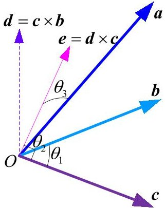

Fig. 2 Angular position relationships between tri-Vectors

Let three unit vectors, a,b and c, be illustrated in the Fig.2. The mentioned fork products and the corresponding included angles are denoted in this figure. According geometric knowledge, it is easy to get,

$$
\begin{array}{l} \cos \theta_ {1} = \boldsymbol {b} \cdot \boldsymbol {c} \\ \cos \theta_ {2} = \boldsymbol {d} \cdot \boldsymbol {c} = (\boldsymbol {c} \times \boldsymbol {b}) \cdot \boldsymbol {c} = 0 \\ \cos \theta_ {3} = \boldsymbol {a} \cdot \boldsymbol {e} = \boldsymbol {a} \cdot (\boldsymbol {d} \times \boldsymbol {c}) = \boldsymbol {a} \cdot \left[ (\boldsymbol {c} \times \boldsymbol {b}) \times \boldsymbol {c} \right] \\ \end{array}
$$

Therefore, one could have,

$$
\left| \boldsymbol {a} \cdot \left[ (\boldsymbol {c} \times \boldsymbol {b}) \times \boldsymbol {c} \right] \right| = \left| \| \boldsymbol {a} \| \| \boldsymbol {b} \| \| \boldsymbol {c} \| \right| ^ {2} \sin \theta_ {1} \sin \theta_ {2} \cos \theta_ {3} | < 1
$$

End of the proof.

Proposition 2: for arbitrary three unit vectors, a, b and c, the projection of vector a in the plane determined by b and c, could be denoted as g. Unit vector corresponding to vector g is denoted as vector d, which should satisfy

<!-- PDF_PAGE: 6 -->

d=（b×c）×[a×（b×c）]/||（b×c）×[a×（b×c）]||. When $ \cos^{-1} ( b \cdot d )+\cos^{-1} ( c \cdot d )>\cos^{-1} ( b \cdot c ), $ （a·b）<（a·c）·（b·c）holds. While if $ \cos^{-1} ( b \cdot d )+\cos^{-1} ( c \cdot d )=\cos^{-1} ( b \cdot c ), $ （a·b）>（a·c）·（b·c）holds.

Proof.

We would discuss this problem in three-dimensional space.

Let three unit vectors, a, b and c, be illustrated in the following figure. Unit vector $ d=(b\times c)\times[a\times(b\times c)]/\|(b\times c)\times[a\times(b\times c)]\| $ is the projection of vector a in the plane determined by b and c. The case corresponding to $ \cos^{-1}(b\cdot d)+\cos^{-1}(c\cdot d)=\cos^{-1}(b\cdot c) $ means that vector d lies in the region surrounded by b and c while the case of $ \cos^{-1}(b\cdot d)+\cos^{-1}(c\cdot d)>\cos^{-1}(b\cdot c) $ means that vector d lies outside of the corresponding region.

The corresponding included angles are denoted in this figure. According geometric knowledge, it is easy to get,

$$
\cos \theta = \cos \alpha_ {0} \cdot \cos \beta_ {0} = \cos \left(\alpha_ {0} + \Delta\right) \cdot \cos \beta_ {0}
$$

$$
\cos \beta = \cos \left(\alpha - \alpha_ {0}\right) \cdot \cos \beta_ {0} = \cos \Delta \cdot \cos \beta_ {0}
$$

where $ \Delta $ is the difference between $ \alpha_{0} $ and $ \alpha $ , and $ \alpha{=}\alpha_{0}+\Delta. $

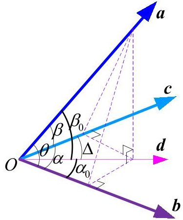

Fig. 3 Angular position relationships between tri-Vectors

From Equation (26), one could have,

$$
\begin{array}{l} \cos \theta = \cos \alpha_ {0} \cdot \cos \beta_ {0} = \cos \alpha_ {0} \cdot \frac {\cos \beta}{\cos (\alpha - \alpha_ {0})} = \frac {\cos (\alpha - \Delta)}{\cos \Delta} \cos \beta \\ = \frac {\cos \alpha \cos \Delta + \sin \alpha \sin \Delta}{\cos \Delta} \cos \beta \\ \end{array}
$$

In the previous equation, the magnitude of all the angles are less than 180deg and $ \beta_{0} $ is obviously an acute angle. In addition, it is easy to get that when $ \beta<0 $ $ \alpha $ would be an acute angle, too. That means that vector c could not influence the validity of Equation(27). Without loss of generality, the following discussion would set $ \beta $ be an acute angle.

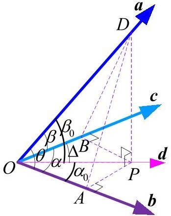

(a). Case A

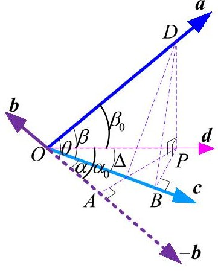

(b). Case B

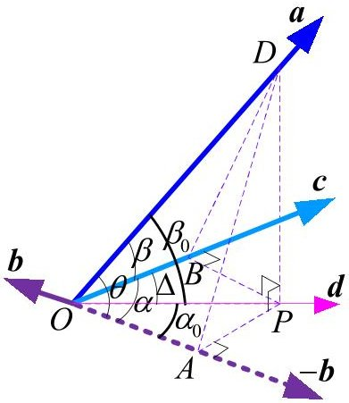

(c). Case C

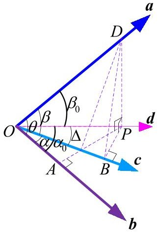

(d). Case D

Fig. 4 Schematic diagram for tri-Vectors

When $ \cos^{-1} ( \boldsymbol{b}\cdot\boldsymbol{d})+\cos^{-1} ( \boldsymbol{c}\cdot\boldsymbol{d})=\cos^{-1} ( \boldsymbol{b}\cdot\boldsymbol{c}) $ , vector d lies between vector b and vector c in the plane determined by vector b and vector c. As shown in case (A) and case (B).

In these cases, angle difference $ \Delta $ is a positive quantity, and therefore, Equation (26) could be rewritten as,

<!-- PDF_PAGE: 7 -->

$$
\cos \theta = \frac {\cos \alpha \cos \Delta + \sin \alpha \sin \Delta}{\cos \Delta} > \frac {\cos \alpha \cos \Delta}{\cos \Delta} \cos \beta = \cos \alpha \cos \beta
$$

When $ \cos^{-1} ( \boldsymbol{b}\cdot\boldsymbol{d})+\cos^{-1} ( \boldsymbol{c}\cdot\boldsymbol{d})>\cos^{-1} ( \boldsymbol{b}\cdot\boldsymbol{c}) $ , vector d lies outsides the region surrounded by vector b and vector c in the plane determined by vector b and vector c.

As shown in the case (C) and case (D). Since angle difference $ \Delta $ is a negative quantity, and therefore, from Equation (26), one could get,

$$
\cos \theta = \frac {\cos \alpha \cos \Delta + \sin \alpha \sin \Delta}{\cos \Delta} < \frac {\cos \alpha \cos \Delta}{\cos \Delta} \cos \beta = \cos \alpha \cos \beta
$$

Rewritten the cosine function into the dot product form, for case (A) and case (B), one could have,

$$
\left\{ \begin{array}{l l} \boldsymbol {a} \cdot \boldsymbol {b} > (\boldsymbol {a} \cdot \boldsymbol {c}) (\boldsymbol {b} \cdot \boldsymbol {c}) > 0 \\ (\boldsymbol {a} \cdot \boldsymbol {c}) (\boldsymbol {b} \cdot \boldsymbol {c}) < \boldsymbol {a} \cdot \boldsymbol {b} < 0 \end{array} \right. \quad \text {i f} \cos^ {- 1} (\boldsymbol {b} \cdot \boldsymbol {d}) + \cos^ {- 1} (\boldsymbol {c} \cdot \boldsymbol {d}) = \cos^ {- 1} (\boldsymbol {b} \cdot \boldsymbol {c})
$$

In the similar manner, as for case (C) and case (D), one could have,

$$
\left\{ \begin{array}{l l} \boldsymbol {a} \cdot \boldsymbol {b} < (\boldsymbol {a} \cdot \boldsymbol {c}) (\boldsymbol {b} \cdot \boldsymbol {c}) < 0 \\ (\boldsymbol {a} \cdot \boldsymbol {c}) (\boldsymbol {b} \cdot \boldsymbol {c}) > \boldsymbol {a} \cdot \boldsymbol {b} > 0 \end{array} \right. \quad \text {i f} \cos^ {- 1} (\boldsymbol {b} \cdot \boldsymbol {d}) + \cos^ {- 1} (\boldsymbol {c} \cdot \boldsymbol {d}) > \cos^ {- 1} (\boldsymbol {b} \cdot \boldsymbol {c})
$$

End of the proof.

Lema 1: for the cases that the included angle between a and b is an acute angle, when the coefficient k is selected properly, $ [ ( a \cdot b ) - ( a \cdot c ) \cdot ( b \cdot c ) ] - k ( a \cdot b ) < 0 ( k > 1 ) $ always holds. While for the cases that the included angle is an obtuse angle, the mentioned expression is never true.

## Proof.

According to the above analysis, this problem would be divided into 4 cases, which are illustrated in Fig.4.

For case (A), according to Equation(30), $ (a\cdot b)>(a\cdot c)\cdot(b\cdot c)>0 $ holds. One could have $ (a\cdot b)-(a\cdot c)\cdot(b\cdot c)>0 $ . In this case, when a proper k (k>1) is picked up, for example k=2, $ [(a\cdot b)-(a\cdot c)\cdot(b\cdot c)]-k(a\cdot b)<0 $ holds.

For case (B), according to Equation(30), $ (a\cdot c)\cdot(b\cdot c)<(a\cdot b)<0 $ holds. One has $ (a\cdot b)-(a\cdot c)\cdot(b\cdot c)>0 $ . In this case, whatever the positive k is, $ [(a\cdot b)-(a\cdot c)\cdot(b\cdot c)]-k(a\cdot b) $ is always a positive quantity.

For case (C), according to Equation(31), $ (a\cdot b) < (a\cdot c)\cdot(b\cdot c) < 0 $ holds. One could have $ (a\cdot b)-(a\cdot c)\cdot(b\cdot c) > 0 $ . In this case, when a proper k (0<k<<1) is picked up, for example k=0.01, $ [ (a\cdot b)-(a\cdot c)\cdot(b\cdot c)]-k(a\cdot b)<0 $ holds.

For case (D), according to Equation(31), $ (a\cdot c)\cdot(b\cdot c)>(a\cdot b)>0 $ holds. One has $ (a\cdot b)-(a\cdot c)\cdot(b\cdot c)>0 $ . In this case, when k>0 is picked up, $ [(a\cdot b)-(a\cdot c)\cdot(b\cdot c)]-k(a\cdot b)<0 $ always holds.

According to the above discussed, suppose that the included angle between vector a and vector b is an acute angle (corresponding to the discussed case (A) and case (D)) and a proper positive k(k>1) is picked up, $ [ ( a \cdot b ) - ( a \cdot c ) \cdot ( b \cdot c ) ] - k ( a \cdot b ) < 0 $ always holds. While for the case (B) and case (C), the included angle between a and b is an obtuse angle. Specifically, in case (B), the expression is never true, while in case (C), the expression is true only when a proper k (0<k<<1) is picked up.

End of the proof.

## D. Feasibility Analysis for Spinning-based Sun-pointing Attitude Control Scheme

## Revisiting Equation (19), one could find that some basic conclusions.

For the first term in Equation (19), since it is devoted to reducing sun angle, under the corresponding control effort, sun angle would be more and more close to zero. The third term in Equation (19) would control the angular velocity to the specified one, which would enhance the satellite's gyroscopic stiffness to resist attitude disturbance. For the second term in Equation (19), which is adopted to prevent the satellite rotating around $ B_{b} $ . This term would act as the damping term in the proposed attitude control law, and the corresponding control effort is used to ensure the stabilization of the attitude control process.

The third term in right hand of Equation (23) is devoted to controlling the angular velocity to the specified one and it could be rewritten as,

$$
\begin{array}{l} k _ {3} \left(\boldsymbol {\omega} - \boldsymbol {\omega} _ {0}\right) ^ {T} \left\{\left[ \boldsymbol {B} _ {b} \times \left(\boldsymbol {\omega} _ {0} - \boldsymbol {\omega}\right) \right] \times \boldsymbol {B} _ {b} \right\} \\ = - k _ {3} \left\{\left[ \boldsymbol {B} _ {b} \times \left(\boldsymbol {\omega} _ {0} - \boldsymbol {\omega}\right) \right] \times \boldsymbol {B} _ {b} \right\} ^ {T} \left(\boldsymbol {\omega} - \boldsymbol {\omega} _ {0}\right) \\ = - k _ {3} \left\| \boldsymbol {B} _ {b} \times \left(\boldsymbol {\omega} - \boldsymbol {\omega} _ {0}\right) \right\| ^ {2} \\ \end{array}
$$

<!-- PDF_PAGE: 8 -->

Under the corresponding attitude control effort, the angular velocity would approach the specified one, that means, $ \omega\to\omega_{0} $ holds. Along with the advancement of the attitude control process, the included angle between $ \omega $ and $ \omega_{0} $ would be an acute angle.

The first term in right hand of Equation (23) could be expanded as,

$$
\begin{array}{l} k _ {1} \left(\boldsymbol {\omega} - \boldsymbol {\omega} _ {0}\right) ^ {T} \left\{\left[ \boldsymbol {B} _ {b} \times \left(\boldsymbol {V} _ {S} \times \boldsymbol {S} _ {b}\right) \right] \times \boldsymbol {B} _ {b} \right\} - k \boldsymbol {V} _ {S} ^ {T} \dot {\boldsymbol {S}} _ {b} \\ = k _ {1} \boldsymbol {\omega} ^ {T} \left\{\left[ \boldsymbol {B} _ {b} \times \left(\boldsymbol {V} _ {S} \times \boldsymbol {S} _ {b}\right) \right] \times \boldsymbol {B} _ {b} \right\} - k _ {1} \boldsymbol {\omega} _ {0} ^ {T} \left\{\left[ \boldsymbol {B} _ {b} \times \left(\boldsymbol {V} _ {S} \times \boldsymbol {S} _ {b}\right) \right] \times \boldsymbol {B} _ {b} \right\} - k \boldsymbol {V} _ {S} ^ {T} \dot {\boldsymbol {S}} _ {b} \\ = k _ {1} \boldsymbol {\omega} ^ {T} \left\{\left\| \boldsymbol {B} _ {b} \right\| ^ {2} \left(\boldsymbol {V} _ {S} \times \boldsymbol {S} _ {b}\right) - \left[ \boldsymbol {B} _ {b} \cdot \left(\boldsymbol {V} _ {S} \times \boldsymbol {S} _ {b}\right) \right] \boldsymbol {B} _ {b} \right\} - k _ {1} \boldsymbol {\omega} _ {0} ^ {T} \left\{\left[ \boldsymbol {B} _ {b} \times \left(\boldsymbol {V} _ {S} \times \boldsymbol {S} _ {b}\right) \right] \times \boldsymbol {B} _ {b} \right\} - k \boldsymbol {V} _ {S} ^ {T} \dot {\boldsymbol {S}} _ {b} \\ = k _ {1} \left\| \boldsymbol {B} _ {b} \right\| ^ {2} \left\{\boldsymbol {\omega} ^ {T} \left(\boldsymbol {V} _ {S} \times \boldsymbol {S} _ {b}\right) - \left[ u \boldsymbol {B} _ {b} \cdot \left(\boldsymbol {V} _ {S} \times \boldsymbol {S} _ {b}\right) \right] \left(u \boldsymbol {B} _ {b} ^ {T} \boldsymbol {\omega}\right) \right\} - k _ {1} \boldsymbol {\omega} _ {0} ^ {T} \left\{\left[ \boldsymbol {B} _ {b} \times \left(\boldsymbol {V} _ {S} \times \boldsymbol {S} _ {b}\right) \right] \times \boldsymbol {B} _ {b} \right\} - k \boldsymbol {V} _ {S} ^ {T} \dot {\boldsymbol {S}} _ {b} \\ = \left\langle k _ {1} \left\| \boldsymbol {B} _ {b} \right\| ^ {2} \left\{V _ {S} ^ {T} \dot {\boldsymbol {S}} _ {b} - \left[ u \boldsymbol {B} _ {b} \cdot \left(\boldsymbol {V} _ {S} \times \boldsymbol {S} _ {b}\right) \right] \left(u \boldsymbol {B} _ {b} ^ {T} \boldsymbol {\omega}\right) \right\} - k V _ {S} ^ {T} \dot {\boldsymbol {S}} _ {b} \rangle - k _ {1} \boldsymbol {\omega} _ {0} ^ {T} \left\{\left[ \boldsymbol {B} _ {b} \times \left(\boldsymbol {V} _ {S} \times \boldsymbol {S} _ {b}\right) \right] \times \boldsymbol {B} _ {b} \right\} \\ \end{array}
$$

Considering $ V_{S}^{T}\dot{S}_{b} $ firstly, it is easy to get,

$$
\begin{array}{l} \boldsymbol {V} _ {S} ^ {T} \dot {\boldsymbol {S}} _ {b} = \boldsymbol {V} _ {S} ^ {T} \left(\boldsymbol {S} _ {b} - \boldsymbol {S} _ {b} ^ {-}\right) / \Delta T \\ = \left(\boldsymbol {V} _ {S} ^ {T} \boldsymbol {S} _ {b} - \boldsymbol {V} _ {S} ^ {T} \boldsymbol {S} _ {b} ^ {-}\right) / \Delta T = \left(\cos \varepsilon - \cos \varepsilon^ {-}\right) / \Delta T \\ \end{array}
$$

According to Equation (19), one could find that, at the beginning of the sun-pointing attitude control process, $ \varepsilon $ is a big one, which would be depressed by the corresponding attitude control effort. That means, both $ \varepsilon <\varepsilon^{-} $ and $ \cos \varepsilon >\cos \varepsilon^{-} $ hold and $ V_{S}^{T}\dot{S}_{b} $ is a positive quantity. In this case, according to the results in the previous subsection, one could find that, when a suitable k is picked up, the first term in Equation(33) is a negative one. Nevertheless, when sun angle has been suppressed near to zero, the sign of $ V_{S}^{T}\dot{S}_{b} $ would be negative or positive or even zero.

According to Equation (25), the first term in ' $ \langle \rangle $ ' could be considered to have the same order of magnitude as $ V_{S}^{T}\dot{S}_{b} $ . For the sun angle control, considering Lemma 1 described in the previous subsection, the coefficient k (in Equation (23)) is obvious larger than $ k_{1}||B_{b}||^{2} $ (the weight corresponding to sun angle is emphasized here), which means that, for the contents in ' $ \langle \rangle $ ' of Equation (23), $ k V_{S}^{T}\dot{S}_{b} $ is the dominant term. Therefore, Equation(33) could be rewritten as,

$$
\begin{array}{l} k _ {1} \left(\boldsymbol {\omega} - \boldsymbol {\omega} _ {0}\right) ^ {T} \left\{\left[ \boldsymbol {B} _ {b} \times \left(\boldsymbol {V} _ {S} \times \boldsymbol {S} _ {b}\right) \right] \times \boldsymbol {B} _ {b} \right\} - k \boldsymbol {V} _ {S} ^ {T} \dot {\boldsymbol {S}} _ {b} \\ \approx \left\langle - k V _ {S} ^ {T} \dot {\boldsymbol {S}} _ {b} \right\rangle - k _ {1} \omega_ {0} ^ {T} \left\{\left[ \boldsymbol {B} _ {b} \times \left(\boldsymbol {V} _ {S} \times \boldsymbol {S} _ {b}\right) \right] \times \boldsymbol {B} _ {b} \right\} \\ = \left\langle - k V _ {S} ^ {T} \dot {\boldsymbol {S}} _ {b} \right\rangle - k _ {1} \left\| \boldsymbol {B} _ {b} \right\| ^ {2} \left\| \boldsymbol {\omega} _ {0} \right\| \left\| \boldsymbol {V} _ {S} \times \boldsymbol {S} _ {b} \right\| u \boldsymbol {\omega} _ {0} ^ {T} \left\{\left[ u \boldsymbol {B} _ {b} \times \frac {\left(\boldsymbol {V} _ {S} \times \boldsymbol {S} _ {b}\right)}{\left\| \boldsymbol {V} _ {S} \times \boldsymbol {S} _ {b} \right\|} \right] \times u \boldsymbol {B} _ {b} \right\} \\ < - k \left(\varepsilon - \varepsilon^ {-}\right) \Delta T + k _ {1} \left\| \boldsymbol {B} _ {b} \right\| ^ {2} \left\| \boldsymbol {\omega} _ {0} \right\| \left\| \boldsymbol {V} _ {S} \times \boldsymbol {S} _ {b} \right\| \\ < - k \left(\varepsilon - \varepsilon^ {-}\right) \Delta T + k _ {1} \left\| \boldsymbol {B} _ {b} \right\| ^ {2} \left\| \boldsymbol {\omega} _ {0} \right\| \\ \end{array}
$$

For the second term in Equation(33), when sun angle has not been stabilized, the angular position relationship between $ \omega_{0} $ $ B_{b} $ and $ V_{S}\times S_{b} $ are changing continuously. With the going on of the control process corresponding to sun angle, the difference between $ V_{S} $ and $ S_{b} $ would be suppressed and the second term would approach to the region near to zero.

The second term in right hand of Equation (23) could be rewritten as,

$$
\begin{array}{l} k _ {2} \left(\boldsymbol {\omega} - \boldsymbol {\omega} _ {0}\right) ^ {T} \left\{\left[ \boldsymbol {B} _ {b} \times \left(\boldsymbol {B} _ {b} ^ {-} \times \boldsymbol {B} _ {b}\right) \right] \times \boldsymbol {B} _ {b} \right\} \\ = k _ {2} \boldsymbol {\omega} ^ {T} \left\{\left[ \boldsymbol {B} _ {b} \times \left(\boldsymbol {B} _ {b} ^ {-} \times \boldsymbol {B} _ {b}\right) \right] \times \boldsymbol {B} _ {b} \right\} - k _ {2} \boldsymbol {\omega} _ {0} ^ {T} \left\{\left[ \boldsymbol {B} _ {b} \times \left(\boldsymbol {B} _ {b} ^ {-} \times \boldsymbol {B} _ {b}\right) \right] \times \boldsymbol {B} _ {b} \right\} \\ \end{array}
$$

It is easy to get,

$$
\begin{array}{l} \boldsymbol {\omega} ^ {T} \left\{\left[ \boldsymbol {B} _ {b} \times \left(\boldsymbol {B} _ {b} ^ {-} \times \boldsymbol {B} _ {b}\right) \right] \times \boldsymbol {B} _ {b} \right\} = - \boldsymbol {\omega} ^ {T} \left\{\left[ \boldsymbol {B} _ {b} \times \left(\left(\boldsymbol {B} _ {b} \times \boldsymbol {\omega}\right) \times \boldsymbol {B} _ {b}\right) \right] \times \boldsymbol {B} _ {b} \right\} \Delta T \\ = - \boldsymbol {\omega} ^ {T} \left\{\left[ \left\| \boldsymbol {B} _ {b} \right\| ^ {2} \left(\boldsymbol {B} _ {b} \times \boldsymbol {\omega}\right) - \left[ \boldsymbol {B} _ {b} \cdot \left(\boldsymbol {B} _ {b} \times \boldsymbol {\omega}\right) \right] \boldsymbol {B} _ {b} \right] \times \boldsymbol {B} _ {b} \right\} \Delta T \\ = - \left\| \boldsymbol {B} _ {b} \right\| ^ {2} \boldsymbol {\omega} ^ {T} \left[ \left(\boldsymbol {B} _ {b} \times \boldsymbol {\omega}\right) \times \boldsymbol {B} _ {b} \right] \Delta T = - \left\| \boldsymbol {B} _ {b} \right\| ^ {2} \left\| \boldsymbol {B} _ {b} \times \boldsymbol {\omega} \right\| ^ {2} \Delta T \\ \end{array}
$$

And according to Equation (25), one could obtain,

$$
\begin{array}{l} - \boldsymbol {\omega} _ {0} ^ {T} \left\{\left[ \boldsymbol {B} _ {b} \times \left(\boldsymbol {B} _ {b} ^ {-} \times \boldsymbol {B} _ {b}\right) \right] \times \boldsymbol {B} _ {b} \right\} = \left\| \boldsymbol {B} _ {b} \right\| ^ {2} \boldsymbol {\omega} _ {0} ^ {T} \left[ \left(\boldsymbol {B} _ {b} \times \boldsymbol {\omega}\right) \times \boldsymbol {B} _ {b} \right] \Delta T \\ = \left\| \boldsymbol {B} _ {b} \right\| ^ {4} \left\| \boldsymbol {\omega} _ {0} \right\| \left\| \boldsymbol {\omega} \right\| \Delta T \cdot \left\{u \boldsymbol {\omega} _ {0} ^ {T} \left[ \left(u \boldsymbol {B} _ {b} \times u \boldsymbol {\omega}\right) \times u \boldsymbol {B} _ {b} \right] \right\} < \left\| \boldsymbol {B} _ {b} \right\| ^ {4} \left\| \boldsymbol {\omega} _ {0} \right\| \left\| \boldsymbol {\omega} \right\| \Delta T \\ \end{array}
$$

where $ u B_{b}, u \omega $ and $ u \omega_{0} $ are the unit vectors corresponding to $ B_{b}, \omega_{0} $ and $ \omega $ , respectively.

<!-- PDF_PAGE: 9 -->

Therefore, Equation (36) could be rewritten as,

$$
\begin{array}{l} k _ {2} \left(\boldsymbol {\omega} - \boldsymbol {\omega} _ {0}\right) ^ {T} \left\{\left[ \boldsymbol {B} _ {b} \times \left(\boldsymbol {B} _ {b} ^ {-} \times \boldsymbol {B} _ {b}\right) \right] \times \boldsymbol {B} _ {b} \right\} \\ = - k _ {2} \left\| \boldsymbol {B} _ {b} \right\| ^ {2} \left\| \boldsymbol {B} _ {b} \times \boldsymbol {\omega} \right\| ^ {2} \Delta T + k _ {2} \left\| \boldsymbol {B} _ {b} \right\| ^ {2} \omega_ {0} ^ {T} \left[ \left(\boldsymbol {B} _ {b} \times \boldsymbol {\omega}\right) \times \boldsymbol {B} _ {b} \right] \Delta T \\ < - k _ {2} \left\| \boldsymbol {B} _ {b} \right\| ^ {2} \left\| \boldsymbol {B} _ {b} \times \boldsymbol {\omega} \right\| ^ {2} \Delta T + k _ {2} \left\| \boldsymbol {B} _ {b} \right\| ^ {4} \left\| \boldsymbol {\omega} _ {0} \right\| \left\| \boldsymbol {\omega} \right\| \Delta T \\ \end{array}
$$

During the control process, the angular position relationship between $ \omega_{0} $ $ B_{b} $ and $ \omega $ are changing continuously. And when $ \omega\to\omega_{0} $ holds, the second term in right hand of Equation (23) would be near to zero.

According to Equation(35), Equation(39) and Equation(32), Equation (23) could be rewritten as,

$$
\begin{array}{l} \frac {d J}{d t} = \left\langle k _ {1} \left(\boldsymbol {\omega} - \boldsymbol {\omega} _ {0}\right) ^ {T} \left\{\left[ \boldsymbol {B} _ {b} \times \left(\boldsymbol {V} _ {S} \times \boldsymbol {S} _ {b}\right) \right] \times \boldsymbol {B} _ {b} \right\} - k \boldsymbol {V} _ {S} ^ {T} \dot {\boldsymbol {S}} _ {b} \right\rangle \\ + \left\langle - k _ {2} \left\| \boldsymbol {B} _ {b} \right\| ^ {2} \left\| \boldsymbol {B} _ {b} \times \boldsymbol {\omega} \right\| ^ {2} \Delta T + k _ {2} \left\| \boldsymbol {B} _ {b} \right\| ^ {2} \boldsymbol {\omega} _ {0} ^ {T} \left\{\left[ \left(\boldsymbol {B} _ {b} \times \boldsymbol {\omega}\right) \right] \times \boldsymbol {B} _ {b} \right\} \Delta T \rangle + \left[ - k _ {3} \left\| \boldsymbol {B} _ {b} \times \left(\boldsymbol {\omega} - \boldsymbol {\omega} _ {0}\right) \right\| ^ {2} \right] \\ < - \left\langle k _ {2 0} \left\| \boldsymbol {B} _ {b} \times \boldsymbol {\omega} \right\| ^ {2} \Delta T + k _ {3 0} \left\| u \boldsymbol {B} _ {b} \times \left(\boldsymbol {\omega} - \boldsymbol {\omega} _ {0}\right) \right\| ^ {2} \right\rangle - k \left(\varepsilon - \varepsilon^ {-}\right) \Delta T + \left[ k _ {1 0} \left\| \boldsymbol {\omega} _ {0} \right\| + k _ {2 0} \left\| \boldsymbol {B} _ {b} \right\| ^ {2} \left\| \boldsymbol {\omega} _ {0} \right\| \left\| \boldsymbol {\omega} \right\| \Delta T \right] \\ \end{array}
$$

The first term in the right hand of Equation (40) is negative, which means that it would be devoted to reducing the energy function J. The second term is related to the sun angle. At the beginning of attitude control process, under the corresponding control effort, sun angle would approach to zero and, therefore, the second term in Equation (40) is also a negative quantity. Nevertheless, when sun angle has been near to zero, the introduction of attitude error, disturbance, and the underactuated characteristic corresponding to magnetic attitude control scheme, would make sun angle change in a certain range.

According to Equation (40), when suitable coefficients are picked up, change rate of the expanded energy function J would be negative, which means that sun angle is controllable. Nevertheless, since the damping term is small, the corresponding control system is an under-damped system and sun angle would change in a large range. While when $ k_{3} $ is obviously large, in a similar manner, the sun-pointing control system is still stable. However, the strong gyroscopic stiffness would make it hard to control sun angle. Therefore, in the proposed attitude control scheme, spinning motion could not be emphasized, especially for cases that the included angle between the Sun and the orbital plane is near to 90deg. For dawn-dusk orbits, since sun vector is always on the same side of the orbital plane, spinning motion could enhance the desired sun-pointing. While for Meridional orbits, since sun vector is near to parallel with the orbital plane, spinning motion could be limited to a small-scale level, which could guarantee sun-pointing is available.

Actually, one could divide the attitude control process into two phases. In the first phase, the corresponding control effort is devoted to reducing sun angle and the specified angular velocity, $ \omega_{0} $ , could be set as 0. During the control process, the value corresponding to Equation (40) is always negative and the sun-pointing attitude control is feasible. While in the second phase, $ \omega_{0} $ could be set as a non-zero quantity, which would drive the satellite spin around the normal of the solar panel and the spinning motion would guarantee sun-pointing manner. During the second phase, since sun angle is small, under the attitude control effort, angular velocity $ \omega $ would approach to $ \omega_{0} $ .

In summary, during the attitude control process, when suitable coefficients are picked up, the change rate of J (J is the proposed Lyapunov function) is negative. That means that the proposed sun-pointing magnetic attitude control scheme is convergent and sun angle is controllable.

## IV. SIMULATIONS

Suppose that the inertial tensor is diag([40, 48, 36]) $ \mathrm{k g}\cdot\mathrm{m}2 $ . The product of inertia is taken as $ 0.5 \mathrm{k g}\cdot\mathrm{m}2 $ . The section area corresponding to the aerodynamic drag is 3.5 m2, and the offset (in body-fixed frame) of the center of geometry away from the center of gravity is [-0.02, 0.005, 0.005] m. The nominal output of the magnetic torquers is $ 30\mathrm{A}\cdot\mathrm{m}2 $ . Both the control cycle and the sensors' sampling duration are 1s and the maximum duration corresponding to the magnetic torquers is 0.5s. The initial attitude quaternion is supposed as [-0.58113, 0.27710, 0.76414, 0.03989], while the initial angular velocity is supposed as [-2, -2, 2]deg/s. when the spacecraft is in the shadow of the Earth, a gyro is required to estimate the sun vector, which means sun vector is always available.

For the proposed PD-type sun-pointing attitude control scheme, harsh conditions have been considered in the following simulations. Suppose magnetometer measurement error be 200nT and the measurement noise be 500nT. The order of the magnitude of disturbance is set to the level of $ 1 0^{-4} \mathrm{N m} $ . And solar panel is mounted on the $ -y $ facet of the satellite.

## A. CASE1: Sun-synchronous orbit and LTDN=8:00AM

For theses near dawn-dusk orbits, the injected angle of the Sun to the orbital plane is about 35deg and, obviously, $ - y $ facet is suitable for solar panel to mount. When the specified angular velocity is set as zero, the corresponding simulation results are presented in Fig. 5.

<!-- PDF_PAGE: 10 -->

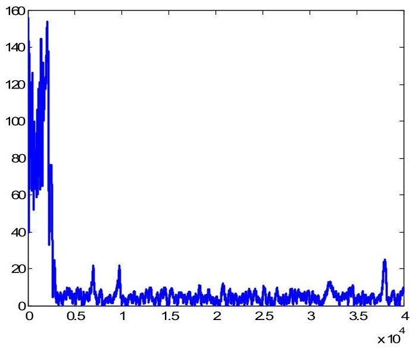

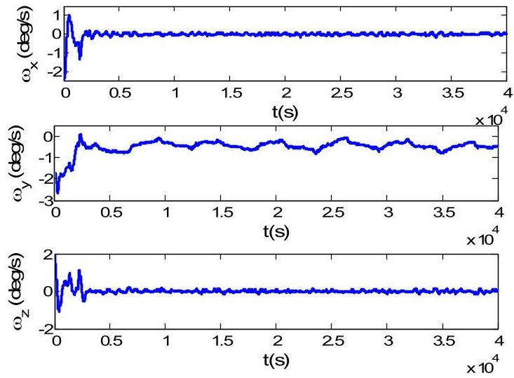

Fig. 5 Curves of sun angle and angular velocity with time (spin-free satellite)

When the specified angular velocity is -2deg/s, the corresponding simulation results are presented in Fig. 6.

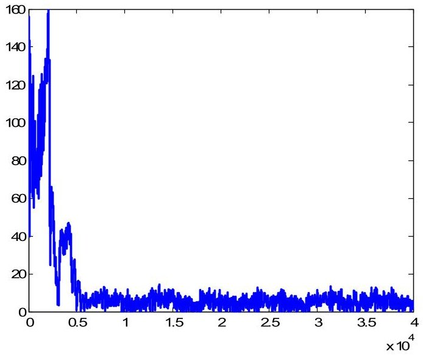

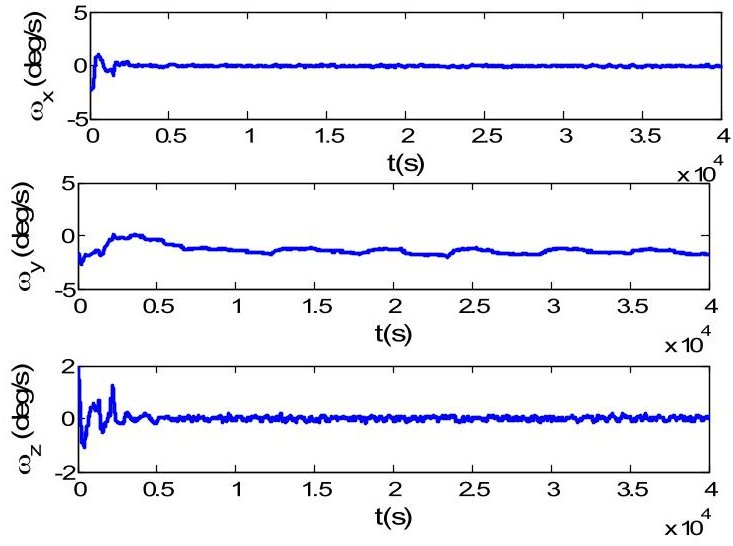

Fig. 6 Curves of sun angle and angular velocity with time (spin velocity is -2deg/s)

Simulation results indicate that, for near dawn-dusk orbits, whether the target angular velocity is set as zero or a non-zero quantity, the proposed sun-pointing attitude control scheme could guarantee sun-pointing manner. And in both of the cases, solar panels would rotate around the Sun, which means energy achievement requirement could be met.

## B. CASE2: Sun-synchronous orbit and LTDN=1:00AM

For near meridional orbits, sun vector is near parallel with the orbital plane. Therefore, solar panels should change continuously to track the Sun. When the specified angular velocity is set as zero, the corresponding simulation results are presented in Fig. 7.

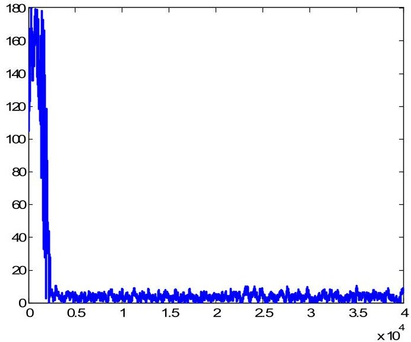

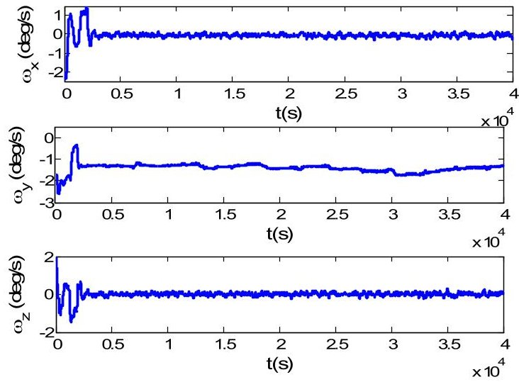

<!-- PDF_PAGE: 11 -->

When the target angular velocity is specified as -2deg/s, the corresponding simulation results are presented in Fig. 8.

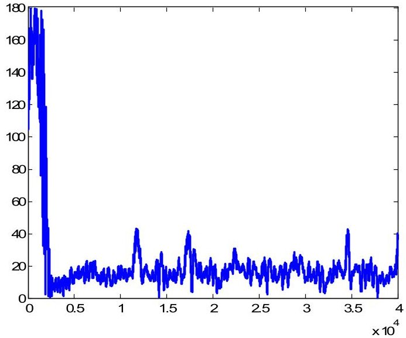

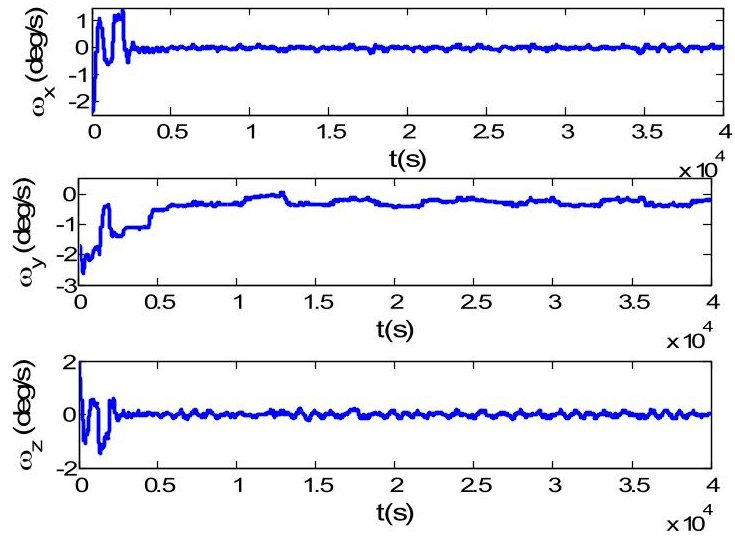

Fig. 8 Curves of sun angle and angular velocity with time (spin velocity is -2deg/s)

Simulation results show that, when the specified angular velocity is set as zero, corresponding attitude control effort would spin the satellite and the actual angular velocity would be controlled to some value, which would guarantee sun-pointing manner. While if the specified angular velocity is set as a non-zero quantity, due to the change of sun vector, the actual angular velocity may be different from the specified one. In this case, sun angle would be worse than that corresponding to the case discussed above.

## C. CASE3: Low-inclination Earth orbit

Suppose the orbit height be 500km, orbital inclination be 35 deg, right ascension of ascending node be 159 deg. In this case, the included angle between the Sun and the orbital plane is about 35 deg. When the target angular velocity is specified as 0deg/s or -2deg/s, the corresponding simulation results are presented in Fig. 9~Fig. 10.

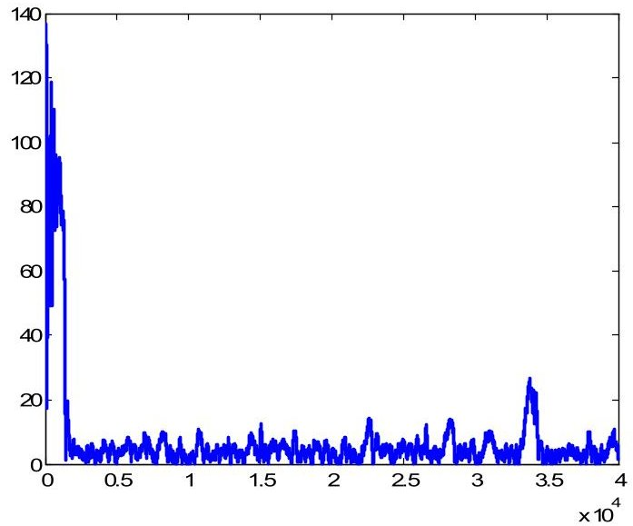

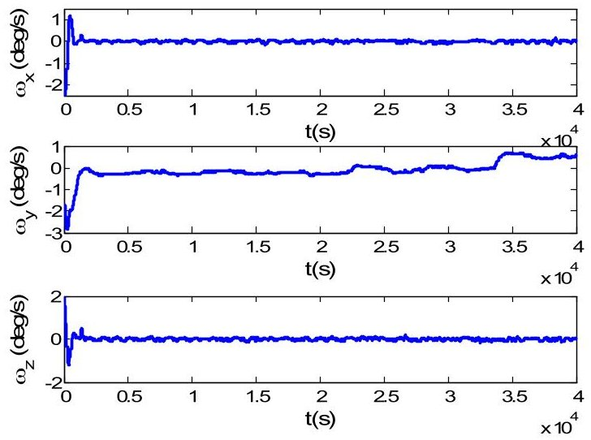

Fig. 9 Curves of sun angle and angular velocity with time (spin-free satellite)

<!-- PDF_PAGE: 12 -->

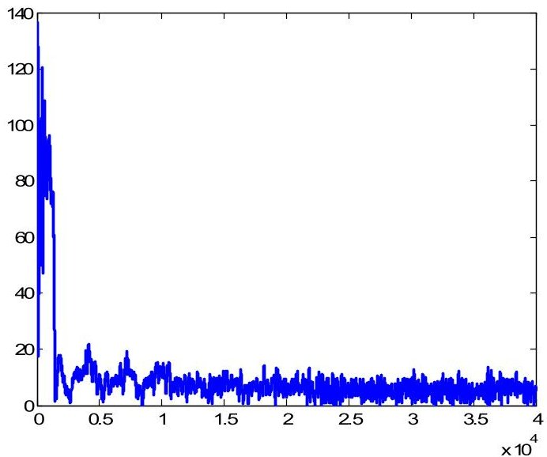

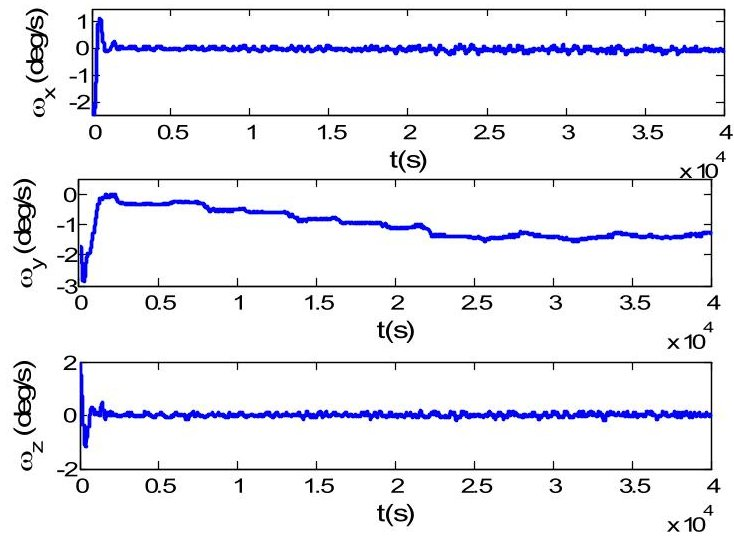

Fig. 10 Curves of sun angle and angular velocity with time (spin velocity is -2deg/s)

Simulation results indicate that, when the target angular velocity is specified as zero, the actual angular velocity would change around zero and sun angle would be controlled near to zero. While if the specified angular velocity is -2deg/s or other non-zero quantity, the actual angular velocity would change slowly to the specified one and sun angle would be stabilized near to zero along with the increment of angular velocity.

Consider the case that right ascension of ascending node is 259 deg. In this case, the included angle between the Sun and the orbital plane is about 65 deg, which would add the difficulty for sun-pointing.

When the target angular velocity is specified as 0deg/s or -2deg/s, the corresponding simulation results are presented in Fig. 11~Fig. 12.

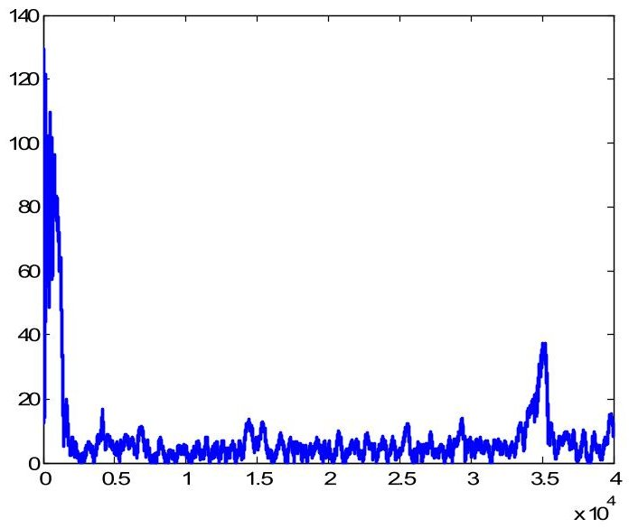

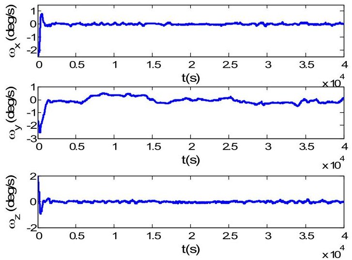

Fig. 11 Curves of sun angle and angular velocity with time (spin-free satellite)

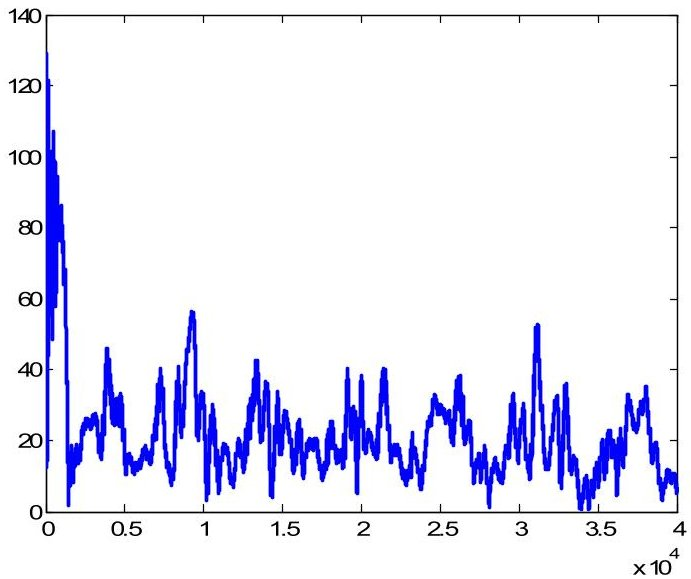

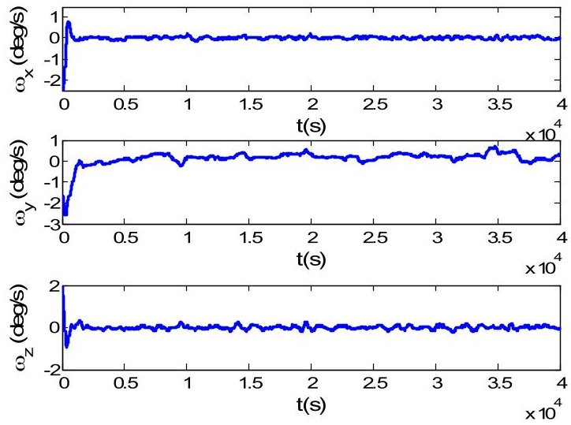

<!-- PDF_PAGE: 13 -->

Fig. 12 Curves of sun angle and angular velocity with time (spin velocity is -2deg/s)

When the specified angular velocity is 0deg/s, from Fig. 11, one could find that both the actual angular velocity and sun angle are near to zero. While if specified angular velocity is -2deg/s, from Fig. 12, one could find that, due to the change of sun vector with respect to the orbital plane, the control effort adopted to spin the satellite would weaken that used to suppress sun angle. In this case, the actual angular velocity could be controlled to the specified one and sun angle would change in a larger range.

Combining Fig. 9 and Fig. 11, one could find that, the actual angular velocity would change in the adjacency region near to zero and sun angle may be a large one since angular velocity is near to zero and the gyroscopic stiffness is very weak. Combining Fig. 10 and Fig. 12, one could find that, when control efforts corresponding to several terms in Equation (19) could not counteract each other, sun angle could be controlled perfectly. While if the control efforts neutralize each other, it would be hard to suppress sun angle.

## V. CONCLUSION

The proposed magnetic-based attitude control scheme could provide proper control effort to guarantee sun-pointing. Under the attitude control effort provided by the three orthogonal magnetic torquers, the orientation of the solar panel would be controlled to point to the Sun, which is the basic survive mode for any satellite. The Lyapunov function-based sun-pointing attitude control scheme could guarantee sun-pointing manner in the cases that both attitude error and disturbance are small and the spin motion could enhance the capability to resist the introduced command noise to a certain extent. Sun pointing attitude control effects are related to the orbit and the proposed attitude control scheme could guarantee sun-pointing when the included angle between the Sun and the orbital plane is near to 90 deg. For the proposed PD-type sun-pointing attitude control scheme, which emphasis clearly the satellites spinning around the orientation of the solar panel, is suitable for arbitrary low-earth orbits and the sun-pointing effect could meet the requirements corresponding to energy achievement.

## DECLARATIONS

Conflicts of interest: The authors declare that they have no conflict of interest.

Funding: This work is supported, in part, by Shanghai Natural Science Foundation of China (Grant Number: 19ZR1453200).

Availability of data and material: This manuscript has no associated data.

## REFERENCES

[1] M. Y. Ovchinnikov, D.S. Roldugin. A survey on active magnetic attitude control algorithms for small satellites, Progress in Aerospace Sciences. 109 (2019) 100546, https://doi.org/10.1016/j.paerosci.2019.05.006.

[2] M. Lovera, A. Astolfi. Global magnetic attitude control of inertially pointing spacecraft, Journal of Guidance, Control, and Dynamics. 28 (2005) 1065-1072, https://doi.org/10.2514/1.11844.

[3] D.S. Ivanov, M.Y. Ovchinnikov, V.I. Penkov, etc. Advanced numerical study of the three-axis magnetic attitude control and determination with uncertainties, Acta Astronautica. 132 (2017), https://doi.org/10.1016/j.actaastro.2016.11.045.

[4] A. Sofyali, E.M. Jafarov, R. Wisniewski. Robust and global attitude stabilization of magnetically actuated spacecraft through sliding mode, Aerospace Science and Technology. 76 (2018) 91-104, https://doi.org/10.1016/j.ast.2018.01.022.

[5] M.Y. Ovchinnikov, D.S. Roldugin, V.I. Penkov, etc. Fully magnetic sliding mode control for acquiring three-axis attitude, Acta Astronautica. 121 (2016) 59-62, https://doi.org/10.1016/j.actaastro.2015.12.031.

[6] Y. Yang. An effient algorithm for periodic Riccati equation with periodically time-varying input matrix, Automatica. 78 (2017) 103-109. https://doi.org/10.1016/j.automatica.2016.12.028.

[7] B. Zhou. Global stabilization of periodic linear systems by bounded controls with applications to spacecraft magnetic attitude control, Automatica. 60 (2015) 145-154, https://doi.org/10.1016/j.automatica.2015.07.003.

[8] U. Eren, A. Prach, B.B. Kocer, etc. Model predictive control in aerospace systems: current state and opportunities, Journal of Guidance, Control, and Dynamics. 40 (2017) 1541-1566, https://doi.org/10.2514/1.G002507.

[9] J. Kim, Y. Jung, H. Bang. Linear time-varying model predictive control of magnetically actuated satellites in elliptic orbits, Acta Astronautica. 151 (2018) 791-804, https://doi.org/10.1016/j.actaastro.2018.07.029.

[10] S. Das, M. Sinha, A.K. Misra. Dynamic neural units for adaptive magnetic attitude control of spacecrafts, Journal of Guidance, Control, and Dynamics. 35 (2012) 1280-1291, https://doi.org/10.2514/1.54408.

[11] A.R. Walker, P.T. Putman, K. Cohen. Solely magnetic genetic/fuzzy-attitude-control algorithm for a CubeSat, Journal of Spacecraft and Rockets. 52 (2015) 1627-1639, https://doi.org/10.2514/1.A33294.

[12] D. Lebedev, A. Tkachenko, Magnetic attitude control system for low-earth orbit satellites, Multibody System Dynamics. 6 (2001) 29-37, https://doi.org/10.1023/A:1011484008063.

[13] Y. Kou, Q. Yuan, C. Li, etc. Application constraints of the three-Axis stabilization magnetic control method based on LQR, 6th International Conference on Instrumentation & Measurement, Computer, Communication and Control (IMCCC). IEEE, Harbin, China, 2016, pp. 554-558, https://doi.org/10.2514/2.4609.

[14] D. Ivanov, M. Ovchinnikov, D. Roldugin. Three-Axis Attitude determination using magnetorquers, Journal of Guidance, Control, and Dynamics. 41 (2018) 2455-2462, https://doi.org/10.2514/1.G003698.

[15] H. Liu, H. Wang, Y. Cheng. Attitude control of micro-satellite with only magnetic actuators. Chinese Journal of Space Science. 2007(5):425-429. https://doi.org/10.11728/cjss2007.05.425.

<!-- PDF_PAGE: 14 -->

[16] S. Qian, S. Zhang, H. Cai. Study on attitude acquisition of Micro-satellite with only magnetic actuators. Journal of Astronautics. 2011(1): 72-80.

[17] X. Xia, S. Wu, G. Sun, etc. Magnetic-based Attitude Cotnrol Scheme for CubeSat. Proceedings of 2016 IEEE Chinese Guidance, Navigation and Control Conference - IEEE CGNCC 2016, 12-14 Aug, 2016, Nanjing, China, https://doi.org/10.1109/CGNCC.2016.7828771.

[18] C.A. Sedlund. A simple sun-pointing magnetic controller for satellites in equatorial orbits, IEEE Aerospace Conference Proceedings. IEEE, Big Sky, Montana, 2009, pp. 1-12, https://doi.org/10.1109/AERO.2009.4839544.

[19] H. You, Y.-W. Jan, J.-R. Tsai. Sun pointing attitude control with magnetic torquers only, 57th International Astronautical Congress. American Institute of Aeronautics and Astronautics, Reston, Virigina, 2006, https://doi.org/10.2514/6.IAC-06-C1.2.01.

[20] J. Kim, K. Worrall, Sun tracking controller for UKube-1 using magnetic torque only, IFAC proceedings volumes. 46 (2013) 541-546, https://doi.org/10.3182/20130902-5-DE-2040.00126.

[21] M.C. Crocker, E.A. Vrablik. Experiment in solar orientation of spin stabilized satellite, AIAA Journal. 3 (1965) 1350-1351. https://doi.org/10.2514/3.3144.

[22] E.I. Ergin, P.C. Wheeler. Magnetic attitude control of a spinning satellite, Journal of Spacecraft and Rockets. 2 (1965) 846-850. https://doi.org/10.2514/3.28302.

[23] M.L. Renard. Command laws for magnetic attitude control of spin-stabilized earth satellites, Journal of Spacecraft and Rockets. 4 (1967) 156-163, https://doi.org/10.2514/3.28828.

[24] J.A. Sorensen. A magnetic attitude control system for an axisymmetric spinning spacecraft, Journal of Spacecraft and Rockets. 8 (1971) 441-448. https://doi.org/10.2514/3.59677.

[25] T. Holden, D. Lawrence. A Lyapunov design approach to magnetic nutation damping, AIAA Guidance, Navigation, and Control Conference. Reston, Virigina, 1999, https://doi.org/10.2514/6.1999-3971.

[26] Y. Cheon, S. Lee, J. Kim. Fully magnetic devices-based control for gyroless target pointing of a spinning spacecraft, IEEE Transactions on Aerospace and Electronic Systems. 46 (2010) 1484-1491, https://doi.org/10.1109/TAES.2010.5545203.

[27] M.Y. Ovchinnikov, V.I. Penkov, D.S. Roldugin. Study of a bunch of three algorithms for magnetic control of attitude and spin rate of a spin-stabilized satellite, Cosmic Research. 50 (2012), https://doi.org/10.1134/S0010952512040041.

[28] G. Avanzini, E.L. de Angelis, F. Giulietti. Spin-axis pointing of a magnetically actuated spacecraft, Acta Astronautica. 94 (2014) 493-501. https://doi.org/10.1016/j.actaastro.2012.10.035.

[29] G. Creamer. The HESSI magnetic attitude control system, AIAA Guidance, Navigation, and Control Conference. American Institute of Aeronautics and Astronautics, Reston, Virigina, 1999, https://doi.org/10.2514/6.1999-3969.

[30] C. Chasset, S. Berge, P. Bodin, etc. 3-axis magnetic control with multiple attitude profile capabilities in the PRISMA mission, 57th International Astronautical Congress. American Institute of Aeronautics and Astronautics, Reston, Virigina, Oct. 2-6, 2006, IAC-06-C1.2.3.

[31] K. Vega, D. Auslander, D. Pankow. Design and modeling of an active attitude control system for CubeSat class satellites, AIAA Modeling and Simulation Technologies Conference. American Institute of Aeronautics and Astronautics, Reston, Virigina, 2009, https://doi.org/10.2514/6.2009- 5812.

[32] A. de Ruiter. A fault-tolerant magnetic spin stabilizing controller for the JC2Sat-FF mission, Acta Astronautica. 68 (2011) 160-171. https://doi.org/10.1016/j.actaastro.2010.07.012.

[33] H. Ehrpais, J. Kutt, I. Sünter, etc. Nanosatellite spinup using magnetic actuators: ESTCube-1 flight results, Acta Astronautica. 128 (2016) 210-216. https://doi.org/10.1016/j.actaastro.2016.07.032.

[34] F. Markley, J. Crassidis. Fundamentals of Spacecraft Attitude Determination and Control, New York: Springer, 2014. https://link.springer.com/book/10.1007/978-1-4939-0802-8.