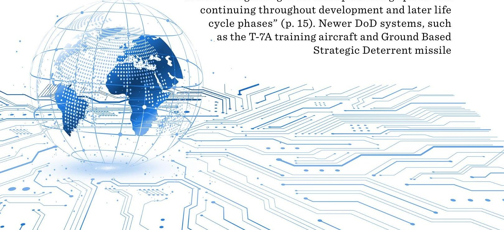
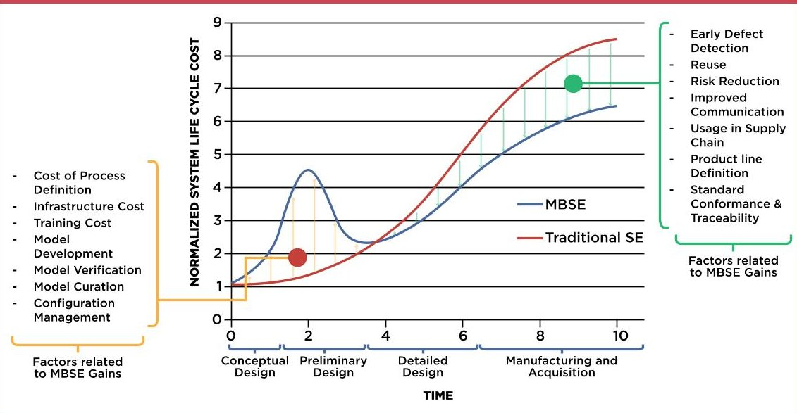
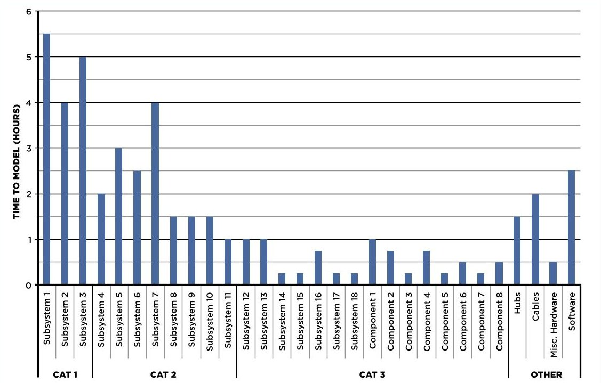
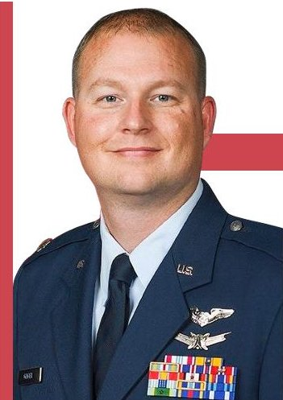

<!-- PDF_PAGE: 1 -->

Image designed by Nicole Brate

<!-- PDF_PAGE: 2 -->

ADOPTION OF

Model-Based

Systems

Engineering

IN TRADITIONAL

DoD Systems

Capt. Patrick Assef, USAF, and Lt. Col. Jeremy Geiger, USAF

The transition to digital engineering has become a major objective within the Department of Defense (DoD). One such method is Model-Based Systems Engineering (MBSE), or the use of models to facilitate systems engineering. Most new DoD programs are being built from the ground up using MBSE. However, the question of whether MBSE should be incorporated into existing systems still lingers. Little research currently exists on the efforts required to transition existing systems to MBSE. In this article, the authors measure the effort required to transition an existing system of systems (SoS), which primarily relied on document-centric methods, to MBSE. Time efforts were measured to develop the model for the SoS, as well as the subsystems and components it contains. Additionally, existing MBSE resources that are part of the cost of transitioning to MBSE were also compiled. The research is intended to serve as a guide for program managers throughout the DoD to roughly estimate the time and costs they will incur to transition their programs to MBSE.

DOI: https://doi.org/10.22594/dau.22-892.30.01 Keywords: Model-Based Systems Engineering (MBSE), Systems Modeling Language (SysML), Document-Based Systems Engineering (DBSE), digital engineering, system of systems (SoS)

<!-- PDF_PAGE: 3 -->

The Department of Defense (DoD) is making an unprecedented shift in the way it conducts systems engineering. Traditionally, Document-Based Systems Engineering (DBSE) has been used over the life cycle of our weapon systems. As the name implies, documents are used in DBSE to capture important system information: technical specifications, interfaces, requirements, analysis, and functions. Documents often include (but are not limited to) text files, spreadsheets, slideshows, diagrams, and/or operational views. In 2018, the Office of the Deputy Assistant Secretary of Defense for Systems Engineering introduced a new initiative, the Department of Defense Digital Engineering Strategy, to capitalize on the best systems engineering practices found in the commercial environment. This strategy was designed to move the DoD away from DBSE and toward digital engineering practices to "help ensure continued U.S. technological superiority" (DoD, 2018, p.12).

Disadvantages of the DBSE approach have become apparent. Complex systems quickly become document-intensive and are difficult to change and sustain (p.15). This leads to extended development and acquisition times for systems, which is not acceptable in "rapidly changing operational and threat environments, tight budgets, and aggressive schedules" (p.1). The strategy urges the adoption of digital engineering, which is "an integrated digital approach that uses authoritative sources of system data and models as a continuum across disciplines to support life-cycle activities from concept through disposal" (p.3). Compared to DBSE, digital engineering is expected to offer informed decision making, enhanced communication, increased design flexibility and adaptability, increased confidence in the system, and increased engineering and acquisition efficiency (p.3).

One form of digital engineering being used in the DoD is Model-Based Systems Engineering (MBSE). MBSE is defined by the International Council on Systems Engineering (2007) as "the formalized application of modeling to support svstem requirements, design, analysis, verification and validation activities beginning in the conceptual design phase and continuing throughout development and later life cycle phases" (p.15). Newer DoD systems, such as the T-7A training aircraft and Ground Based Strategic Deterrent missile

<!-- PDF_PAGE: 4 -->

system, are being built from the ground up using MBSE. However, the majority of DoD systems were developed and fielded using DBSE methods. Program offices wishing to transition a weapon system to MBSE methods will need to determine how to do so and what resources will be needed.

# Compared to DBSE, digital engineering is expected to offer informed decision making, enhanced communication, increased design flexibility and adaptability, increased confidence in the system, and increased engineering and acquisition efficiency.

To support the shift to digital engineering, the Air Force recently established the Digital Transformation Office (DTO) with the goal of managing digital transformation activities in both the Air and Space Force enterprises (Alia-Novobilski, 2021). The DTO SharePoint site contains some resources for program managers to start the transition to MBSE, but the site is still a work in progress. Additionally, current literature has not captured all efforts required to transition an existing system from DBSE to MBSE. This leads to a few different research questions:

- What efforts are required to transition an existing, documentbased system of systems (SoS) to MBSE?

- How can transition efforts be measured?

- What resources are available to program offices trying to transition a system to MBSE?

This research examined an existing SoS built and managed using DBSE and measured the effort needed to shift the SoS to MBSE. Additionally, this research explored what existing resources are available for program managers wishing to transition to MBSE methods.

## Literature Review

Industry's approach to systems engineering has been shifting from DBSE to MBSE over the past several years. As a result of this shift, MBSE has become an important area of research as commercial and government

<!-- PDF_PAGE: 5 -->

organizations determine how to approach the MBSE process. MBSE methods affect the entire life cycle of a system and require extensive investment in training, technology, and process changes. Stated advantages of MBSE often include reduced program costs, improved system performance, improved decision making and traceability, and decreased program risk, among many others (Carroll & Malins, 2016, pp. 45-48; Henderson & Salado, 2021, pp. 51-66; Huldt & Stenius, 2019, pp. 139-145). However, in a systematic review of 360 published papers mentioning MBSE benefits, Henderson and Salado (2021) found only two that had measured the benefits of using MBSE (pp. 57-59). Additionally, only 10% of papers observed some benefit resulting from MBSE, while the benefits mentioned in the remaining papers were only perceived or referenced from another paper (p. 59). This shows a large gap in current research to measure the benefits of MBSE and the efforts it takes to adopt MBSE.

Part of the reason for the lack of measured MBSE benefits may be due to the relative newness of MBSE methods. Examining the current state-ofpractice of MBSE through surveys and interviews, Huldt and Stenius (2019) found that, on an organizational scale, no established methods exist to measure the benefits or efforts of using MBSE (p.144). In addition, hurdles are still encountered in applying MBSE over the life cycle of larger, more complex systems. Most implementation of MBSE has been on the front end of system development, so methods and tools may not be sufficiently developed for later program management activities (pp.139-140). Little published research is available on applying these same methods and tools to an existing system in the later stages of its life cycle. Additionally, without

<!-- PDF_PAGE: 6 -->

standards for how the effort can be measured, program managers will not know what efforts are required to transition their systems to MBSE.

Organizations are interested in adopting MBSE for their systems. NASA has published results of applying MBSE within its programs (Bayer, 2018). The DoD has also performed research on the use of MBSE to assist in creating a new system (Cole et al., 2019). However, in both of these cases and much of current MBSE research, the system was developed from the beginning using MBSE. Research on transitioning an existing system has just recently become an area of focus. Rogers and Mitchell (2021) examined the application of MBSE to the Submarine Warfare Federated Tactical Systems (SWFTS) program, a complex system of systems incorporating commercial and military systems that had traditionally used document-based methods. The SWFTS is currently undergoing sustainment activities within its life cycle and had traditionally used spreadsheets and database software to manage requirements (pp. 8-9). By transitioning to MBSE to manage and test interface requirement changes, the authors found an 18% decrease in required labor time, 9% fewer problems, 18% of problems being identified earlier, as well as associated cost reductions within the program (pp. 17-18). They also developed a metric for measuring the number of labor hours taken to make requirements modifications, where they found MBSE to take an average of 9.9 hours per requirement, down from 12.1 hours required during the legacy process (p.13). Rogers and Mitchell (2021) show that transitioning an existing SoS from DBSE to MBSE is possible, can provide benefits to the system, and provide a metric for program managers to estimate an effort for a transition. However, this study focused solely on transitioning requirements. Transitioning other portions of a system (e.g., structure or functions) to MBSE are other areas that can be researched. Additionally, the SWFTS program is a single data point of transitioning an SoS to MBSE. More data points should be collected to confirm the results and further develop a time/cost model of transitioning a system to MBSE.

Another study by Madni and Purohit (2019) examined the economics of transitioning existing systems from DBSE to MBSE. In comparing DBSE and MBSE approaches, they found that the MBSE approach, while requiring a greater up-front investment, gave a greater return on investment later in the system's life cycle (pp.11-13), as shown in Figure 1 (see next page). Expected gains from MBSE included earlier defect detection, risk reduction, improved communication, and reuse of models and data, all of which led to time and/or cost savings (pp.13-14). Madni and Purohit (2019) break the costs of transitioning an existing system to MBSE into four categories: process definition cost, infrastructure cost, training cost, and model-related costs (p.13).

<!-- PDF_PAGE: 7 -->

FIGURE 1. MBSE AND DBSE LIFE-CYCLE COST

Note. Source: Madni & Purohit, 2019, p. 13

- Process definition cost is the cost of applying and generating models using a specific MBSE methodology.

- Infrastructure cost is the cost of software and equipment to perform MBSE.

- Training cost is the cost of training people on MBSE, tools, and modeling languages.

- Model-related costs are the costs that come with developing the model, including maintaining consistency, verifying the model, and configuring the model for the intended number of users.

With costs and benefits identified, users can better determine whether transitioning their system to MBSE will produce a net positive benefit.

## Methods

To determine the efforts required to transition an SoS to MBSE, an existing system that relies on DBSE must be identified. The system should have >90% of its systems engineering work accomplished through DBSE processes and >90% of system information captured in documents. These criteria will result in selection of a system that relies on documents for systems engineering and has information available to develop a digital model. The system's past and present systems engineering and technical documents will need to be collected to develop the digital model. The time

<!-- PDF_PAGE: 8 -->

it takes to transition the documents to the model will be recorded for each system or component within the SoS, as well as the SoS as a whole. The goal of this research is not to provide a definitive amount of time required to transition a whole SoS to MBSE. Rather, it provides a data point from a single SoS that can—with the addition of other data points—be used to generate an estimate for the amount of time to transition a system or SoS.

All four categories of cost identified by Madni and Purohit (2019) were considered in this research. The model-related costs will be captured during the transition of the existing SoS to MBSE. To capture process definition, infrastructure, and training costs, current MBSE resources will be compiled to provide a user with available options. This list of resources provides a reference for users interested in transitioning their system to MBSE, offering them the ability to roughly estimate costs. MBSE resources will be compiled using a combination of online search engines and pre-existing lists compiled by various organizations. Important information about each resource was tabulated for the user. As stated previously, the intent of this research is not to point a user toward a specific MBSE methodology, tool, or training resource, but to provide users with information on the resources available to them. They can then estimate the effort needed to transition their organization to MBSE based on the resources that best suit them.

This research uses the Systems Modeling Language (SysML) to develop its MBSE model. SysML is a general-purpose graphical modeling-language for systems engineering, maintained by the Object Management Group (OMG). Unified Modeling Language (UML) 2.0 is the graphical-modeling language for software engineering from which SysML is derived. SysML provides a user with different diagram types to create a model. The nine diagrams can broadly be grouped into five categories: (a) package diagrams, dealing with the organization of the model; (b) requirement diagrams, detailing system requirements and their relations; (c) behavior diagrams, which model system behavior; (d) parametric diagrams, used to perform analysis

<!-- PDF_PAGE: 9 -->

on a system; and (e) structure diagrams, which present the structure of the system, including its composition, interconnection, and interfaces (Friedenthal et al., 2015). Some of these diagrams are inherited from UML 2.0, while others are new. Cameo Systems Modeler v19.0 SP4 was chosen as the MBSE software tool for this research. Cameo allows modeling and simulation of systems in an MBSE environment and supports SysML usage. The authors chose both SysML and Cameo because of their familiarity with, and access to, the language/software. Additionally, SysML and Cameo are used in commercial industry as well as the DoD.

## Training resources are courses intended to teach users about MBSE, whether it be general MBSE knowledge or specific language/tool application.

The authors located an existing SoS within the DoD, which heavily relies on DBSE methods. The SoS consists of several different types of subsystems and components to connect the subsystems within the SoS. As part of an Acquisition Category (ACAT) III program, the SoS is defined by the DoD as requiring less than $200 million of total expenditure for research, development, test and evaluation, and less than $920 million for procurement. The program office that maintains this system uses a Microsoft SharePoint site as a central repository for documents. The authors used digital spreadsheets to record the number and types of documents made available for this research. The authors chose this SoS as a basis for their research because of the use of DBSE methods by the program office, number of documents about the structure of the SoS and its subsystems, and access to documentation to build the digital model. The SoS provided a good data point as all of its systems engineering work is accomplished through DBSE processes, and information is captured in documents. For the chosen SoS, this research only examined the structure of a single SoS because of constraints on time and access to information.

To begin, the researchers found lists of resources created by various MBSE organizations and used Google's online search engine to find other potential resources that were not included in the pre-existing lists. The authors searched for the terms MBSE resources, MBSE software, and MBSE methodologies. Information was recorded in spreadsheets. The authors then performed additional research on each resource found, such as cost to

<!-- PDF_PAGE: 10 -->

gather information about the resource. Resources were divided into three categories: methodologies, software tools, and training.

In terms of MBSE, a methodology is a combination of a process (what will be done), a method (how it will be done), and a tool (ability to do the "what" and "how") (Estefan, 2008, pp. 2-3). The methodology acts as a recipe, directing the usage of the process, method, and tool (p. 3). Software tools are software that supports MBSE modeling through a modeling language, such as SysML. Training resources are courses intended to teach users about MBSE, whether it be general MBSE knowledge or specific language/ tool application.

Table 1 captures information on software resources. This information informs a user about whether or not the existing software is available and the popularity, cost, and variations. Since the prices of software regularly change as new editions and features are added, price information will be recorded using a scale of one-to-three dollar signs. One dollar sign represents a cheaper cost and three represents a more expensive cost. The price includes the one-time cost of initially purchasing the software license and the annual price to maintain a subscription. Most companies offer a subscription service to their software, allowing a user to receive new updates and versions (as long as the subscription is maintained). Without a subscription, users maintain their software license (referred to as a perpetual license), but are usually locked into the version of the software they initially purchased. Some companies also offer the ability to rent software licenses, with loss of access to the software license once the rental period ends. These aspects are captured under the "Purchase Options" category.

<table border="1"><tr><td>Software</td><td>Name of the software</td></tr><tr><td>Company</td><td>Company that develops the software</td></tr><tr><td>Country of Origin</td><td>Country where the company is located</td></tr><tr><td>Number of Users</td><td>Numbers of users of the software</td></tr><tr><td>Version</td><td>Different versions of the software available, ordered from least amount of features to most</td></tr><tr><td>Price</td><td>Price of the software, rated on a scale of $ (low) to $ $ $ (high)</td></tr><tr><td>Purchase Options</td><td>Perpetual, rental, and/or subscription</td></tr><tr><td>License Type(s)</td><td>Standard, floating, or both</td></tr><tr><td>Modeling/Simulation</td><td>Modeling and/or simulation</td></tr><tr><td>Cloud Service</td><td>Does the software offer a cloud service for model storage and collaborative work?</td></tr></table>

<!-- PDF_PAGE: 11 -->

Another option for users to consider is the type of purchase license: standard or floating. Standard licenses, also called node-locked, are tied to a single device, although some companies allow license transfers to other devices (which may come with an additional fee). While users have access to their devices, they can access the software with a standard license. Floating licenses are stored on a server and checked out when a user is making use of the software, allowing the software to be installed across multiple devices. If all floating licenses are checked out, the software will not be accessible until one of the licenses is made available again. In general, standard licenses are cheaper and better for an organization, with users and devices paired one-to-one, while floating licenses are better in larger organizations with multiple devices and users who will not be using the software at the same time.

Finally, two other features for users to consider with software are the support of simulation and a cloud storage service.Many pieces of MBSE software allow users to not only model their system, but simulate it as well. These simulations can include engineering analysis based on data values or the simulation of behaviors modeled in diagrams. Typically, the higher end variations of specific software incorporate simulation features. Whether or not the software supports simulation features is captured under the "Modeling/Simulation" category. The ability for multiple users in an organization (or across multiple organizations) to collaborate on a single model is also an important feature. Cloud storage is a method of data storage using the internet/remote servers. Multiple users can access the data on these servers without needing to be in the same location. This allows for easier collaboration and version management of models. Many companies offer some form of cloud storage and collaboration with their software, although it may come with an extra fee.

## Floating licenses are stored on a server and checked out when a user is making use of the software, allowing the software to be installed across multiple devices. If all floating licenses are checked out, the software will not be accessible until one of the licenses is made available again.

<!-- PDF_PAGE: 12 -->

Table 2 lists the type of information that will be captured for training resources. Similar to the software table, the intent is to provide users with a list of current options and allow them to choose what best suits their needs. The training resource list will capture training resources from DoD, commercial, and university sources. Course pricing information will be captured under the "Price" category, if available. The "Language/ Tool" category will be used to display whether the course focuses on a specific MBSE language and/or tool, or general MBSE. The "level" category will be used to capture the type of user for which the course is intended. Beginner courses are for those with little to no prior experience with MBSE, intermediate courses are for those with prior MBSE experience, and advanced courses are for those who are very familiar with MBSE. The course level will be based on its difficulty, as listed on the course page; or, if no level of difficulty is listed, potential students can discern the level of difficulty implied through the course description. The method of course delivery will also be included in the software table. Courses may be offered in-person or through a virtual service remotely. Two types of remote courses are offered: synchronous and asynchronous. Synchronous courses are taught in real time by a teacher with other students over a virtual network, similar to an in-person class. Asynchronous courses allow users to go through the material at their own pace.

<table border="1"><tr><td>Organization</td><td>Organization that offers the course</td></tr><tr><td>Course</td><td>Title of the course</td></tr><tr><td>Price</td><td>Price of the course, if there is one</td></tr><tr><td>Language/Tool</td><td>What MBSE language(s) and tool(s) the course uses</td></tr><tr><td>Level</td><td>The MBSE skill level of the course: beginner, intermediate, or advanced</td></tr><tr><td>Length</td><td>Length of the course</td></tr><tr><td>Course Delivery</td><td>How the course is taken: in-person, synchronous remote, or asynchronous remote</td></tr></table>

<!-- PDF_PAGE: 13 -->

## Results

The researchers created a model of the SoS using documents collected from the program office. They focused on modeling the structure of the existing SoS. Four viewpoints containing various physical, electrical, and data interfaces and interconnections within the SoS were developed in the model. Additionally, documentation of the subsystems within the SoS was recreated in the model. A more in-depth discussion on the creation and contents of the model and findings from transitioning the document-based SoS to MBSE can be found in Assef and Geiger (2021). As various documents were transitioned to MBSE, the time spent modeling was recorded. Table 3 is a breakdown of the time spent modeling. In total, 51 documents were used to model the SoS and its subsystems and components. The authors read over 5,100 pages within these documents to recreate the SoS structure within the model.

TABLE 3. TIME SPENT TRANSITIONING DOCUMENTS TO MBSE

<table border="1"><tr><td>Portion</td><td>Time Spent Transitioning to MBSE(hrs)</td><td>Time Spent Transitioning to MBSE(%)</td></tr><tr><td>Subsystems/Components</td><td>45.75</td><td>49.6</td></tr><tr><td>SoS Structure</td><td>38.5</td><td>41.7</td></tr><tr><td>Model</td><td>8</td><td>8.7</td></tr><tr><td>Total</td><td>92.25</td><td>100</td></tr></table>

In total, 92.25 hours were spent transitioning the SoS to MBSE. It took 45.75 hours to model the various subsystems/components that made up the SoS. Modeling time is further broken down into each individual subsystem and component in the discussion that follows. Modeling the SoS structure took 38.5 hours. This number included the time spent creating and connecting the different interface viewpoints, modeling connections with external systems, the physical decomposition of the SoS, and creating allocation matrices for the SoS. The remaining 8 hours were spent on general model work. This included organizing the model and determining the right type of diagrams and features to display information.

<!-- PDF_PAGE: 14 -->

The subsystems and components within the SoS were divided into four categories (Category 1, Category 2, Category 3, and Other), based on the type and amount of documentation used to model them. For purposes of this research, a subsystem is any part of the SoS, which, when removed from the SoS, can still operate and perform a function independently. A component is a part of the SoS that cannot operate independently when removed. Using a car as an example, a smartphone used to play music over the car's radio would be considered a subsystem, as it still can independently operate and perform functions when removed from the car. On the other hand, a steering wheel in the car would be considered a component, as it serves no function when not part of the car.

## In total, 51 documents were used to model the SoS and its subsystems and components. The authors read over 5,100 pages within these documents to recreate the SoS structure within the model.

Category 1 included subsystems that had the most detailed documents available. These documents typically included operations and maintenance manuals, which broke down the interfaces and parts of the subsystem in copious detail. Complete structural diagrams of Category 1 subsystems were developed in the model using these documents. These diagrams contained a large amount of detail about the technical values, internal structure, and interfaces of the subsystems. Category 2 includes subsystems that had moderate detail available in documentation. They typically included documents with interface breakdowns, such as an operations manual. However, these subsystems did not have detailed part breakdowns in the documents available. As a result, the diagrams developed in the model for Category 2 subsystems detail the subsystem's interfaces but have little to no information on the internal structure of the subsystem.

Category 3 included subsystems and major components with minimal information from available documents. Typically, these subsystems/components had a one- or two-page technical data sheet with various technical values and an interface specification but little other information. Diagrams in the model for Category 3 subsystems/components feature minimal interface and structural detail.

<!-- PDF_PAGE: 15 -->

Finally, the "Other" category included groupings of minor components that did not fit well within Categories 1, 2, or 3. Groupings included cables, power/data hubs, software, and miscellaneous hardware. Each of these groups of components also had their own diagrams within the model (i.e., a cabling diagram with all of the cables, a software diagram with all of the software, etc.). The cables and power/data hubs had little documentation available, but their interfaces were derived from the subsystem and SoS interface documents. Within the SoS, 29 cables and four power/data hubs were modeled. Software included all software within the SoS. Similar to the cables and hubs, no documentation was available specifically on software. Rather, information on software was derived from engineering documentation on the SoS. Fifty distinct pieces of software were captured within the SoS. Finally, minor components that were not considered part of the subsystem, with very little technical information/documentation and only a physical interface (such as protective casing for subsystems), were grouped together as miscellaneous hardware. In total, four minor components were considered miscellaneous hardware.

The authors used 26 subsystems/components in the SoS research. This number does not include the cabling, power/data hubs, software, and miscellaneous hardware groupings in the "Other" category. Table 4 shows a breakdown of how the subsystems/components were distributed. Similarly, Figure 2 is a breakdown of the time required to model each subsystem/component.

TABLE 4. CATEGORY BREAKDOWN OF SUBSYSTEMS/COMPONENTS

<table border="1"><tr><td>Category</td><td>Description</td><td>Number in SoS</td></tr><tr><td>1</td><td>Documentation allowed the detailed modeling of interfaces and structure.</td><td>3</td></tr><tr><td>2</td><td>Documentation allowed the detailed modeling of interfaces, minimal modeling of structure.</td><td>8</td></tr><tr><td>3</td><td>Documentation allowed minimal modeling of interfaces and structure.</td><td>15</td></tr><tr><td>Other</td><td>Documentation allowed the modeling of cabling, hubs, software, or miscellaneous hardware.</td><td>4</td></tr><tr><td>Total</td><td>-</td><td>30</td></tr></table>

<!-- PDF_PAGE: 16 -->

FIGURE 2. TIME SPENT MODELING EACH SUBSYSTEM, COMPONENT, AND GROUPING

A majority of the subsystems and components within the SoS fell into Category 3, while only three fell into Category 1. The decreasing number of hours required to model each subsystem/component is not necessarily representative of the total amount of time to model the subsystem/ component with all documentation. It simply means more documentation was available for some subsystems. For example, subsystem 7 fell into Category 2, despite requiring the same length of time to model than subsystem 2, which fell into Category 1. This was because subsystem 7 was a more complex system than subsystem 2, with a larger number of interfaces. If documentation better detailing the structure of subsystem 7 had been available, it may have required the most time to model of all subsystems.

MBSE saved time as more subsystems were added. Subsystem 6 was one of the first subsystems modeled, so most of its elements had to be created. Subsystem 10, which had a similar number of interfaces and structural elements, took about 1 hour less to model. The time difference was because many model elements were able to be reused and repurposed in subsystem 10's diagram. As a model is developed, additional subsystems and components will take less time to develop if elements can be reused. This agrees with existing literature, which found that MBSE requires a larger up-front investment (of time and money) than DBSE but provides savings long-term, partly because of the ability to reuse assets in models (Madni & Purohit, 2019, pp.11-13).

<!-- PDF_PAGE: 17 -->

On average, the time to model Category 1 subsystems was 4.83 hours, Category 2 subsystems required 2.12 hours, and Category 3 subsystems/components took 0.52 hours. The decreasing average time between each category was expected, as each category has a smaller amount of documentation that was used to model the system. The hubs, cables, software, and miscellaneous hardware groupings took 1.5, 2, 2.5, and 0.5 hours, respectively. Using the number of components within each grouping, as well as the number of subsystems/components within the SoS, the average times taken to model this SoS were calculated, as shown in Table 5.

Using Table 5 as a guide, a rough estimate can be made to determine the amount of time required to transition a document-based SoS to a model. For example, if a program manager has an existing SoS with 5 Category 1, 10 Category 2, 5 Category 3, 10 different cable types, 2 different hub types, 20 pieces of software, and 2 pieces of miscellaneous hardware, it would take roughly 88 hours to transition the documents to MBSE. Of that time, 50.7 hours would be spent modeling the various subsystems and components, 30.8 hours would be spent on modeling the SoS, and 6.4 hours would be spent on general modeling.

TABLE 5. AVERAGE TIMES TO MODELEACH PORTION OF THE SOS

<table border="1"><tr><td>Model Portion</td><td>Average Time to Model(hrs)</td></tr><tr><td>Category1 Subsystem/Component</td><td>4.8</td></tr><tr><td>Category2 Subsystem/Component</td><td>2.1</td></tr><tr><td>Category3 Subsystem/Component</td><td>0.52</td></tr><tr><td>Cabling</td><td>0.07/cable</td></tr><tr><td>Power/Data Hubs</td><td>0.37/hub</td></tr><tr><td>Software</td><td>0.05/piece of software</td></tr><tr><td>Miscellaneous Hardware</td><td>0.12/component</td></tr><tr><td>SoS</td><td>1.3 per subsystem or component</td></tr><tr><td>General Modeling</td><td>0.27 per subsystem or component</td></tr></table>

Another factor to consider is cost. The program office managing the SoS used in this research gave a cost estimate range of $100-$200 per systems engineering hour (P. Steiner, personal communication, December 13, 2021). This cost figure lines up with Rogers and Mitchell (2021, p.19), who used a cost estimate of $150 per systems engineering hour in their study. Based on these cost estimates, the example SoS described previously would cost somewhere in the range of $8,800 to $17,600 for the modeling work to transition from DBSE to MBSE.

<!-- PDF_PAGE: 18 -->

These results will not be applicable to all systems. The size and complexity vary greatly from one SoS to another, and finding a one-size-fits-all metric is not reasonable. This research focused on a system from an ACAT III program. The results may be more beneficial to ACAT III programs than other programs; however, rough extractions with lower fidelity for ACAT II programs may be made. Additionally, this research only contains a single SoS data point, from which significant conclusions cannot be drawn. However, as stated in the previous section, transitioning an SoS from DBSE to MBSE is a field with minimal published and publicly available research as well as established methods for measuring effort. These results can be used as a starting point to which more data points can be added, and they can provide potential MBSE practitioners an idea of what to expect for their system or SoS.

Time to transition documents to a digital model is only one component of the costs to transition an organization to MBSE. The other components are MBSE methodologies, tools, and training for personnel, each with its own cost. In this research, the authors attempted to collect current information on MBSE methodologies, software, and training resources available to provide users with a better idea of the cost of transitioning their organization/program to MBSE.

## Transitioning an SoS from DBSE to MBSE is a field with minimal published and publicly available research as well as established methods for measuring effort.

Estefan (2008) captures the most heavily used methodologies and provides detailed information on what each methodology entails. The five methodologies captured by Estefan (2008) are (1) IBM Telelogic Harmony-SE, (2) INCOSE Object-Oriented Systems Engineering Method (OOSEM), (3) IBM Rational Unified Process for Systems Engineering for Model-Drive Systems Development, (4) Vitech MBSE Methodology, and (5) Jet Propulsion Laboratory State Analysis. Of these, Harmony-SE and OOSEM have free training resources available on their respective websites for learning the methodologies. Publicly available training resources for the other three could not be found.

<!-- PDF_PAGE: 19 -->

The researchers focused on software that supports SysML in their capture of software resources, as SysML is the industry standard for MBSE. Software was found through existing INCOSE (2021) and Object Management Group (2019) webpages, and further information was gathered from the software's website. Table 6 lists the software resources compiled by this research. Thirteen software tools were found and compiled for the software resource table. Most developers of software did not publish the number of subscribed users, although each claims several large organizations use their software. Six pieces of software had multiple listed versions from which the user could choose. Versions were organized within each spreadsheet row from top to bottom, starting with the most basic and ending with the most advanced. The more advanced versions of the software offer users more features, although the exact features differ from software to software. Prices were rated on a scale of one-to-three dollar signs, with one dollar sign being <$1,500, two being $1,500-$2,500, and three being >$2,500. Pricing information was not publicly available for Rhapsody, Innoslate, SCADE Architect, or Windchill Modeler. Cameo and GENESYS provided more expensive software, while Enterprise Architect and Visual Paradigm offered options throughout the price spectrum. Astah and Software Ideas Modeler had software on the lower end of the price scale. Relatively little information was publicly available about SCADE Architect and Windchill Modeler, although their webpages both mention the support of SysML.

All companies with paid software offered standard and floating licenses as well as annual subscription plans. Additionally, the software licenses all turned into perpetual licenses (software access maintained without updates) once a subscription was discontinued. Visual Paradigm also offered the ability to rent software licenses for a 1-, 3-, 6-, or 12-month period. However, the license is not perpetual, and the user will lose software access at the end of the rental period. Finally, all paid software offered a cloud service for collaboration and the ability to model using SysML with their software. Astah, Software Ideas Modeler, and Visual Architect did not offer

<!-- PDF_PAGE: 20 -->

<table border="1"><tr><td>Software</td><td>Developer</td><td>Country of Origin</td><td>No. of Users</td><td>Variation</td><td>Price (USD)</td><td>License Type</td><td>Purchase Options</td><td>Modeling/Simulation?</td><td>Cloud Service?</td></tr><tr><td rowspan="2">Astah</td><td rowspan="2">Change Vision, Inc.</td><td rowspan="2">Japan</td><td rowspan="2">640,000</td><td>astah SysML</td><td>$</td><td>Both</td><td rowspan="2">Perpetual or subscription</td><td>Modeling</td><td>N</td></tr><tr><td>astah System Safety</td><td>$</td><td>Both</td><td>Modeling</td><td>Y</td></tr><tr><td rowspan="2">Cameo Systems Modeler</td><td rowspan="2">Dassault Systems (acquired from No Magic)</td><td rowspan="2">France</td><td rowspan="2"></td><td>Architect Edition</td><td>$$-$$</td><td>Both</td><td rowspan="2">Perpetual or subscription</td><td>Modeling</td><td>Y</td></tr><tr><td>Enterprise Edition</td><td>$$</td><td>Both</td><td>Both</td><td>Y</td></tr><tr><td>Capella</td><td>Multiple</td><td>France</td><td>50+ organizational users</td><td>N/A</td><td>Free</td><td>N/A</td><td>N/A</td><td>Modeling</td><td>?</td></tr><tr><td rowspan="2">Engineering Systems Design Rhapsody</td><td rowspan="2">IBM</td><td rowspan="2">USA</td><td rowspan="2"></td><td>Architect for Systems Engineers</td><td>?</td><td>Both</td><td rowspan="2">Perpetual or subscription</td><td>Modeling</td><td>Y</td></tr><tr><td>Designer for Systems Engineers</td><td>?</td><td>Both</td><td>Both</td><td>Y</td></tr><tr><td rowspan="4">Enterprise Architect</td><td rowspan="4">Sparx Systems</td><td rowspan="4">Australia</td><td rowspan="4">850,000+ licenses sold</td><td>Professional</td><td>$</td><td>Both</td><td rowspan="4">Perpetual or subscription</td><td>Modeling</td><td>Y</td></tr><tr><td>Corporate</td><td>$</td><td>Both</td><td>Modeling</td><td>Y</td></tr><tr><td>Unified</td><td>$</td><td>Both</td><td>Both</td><td>Y</td></tr><tr><td>Ultimate</td><td>$$</td><td>Both</td><td>Both</td><td>Y</td></tr><tr><td>GENESYS</td><td>Vitech</td><td>USA</td><td></td><td>N/A</td><td>$$</td><td>Both</td><td>Perp. or sub.</td><td>Both</td><td>Y</td></tr><tr><td>Innoslate MBSE</td><td>SPEC Innovations</td><td>USA</td><td>2000+ companies</td><td>N/A</td><td>?</td><td>Both</td><td>?</td><td>Both</td><td>Y</td></tr><tr><td>Modelio</td><td>Modeliosoft</td><td>France</td><td></td><td>N/A</td><td>Free</td><td>N/A</td><td>N/A</td><td>Modeling</td><td>N</td></tr><tr><td>Papyrus</td><td>CEA LIST, Eclipse Foundation</td><td>France</td><td></td><td>N/A</td><td>Free</td><td>N/A</td><td>N/A</td><td>Both</td><td>N</td></tr><tr><td>SCADE Architect</td><td>Ansys</td><td>USA</td><td></td><td>N/A</td><td>?</td><td>?</td><td>?</td><td>?</td><td>?</td></tr><tr><td rowspan="3">Software Ideas Modeler</td><td rowspan="3">Software Ideas</td><td rowspan="3">Slovakia</td><td rowspan="3"></td><td>Premium</td><td>$</td><td>Both</td><td rowspan="3">Perpetual or subscription</td><td>Modeling</td><td>Y</td></tr><tr><td>Professional</td><td>$</td><td>Both</td><td>Modeling</td><td>Y</td></tr><tr><td>Ultimate</td><td>$</td><td>Both</td><td>Modeling</td><td>Y</td></tr><tr><td rowspan="4">Visual Paradigm</td><td rowspan="4">Visual Paradigm</td><td rowspan="4">Hong Kong</td><td rowspan="4">320,000+</td><td>Modeler</td><td>$</td><td>Both</td><td rowspan="4">Perpetual, subscription, or rental</td><td>Modeling</td><td>Y</td></tr><tr><td>Standard</td><td>$</td><td>Both</td><td>Modeling</td><td>Y</td></tr><tr><td>Professional</td><td>$</td><td>Both</td><td>Modeling</td><td>Y</td></tr><tr><td>Enterprise</td><td>$$-$$</td><td>Both</td><td>Modeling</td><td>Y</td></tr><tr><td>Windchill Modeler</td><td>PTC</td><td>USA</td><td></td><td>N/A</td><td>?</td><td>?</td><td>?</td><td>?</td><td>?</td></tr></table>

<!-- PDF_PAGE: 21 -->

model simulation capability with at least one of their software versions. Three free, open source software tools were also found: Modelio, Capella, and Papyrus. All three support SysML modeling, and Papyrus supports simulation of the model. While these three software developers do not provide a space for collaborative modeling, the capability could be developed.

To capture training resources, the researchers used a list compiled by the U.S.Air Force Digital Transformation Office (Headquarters, U.S.Air Force Materiel Command, 2021), as well as training from commercial sources. As they did with the software list, the researchers focused on SysML training. Table 7 lists these training resources.

## All companies with paid software offered standard and floating licenses as well as annual subscription plans.Additionally, the software licenses all turned into perpetual licenses (software access maintained without updates) once a subscription was discontinued.

Training resources are offered by a variety of organizations, from commercial to DoD to universities, which include a mix of course types offered for all levels of prior MBSE experience. Many courses are available exclusively to users within the DoD community, such as those offered by the Air Force Institute of Technology and Naval Air Systems Command University. Of the courses with a specific software tool, Cameo Systems Modeler was the most common. However, many of the software companies offer training resources tailored for their software tool. Course length ranges from courses that could be completed in a few hours to semester-long university courses. Most courses offer a distance-learning option, either synchronous or asynchronous. Many of the commercial training resources also offer an in-person option, including the option for an instructor to come out to the training site of the person/organization.

This research will likely benefit program offices interested in adopting MBSE practices for their existing system but unsure whether the benefits will outweigh the cost of transition. The research is most applicable to ACAT III programs, but can be applied to any program where a transition to MBSE is desired. Using the results from this research, a program office can estimate the time it would take to transition its existing system documents

<!-- PDF_PAGE: 22 -->

<table border="1"><tr><td>Organization</td><td>Course</td><td>Price</td><td>Language/Tool</td><td>Level</td><td>Length</td><td>Delivery</td></tr><tr><td rowspan="3">AFIT</td><td>SENG 520 Foundations of Systems Engineering</td><td>?</td><td>SysML/Cameo</td><td>Beginner</td><td>10 weeks</td><td>In-person or Virtual</td></tr><tr><td>SENG 660 Advanced Principles of Engineering Design</td><td>?</td><td>SysML/Cameo</td><td>Advanced</td><td>10 weeks</td><td>In-person or Virtual</td></tr><tr><td>Tailored Program-Specific Modeling and Cameo Course</td><td>?</td><td>SysML/Cameo</td><td>Varies</td><td>1-4 weeks</td><td>In-person or Virtual</td></tr><tr><td>Cal Tech</td><td>Model-Based Systems Engineering (MBSE) Certificate Program</td><td>$2,850</td><td>SysML</td><td>Beginner</td><td>5 days</td><td>Virtual-Sync</td></tr><tr><td rowspan="3">Dassault Systèmes</td><td>SysML Intensive with MBSE Using Cameo Systems Modeler</td><td>Paid</td><td>SysML/Cameo</td><td>Beginner</td><td>5 days</td><td>In-person or Virtual</td></tr><tr><td>Teamwork Cloud Project Strategies and Best Practices</td><td>Paid</td><td>SysML/Cameo</td><td>Intermediate</td><td>2 days</td><td>In-person or Virtual</td></tr><tr><td>Simulation Toolkit with Cameo Systems Modeler</td><td>Paid</td><td>SysML/Cameo</td><td>Advanced</td><td>5 days</td><td>In-person or Virtual</td></tr><tr><td>DAU</td><td>CENG 001 Coursera-MBSE (Model-Based Systems Engineering)</td><td>Free</td><td></td><td>Intermediate</td><td>11 hours</td><td>Virtual-Async</td></tr><tr><td rowspan="4">IBM</td><td>IBM Engineering Systems Design Rhapsody plus SysML for MBSE</td><td>Paid</td><td>SysML/Rhapsody</td><td>Intermediate</td><td>24 hours</td><td>In-person or Virtual</td></tr><tr><td>Quick Starts: IBM Engineering Systems Design Rhapsody for MBSE</td><td>Free</td><td>Rhapsody</td><td>Beginner</td><td>2 hours</td><td>Virtual-Async</td></tr><tr><td>Accelerated IBM Engineering Systems Design Rhapsody for Existing UML/SysML Users</td><td>Paid</td><td>UML or SysML/Rhapsody</td><td>Advanced</td><td>24 hours</td><td>In-person or Virtual</td></tr><tr><td>MIT x Pro</td><td>Architecture and Systems Engineering: Models and Methods to Manage Complex Systems</td><td>$3,249</td><td>SysML</td><td>Beginner</td><td>17 weeks</td><td>Virtual-Sync</td></tr><tr><td rowspan="3">NASA</td><td>Foundations of MBSE (APPEL-vMBSE1)</td><td>Free</td><td>General MBSE</td><td>Beginner</td><td>1 day</td><td>Virtual-Sync</td></tr><tr><td>Applied MBSE (APPEL-vMBSE2)</td><td>Free</td><td>General MBSE</td><td>Intermediate</td><td>2 days</td><td>Virtual-Sync</td></tr><tr><td>Model Based Systems Engineering Design and Analysis (APPEL-vMBSE3)</td><td>Free</td><td>General MBSE</td><td>Advanced</td><td>3 days</td><td>Virtual-Sync</td></tr><tr><td rowspan="8">NAVAIRU</td><td>CORE-410-102 Basic SysML (101/201)</td><td>Paid</td><td>SysML</td><td>Beginner</td><td></td><td></td></tr><tr><td>CORE-420-103 Intro to SysML</td><td>Free</td><td>SysML</td><td>Beginner</td><td>4 hours</td><td>Virtual-Async</td></tr><tr><td>CORE-411-115 SE Bootcamp</td><td>Free</td><td>General MBSE</td><td>Beginner</td><td>5 days</td><td>In-person</td></tr><tr><td>CORE-411-116 SET for PMs and IPTLS</td><td>Free</td><td>General MBSE</td><td>Beginner</td><td>3 hours</td><td>Virtual-Async</td></tr><tr><td>CORE-41B-2001 A Look Ahead at SysML v2 by Sanford Friedenthal</td><td>?</td><td>SysML</td><td>Intermediate</td><td></td><td></td></tr><tr><td>CORE-41B-200121 Language, Profile, and Framework</td><td>?</td><td>SysML</td><td>Intermediate</td><td></td><td></td></tr><tr><td>CORE-41B-200211 Cameo Collaborator-Tutorial</td><td>?</td><td>SysML/Cameo</td><td>Intermediate</td><td></td><td></td></tr><tr><td>CORE-44W-190314</td><td>?</td><td>SysML</td><td>Intermediate</td><td></td><td></td></tr></table>

<!-- PDF_PAGE: 23 -->

<table border="1"><tr><td>Organization</td><td>Course</td><td>Price</td><td>Language/Tool</td><td>Level</td><td>Length</td><td>Delivery</td></tr><tr><td rowspan="3">NAVAIRU(continued)</td><td>CORE-450-195 Applying Open Architecture Through MBSE for Applications at NAVAIR</td><td>?</td><td>UML&amp;SysML</td><td>Intermediate</td><td></td><td></td></tr><tr><td>CORE-4KB-181219 Application of MBSE in the Development of UPneXt</td><td>?</td><td>General MBSE</td><td>Beginner</td><td></td><td></td></tr><tr><td>CORE-4M2-107 SysML Intensive with MBSE using CSM</td><td>?</td><td>SysML/Cameo</td><td>Intermediate</td><td>5 days</td><td></td></tr><tr><td rowspan="2">Naval Postgraduate School</td><td>SE4930 Model-Based Engineering Course</td><td>$2,500</td><td></td><td>Intermediate</td><td>10 weeks</td><td>Virtual-Sync</td></tr><tr><td>MBSE Certificate Program</td><td>$10,000</td><td></td><td>Intermediate</td><td>1 year</td><td>Virtual-Sync</td></tr><tr><td rowspan="4">PivotPoint Technology</td><td>Essential MBSE+SysML Applied</td><td>Paid</td><td>SysML/Various</td><td>Beginner</td><td>3-5 days</td><td>In-person or virtual</td></tr><tr><td>Intermediate MBSE+SysML Applied</td><td>Paid</td><td>SysML/Various</td><td>Intermediate</td><td>4-5 days</td><td>In-person or virtual</td></tr><tr><td>Advanced MBSE+SysML Applied</td><td>Paid</td><td>SysML/Various</td><td>Advanced</td><td>3-5 days</td><td>In-person or virtual</td></tr><tr><td>MBSE Using Sparx EA</td><td>Paid</td><td>SysML/Enterprise Architect</td><td>Intermediate</td><td>5 days</td><td>In-person or virtual</td></tr><tr><td rowspan="5">SPEC Innovations</td><td>IST 101 Introduction to Innoslate</td><td>Paid</td><td>LML/Innoslate</td><td>Beginner</td><td></td><td>In-person or virtual</td></tr><tr><td>IST 201 Innoslate for MBSE</td><td>Paid</td><td>LML/Innoslate</td><td>Beginner</td><td>2 days</td><td>In-person or virtual</td></tr><tr><td>IST 501 Intermediate Innoslate Application</td><td>Paid</td><td>LML/Innoslate</td><td>Intermediate</td><td>3 days</td><td>In-person or virtual</td></tr><tr><td>IST 705 Advanced Innoslate Workshop</td><td>Paid</td><td>LML/Innoslate</td><td>Advanced</td><td></td><td>In-person or virtual</td></tr><tr><td>MBSE Course with Workshop</td><td>$980</td><td>General MBSE/Innoslate</td><td>Beginner</td><td>4-5 days</td><td>In-person or virtual</td></tr><tr><td>Thales</td><td>Arcadia &amp; Capella MBSE training</td><td>Paid</td><td>Capella</td><td>Beginner</td><td>3 days</td><td></td></tr><tr><td>Visual Paradigm</td><td>Visual Paradigm Essential</td><td>Free</td><td>Visual Paradigm</td><td>Beginner</td><td>5+ hours</td><td>Virtual-Async</td></tr><tr><td rowspan="2">Vitech</td><td>MBSE Tutorial</td><td>Paid</td><td>General MBSE</td><td>Beginner</td><td>2 hrs-2 days</td><td></td></tr><tr><td>Introduction to MBSE with GENSYS</td><td>$1,995</td><td>GENESYS</td><td>Intermediate</td><td>5 days</td><td>Virtual-Sync</td></tr></table>

<!-- PDF_PAGE: 24 -->

to an MBSE model. An engineering labor cost rate can be applied to this time value to estimate the cost of transitioning the system to MBSE. Using the MBSE resources gathered in this research, the program office can also determine approximate costs for the process, software, and training resources needed for successful MBSE adoption in their organization. Readied with all this information, the program office will have an estimate of the up-front time and cost needed to transition a program to MBSE. Each program office can then make an informed decision as to whether MBSE practices are beneficial for its system or if the costs of transition are too great. Another factor for program offices to consider is the long-term benefits of MBSE adoption, which are presented in referenced research.

## Conclusions

In this article, the authors have answered the following research questions:

- What efforts are required to transition an existing document-based SoS to MBSE?

- How can transition efforts be measured?

- What resources are available to program offices trying to transition a system to MBSE?

Using an existing DoD program that utilized DBSE, an SoS was successfully transitioned to MBSE methods, specifically a digital model using SysML. The scope of the research was limited to transitioning the structure of the SoS, as well as its various subsystems and components. To measure the effort, the time taken to transition the SoS was recorded. In total, 92.25 hours were spent transitioning the SoS to the digital model. The total time was further broken down into time used to model the subsystems and components of the SoS; time spent modeling the interconnections, interfaces, and structure of the SoS; and time spent on the general model. These three processes took 45.75, 38.5, and 8 hours, respectively. Individual subsystem and component times were further broken down and categorized based on the amount of documentation available. Because of model element

<!-- PDF_PAGE: 25 -->

reuse, the authors observed that subsystems were modeled quicker as more model elements were created. Using the recorded effort measurements, average times were computed that could provide an estimate of how long it would take to transition an existing SoS based on its number of subsystems and components. As this research has only one SoS data point, this estimate was not intended to be a parametric for application to other systems, but a starting point to which additional data points should be added.

Additionally, the research compiled tables of available methodologies, software, and training resources for prospective MBSE adopters. The purpose of collecting these resources was to provide prospective MBSE adopters with knowledge of the resources available to them, as well as information about those resources. With this information, a program office can devise a rough estimate on what type of time and cost effort will be required to transition its system to MBSE.

One limitation on this research was the size of the system studied. The system was an ACAT III program, so the results from this research may not scale to larger, more complex programs. Another limitation was the modeler used for this research. A single modeler was used to develop the digital model in this study. The modeler had prior experience with the system and was experienced using MBSE software. This research did not take into account the time needed for a modeler to gain experience with the system and MBSE software, which may result in increased model development times and costs. This research also did not take into account the time needed to prepare documents for transition to MBSE, including ensuring that information in the documents is correct, and to consult with any subject matter experts (SMEs) or stakeholders. The authors assumed the information in the documents was prepared for MBSE transition. The time contributed by stakeholders/SMEs to prepare for an MBSE transition should not be discounted in the total time required for a transition and may

<!-- PDF_PAGE: 26 -->

significantly add to the time/cost of a transition. A program office transitioning a system to MBSE may have multiple modelers working on the model. The added need for communication between modelers (e.g., to ensure every part of a system is modeled and efforts do not overlap) may disproportionally affect the time and cost to develop the model. Future research could examine what effect having multiple modelers has in terms of cost and time.

Another limitation comes from the order in which the subsystems were modeled. The order may have resulted in a "learning curve," where the first subsystems modeled took additional time due to the authors determining the best way to capture document information in the model. As more subsystems were added, the authors became more experienced and had the ability to reuse model elements, which may have resulted in faster modeling time. The order in which the subsystems and components were modeled was not captured, so researchers cannot say whether the order was a factor in modeling time. Finally, the MBSE resources compiled in this research are limited to what was publicly available. As MBSE is an emerging field, the tools, methodologies, and training resources are subject to change.

## More work can be done transitioning documents from other portions of the system to MBSE—requirements, behaviors, and engineering analysis—all of which SysML supports.

More research is needed to document additional data points of transitioning DBSE systems to MBSE. As mentioned earlier, only one data point was captured in this research. An area for future research is the transition of other existing systems to verify the results of this research. Additionally, this research transitioned one portion of the SoS to MBSE—the structure and interfaces. More work can be done transitioning documents from other portions of the system to MBSE-requirements, behaviors, and engineering analysis all of which SysML supports. Another area for further research is the level of detail needed in the digital model. Researchers could examine the return on investment received at different levels of the model (i.e., the SoS, subsystems, and component levels) to determine how much detail is needed. In summary, this research shows that transition efforts can be measured and hopefully opens the door for performing additional MBSE transition research.

<!-- PDF_PAGE: 27 -->

## References

Alia-Novobilski, M. (2021, June 9). New AFMC office to drive digital transformation across Air, Space enterprise [News release]. Air Force News Service. https:// www.af.mil/News/Article-Display/Article/2650593/new-afmc-office-to-drive digital-transformation-across-air-space-enterprise/

Assef, P., & Geiger, J. (2021). Transitioning a document-based SoS to MBSE [Unpublished journal manuscript].

Bayer, T. (2018, March 3-10). Is MBSE helping? Measuring value on Europa Clipper [Paper presentation]. 2018 IEEE Aerospace Conference, Big Sky, MT, United States. https://doi.org/10.1109/AERO.2018.8396379

Carroll, E. R., & Malins, R. J. (2016). Systematic literature review: How is Model-Based Systems Engineering justified? (Report No. SAND2016-2607). Sandia National Laboratories. https://doi.org/10.2172/1561164

Cole, B., Mittal, V., Gillespie, S., La, N., Wise, R., & MacCalman, A. (2019). Model-based systems engineering: Application and lessons from a technology maturation project. Procedia Computer Science, 153, 202-209. https://doi.org/10.1016/j.procs.2019.05.071

Department of Defense. (2018). Digital engineering strategy. Office of the Deputy Assistant Secretary of Defense for Systems Engineering. https://man.fas.org/ eprint/digeng-2018.pdf

Estefan, J. A. (2008). Survey of Model-Based Systems Engineering (MBSE) methodologies. International Council on Systems Engineering. https://www.omgsysml.org/MBSE_Methodology_Survey_RevB.pdf

Friedenthal, S., Moore, A., & Steiner, R. (2015). A practical guide to SysML: The systems modeling language (3rd ed.). Elsevier.

Headquarters, U.S. Air Force Materiel Command. (2021). Air Force digital guide. Digital Transformation Office. Retrieved December 7, 2021, from https://usaf.dps mil/teams/afmcde (Unavailable to the general public)

Henderson, K., & Salado, A. (2021). Value and benefits of model-based systems engineering (MBSE): Evidence from the literature. Systems Engineering, 24(1), 51-66. https://doi.org/10.1002/sys.21566

Huldt, T., & Stenius, I. (2019). State-of-practice survey of Model-Based Systems Engineering. Systems Engineering, 22(2), 134-145. https://doi.org/10.1002/sys.21466

International Council on Systems Engineering. (2007). Systems engineering vision 2020 (INCOSE-TP-2004-004-02). INCOSE Technical Operations. https://www. sebokwiki.org/wiki/INCOSE_Systems_Engineering_Vision_2020

International Council on Systems Engineering. (2021). MBSE tools. INCOSE UK. Retrieved November 13, 2021, from https://www.incosewiki.info/Model_Based_Systems_Engineering/index.php?title=MBSE_Tools

Madni, A. M., & Purohit, S. (2019). Economic analysis of Model-Based Systems Engineering. Systems, 7(1), 12. https://doi.org/10.3390/systems7010012

Object Management Group. (n.d.). SysML vendor directory listing. Retrieved October 28, 2021, from https://www.omg.org/sysml-directory/vendor/list.htm

Rogers, E. B., & Mitchell, S. W., III. (2021). MBSE delivers significant return on investment in evolutionary development of complex SoS. Systems Engineering, 24(6), 385-408. https://doi.org/10.1002/sys.21592

<!-- PDF_PAGE: 28 -->

## CAPT PATRICK E. ASSEF, USAF

is a developmental engineer at the Air Force Nuclear Weapons Center, Hill AFB, Utah. He received his BS in Mechanical Engineering from the University of Louisville and an MS in Systems Engineering from the Air Force Institute of Technology (AFIT).

(E-mail address: patrick.assef.1@us.af.mil)

## LT COL JEREMY R. GEIGER, USAF

is an assistant professor of systems engineering in the Department of Systems Engineering and Management, AFIT. He received his BS in Electrical Engineering from Michigan State University, both an MBA and MS in Electrical Engineering from Arizona State University, an MS in Flight Test Engineering from Air University via USAF Test Pilot School, and a PhD in Systems Engineering from AFIT.

(E-mail address: jeremy.geiger@afit.edu)

The views expressed in this article are those of the author(s) alone and not of the Department of Defense. Reproduction or reposting of articles from Defense Acquisition Research Journal should credit the author(s) and the journal.