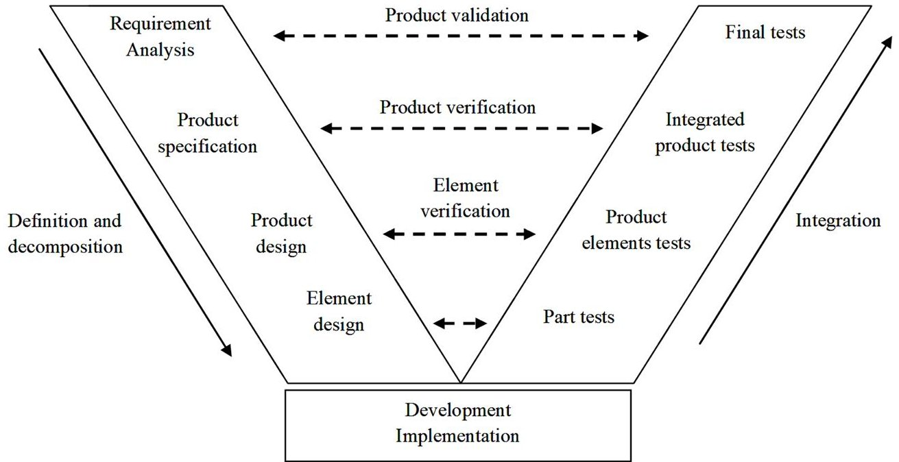
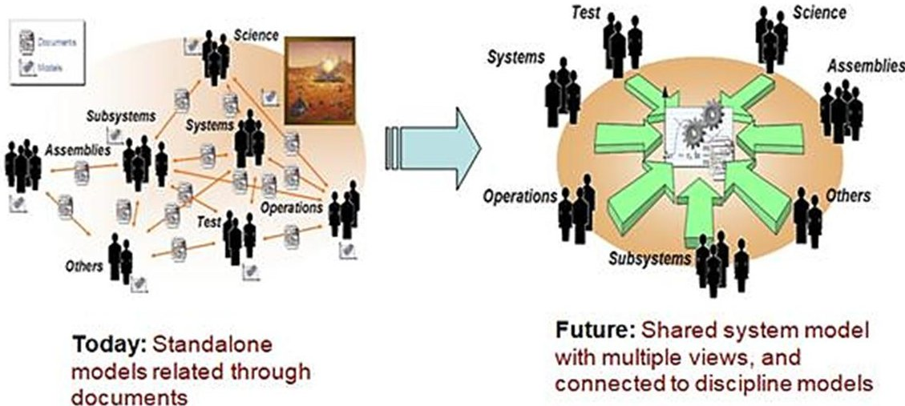
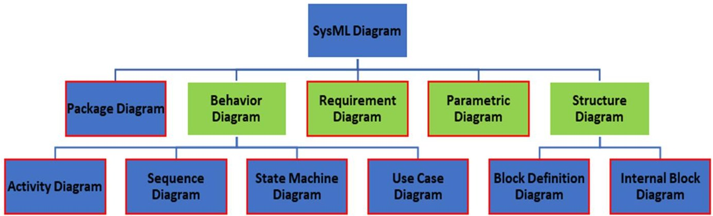
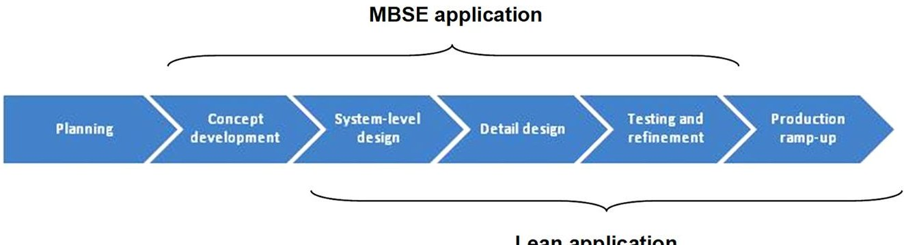

<!-- PDF_PAGE: 1 -->

sciendo

# An integrative Model Based Systems Engineering (MBSE) and lean-based approach for development of new complex products

doi:10.2478/mape-2019-0043

Date of submission to the Editor: 04/2018

Date of acceptance by the Editor: 07/2018

MAPE 2019, volume 2, issue 1, pp. 425-434

Aleksander Buczacki $ ^{*} $

ORCID ID: 0000-0002-6890-5661

Warsaw University of Technology, Poland

## INTRODUCTION

An efficient NPD process and implementation are crucial for creation of competitive advantage for each company. Currently many advanced functionalities of new complex products are achieved through the integration of new hardware solutions and software. In last few years the influence of information technologies on the product functionality has increased dramatically. Due to this fact, companies are looking more often for methods and tools enabling design and implementation of new products in a more effective way, taking into account needs appearing through product design process.

One such approach is MBSE. It allows for a significant increase of work effectiveness over the entire product lifecycle, especially at the new product design and testing phases, as well as support in the product utilisation and service phases. Such an approach requires the development of a number of models, frequently dedicated to a specific product/system. The designed model is always a simplified version of the target product but it allows wider and multiple testing.

Introduction of MBSE in the business practice of enterprises requires the development of advanced design support tools as well as entire design support platforms. This is a process of strategic significance. MBSE affects not only a way of designing new products, but also organization of the design process itself and the organizational structure of enterprise. Implementing MBSE in an enterprise can bring significant positive effects but without appropriate organisational changes of the process itself, it can perpetuate inappropriate habits and thereby fail to achieve the planned results. The use of lean techniques at the stage of planning changes at the enterprise as well as in the products being developed may help to minimise the risk of not attaining the foreseen results of implementing MBSE process in NPD.

The paper starts with a short description of the process of developing new products and the systems engineering used in developing new technologically advanced products. The subsequent section is a general discussion of MBSE. It is followed by a description of assumptions of lean with special emphasis on lean NPD. The main portion of the paper contains a review of the literature on the topic and an integrated MBSE and lean approach to NPD processes. The final portion presents conclusions, possible directions of future research and the bibliography.

<!-- PDF_PAGE: 2 -->

## NPD PROCESS FOR TECHNOLOGICALLY ADVANCED PRODUCT DEVELOPMENT

Launching a new product on the market is critical for the competitiveness of the company. The generic new product development process consists of the several stages (Ulrich, Eppinger, 2012):

- Planning, which includes assessment of market needs and product opportunity potential. This stage also includes product planning and definition of ways to meet market needs.

- Concept development, including definition of stakeholders' needs and the functional specification of the product. This stage involves initial concept development, selection and testing, as well as initial product development.

- System-level design, during which work on system specification is concluded. The stage includes decomposition of the system requirements into component/subsystem requirements. In addition, the requirements for the product's internal and external interfaces are defined, as well as are the initial production technology assumptions.

- Detail design, during which the product components are developed and the product integration process begins.

- Testing and refinement, during which the components are integrated into systems and product itself are tested. This stage also includes improvements of selected elements and the entire product.

- Production ramp-up, during which the production technology as well as production standards are developed and tested.

NPD is not a linear process, it includes many feedback loops and certain tasks may be carried out in parallel. The duration of individual stages depends on the specific product being developed, the development personnel's experience and the availability of resources. For an enterprise developing new products, NPD is one of the most complicated processes. A contribution to new product development is made not just by employees of research and development departments but also those representing sales logistics, production and others. For this reason, not only technical and technological issues but also management, including communication between teams/persons involved in the project implementation, should be taken into account in the implementation of such undertakings. Additionally, process designers should take whole lifecycle of the designed product into account already at the start of NPD. Technologically advanced and complex products are designed and implemented with the use of the systems engineering approach, especially in the Planning-Testing and refinement of the NPD process stage. The process of applying systems engineering can be presented with the so-called V model, presented in Fig. 1., which assumes that all the identified requirements must be reflected in the final product they are verified at individual design stages, and the finished product is validated. The requirements for the entire product are defined first and then decomposed into lower-order requirements relating to individual subsystems and into requirements relating to subsystem interfaces.

<!-- PDF_PAGE: 3 -->

Fig. 1 V-model

Source: (based on Forsberg et al., 2005).

Definition of requirements is accompanied by a specification of the means of the verification and validation of the target products. The functional range of the product and its individual components as well as the proposed product architecture are defined in parallel with requirement determination. Of special significance in technologically advanced products is in addition to the integration of individual elements of the designed product the joint operation of different technologies, frequently based on different areas of technical knowledge.

The essence of the expanded V model can be characterised based on the example of brake system design in cars. To put it very simply, the modern car brake system is controlled electronically. Writing the software that controls the whole system requires knowledge of programming, and specifically programming embedded systems. The software is installed on specially designed PCBs - Printed Circuit Boards. Designing such a board requires appropriate knowledge on electronic circuit functioning. The most important element of a brake system are mechanical-hydraulic devices that use a set of sensors to receive and transmit signals (commands and information on the state/position of selected elements) to the circuit board. Designing a mechanical-hydraulic device requires appropriate knowledge of mechanics and fluid mechanics. The operation of the entire system depends not only on the correct operation of its individual components but also on the correct design of the interfaces between the elements, which requires interdisciplinary technical knowledge. For this reason, research and development results at each stage of the V-model must be compared/verified with the results of work in other technology domains.

## MBSE

The International Council on Systems Engineering (INCOSE) defines MBSE as a formalized application of modelling to support system requirements, design, analysis, verification and validation activities beginning in the conceptual design phase and continuing throughout development and later life cycle phases (INCOSE, 2007).

The use of systems engineering in new product development significantly reduces the occurrence of technical errors and the risk of the product not meeting the

<!-- PDF_PAGE: 4 -->

stakeholders', and especially customers', requirements. On the other hand, however, performance of a project in line with the systems engineering approach may require the preparation of many separate documents, frequently describing only a specific aspect of the product, e.g. the architecture or requirements, thus making the description incomplete. For this reason, documentation developed as part of traditional systems engineering often requires verification in terms of the integrity and consistency of individual documents. The development of software tools assisting the product development process has allowed for the use of models located in one repository. This single model is assumed to take into account all the key product development perspectives as well as all the product lifecycle stages. The MBSE concept is presented in the figure below (Fig. 2).

Fig. 2 Transformation from current practice -Traditional SE to future practice - MBSE Source: (Fosse, 2014).

The MBSE approach is used mainly in the design of large IT systems but with the development of tools for modeling all types of physical phenomena it is now possible to design and verify even very complex products based on many different technologies.

When using MBSE models, IT systems are usually described using SysML. The language enables describing models based on the 9 types of diagrams with red borders (Fig. 3): behavior, requirements, parametric, structure.

Fig. 3 Types of SysML diagrams

Source: (Fridenthal et al., 2012).

<!-- PDF_PAGE: 5 -->

It must be emphasised that MBSE is undergoing constant development. A broader application of this approach depends on development of modelling tools which allow new product modelling and design taking into account different perspectives. It is crucial to implement interfaces between different tools especially if the model includes different perspectives. Another important factor with an impact on the model's development is development of SysML so as to make possible its use to develop very complex models covering multiple technology domains.

## LEAN-BASED APPROACH

Lean management has had a large impact not only on the organisation of production but also on other enterprise functions. Lean originated from the Toyota Production System, the main assumptions of which were presented by T. Ohno (Ohno, 1988). Lean was seen as the main reason for Japanese automotive manufacturers' advantage over their American competitors (Womack et al., 1990). It was soon realised that introducing lean only in production processes without extending it to the enterprise's other functional areas not only may not bring the desired effects but may sometimes also hamper the introduction of lean in manufacturing. This applies particularly to new product development, i.e. when a product is developed without taking production process organisation into account, the manufacturing may turn out to be more costly that originally assumed. This is why subsequent work focused on using lean management in other functional areas of the enterprise, including the office functions (finance, HR) and logistics. The next step was to apply lean in different industries, not in the area of production but services, such as banking, health care and education.

The first attempts to implement lean in product development processes were conducted in the early 2000s. These activities fell both into the general and comprehensive categories (Ward, 2007, Morgan, Liker, 2007) and focused on selected tools, e.g. value stream mapping and management in new product development (Oppenheim, 2004) or identification and elimination of waste (Oehmen, Rebentisch, 2010). Later, papers were published on the use of Lean in the development of technologically advanced products (Oehmen, 2012, Oppenheim, 2011).

The structure of the NPD processes should be based on the following principles (Oppenheim, 2011):

- Value, meaning all activities should generate value.

- Value Stream, according to which value is generated as a result of processes. Identification of sources of waste within processes - areas that do not generate added value - and their elimination, thereby improving the process and the quality of the outcomes (products) of the process.

- Flow, meaning ensuring the constant flow (of information, materials) in the process without unnecessary stoppages, slowdowns, interruptions or delays.

- Pull, meaning that information is produced at the appropriate time, in the correct amount and quality corresponding to external or internal clients' requirements (next process, activity).

- Perfection, meaning that constant improvement methods should be used, aiming at performance of all activities in accordance with the customer's expectations (with the possible exception of planned testing).

<!-- PDF_PAGE: 6 -->

- Respect People, meaning that an organisation should promote interpersonal relations that motivate workers to achieve the best objectives based on teamwork, trust, helping, and involvement in the work performed including organisational improvement.

- All actions related to Lean within NPD processes should focus on identification and elimination of all types of waste presented in Table 1.

Table 1

Types of waste in NPD processes

<table border="1"><tr><td>Type of waste</td><td>Description</td></tr><tr><td>Overproduction</td><td>Creating more information than the next process needs“Reinventing the wheel”</td></tr><tr><td>Waiting</td><td>Waiting for information/decisionsInformation or decisions waiting for further processing</td></tr><tr><td>Wrong process</td><td>Performing unnecessary activities/tasks</td></tr><tr><td>Transportation</td><td>Unnecessary flow of information</td></tr><tr><td>Motion</td><td>Unnecessary actions in the performance of tasks</td></tr><tr><td>Inventory</td><td>Collecting information which is not subsequently used</td></tr><tr><td>Reworks</td><td>Quality management based on control and not preventing the occurrence of errors</td></tr></table>

Source: Based on (Oehmen, Rebentisch, 2010).

Effective identification and elimination of waste has an especially significant impact with respect to principles 2 and 3. It should also be emphasised that the implementation of Lean should be considered in two dimensions:

- Engineering work, i.e. what has been developed;

- NPD process organisation and management, i.e. how the product was developed.

## AN INTEGRATIVE APPROACH MBSE AND LEAN FOR NPD

Since, as mentioned above, the products that are designed and offered on the market are becoming more and more complex, developers have to make use of more efficient techniques. MBSE is an area of knowledge that is developing constantly, especially with the ever-larger use of software in products. Lean management has proved itself in production process improvement as well as in other areas, e.g. the NPD process.

## Literature review

The literature review consisted of a query both of MBSE & Lean topics in scientific databases (ScienceDirect Journals, Elsevier, SciTech Premium Collection, Technology Collection, Materials Science & Engineering Database) which identified only 38 items, of which 22 were in scientific journals. Closer analysis showed that only 15 publications related to the NPD process but these publications did not focus directly on the management issues of NPD processes. The results of the review are presented in the table (2) below.

All the identified publications are relatively new, with the oldest being from 2012 (Pineda et al., 2012). The majority of the publications describe examples of new product development or implementation. Three publications were overviews. The products which the publications concern involve both physical elements and software. The analysis of the review results took into account the phase of the project and the type of work on which the publication focused.

<!-- PDF_PAGE: 7 -->

Table 2 Results of literature review

<table border="1"><tr><td>Publications&#x27; area of interest</td><td>Publication</td></tr><tr><td>Product development process focused on software development</td><td>(Shafiee et al.,2017)</td></tr><tr><td>Product development process focused on software and hardware</td><td>(Esridge et al.,2016,Haghighatkhah et al.,2017,Li,Lockett,2017,Marseu et al.,2016,Pineda et al.,2012,Rodic,2017,Siedlak et al.,2018,Silventoinen et al.,2014,Sporer,Brenner,2016)</td></tr><tr><td>Product development process focused primarily on hardware</td><td>(Welo et al.,2013)</td></tr><tr><td>Organization management</td><td>(Esridge et al.,2016,Marseu et al.,2016,Rodic,2017,Ulonska,Welo,2013)</td></tr><tr><td>Review papers</td><td>(Chen,2016,Esridge et al.,2016,Haghighatkhah et al.,2017)</td></tr><tr><td colspan="2">NPD process</td></tr><tr><td>Planning phase/Concept development phase</td><td>(Pineda et al.,2012,Rodic,2017,Shafiee et al.,2017)</td></tr><tr><td>Design&amp;Testing</td><td>(Li,Lockett,2017,Shafiee et all,2017,Siedlak et all,2018,Sporer,Brenner,2016,Ulonska,Welo,2013)</td></tr><tr><td>Production</td><td>(Li,Lockett,2017,Marseu et al.,2016,Siedlak et all,2018,Ulonska,Welo,2013)</td></tr><tr><td>Whole process</td><td>(Chen,2016,Haghighatkhah et al.,2017,Silventoinen et al.,2014,Welo et al.,2013)</td></tr><tr><td colspan="2">Type of design activity</td></tr><tr><td>Requirement identification</td><td>(Pineda et al.,2012,Shafiee et al.,2017,Sporer,Brenner,2016)</td></tr><tr><td>Verification&amp;validation</td><td>(Shafiee et al.,2017,Sporer,Brenner,2016,Ulonska,Welo,2013)</td></tr><tr><td>Architecture management</td><td>(Li,Lockett,2017,Marseu et al.,2016,Shafiee et al.,2017,Sporer,Brenner,2016)</td></tr><tr><td>Design</td><td>(Li,Lockett,2017,Shafiee et al.,2017,Siedlak et al.,2018,Sporer,Brenner,2016)</td></tr><tr><td>Integration/Implementation(production)</td><td>(Li,Lockett,2017,Marseu et al.,2016,Rodic,2017,Siedlak et al.,2018)</td></tr><tr><td>All type of activities</td><td>(Chen,2016,Haghighatkhah et al.,2017,Silventoinen et al.,2014,Welo et al.,2013)</td></tr></table>

## Description of an integrative approach

NPD based on models significantly changes the approach to new product design. MBSE is particularly effective in designing products with a high saturation with software. This is partially due to the high availability of commercial and freeware modelling tools. However, the highest benefits of MBSE-based design can be achieved in constructing a complex model of the target product. The development of such a model requires effective communication between its individual elements.

The use of MBSE is justified at the concept development stage. A well-constructed model allows for verification of the product concept, including performance of initial analyses, e.g. using the Finite Element Method (FEM), and other types of simulations related to the functionality of the product being designed. The use of models enables the creation of a uniform communication platform for the individual teams involved in the new product design and implementation process.

Implementing MBSE together with Lean will allow the team to achieve additional effects.

Focusing on models instead of preparing all kinds of documentation describing the model is in line with the Lean approach since it is an attempt to eliminate the activities

<!-- PDF_PAGE: 8 -->

that do not generate value - preparing and transmitting documentation.

The use of lean techniques and tools can be started already at the NPD process analysis stage in the organisation, e.g. by using value stream mapping. There are currently a number of process mapping methods which can be used in mapping the new product development process, e.g. BPMN (Business Process Modelling Notation) or EPC (Event-driven Process Chain). Another issue is the level of detail of the map, and on the other hand, ensuring its legibility. Depending on the method and level of detail, it is possible to focus on different types of waste occurring in the process.

Then, in the process of improving the NPD processes, it is possible to manage the timing of the project and streamline the process flow (Oppenheim, 2004). The tools used in the NPD process can be classified into the following categories:

- Identification and analysis of waste e.g. causal diagrams, VSM;

- Improvements of implementation e.g. SMED, poka-yoke;

Process monitoring e.g. andon, supermarket.

The development of target value stream maps of the NPD process should consider the advantages offered by the use of MBSE tools.

The individual stages of the NPD process are predisposed to different degrees to the use of MBSE and Lean. The figure (4) below shows the dependencies between NPD process stages in the context of applying MBSE and lean.

Fig. 4 Application areas of MBSE and Lean in the NPD process

It is worth mentioning that the benefits of using lean management tools increase with the development level of the NPD process toward implementation. The closer a product is to implementation, the easier it is to use lean tools.

## CONCUSIONS

The research conducted shows that the use of advanced MBSE and lean tools and techniques in the development of new products is not widespread. At its basis, MBSE contains many elements of lean management, i.e. it helps in eliminating waste in the NPD process, and specifically enables:

- Presentation and analysis of the products being designed and their elements with the use of graphic models which, in addition to giving a clearer understanding of the products being developed, also greatly simplifies communication between the NPD process stakeholders;

- Scaling of applied solutions, e.g. subassembly designs;

- Testing and verification of the product elements being designed;

- Multiple use of the designed assemblies and subassemblies.

<!-- PDF_PAGE: 9 -->

Both approaches are focused on improvement and perfecting of the process. MBSE is used mainly in the development of new products/systems. Lean, on the other hand, can be used at the stage of engineering and especially implementation. Implementation of an integrated approach should take into consideration:

- The specific characteristics of the products being developed, e.g. the industry the product is related to, the degree of software saturation;

- The NPD process organisation, e.g. whether there are many subcontractors involved or the process is developed entirely within one organisation.

Future research will focus on analysis of integrated approach implementations and definition of which MBSE and lean tools can be used at specific NPD stages as well as utilization of MBSE for Digital Twin concept development, which is crucial for Industry 4.0 implementation. Another potential research area is the use of Agile and MBSE. Software engineers frequently emphasise that Agile is convergent with Lean.

## REFEENCES

Chen, Y. (2016). Industrial information integration - A literature review 2006-2015, Journal of Industrial Integration, 2, pp. 30-64.

Esridge, C., Eveleigh, T. and Tanju, B. (2016). Integration of System Modeling and Design Processes, Data and Technology for streamlining Enterprise Integration, Procedia Computer Science, 95, pp. 311-318.

Forsberg, K., Mooz, H. and Cotterman, H. (2005). Visualizing Project Management: Models and Frameworks for Mastering Complex Systems. Third Edition, John Wiley&Sons, Hoboken.

Fosse, E. (2014). Model-based Systems Engineering (MBSE) 101, Presentation presented on International Workshop 25 Jan-26 Jan 2014, Torrance, CA, USA.

Fridenthal, S., Moore A. and Steiner R. (2012). A Practical Guide to SysML: The Systems Modeling Language, Morgan Kaufmann OMG Press.

Haghighatkhah, A., Banijamali, A., Pakanen, O., Oivo, M. and Kuvaja P. (2017). Automotive software engineering A systematic mapping study. The Journal of Systems and Software, 128, pp. 25-55.

INCOSE SE Vision 2020, INCOSE-TP-2004-004-02, Sep 2007 [Accessed: 10 May 2019].

Li, T., Lockett, H. (2017). An Investigation into the Interrelationship between. Aircraft Systems and Final Assembly Process Design, Procedia CIRP, 60, pp. 62-67.

Marseu, E., Kolberg, D., Birtel, M. and Zuhlke D. (2016). Interdisciplinary Engineering Methodology for changeable Cyber-Physical Production Systems, IFAC-PapersOnLine, 49-31, pp. 85-90 [Accessed: 20 Apr 2018].

Morgan, J., Liker, J. (2006). The Toyota Product Development System. New York: Productivity Press.

Oehmen, J. (2012). The Guide to Lean Enablers for Managing Engineering Programs, PMI, INCOSE, LAI-MIT.

Oehmen, J., Rebentisch, E. (2010). Waste in Lean Product Development, Lean Advancement Initiative LAI-MIT.

Ohno, T. (1988). Toyota Production System: Beyond Large-Scale Production, 1st Edition, Productivity Press.

Oppenheim, B. (2004). Lean Product Development Flow, Systems Engineering, 7(4), pp. 352- 376.

Oppenheim, B. (2011). Lean for Systems Engineering with Lean Enablers for Systems Engineering, Wiley. New Jersey: Hoboken.

Pineda, R., Lopes, A., Tseng, B. and Salcedo O. (2012). Service Systems Engineering Emerging Skills and Tools, Procedia Computer Science, 8, pp. 420-427.

Rodic, B. (2017). Industry 4.0 and the New Simulation Modelling Paradigm, Organizacija, 50(3), pp. 193-207.

Shafiee, S., Hvam, L., Haug, A., Dam, M. and Kristjansdottir K. (2017). The documentation of product configuration systems A framework and an IT solution, Advanced Engineering Informatics, 32, pp. 163-175.

<!-- PDF_PAGE: 10 -->

Siedlak, D., Pinon, O., Schlais, P., Schmidt, T. and Mavris D. (2018). A digital thread approach to support manufacturing-influenced conceptual aircraft design, Research Engineering Design, 29, pp. 285-308.

Silventoinen, A., Denger, A., Lampela, H. and Papinniemi J. (2014). Challenges of information reuse in customer-oriented engineering networks, International Journal of Information Management, 34, pp. 720-732.

Sporer, H., Brenner, E. (2016). An Automotive E/E Systems Domail-Specific Modelling Approach with Various Tool Support, Applied Computing Review, 16(1), pp. 5-14.

Ulonska, S., Welo, T. (2013). Need Finding for the Development of a Conceptional, Engineering-Driven, Framework for Improved Product Documentation, Procedia Computer Science, 16, pp. 423-432.

Ulrich, K.T., Eppinger, S.D. (2012). Product Design and Development. New York: Fifth Edition, McGraw-Hill Education.

Ward, A. (2007). Lean Product and Process Development, Lean Enterprises Inst. Inc., Cambridge MA.

Welo, T., Tonning, O. and Rolvag, T. (2013). Leans Systems Engineering (LSE) Hands-on Experiences in Applying LSE to a Student Eco-Car Build Project, Procedia Computer Science, 16, pp. 492-501.

Womack, J., Jones, D. and Roos, D. (1990). The Machine That Changed the World, New York (NY): Free Press.

Abstract: An effective and efficient New Product Development (NPD) and implementation process is crucial for creation of competitive advantage for each company. Due to this fact, companies are more and more often looking for methods and tools for improvement of NPD processes. The paper deals with an integrated Model Based Systems Engineering (MBSE) and lean approach to NPD. The individual stages of the NPD process are predisposed to different degrees to the use of MBSE and Lean. The research conducted shows that the use of advanced MBSE and lean tools and techniques in the development of new products is not widespread. There is a room for future research.

Keywords: model based systems engineering (MBSE), Lean management, New product development (NPD)