<!-- PDF_PAGE: 1 -->

# Design Implications for Missions Participating in Federated Satellite Systems

Ignasi Lluch $ ^{*} $ and Alessandro Golkar $ ^{\ddagger} $ Skolkovo Institute of Science and Technology, 143026, Skolkovo, Russia

DOI: 10.2514/1.A33172

This paper analyzes the design implications for space missions participating in opportunistic satellite federations. Satellite federations are a novel instance of distributed satellite systems implementing the concept of opportunistic collaboration in space among heterogeneous missions; trading resources, such as data relay; storage; and computing power among participant missions. The ability of a spacecraft to join a federation is mainly constrained by bus power availability and spacecraft attitude. The paper quantifies design implications for missions to participate in satellite federations. In particular, the paper quantifies the overall spacecraft mass impacts associated with operations on margins within a federation. A systems-level spacecraft model is developed to show that overall system mass impacts for typical-use low-Earth-orbit spacecraft participating in a satellite federation are 12, 1.1, and 0.6% for small-, medium-, and large-class platforms, respectively. It is shown that up to $ 5 0 0 \mathrm{s}^{-1} $ per orbit federated satellite system connectivity is achievable for more then 70% lifetime on low-Earth-orbit platforms. The paper also addresses orbital geometry considerations by formulating a satellite-to-satellite coverage-optimization problem. This research work allows designers to identify optimal federation engagement levels for different satellite missions and helps to identify beneficial orbital geometries for federates seeking to act as resource suppliers.

## Nomenclature

Nomenclature

$ A $ = area on the supplier sphere

$ E $ = energy requirement of momentum wheels, J

$ I_{\mathrm{antenna}} $ = inertia of the intersatellite link antenna, $ \mathrm{kg} \cdot \mathrm{m}^{2} $

$ I_{\mathrm{wheel}} $ = inertia of momentum wheel, $ \mathrm{kg} \cdot \mathrm{m}^{2} $

$ k $ = decreasing interest factor

$ M_{c} $ = customer Loaded mass, kg

$ M_{0} $ = initial mean anomaly, rad

$ P_{c} $ = customer bus power, W

$ P $ = Cartesian set denoting supplier position

$ r $ = geocentric satellite distance, km

$ r_{\mathrm{lim}} $ = maximum communications range, km

$ T $ = temperature of the solar array, $ ^{\circ} \mathrm{C} $

$ t $ = duration of the steering maneuver, s

$ u $ = supplier orbit utility, s

$ v_{A} $ = area value

$ v_{c} $ = customer value

$ \alpha_{\mathrm{steering}} $ = acceleration of the steering mechanism, $ \mathrm{rad} \cdot \mathrm{s}^{-2} $

$ \varepsilon_{\mathrm{wheel}} $ = electric to kinetic energy momentum wheel conversion efficiency

$ \eta $ = efficiency of the solar array

$ \theta $ = angular distance between satellites taken from Earth center, rad

$ \mu $ = Earth standard gravitational parameter, $ \mathrm{km}^{3} \cdot \mathrm{s}^{-2} $

$ \omega_{0\mathrm{wheel}} $ = nominal speed of the momentum wheels, $ \mathrm{rad} \cdot \mathrm{s}^{-2} $

## I. Introduction

FEDERATED satellite systems (FSSs) [1] are an instance of distributed space systems that aim to exploit the potential of underutilized space commodities by trading and sharing previously inefficiently allocated and unused resources. Within a satellite federation, resources such as data processing, data relay, or storage capacity are traded on a voluntary basis among participant spacecraft.

This resource exchange leads to enhanced mission reliability and performance for participant missions and increased mission sustainability and cost effectiveness by leveraging on onboard spare resources. The underlying concepts and benefits of FSSs are analogous to those found on terrestrial power smart grids and cloud computing environments, in terms of distribution, scalability, and virtualization.

FSSs are one of the most recent space distributed architecture paradigm proposals. An FSS bridges a gap between traditional space distributed systems, such as constellations, and novel approaches, such as fractionated spacecraft [2], in terms of component uniformity and independency. Although constellations such as Iridium [3] and GPS [4] deploy homogeneous spacecraft to achieve a collective goal, an FSS proposes the voluntary exchange of resources between heterogeneous, fully independent missions with diverse goals. Dissimilarly, a fractionated spacecraft proposes to transition from a single, monolithic spacecraft into a group of physically detached, disaggregated components. This would allow us to flexibly cover a suite of missions. However, fractionated spacecraft present a strong and permanent component interdependency, which we do not find in FSSs, for which the usage scenarios are better described as opportunistic cooperation. Technical challenges of paramount importance for fractionated spacecraft such as formation flying and precise thrusting are irrelevant for FSSs, since the latter can be based upon conventional missions. However, it is on the intersatellite link (ISL) and networking domains that FSS benefits from state-of-the-art advances.

Making possible the envisioned resources exchange in FSS demands the implementation of a communications network among the federated spacecraft. Intersatellite links capabilities have to be deployed on participant spacecraft, effectively playing the same role as network interface cards on computer networks. Although fractionated spacecraft fly in close proximity and readymade solutions like IEEE 802 network standards have been proposed [5], the opportunistic and heterogeneous nature of the FSS participants requires enhanced interoperability and long-range mobile networking approaches [6]. Interoperability enhancements can be provided by software-defined radio [7] technologies, whereas the existing mobile networking methods need to be applied to the space domain [8]. Engaging in FSSs is therefore limited by the resources available onboard each spacecraft, as the operation of the ISL equipment requires electric power, a compatible spacecraft attitude, and spare computing and data-handling capacity. In addition, the resource exchange through ISL is bound by orbital geometry, as will be discussed in Sec. III of this paper. System modeling in federated

<!-- PDF_PAGE: 2 -->

spacecraft is likewise novel with respect to fractionated analogs. The envisioned mode of operations of satellite federations can range from the exploitation of windows of opportunities to the modification of the original system design to accommodate federated operations, thus resulting in a design impact that needs to be estimated and accounted for at the conceptual design stage: this is a gap that is currently not addressed in the literature. The present paper covers this gap.

Satellite federations provide a cooperation frame for all types of missions to join, moving away from the isolated mission paradigm. By combining different missions with different objectives, needs, and operational schedules, windows of opportunity for resource exchange arise. Spacecraft experiencing a period of low operational burden may lease datalink and computation power resources to other spacecraft in need. Moreover, spacecraft with partial failures in the data-handling or communications subsystems could reallocate these tasks to other spacecraft within the federation. Along the same lines, those spacecraft presenting early payload failures could reorient their mission to be a services provider within the federation.

Two notional roles can be defined for the federated spacecraft. One option is to be a supplier; a supplier spacecraft engages in the federation to provide resources such as data relay to the ground. Another option is to be a customer; a FSS customer uses the resources available in the federation to achieve enhanced reliability or performance. The supplier spacecraft processes and transfers to the ground data from customers. Note that the customer and supplier roles are interchangeable and encompass a variety of hybrid approaches, where the spacecraft are customers and suppliers at the same time, changing their role balance at different phases during their mission lifecycle. In fact, a single spacecraft can act as a customer or a supplier of different resources within the FSS network at the same time. The paper by Golkar and Cruz [1] provides detailed definitions on this matter and offers a taxonomy for the range of options available to spacecraft when participating in a FSS.

The goal of this paper is to assess the design impacts on missions participating in FSSs, driven by the operations of the ISL equipment supporting the resources exchange (referred as FSS ISL). The paper answers two research questions of interest to the development of satellite federations:

1) What are the subsystem- and system-level design impacts on a spacecraft operating an FSS ISL as a hosted payload?

2) How does one optimize the orbital geometry of a dedicated spacecraft supplying FSS services?

Design impacts are characterized, depending on the role adopted by the particular mission in a federation. In the first part of the analysis, described in Sec. II, the FSS ISL is considered a hosted payload and the impacts occurring at spacecraft system and subsystem level are mapped to the desired amount of utilization of the FSS and the spacecraft market role. The second part of the analysis, based upon Sec. III, addresses orbital geometry considerations, finding advantageous orbits for dedicated supplier missions wishing to tailor their orbit design to access a high amount of potential customer spacecraft.

The remainder of the paper is structured as follows. Section II addresses the first question, quantifying the minimal system-level impacts of hosting and operating an FSS ISL payload. Section III addresses the second question on orbital geometry of dedicated FSS suppliers. Section IV draws conclusions of this research and outlines the future work.

## II. Impacts on Spacecraft Design: Resource Balance

This section attempts to quantify the design impacts in mass and power of operating an FSS ISL subsystem to engage in a federation of satellites, presenting different spacecraft roles and operation concepts. Participating spacecraft in FSS choose to what extent they wish to engage in the exchange of resources, depending on their needs or the availability of onboard spare capacity. Their commitment can range from occasional to full-time connection, depending on needs and spacecraft power constraints. The FSS ISL payload requires an amount of power to be operated, and this translates into a

direct impact on the power subsystem. Besides, other subsystems such as communications and the attitude control and determination system (ACDS) also experience changes when introducing FSS ISL payload in the spacecraft. This section addresses the design impacts on these subsystems and the associated system-level impacts by developing a spacecraft model that accounts for the interdependencies of the spacecraft subsystems and the FSS ISL.

Throughout this paper, the customer is always assumed to be a network data source and can downsize its space-to-ground communications subsystem by routing the data via the federation. Reciprocally, the supplier spacecraft always acts as a network data sink. This introduces important design changes: the space-to-ground link has to be oversized to manage the additional data relay to ground. Note that, in the case of multiple-hop connections, one or more participant spacecraft may act as data routers, buffering data and retransmitting it when the supplier is available. When the data reach a supplier, they have to be transmitted to the ground. Figure 1 exemplifies the evolution of the downlink data-rate requirement on the supplier spacecraft offering a relay service, depending on the data volume acquired via ISL. For this example, the supplier is assumed to be at an 800 km altitude and to downlink the data via a single ground station contact per orbit. Realistic limits to the achievable downlink data rate are around 500 Mbit/s on the X-band for a low Earth orbit (LEO) [9].

Section II.D of the following analysis will exploit current spacecraft design margins. One of the most significant design margins is found in the power subsystem. Solar-powered missions present a significant difference on power production at the beginning of life (BOL) and at the end of life (EOL) due to solar cell degradation [10,11]. The amount of excess power produced progressively decays toward zero at the EOL. The FSS ISL subsystem can exploit this power excess to operate like a noncritical mission payload with a progressively less frequent activation. Conversely, Secs. II.B and II.C estimate design impacts when accounting for FSS ISL in the power budgets. The following discussion describes the spacecraft model developed to estimate such design impacts.

## A. Spacecraft Model

The approach chosen for the analysis is to develop a spacecraft model that includes the subsystems that are most affected by the addition of an ISL subsystem. The model derives the impacts up to system-level mass and power. The spacecraft bus power is the first noticeable spacecraft resource being directly used as in the spacecraft federation through the operation of the ISL. Ultimately, changes in onboard power consumption profiles have an impact on spacecraft mass and the mission's concept of operations. The change

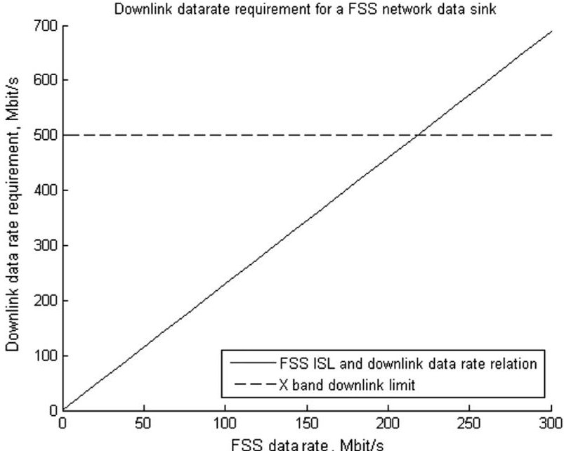

Fig.1 Downlink data-rate requirement for a FSS network data sink. Results were obtained assuming 10 ISL contacts of 120 s/orbit.

<!-- PDF_PAGE: 3 -->

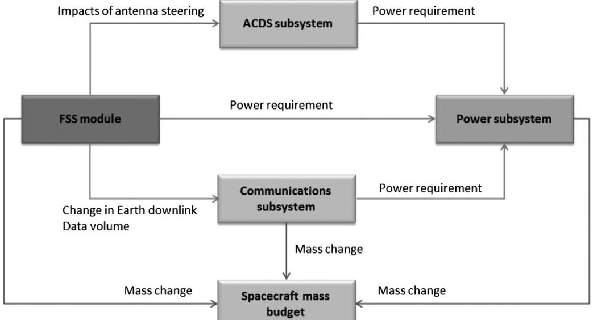

Fig. 2 Flow of design impacts across the considered subsystems.

in spacecraft loaded mass is recognized as the proxy metric for system-level spacecraft impacts.

The model captures the main interactions between key subsystems and the FSS ISL, as illustrated in Fig. 2. The spacecraft model here developed describes system changes relative to a reference design rather than attempting to give absolute sizing estimations. The model considers the following subsystems: power; telemetry, tracking, and control (TTC), the FSS intersatellite link, and the attitude control and determination subsystem. The power subsystem is directly affected by the additional consumption of ISL module operation. An accurate modeling of this subsystem is essential to understand the evolution of power margins on the spacecraft through the lifetime. The communications to ground are enabled by the TTC subsystem. TTC is one of the key elements in which capacity can be scaled upward or downward, depending on the role and intensity of engagement of the spacecraft in the federation. The FSS ISL communications subsystem and the space-to-space RF link are included in the spacecraft model to assess system-level impacts in terms of mass and power consumption. Lastly, as the FSS payload is assumed to use a steering mechanism to orientate the antenna, extra loads to the ACDS and associated design impacts need to be considered in the modeling effort.

The influence of the FSS ISL on the propulsion subsystem would appear as an increased wheel despin requirement, but this is ruled out due the acceleration-neutral movements of the steering mechanisms (see Sec. II.A.2). The thermal subsystem is not included, since this system is very sensitive to specific spacecraft configurations and no general trends can be outlined. This paper does not analyze the data storage and payload data-handling requirements on the ground segment.

## 1. Power Subsystem Model

The power subsystem sizes the solar array and secondary battery, taking into account the load profile of the spacecraft, with the requirement to meet all subsystems consumption until the end of life, with nominal usage of the main instrument(s). Additional operation modes such as safe sun pointing, maneuver, or standby are out of the scope of the present paper. The model makes four main assumptions in regard to the power subsystem. The first assumption of the model is to assume a solar-powered spacecraft with three-axis stabilization and a sun-pointing array mechanism. The solar array energy transfer system is considered to be peak-power tracking [12]. For excess power computation purposes, the output power generated corresponds to the maximum power achieved by operating always at the maximum output point on the array voltage-current (V-I) characteristic curve [12]. During and after a controlled battery charge, spacecraft with peak-power tracking eliminate excess power by changing the operation point of the array in a dynamic way, always to match the power output to the load need. Indeed, this power margin could be otherwise used instead of being dissipated. The second

assumption being made is in regard to the evolution of solar panel efficiency over the course of the orbit. It is assumed that solar array efficiency evolves as a function of its temperature [13]:

$$
\eta (T) = \frac {\partial \eta}{\partial T} (T - 2 8)
$$

where, in Eq. (1), T is the temperature in degrees Celsius; data on the gradient $ \mathrm{d}\eta /\mathrm{d}T $ is found in [13] as a function of cell technology type. The temperature on the solar array is evaluated by solving a centered finite differences numerical approximation of the transient-state thermal balance of the array.

The third assumption concerns the modeling approach of the pointing misalignment between the solar array and the sun vector, which affects the power production of the array. This factor is modeled as white noise centered on 0 deg (no misalignment) and a default standard deviation of 3 deg.

Lastly, the model makes a fourth assumption on solar cell degradation over time. This degradation ranges from 0.5 to 5% per year [14,15], depending on the orbital environment. The model uses cell manufacturer data [16] to estimate this value.

In addition to sizing the power subsystem, the model is capable of assembling a continuous power-generation profile for the entire lifetime of the spacecraft, taking into account power-generation dynamics, including battery charging and discharging.

## 2. Attitude Control and Determination Model

The operation of the FSS ISL may require the use of antenna steering mechanisms to acquire the adequate pointing before the satellite-to-satellite data exchange. If this is the case, the recurrent operations of the FSS payload pose additional requirements on the ACDS. Such design impacts are threefold. First, it is possible to identify impacts on global platform accuracy and jitter tolerance. In the current analysis scenario, the requirements on accuracy are assumed by the antenna steering mechanism that will work in a closed loop. Space-proven ISL RF pointing systems have positively dealt with spacecraft jitter and attitude determination error since the 1960s [17]. This section focuses on RF-based ISL links. The ensuring of proper steering accuracy shall prove more challenging for optical links, which also have been proposed for FSSs [1]. Second, design impacts on torque authority requirements may also occur. The model assumes the attitude control is based on momentum wheels, which have to provide enough torque authority to deal with antenna steering. This is typically not a problem, given the dimensions of the ISL subsystem compared to the spacecraft. Lastly, FSS operations may imply impacts on management onboard momentum. To acquire a new contact, the steering mechanism will accelerate, move at constant speed, and decelerate the antenna in a symmetric process. Disturbance torques are a product of accelerations. Even though a whole movement cycle of the steering mechanisms of the antenna is acceleration neutral (and could be entirely disregarded), in a

<!-- PDF_PAGE: 4 -->

worst-case scenario, the ACDS would immediately counter the accelerations of the steering mechanisms without leaving time for its own cancelling deceleration. Hence, extra power is required to accelerate and decelerate the momentum wheels accordingly.

This ACDS subsystem model captures the aforementioned behavior. A reference momentum wheel is spun and despun according to the inertia ratios of the wheel and the antenna every time the FSS ISL operates. The energy required to change the rotational state of the momentum wheel is translated into a power subsystem requirement through a wheel efficiency coefficient $ \varepsilon_{\mathrm{wheel}} $:

$$
E = \frac {\alpha_ {\mathrm {s t e e r i n g}} \cdot I _ {\mathrm {a n t e n n a}}}{\varepsilon_ {\mathrm {wheel}}} \left(\omega_ {0 \mathrm {wheel}} \cdot t + \frac {1}{2} \cdot \frac {I _ {\mathrm {a n t e n n a}} \cdot \alpha_ {\mathrm {s t e e r i n g}}}{I _ {\mathrm {wheel}}} t ^ {2}\right)
$$

where, in Eq. (2), t is steering time, $ \alpha_{\mathrm{steering}} $ is the acceleration of the steering mechanism (chosen to cover 45 deg displacement in time t), I stands for the inertias of the antenna and the reaction wheel, and $ \omega_{0\mathrm{wheel}} $ is the initial spinning speed of the momentum wheel. The value for this parameter is averaged from the nominal range of operations of momentum wheels [18]. Then, $ \varepsilon_{\mathrm{wheel}} $ is taken as 0.8, as a reasonable electric to kinetic energy conversion factor for brushless motors.

## 3. Communications Subsystem Model

The communications subsystem model aims to capture the relations between downlink data rates and the power and mass associated to the spacecraft communications subsystem. In accordance with the goals of FSSs, the model of the communications subsystem focuses on sizing the hardware required for the most voluminous mission data downlinks. Therefore, the model represents a mission data downlink, which is the main element that can be influenced by the use of FSS ISL as an alternative data relay. It includes the components of the communications subsystem that are considered data-rate sensitive and mass/power intensive. This incorporates the signal-generation hardware (modulators, coders): the amplifier units, such as traveling-wave tube amplifiers (TWTAs) or solid-state power amplifiers, and the mission antenna. The masses and consumptions of the harness, multiplexers, filters, and other auxiliary hardware are not included, as its dependence on the final data rate is not direct. Moreover, the low-data-rate equipment for the telecommanding link and the launch and early operations phase (LEOP) omnidirectional antenna is left aside. It is the critical equipment that would hardly be suppressed in favor of FSS telecommanding, and it has to be flown anyway for the commissioning phase of the original mission. The model allows specifying the amount of the fully redundant amplifier and antenna units included in the communication subsystem design. Said model uses flight hardware data on S-, C-, X-, and Ku-band equipment to represent the transmitter equipment, and it uses a parabolic antenna model [19] to describe the antenna gain and mass. The transmitter is embodied by an assembly of space-qualified equipment consisting of a signal generator generally managing the data formatting; coding; and modulation, such as was exemplified in [20] a RF amplifier; and an electronic power conditioner (EPC) unit for those TWTA amplifiers, not including its own conditioner. This assembly is illustrated in Fig. 3.

With data available from several manufacturers, up to 20 transmitter equipment combinations in the X band have been assembled: 8 in the S band, 6 in the C band, and 23 in the Ku band. Each of these transmitters has a RF power grading, a consumption, and a mass sum of the masses of its components. Among the combinations available, Pareto-optimal [21] transmitters are chosen, representing more modern transmitters or a better combination of the components on the database. This provides an empirical relation between the RF power output and the power input and mass of the transmitter equipment.

Then, the gains provided by parabolic antennas of different apertures are combined with the necessary RF transmitter output to reach a given effective isotropic radiated power (EIRP) requirement. Among the combinations compliant with the EIRP model, the model runs a search for the minimal overall equipment mass (transmitter

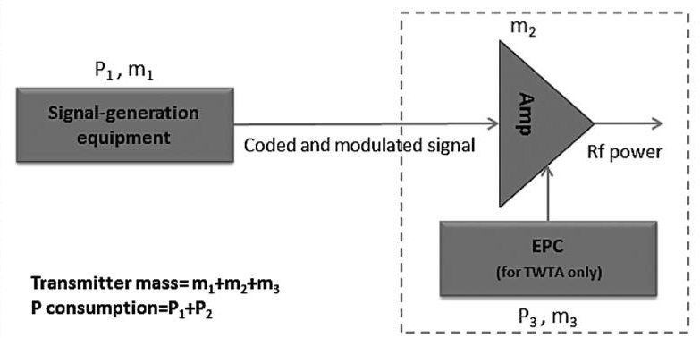

Fig. 3 Model of the transmitter equipment composed of a coder/ modulator device, an amplifier, and a its electronic power conditioner.

plus antenna). This means that, for every different EIRP requirement, the model adopts mass-optimized communications equipment. Said EIRP requirement is derived from a data-rate requirement, through a link budget model that uses the set of values shown in Table 1.

The atmospheric attenuation and antenna temperature component are estimated for different frequencies according to the International Telecommunications Union Recommendations [22]. The model sizes the data rate for the contact at the largest range given by the spacecraft height and link elevation constraint [14]. Contact times to the ground station are derived from the spacecraft height, following the tables in [14].

## 4. FSS ISL Subsystem Model

The ISL communications model uses the same procedure as described in the previous section to size the ISL equipment given a data-rate requirement. However, the link model is modified accordingly to a space-to-space link: there are no atmospheric losses, the ISL range chosen for analysis on low Earth orbit is 4500 km, and the antennas at both sides of the transmission are assumed identical. A baseline idle consumption of 5 W is assigned to the ISL hardware when not operating.

## B. Impacts on Supplier Spacecraft

Using the model presented so far, this section analyzes the spacecraft impacts associated with the adoption of different roles in the satellite federation as supplier or customer, for different spacecraft types and at different orbital environments. First, the analysis shows the impacts of supplying a relay service for tradeoff in three classes of Earth observation (EO) spacecraft in LEO and a large platform in geostationary Earth orbit (GEO). The supplier spacecraft oversize their space-to-ground link to provide this service, modifying the ACDS and power subsystem. Then, the analysis quantifies the loaded mass (dry mass and propellant mass at separation from launcher) for the customer spacecraft engaging in the federation, which are exchanging space-to-ground link capabilities for ISL capabilities and receiving impacts across subsystems.

Three different spacecraft in low Earth orbit have been simulated. These spacecraft represent large-, medium-, and small-class missions (2000, 900, and 100 kg) with different space-to-ground link capabilities. Their characteristics, inspired in COnstellation of small Satellites for the Mediterranean basin Observation (COSMO-SkyMED) [23], Environmental Mapping and Analysis Programme (EnMAP) [24], and Orbcomm second-generation platforms [25], are summarized in Table 2.

Table 1 Space-to-ground link default parameters $ ^{a} $

<table border="1"><tr><td>Parameter</td><td>Value</td></tr><tr><td>Ground antenna diameter</td><td>2m</td></tr><tr><td>Link elevation constraint</td><td>10deg</td></tr><tr><td>Atmospheric gas attenuation losses(11Ghz)</td><td>0.3dB</td></tr><tr><td>Receiver system temperature(at11Ghz)</td><td>386K</td></tr><tr><td>Maximum bit error rate</td><td>10-5</td></tr><tr><td>Link margin to be achieved</td><td>6dB</td></tr></table>

$ ^{a} $No coding gain added.

<!-- PDF_PAGE: 5 -->

Table 2 LEO spacecraft characteristics

<table border="1"><tr><td>Parameter</td><td>Value</td></tr><tr><td colspan="2">Large platform</td></tr><tr><td>Loaded mass</td><td>2000kg</td></tr><tr><td>Average EOL power</td><td>3500W</td></tr><tr><td>Mission lifetime</td><td>10years</td></tr><tr><td>Orbit</td><td>SSO619km</td></tr><tr><td>Mission space-to-ground data rate</td><td>150Mbits/s</td></tr><tr><td>Space-to-ground link frequency</td><td>11Ghz</td></tr><tr><td>Space-to-ground link redundancy</td><td>4 amplifiers,2 antennas</td></tr><tr><td colspan="2">Medium platform</td></tr><tr><td>Loaded mass</td><td>900kg</td></tr><tr><td>Average EOL power</td><td>800W</td></tr><tr><td>Mission lifetime</td><td>7years</td></tr><tr><td>Orbit</td><td>SSO643km</td></tr><tr><td>Mission space-to-ground data rate</td><td>320Mbits/s</td></tr><tr><td>Space-to-ground link frequency</td><td>8Ghz</td></tr><tr><td>Space-to-ground link redundancy</td><td>2 amplifiers,1 antenna</td></tr><tr><td colspan="2">Small platform</td></tr><tr><td>Loaded mass</td><td>100kg</td></tr><tr><td>Average EOL power</td><td>400W</td></tr><tr><td>Mission lifetime</td><td>5years</td></tr><tr><td>Orbit</td><td>SSO700km</td></tr><tr><td>Mission space-to-ground data rate</td><td>50Mbits/s</td></tr><tr><td>Space-to-ground link frequency</td><td>8Ghz</td></tr><tr><td>Space-to-ground link redundancy</td><td>2 amplifiers,1 antenna</td></tr></table>

Table 3 FSS ISL characteristics

<table border="1"><tr><td>Parameter</td><td>Value</td></tr><tr><td>Frequency</td><td>27GHz</td></tr><tr><td>Data rate</td><td>100Mbits/s</td></tr><tr><td>Link range</td><td>4500km</td></tr><tr><td>Typical ISL contact time</td><td>120s</td></tr><tr><td>Bit error rate</td><td>10-5</td></tr><tr><td>Link margin required</td><td>6dB</td></tr></table>

The solar cell performance data are kept constant for all platforms, and they are based upon the parameters of COSMO-SKYMED, for which accurate data are available [26]. The FSS module is sized to provide a link capability with the characteristics shown in Table 3.

The requirements shown in Table 3 are met, according to the ISL subsystem model, by a 50 W consumption transmitter and 0.4-m-diam parabolic antenna for a total EIRP of 50.2 and 6 dB $ \cdot $ W margins. In the simulations, the ISL operates with an increasing number of contacts per orbit and the corresponding mass impacts to design for this operation regime are shown in Fig. 4.

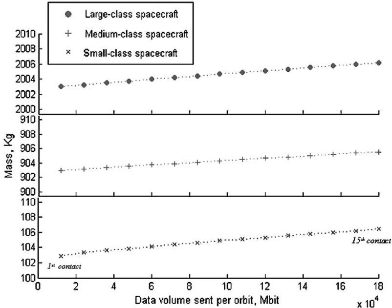

Fig.4 Evolution of spacecraft mass as a function of data volume relayed per orbit. Note that each subplot refers to a different spacecraft class and presents a different mass range.

Each of the data points in Fig. 4 corresponds to a number of ISL contacts, ranging from 1 to 15. The volume of data received via these contacts has to be relayed to the ground, and the capability of the space-to-ground link is increased accordingly. The volume of data received via ISL is relayed to the ground by increasing the downlink capacity of the spacecraft.

The system-level mass impacts on the three spacecraft are very similar, on the range of the 3-6 kg. A constant mass shall be added to this value, to account for the passive equipment needed to operate the FSS ISL, such as harness, casings, filters, multiplexers, etc., as previously mentioned in this section (Sec. II.A.4). If these elements accounted for a total of 5 kg, then the relative mass impacts of acquiring and relaying to the ground 180 Gbits per orbit for the large, medium, and small spacecraft are 0.6, 1.1, and 12%, respectively.

However, not only the available mass may limit the data volume to be relayed. The short ground station passes in LEO imply large downlink data rates that may not be achievable due to bandwidth limitations. For instance, the medium-class missions needs a large data rate to downlink their own mission data (320 Mbits/s) and the model shown this leads scenario where the increased data rate required to act as a data sink surpasses the achievable data rate. This situation could be overcome by adding a second X-band transmission system, at the cost of doubling the mass impacts on the spacecraft.

In addition to the three LEO platforms, a very large GEO spacecraft, based upon Alphasat [24], of 6500 kg loaded mass and 12 kW has also been simulated as a supplier. The FSS ISL in the GEO spacecraft is required to support a 100 Mbits/s data rate when receiving the signal from a LEO spacecraft that uses the relatively small LEO-to-LEO ISL equipment. Therefore, the GEO spacecraft must equip a large FSS ISL antenna (2.5 m dish) to be able to close the link, constituting a significant mass (and platform configuration) impact. A GEO spacecraft can relay data to the ground continuously but, in this analysis, a period of 100 min (roughly corresponding to the LEO orbit period) has been set as the time window for the relay to send the data to the ground after receiving it via ISL. That is, the data received from a LEO spacecraft have to be relayed to ground before their next ground-station pass. In addition, a dedicated space-to-ground X-band transponder has been added to relay the FSS data to the ground station. The ISL contacts are, as before, limited to 120 s, and up to 100 of them are tracked in Fig. 5.

Figure 5 shows the starting impact of adding a FSS ISL payload over 40 kg, and operating it to relay 1.2 Tbits per 24 h period implies adding approximately 50 kg over the spacecraft baseline mass. This is an impact of 0.8% over loaded mass. Note that, from 1 to 14 contacts, the driving constraint dimensioning the downlink is the 100 min time window, over which a constant 2 Mbits/s data rate is maintained (100 min at 2 Mbits/s to relay 120 s worth of data at 100 Mbits/s). After each contact, the downlink is powered by 100 min. After 14

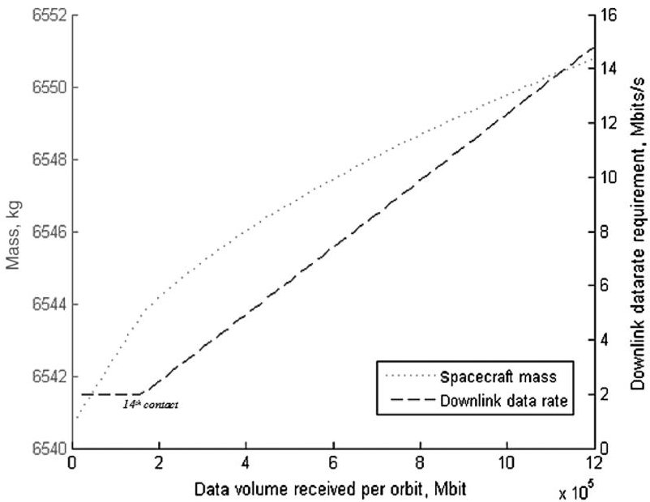

Fig. 5 Mass impacts on a 6500 kg GEO spacecraft operating 1 to 100 times the FSS ISL to relay data from LEO. Note that the y-axis origin is 6540 kg.

<!-- PDF_PAGE: 6 -->

contacts, the number of contacts is too frequent and the communications downlink has to be permanently on, progressively increasing the downlink data rate. This increase has a lower mass impact than what would be obtained by increasing the transmission time. This result suggests that increasing data rates rather than transmission times is beneficial in terms of mass for satellite communication systems.

## C. Impacts on a Customer Spacecraft

Considering the same set of LEO spacecraft shown in Table 2, this paragraph analyzes the impacts of operating the FSS ISL from a customer perspective. The FSS customer relays its mission data via the federation, and it accordingly downsizes its communications subsystem. This process is shown in Fig. 6.

As more contacts are made, more of the mission data can be relayed through the ISL, and the downlink data-rate requirement on the space-to-ground link can be reduced. With enough contacts, all of the data can be relayed and the mission data downlink equipment can be completely suppressed, leading to a significant mass reduction. This occurs at the seventh contact in Fig. 6 for large spacecraft (0.35% reduction), at the 14th contact in the medium spacecraft (0.5% reduction), and at the third contact on the small spacecraft (4.5% mass reduction). Note that such a reduction is a product of substituting a fully redundant communications subsystem for a single ISL link. Mission designers may hence prefer an approach retaining a minimal space-to-ground link capability, as on the left side of Fig. 6, leading to a slight mass increase and the capability to use both the ISL and the downsized space-to-ground link.

## D. Operation of the FSS ISL on Spacecraft Power Margins

In the discussion that follows, the only design modification introduced to the spacecraft is the addition of the ISL FSS module, adding 5 to 10 kg to the baseline spacecraft loaded mass. No other changes are introduced on any other subsystem; therefore, it is indifferent whether the spacecraft role in the federation is biased toward a supplier or customer approach. In this operation regime, only the excess power generated by a solar-powered mission serves the FSS ISL and associated ACDS loads.

Figures 7-9 give an estimate on potential connection periods of each spacecraft to the network, provided there is another node available to connect to via ISL. The spacecraft analyzed are LEO residents, as shown in Table 2, with orbital periods of approximately 5800 s. Eclipses are assumed to be worst case through the whole time, lasting approximately 2100 s. The ISL connection supported features of 100 Mbits/s, corresponding to Table 3. The FSS ISL is not operated during eclipse times to avoid any impacts on battery

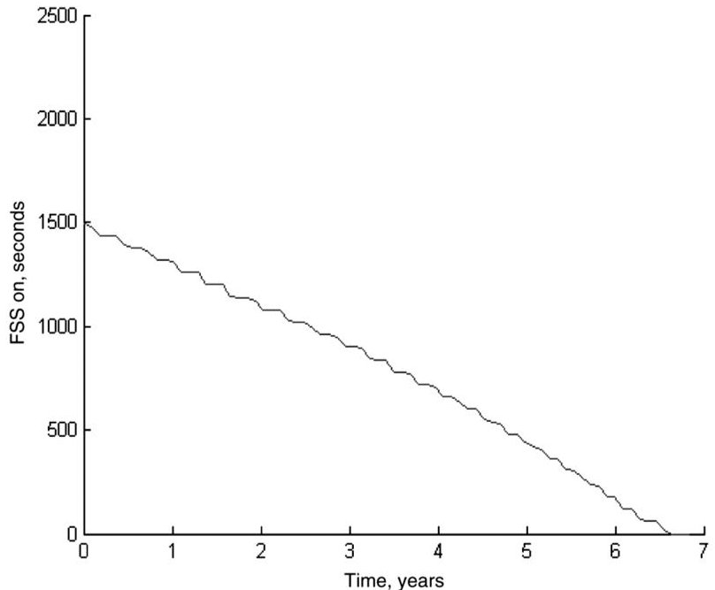

Fig. 7 Seconds per orbit of supported FSS ISL operation through a lifetime for a 100-kg-class spacecraft.

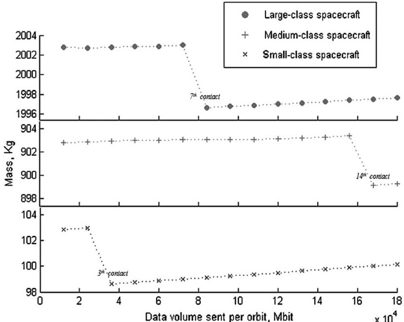

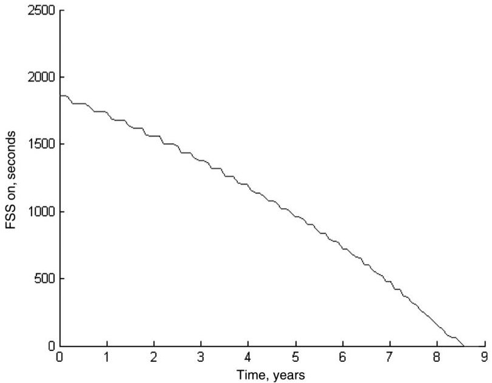

Fig. 6 Evolution of spacecraft mass as a function of data volume sent per orbit. Note that each subplot refers to a different spacecraft class and presents a different mass range.

Fig. 8 Seconds per orbit of supported FSS ISL operation through lifetime for a 900-kg-class spacecraft.

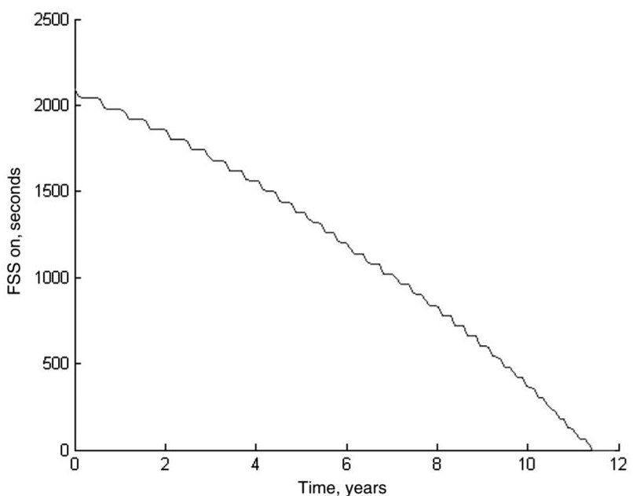

Fig. 9 Seconds per orbit of supported FSS ISL operation through lifetime, 2000 kg class spacecraft.

<!-- PDF_PAGE: 7 -->

sizing. During sunlight exposure, the spacecraft perform a standardized typical load profile consisting of one communications contact per orbit, a payload operation with a 0.8 duty cycle, constant thermal and mechanical loads, and 0.5 duty-cycle ACDS operations. The operations are profiled such that their average at EOL for each spacecraft corresponds to the data in Table 2.

The simulations depicted in Figs. 7-9 run in 60 s time steps through the whole spacecraft lifetimes of 10, 7, and 5 years for the different spacecraft. The FSS ISL is operated every time the solar arrays could produce more power than the current total load requirement. The load of the batteries is prioritized in the process. The decay of power production during the lifetime impacts the amount of excess power produced, and this reduces the total time per orbit that the spacecraft can be connected to the federation, as shown in Figs 7-9. Due to the simulation time discretization, the potential FSS operation time per orbit decreases in discrete amounts. All the platforms can support a significant connection time, as shown in Figs. 9-11: 500 s/orbit can be sustained for more of 70% of the lifetime in the small spacecraft, for 77% of the lifetime in the medium spacecraft, and 81% of the lifetime for the large-class spacecraft. At the BOL, the small spacecraft can support up to 1500 s/orbit of FSS connectivity, whereas 1850 and 2100 s/orbit can be supported by the medium and large spacecraft, respectively. The achievable connection times naturally scale up with the mission bus power. However, note that, at the BOL, large spacecraft can generate excess peaks on the order of 1000 W, but only 50 W are needed to switch on the FSS ISL (Table 3). This bounds the increase in connection time with bus power to an asymptotic behavior, since part of the excess power is not used. Larger spacecraft could equip arrays of FSS ISL transponders to harness more of their excess power.

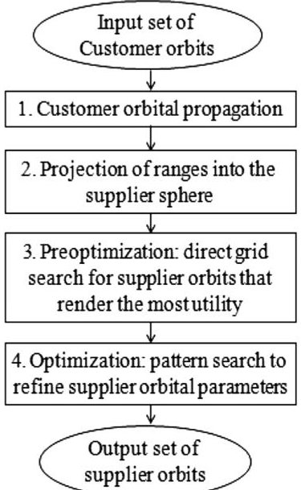

Fig. 10 S2S coverage-optimization flow.

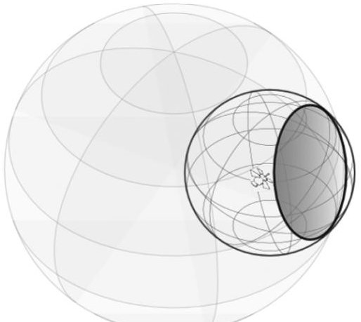

Fig. 11 Darker access region showing the result of projecting the ISL range from a customer spacecraft into the supplier sphere (the largest).

This analysis shows that minimal changes at spacecraft level could enable future space missions to reap the benefits of participating in satellite federations.

## III. Orbital Geometry Considerations: An Optimization Approach

The previous section analyzed design impacts at spacecraft level associated with FSS operations. This section instead considers the mission-level impacts of FSSs: in particular, in regard to the orbital geometry. The line of sight and link distance between spacecraft within a satellite federation are constraints for the realization of ISL links among them. The access duration drives the available time for the resource exchanges. The analysis that follows discusses how to design the orbit of dedicated, supplier satellites to maximize the access time to ranked customers, and therefore increase the potential resource exchange.

The generalization of this problem leads to the formulation of a satellite-to-satellite (S2S) coverage-optimization problem. Earth coverage by satellite constellations has been the subject of multiple studies in the last four decades [27-30], mostly due to the rise of satellite-based commercial solutions for telecommunications. The optimization problem has been traditionally formulated as the maximization of global or zonal coverage of Earth while minimizing the number of required satellites. On the other hand, researchers have only briefly touched upon the problem of maximizing coverage of orbit assets as seen from other satellites. Since most satellites focus their mission on the Earth (communications, navigation, Earth observation) or outer space (astronomy, space physics), satellite-to-satellite coverage optimization has usually been a secondary driver of orbit design, if ever considered: a notable exception is the tracking and data relay satellite system (TDRSS) [31], which is a specific case of S2S communications for data relay from geostationary orbit (GEO). As for the TDRSS, the services provided within an FSS are satellite oriented; therefore, S2S geometry is an important driver of the FSS operations. The federated spacecraft trade resources by using any ISL links of opportunity exposed by orbital geometry.

This section analyses the S2S coverage problem in FSS by adopting an optimization approach. The following discussion introduces necessary definitions to the reader, formulates the problem, describes the approach, and presents the results and insights obtained.

## A. Definitions

First, it is necessary to introduce the supplier sphere, access region, and customer utility concepts. The supplier sphere is defined as the surface in three-dimensional space enclosing supplier nodes' orbits, assuming an equal semimajor axis and zero eccentricity for all involved orbits. The orbital parameters distinguishing different supplier orbits are the orbital inclination and the right ascension of the ascending node (RAAN).

An access region is defined as the area within the supplier sphere where it is possible to establish communications to customer nodes at a given time. This requires unobstructed line of sight and the distance between the region and the customer to be within the maximum ISL slant range.

Customers with the most demanding needs in data relay, storage, and distributed processing, such as large Earth observation spacecraft, are of a higher interest for suppliers. Customer utility is defined as the measure of this interest. A simplified method to estimate the data relay needs of customer nodes is to use spacecraft power and mass as proxy variables. Spacecraft loaded mass $ M_{c} $ and EOL average bus power $ P_{c} $ are used to obtain an expression for customer value:

$$
v _ {c} = 5 \left(\frac {M _ {c}}{\operatorname* {M a x} (\{M \})} + \frac {P _ {c}}{\operatorname* {M a x} (\{P \})}\right)
$$

In Eq. (3), the value $ v_{c} $ of a given customer is computed as the ratio of its loaded mass $ M_{c} $ to the maximum loaded mass on the customer set under consideration, plus the ratio of customer average bus power

<!-- PDF_PAGE: 8 -->

$ P_{c} $ to the maximum bus power within the customer set. By using a normalization factor of five, the resulting values range from 0 to 10.

## B. S2S Coverage-Optimization Formulation

Building on the definitions introduced in the previous section, the assumptions, constraints, target function, and decision variables composing the optimization problem are described as follows:

1) For assumptions, the ISL antenna of each considered spacecraft is assumed capable of performing connections in any direction, regardless of spacecraft configuration or steering procedure. The communications handover time between ISL connections is not considered. The supplier orbit eccentricity is assumed to be zero.

2) For constraints, the ISL communications range is bounded to a maximum slant range.

3) For the target function, given the supplier orbital parameters, it is possible to estimate the number of ISL accesses to each customer node and their duration. The supplier seeks to access most customers with the highest customer value for the maximum possible time. Hence, the computation of the supplier orbit utility u is based on the customer value $ v_{c} $ and total access time t as

$$
u = \sum_ {i} ^ {N \mathrm {c u s t o m e r s}} v _ {c _ {i}} \cdot t _ {i}
$$

In the case of multiple suppliers, the total utility will be the aggregate of individual utilities, modified by a "decreasing interest factor," as defined in the preoptimization discussion; see Eq. (6). Equation (4) constitutes the target function of the optimization process. This utility is the quantification of coverage in terms relevant to an opportunistic ISL problem.

4) For decision variables, the approach presented here seeks to find a set of optimal supplier orbit parameters maximizing supplier orbit utility u. These orbital parameters constitute the decision variables. As the approach assumes the supplier semimajor axis and zero orbit eccentricity, three orbital parameters are the decision variables: inclination, RAAN, and initial mean anomaly (Ma) $ M_{0}. $ The argument of the perigee is not taken into account, as the considered orbits are circular and the simulation periods are on the order of weeks.

5) For the parameters, the orbital parameters of the customer satellites, the supplier semimajor axis, and the simulation period are fixed for each optimization. The simulation period T is discretized in time steps.

## C. Approach Overview

The orbital analysis of an S2S, opportunistic ISL scenario has to account for temporal propagation of both supplier and customer node positions. The approach described herewith decouples the propagation of both types of nodes by using the supplier sphere concept. Figure 10 illustrates the developed approach for S2S optimization.

The discussion that follows describes in detail each part of the optimization approach.

## 1. Customer Orbital Propagation

The first step performs a complete propagation of customer node orbits, which are considered an input to the optimization process.

To ensure the representativeness of the results, and given that the customer and supplier orbits are generally asynchronous, the simulation periods have to be on the order of weeks. Since the particular positions at every instant have to be considered and the Earth gravity harmonics have nonnegligible effects on orbital parameters, a precise propagation is needed. AGI's Systems Took Kit (STK) J2 perturbation is the propagator of choice.

To reduce computational burden, accesses are not computed. Access computation would have to be performed recurrently by the optimization, and this would involve large computation times. The decoupled customers/supplier approach allows for different optimizations to be run over the same customer set without recomputing customer positions or accesses.

## 2. Projection of Ranges into the Supplier Sphere

The next step is to project the communication ranges from each customer into a supplier sphere. The introduction of the supplier sphere concept as defined previously allows us to avoid recomputation of the inertial coordinates of customer satellites at each time step of the optimization routine. It also avoids performing access computations (being a highly computationally intensive process), thus effectively decoupling customer and supplier orbital propagation and reducing computation time.

The second step of the approach in Fig. 10 implements this strategy. This module runs a whole simulation period and discretizes the supplier sphere by longitude and latitude steps. This divides the supplier sphere in different areas: $ A_{1}, A_{2} \dots A_{n} $ . For each area, at each time step, the module lists the customer nodes within the ISL range. Nodes out of sight due to Earth blocking are discarded. Next, the corresponding value $ v_{c} $ of the N customers in range is assigned to the area as shown in Eq. (5):

$$
v _ {A} (t) = \sum_ {i} ^ {N \mathrm {r a n g e}} v _ {c _ {i}}
$$

If, from a particular area A, multiple customers can be accessed, the value $ v_{A} $ assigned to it will be the sum of each customer's value.

The outcome of this process is a list of $ v_{A} $ values at each time step for each area: $ A_{1}, A_{2}\dots A_{n} $ . An alternative approach to describe this process is to consider a customer satellite at a given simulation time. A portion of the supplier sphere will be within ISL communications range. This portion is an access region. The customer value will be assigned to the areas $ A_{1}, A_{2}\dots A_{n} $ that belong to the access region. Figure 11 illustrates this concept.

## 3. Preoptimization: Direct Grid Search

After the customer propagation and the projection of ranges into the supplier sphere have been completed, as discussed in the previous sections, the information regarding ISL available connectivity and value are encoded in the list of time-dependent area values $ v_{A} $

Such related values are needed for the computation of the target function in Eq. (4) that, after the discretization, translates into

$$
\begin{array}{l} u = \sum_ {t} ^ {N \mathrm {t i m e s t e p s}} \sum_ {j} ^ {N \mathrm {a r e a s}} \sum_ {i} ^ {N \mathrm {s u p}} \left(v _ {A _ {j, t}} \cdot k _ {j, t} ^ {i - 1} \cdot 1 _ {c} (i, j)\right) \\ C \{i, j \}: \left(P _ {i, t} \{x, y, z \} \in A _ {j}\right) \\ \forall (j, t) k _ {j, t} = 0. 5 \\ \end{array}
$$

In Eq. (6), $ 1_{c}(i,j) $ is the indicator function with a value one when $ (i,j) $ belongs to the subset C, and zero otherwise. The subset C represents the supplier i and area j combinations such that the supplier position $ P\{x,y,z\} $ is within the area j at time step t. The decreasing interest factor is k, which is set to 0.5. The term $ \mathrm{k}^{i-1} $ modifies area values to account for other suppliers present on the area at the current time step. In a multiple-supplier scenario, this factor enforces orbit diversification.

To summarize, a supplier node adds up its utility u as it flies through the different discretized areas $ A_{1}, A_{2}\dots A_{n} $ on the supplier sphere, gathering its values. Simply put, the approach starts from customer values, transforms them into area values, and finally translates them into orbit utility.

The maximization of the utility in the terms formulated here constitutes a derivative-free constrained optimization problem with the suppliers' orbital parameters as decision variables. Assumptions on altitude and eccentricity are necessary to enable the supplier sphere concept; therefore, inclination, RAAN, and the initial mean anomaly $ M_{0} $ are the decision variables. Derivative-free optimization in this particular problem is prone to return suboptimal, local maxima solutions. This is mitigated by performing a basic direct grid search [32] before starting a pattern search optimization [33].

The preoptimization step performs the direct grid search by creating a grid on decision variables covering the complete span of

<!-- PDF_PAGE: 9 -->

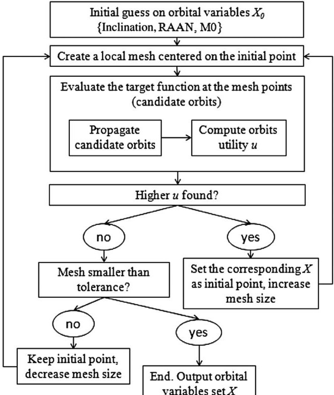

Fig. 12 S2S coverage-optimization process.

inclination, RAAN, and $ M_{0} $ . In practice, each point in this grid represents a candidate supplier orbit (if only one supplier is considered). The grid must be dimensioned according to the access regions size. The smaller the access regions of the problem, the closer the tentative orbits have to be to avoid skipping areas of interest.

The preoptimization computes the utility value for all the points on the grid and returns the set of orbital parameters $ X_{0} $ obtaining the highest utility. This candidate supplier(s) orbit is used afterward as an initial guess $ X_{0} $ for the pattern search.

## 4. Optimization: Pattern Search

The pattern search [32] starts from the initial guess $ X_{0} $ and refines the result, returning an optimized set of supplier orbit parameters X. The pattern search applies a mesh only around the initial point $ X_{0} $ and not the complete domain. Figure 12 shows the layout of this particular implementation of pattern search.

## D. Validation of the Proposed Approach

To validate the tool, a simple coverage scenario, which can be computed in analytic closed form, is formulated and used as a validation test case. The objective of this validation is twofold: 1) to obtain similar access time values with the numerical approach developed; and 2) to demonstrate the optimization process that, due to the nature of the scenario under consideration, will return a coplanar orbit for the supplier as it maximizes access time.

Consider two spacecraft in coplanar orbits around the Earth, with different semimajor axes $ r_{1} $ and $ r_{2} $ . The first is an FSS supplier node, and the second is a customer. ISL communications between spacecraft are feasible within the slant range $ r_{\mathrm{lim}} $ . The angle $ \theta $ , as depicted in Fig. 13, is the angular distance between satellites measured from the Earth center. A $ \theta_{\mathrm{lim}} $ exists such that the range between the satellites is exactly $ r_{\mathrm{lim}} $ . By the law of cosines, this angle is

$$
\theta_ {\lim } = \cos^ {- 1} \left(\frac {r _ {1} ^ {2} + r _ {2} ^ {2} - r _ {\lim } ^ {2}}{2 r _ {1} r _ {2}}\right)
$$

The access time t is then the time elapsed for the angle $ \theta $ to change from $ \theta_{\mathrm{l i m}} $ to $ -\theta_{\mathrm{l i m}} $ :

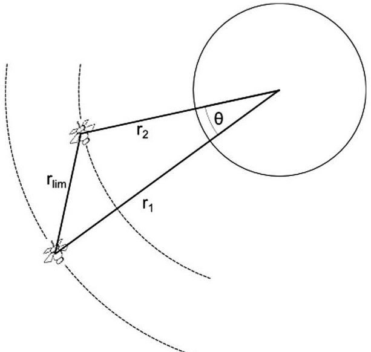

Fig. 13 Customer and supplier at maximum ISL range $ r_{\mathrm{lim}}. $

$$
t _ {\mathrm {a c c e s s}} = \frac {2 \theta_ {\mathrm {l i m}}}{\sqrt {\mu} \left(r _ {2} ^ {- 3 / 2} - r _ {1} ^ {- 3 / 2}\right)}
$$

In Eq. (8), $ \mu $ is the Earth's standard gravitational parameter.

To run the numerical computation and optimization in this case requires an arbitrary customer inclination and customer value, as well as spatial and time simulation settings, as summarized in Table 4. The simulation of a single customer orbit period (90 min) is sufficient for the purposes of this validation.

Table 4 shows the results for both the optimization and the analytical computation by using Eqs. (7) and (8). The access times are 980 s for the simulation and 966 s for the analytic result. This difference of 14 s is within the selected time step. Moreover, the optimization returns a 30 deg inclination orbit for the supplier, making customer and supplier orbits coplanar, as expected. Besides this analytical validation, the discussion that follows presents different optimization runs that will validate the consistency of the results.

## E. Approach Limitations

The approach described here presents a number of limitations. First, the minimum useful contact time span for the ISL and the minimum handover time between connections have not been considered. This may result in a marginal increase in utility for supplier orbits that have short contacts to customers. Second, the supplier sphere approach requires us to assume a zero eccentricity orbit for the supplier, reducing the number of available design options. Third, the supplier orbital altitude is set by the designer as an assumption. However, the approach can be iterated with multiple assumptions in altitude to study the sensitivity of results. In addition, it could be extended to support multiple-supplier spheres at different altitudes. Fourth, no specific assumptions are made on participating

Table 4 Validation parameters and results

<table border="1"><tr><td>Parameter</td><td>Value,km</td></tr><tr><td colspan="2">Problem parameters</td></tr><tr><td>$r_{1}$(supplier)</td><td>10,000</td></tr><tr><td>$R_{2}$(customer)</td><td>7,000</td></tr><tr><td>$r_{\mathrm{limit}}$</td><td>3,500</td></tr><tr><td colspan="2">Simulation parameters</td></tr><tr><td>Time step $\Delta t$</td><td>20s</td></tr><tr><td>Longitude step</td><td>3deg</td></tr><tr><td>Customer inclination</td><td>30deg</td></tr><tr><td>Simulation time</td><td>90min</td></tr><tr><td>Latitude step</td><td>3deg</td></tr><tr><td>Customer value</td><td>1</td></tr><tr><td colspan="2">Analytic results</td></tr><tr><td>Access time</td><td>966s</td></tr><tr><td colspan="2">Simulation results</td></tr><tr><td>Access time</td><td>980s</td></tr></table>

<!-- PDF_PAGE: 10 -->

spacecraft's attitude, or on the antenna configuration and antenna tracking ability, which is always assumed to be capable of establishing links in any direction. Last, the proposed optimization is a single objective (maximize access time), and other desirable objectives such as short communication ranges are omitted.

## F. Demonstration of the S2S Coverage Optimization

The discussion that follows presents several test cases that serve as demonstration of the proposed approach for S2S coverage optimization. First, two test studies are considered to further consolidate the confidence in the results, which are run with hypothetical sets of customers. Then, single-supplier orbit optimizations are performed with a set of real potential customers. Test study 3 discusses the convergence of results. Test study 4 presents the sensitivity of the results to the maximum ISL slant range. Finally, a three-supplier orbit optimization is presented.

## 1. Common Test Study Assumptions

The configurations under study in this paper consider both customer and supplier nodes to be LEO residents. This is representative for a FSS network, as LEO hosts a variety of data-intensive missions that experience a mission performance bottleneck in their limited groundstation contacts time. A distribution of potential LEO FSS users has been presented in the paper by Golkar and Cruz [1].

## 2. Test Study A: Single Supplier Selecting a Customer

This optimization test involves two LEO customer spacecraft, with different customer values, in 90 and 0 deg inclination orbits with a 7000 km semimajor axis. The ISL slant range is set to only 1000 km to avoid the overlapping of the access regions. Given this limited range, it is not possible to access both customers at the same time. Therefore, the optimized supplier orbital parameters are expected to be the best suited to track the highest value customer.

The supplier semimajor axis is set to 7200 km, which is a high altitude within the LEO, to grant it a slight coverage advantage. Figure 14 shows the customers orbits and the returned supplier orbit. As expected, the optimization returns a supplier inclination, RAAN, and $ M_{0} $ design to closely track the highest value customer, which in this case is the customer with an inclination of 90 deg. Table 5 summarizes the simulation parameters and results.

## 3. Test Study B: Single Supplier Tracking Two Customers

Consider now a similar scenario, as proposed in the previous test study, but with an ISL range extended to 6000 km. This range is chosen to create a region in space where it is possible to simultaneously access customers 1 and 2 (overlap region Fig. 15). As

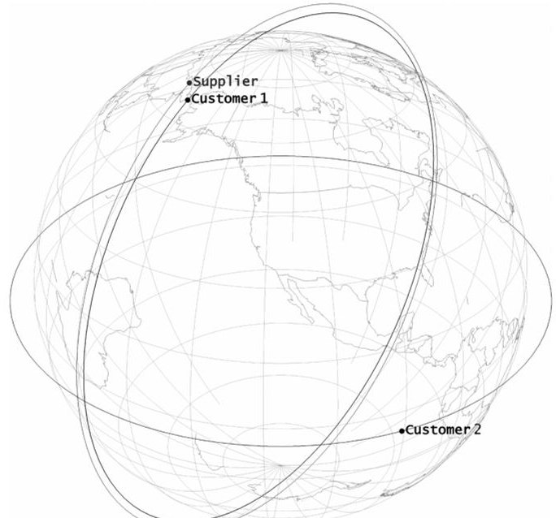

Fig. 14 Visualization of optimized geometries (image generated using AGI's STK).

Table 5 First test case parameters and results

<table border="1"><tr><td colspan="2">Simulation parameters</td></tr><tr><td>Simulation time</td><td>120 min</td></tr><tr><td>Time step</td><td>20 s</td></tr><tr><td>Supplier sphere longitude step</td><td>3 deg</td></tr><tr><td>Supplier sphere latitude step</td><td>3 deg</td></tr><tr><td>Supplier semimajor axis</td><td>7,200 km</td></tr><tr><td>ISL range</td><td>1,000 km</td></tr><tr><td>Customer 1 inclination</td><td>90</td></tr><tr><td>Customer 1 RAAN</td><td>0</td></tr><tr><td>Customer 1 mean anomaly</td><td>0</td></tr><tr><td>Customer 1 value</td><td>10</td></tr><tr><td>Customer 2 inclination</td><td>0</td></tr><tr><td>Customer 2 RAAN</td><td>0</td></tr><tr><td>Customer 2 mean anomaly</td><td>0</td></tr><tr><td>Customer 2 value</td><td>5</td></tr><tr><td>Supplier orbit results: Inclination</td><td>91</td></tr><tr><td>Supplier orbit results: RAAN</td><td>359</td></tr><tr><td>Supplier orbit results: $M_{0}$</td><td>1.5</td></tr></table>

it is desirable for the supplier to fly in this area, the optimization is expected to return a supplier orbit that keeps the supplier spacecraft in that region for the longest possible time.

The optimization returns a supplier orbit at a 45 deg inclination, with a RAAN and $ M_{0} $ such that the supplier lies in the overlap region. Figure 16 illustrates this result.

## 4. Convergence Analysis

Next, a single-supplier orbit is optimized over an example customer set including real spacecraft. The time step as well as the spatial and simulation period convergence are assessed. Finally, the influence on the results of different maximum ISL slant ranges is evaluated.

Table 6 proposes six LEO spacecraft as example customers of an FSS network. The set includes four sun-synchronous EO spacecraft and two spacecraft in non-sun-synchronous orbits: SORCE [24] and SWIFT [24]. Although a reduced set, it intends to represent the diverse LEO traffic. All the following optimizations use this example customer set.

Multiple simulations with time steps ranging from 480 to 10 s have been conducted. The goal is to optimize a single-supplier orbit, over the customer set presented in Table 5. The results are stable across the different time-step settings and converge from 100 s, toward the left in Fig. 17. With the finest time step, the optimization returns a nearpolar supplier orbit of 82.5 deg inclination, 18.75 deg RAAN, AND 0 deg $ M_{0} $ , with an averaged utility of 4.8. The utility value has been averaged with the number of time steps to enable comparison of different simulations.

To assess the spatial sensitivity of the results, an optimization of single supplier over the example customer set with a 20 s time step has been performed, with different grid steps, ranging from 15 to 1 deg. This latitude and longitude grids are the discretization of the supplier

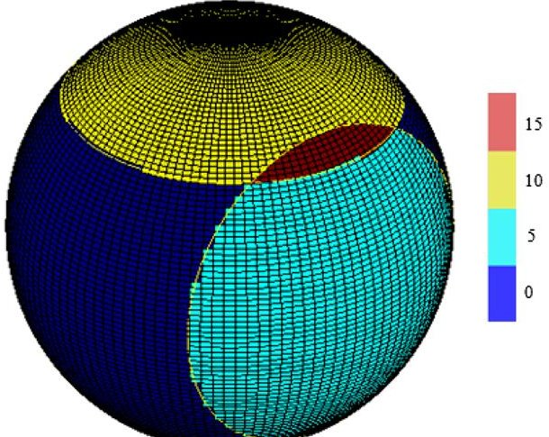

Fig. 15 Discretized supplier sphere with access regions highlighted, at a given time step.

<!-- PDF_PAGE: 11 -->

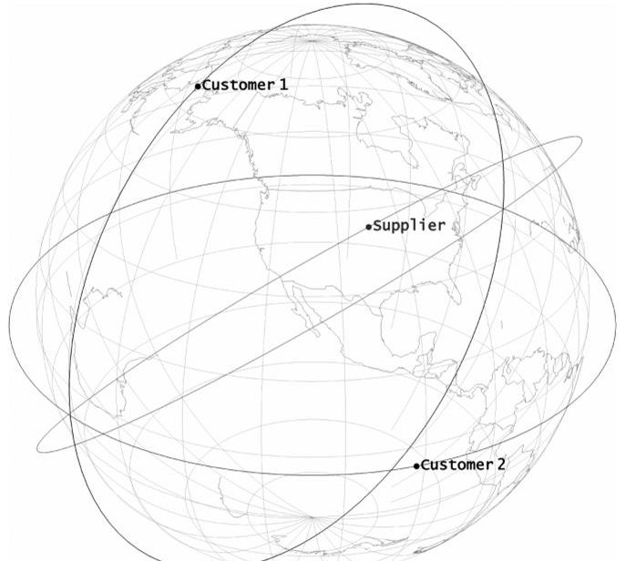

Fig. 16 Visualization of the results for test study 2 (image generated using AGI STK).

sphere, as previously discussed in the Approach Limitations section (Sec. III.E). The grids under consideration are equal sized (in degrees), i.e., their angular dimensions in longitude and latitude are the same.

The results in Fig. 18 are stable from steps equal to and smaller than 5 deg. As before, the optimization proposes a 82.5 deg inclination, 18.75 RAAN, and 0 deg $ M_{0} $ orbit with the finest grid size. The utility value is 4.8.

The optimization process can be executed through different simulation periods. Since the orbital propagation of the tool includes J4 perturbations, if multiple asynchronous orbits are simulated, the results will naturally vary for different simulation periods. Figure 19 shows the results for a single-supplier optimization, assessing its sensitivity with simulation time, for different time periods. This simulation is run with a 60 s time step and a 3 deg grid.

Starting from 300 h (two weeks), the values of utility, supplier inclination, and RAAN converge to 3.8, 90 deg, and 30 deg. $ M_{0} $ oscillates through the simulation period. Since the utility value converges, this means that the optimization result is mostly insensitive to the $ M_{0} $ changes on longer simulations. That is, the influence of the initial position of the supplier smoothes out as more orbit cycles are performed. If long periods are to be simulated, the $ M_{0} $ can therefore be taken out to reduce the number of decision variables, and consequently speed up the optimization process.

To consolidate this idea, the two-week simulation is rerun without considering $ M_{0} $ as a decision variable. The result is nearly identical; the returned supplier orbit features an inclination of 93 instead of 90 deg, which is the exact same RAAN at 22.5 and a utility value of 3.83 against 3.90. This fact will be exploited in the computationally intensive multiple-supplier optimization presented later in this section.

## 5. Sensitivity to ISL Range

Taking into account the previous results, simulations are executed with a 60 s step, with a $ 3^{\circ} $ latitude and longitude grid, and a one month simulation time. With these simulation settings, and employing the example customer set, the optimization is rerun with different ISL ranges. Under these conditions, the execution time of each optimization is approximately 2 h.

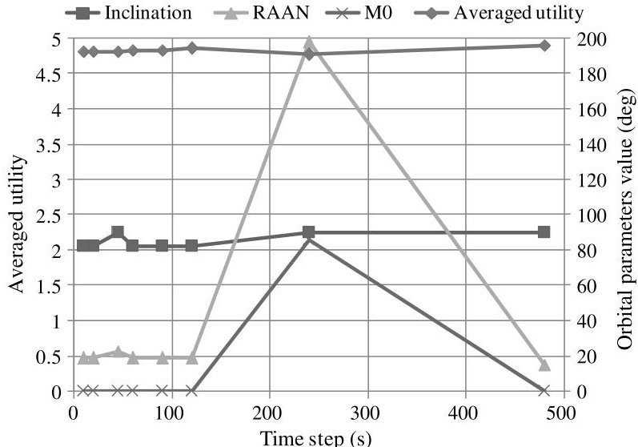

Fig. 17 Time sensitivity. Simulations run with a 7200 km semimajor axis supplier orbit, in a 4000 km ISL range.

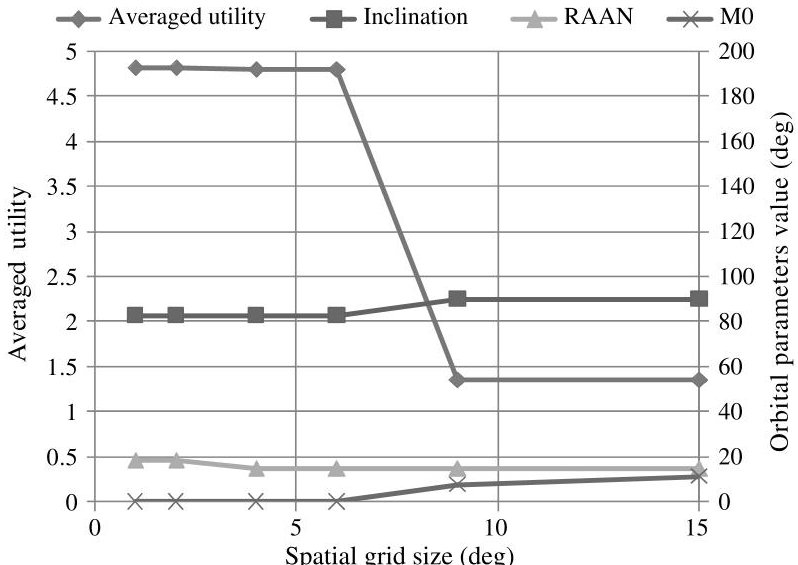

Fig.18 Spatial sensitivity. Simulations run with a 7200 km semimajor axis supplier orbit, in a 4000 km ISL range.

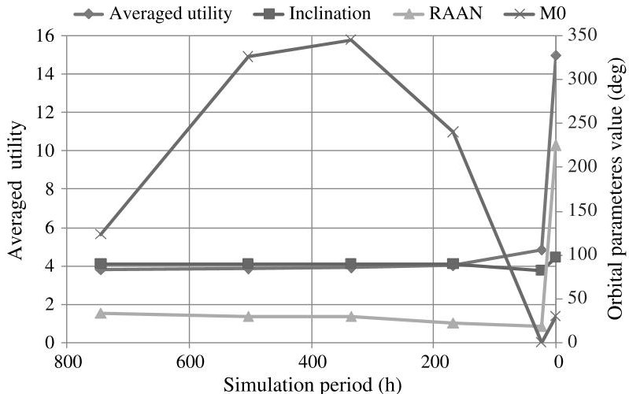

Fig.19 Simulation period sensitivity. Simulations run with a 7200 km semimajor axis supplier orbit, in a 4000 km ISL range.

Table 6 Example customer set $ ^{a} $

<table border="1"><tr><td>Customer satellite</td><td>Semimajor axis,km</td><td>Inclination,deg</td><td>RAAN,deg</td><td>Initial mean anomaly,deg</td><td>Customer value</td></tr><tr><td>Radarsat2</td><td>7168.00</td><td>98.58</td><td>193.78</td><td>22.00</td><td>7.29</td></tr><tr><td>Pleiades1A</td><td>7064.00</td><td>98.20</td><td>261.09</td><td>228.00</td><td>3.86</td></tr><tr><td>Geoeye1</td><td>7057.00</td><td>98.10</td><td>260.03</td><td>25.00</td><td>7.51</td></tr><tr><td>COSMO-SKYMED1</td><td>6989.00</td><td>97.87</td><td>11.13</td><td>174.00</td><td>8.27</td></tr><tr><td>SORCE</td><td>7015.00</td><td>40.00</td><td>246.00</td><td>30.00</td><td>2.34</td></tr><tr><td>SWIFT</td><td>6970.00</td><td>20.00</td><td>143.00</td><td>186.00</td><td>4.45</td></tr></table>

$ ^{a} $Data from work by Kramer [24].

<!-- PDF_PAGE: 12 -->

Figure 20 shows that supplier orbit utility increases with maximum ISL range, but it saturates from 6000 km due to Earth blocking of the line of sight. This saturation point is found at different distances depending on orbit altitudes involved. This insight is useful to orient the design of ISL equipment and avoid overperformance.

The optimal RAAN and $ M_{0} $ are sensible to the ISL range considered, since adjusting the orbit plane and starting point can place more customers in view as the ISL range is expanded. However, the optimized orbit inclination at 90-93 deg, also found on the long simulations in Fig. 19, is constant across the different simulations. This points to polar orbits rather than sun synchronous, despite the fact that most customers present sun-synchronous orbits; this is an effect of the RAAN dispersions. This insight is already evident with a small set of example customers, and it would gain more importance if larger customer sets were to be considered.

## 6. Three-Supplier Optimization with Real Customers

Consider now a set of three supplier spacecraft, for which the orbits have to be optimized for the example customer set. If the $ M_{0} $ variable is neglected as discussed in the simulation period discussion, the optimization runs on six decision variables (inclination and RAAN for each supplier) that are optimized to deliver the maximum total utility. The simulation settings are a 60 s step, a $ 3^{\circ} $ latitude and longitude grid, and a 15-day simulation period. The ISL range is set to 4000 km. Figure 21 shows the example customer set and the three optimized supplier orbits.

Table 7 shows the results of the simulation and compares them to a single-supplier optimization case. In the three-supplier optimization,

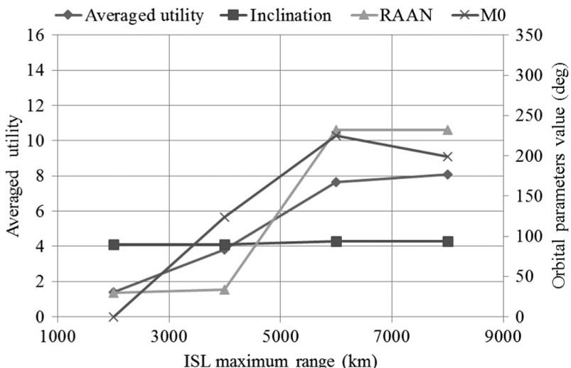

Fig.20 ISL range influence. Simulations run with a 7200 km semimajor axis supplier orbit. Average utility (left axis) saturates when ISL range increases.

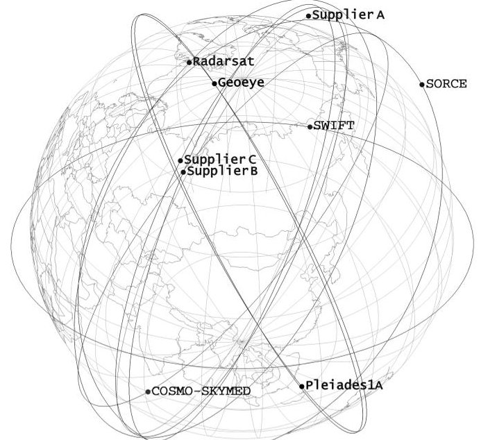

Fig. 21 Three suppliers' (A, B, and C) orbit optimization results.

Table 7 Optimization results with three suppliers $ ^{a} $

<table border="1"><tr><td colspan="2">Three suppliers optimization vs single supplier optimization</td></tr><tr><td>Supplier A inclination</td><td>93 deg</td></tr><tr><td>Supplier B inclination</td><td>90 deg</td></tr><tr><td>Supplier C inclination</td><td>90 deg</td></tr><tr><td>Supplier A RAAN</td><td>22.5 deg</td></tr><tr><td>Supplier B RAAN</td><td>206 deg</td></tr><tr><td>Supplier C RAAN</td><td>202.5 deg</td></tr><tr><td>Total averaged utility</td><td>11.0</td></tr><tr><td>Average utility-per supplier</td><td>3.6</td></tr><tr><td>Single Supplier inclination</td><td>93 deg</td></tr><tr><td>Single Supplier RAAN</td><td>22.5 deg</td></tr><tr><td>Averaged utility</td><td>3.8</td></tr></table>

$ ^{a} $Values compared to the corresponding single-supplier optimization.

the results for the first supplier orbit are equal to the results obtained with a single-supplier optimization. The other two optimized supplier orbits are also polar orbits, and they feature a very similar RAAN, even though the target function rewards orbit diversification (implemented by the decreasing interest factor). This means that their orbit covers high interest regions where multiple accesses are possible. The visualization of the orbit shows they often access multiple customers at the same time. In this particular scenario, this result would suggest using a single spacecraft capable of establishing multiple, independent links instead of two in a similar orbit.

Another remarkable result is that the utility value gathered per supplier node nearly matches the single-supplier result, meaning that there is no saturation of suppliers in this particular case of three suppliers and six customers.

## IV. Conclusions

The different approaches available for spacecraft joining a satellite federation lead to different mission design impacts that are to be traded against the benefits obtained by the resource exchange. This work has analyzed the impacts on missions hosting an FSS ISL payload in terms of the system-level mass impacts, as well as the impacts on dedicated missions in terms of preferred orbit geometry. The former can act as federation resource suppliers or customers, whereas the dedicated spacecraft are supplier nodes deployed in favorable orbital spots to maximize access to potential customers.

The test cases and analysis shown in this paper are predominantly developed for LEO spacecraft. The operational environment for missions in LEO, featuring short ground-station contact times, and the rising mission data volumes gathered by current EO missions make a pressing case for cooperative data relay, which is one of the core functionalities envisioned in the federated satellite systems paradigm.

The impacts on host spacecraft are analyzed by using a tailored spacecraft model. Section II focused on the data relay between participating spacecraft. First, the mass impacts were shown for spacecraft performing a supplier role. The spacecraft in LEO orbit presented a nearly linear increase on their baseline loaded mass, as more ISL contacts per orbit were established. For a total of 15 contacts of 120 s, corresponding to a total data volume of 180 Gbits per orbit, small, medium, and large spacecraft presented 12, 1.1, and 0.6% of the loaded mass increase, respectively. Large spacecraft were subject to smaller design impacts of including FSS capabilities, presenting an economies-of-scale effect. However, for any size of platform, the need of augmented space to the ground data rate can reach the bandwidth limits, as this is an upper bound to the relay service performance. Next, this work has shown the evolution of the mass impacts on spacecraft acting as customers. Such spacecraft may choose to downsize their space-to-ground communications equipment and progressively substitute it by ISL contacts to other federated spacecraft. For a limited loaded mass increase consisting of 3 kg worth of active ISL components (antenna and amplifiers), plus any other ancillary components needed (estimated on 5 kg), the customer spacecraft can relay all their mission data via the federation, and it can retain (at the same time) a minimal space-to-ground communications

<!-- PDF_PAGE: 13 -->

subsystem. Going a step further, the customers may completely drop their space-to-ground link capacity for increased mass savings. However, this option may come with effects on mission reliability and would ultimately depend on the amount of suppliers available in the federation and the perception of risks by the mission designer.

An additional study has been presented, analyzing the potential of participating in an FSS without any subsystem modifications, only adding to the spacecraft the stated 3-8 kg ISL providing a 100 Mbits/s data rate and operating it solely on power margins. The results show, for small, medium, and large LEO spacecraft classes, the capability to sustain a significant amount of ISL operations through a lifetime based upon the extra power generated before the EOL. For all spacecraft types, the operations' potential duration exceeded 500 s/orbit for more than 70% of the mission life. These results show how adding FSS capabilities to a spacecraft comes with little design impact, which is desirable.

The impacts on dedicated satellites aiming to supply resources to the federation have been analyzed in terms of preferred orbital geometries. Dedicated supplier missions seek to maximize access to potential customers. Although FSS suppliers would serve future customer missions, the current orbital population gives a starting point to characterize customer geometries and develop approaches to optimally supply them. The approach chosen is to formulate a satellite-to-satellite coverage-optimization problem: that is, the problem of maximizing satellite coverage as seen from other satellites. This coverage, in the FSS context, is subject to opportunistic ISL contacts, as the spacecraft constituting the federation are not designed a priori as a constellation and establish communications when possible. The optimization approach has been validated and tested, and it was demonstrated with single- and multiple-dedicated-supplier orbital optimizations. Although the optimized RAAN and the $ M_{0} $ are sensible for the particular parameters and constraints of the problem (customer orbits, ISL range), the optimized inclination for the supplier is always close to 90 deg, pointing the system toward polar orbits. This is a result of the LEO population being predominantly sun synchronous orbit missions with a wide range of RAANs. It is also shown that $ M_{0} $ can be neglected as a decision variable. The multiple dedicated supplier optimization is also consistent with this results. In addition, it points out that, in particular cases, for the same performance, the system architecture could make use of more capable supplier spacecraft rather than a higher number of them.

This work supports the concept of federated satellite systems by showing how participant spacecraft can access the federation with very small operational and design impacts, and exchange resources in an opportunistic ad hoc fashion, based upon marginal onboard resources. For those missions interested in offering services to the federation, polar orbits are preferred in the LEO region. Future work includes analyzing the full-scale design impacts on customer spacecraft of allocating all of the data-based spacecraft functions to the federation, and not only the data relay as described in this work. In addition, the space communications network concept supporting FSS has to be architected and demonstrated.

## Acknowledgment

The authors want to thank Giorgio Daprati from Thales Alenia Space in Italy for his insights into solar array sizing.

## References

[1] Golkar, A., and Cruz, I. L., "The Federated Satellite Systems Paradigm: Concept and Business Case Evaluation," Acta Astronautica, Vol. 111, June-July 2015, pp. 230-248. doi:10.1016/j.actaastro.2015.02.009

[2] Brown, O., and Eremenko, P., "The Value Proposition for Fractionated Space Architectures," Space 2006, AIAA Paper 2006-7506, Sept. 2006.

[3] Fossa, C. E., Raines, R. A., Gunsch, G. H., and Temple, M. A., "An Overview of the IRIDIUM (R) Low Earth Orbit (LEO) Satellite System," Proceedings of the IEEE 1998 National Aerospace and Electronics Conference, IEEE Publ., Piscataway, NJ, 1998, pp. 152-159. doi:10.1109/NAECON.1998.710110

[4] Parkinson, B. W., and Axelrad, P., Global Positioning System Theory and Applications, AIAA, Reston, VA, 1996, pp. 29-55.

[5] Michel, T., Thapa, B., and Taylor, S., "802.11s Based Multi-Radio Multi-Channel Mesh Networking for Fractionated Spacecraft," 2013 IEEE Aerospace Conference, IEEE Publ., Piscataway, NJ, 2013, pp. 1-8. doi:10.1109/AERO.2013.6497331

[6] Hoebeke, J., Moerman, I., Dhoedt, B., and Demeester, P., "An Overview of Mobile Ad Hoc Networks: Applications and Challenges," Journal of the Communications Network, Vol. 3, No. 3, 2004, pp. 60-66.

[7] Reed, J. H., Software Radio: A Modern Approach to Radio Engineering, Prentice-Hall, Upper Saddle River, NJ, 2002.

[8] Lluch, I., Grogan, P. T., Pica, U., and Golkar, A., "Simulating a ProActive Ad-Hoc Network Protocol for Federated Satellite Systems," IEEE Space 2015, IEEE Publ., Piscataway, NJ, 2015, pp. 1-16.

[9] Rosello, J., Martellucci, A., Acosta, R., Nessel, J., Braten, L. E., and Riva, C., "26-GHz Data Downlink for LEO Satellites," 6th European Conference on Antennas and Propagation (EUCAP), IEEE Publ., Piscataway, NJ, 2012, pp. 111-115. doi:10.1109/EuCAP.2012.6206717

[10] Jang, S.-S., and Choi, J., "Energy Balance Analysis of Small Satellite in Low Earth Orbit (LEO)," IEEE 2nd International Power and Energy Conference, IEEE Publ., Piscataway, NJ, 2008, pp. 967-971. doi:10.1109/PECON.2008.4762613

[11] Salim, A., "On-Orbit Management of Spacecraft Solar Array Output Power," AIAA Paper 1994-4230, 1994. doi:10.2514/6.1994-4230

[12] Patel, M. R., Spacecraft Power Systems, CRC Press, Boca Raton, FL 2005, pp. 16-21, Chap. 4. doi:10.1201/9781420038217

[13] Luque, A., and Hegedus, S. (eds.), Handbook of Photovoltaic Science and Engineering, Wiley, Hoboken, NJ, 2003, pp. 413-448. doi:10.1002/0470014008

[14] Wertz, J. R., Everett, D. F., and Puschell, J. J. (eds.), Space Mission Engineering: The New SMAD, Microcosm Press, Hawthorne, CA, 2011, pp. 1028-1033. doi:10.1007/978-94-011-3794-2

[15] Woike, T. J., "EOL Performance Comparison of GaAs/Ge and Si BSF/R Solar Arrays," Proceedings of the 12th Space Photovoltaic Research and Technology Conference (SPRAT 12), NASA, Lewis Research Center, 1993, pp. 167-176.

[16] Stan, M., Aiken, D., Clevenger, B., Cornfeld, A., Doman, J., Downard, E., Hills, J., Hoffman, R., Johnston, G., Newman, F., Pappan, J., Sandoval, A., Sharps, P., and Wood, J., "Design and Performance of High Efficiency III-V Space Solar Cells with Monolithic Bypass Diode Architecture," Conference Record of the 2006 IEEE 4th World Conference on Photovoltaic Energy Conversion, Vol. 2, IEEE Publ., Piscataway, NJ, May 2006, pp. 1865-1868. doi:10.1109/WCPEC.2006.279858

[17] Hodgson, B. A., "Attitude Control of Communication-Satellite Radio Antennae," Students' Quarterly Journal, Vol. 35, Dec. 1964, pp. 63-68. doi:10.1049/sqj.1964.0072

[18] Tsiotras, P., Shen, H., and Hall, C., "Satellite Attitude Control and Power Tracking with Energy/Momentum Wheels," Journal of Guidance, Control, and Dynamics, Vol. 24, No. 1, 2001, pp. 23-34. doi:10.2514/2.4705

[19] Kolawole, M. O., Satellite Communication Engineering, Marcel Dekker, New York, 2002, p. 54. doi:10.1201/9780203910283

[20] Cartier, N., Oster, J., and Lesthievent, G., "High Data Rate 8PSK Transmitter for X-Band Payload Telemetry," European Radar Conference, 2005 (EURAD 2005), IEEE Publ., Piscataway, NJ, Oct. 2005, pp. 93-96. doi:10.1109/EURAD.2005.1605572

[21] Chinchuluun, A. (ed.), Pareto Optimality, Game Theory and Equilibria, Springer, New York, 2008, pp. 481-515. doi:10.1007/978-0-387-77247-9

[22] "Attenuation by Atmospheric Gases," P Series: Radiowave Propagation International Telecommunication Union Recommendation ITU-R P. 676-10, Geneva, Sept. 2013.

[23] Covello, F., Battazza, F., Coletta, A., Lopinto, E., Fiorentino, C., Pietranera, L., Valentini, G., and Zoffoli, S., "COSMO-SkyMed an Existing Opportunity for Observing the Earth," Journal of Geodynamics, Vol. 49, Nos. 3-4, April 2010, pp. 171-180. doi:10.1016/j.jog.2010.01.001

[24] Kramer, H. J., Observation of the Earth and Its Environment: Survey of Missions and Sensors, Springer, New York, 2002. doi:10.1007/978-3-642-56294-5

<!-- PDF_PAGE: 14 -->

[25] Johal, R., Christensen, J., and Doud, D., "ORBCOMM Generation 2 Access to LEO on the Falcon 9 Using SoftRide, A Case History," Proceedings of the AIAA/USU Conference on Small Satellites, AIAA/ USU Paper SSC12-V-7, Logan, UT, 2012, pp. 1-6.

[26] Scorzafava, E., Daprati, G., Manfreda, M., Constantini, S., Perrone, G., and Antongirolami, D., "Cosmo-Skymed Power Subsystem Technology, Models and in Orbit Results," Ka and Broadband Communications, Navigation and Earth Observation Conference, ASI, Cagliari, Italy, 2009, pp. 1-8.

[27] Beste, D. C., "Design of Satellite Constellations for Optimal Continuous Coverage," IEEE Transactions on Aerospace and Electronic Systems, Vol. AES-14, No. 3, May 1978, pp. 466-473. doi:10.1109/TAES.1978.308608

[28] Walker, J. G., "Circular Orbit Patterns Providing Continuous Whole Earth Coverage," Royal Aircraft Establishment TR-70211, Farnborough, England, U.K., Nov. 1970.

[29] Rider, L., and Adams, W. S., "Circular Polar Constellations Providing Continuous Single or Multiple Coverage Above a Specified Latitude," Journal of the Astronautical Sciences, Vol. 35, April-June 1987, pp. 155-192.

[30] Ballard, A. H., "Rosette Constellations of Earth Satellites," IEEE Transactions on Aerospace and Electronic Systems, Vol. AES-16, No. 5, Sept. 1980, pp. 656-673. doi:10.1109/TAES.1980.308932

[31] Teles, J., Samii, M. V., and Doll, C. E., "Overview of TDRSS," Advances in Space Research, Vol. 16, No. 12, 1995, pp. 67-76. doi:10.1016/0273-1177(95)98783-k

[32] Hooke, R., and Jeeves, T. A., "Direct Search Solution' of Numerical and Statistical Problems," Journal of the ACM, Vol. 8, No. 2, April 1961, pp. 212-229. doi:10.1145/321062.321069

doi:10.1145/321062.321069

[33] Rios, L., and Sahinidis, N., "Derivative-Free Optimization: A Review of Algorithms and Comparison of Software Implementations," Journal of Global Optimization, Vol. 56, No. 3, July 2013, pp. 1247-1293. doi:10.1007/s10898-012-9951-y

D. Thunnissen Associate Editor