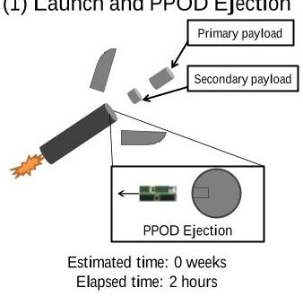
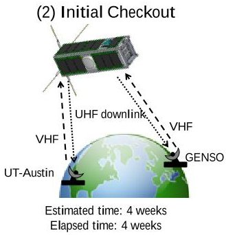
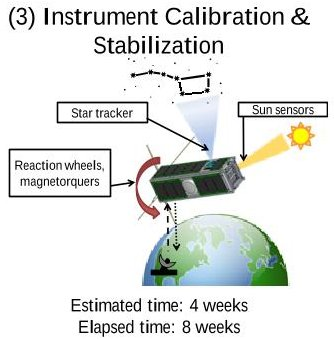
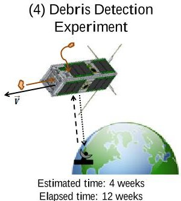
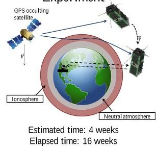
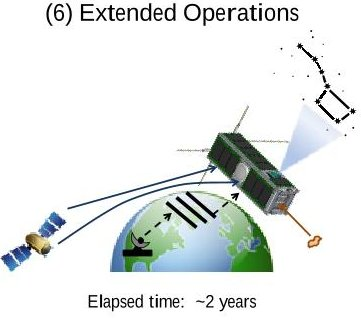
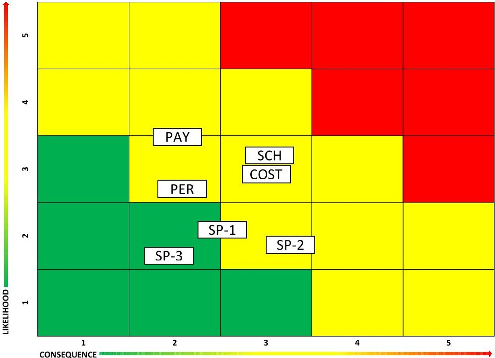
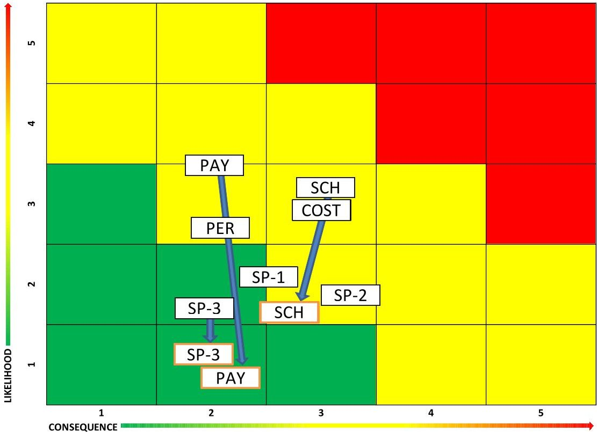

<!-- PDF_PAGE: 1 -->

# A Risk Management Plan for CubeSats

Katharine M. Brumbaugh $ ^{1} $ and E. Glenn Lightsey $ ^{2} $ The University of Texas at Austin, Austin TX, 78712

Risk management is a crucial step of any spacecraft design in order to ensure system functionality and mission success. Unfortunately, risk management plans are typically high-level descriptions of risk philosophies or are too detailed for use on a student-built or otherwise low-budget spacecraft design. This paper outlines a risk management plan for CubeSats by first identifying risks, defining the root causes and their priority, and naming a responsible party for monitoring the root cause. These mission risks are then ranked by their likelihood and consequence of occurrence. Rationales for these rankings and the graphing of the mission risk on a 5x5 grid complete the risk identification phase of this risk management plan. To monitor the progress of the mission risks throughout the design life cycle, four types of mitigation strategies are described and risks are re-evaluated at key design milestones. Each step of this risk management plan is described and an example given based upon the risk analysis completed for a 3U CubeSat being built by a student team at The University of Texas at Austin. The paper then concludes with the proposed future work of gathering previously flown CubeSat mission failures through a Failure Modes and Effects Analysis (FMEA) within a Probabilistic Risk Assessment (PRA).

## I. Introduction and Background

According to the NASA Risk Management Procedural Requirements, "risk is the potential for performance shortfalls, which may be realized in the future with respect to achieving explicitly established and stated performance requirements." $ ^{1} $ These potential pitfalls range from lack of the needed institutional support for the mission to the areas of safety, technical, cost and schedule of the project itself. Based on these guidelines, risk management is the process of risk identification, analysis, mitigation planning and tracking of the root cause of problems and their ultimate consequences. Risk management plans make the mission more successful by identifying potential failures early, and planning methods to circumvent any issues. However, to date, risk management plans have typically only been used for larger, and more expensive, satellites and have rarely been applied to nanosatellites, much less to the emerging nanosatellite class with a mass less than 10 kg. For this new class of satellites which is becoming of interest to the aerospace industry, these larger-scale risk management plans need to be adapted to small satellites on a mission appropriate scale.

California Polytechnic State University (Cal Poly) has established a standard launch mechanism for nanosatellites called the Poly-Picosatellite Orbital Deployer (P-POD). The P-POD is frequently flown as a secondary payload on unmanned launch vehicles, making it easier for small satellites which use the system to obtain launches. In order to use the P-POD, the spacecraft must be in the shape of 10 cm cubes called CubeSats. One CubeSat is called a 1-Unit (1U) and has a mass of approximately 1 kg. Multiple CubeSats may be combined to form various size configurations of Units, such as 1U, 2U, and 3U. The P-POD and CubeSat standard were first demonstrated together in June 2003 with the launch two P-POD devices and a total of six 1U CubeSats. $ ^{2} $

Because of their relative simplicity, and lower cost, CubeSats have the potential to change the economics of space access. According to Johnson, CubeSats "...have grown in importance. Some think they are poised to have a potentially profound impact on the big-budget space industry, where missions can routinely cost hundreds of millions, similar to the effect the advent of personal computers had on computing." $ ^{3} $ U.S. Air Force Maj. David Shultz, head of the Colony Program Office, has stated the potential for CubeSats "to prove advanced technologies on orbit more quickly and affordably than on larger platforms." $ ^{4} $ Additionally, the National Reconnaissance Office (NRO) and the National Science Foundation (NSF) are using CubeSats for a variety of missions including space

<!-- PDF_PAGE: 2 -->

weather, signifying the transition from purely educational purposes to new applications in scientific research and technology validation. $ ^{5} $

But CubeSat projects are a new development in the domain of traditional spacecraft programs. Many engineering processes and practices which have been successfully implemented on larger scale satellite projects have never been applied, and may be inappropriate, on a smaller scale such as CubeSats. Lacking a suitable body of evidence that can be applied to small satellites, many small satellite projects are operated with purely ad hoc or without established engineering practices. A new set of practices is needed that is appropriate to the schedule, budget, and risk tolerance of this new class of satellites. This risk analysis research will result in more informed decision making for small satellite projects, ultimately producing more successful spacecraft missions. $ ^{6} $ It is timely to perform this research now, as small satellites continue to grow in use and capability.

Founded in 2003, the Satellite Design Lab (SDL) at the University of Texas at Austin (UT-Austin) has established a tradition of designing, building, launching, and operating student-built satellites. The lab has successfully launched two nano-satellites (~25 kg each) and one pico-satellite (~1 kg) within the past 3 years. In the SDL, student teams are currently designing two 3U CubeSats (~4 kg). One is part of a joint-university project with Texas A&M University which is sponsored by NASA Johnson Space Center, called LONESTAR (Low Earth Orbiting Navigation Experiment for Spacecraft Testing Autonomous Rendezvous and docking). The UT-Austin contribution to this project is a maneuverable 3U CubeSat known as Bevo-2.The second 3U CubeSat currently being designed in the SDL is an entry into the AFRL-run University Nanosatellite Program (UNP). This project is titled ARMADILLO - Atmosphere Related Measurements And Detection of submILLimeter Objects.

Combined, the Bevo-2 and ARMADILLO missions provide a unique perspective to study the design strategy of 3U CubeSats across two separate missions. Bevo-2 is currently in the spacecraft integration phase while ARMADILLO is nearing the final design phase. The primary goal of risk identification and mitigation is to be aware of potential threats to the mission success and to set methods in place which will lessen the effect of the harmful event should it occur or to completely remove the risk altogether. Typically, risk identification and mitigation begins during the initial phases of mission planning in order to incorporate these mitigation techniques into the design from the beginning. Unfortunately, at the time the risk identification process presented in this paper was introduced, the Bevo-2 and ARMADILLO missions had already progressed beyond initial concept design. Even so, the two CubeSat missions can provide a baseline risk analysis of nanosatellites from which to build a more detailed CubeSat risk management plan as outlined by this research.

## II. Detailed Risk Management Plan

This paper presents the process of creating a CubeSat Risk Management Plan, as listed in Table 1, by using the risk analysis completed for the ARMADILLO mission as an example application. The risks are identified hardware, software and programmatic which the mission could potentially experience. Following this, the risks are

Table 1. Steps of a Risk Management Plan

<table border="1"><tr><td>Main Step</td><td>Sub-steps</td></tr><tr><td>A. Identify Risks</td><td>1. Start with the mission concept of operations2. Identify root causes3. Classify priority of risk4. Name responsible party5. Rank likelihood and consequence of root cause6. Describe rationale for ranking7. Compute mission risk likelihood and consequence values8. Plot mission risks on L-C chart</td></tr><tr><td>B. Determine mitigation techniques</td><td>Choices consist of:1. Avoid the risk by eliminating root cause and/or consequence2. Control the cause or consequence3. Transfer the risk to a different party or project4. Assume the risk and continue in development</td></tr><tr><td>C. Closely monitor progress</td><td>Plot the mission risk values on an L-C chart at key design milestones to see progress.</td></tr></table>

prioritized, so as to recognize which risks need the most attention at any one time. Each risk requires a responsible party from whom status updates are gathered. The systems engineer then ranks, and provides rationales for, the likelihood and severity of each root cause based upon scales developed by the Department of Defense (DoD). Next, calculating the mathematical average of all the root cause likelihood and severity values for each mission risk yields the overall mission risk likelihood and consequence values. Then, the mission risk likelihood and consequence values are plotted as a coordinate system on the

<!-- PDF_PAGE: 3 -->

industry-used Likelihood-Consequence (L-C) plot. Finally, the systems engineer analyzes mitigation strategies for each root cause, and the mission risk L-C values are tracked between key design milestones.

The paper concludes with suggested future work in the area of CubeSat Risk Management Plans. Without appropriate statistical data, the likelihood and consequence scales by which the risks are ranked is highly subjective to the systems engineer completing the risk analysis. Thus, a main goal of this paper is to highlight the necessity of implementing an in-depth Probabilistic Risk Assessment (PRA) to determine the likelihoods of similar risks occurring and the severity of those failures according to previously flown CubeSat missions. According to NASA, PRA is a study of "scenarios, frequencies, and associated consequences." $ ^{7} $ Basically, the PRA method calls for conducting a CubeSat Failure Modes and Effects Analysis (FMEA) via the accumulation of mission data with any failures the mission experienced, the consequence of the failure, and any action taken.

## A. Identify Risks

## 1. Start with mission concept of operations

It is difficult to identify the risks of a mission with no previous experience or resources on which to rely. To determine the risks which could potentially cause mission failure, it is useful to start with the mission concept of operations and the primary payloads. Often times launch and checkout are the first steps of the concept of operations. With this approach in mind, what mission-specific actions would cause launch and checkout to fail? Obviously, the spacecraft design and integration team

Table 2. Sources of mission risk.

<table border="1"><tr><td>Hardware/Software</td><td>Programmatic</td></tr><tr><td>Requirements</td><td>Logistics</td></tr><tr><td>Technical baselines</td><td>Concurrency</td></tr><tr><td>Test and Evaluation</td><td>Cost</td></tr><tr><td>Modeling and simulation</td><td>Management</td></tr><tr><td>Technology</td><td>Schedule</td></tr><tr><td>Production/Facilities</td><td>External factors</td></tr><tr><td>Industrial capabilities</td><td>Budget</td></tr></table>

cannot control launch failures, but they can control spacecraft delivery delays. Moving along in many concept of operations to the primary mission, consider what could cause these payloads to not function. Mission risks are high-level failures, whereas the component and system-level failures are the root causes to be discussed next. All risks should be analyzed in terms of hardware, software and programmatic issues. Table 2 lists typical sources of mission risk according to the DoD Risk Management guide. $ ^{8} $

The ARMADILLO 3U CubeSat Concept of Operations is shown graphically in Figure 1. ARMADILLO has a

(1) Launch and PPOD Ejection

Figure 1. ARMADILLO Concept of Operations

primary science mission of studying sub-millimeter space debris particles with an experiment called the Piezoelectric Dust Detector (PDD). The secondary science mission uses a dual-frequency software-defined GPS receiver named FOTON, capable of accurate orbit determination, to gather radio occultation data in order to help increase understanding of space weather, especially in the ionosphere. The ARMADILLO CubeSat has many critical systems on board, but mission success is dependent upon the ability of the spacecraft to gather scientific and spacecraft health data, and communicate it to the UT-Austin ground station. Cost

risks are identified by evaluating the current satellite budget which outlines the cost of each component within its respective subsystem as well as personnel costs to the project. Schedule risks are determined by examining the integration and testing schedule for potential schedule slips. Personnel risks are recognized by management experience over the course of the spacecraft design cycle. Spacecraft risks are identified by examining the Requirements Verification Matrix and the simulation, modeling and testing processes needed to verify that each

<!-- PDF_PAGE: 4 -->

requirement is being met. These risks are combined to encompass the seven identified risks for the ARMADILLO mission. Each risk is given a unique call sign which identifies it on the L-C chart presented later. The seven ARMADILLO risks are listed in Table 3.

Note that the SCH risk of Table 3 refers to the Flight Competition Review (FCR) during which ARMADILLO will be evaluated in January 2013. ARMADILLO is the UT-Austin entry in the current University Nanosatellite Program (UNP) competition, and the FCR is when the winner is selected. Thus, the FCR acts as a key delivery point. The PAY, SP-1, SP-2 and SP-3 risks were identified by analyzing the mission concept of operations, mission success criteria, and mission requirements verification matrix as discussed earlier.

Table 4. ARMADILLO SCH mission risk (Failure to deliver EDU to FCR) detailed to root cause, priority, and responsible party at PQR in Summer 2012.

<table border="1"><tr><td>Root cause</td><td>Priority</td><td>Responsible party</td></tr><tr><td>Mechanical EDU structure delay due to the delay in sending out CAD drawings to the machine shop.</td><td>7</td><td>Structures (STR) lead</td></tr><tr><td>Hardware integration delays due to individual subsystems not being ready to be integrated with the entire spacecraft</td><td>8</td><td>Integration (INT) lead</td></tr><tr><td>Software integration delays due to individual subsystems not being ready to be integrated with the entire spacecraft.</td><td>5</td><td>Command and Data Handling (CDH) lead</td></tr><tr><td>Software interfacing with PDD delayed</td><td>1</td><td>CDH lead</td></tr><tr><td>PDD instrument team fails to provide a flight unit for final spacecraft build causing the attendance of FCR without a flight PDD</td><td>4</td><td>Student Program Manager (PM)</td></tr><tr><td>FOTON development delayed and scheduled deadlines not met</td><td>3</td><td>PM</td></tr><tr><td>FOTON fails to meet the jointly (ARMADILLO and FOTON) decided interface requirements</td><td>6</td><td>Attitude Determination and Control (ADC) lead</td></tr><tr><td>Software integration delays due to the flight computer not being ready to integrate with subsystems</td><td>2</td><td>CDH lead</td></tr></table>

Table 3. ARMADILLO Mission Risks.

<table border="1"><tr><td>Risk Category</td><td>Call sign</td><td>Mission Risk</td></tr><tr><td>Schedule</td><td>SCH</td><td>Failure to deliver EDU to the FCR</td></tr><tr><td>Payload</td><td>PAY</td><td>Failure to gather science mission data in orbit</td></tr><tr><td>Spacecraft</td><td>SP-1</td><td>Being unable to communicate with spacecraft</td></tr><tr><td>Spacecraft</td><td>SP-2</td><td>Unable to gather data from spacecraft</td></tr><tr><td>Personnel</td><td>PER</td><td>Loss of human knowledge and experience</td></tr><tr><td>Spacecraft</td><td>SP-3</td><td>Inability to meet spacecraft standards</td></tr><tr><td>Cost</td><td>COST</td><td>Mission cost too overwhelming to continue</td></tr></table>

## 2. Identify root cause which would cause risk

descriptive as possible when developing the Risk Management Plan.

The next step in assessing the potential risks to a spacecraft mission is to analyze the root causes of such a risk. Starting with the risks identified in a table such as Table 3, determine what hardware, software or programmatic issues would eventually lead to the harmful event occurring. While the mission risks may be very similar between different university and industry missions, the root causes may greatly differ based upon the engineering practices in place in each environment. For instance, student teams may experience different personnel risk root causes than industry spacecraft projects which have career engineers as part of the team. Additionally, university projects tend to have smaller budgets leading to a higher cost risk. With each mission risk, it is encouraged to examine the requirements verification matrix, project schedule, budget and mission overview documents to determine what root causes may contribute to the specified mission risk.

While the ARMADILLO mission risks are shown in Table 3, the SCH risk is further analyzed in Table 4 by displaying the top eight root causes. The priority and responsible parties are discussed in the next sections. The root causes were identified by examining the project schedule and status, hardware trade studies, as well as utilizing lessons learned during previous satellite design missions at UT-Austin. For example, these lessons refer to underestimating the difficulty of software interfacing between hardware and the spacecraft flight computer. Note that the root causes shown in Table 4 are descriptive and specific to the ARMADILLO concept of operations and scientific payloads. It is beneficial to be as

<!-- PDF_PAGE: 5 -->

## 3. Classify priority of risk

After recognizing the root causes of each mission risk, the priority of that risk is classified. The decision of priority should be based not only upon the potential harm the root cause would have upon the mission, but should also be based upon the current financial and personnel resources allocated to the event. In other words, is a root cause currently being addressed with either financial or personnel resources, or is addressing the root cause being delayed until more resources can be acquired? The top priority, a numerical "1", represents the root cause which generates the most concern and should be given as much financial and personnel resources as required to mitigate the risk.

Table 4 details the ARMADILLO SCH mission risk with its top eight priority root causes identified. At the Critical Design Review in Spring 2012, ARMADILLO had a top SCH risk root cause of a delay in the Mechanical EDU fabrication based on a delay of sending out the mechanical drawings for machining. At the time, this risk was highly rated because the team did not have as many personnel resources allocated to mitigating the root cause as needed. Having applied the risk identification method to the ARMADILLO mission, the team saw that this event could cause a major schedule slip and more members of the team were trained to create and check the drawings. Because of this personnel shift, the drawings of the Bevo-2 spacecraft were finished, checked and sent to the machine shop without delaying the project schedule. While these drawings were specific to the Bevo-2 mission, the ARMADILLO schedule mission risk was nevertheless mitigated, because now the team understands the time associated with completing a quality job on the mechanical drawings prior to sending them to the machine shop. Additionally, since the Bevo-2 and ARMADILLO spacecraft are similar, $ ^{9} $ only small changes to the Bevo-2 drawings are needed to complete the ARMADILLO drawings. Thus, the root cause priority decreased in the five months between Critical Design Review (CDR) to Proto-Qualification Review (PQR), after having identified the mechanical drawings as a top priority root cause for a schedule slip mission risk and allocating the appropriate resources to address the issue.

## 4. Name responsible party

While the systems engineer and program manager are ultimately responsible for the risk analysis and management of the entire spacecraft and mission, respectively, the entire team should be held responsible for the mitigation of mission risk root causes. Thus, it is important to identify a responsible party for each root cause. This person should be the most knowledgeable about the root cause and to whom all questions regarding its status will be directed. Most likely, the subsystem or task leads are the responsible parties, but this is not necessarily so.

For the SCH risk of the ARMADILLO mission, described in detail in Table 4, the responsible parties are identified as the persons currently working on the root cause tasks. For example, all correspondences with the payload providers of the ARMADILLO mission are performed through the Student Program Manager. She is therefore listed as the responsible party for root causes such as "FOTON development delayed and scheduled deadlines not met" and "PDD instrument team fails to provide a flight unit for final spacecraft build..." As additional examples, the Integration (INT) lead has been conducting the hardware integration to the FlatSat while the Command and Data Handling (CDH) lead has been managing the software integration effort, so they are each listed for their respective tasks. By naming a responsible party, the systems engineer monitoring the risk management plan has a point of contact for each root cause and can request updates at any point in time.

## 5. Rank likelihood and consequence of root cause

After having first identified the mission risks and their root causes, as well as classifying the priority and naming a responsible party for every root cause, each risk must then be ranked according to its likelihood and consequence

(L-C). Both of these rankings are based upon a 1-5 scale where a value of "1" is viewed as the least severe while "5" is most critical. These scales, however, greatly vary in the descriptions of each value based upon the source. The most detailed set of the two scales found, and used in this analysis, is from the DoD Guide to Acquisition shown in Table 5 and Table 6. $ ^{8} $

While the likelihood criteria of Table 5 may be similar across many sources of L-C ranking scales, the DoD has identified three methods of assessing the

Table 5. DoD likelihood criteria for risk ranking.

<table border="1"><tr><td>Level</td><td>Likelihood</td><td>Probability of occurrence</td></tr><tr><td>1</td><td>Not Likely</td><td>~10%</td></tr><tr><td>2</td><td>Low Likelihood</td><td>~30%</td></tr><tr><td>3</td><td>Likely</td><td>~50%</td></tr><tr><td>4</td><td>Highly Likely</td><td>~70%</td></tr><tr><td>5</td><td>Near Certainty</td><td>~90%</td></tr></table>

consequence of a root cause occurring in terms of the technical, schedule and cost implications to the mission. Furthermore, Table 6 quantifies the schedule and cost of each consequence level. Note that the values of the two

<!-- PDF_PAGE: 6 -->

columns labeled "...application to CubeSats" in Table 6 are specifically tailored for a 3U CubeSat mission with a budget of $1.5 Million (including personnel costs) and timeline of three years from design to launch with design reviews every six months. However, these schedule and cost values can easily be modified to reflect a larger scale mission.

Table 6. DoD consequence criteria for risk ranking.

<table border="1"><tr><td>Level</td><td>Technical</td><td>Schedule</td><td>Schedule application to CubeSats</td><td>Cost</td><td>Cost application to CubeSats</td></tr><tr><td>1</td><td>Minimal or no consequence to technical performance</td><td>Minimal or no impact</td><td>No change</td><td>Minimal or no impact</td><td>No change</td></tr><tr><td>2</td><td>Minor reduction in technical performance or supportability, can be tolerated with little or no impact on program</td><td>Able to meet key dates.</td><td>Slip&lt;1 month</td><td>Budget increase or unit production cost increases(1% of budget)</td><td>Increase&lt;$10K</td></tr><tr><td>3</td><td>Moderate reduction in technical performance or supportability with limited impact on program objectives</td><td>Minor schedule slip.Able to meet key milestones with no schedule float.</td><td>Slip&lt;3 months.</td><td>Budget increase or unit production cost increases(5% of budget)</td><td>Increase&lt;$50K</td></tr><tr><td>4</td><td>Significant degradation in technical performance or major shortfall in supportability; may jeopardize program success</td><td>Program critical path affected.</td><td>Slip&lt;6 months.</td><td>Budget increase or unit production increase(10% budget)</td><td>Increase&lt;$100K</td></tr><tr><td>5</td><td>Severe degradation in technical performance; cannot meet key technical/supportability threshold; will jeopardize program success</td><td>Cannot meet key program milestones.</td><td>Slip&gt;6 months</td><td>Exceeds budget threshold(10% of budget)</td><td>Increase&gt;$100K</td></tr></table>

Once the L-C scales have been chosen, the root causes are ranked based upon the L-C criteria. For the ARMADILLO SCH risk, Table 7 outlines the top eight priority root causes with the likelihood and consequence values according to Table 5 and Table 6. The values are representative of the spacecraft design status at Critical Design Review (CDR) in Spring 2012. Specifically, CDR represents the mid-point design review prior to the Flight Competition Review (FCR) of the University Nanosatellite Program (UNP). The winner of the competition is decided at FCR based upon mission military relevance as well as their readiness to integrate a flight spacecraft, deliver on-time and the likelihood of a successful mission. Because of the criteria for FCR, CDR represents an important milestone in the ARMADILLO lifecyle. As with any important spacecraft design milestone, it is ideal for the mission risks to score as low as possible on the likelihood and consequence criteria at this time.

When the risk management plan was first created for the ARMADILLO mission, the systems engineer and responsible party together decided on a valid likelihood and consequence value for the associated root cause based upon the criteria outlined in Table 5 and Table 6. For the CDR status, the systems engineer took the current status of the root cause into consideration when updating these values. However, because assigning a likelihood and consequence value is such a subjective process, it is recommended that a more objective L-C ranking method be developed in the future.

## 6. Describe rationale for the ranking

During the ranking of root cause likelihood and consequence, it is important to also include a rationale for the choice of the value made. This enlightens other team members and program evaluators as to the current status and issues surrounding each root cause. Additionally, if the root cause L-C values are tracked over time, the rationales can include updates for increasing or decreasing the L-C values. The rationales for updating the L-C values of the ARMADILLO SCH mission risk root causes based on the CDR spacecraft status are included in Table 7 along with the chosen values based upon the criteria listed in Table 5 and Table 6. Note that the root cause, priority and responsible party are the same as those from Table 4.

<!-- PDF_PAGE: 7 -->

Table 7. ARMADILLO SCH mission risk (Failure to deliver EDU to FCR) completely identified with root cause, priority, responsible party, L-C values, and rationales at CDR status in Spring 2012.

<table border="1"><tr><td>Root cause</td><td>Priority</td><td>Responsible party</td><td>Likelihood</td><td>Consequence</td><td>Rationale</td></tr><tr><td>Mechanical EDU structure delay due to the delay in sending out CAD drawings to the machine shop.</td><td>7</td><td>Structures(STR) lead</td><td>5</td><td>2</td><td>The project is already experiencing delays in getting drawings finished;but it will not cause enough delays to be more than 6 months</td></tr><tr><td>Hardware integration delays due to individual subsystems not being ready to be integrated with the entire spacecraft</td><td>8</td><td>Integration(INT) lead</td><td>2</td><td>2</td><td>Slip&lt;1 month, already had some delays with components and difficulty with parts from vendors</td></tr><tr><td>Software integration delays due to individual subsystems not being ready to be integrated with the entire spacecraft.</td><td>5</td><td>Command and Data Handling(CDH) lead</td><td>4</td><td>3</td><td>Inevitable but continuously monitored</td></tr><tr><td>Software interfacing with PDD delayed</td><td>1</td><td>CDH lead</td><td>5</td><td>4</td><td>Little is known about the PDD software at this point;ICD information has been exchanged,but need to consistently monitor progress of the instrument</td></tr><tr><td>PDD instrument team fails to provide a flight unit for final spacecraft build causing the attendance of FCR without a flight PDD</td><td>4</td><td>StudentProgramManager(PM)</td><td>4</td><td>4</td><td>Doubt exists about whether or not unit will be delivered;Slip would happen but not more than 6 months</td></tr><tr><td>FOTON development delayed and scheduled deadlines not met</td><td>3</td><td>PM</td><td>1</td><td>3</td><td>Device being developed at UT-Austin and consistently making progress.</td></tr><tr><td>FOTON fails to meet the jointly(ARMADILLO and FOTON) decided interface requirements</td><td>6</td><td>AttitudeDeterminationandControl(ADC) lead</td><td>2</td><td>3</td><td>COM interface needs to be changed to work properly with ARMADILLO;Hasn't been truly tested yet.</td></tr><tr><td>Software integration delays due to the flight computer not being ready to integrate with subsystems</td><td>2</td><td>CDH lead</td><td>2</td><td>3</td><td>Always unforseen consequences.</td></tr></table>

7. Compute mission risk likelihood and consequence values

After identifying the mission risks and their associated root causes and deciding upon an L-C value for each root cause, the total mission risk L-C values are computed. For an initial analysis, a mathematical average of all the root causes which could generate the mission risk is calculated.

Table 7 outlines the top eight of 11 root causes which would elicit a schedule risk entitled "Failure to deliver EDU to the FCR". This means that any combination of the root causes occurring could potentially endanger the delivery of an ARMADILLO Engineering Design Unit to the Flight Competition Review, where the winner of the UNP-7 competition is decided based upon current hardware and software status. If ARMADILLO did not deliver a completed EDU to FCR, it would severely jeopardize the possibility of being selected and therefore jeopardize the mission itself. The mathematical average of all 11 root causes is taken to determine the overall likelihood and consequence of this mission risk occurring. Each of the other six mission risks identified in Table 3 has its own set of root causes which determines the overall likelihood and consequence of the mission risk occurring. These overall

<!-- PDF_PAGE: 8 -->

L-C values for each of the seven ARMADILLO mission risks are shown in Table 8 when the spacecraft was at CDR status in Spring 2012.

Table 8. ARMADILLO mission risks liklihood and consequence values at CDR status.

<table border="1"><tr><td>Risk Type</td><td>Call sign</td><td>Risk</td><td>Likelihood</td><td>Severity</td></tr><tr><td>Schedule</td><td>SCH</td><td>Failure to deliver EDU to the FCR</td><td>3.23</td><td>3.23</td></tr><tr><td>Payload</td><td>PAY</td><td>Failure to gather science mission data in orbit</td><td>3.50</td><td>2.00</td></tr><tr><td>Spacecraft</td><td>SP-1</td><td>Being unable to communicate with spacecraft</td><td>2.00</td><td>2.60</td></tr><tr><td>Spacecraft</td><td>SP-2</td><td>Unable to gather data from spacecraft</td><td>1.88</td><td>3.13</td></tr><tr><td>Personnel</td><td>PER</td><td>Loss of mission human knowledge</td><td>2.67</td><td>2.11</td></tr><tr><td>Spacecraft</td><td>SP-3</td><td>Inability to meet spacecraft standards</td><td>1.56</td><td>2.11</td></tr><tr><td>Cost</td><td>COST</td><td>Mission cost too overwhelming to continue</td><td>3.00</td><td>3.00</td></tr></table>

## 8. Plot mission risks on L-C chart

Each of the mission risks from Table 8 is plotted on a Likelihood-Consequence (L-C) chart. This chart is comprised of a 5x5 grid. The x-axis is typically the consequence axis while the y-axis is the likelihood of the risk occurring. The upper right portion of the grid is usually colored red to signify that risks which are placed in this area should cause serious concern and redistribution of resources. The lower left portion of the plot is commonly colored green to indicate these risks have been mitigated to the best of the team's ability. Inbetween these red and green areas is generally colored yellow to show the risks which are being watched but not currently a threat to mission success. Mitigation techniques will be discussed in the next section.

The seven identified risks of the ARMADILLO mission at CDR with their L-C values given in Table 8 are plotted on the 5x5 L-C chart shown in Figure 2. Note that the SCH risk is ranked highest and closest to the red zone. Table 7 details this ARMADILLO SCH risk at CDR. The L-C chart is useful for assessing which mission

risks should be of immediate concern. For the ARMADILLO team, after completing this preliminary risk assessment, a conscious effort was made to decrease the likelihood and consequence of the SCH, COST and PAY risks. These mitigation techniques are discussed next.

Figure 2. ARMADILLO mission risk L-C chart at CDR status.

<!-- PDF_PAGE: 9 -->

## B. Determine mitigation techniques

After identifying the risks and their root causes, the full risk management plan is not complete until the mitigation strategy is determined. According to the DoD, risk mitigation is the selection of the option that best provides the balance between performance and cost. $ ^{8} $ This can be done in four ways: avoid, control, transfer or assume:

1. Avoid risk by eliminating root cause and/or consequence

2. Control the cause or consequence

3. Transfer the risk to a different party or project

4. Assume the risk and continue in development

For each of the risks and their identified root causes, at least one mitigation strategy should be documented. Having multiple methods of mitigation decreases the likelihood and consequence that the risk would have upon mission success. As the design status matures, these mitigation strategies also mature. By gathering data from other CubeSat missions, a list of common risks and their associated mitigation strategies can be created. This database could be made available to all CubeSat missions for their reference in the development of successful designs. Unfortunately, due to the recent emergence of the CubeSat standard, such a database does not yet presently exist.

For the ARMADILLO mission, the SCH risk was rated the highest likelihood and consequence at CDR. By the natural progression of the design, most of the root cause L-C values for this mission risk decreased in the six months between CDR and Proto-Qualification Review (PQR). The primary mitigation techniques used for this mission risk were to control the risk by working and communicating more frequently with the payload and subsystem providers and stressing delivery deadlines. Additionally, the SCH risk L-C values were decreased by shifting personnel resources to necessary tasks such as mechanical drawings, and software and hardware interfacing.

Because the ARMADILLO COST mission risk was deemed one of the highest likelihood and highest consequence as described in the previous section, its mitigation strategies are considered as a detailed example. Table 9 lists the three root causes associated with the COST risk, "Mission cost too overwhelming to continue." Notice that each of the root causes has at least one mitigation technique documented and additional methods may be added when they are developed. While cost is a difficult factor to predict in spacecraft integration, work has been completed which details the current cost of the development and integration of a 3U CubeSat with the capabilities of the ARMADILLO and Bevo-2 missions. In this manner, ARMADILLO considers the documentation of all hardware, personnel and travel costs a mitigation technique, as described in Table 9, and one of the best ways to both avoid and control a serious budget issue. Additionally, the ARMADILLO student team has limited control over

Table 9. Mitigation techniques for the ARMADILLO COST risk.

<table border="1"><tr><td>Root cause</td><td colspan="4">Mitigation techniques</td></tr><tr><td></td><td>Avoid</td><td>Control</td><td>Transfer</td><td>Assume</td></tr><tr><td>Unsuccessful understanding of all mission costs associated with spacecraft causes a misrepresentation of the total mission cost</td><td>Document all costs - hardware, personnel, travel to ensure proper budget knowledge</td><td>Document all costs - hardware, personnel, travel to ensure proper budget knowledge</td><td></td><td></td></tr><tr><td>COTS parts prices increase causing an increase to the mission budget beyond control</td><td></td><td>Maintain relationships with manufacturer so we know why/when the prices change; Have updated trade studies of other potential vendors</td><td></td><td>With proper budget documentation, there should be contingency money to allow for price increases</td></tr><tr><td>Inability to obtain sufficient research funding causes program to be put on hold until more money can be found</td><td></td><td>Maintain relationships with manufacturer to determine why/when the prices change; Have updated trade studies of other potential vendors</td><td></td><td>With proper budget documentation, there should be contingency money to allow for price increases</td></tr></table>

<!-- PDF_PAGE: 10 -->

the cost of Commercial Off The Shelf (COTS) parts or whether or not the program is selected for grants. However, it is possible to help control and assume these risks by maintaining important relationships with suppliers so as to be knowledgeable about price increases before they occur as well as to include important contingency money in the design's monetary budget to help alleviate the financial burden. The choice of mitigation technique is highly dependent upon the project resources available and may also be highly dependent upon the nature of the program i.e. whether it is a university or industry project.

## C. Track progress

To monitor the progress of the mission risks via the mitigation strategies described in the previous section, reevaluate the L-C values at key design milestones such as design reviews. The systems engineer should consult with subsystem or task leads as identified in the "responsible party" column of the risk assessment to obtain the most recent status of each root cause when completing the re-evaluation. Ideally, the L-C values will decrease. However, if the mission risk increases in either likelihood or consequence, this re-evaluation will capture the change. For visualizing the change in mission risk L-C values, plot the previous and new mission risk coordinates on an L-C chart with arrows showing the L-C value movement.

The L-C values in Table 8 were determined when the spacecraft was at CDR. The ARMADILLO mission risks were tracked between the CDR and PQR design reviews and are plotted in Figure 3. Note that there are three mission risks which have duplicates and blue arrows connecting the two sets of mission risks. This method indicates risks with L-C values which have changed between the CDR and PQR design reviews. The Payload, SP-3 and SCH risks have all decreased their likelihood values but continued to experience approximately the same potential consequence. However, one may now notice that the COST mission risk is now the greatest threat to the mission in both likelihood and consequence. As a university spacecraft mission, this mission risk is not unexpected.

The first part of this risk management plan now concludes by noting that the the risk identification and mitigation strategy documentation should also include columns for "Date added" and "Date modified". This allows users to note when the risk was first identified as well as when it was last updated with more recent likelihood or severity values, rationales or mitigation strategies. This first step of a risk management plan simply allows for missions to identify key risks, root causes and mitigation techniques. The likelihood and severity values allow users to quantify these risks, but the values themselves are somewhat arbitrary and highly subjective to the systems engineer completing the risk analysis. This arbitrariness necessitates further analysis through a Failure Modes and Effects Analysis (FMEA) of past CubeSat missions leading to a Probabilistic Risk Assessment (PRA) which will ultimately lead to an analytically derived likelihood and severity rating scale by which to rank these risks and root causes.

Figure 3. ARMADILLO mission risk L-C chart showing migration of risks from CDR to PQR.

<!-- PDF_PAGE: 11 -->

## III. Future Work

## A. Failure Modes and Effects Analysis of past CubeSat missions

The Probabilistic Risk Assessment (PRA) process requires archival mission data on which to run statistical analysis in order to develop the likelihood and severity rating scales. In order to gather this data, it is necessary to complete a Failure Modes and Effects Analysis (FMEA) on current and past CubeSat missions. Currently, an archival mission database on CubeSats and small satellites does not exist. The small satellite community needs to provide information regarding the CubeSat mission issues experienced and the resolutions that were employed.

Once CubeSat mission data is collected, the results will help future CubeSat missions identify potential weaknesses in their design at an earlier stage. It is recommended to create a database of these mission risks and their associated mitigation techniques. Identifying the mission risks during the beginning phases of a mission is a difficult task and it would be extremely useful to reference a database of mission risks. This data will also help mitigate the risks of future missions by documenting discoveries made through the integration, delivery and operations phases of previously delivered CubeSat missions. This FMEA data will also be an input into a Probabilistic Risk Assessment which will ultimately help to establish objective criteria by which to judge the likelihood and consequence of a mission risk.

## B. Probabilistic Risk Assessment (PRA) process

Based upon the results gathered during the FMEA of current and past CubeSat missions, a Probabilistic Risk Assessment (PRA) can be completed to obtain analytically derived likelihood and severity scales by which to rate CubeSat mission risks. It should be noted that the FMEA process is considered by many to be a subsection of a detailed PRA. Because the data of the PRA will be based upon CubeSat missions specifically, it is better suited to reflect CubeSat mission risks than the DoD likelihood and severity definitions given in Table 5 and Table 6.

PRA is a multidisciplinary tool which is used in many applications, for instance: aerospace, civil, and nuclear engineering, and others. Because the methodology is such a broad topic, many articles and books describe the PRA process. $ ^{10,11,12,13} $ However, a clear and concise description describes the Probabilistic Risk Analysis includes: $ ^{14} $

1. The identification of risk-generating hazards (natural and man-made).

2. The identification of system components.

3. The analysis of the functional relationships between the system components.

4. The identification of potential system-failure modes (or sequences).

5. The estimation of the probability (or rate) of occurrence of a system failure, for each failure mode.

6. The analysis of the consequences of system failure.

Two typical methods of identifying potential failures are event trees and fault trees. These tools, while helpful for initial risk analysis, are error prone by their innate use of estimates in initial failure probabilitites as well as the interdependency of failures. Both of these issues can be resolved with numerical analysis but require many assumptions. By gathering data from previously flown CubeSat missions, the probability of certain failures occurring based upon the set of assumptions made by the spacecraft design team may be captured and compared to other missions. Additionally, the consequences of failures will be documented to provide a more concrete scale by which to measure mission risk severity. The PRA process concludes when the likelihood and severity scales used during the risk identification step, described earlier in this paper, have been established from these numerical analyses.

## IV. Conclusion

This paper details the development and application of risk management methods to CubeSats, a class of spacecraft growing in importance. Each step of the detailed risk management plan described in this paper is described using the steps necessary to accomplish the task. The ARMADILLO 3U CubeSat, currently being designed at The Univeristy of Texas at Austin Satellite Design Lab, is used as an example to demonstrate the process. The management plan also includes risk acceptance and mitigation methods, and the entire methodology provides a model for future small satellite missions.

## Acknowledgments

The authors wish to acknowledge the students at the UT-Austin Satellite Design Laboratory for their efforts in the design, development and fabrication of the Bevo-2 and ARMADILLO spacecraft. Without these hardworking students, this paper would not have been possible. Additionally, the authors gratefully acknowledge the financial

<!-- PDF_PAGE: 12 -->

support of the NASA Johnson Space Center and the University Nanosatellite Program administered through the Air Force Research Laboratory, which have sponsored the Bevo-2 and ARMADILLO spacecraft missions.

## References

$ ^{1} $ "Agency Risk Management Procedural Requirements," NASA Procedural Requirements, NPR 8000.4A, 2008.

$ ^{2} $ Nugent, R., Munakata, R., Chin, A., Coelho, R., Puig-Suari, J., "The CubeSat: The Picosatellite Standard for Research and Education," AIAA Space 2008 Conference, AIAA 2008-7734, San Diego, California, 2008.

$ ^{3} $Johnson, C., "Shoe box-size satellites one of the next big things," Boston Globe [online news site], URL: http://www.bostonglobe.com/business/2011/11/28/shoe-box-size-satellites-one-next-big- things/mIcNPfU6V7aakZL9IYgihK/story.html [cited 28 November 2011].

$ ^{4} $ Klamper, A., "NRO Embraces CubeSats for Testing Advanced Technologies," Space News, URL: http://www.spacenews.com/archive/archive09/nrocubesatoffice_0810.html [cited 13 August 2009].

$ ^{5} $ "CubeSat-based Science Missions for Geospace and Atmospheric Research," NSF 12-536 [program solicitation], URL: http://www.nsf.gov/pubs/2012/nsf12536/nsf12536.htm [cited 7 May 2012].

$ ^{6} $ Blanchard, B. S. and Fabrycky, W. J., Systems Engineering and Analysis Fourth Edition, $ 4^{th} $ ed., Pearson Prentice Hall, New Jersey, 2006, pp. 710-712.

$ ^{7} $ "Probabilistic Risk Assessment Procedures Guide for NASA Managers and Practitioners," $ 2^{nd} $ ed., NASA/SP-2011-3421, 2011.

$ ^{8} $ "Risk Management Guide for DoD Acquisition," $ 6^{\mathrm{th}} $ ed., Department of Defense, 2006.

$ ^{9} $ Brumbaugh, K., "The Metrics of Spacecraft Design Reusability and Cost Analysis as Applied to CubeSats," Master's thesis, Aerospace Engineering Dept., The University of Texas at Austin, Austin, TX., 2012.

$ ^{10} $ Ostrom, L. T. and Wilhelmsen, C. A., Risk Assessment: Tools, Techniques, and their Applications, John Wiley & Sons, Inc., Hoboken, NJ, 2012, ch. 15.

$ ^{11} $ Vesely, W. E., System Health Management: With Aerospace Applications, Ed. Stephen Johnson et al., Wiley & Sons, Ltd., Chichester, UK, 2011, ch. 15.

$ ^{12} $ Bari, R., Handbook of Reliability Engineering, $ 1^{\mathrm{st}} $ ed., Ed. Hoang Pham, Springer, London, 2003, pp. 543-557.

$ ^{13} $ Modarres, M., Handbook of Performability Engineering, $ 1^{\mathrm{st}} $ ed., Ed. Krishna Misra, Springer, London, 2008, pp. 699-718.

$ ^{14} $ Reid, S.G., Engineering Safety, $ 1^{\mathrm{st}} $ ed., Ed. David Blockely, McGraw-Hill International, London, 1992, ch. 7.