<!-- PDF_PAGE: 1 -->

# Changing Satellite Morphology through Cellularization

David Barnhart $ ^{1} $ DARPA, Arlington, VA, 22203

Dr Lisa Hill $ ^{2} $ Lecturer, USC, Los Angeles, CA, 90089

Dr Margaret Turnbull $ ^{3} $ Astronomer, University of AZ, Tucson AZ 85721

and Dr Peter Will $ ^{4} $ Professor Emeritus, USC, Los Angeles CA, 90089

For 50 years the morphology or internal makeup of satellites has not fundamentally changed. Major systems and subsystems are combined in the same way whether in the Hubble Space Telescope, a large geostationary communications satellite, or today's Cubesats. The size of elements, components and subsystems may change to accommodate the final satellite, but the fundamental makeup of spacecraft resources of power, propulsion, attitude control, etc. is no different. Today mass has become a proxy in the search for lower cost solutions to accommodate shrinking budgets, but that comes with a requisite consequent exchange of performance. The historical equation of cost as a direct function of mass drives this solution. However, what if this cost-mass-performance equation can be broken? What if these limitations in performance associated with size could be ameliorated or even avoided by the aggregation of elements? And, what if the aggregation could be done on orbit? DARPA's Phoenix program is examining the feasibility of a new construct in "building" satellites through the precept of cellularization. The Phoenix program proposes to tackle both the cost=f(mass) historical models and the fundamental morphology of a spacecraft. Phoenix is exploring mechanical and electrical aggregation of "satlets" on-orbit to create the necessary spacecraft performance to support the "payload" of any potential size, mass or configuration. Critical to the Phoenix program, this "satlet" is the first incarnation of a producible "cell", which mimics traits found in single/multi-cell organisms in biology. This paper will delve into the details on how the aggregation of a new technology construct of "satlets" could change today's satellites cost calculus and may allow on-orbit satellite repurposing and new construction methodology at a small fraction of current cost.

## Nomenclature

DOF = Degrees of freedom

GSD = Ground sample distance

Satlet = An individual "cell" that makes up a function in a satellite that can be aggregated with others

Swath = Total width in area covered by an orbiting satellite at a specific altitude

I. History of Satellite Performance and Cost: Can Morphology Change Economics?

<!-- PDF_PAGE: 2 -->

TO explore the precepts to change satellite morphology, it's instructive to exemplify potential historical trends that may tie to existing configuration and makeup of satellites. A compilation of historical data for satellite production indicates a simple relationship where both satellite cost (excluding launch) and performance capability increase with satellite and payload aperture mass. This cost-mass-performance relationship also extends to the time required to develop and deliver the particular space-capable system. Further, an analysis of satellites developed from the 1960's onward indicates that all share nearly identical morphology (where we take morphology to

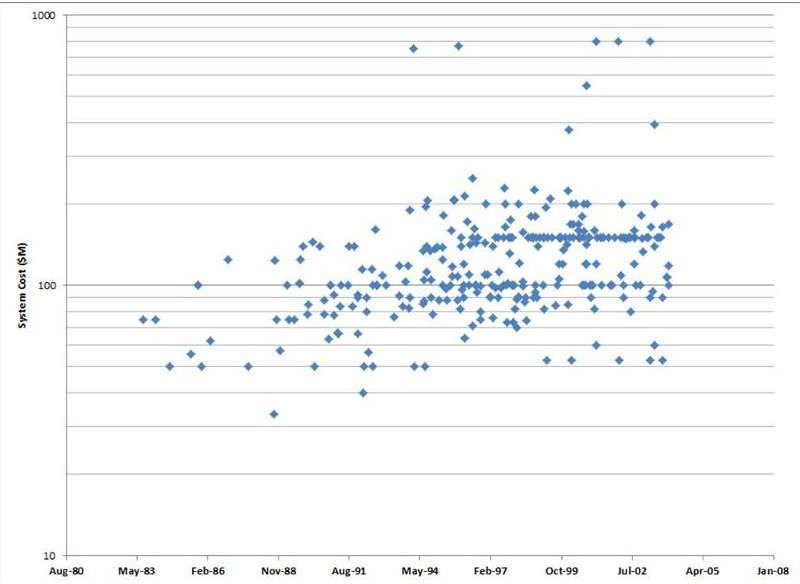

Figure 1 Trend of GEO satellite costs over time (excluding launch)

mean the overall form of spacecraft subsystem elements, especially the technological principles employed). This static spacecraft morphology is not only observed through time but is also observed across all satellite size/mass scales. (An example subsystem element of static morphology is seen in comparing a large satellite Reaction Wheel

Assembly (RWA) to a Cubesat RWA; they both employ the same spinning wheel methodology, albeit at much different scales of size and power.)

Figure 1 and 2 show historical examples of the trend of satellite system cost over time, and cost versus mass, of satellite systems, respectively. Both follow an almost linear trend related to each other, that is spacecraft have grown both in cost vs time and mass vs time. In general, today's satellites are designed based on rules of thumb or equations that help "size" a subsystem based on historical precedents.

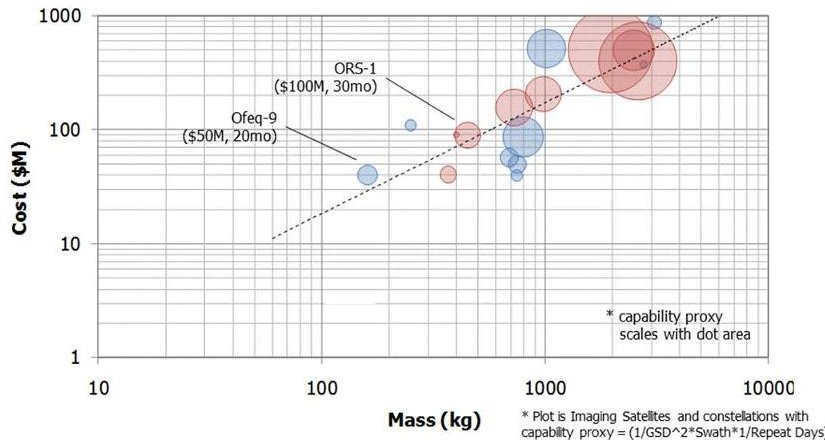

Figure 2 Cost versus mass function for selected ISR satellites

(Significant examples exist in the literature, one recognizable source is SMAD from Wertz $ ^{1} $ ). These rules of thumb have evolved from the industry designers themselves, based on the actual components and subsystems used over time. So the design methodology appears to follow or beget the linear relationship increase in mass and cost. Reasons behind this are typically attributed to the satellite "spiral" $ ^{1} $ or "viscious circle of space acquisition" $ ^{ii} $ related to launch, life requirements and testing.

To provide some context, Figure 3 shows a notional breakout of relative mass sizes (or classes) of satellites and notional cost boundaries for each. In general, the satellite industry has adopted design principles based on basic practices, associated with the breakout of "subsystems" that define in general the existing heterogenous morphology. This morphology, the configuration, composition, and connectivity of the subsystems which provide specific functions with allocations of mass, generally does not fundamentally change over these classes. While the transition from larger mass systems to smaller requires some configuration differences and component decisions or changes, every satellite, be it Cubesat or large satellite has essentially the same sets of functional components that make up those subsystems as every other class. The question arises whether the cost area integrated under the curve of

<!-- PDF_PAGE: 3 -->

Figure 2 can be changed much more, if the morphology or general arrangement of subsystems into an integrated heterogenous system is inherent in the system.

One method then to address altering the economic equation may lie in changing the morphology, or more correctly, how satellites are parsed, aggregated, and reconnected into a new space system. Figure 4 shows another example of the same basic trend of cost versus size, here defined in mass of RF aperture for geosynchronous spacecraft. The size of the circles represent value in performance (ie number

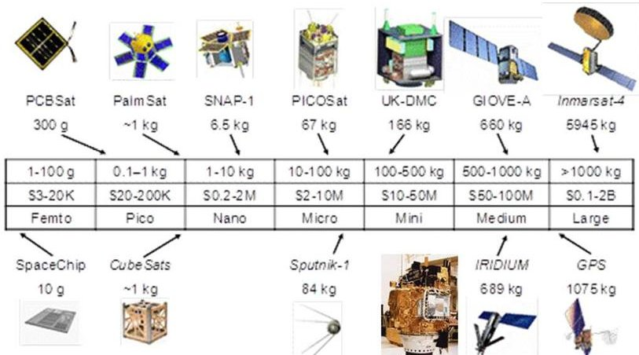

Figure 3 Representative breakout of relative masses and costs over a range of satellite classes

of users or data throughput). One of the questions the Phoenix program is asking is how to fundamentally move the largest circle (ie the large payload defined by aperture size) in this graph to a lower cost, with no sacrifice in performance. This is represented in Figure 4 by applying a high number of modules (or cells) to replace the traditional satellite morphology at a lower cost, with aggregation.

One of the principle goals of the Phoenix program is to re-define the cost-mass-performance function, by

challenging the existing satellite morphology and demonstrate the concept of "cellularity." Phoenix is exploring the idea that many identical (homogeneous) components produced in quantity and operating as one, can significantly reduce the cost while meeting or exceeding the performance of an historic expensive, unitary solution (heterogenous). This is a complimentary but alternative view of looking at how to lower the cost of satellite systems through changing the internal makeup of the subsystems themselves (homogeneity), as opposed to breaking up a single large satellite into multiple smaller satellites flying in close proximity (i.e. fractionation via heterogenity) and then connecting the independent internal subsystems wirelessly across the platforms $ ^{iii} $ . A key question for the homogeneity approach then is whether or not a manufactured cellular construct is achievable. To provide an answer we start with precepts from biology.

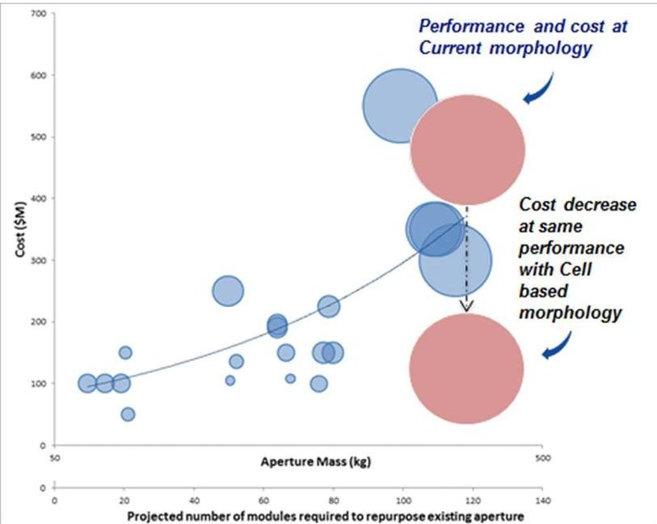

Figure 4 Comparing performance to cost between traditional and cellular morphology models

## II. How a Satellite may be like a Coral reef.

Cross pollination between different technical skill areas has become a method to re-invigorate a particular industry or functional mode of thinking. The more recent commonalities between biology and digital systems have spawned a range of inter-bred areas of research to include bioinformatics, computational genomics, systems biology, etc. This approach was considered in addressing the underlying problem of cost associated with satellites; is there a

<!-- PDF_PAGE: 4 -->

different internal makeup or morphology that could essentially redefine what a satellite is and therefore how it is put together and thus costed? Biological inspiration comes from examining how a system is "built"; basically using cell's that are aggregated together in sufficient quantity to create organisms of sufficient size and complexity that can then execute functions. Take a coral reef: thousands of cell's create a structural base or core, in which specific type cell's execute life functions of oxygen recovery, waste removal and food intake. It turns out that in most of the basic organisms in the world, there are only a handful of "speciality cells" that are aggregated together in sufficient quantity to "create" an organism. Table 1 shows an example of the number of cell

Biology aggregates specialty cells for performance at various scales.

<table border="1"><tr><td></td><td># of Specialty Cell Types</td><td>Typical Cell Total</td></tr><tr><td>Placozoa</td><td>4</td><td>Few thousand</td></tr><tr><td>Hydra</td><td>15</td><td>50-70,000</td></tr><tr><td>Jellyfish</td><td>22</td><td>Several Million</td></tr><tr><td>Satellite</td><td>~8*</td><td>~8-25*</td></tr></table>

Table 1 Examples of organisms and their number of cell types

types and resulting numbers used to create the organism, and a representation of numbers of speciality "cells" analog in satellites. Two key challenges in reconstituting current satellites performance using this cell-based morphology may be the level of cellularization realizable and the methods of "cell" production. The level of cells dictates number of unique hardware and software elements required in the morphology, while the production numbers and methods feed the underlying cost-benefit analysis.

Cell based structures not only have limited specialty cells, but they also have established "rules of behavior" for how the aggregation and interaction between them govern their operations together. It is just now

being understood that cells themselves have behaviors that can in many cases mitigate the proliferation of viruses in the body. Some of these include triggering cell suicide to mitigate transmission of a virus once the cell is infected; developing internal defenses (i.e. interferon) that are created only when a virus invades a cell; and "hardening" the outer shell of a cell thus avoiding maturation of the virus occluded cell to populate to others. Basically the resulting organism operates based on its set of simple rules of behaviors that revolve around their inherent modularity (an analogous precept to cellularity). Turns out this is being done in the robotics industry today.

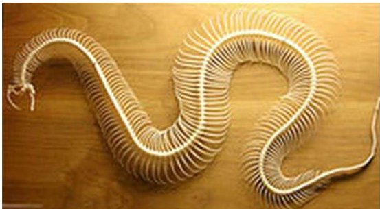

Figure 5 Skeleton of a snake with multiple joints

Modularity has a long history in robotics where normally the modularity is across robots, not within robots. Applying internal "modularity" to robots is an interesting starting point relative to satellite cellularization; reaching inside a robot to deconstruct it requires a different topology from the ones used in industry today. This configuration change would essentially enable this new topology of robots more degrees of freedom than the minimum by virtue of shrinking the elements to smaller modules. "Snake-like" robots provide an analogous biological inspiration to evaluate this type of alternative topology. Snakes have multiple joints that are largely 2 degree-of-freedom (DOF) ball and socket joints, as shown in Figure

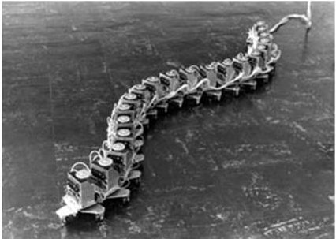

Figure 6 Hirose's snake robot showing locomotion gaits

$ 5^{\mathrm{i v}} $ . The first roboticist to construct a snake-like robot was Hirose $ ^{v} $ , and his original snake robot (shown in Figure 6) ran on wheels that showed possible gaits similar to how snakes locomote.

<!-- PDF_PAGE: 5 -->

In a 1998 call by DARPA's Microscale Technology Office (MTO) to demonstrate robotic reconfiguration enabled the development of the CONfigurableRObot, or $ \mathrm{CONRO}^{\mathrm{vi}} $ . CONRO's challenge was to get across a floor, climb up in some way to the level of a doorknob and get into a lock on a door. While not going to the level of

miniaturization required to meet the original challenge, the overall concept for CONRO as shown in Figure 7 created some interesting innovations in modalities and reconfiguration potential. CONRO consisted of a set of identical very small modules, where small was defined by the need for the lock picking challenge originally (shown in Figure 8). CONRO modules could be plugged together axially to form a snake (shown in lower left of Figure 7) and could move as a sidewinder using lateral motion or as a centipede/inch worm, using vertical motion. Modules could attach in the middle of a module so that a snake could self-morph to a star (shown in lower right in Fig 7). It could do this by having the snake ends join/dock to a module say near the center and thus form two loops in a figure

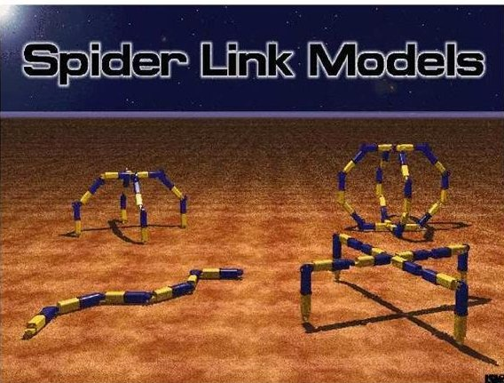

Figure 7 CONRO configurations

eight that could then split to form a 4 legged "insect". The insect could then move across a floor in a walking gait(shown bottom right in Figure 7). The four legged robot could then, if desired, form a ball (shown in top right Figure 7) and roll. Iterating the figure of eight allows making a robot with as many legs as needed. Snake, "spider' and ball have different energy requirements in moving the center of gravity forward which gives a support for reconfiguration.

An interesting facet of CONRO was its self-reconfiguration ability, via software based on the "hormone" topology, without a change in the core onboard software program. Two methods were developed for programming CONRO. The first was a centralized solution, where each module was commanded individually from a central point e.g. a process running in an attached Linux machine where either a human operator commanded each module or the system was driven automatically from code in the Linux machine. The second was a totally distributed solution, from a biologically based process reminiscent of Hormones $ ^{vii} $ . Both were used extensively. The former is simpler, the latter is more aesthetically appealing and conceptually more powerful.

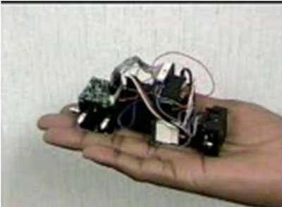

Figure 8. CONRO module as built

Hormone control is based on loose analogy of the circulation of hormones through the body and their action on a cell or assembly of cells depending on the cell function or purpose. As an example fear causes a chemical release that results in a variety of reactions from hair raising to sweaty palms. In CONRO all cells (modules) are connected mechanically and electrically from a signaling point of view. Hormone control signals run along the signaling path and move throughout the system to all connected modules. As an example a module plugged into the backbone acts as a backbone and a module attached to a lateral dock knows from its position in the topology that it is some form of "leg". The "leg" may be a single module leg or a multiple-module, where multiply-jointed leg then invokes a leg motion routine. Hormones can be used to compute global function as well a local ones.

## III. Aggregation of Cellularized Systems: the Satlet

Earlier published work on "aggregation" precepts applied to satellites that involved both hardware and software came in two different activities; "plug and play" (or PnP) satellite development at AFRL and the module work by Tanaka in Japan $ ^{viii, ix} $ . AFRL's work on PnP was a means to address satellite cost through standard interfaces. AFRL identified both mechanical and electrical interfaces that could be instantiated by any number of

<!-- PDF_PAGE: 6 -->

vendors or suppliers, and also explored standardizing software constructs that would allow automatic recognition of a component into the spacecraft bus (thus the reference to plug and play similar to how peripherals are recognized by a computer today.) Tanaka's work showed a homogenous aggregation morphology based on individual units, ie

cells $ ^{x, x_{1}} $ . Figure 9 shows an example morphology breakout relative to satellite functions one could envision, based on "specialty" cells of telemetry, payload, attitude determination and control, propulsion etc. Depending upon the geometry, the Satlet configuration can be different (i.e. cube, hex, diamond, etc), albeit with some standard method of interconnection to other Satlets.

The concept of standardized cellular satellite construction proposed is intended to take advantage of two precepts: the physical and electrical aggregation of smaller cells to create step-wise variations in cell behaviors and performance for different mass spacecraft and the implementation of non-traditional aerospace

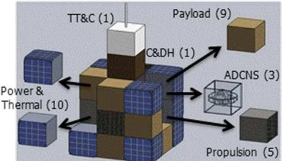

Figure 9 Example homogenous

aggregation morphology where each "cell" represents a different function-to performance $ ^{i x} $

commercial off the shelf (COTS) manufacturing. Aggregation can be either in two or three dimensions from a structural standpoint, with consideration for the size of the 'cell' and the force needed to physically connect as a design factor. The use of today's COTS high volume manufacturing techniques in many structural and electronic systems may provide economies of scale and cost measured against the typical satellites subcomponents, often custom-designed and manufactured in single-digits. As an example, an Apple iPhone (or other variant) uses internal processing and memory chips that in general are more powerful than today's satellite computer systems and at a much lower cost point, specifically because it is mass produced. Concepts that could be explored include understanding how aggregating components that make up high value low cost non-aerospace components with reliability not typically attributed to space could provide scales of performance translatable to the space arena, and where the balance between efficiency loss traded with cost lies (i.e. a cellularized system may have a higher mass as an aggregation, but its total cost may be much less).

The term "Satlet" is intended to define either a single cellularized subsystem or component element (i.e. a wireless power cell or a propulsion cell), or a single standalone cell-based system. The extent of cellularization possible for satellites may vary anywhere along a continuum between the following two extremes (using the Satlet definition):

(a) Single Function Satlets. Each Satlet incorporates one individual satellite subsystem function and aggregates multiple units to increase the required performance (i.e. spatially distributed miniature RWA's that together provide total momentum control, or "stacked" RWA's that accomplish the same functional performance aggregation).

(b) System Satlets. Each Satlet constitutes a complete stand-alone system that contains requisite individual subsystems such as command and data handling, power, thermal control, data sharing, attitude control, propulsion, etc., that can be aggregated together in a single geographically co-located entity to serially increase performance with increased numbers. (A simple example might be today's Cubesat, which is a system Satlet without the ability to aggregate performance.)

On a macro level, another possible benefit of a cell based architecture is the ability to respond and mitigate to the external environment automatically; a biological example may be from an octopus. The brain of an octopus does not send individual commands to the arms and appendages as it glides over a coral reef where its color changes to blend; instead the cells themselves are independently changing their color and form to match the environment. An example of a satellite that is able to elicit this "iso-“ response might be to the changing thermal environment in space from hot to cold depending upon solar input, electro-static charge environment changes, or to radiation. As an example a satellite using a traditional heterogenous morphology may not have to constrain the thermal paths based

<!-- PDF_PAGE: 7 -->

on design, if the satellite "cells" could sense their collective temperature and adjust load or even attitude of the aggregated "cell-based" satellite to provide an even temperature distribution, autonomously via the cell's hormonal behavior directly on orbit.

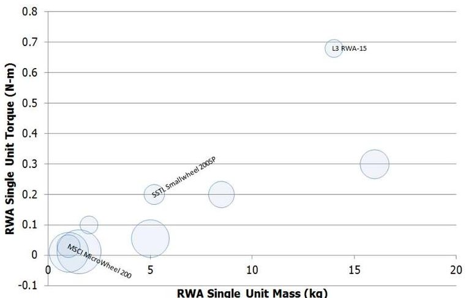

Figure 10 RWA Torque vs Mass with aggregate mass comparison bubbles

A related area of investigation is to determine and demonstrate how the viability of the cell based morphology affects the overall test and qualification process when applied to a variety of traditional mass satellites using aggregation. The Satlet-based construct may challenge existing qualification approaches to allow much lower cost and time to develop a space vehicle using these aggregated cells, where, as an example, the resultant aggregated satellite qualifies only one cell (whatever architecture is proposed) and then extrapolates that qualification sequence to all other similarly assembled cells. The onus will be to prove that this methodology offers an equal or higher level of

robustness and failure compensation versus cost to develop than traditional space systems with this approach. The reliability performance to do this for spacecraft is basically unknown. It is postulated that by Satlets "assembling in space" the aggregated systems will not undergo extensive in-space systems qualification; thus the resultant reliability performance resides in each cell type needing space qualification, offering potential savings in final system-level qualification and testing on the ground.

As a functional performance proof example of aggregation, aggregating miniature reaction wheels into sufficient quantities to provide enough torque for larger mass systems is done with a comparison of relative costs.

Figure 10 shows a sample comparison of aggregation of a very small micro-wheel for space, aggregated in quantity to show how it performs relative to torque. 'Bubbles' are proportional to aggregate mass from varying numbers of multiple units to implement a common 1 N-m RWA capability for a coincident system comparison. Because similarly sized aggregate implementations exist for small units and large units, it appears that a cellular implementation of RWAs is potentially feasible.

So, how might a new "cell" based satellite be made? Figure 11 shows an example of two

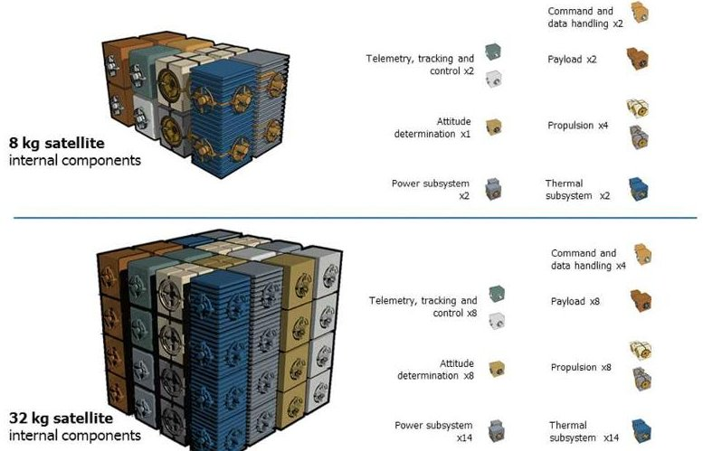

Figure 11 Example mass and function aggregation using notional specialty "cells"

different mass classes of satellites, based on a number of different "specialty cells". The geometry of a cube is used to simplify the representation, but is by no means the final or recommended instantiation. The Phoenix program is investigating the level of cellularization required of hetero vs homo-geneous cells for a specific application, both technically and econometrically to produce proof of concept hardware to represent potential solutions.

<!-- PDF_PAGE: 8 -->

Two potential examples of the cost model change that may be initiated using cell-based morphology are presented. The first example is based on applying cellularized systems in place of the existing morphology and comparing to a traditional mission set of satellites. Figure 12 shows an example cost model using this "satlet" architecture for various sized ISR type payload missions. The band indicates average levels of cost decrease upon successive subsystems cellularized using high volume, with the bottom line representing a A model was

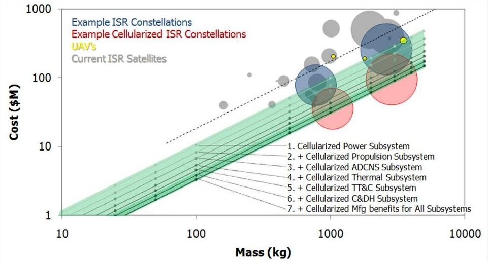

Figure 12. Example cost model of "cellularized" subsystems and their impact on traditional satellite cost estimation

created that estimates mass and function at a cost point applied to each traditional subsystem functional area (ie power, propulsion etc) and was then inserted into the equivalent mass/cost model taken from actual cost numbers for flown ISR systems. This initial model shows how successive levels of cellularization provides decreases in cost for similar performance. To provide some realism relative to unknown inefficiency in the system model, there was an assumed inefficiency in the cellular architecture shown as a mass increase, so lower cost satellites are shown at slightly higher masses.

The second example is a cost model for the case of repurposing existing on-orbit components using the satlet construct. In this model RF apertures are the component to be repurposed on orbit by bringing up the needed functional satlets required to reconstitute needed performance. Figure 13 shows the cost-mass results to re-purpose various size apertures (related to performance by throughput or number of users at a specific bandwidth etc.). This case shows that the benefit of repurposing apertures increases as the aperture size increases, to approximately 10x reduction in the cost relative to the original satellite system at the largest aperture evaluated. This architecture includes non-recurring costs of an on-orbit servicer and the Satlets amortized over a number of missions, and is

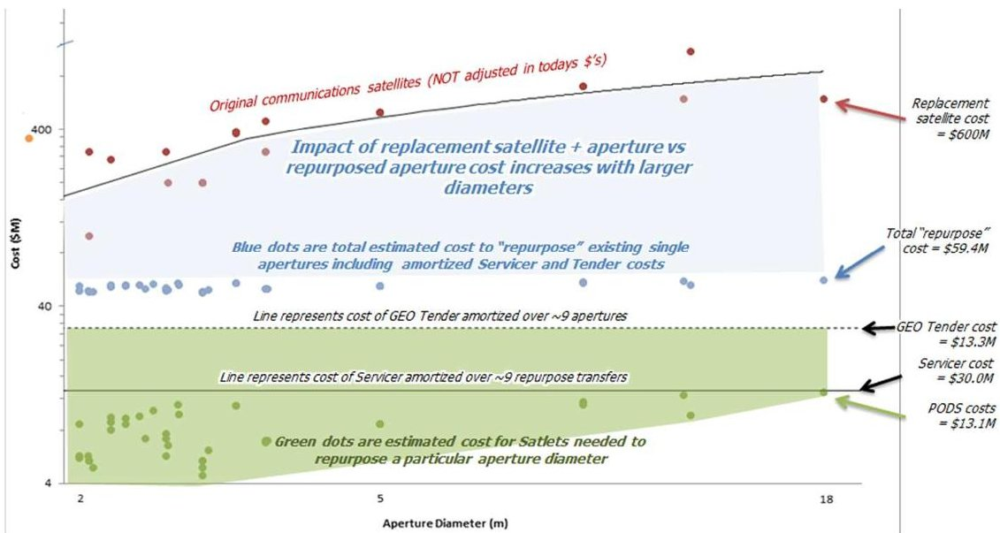

Figure 13. Example cost model of cellularization approach applied to already existing on-orbit payloads (ie RF apertures) using a servicing architecture

American Institute of Aeronautics and Astronautics Distribution Statement "A" (Approved for Public Release, Distribution Unlimited)

<!-- PDF_PAGE: 9 -->

described in further detail by Barnhart et al $ ^{xii} $

## V. Summary

The Phoenix program is challenging the historical mass-cost-performance equation for space systems to explore redefining the cost architecture for future space efforts. Cubesats have provided a good platform for miniaturization but have proven that just changing size does not alter the paradigm. A cellular morphology is proposed that, when coupled with mechanical and electrical aggregation and software to enable dynamic reconfiguration, provides the technologies and tools to re-define the econometric equation. Analysis of a traditional ISR satellite and a repurposing servicing system predicts that this cellular, or satlet, morphology can produce at least a 10x reduction in cost for similar mass and equal or greater performance. The Phoenix program is translating this construct of cellular inspiration into a new morphology of satellites that are created based on aggregation of "satlets" and applying it to a GEO aperture repurposing mission, providing validation of the new econometric equation for space. The satlets will provide the foundation of new space, where the rapidly evolving ground-based electronics technologies, manufacturing, and software constructs are seamlessly implemented into space systems to produce astonishingly new capabilities available to anyone, at anytime, from anywhere. Phoenix is exploring then best methods to "disaggregate" and to what level of "cellularization" is possible in a new cyber/electrical/mechanical based satellite system.