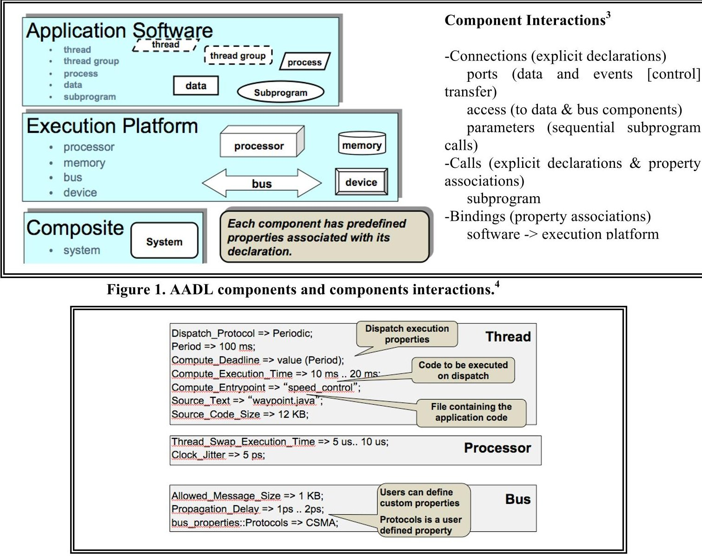
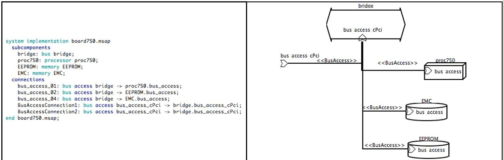
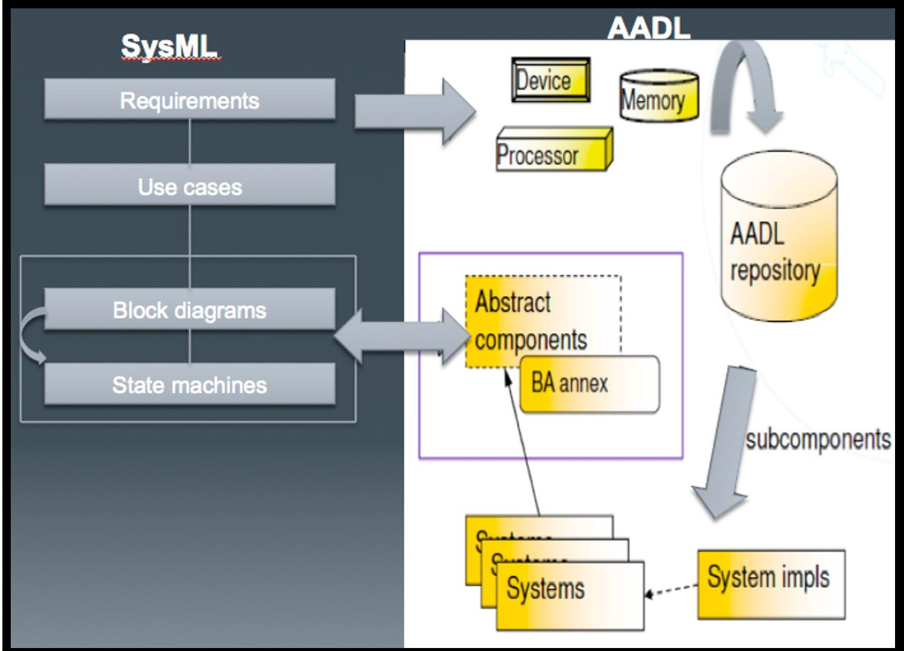
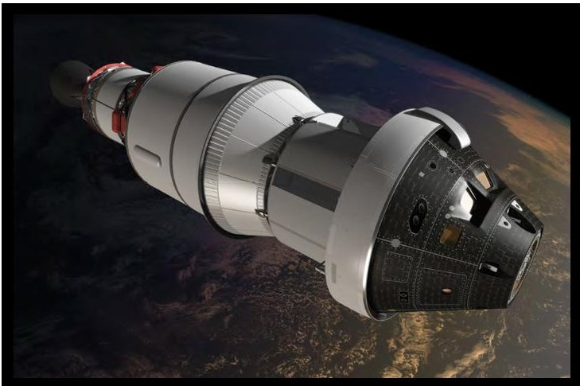
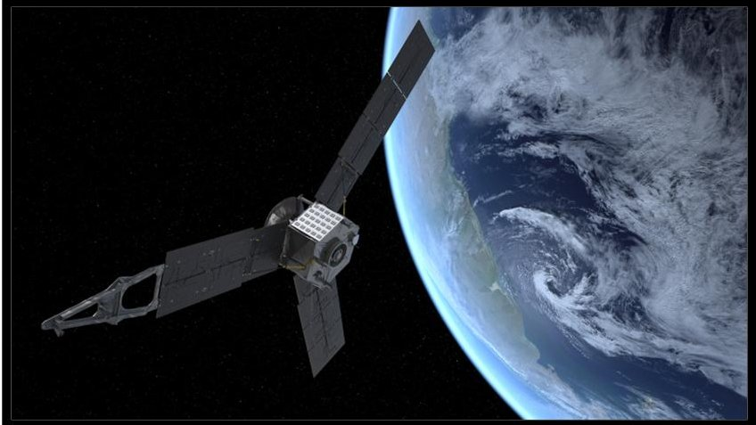
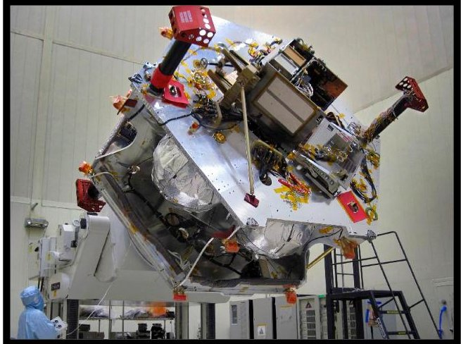
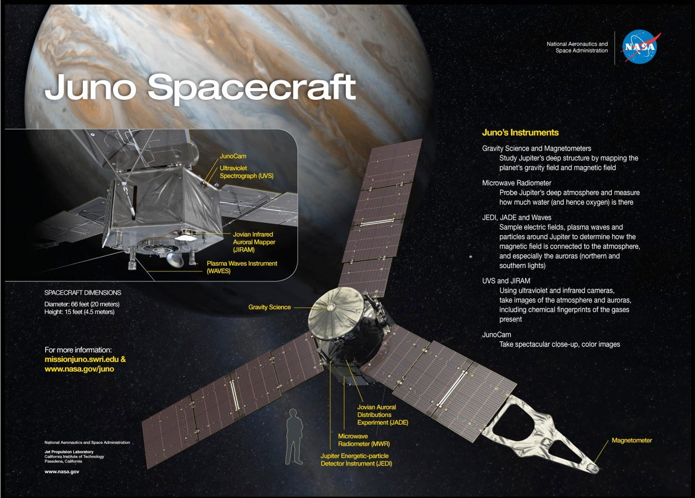
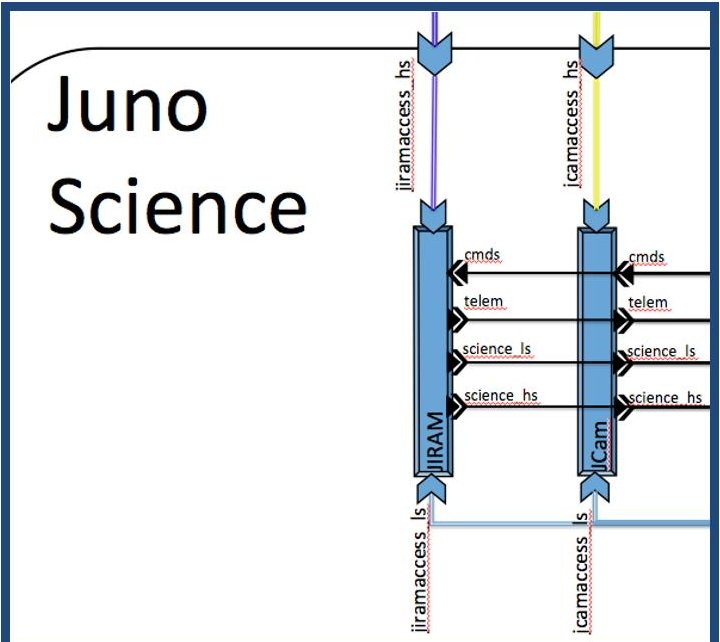
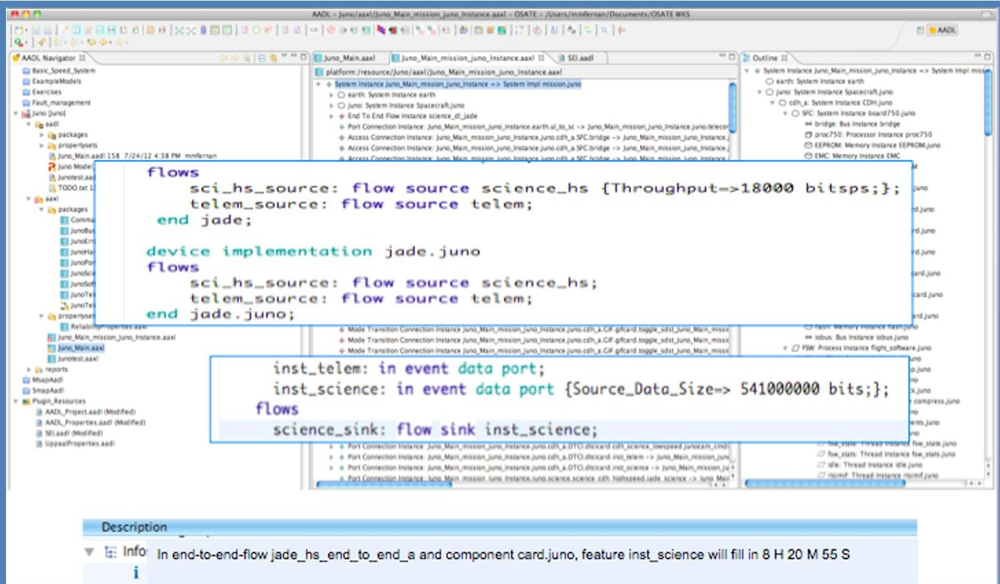

<!-- PDF_PAGE: 1 -->

# Using AADL to Enable MBSE for NASA Space Mission Operations

Dr. Michela Muñoz Fernández $ ^{1} $

NASA Jet Propulsion Laboratory, California Institute of Technology, Pasadena, CA, 91109

This paper describes the potential of Model-Based Systems Engineering (MBSE) that uses the Architecture Analysis and Design Language (AADL) to model space systems. AADL modeling is applicable to real-time embedded systems- the types of systems NASA builds. A case study with the Juno mission to Jupiter showcases how this work will enable future missions to benefit from using these models throughout their life cycle from design to flight operations.

## I. Introduction

THE use of Model-Based Systems Engineering (MBSE) techniques could enable more robust and complete systems engineering and integrated analysis of complex System-of-Systems (SoS) problems. MBSE is the formalized application of modeling to support system requirements, design, analysis, optimization, verification and validation. The modeling activities start in the conceptual design phase, and continue throughout development and into later life cycle phases including operations.

New tools and technologies can be used in future space missions starting at early phases in order to reduce risk. Avionics systems deployed on spacecraft are required to operate at increasing distances. These distances increase the latency at which an undesirable operation can be detected and corrected from an Earth ground station, sometimes by more than an hour. When a mission critical event occurs, such as during orbital insertion of a planet, which typically lasts for minutes, but with a much longer transmission delay, it is necessary for the avionics system to be able to detect and handle faults autonomously. As avionics systems are becoming more capable, the fault management, especially fault management in software, becomes increasingly more complex. Building confidence in the approach to characterize the faults and implementing the fault management scheme can be challenging. The objective is to ensure that the system built will conform to requirements and increase confidence that the system will achieve mission success. Assuming fault management is implemented in the avionics software, demonstrating confidence in the ability of the avionics software system to properly detect and respond to faults is paramount.

## II. The Architecture Analysis and Design Language (AADL)

The SAE AS5506/Architecture Analysis & Design Language (AADL) is an architecture description language for real-time, fault-tolerant, scalable, embedded, modular multiprocessor systems. AADL enables the development of highly evolvable systems, early and quantitative analyses of a system's architecture, and evolution of an architecture model for continued analysis throughout the lifecycle. The customers include system architects who wish to optimize the decision on system architectures and/or any engineer in general who wishes to model embedded systems.

<!-- PDF_PAGE: 2 -->

It is possible to create and analyze component-based models of a task and task interaction architectures of embedded software, as well as perform predictive analyses of operational characteristics (meeting deadline, response time, and throughput requirements). AADL models offer a way to make better decisions on system architectures, helping to discover system integration problems early in a development effort. The following figures show the AADL components, the component interactions, and some standard properties. $ ^{1,2} $

Figure 2. Example of AADL standard properties. $ ^{4} $

AADL has both textual and graphical representations as shown in Fig.3, describing the system implementation including the subcomponents and connections.

Figure 3. Example of AADL textual and graphical representations.

<!-- PDF_PAGE: 3 -->

Traditionally space systems software has been developed without characterizing performance of the real-time system being built until integration. Finding execution-related issues at that point is costly. AADL model shows execution interactions between high-level system components enabling early quality attribute analyses, and it reduces the possibility of doing rework later in the lifecycle increasing confidence at gate reviews, by providing independent, semantically accurate analyses.

## A. Comparison between AADL and SysML

AADL $ ^{1,4} $ was born as an avionics-focused domain-specific language and later on was revised to represent and support a more general category of embedded real-time systems. SysML $ ^{5-7} $ is an extension of the Unified Modeling Language (UML) intended to support modeling system engineering applications. SysML focuses on the "big picture" architectural views, whereas AADL addresses the more detailed platform-oriented and physical aspects of such systems.

At the same time, SysML $ ^{7} $ and AADL $ ^{1} $ are mutually complementary:

- SysML: standarized language for systems engineering. It provides support for requirements engineering, traceability, and precise modeling of diverse physical phenomena.

- AADL: oriented towards the modeling of real-time embedded systems. It includes a comprehensive catalogue or hardware and software elements common in such systems and their characteristics, allowing relatively precise and dependable analysis of different system properties such as performance, timing, or power consumption.

The Object Management Group (OMG) $ ^{8} $ is working on SysML/MARTE (Modeling And Analysis Of Real-Time Embedded Systems) alignment to facilitate using SysML with AADL.

SysML

AADL

Requirements Traceability Parametric models Interactions

Quantitative Analysis, Hardware-Software Component Categories, Software to Hardware Binding

SysML and AADL

Modes/State Machines,

Components/System Blocks,

Component Interactions/Block Flows

<!-- PDF_PAGE: 4 -->

Figure 4 shows how high-level design blocks in SysML could be mapped into an actual architecture in AADL. $ ^{5} $

Figure 4. SysML/AADL integrated process. $ ^{5} $

## III. AADL Modeling of Space Systems

The NASA Exploration Technology Development Program $ ^{9} $ develops long-range technologies to enable human exploration beyond Earth orbit, and also integrates and tests advanced exploration systems to reduce risks and improve the affordability of future missions. The Autonomous Systems and Avionics group develops and demonstrates integrated autonomous systems capable of managing complex operations in space to reduce crew workload and dependence on support from Earth. It also investigates new technologies to address operations in extreme environments, efficient ground-based and on-board avionics systems and operations, and cost-effective human-rated software development.

AADL capabilities could help real-time software more prevalent in avionics systems (unmanned aerial vehicles, spacecraft), operation with limited human interaction or an increased latency in human response, when autonomous fault detection and repair capabilities are required to respond to off-nominal conditions.

<!-- PDF_PAGE: 5 -->

## A. Examples of Applications to Space Systems

MBSE techniques $ ^{6} $ applied to software quality assurance provide a rigorous framework for the verification and validation of software systems through the systematic modeling and analysis of formal architecture representations. This type of framework has been applied to several JPL missions and systems: Mission Data System (MDS) reference architecture, Soil Moisture Active Passive (SMAP), and the Juno mission to Jupiter. These cases have been studied using AADL $ ^{1} $ as a Model-Based Engineering language for architectural analysis and specification of real-time embedded systems with stringent performance requirements (e.g. fault-tolerance, security, safety-critical).

Several projects have used AADL to design software architecture and analyze, validate, or improve various quality attributes, such as reliability, latency/performance, or security. The results of previous case studies demonstrate the utility of the practice framework and the AADL-based analyses in addressing the modeling of key architectural themes and quality assurance with respect to performance, particularly flow latency.

As systems have become increasingly software-intensive, new faults and failures are occurring that are not being addressed by traditional fault tolerance techniques. These failures and system instabilities stem from a lack of understanding the impact of choices in the runtime architecture of embedded software systems.

The cause of these failures is frequently rooted in undocumented and mismatched assumptions, resulting from resource sharing of a shared computing platform, and the increasing complexity of component interactions at the functional and non-functional level. Problems of these types are often discovered during system integration and operational test due to the lack of system-level quantitative analysis of the traditional practice of build first, then integrate and test. MBSE techniques can provide predictability earlier in the development life cycle reducing risk and cost.

Some examples of impacts of software integration include the following:

1. Units, range, delta, base value $ ^{10} $ (Ariane 4/5): Ariane 5 was designed by the European Space Agency (ESA) as a replacement for the successful Ariane 4 launcher. The intention was to create a reliable, high capacity, launch vehicle for ESA that could be used to support their contribution to the International Space Station as well as a range of other commercial and scientific launches. On June 4, 1996 the unmanned Ariane 5 rocket exploded just forty seconds after its lift-off from Kourou, French Guiana. The rocket was on its first voyage, after a decade of development costing $7 billion. The destroyed rocket and its cargo were valued at $500 million. A board of inquiry investigated the causes of the explosion and in two weeks issued a report that found the cause of the failure to be a software error in the inertial reference system. Specifically a 64 bit floating point number relating to the horizontal velocity of the rocket with respect to the platform was converted to a 16 bit signed integer. The number was larger than 32,767, the largest integer storeable in a 16 bit signed integer, and thus the conversion failed.

2. Migration of embedded applications to different runtime architectures and hardware can result in unexpected latency jitter that can lead to instability of control systems. There was a case for the F16, where the jitter showed up as blurriness of target symbols on the cockpit display.

3. Mars Pathfinder, priority inversion was detected through system analysis as the root cause of system crashes. Since the deployed system included support for priority ceiling protocols, the problem could be remotely addressed and an otherwise failed mission completed successfully.

Potential applications in IV&V include space flight and ground systems software assurance modeling for the human exploration program where assurance is critical for the survival of the crew. As an example for EFT-1 (Exploration Flight Test 1-first planned uncrewed test flight of the Orion Multi-Purpose Crew Vehicle), AADL's capabilities would enable modeling of systems comprised of hardware and software subsystems connected to each other via hardline and RF communications links that support the exchange of critical data such as Commands (CMD), various forms of Telemetry (e.g., Operational, Developmental, Engineering), File Exchanges, Primary and Dissimilar Voice, Video/Motion Imagery, and Time.

<!-- PDF_PAGE: 6 -->

Figure 5: Exploration Test Flight 1, EFT-1. Image credit: NASA.gov

## B. Case Study of an Application to a Flight Mission -The Juno Mission to Jupiter

The Juno spacecraft launched aboard an Atlas V-551 rocket from Cape Canaveral, Fla., on Aug. 5, 2011, and will reach Jupiter in July 2016. $ ^{11} $ Juno uses a spinning solar-powered spacecraft in a highly elliptical polar orbit that avoids most of Jupiter's high radiation regions. The designs of the individual instruments are straightforward and the mission does not require the development of any new technologies. Juno will improve our understanding of the solar system's beginnings by revealing the origin and evolution of Jupiter. Underneath its dense cloud cover, Jupiter safeguards secrets to the fundamental processes and conditions that governed our solar system during its formation. Jupiter can also provide critical knowledge for understanding the planetary systems being discovered around other stars. With its suite of science instruments, Juno will investigate the existence of a solid planetary core, map Jupiter's intense magnetic field, measure the amount of water and ammonia in the deep atmosphere, and observe the planet's auroras. Juno will also take a giant step forward in improving our understanding of how giant planets form and the role these titans played in putting together the rest of the solar system. JPL manages the Juno mission, which is part of the New Frontiers Program managed at NASA's Marshall Space Flight Center in Huntsville, Ala. Lockheed Martin Space Systems, Denver, built the spacecraft. Launch management for the mission is the responsibility of NASA's Launch Services Program at the Kennedy Space Center in Florida.

Figure 6. Juno's Earth Flyby (Artist's Rendering). Image credit: Caltech, NASA.

Figure 7. Juno spacecraft at LMSS. Image credit: Caltech, NASA JPL/LMSS.

<!-- PDF_PAGE: 7 -->

Juno's scientific payload includes the following instruments:

- A gravity/radio science system (Gravity Science)

- A six-wavelength microwave radiometer for atmospheric sounding and composition (MWR)

- A vector magnetometer (MAG)

- Plasma and energetic particle detectors (JADE and JEDI)

- A radio/plasma wave experiment (Waves)

- An ultraviolet imager/spectrometer (UVS)

- An infrared imager/spectrometer (JIRAM)

- A camera, (JunoCam), to provide the public with the first detailed glimpse of Jupiter's poles

AADL was used to model the Juno flight system. The model captures the telecommunications, science, C&DH, and flight software systems. Having an AADL model in place during the earlier phases of the mission would help support the mission teams from the beginning. The model would be especially useful during development, and in preparation for science operations by enabling deep understanding of operational needs for the instruments, particularly for downlink data flow during ground systems interface for ATLO (Assembly Test and Launch Operations) tests, and at Cape Canaveral for instrument activities and launch campaign.

Figure 8. Juno spacecraft and its instruments. Image credit: NASA.

In this case, the model was developed after the initial Juno instrument checkouts. It was observed that during some of the instrument checkouts there were command errors. One of the questions to be answered by modeling the Juno spacecraft was how to avoid or minimize Juno command errors. By modeling the Juno spacecraft, and applying

<!-- PDF_PAGE: 8 -->

new tools, errors would have been revealed in real time as it was demonstrated by performing AADL modeling with regards to the following analyses:

- End to end data flow: data latency analysis-> revealed scenarios where commanding errors can occur.

- Data generation and memory analysis revealed the scenario when data overflow would occur could have prevented loss of science data.

Figure 9 captures part of the Juno science system showing two of the instruments and their connections:

Figure 9. Caption of part of the science system of the Juno AADL model.

B.1. Software Architecture Modeling and Assurance with AADL for the JPL Juno Project-Data Latency Analysis (proof of concept)

The Jovian Auroral Distributions Experiment (JADE) Mass Memory Overflow during High Voltage Checkout (ISA 50603, criticality 3)

During flight operations, the JADE instrument had a command error that caused partial loss of science data:

- At the end of the day during one of the high voltage checkout activities of the JADE instrument, the configuration was changed from LVENG to HVENG after discussion with the Mission Manager: the jad_hveng_hvenable.log sequence was sent at 04:13, which put JADE in a mode which produced telemetry at approximately 18 kbps. This filled their 541 Mbits soft partition at approximately 12:43 UTC. The question of data rate production rate in the new configuration was asked, but was not answered or not answered properly. The new configuration produced data which overfilled the instrument memory partition leading to remaining data being discarded.

- Immediate fix: The start of activities on day 5 was delayed for 75 minutes while the memory partition emptied enough to proceed with commanding, and a determination was made that the JADE instrument and spacecraft were in an state to proceed with the day's activity. The error triggered a separate anomaly, which added to the delay, but was found to not interfere with continuing checkout (ISA 50604 Discarded Frames and Data Volume Much Greater than Production Rate).

- Proximate cause: Command Product content not fully understood/communicated for use at different time.

<!-- PDF_PAGE: 9 -->

Running the model would have helped in making the right decision regarding changing the data production rate during JADE high voltage checkout. The data latency reliability plugin could have been run in real time and it would have revealed the data overflow that was going to happen 8hr 20min 55sec later (before the next downlink could occur) as it is shown in Fig.10 below.

Beginning and end of track for day 322:

- DOY BOT (UTC) EOT(UTC)

- 322 17:30 04:20

JADE command error could have been avoided preventing loss of science return, which was important during the instrument checkout, but definitely critical for future science operations at Jupiter.

Figure 10 shows the instance with the Juno model after running the data latency analysis:

Figure 10. Juno data latency analysis.

Future work in his area includes refining the Juno model and providing it to the instrument teams (IOTs) with a GUI in order for them to run it with different scenarios before they plan to make a change in a sequence that for example would change the data rate or any other parameter of relevance to the specific science mode used. The AADL model would be a tool that would allow the principal investigators and engineers have an additional way to ensure that the instruments will be safe as well as help prevent any loss of science data once Juno reaches Jupiter in 2016.

## C. The AADL Error annex

AADL has been extended to model fault management behavior through the AADL Error Annex, $ ^{1,3} $ also an SAE standard. The AADL Error Annex can be used to assure dependability in the software fault management system in avionics real-time embedded systems. It enables modeling of different types of faults, fault behavior of individual system components, and fault propagation affecting related components in terms of peer-to-peer interactions and

<!-- PDF_PAGE: 10 -->

deployment relationships between software components and their execution platform. It also allows modeling of aggregation of fault behavior and propagation in terms of the component hierarchy, as well as specification of fault tolerance strategies expected in the actual system architecture. It supports qualitative and quantitative assessments of system dependability, i.e., reliability, availability, integrity (safety, security), and survivability, as well as compliance of the system to the specified fault tolerance strategies from an annotated architecture model of the embedded software, computer platform, and physical system.

The "Fault Coverage" analysis $ ^{1,2,4} $ can help uncover any missing propagation. Using the "Fault Coverage" tool $ ^{2} $ it can be determined if the software system is not handling the appropriate propagations.

The Error Annex was used to perform some analyses on the instance of the Juno model, the figure below lists a subset of the information provided in the detailed output generated by the "Fault Coverage" :

<table border="1"><tr><td>Source</td><td>Rule</td><td>Destination</td><td>Propagation</td></tr><tr><td>Jno telecom.sdst.sdst_a(device)</td><td>D14</td><td>Jno bus1553(bus)</td><td>corrupt_seq(Missing In)</td></tr><tr><td>Jno cdh_a.FSW.io.mmm_mgr(thread)</td><td>D16</td><td>Jno cdh_a.FSW.payload.jade_io(thread)</td><td>corrupt_cmd</td></tr><tr><td>Jno cdh_b.FSW.io.ms1553(thread)</td><td>D16</td><td>Jno cdh_b.FSW.payload.junocam_cmd(thread)</td><td>corrupt_cmd</td></tr><tr><td>Jno cdh_b.FSW.io.ms1553(thread)</td><td>D16</td><td>Jno cdh_b.FSW.payload.mwr_cmd(thread)</td><td>corrupt_cmd</td></tr></table>

Table 1 - Actual error propagations in Juno case study

Table 1 lists a subset of the information provided in the detailed output generated by the "Fault Coverage" tool. There are four total "out propagations" occurring in the system, taking into account the binary relationship defined by the AADL Error Annex dependency rules. The "Propagation" column in Table 1 lists all the "out propagations" by name, found in the error model. The propagations in red indicate that they are not handled by the destination. The first row shows the only binary pair in this listing where the propagation is unhandled. With the issue uncovered, a solution can be implemented. A mechanism is required to handle the incoming propagation "corrupt_seq." Simply, an "in propagation" of the same name must be declared in the appropriate error model and applied to a transition. Executing the "Fault Coverage" tool a final time produces the desired result. The percentage of actual propagations unhandled by the destination becomes 0%.

## C1. Error propagation with AADL

Errors can propagate between software components and execution platform components to which they are bound. The keywords "processor", "bus", "virtual processor", "virtual bus", "memory", and "device" are used to identify the binding point of a software component $ ^{1} $ with the execution platform component it is bound to. The keyword binding is used for connections and virtual buses to identify their binding to execution platform components. The keyword bindings is used in execution platform components to identify the binding point of components bound to them.

## IV. Conclusion

The paper has shown how AADL can be applied to space missions. A case study described the Juno mission to Jupiter. Some of the analyses that were performed for the Juno mission included end-to-end data flow and data latency that revealed where command errors can occur. Data generation and memory analysis revealed the scenario when data overflow would occur which could have prevented loss of science data. The particular value of these analyses to Juno was to model the science collection and data downlink rate. Furthermore, analyses results show

<!-- PDF_PAGE: 11 -->

how some the Juno command errors might have been avoided if the AADL model had been in place before the Juno instruments checkout activities. Analyses results show the potential that AADL has in order to model flight and ground systems architecture applied to space operations. This work could be extended to model missions such as Mars 2020 or Europa.

## Acknowledgments

The work described in this presentation was carried out by the Jet Propulsion Laboratory, California Institute of Technology, under a contract with the National Aeronautics and Space Administration. This work was funded under the NASA Office of Safety and Mission Assurance (OSMA) Software Assurance Research Program (SARP). Special thanks to Allen Nikora, and Lisa Montgomery for their management and support of the SARP program at JPL.

## References

$ ^{1} $AADL, http://www.aadl.info/aadl.currentsite/

$ ^{2} $Evensen, Kenneth D., Michela Muñoz Fernández. "Assuring Software Fault Management with the Architecture

Analysis and Design Language." AIAA Infotech@Aerospace. 19 - 21 June 2012. Garden Grove, CA.

$ ^{3} $Model-Based Engineering with AADL, Peter H. Feiler, and David P. Gluch. SEI, Carnegie Mellon. 2013.

$ ^{4} $Dave Gluch, Model-Based Software Assurance with the SAE Architecture Analysis & Design Language (AADL), September 2008.

$ ^{5} $SysML and AADL, patterns for integrated use. J. Hugues, P. de Saqui-Sannes, ISAE.

$ ^{6} $INCOSE Systems Engineering Vision 2020. INCOSE-TP-2004-004-02. September 2007.

$ ^{7} $SysML, http://www.sysml.org

$ ^{8} $OMG. http://www.omg.org

$ ^{9} $NASA Ground Systems Development and Operations Program. http://go.nasa.gov/groundsystems

$ ^{10} $ Ariane 5 Software problem. http://www.vuw.ac.nz/staff/stephen marshall/SE/Failures/SE Ariane.html

$ ^{11} $NASA Juno website: http://www.nasa.gov/mission_pages/juno/multimedia, Juno mission status updates:

http://missionjuno.swri.edu/news