<!-- PDF_PAGE: 1 -->

# Extending Model Based Systems Engineering (MBSE) for Complex Systems

Mathew French $ ^{*} $ Rolls-Royce North American Technologies, Inc., Indianapolis, Indiana, 46241

## Abstract

There is a growing body of knowledge in the systems engineering arena trending towards the expansion of traditional systems engineering scope because the most complex, indeed complex adaptive, part of any system is the human. (1) (2) (3) This is particularly important where interfaces with external environments of the system unknowingly directly and heavily influence system requirements. This paper will describe complex domain attributes and utilizing model based systems engineering tools for complex systems.

## Nomenclature

ConOps = Concept of Operations

IPT = Integrated Product Team

MBSE = Model Based Systems Engineering

OMG = Object Management Group

SE = Systems Engineering

SysML = Systems Modeling Language

UML = Unified Modeling Language

## I. Introduction

A typical program autopsy (4) finds that incorrect requirements are the number one reason a delivered system was not the right system, even if the system was correctly developed. Figure 1 depicts how multiple viewpoints can result in multiple different solutions.

As amusing as Figure 1 can be, unfortunately it's also very real. It's very real because of different perspectives from different viewpoints, starting with a system of interest's requirements. Requirements should be adjusted as a program gains more understanding of the system's external environment. In addition, requirements are both technical and non-technical. The SE 'V' process (5) traditionally starts with development of the Concept of Operations (ConOps) for the system and progresses through development, verification, validation, maintenance, and finally disposal. In this context the system's environment is defined as the requirements the ConOps produced, the development environment of the system itself, testing environment the requirements will be verified against, and the operating environment the system is to be validated against.

<!-- PDF_PAGE: 2 -->

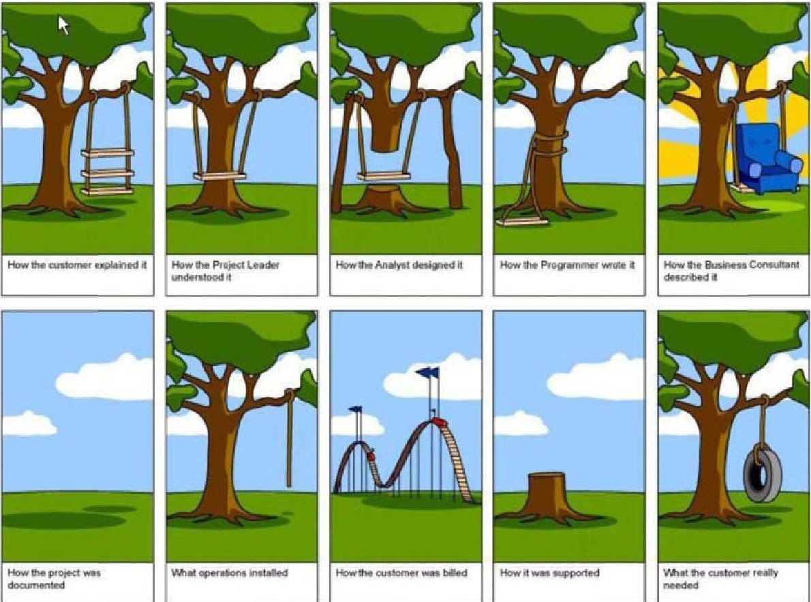

Figure 1: Example of differing viewpoints yielding different results (6)

Finding out during the validation phase the program has not developed the right system (no matter how correctly it was developed) increases costs to correct the system and is therefore not desired to sustain repeated behavior. It is intuitive that prior to the ConOps defining the requirements, there is a large amount of uncertainty and ambiguity about the ConOps and the emergent behavior of this uncertainty directly influences the requirements defining the right system. These large influences come from additional viewpoints found within a system's external environment that include the political, societal, economic, contractual, and organizational environments, all of which greatly influence the ConOps and thereby directly influence system requirements. These additional viewpoints from external environments exist in the complex sphere context (7) and have identifiable attributes. Key to including these additional viewpoints from external environments found within the complex sphere context is that they enable the ability to architect the right system while lacking data, possess environmental ambiguity, and are constantly evolving with emergent objectives from the complex sphere context.

Figure 2, below, shows the systems engineering "V" process, and the area of focus for this paper is indicated by the gray arrow at the beginning of the "V" process. This paper will focus on the beginning of the systems engineering "V" process looking specifically at the influences that shape and scope the development of requirements. This paper will address the following questions regarding MBSE modeling of complex systems (8):

1. How does MBSE account for models of evolving systems?

2. MBSE efforts are used to describe a problem or system of interest. Can it explore predictions based on probability?

3. How does MBSE account for the entire lifecycle to include capturing rationale for system knowledge based on past occurrences (not linear, simple, or as obvious as it appears)?

<!-- PDF_PAGE: 3 -->

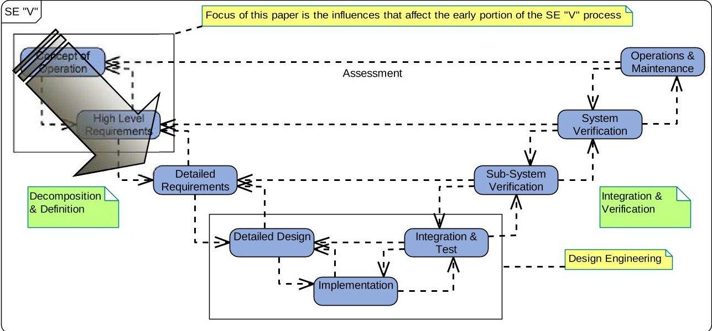

Figure 2: This paper will focus at the beginning of the Systems Engineering "V" Process

Figure 3 depicts the expansion of the systems engineering scope. Strong SE leadership and holistic systems thinking are characteristics of successful systems engineers who have embraced the irreducible uncertainties exemplified by complex systems which are capable of emergent behavior and cannot be predicted from the system's parts.

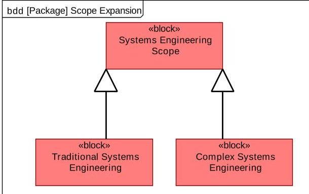

Figure 3: Complex Systems Engineering is a type of Systems Engineering Scope (1) (2) (3)

## A. Herding cats

One engineer exclaimed, "I feel like I'm herding cats!" This explanation reminds me of the super bowl commercial where a cowboy indicates that it's easy to herd cattle, but herding cats is more challenging. I like cats, so I believe herding cats would be more fun, too. It could be more challenging than cattle because cats don't follow each other in traditional cattle herding fashion. Cats seem to exhibit interdependent behavior with each other, act autonomously within a clowder, evolve independently, and can even exhibit emergent behavior when all cats interact within unknown environments. Have you ever seen one cat get spooked and all others react similarly? Systems engineers often find themselves in similar scenarios as the cowboy in the commercial. The commercial shows a cowboy, who is riding through a new frontier, and is herding cats as shown in Figure 4 below. We can call the figure depicted as the wild 'cat' West. In the wild 'cat' West the cowboy is navigating new frontiers while attempting to herd cats, which he finds very challenging to the point that he can't find all of them. If you use the picture of Figure 4 but depict the cowboy as a systems engineer, the new frontier as the complex sphere context, and the 'herd' of cats as objectives that greatly influence program requirements, then we can use the wild 'cat' West picture to create a mental image of why the new frontier offers the opportunity for herding cats rather than cattle. Herding cats is like trying to identify evolving objectives that greatly influence program requirements and exist

<!-- PDF_PAGE: 4 -->

within the new frontier. Similar to the cats, requirements identification from the complex sphere context are unpredictable, some get lost, and are more challenging than herding cattle in a familiar and knowable environment.

Figure 4: Cowboy in a new frontier herding cats. (9)

In reality, however, the new frontier of the complex sphere context is not new. It's just new to the systems engineer cowboy. Native Americans and resident animal species would attribute the wild 'cat' West new frontier as very well known, and it would be anticipated to be similar to how other disciplines outside of engineering (e.g. social sciences) view the complex sphere context. A judicious cowboy would embrace learning from existing residents, who reside in the new frontier, to learn how to operate in the wild 'cat' West. In the same way, systems engineers could learn from long-standing residents of the complex sphere context how to best incorporate uncertainty and emergent behavior of system objectives that greatly influence requirements of a program. However, the difficulty to work with complex sphere context residents, or the inability of the systems engineer cowboy to independently identify the elusive requirements from complex sphere context's objectives, can be attributed to multiple sources.

## B. Herding Cats can be Difficult

The first source of difficulty a systems engineer cowboy typically finds is that herding cats is flawed through ignorance of the new frontier. The new frontier for systems engineers is the complex sphere context. The new frontier to the wild 'cat' West cowboy contained many new and unfamiliar elements that the cowboy encountered with new and unknown territory such as Native American tribes, new weather patterns, and different animals. The new elements of the systems engineer cowboy's new frontier of the complex sphere context are new and unfamiliar elements, such as societal, financial, and political, to name a few.

Another source of difficulty adapting to changing requirements is the extreme speed of development for new technology. The pace of technology is unprecedented in history, and the technology refreshment cycle exceeds the system development cycle by an order of magnitude. (10) Gordon E. Moore, Intel co-founder, described in 1965 the doubling every two years he observed of transistors on integrated circuits. Moore's law (11) can be applied to the speed of development experienced within the aerospace industry. In general, his law describes the exponential pace of technological growth to be anticipated and socially accepted with any product. As a result of the pace of technology development, fielding of old equipment and software is becoming typical due to the typically long acquisition lifecycle of aerospace systems. Prevention of the stifling of innovation early in the development lifecycle, even if radical in nature, becomes an important attribute of systems engineering methods and tools during system design and development. However, just as innovation and flexibility should be celebrated at the beginning of a program, there can be natural tension with a strong desire to hold requirements rigid and control changes from the very beginning that affect design and development.

Finally, another source of difficulty of adapting to changing requirements is that we have also apparently entered a period where, because of the numerous, and dynamic interactions with a complex aerospace system, results are not fully predictable. Robert Metcalf's law (11) describes the value of interconnecting communication nodes. The greater the number of communication nodes, the greater the value of the network. Therefore, it is logical that an

<!-- PDF_PAGE: 5 -->

aerospace system would be interconnected to other aerospace systems, causing numerous dynamic interactions. Metcalf's law is used to describe the value of interconnectivity between systems due to the potential for a tremendous amount of information being readily available through a lot of communication nodes.

With Moore's law describing the exponential growth of technology and Metcalf's law describing the value in interconnecting multiple communication nodes, it highlights the extremely complicated nature of our systems and the complex sphere context within which they operate. Moore's law indicates that there exists an increasing demand for better performance, less development time, and better quality. Metcalf's law shows that complexity is increasing due to the amount of humans interacting.

This paper will continue to investigate if the existing MBSE framework is useful for modeling complex systems, or offer solutions on how to extend it to account for attributes of complex systems. To accomplish this, the content of this paper is broken into four parts:

1. Identification of product scope influences

2. Characterization of current MBSE capabilities

3. Exploration of the gap between traditional and complex systems engineering

4. Determine MBSE framework solutions for modeling complex systems

## III. Identification of Product Scope Influences

There are three important factors that deeply influence the stages of a product's lifecycle. Systems engineers need to understand how these factors influence each stage of a product and understand how these factors coincide with this new frontier. The factors are 1) Concurrent engineering, 2) Collaborative engineering, and 3) design-space sphere context. Systems engineers traditionally understand concurrent and collaborative engineering as necessary for development of a product. Systems engineers have been the key enabling link between concurrent and collaborative development of a product. However, systems engineers have to ensure the third factor is equally important to the first two so that they fully account for sphere of context within the design space. Figure 5 below shows the traditional scope that systems engineers are concerned about with concurrent and collaborative engineering which traditional tools support. Figure 6 depicts the expansion of systems engineering to include the sphere context where exploration of tools and methods need to be advanced. Systems engineers need to be able to tactically operate within the entire scope of all influences within the stages of a product lifecycle.

<!-- PDF_PAGE: 6 -->

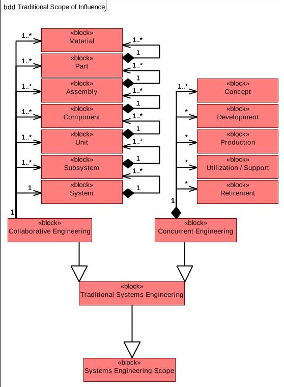

Figure 5: Systems Engineering Traditional Scope

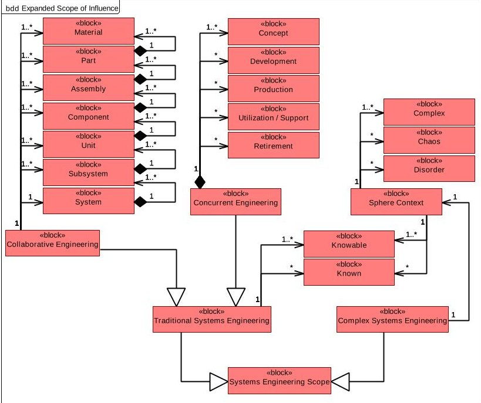

Figure 6: Systems Engineering Expanded Scope

Concurrent engineering encompasses the entire horizontal product lifecycle. The horizontal product lifecycle enables development of interoperable solutions initiating from the observation of basic principles. This showcases the transition from scientific research to applied design, transitioning to the mature lifecycle production capability that is demonstrated over extended periods of time, and finally achieving a robust solution with adaptation to changing environments reliably and with production knowledge. An example of concurrent engineering is having production capability represented during the initial requirements development of a product to help ensure the manufacturability (feasibility or associated cost) of a product under development.

Collaborative engineering encompasses the multiple vertical tiers of a product. These multiple vertical tiers enable an integrated product team (IPT) type environment from the system level through part materials. These multiple tiers involve design that can span the system, multiple subsystems, multiple units within a subsystem, multiple components within a unit, multiple assemblies within a unit, multiple parts within an assembly, and multiple materials within a part. An example of a hierarchical decomposition of a complicated engineered system (e.g. aircraft) is shown below in Figure 7 with the dotted line indicating the scope of a system. What's important to note about collaborative engineering is that the system (e.g. aircraft) is not developed by a single organization. Many organizations are utilized to develop the system. The effective flow of information up and down the decomposition is critical to effective and efficient development of a system.

<!-- PDF_PAGE: 7 -->

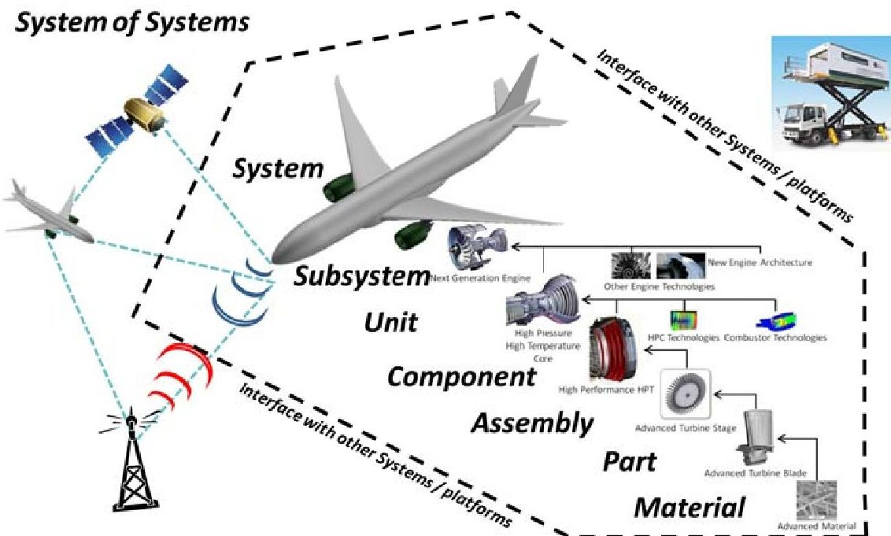

Figure 7: System decomposition spans multiple organizations (12)

Multiple design space sphere contexts are types of a sense making framework of a product. This sense making framework is the environment in which all product decisions are made affecting both concurrency and collaboration. Traditional systems engineering was focused on the 'knowable' and 'known' sphere contexts, described below. Even though systems engineers didn't examine a product in accordance with the attributes of these sphere contexts, benefits were still realized due to the systems engineering tools and methods were able to be extended to each of the sphere contexts. However, the complex sphere context is not allowing natural extensions of traditional systems engineering tools or methods.

A complex system is not the opposite of a simple system. Instead, complex system behaviors are not totally understood or predictable. They are not predictable due largely to the unpredictable nature of the interdependent elements residing in the new frontier. Many times these elements are humans, but can be extended to be cats in our wild 'cat' West mental picture. 'Complex' systems are characterized by interdependence, self-organization and emergence, and new industry tools and approaches are needed to fully explore the patterns that emerge from this sphere. Emergence can be defined as resultant behavior at the system level that cannot be predicted based on complete knowledge of a system's subsystems. It should be noted that the existence of emergence is not universally accepted within the systems engineering field of practice. It has been posed that emergence does not arise from complexity, but instead through ignorance. (13) A lack of understanding results in unexpected system behaviors instead of emergence from within the complex sphere context.

"Complex" sphere context analysis yields new industry innovation by predicting the emerging trends of self-organized and interdependent agents bound by 'fuzzy' boundaries. For example, a traffic jam on an engineered traffic network is a complex system in that it exhibits self-organization and emergence as local actors (e.g. individual vehicles) and decisions interact to create larger patterns, produce counter-intuitive outcomes where adding capacity to the network can degrade network performance, and even after the obstacle creating the traffic jam has been removed the jam has memory that persists for hours. As depicted in Figure 8, IBM Systems "Cynefin Domains" are multiple sphere contexts on a single solution across the entire lifecycle. The complex sphere context is shown in the top left quadrant.

<!-- PDF_PAGE: 8 -->

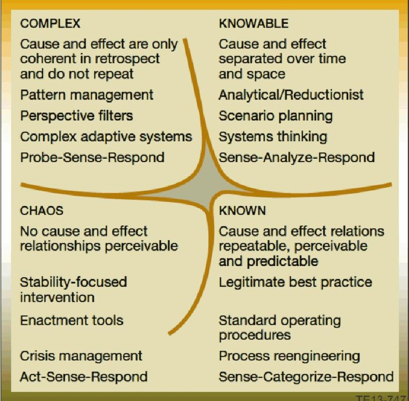

Figure 8: IBM Systems 'Cynefin' domains. (7)

"Known" sphere context includes simple and complicated systems that are typically straightforward to manage using traditional systems engineering and management approaches. The "known" sphere context is typically where solution manufacturing occurs, and ironically where most program management processes are derived.

"Knowable" sphere context includes massively complicated systems that present challenges of scale and interface accounting where extensions of traditional methods and tools can help. An example of a complicated system is a modern transit vehicle in that it has large numbers of interacting systems (e.g. fuel, electrical, engine, transmission, safety, etc) aggregate properties without emergence (e.g. range, top speed, etc), and unexpected outcomes are still possible but origin is knowable. The "knowable" sphere context is typically where large defense solutions (e.g. F- 35, V-22, etc) research and development efforts are located. These systems are typically straightforward to manage using traditional systems engineering and management approaches, too.

"Chaos" sphere context includes systems undergoing large disruptive events or is turbulent. These disruptive events are ones beyond the scope of the other spheres, and do not include any influence on a product from a micro or macro level. In short, the product is under control from everyone and no one simultaneously. The only course of action is to maneuver timely to a different sphere context where development can resume. An example is transition to the "known" sphere context where a strong central authority exists. However, this transition causes minimal innovation due to prescribed, repeatable, and best practices are usually exercised. It's worth noting that sphere context transitions are necessary and the strategic objectives will drive the transition process. In this example, the transition to other sphere contexts could have been just as possible. However, transitions between different sphere contexts are the subject of another paper and will not be discussed here.

"Disorder" sphere context is not a sphere context that the opposite is "order". It's instead a state of 'inappropriateness'. This sphere context is critical to understanding conflict within a product from multiple stakeholders who view the same product but from differing viewpoints. A product can enter into the "disorder" sphere context when stakeholders inappropriately apply their biases, perceptions, or even their level of understanding to a product incorrectly. Many times the inappropriate application of skills or knowledge is not

<!-- PDF_PAGE: 9 -->

intentional; instead the stakeholder really does have the best interests at heart. However, lack of understanding about other viewpoints, skills, or comfort with other methods prevents the correct influence in the appropriate sphere context. An example is the application of production based approaches ("known" sphere context) to product development that currently has no known objectives or even requirements established ("complex" sphere context). This example of inappropriate application of processes, procedures, tools, methods, or even individual skill-sets will drive product development into the "disorder" sphere context.

A system usually will reside within multiple sphere contexts simultaneously. Within the aerospace community, products span multiple decades and traverse multiple spheres within its lifecycle. The important part to recognize is the existence of the many sphere contexts and each one is part of the sense making framework, as shown below in Figure 9.

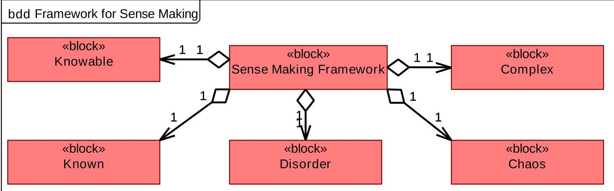

Figure 9: Multiple spheres influence our decision making capabilities

## IV. Characterization of Current MBSE Capabilities

MBSE utilization is gaining widespread industry usage, and SysML provides increased capability for systems engineers. (14) Reusing a subset of Unified Modeling Language $ ^{\mathrm{T M} \dagger} $ （UML $ ^{\circled{2}} $ ）2, Systems Modeling Language (SysML $ ^{\mathrm{T M} \S} $ ）contains additional extensions of UML2, too. MBSE tools, such as Magicdraw, Telelogic Rhapsody, or Artisan Studio use the graphical (notational) language SysML that provides syntax for representing certain aspects of a system. MBSE efforts has proven to enhance systems engineering capabilities, reduce product risk, save money in product development, and provides a better match between the marketplace and the product over traditional vernacular text. (15) Of particular importance to MBSE activities, and complex spheres of context, are the interfaces between system elements. Informational flow types for interfaces facilitating increased checking that producers and consumers expect the same syntax are strengthened by using SysML. The flexibility of SysML to adapt to multiple processes and be extended by other methods is also strength captured by OMG's description of SysML:

"SysML is designed to provide simple but powerful constructs for modeling a wide range of systems engineering problems. It is particularly effective in specifying requirements, structure, behavior, allocations, and constraints on system properties to support engineering analysis. The language is intended to support multiple processes and methods such as structured, objectoriented, and others, but each methodology may impose additional constraints on how a construct or diagram kind may be used." (16)

<!-- PDF_PAGE: 10 -->

As much as SysML can increase system engineering capability, SysML does possess some inherent limitations worth noting. Specifically, it should be noted that although SysML provides a standardized notation for rendering systems (e.g. graphical standards), SysML does not provide strong semantics related to the meaning or use of models. SysML semantics are left open and may depend on the tool in which the model was rendered. Flexible semantics are very helpful because they enable customizations but sharing models across tools isn't currently practical. (17) Other models (e.g., Ptolemy from UC Berkeley) don't worry much about the rendering but instead formalize the semantics. (18)

SysML models are constructed with four primary views. These primary views include 1) requirements view, 2) physical (e.g. component) view, 3) behavioral (e.g. functional) view, and 4) parametric view. These views are all contained in a complete SysML model, as shown below in Figure 10.

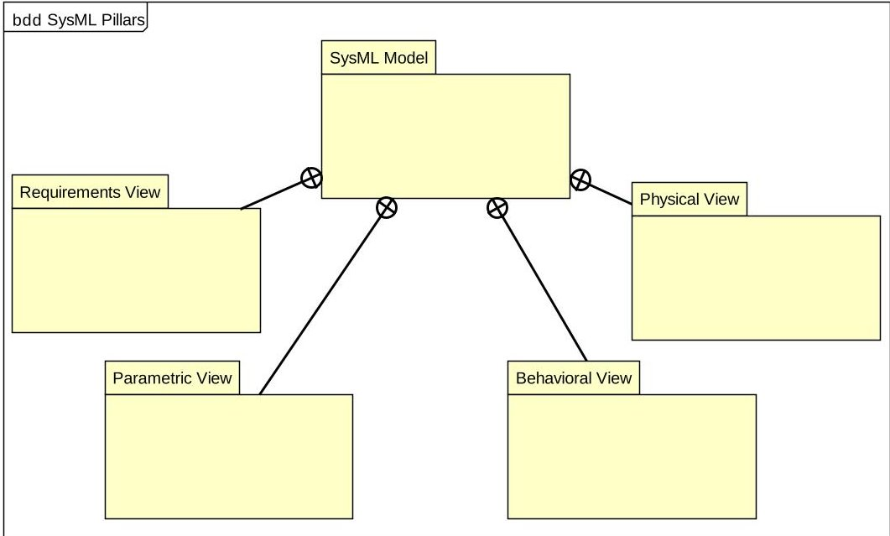

Figure 10: Four Pillars of SysML

One of the attractive features of SysML models is the interconnections between the four SysML pillars. Interconnectivity is a key feature to understanding system internal influences, and SysML interconnections are captured so that all model subsystems, units, assemblies, components, and parts are traceable throughout the entire system of interest. As shown below in Figure 11, the four pillars of a complete SysML model exert influence between the pillars. For example, the behavioral (e.g. functional) view is allocated to the physical (e.g. component) view. The physical view is influenced through the behavioral view to satisfy system requirements. The physical view does not satisfy requirements directly; the physical view implements solutions described in the behavioral view that together both views then partially satisfy the requirements (fully satisfied would include implementation of the parametric view).

<!-- PDF_PAGE: 11 -->

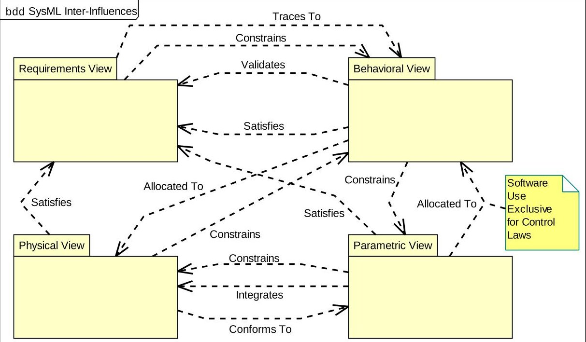

Figure 11: SysML Inter-Influences between the Four Pillars

As can be seen from Figure 10 and Figure 11, a complete SysML model can describe a system of interest. The system of interest is described from the requirements portion of the systems engineering "V" diagram, through to the validation portion of the "V" diagram. In fact, the system is described using a referential model structure so that internal influences are traceable and linked. Figure 12 shows where the SysML model fits within the larger system of interest. The SysML model constrains the analytical models utilized within the subsystems. The 'constrain' relationship is shown in Figure 11 and Figure 12. Examples of these types of models include MATLAB $ ^{**} $ /Simulink $ ^{\dagger\dagger} $ , Modelica $ ^{\ddagger\ddagger} $ , Excel $ ^{\mathrm{§§}} $ , or any type of model that has a solver and could link into the parametric view of the complete SysML model.

<!-- PDF_PAGE: 12 -->

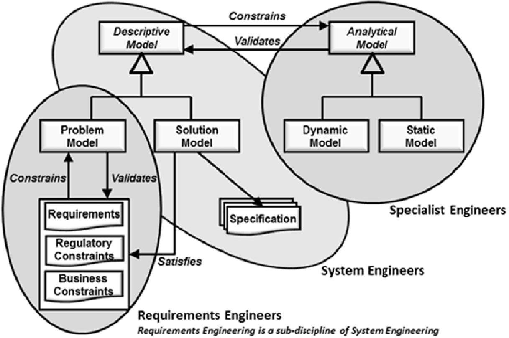

Figure 12: SysML Descriptive Model (19)

## V. Gap Exploration between Traditional and Complex Systems Engineering

The complex sphere context has been described, and the capability of SysML has been clarified. Now we can start to come to grips with the non-deterministic nature of complex systems and better understand the wild 'Cat' West systems engineers find themselves in as they discover the new frontier.

As described above, SysML describes a system of interest very well. However, the SysML system of interest is a static picture of a constantly evolving complex sphere context. This is not a fault of a SysML model. In fact, SysML fits well within the design space when extended to include the complex sphere context. As external environmental influences (e.g. societal, political, economic, etc) affect the system requirements, the only way to decompose and design a system is to take a snapshot of the evolving system of interest from the complex sphere context. When the system of interest is static, then it can be decomposed, designed, tested, and verified. Therefore, when a system has progressed down the left hand side of the systems engineering "V" and back up the right hand side of the "V", it's usually a single snapshot of the last known status from the complex sphere context. However, since the complex sphere context is constantly evolving, its system behavior may be fundamentally different from when the snapshot was taken through the linear "V". In addition, when viewed at a significantly different level of abstraction within the decomposed problem it may represent a different problem than originally understood. Figure 13 represents a snapshot out of a complex sphere context. Although the city skyline is visible in the wide panoramic view, the mother/daughter snapshot is what's visible in the snapshot view.

<!-- PDF_PAGE: 13 -->

Figure 13: Simultaneous Exploration of Multiple Levels of Abstraction

Maintaining and understanding this multiple perspective view simultaneously is the key to ensuring decomposition, design, testing, and verification which yields a valid product that has to operate and 'live' within the complex sphere context. It is known that the process going through the systems engineering "V" is complicated, difficult, and remain deep exploration is still needed. However, it still uses traditional systems engineering tools and methods. The problem is that attempts are made where traditional systems engineering methods and tools using linear interpolation within a deterministic process are incorrectly used to describe complex sphere context for a system of interest. As described by Norman and Kuras:

"Traditional systems engineering has its foundations in Linear System Theory. Key ideas are proportionality, superpositioning, and the existence of the invertible functions (i.e. $ x= f^{-1} ( f ( x ) ) $ ). There is also the assumption of repeatability. These ideas, coupled to an attention to detail, explain why traditional systems engineering works as well as illuminating the boundaries of its applicability." (2)

However, the complex sphere context does not remain static and exhibits non-deterministic behaviors. Just as the city skyline is changing in relation to the mother/daughter snapshot, so does the evolving complex system constantly and unpredictably change as a system of interest is developed. So, the delay between the complex sphere context snapshot and completing the systems engineering "V" is a key metric to achieving successful system validation/customer acceptance. In fact, ideally there should be many complex sphere context snapshots taken throughout the "V" development lifecycle. In order for the snapshot metric to become an enabler for system development, rapidly incorporating the evolving changes within the complex sphere context within the development of a system of interest will be of particular interest. The closer a system of interest can mirror the evolving and emerging behavior(s) from the complex sphere context in the development of the system of interest, the more likely system validation will be achieved. SysML is important because its application can support rapid and automated iterations accounting for complex sphere contexts within system development. The SysML referential structure enables this rapid understanding of system effects from requirements changes due to complex sphere context. However, SysML by itself will not enable this understanding to occur. There are key pieces that need to be understood to enable understanding complex sphere context on a system of interest development.

Recognition of the different sphere contexts and timely adaptation is important. Effective concurrent and collaborative engineering places importance on the interfaces of partner collaboration to identify solution lifecycle position and reach common consensus. Innovation will be stifled through inappropriate application of capabilities, tools, or methods not aligned with the appropriate lifecycle sphere context. (20) For example, subject matter experts may want to inappropriately apply techniques best suited for the knowable sphere context to other sphere contexts. The importance of "Cynefin domains" is for the vertical 'organizational' collaboration of trusted partners to identify solution lifecycle position and reach common focal sphere context consensus. Without collaborative consensus for a

<!-- PDF_PAGE: 14 -->

focal sphere context, competition for focal sphere becomes based on preference for action with a strong pull to spheres based on individual or organizational capabilities and perspective. Most importantly, innovation can also be stifled through inappropriate application of capabilities, tools, methods, or organizational structures to a sphere context not aligned with the correct lifecycle position. For example, subject matter experts (e.g. Fellows) may want to apply analysis and collection of data best suited for the "knowable" sphere context which may be inappropriately applied to other spheres. All sphere contexts support the solution across the full-spectrum of the solution's lifecycle, but the appropriate capabilities, tools, methods, and organizational structure will transition between sphere context capabilities and perspective depending on the respective lifecycle position.

Table 1: Innovation at appropriate lifecycle through collaborative consensus (21)

<table border="1"><tr><td>Lifecycle Position</td><td>Complex</td><td>Knowable</td><td>Known</td><td>Chaos</td><td>Example Outputs</td></tr><tr><td>Observable Patterns</td><td>Focal</td><td>Supporting</td><td>Supporting</td><td>Supporting</td><td>Program Objectives ConOps</td></tr><tr><td>Disruptive Events</td><td>Supporting</td><td>Supporting</td><td>Supporting</td><td>Focal</td><td>Strategic Loss</td></tr><tr><td>Categorize Known Data</td><td>Supporting</td><td>Supporting</td><td>Focal</td><td>Supporting</td><td>Product Production</td></tr><tr><td>Analysis to determine unknowns</td><td>Supporting</td><td>Focal</td><td>Supporting</td><td>Supporting</td><td>R&amp;D</td></tr></table>

Table 1 depicts typical lifecycle position attributes (e.g. observable patterns), the sphere context capabilities and preferences that should be applied (e.g. focal), and typical outputs of that lifecycle position.

Extensions of MBSE are critical to understanding the complex sphere context. With SysML effectively describing a system of interest, it needs an extension to capture the emergent behavior(s) of the external environment within which the system of interest resides. There exist multiple modeling methods that effectively capture complex system behavior. Shown in Table 2 are multiple modeling methods that can be utilized to understand the complex sphere context.

<!-- PDF_PAGE: 15 -->

Table 2: Selected modeling methods for complex systems (22)

<table border="1"><tr><td>Analyze</td><td>Diagnose</td><td>Model</td><td>Synthesize</td></tr><tr><td>Data Mining</td><td>Algorithmic Complexity</td><td>Uncertainty Modeling</td><td>Design Structure Matrix</td></tr><tr><td>Splines</td><td>Monte Carlo Methods</td><td>Virtual Immersive Modeling</td><td>Architectural Frameworks</td></tr><tr><td>Fuzzy Logic</td><td>Thermodynamic Depth</td><td>Functional/Behavioral Models</td><td>Simulated Annealing</td></tr><tr><td>Neural Networks</td><td>Fractal Dimension</td><td>Feedback Control Models</td><td>Artificial Immune System</td></tr><tr><td>Classification &amp; Regression Trees</td><td>Information Theory</td><td>Dissipative Systems</td><td>Particle Swarm Optimization</td></tr><tr><td>Kernel Machines</td><td>Statistical Complexity</td><td>Game Theory</td><td>Genetic Algorithms</td></tr><tr><td>Nonlinear Time Series Analysis</td><td>Graph Theory</td><td>Cellular Automata</td><td>Multi-Agent Systems</td></tr><tr><td>Markov Chains</td><td>Functional Information</td><td>System Dynamics</td><td>Adaptive Networks</td></tr><tr><td>Power Law Statistics</td><td>Multi-Scale Complexity</td><td>Dynamical Systems</td><td></td></tr><tr><td>Social Network Analysis</td><td></td><td>Network Models Agent Based Models Multi-Scale Models</td><td></td></tr></table>

Just as systems engineers are the key enabling link between all of the different sphere contexts (complex, knowable, known, chaos, and disorder), it makes sense that systems engineering tools enable systems engineers to break down the barriers of ambiguity. Reducing ambiguity will enable understanding of all the different viewpoints when viewing the same diagram.

Systems engineers are in the new frontier of the wild 'cat' West. But, social scientists have been using modeling methods, such as some listed in Table 2, for decades attempting to understand human behavior and social motivations. Systems engineering can tap into this resource, gain an understanding of the advancements made in math-based social sciences, and apply new techniques to the systems of interest under development.

## VI. Determine SysML Framework Solutions for Modeling Complex Systems

SysML itself cannot account for modeling behaviors of evolving complex systems. However, SysML is a key enabling tool that facilitates the design of the system of interest to closely mirror the rapidly changing complex sphere context. It’s through extensions of MBSE that will enable necessary modeling methods capable of gaining insight to the emergent and evolving behavior of complex systems. As shown in Figure 14 below, complex systems engineering can extend systems engineering, and SysML is part of systems engineering. So, by virtue of SysML being part of systems engineering, complex systems engineering can extend SysML.

Also shown in Figure 14 below, there are additional extensions yet to be fully realized out of SysML. Systems engineering will need to continue to mature to take advantage of existent patterns for reusable models of requirements and design, and eventually will provide an approach for reusable patterns of intelligent systems and processes. (23)

<!-- PDF_PAGE: 16 -->

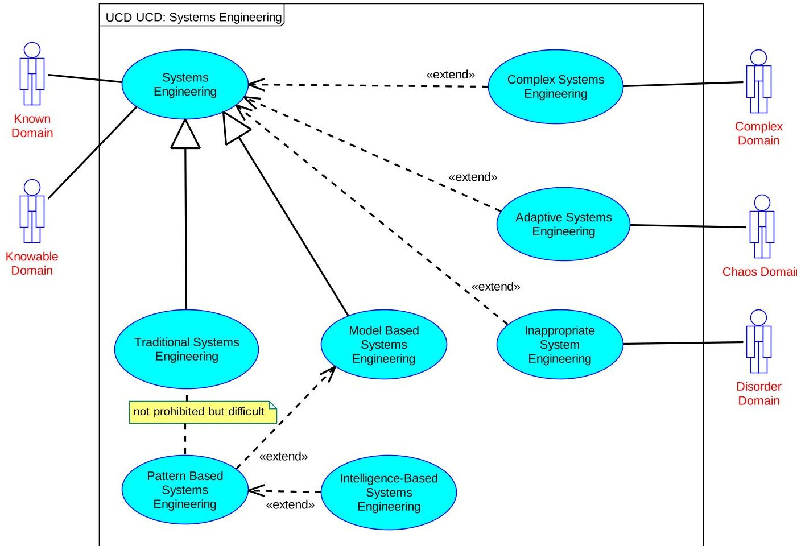

Figure 14: Systems Engineering Across Multiple Sphere Contexts

MBSE efforts are used to describe a problem or system of interest and SysML cannot, in isolation, explore predictions based on probability. However, SysML can be extended by other methods that extensively utilize probabilistic based methods. Causal probabilistic models (e.g. Bayesian Belief Networks) capture complex interdependencies providing quantification for management decisions. (24) These types of models are examples of adaptive networks indicated in Table 2. SysML models can be extended to account for predictions based on probability, and the accuracy of the probability is proportional to the amount of knowledge input to the model. The probabilistic models become more accurate with more information provided. So, predictions can only be as effective as the information provided. Remember, garbage in equals garbage out? In short, SysML model extensions of probabilistic models look promising, but need to be approached with caution. Systems engineers need to ensure the right kind of information is provided to the probabilistic models to make certain the output is appropriate and accurate enough to be provided as extended input to the SysML model.

SysML models can capture an entire lifecycle of a product. The models certainly span the entire systems life-cycle, from the engineering "V" requirements through to customer acceptance. SysML models also provide opportunity for systems architects to capture rationale for decisions made or risk accepted. It can also be claimed that in retrospect most complex systems appear deceptively simple and obvious. So, with SysML models capturing the entire lifecycle, providing opportunities for rationale statements, and typically complex system decisions appearing simple and obvious in retrospect, can SysML account for the entire lifecycle to include capturing rationale for system knowledge based on past occurrences? Well, it depends. It depends on how well rationales were captured and if appropriate sphere context techniques and methods were applied. If the inappropriate use of tools, techniques, or methods were employed due to personal skill-sets or biases, then the likelihood that SysML (or any tool) would appropriately display product knowledge and supporting decision rationale is reduced. For example, if a non-linear system was incorrectly extrapolated into linear design space, then the supporting rationale would be incorrect regardless of the quantity of rationale statements. So, SysML can account for an entire lifecycle based on past occurrences if done correctly. This should include consensus on focus and supporting sphere contexts with adequately applying appropriate tools and techniques, and justification statements with supporting rationale analysis provided into the SysML model.

<!-- PDF_PAGE: 17 -->

Finally, it should be clear that accounting for complexity within SysML is possible and practical, but it will affect existing design processes. To include the complex sphere context, there should be two parallel development processes. Extending systems engineering to include complex systems engineering with MBSE necessitates changes to the design process. Complex systems will continue to evolve forever and will never reach a specific solution. However, at certain points a design needs to be created where requirements need to be a 'snapshot' of the last known evolution within the complex sphere context. Figure 15 depicts the state transitions for a generic system of interest. SysML enables very rapid transitions from product analysis to another complex sphere context 'snapshot'. A history pseudo-state within the 'applied competence' state indicates shallow history which holds the identity of the last active sub-state within the same region as itself. Shallow history is purposeful because the complex sphere context is constantly evolving and any new iteration 'snapshot' will not be the same as the previous 'snapshot'. This enforces the need for multiple, rapid validation gate iterations. However, process memory is needed to recognize trends from multiple 'snapshots' of the complex sphere context. The validation gate is the feedback gate, opposite the decision gate, which ensures the product remains a valid product and accounts for evolving trends within the market.

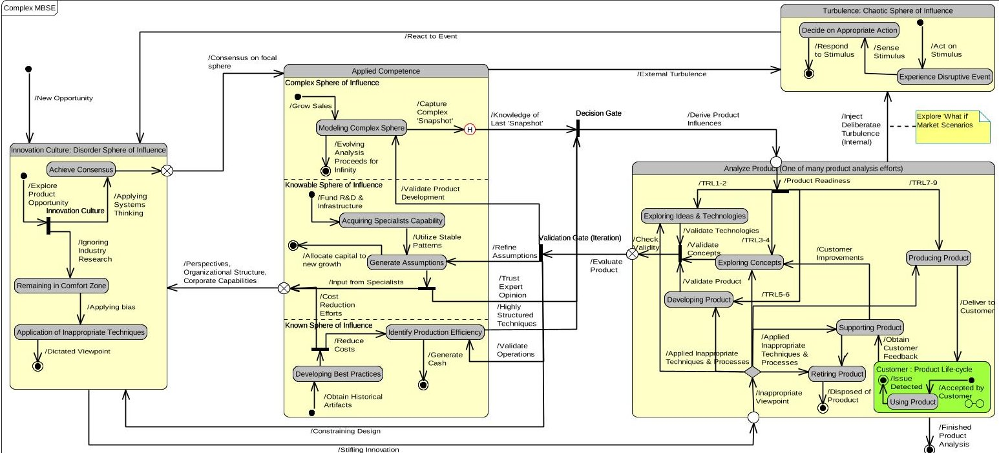

Figure 15: Generic System State Diagram $ ^{***} $ Accounting for Multiple Sphere contexts

Figure 15 shows four primary states of a generic system that has complex sphere contexts. The 'innovation culture: disorder sphere context' (left most state) is a state the new system of interest opportunity enters. Within this state a key decision is made if recognition of multiple sphere contexts will be acknowledged with appropriate principles, techniques and skill-sets applied. Or, will the development of a new system of interest opportunity be developed (at least initially) using comfortable preconceived biases, organizational structures, and perspectives? The bias decision circumvents applying the appropriate capability and dictates preconceived methods and techniques to developing the new system of interest. This is shown by the bottom-most state transition labeled 'stifling innovation'. If, however, consensus is achieved for the appropriate capability depending on system of interest life cycle position, then the middle state will be enabled. This enables the most innovative solution because it draws upon competencies supporting multiple sphere contexts that will frequently extend beyond a single subject matter expert's limits of validity. The middle state is 'applied competence' and depicts the competencies existing within the complex, knowable, and known sphere contexts. The 'applied competence' state is a concurrent state with three separate states, representing interdependent sphere contexts, operating simultaneously. However, as previously discussed, there is a preferred focal sphere context with the other spheres supporting product development. Although only contributing through a supporting role, they are nevertheless very present and necessary contributing sphere contexts. The output of all three concurrent sphere contexts is joined as input to the new system of interest

<!-- PDF_PAGE: 18 -->

opportunity 'analyze product' state. This state is where the new system of interest opportunity is taken through its life-cycle stages. This state shown in Figure 15 is for a single new system of interest opportunity, but this will include multiple new opportunities. This state should not be viewed as a single product, but rather multiple products analysis or even analysis for a potential product family. What's important to note about this state is the iterative loop back to the concurrent 'applied competence' states. This iterative loop provides critical input to the next 'snapshot' from the complex sphere context, new specialist techniques, and manufacturing capability. This iterative loop needs to happen frequently and very quickly (e.g. hours as compared to weeks or months) to add value to the 'analyze product' state. SysML enables this and is therefore enabling the critical iteration loop. Finally, the last state is the 'turbulence: chaotic sphere context' which encompasses major disruptive events. Examples of disruptive events could be as simple as strategic losses, but could be as large as global conflicts or major weather catastrophes. In any of these examples, extreme turbulence is introduced to the new system of interest opportunity necessitating immediate and decisive action. This allows for reentry to the 'innovation culture: disorder sphere context' where again a choice is made about what kind of innovation will be supported. The 'innovation culture: chaotic sphere context' should also be simulated through internal injections to account for product turbulence not anticipated or predicted. This enables contingency planning and risk mitigation from unexpected turbulent events.

## VII. Conclusions

The new frontier for systems engineers is the wild "cat" West also known as the complex sphere context. Technology development requirements are heavily influenced by the new frontier and need to be accounted for during design, test, and verification activities. Systems engineering skills will be extended to include complex systems engineering. MBSE capability provides movement in the correct direction by facilitating rapid understanding throughout a system due to effects of requirements changes. However, MBSE by itself cannot cross the finish line of acquiring complex sphere context knowledge. MBSE needs to be extended through adjacent modeling efforts. Sometimes these adjacent modeling efforts are founded in sciences not typically leveraged for aerospace applications, such as math-based social sciences. Utilizing SysML with complex sphere context modeling extensions will enable systems engineers to account for rapidly changing external environments and provide a foundation to extend into future traditional systems engineering areas (e.g. pattern or even intelligent systems engineering). The first step is recognizing and adapting to changing requirements quickly. MBSE provides this capability.

<!-- PDF_PAGE: 19 -->

## Acknowledgments

M. French thanks Rolls-Royce, AIAA CASE, AIAA SETC, and INCOSE CxSWG for the support to explore MBSE for complex systems. M. French also thanks Dr. Mike Sievers, USC, Dr. Jimmie McEver, JHAPL, and Fran Thom, Rolls-Royce plc, for independent reviews and comments assisting in the development of this paper.

## References:

1. M.L. Kuras, B.E. White. Engineering Enterprises Using Complex-Systems Engineering. Bedford: INCOSE, 2005.

2. Norman, Douglas O. and Kuras, Michael L. Engineering Complex Systems. s.I. : The MITRE Corporation. Case #04-0043.

3. Principles of Complex Systems for Systems Engineering. Sheard, Sarah. s.l. : INCOSE 17th Annual International Symposium Proceedings, 2007. Systems Engineering: Key to Intelligence Enterprises.

4. Honour, Eric C. Systems engineering return on investment. University of South Australia: Defence and Systems Institute, School of Electrical and Information Engineering, 2013.

5. Kevin Forsberg, Hal Mooz. Visuaizing Project Management: Models and Frameworks for Mastering Complex Systems. Hoboken : John Wiley & Sons, Inc., 2005.

6. Commons, Creative. The Project Cartoon.com BETA. [Online] [Cited: May 8, 2014.] http://www.projectcartoon.com/about/.

7. The new dynamics of strategy: Sense-making in a complex and complicated world. C.F. Kurtz, D.J. Snowden. s.I. : IBM Systems Journal, Vol 42, No 3, 2003, IBM Systems Journal Vol 42, No 3, pp. 462- 483.

8. Mathew French, Fran Thom, Jimmie McEver. Conversations. 2014.

9. EDS, an HP Company. EDS Super Bowl Commercial. workplaceinsanity.com. [Online] [Cited: 04 08, 2014.] http://www.workplaceinsanity.com/2010/10/herding-cats-art-of-managing-knowledge.html.

10. Wilson N. Felder, Paul Collopy. The Elephant in the Mist: What we don't Know about the Design, Development, Test and Management of Complex Systems. Journal of Aerospace Operations, v.1. no. 4. 2012, pp. 317-327.

11. Alvidrez, Frank. SAE541 Class. USC Viterbi School of Engineering: s.n., January 14, 2014.

12. Hernando Jimenez, Mathew French. SE CoS for G135 Face to Face Meeting. Orlando: AIAA ASI-WG, 2012.

13. Edmunds, B. Syntactic Measures of Complexity. Manchester, U.K.: Department of Philosophy, University of Manchester, 1999. PhD Thesis.

<!-- PDF_PAGE: 20 -->

14. Fisher, Jerry. Model-Based Systems Engineering: A New Paradigm. INCOSE INSIGHT. Fall 1998, pp. 3-4.

15. Oliver, David W. The Benefits of Model Based Engineering. INCOSE INSIGHT. Fall 1998, pp. 13- 14.

16. OMG. OMG Systems Modeling Language (OMG SysML). Version 1.3. June 2012.

17. Michael Sievers, PhD. SAE 547 - Model Based Systems Engineering. Los Angeles: USC, Viterbi School of Engineering, 2014.

18. Mark L. McKelvin, PhD. Models of Computation. Los Angeles: USC, Viterbi School of Engineering, 2014.

19. Thom, Francis. Model-Based Systems Engineering (MBSE) Guidelines; DNS183275. Derby, UK: Rolls-Royce, 2012. Technical Report.

20. Interactions Among Components in Complex Systems. Felder, Wilson N. s.I. : AIAA, 2013. AIAA CASE. p. 11.

21. Complexity Primer. Jimmie McEver, Mathew French. Fort Washington: AIAA, 2013. CASE Brainstorming Session.

22. Sheard, Cook, Honour, Hybertson, Krupa, McEver, Mckinney, Ondrus, Ryan, Scheurer, Singer, Sparber. A complexity primer for systems engineers version 1.0. s.l. : INCOSE Complex Systems Working Group, 2013.

23. Affordable Systems Engineering: An Application of Model-Based Systems Patterns To Consumer Packaged Goods Products, Manufacturing, and Distribution. Representative, Consumer Packaged Goods. s.l. : INCOSE, 2014. 2014 International Workshop. pp. 1-25.

24. Fenton, Norman and Neil, Martin. The use of Bayes and causal modelling in decision making, uncertainty and risk. 2011. White Paper.

25. Douglas O. Norman, Michael L. Kuras. Engineering Complex Systems. unknown : The MITRE Corporation, unknown.

26. Sheard, Sarah, et al., et al. A Complexity Primer for Systems Engineers. s.l. : INCOSE Complex Systems Working Group, 2013. pp. 1-10, Short Paper.