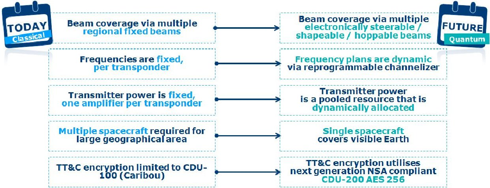
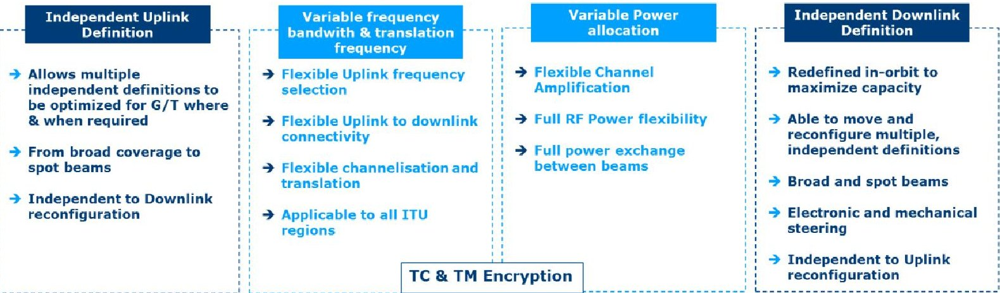
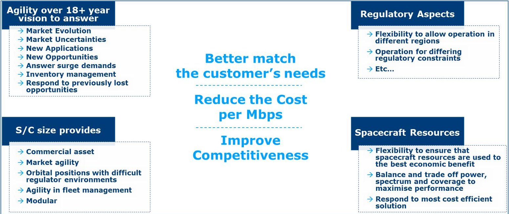
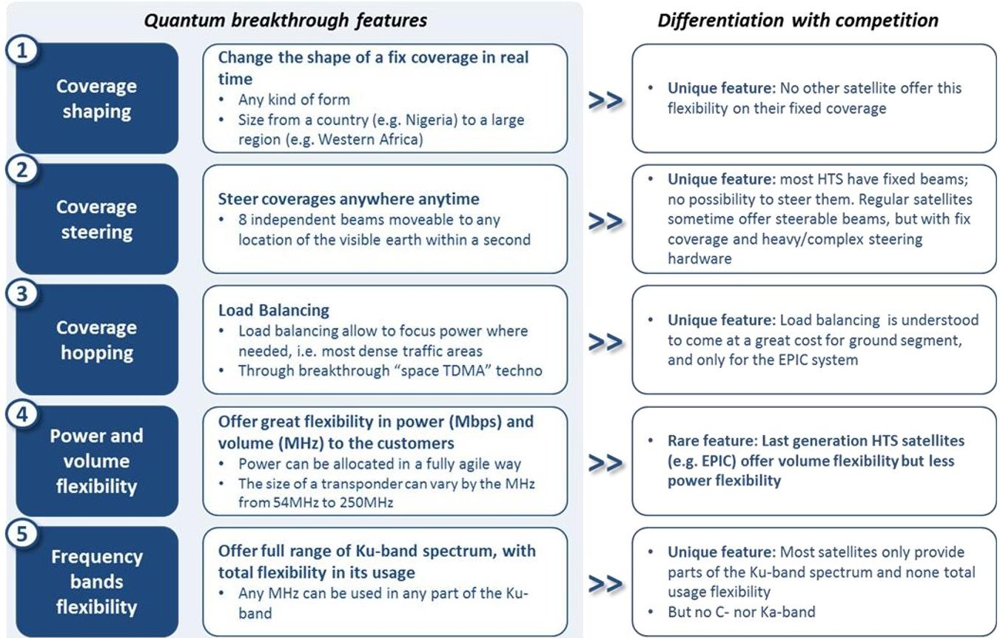
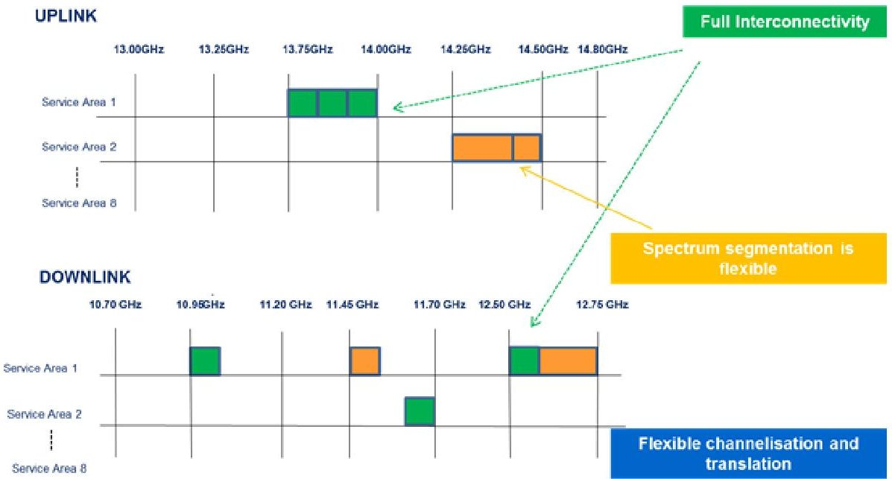
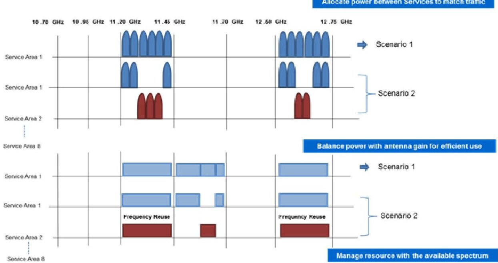
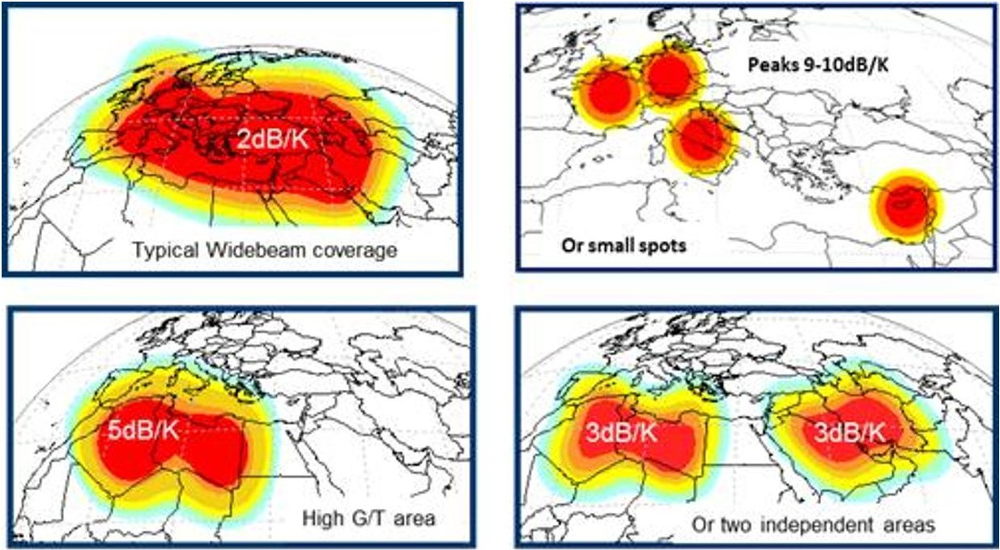

<!-- PDF_PAGE: 1 -->

# Eutelsat Quantum: A Game Changer

Dr. Hector Fenech $ ^{1} $ and Sonya Amos. $ ^{2} $

Eutelsat, Paris, 75015

Whereas commercial Ku-band satellites have seen significant technological developments at equipment level the transponder concept remains unchallenged. Payloads have increased in size, leading to increased equipment count. Additionally, operator quest to improve efficiency and a high fill-factor has increased the importance of flexibility. Traditionally this has been attained by switching between optional additional equipment, further increasing payload mass and capacity cost. "Eutelsat Quantum" is a brand new system approach that allows the payload to include inbuilt flexibility in service area definition, RF power management, spectrum management and network definition. It relies on a suite of enabling technologies to deliver a software-defined payload that affords levels of flexibility that have never before been attained by a commercial Ku-band satellite. Eutelsat Quantum is a game-changer that will enable the satellite to adapt to a variety of applications while making efficient use of satellite resources and maximizing capacity.

## Nomenclature

CAPEX = Capital Expenditure

EIRP = Effective Isotropic Radiated Power

kW = kiloWatt

LLI = Long Lead Items

ITU = International Telecommunications Union

RF Radio Frequency

TWT = Travelling Wave Tube

## I. Introduction

The Eutelsat Quantum project is a major innovative step in providing a change in the satellite system approach. It starts with operator requirements for flexibility and performs a top down approach to meeting these requirements by identifying a suite of enabling technologies. In combining flexibility in spectrum, power, coverage and network operation on a dynamic spacecraft, Eutelsat Quantum will enable a radical change in meeting communication mission requirements and the procurement approach of future satellites.

Eutelsat Quantum presents advantages to clients, operators and industry:

- For clients, it provides a new approach to conducting satellite communications where the satellite can adapt to the application rather than the application adapting to the satellite. The capacity leased is no longer locked in time.

<!-- PDF_PAGE: 2 -->

- For operators, it provides a flexible asset that allows capacity to evolve over time, to cater for new business opportunities and to enhance fleet integrity by enabling operation in the three ITU regions efficiently.

- For industry, it represents a step towards the industrialization process through a more standard design that caters for a large range of satellite requirements. At unit level, more of the same can be produced, increasing production runs of equipment and reliability, therefore simultaneously reducing the schedule and cost.

The concept of Eutelsat Quantum has its genesis in 2011 $ ^{1} $ when the formal flexibility requirements of the communication mission were being assessed. The issue was to determine the economic value of flexibility. Obviously, the more flexible a satellite is, the easier it is to sell capacity but the capacity cost is also increased as traditionally flexibility results in additional hardware and mass The next phase investigated the enabling technologies that would be required to implement such flexibility and discussions with industry on both sides of the Atlantic were initiated.

Airbus Defence and Space was finally selected as the industrial partner for Eutelsat Quantum. The proposal for this Private Public Partnership brings together the experience of an operator, the expertise of a satellite manufacturer and the essential support to innovations of the European Space Agency to enable a revolutionary step in telecommunication satellite systems, indeed a Quantum leap forward.

## II. Overview

Whilst there have been significant advances in satellite technology, the approach to payload design has in general remained the same over the past few decades. If payload flexibility has been required, then it has typically been implemented using classical non-flexible hardware, switched into and out of the operational transponder chain and through additional classical fixed hardware over and above that which can be operational at any given time. This design philosophy results in payloads whose mass, power and cost scale linearly with the level of mission flexibility required, effectively resulting in a "penalty of flexibility". This type of flexibility can be termed as discrete flexibility in the sense that discrete options are available according to the number of selectable hardware options. For example, two antennas could provide a choice of two pre-defined coverages without providing options in between. Steerable antennas provide an extra level of flexibility but typically with a pre-defined spot beamshape.

Fig. 1. Overview of comparative advantages provided by Eutelsat Quantum

The Eutelsat Quantum Class project, aims at breaking this linear/discrete relation between hardware and flexibility. A comparison of how the solution compares to today's classical approach is provided in Fig.1.

The Eutelsat Quantum satellite is a major innovative step, and the first operational programme for a fully flexible, scalable and generic payload in Ku-band. The mission has four main focusses of flexibility: coverage, power, spectrum and architecture, but the ultimate innovation lies in the system approach that intertwines them in a harmonised system, the main aspects can be highlighted as in Fig. 2.

<!-- PDF_PAGE: 3 -->

It will provide optimum flexibility and therefore market agility - in an architecture that will allow a generalised and modular approach to the spacecraft subsystems, technology and manufacturing, ultimately reducing schedule and cost. The benefit is therefore observed by both the Operator and the Manufacturer.

Fig. 2. Overview of Eutelsat Quantum Solution Aspects

## III. Operator Perspective

Eutelsat as a global operator must react effectively and efficiently to the evolving environment. It must be capable of satisfying an ever increasing variety of customer and user demands. It must be able to respond to market needs, not just now but also future requirements. It is no longer sufficient to launch a satellite that is designed with mission requirements defined at the start of a three year procurement and manufacturing cycle and designed to cover a 15 year in-orbit lifetime. For the first time, the Eutelsat Quantum Class satellite enables the satellite operator to respond to market agility and evolution, uncertainty and opportunities without excessive cost, risk and complexity.

The Eutelsat Quantum project is the acquisition and commercialization of a satellite that will bring new market opportunities thanks to strongly differentiating technology. Unlike conventional satellites with fixed coverage, Eutelsat Quantum will enable customers to adapt to the changing needs of their end users. It will be able to capture opportunities that are less predictable such as the Government and Military entities, mobility in both aero and nautical segments and occasional use and high-surge markets.

The commercial and financial benefits for Eutelsat are many. Given its flexibility it has the ability to respond to a variety of end-user needs which ensures high utilization and fill rate of its capacity. Eutelsat's customer will be able to address the regions and markets of their choice, power is directed only where and when necessary, resulting in more efficiency and ultimately optimized costs.

## IV. Answering the Market Need

The Eutelsat Quantum satellite enables flexibility and dynamic reconfiguration in four areas:

- Coverage: Management of the Service Area in-orbit from array antennas provides multiple service areas per aperture, reducing the number of apertures required per payload and enabling a variety of antenna patterns from broad coverages to spot beams and anything in between.

- Spectrum: Flexibility in bandwidth allocation and translation frequency enables a more efficient use of resource, increasing spectrum usage from typically 86% in a conventional payload to >98%

- Power: Flexibility in the RF Power per user and optimisation of the space segment resources leads to lighter payloads and more efficient use of the available resources.

- Network: Whether the Forward and the Return links use separate resources or share the same resources, whether beam hopping is employed.

<!-- PDF_PAGE: 4 -->

The ability to manage, balance and reconfigure not just the coverage, but the power and spectrum is a powerful tool in responding to market needs and opens the door to a variety of avenues previously too complex or costly, particularly on a small platform. Such opportunities are summarised in the Fig. 3.

Fig. 3. Eutelsat Quantum market agility

In providing a solution that offers flexibility in coverage, power and frequency we are enabling a much more dynamic approach to the satellite system. The Eutelsat Quantum concept is beneficial to both operator and industry and will address the following markets:

- A new way of selling satellite capacity where the operator can offer a more customised solution to the customer so that for a given spacecraft class more clients can be served providing a more efficient economic use of satellite CAPEX.

- A flexible solution designed to cope with changing market requirements and multi-orbital position operation with efficient use of spacecraft resources.

- A fast track pre-defined spacecraft solution where the operator is after a quick solution without necessarily seeking flexibility but rather an early inception point. Flexibility may not be the prime design driver. Prefabrication of the hardware could further enhance this market.

- A modular approach on a multi-mission spacecraft where other payload could be more traditional and perhaps employing other frequency bands.

- An in-orbit sparing solution that could either be owned by the operator to enhance the integrity of this fleet or as a new service delivered by a third-party It should be noted that in the case of a solar wing failure which is a major (but not the worst case) scenario, the Eutelsat Quantum satellite could adequately complement the ailing spacecraft..

- The ability to reconfigure for different orbital locations and regulatory aspects means that the system could provide Eutelsat with not only market agility but enable launch failure protection, both enhancing the fleet integrity.

The spacecraft system has five distinct features, illustrated in Fig. 4.

<!-- PDF_PAGE: 5 -->

Fig. 4. Overview of Eutelsat Quantum Solution Aspects

## V. Eutelsat Quantum-Class Product Line

The aim is to have a flexible spacecraft for Eutelsat and a generic design for industry. This would open the door to a standard spacecraft of the 5 kW class. Since one satellite is capable of serving any region of the visible Earth from a particular orbital slot, the product would be an international product, capable of operating in any ITU region. The technology baselined has been developed to be generic and modular, this has a number of potential benefits:

- The follow-on satellites will benefit from improved schedules without the non-recurring effort seen on the first satellite.

- Since the units are generic, this could lead to bulk or mass production leading to benefits in testing, standardization in procedures, reliability and potentially less risk.

- The second satellite could potentially follow soon after the first.

- Modularity allows extension to larger spacecraft.

- The payload could be combined with alternative payload missions that do not require the full flexibility provided by Eutelsat Quantum.

The concept can also be applied to other frequency bands where C-band and Ka-band for instance could be particularly interesting in the commercial world and X-band and Military Ka-band for governmental applications. Since the Eutelsat Quantum-Class satellite is designed based upon a 5kW satellite it also brings an additional competitive element to this size of spacecraft to the market.

<!-- PDF_PAGE: 6 -->

## VI. Satellite System Design

The Eutelsat Quantum system incorporates a software defined approach that enables in-orbit flexibility and reconfiguration over the FSS Ku frequency bands. The solution provides a generic architecture that can be applied to an envelope of future missions but the concept will be applicable to other frequency bands.

Fig. 2 summarises the system aspects that have been brought together to form a suite of enabling technologies that form the basis of the flexibility of the system and how they are managed. The non-channelised approach allows for significant reduction in equipment and therefore reduced mass and a more compact accommodation - whilst unlocking the frequency flexibility. In utilising active antennas and employing independent arrays on uplink and downlink we enable multiple reconfigurable coverages from fewer apertures.

The flexibility of the system enables footprints that are reconfigurable in a time-varying manner. This is a powerful aspect that allows Operators to target their customers demand, not only where they want, but also when they want. This time dynamic nature can be:

- Shifts in seasonal demand such as cruise ships in the Caribbean during the winter and Mediterranean during the summer.

- Emergency Government situations where the location of theatres are impossible to predict and change over time.

- Managing allocation over a diurnal cycle: e.g. peak demand for New York will be the off-peak in East Africa. Operators, and ultimately customers can manage their overall use and resources more efficiently.

- Tracking in mobility applications.

- Answering surge demands and enabling a more efficient response to customer inventories

Additionally the technology of Eutelsat Quantum facilitates beam hopping. This allows a beam to be shared in time over a number of locations in a cyclical fashion. Thus, a given capacity is shared amongst a number of coverages on a time basis. This allows the optimisation of link budgets for the specific application since at any given time the antenna performance is optimised. The basis for the beam hopping operation is the DVB-S2x standard although the system could accommodate other schemes. The principle is that the dwell time of each coverage is an integer multiple of super-frames and the dummy symbol section is used as a guard time during which the coverage or timing could change.

The number of super-frames for each coverage can be dynamically assigned to better match the demand on that given area. Therefore Eutelsat Quantum enables beam hopping with flexibility in the beamshape - they need not be traditional spots or ellipses - but also in variation in time in order to apportion in response to the traffic demand.

## VII. Innovative Elements

The Eutelsat Quantum concept is a major leap forward. All the elements of the satellite programme will require and involve innovations, from the payload architecture, in orbit configuration and reconfiguration and exploitation of the system resources.

## A. Spectrum Management

If we consider the spectrum flexibility, the system provides a dynamic approach to the frequency plan. As highlighted in Fig. 5 full connectivity between the Uplink and Downlinks is provided. The spectrum segmentation is flexible and in essence given the granularity of the payload, arbitrary to the users need. The channelization and translation is also flexible and given the agile filters, enables spectral interference mitigation through notching. This

<!-- PDF_PAGE: 7 -->

minimises the lost spectrum and relies solely on the frequency without requiring knowledge of the location of the interference source.

Eutelsat Quantum therefore uses flexibility at the system level to define frequency plans in-orbit providing capacity allocation, adaption to different regulatory scenarios of ITU regions and the coordination agreements, connectivity and interference avoidance.

Fig. 5. Quantum Spectrum Flexibility

## B. RF Power Management

The management and allocation of a pool of RF power is crucial aspect of the Eutelsat Quantum system as, when combined with the ability to reconfigure the antenna footprint, we are able to balance and make efficient use of the spacecraft resources. Traditional payload architecture with one TWT per transponder often leads to overdimensioning and inefficient use of spacecraft resources. Highlighted in Fig. 6, the power is allocated in response to the service traffic. Since we are able to reconfigure the beam to only the footprint required and thus improve antenna gain, we are able to use this more efficient use of the resource and provide the power elsewhere. Further flexibility is offered through frequency reuse of the spectrum.

Thus there are two independent levels of flexibility adjusting the EIRP: there is the power into the downlink antenna and the antenna gain.

<!-- PDF_PAGE: 8 -->

Fig. 6. Eutelsat Quantum RF Power Management

Analysis of the RF power used for a customised beam compared to a typical Eutelsat Widebeam coverage indicates that the benefits can typically range from 30-60% depending on the pattern reconfiguration. Management of a pool of power can be provided through a number of ways, for instance Multi-port Amplifiers are becoming more common in satellite payload designs and have been employed at S-band on EUTELSAT 10A and will be employed on EUTELSAT 172B in Ku-band. But when used in conjunction with reconfigurable array antennas, this flexibility truly becomes 'powerful'.

## C. Coverage Flexibility

The coverage flexibility provides fully reconfigurable antenna patterns in-orbit, ranging from broad coverages to spot beams. This provides an in-orbit trade-off between area and performance. With separate uplink and downlink antennas, multiple footprints can be generated from each aperture and the footprints can be defined in a fully independent way. Fig. 7 provides examples of the variety in coverage. A typical Eutelsat Widebeam is possible, reconfigured to more specific demands, or indeed split into two separate regions.

The reconfiguration of the beam means that the system can be changed based upon the change in traffic and demands.

<!-- PDF_PAGE: 9 -->

Fig. 7. Coverage flexibility from the same antenna

The scenarios discussed above have focussed on the capabilities of a single beam and the examples are provided for the uplink from Eutelsat Quantum. The satellite has eight uplink and eight downlink beams with similar flexibility available on the downlink, with the additional flexibility of RF power allocation. Separate uplink and downlink antennas enables independent and separate reconfiguration of the uplink and downlink and also allows for optimised antenna designs for the different frequency bands. Further to the beam pattern flexibility, beams can also be 'split' such that a single beam can cover more than one region. These regions can be balanced to share power or imbalanced e.g. a broad service area and a small Gateway spot.

In addition to the flexible payload architecture, the Eutelsat Quantum solution is based upon the small SSTL GMP-T platform in order to achieve a significant commercial asset whilst controlling cost and risk. The system remains scalable to larger missions and the technology is modular in its approach.

## D. Concepts of Operations

Of course the on-board flexibility could not be exploited without the appropriate operational software which is critical to providing the customer focused experience that is Eutelsat Quantum. The concept of operations is based on two modules:

One module provides the suite of tools required for planning purposes. This includes tools required for antenna simulation, payload emulation, spectrum management, RF power management and beam hopping. Any introduction of a change is conditioned by the intra-satellite coordination of the operational scenario in terms of coverages, frequency plan and inter-satellite agreements with neighbouring satellites. The input relies on a graphical user interface that allows the operator to input frequency plan parameters, polygon definition for service areas and minimum/maximum performance requirements. The output provides graphical outputs that can be used technically, operationally and commercially and a data structure that can be used as the input to a second module. It will also enable clients and commercial entities to best balance and optimise their resources between beams. The second module translates the data structure into a TC stream that can be used to control the satellite.

It is foreseen that variations of the first module can be envisaged based upon a common interface. One 'light' and stand alone version could be used in isolation for marketing and commercial applications requiring reconfiguration to the overall database at regular intervals to ensure cohesion with the current operation To the other extent, another version could interface with the satellite control centre to allow a third party to control a defined set of resources on the satellite.

<!-- PDF_PAGE: 10 -->

## E. The Innovation doesn't stop here...

This paper has highlighted some of the innovative elements on-board the new Eutelsat Quantum-Class of satellites. However there are further elements not explored here which provide further advantages and capabilities and these include:

- Geolocation

- Interference mitigation - including both spectral notching and spatial nulling

- TM and TC encryption

## VIII. Conclusion

The Eutelsat Quantum Class of satellites sees the advent of another game changer within the satellite telecommunication industry. Following the first of the new age of High Throughput Satellites with KA-SAT, Eutelsat is looking to push the boundaries back further with the first software defined system for commercial satellites in Ku-band.

With the support of the European Space Agency and with significant backing from the UK Space Agency, the Eutelsat Quantum satellite manufactured by Airbus Defence and Space will provide flexibility in power, frequency and coverage in-orbit with reconfiguration times that enable fast and dynamic reaction not only to changing and evolving markets but enable tracking and hopping of beams for mobility and government/emergency situations.

The Eutelsat Quantum class of satellite is applicable to any ITU region, operable at any orbital slot and offers full Earth coverage. Based upon a generic satellite approach that provides tailor-made customer solutions the system will enable cost and schedule improvements as we take benefit of the elimination of the traditional design phase and significantly improve testing and impacts from LLI. The modular and scalable approach also lends itself towards father evolutions in both size and frequency band.

The Eutelsat Quantum class heralds a new wave of satellite design and customer experience that is certainly a step ahead of the future.

## References

1. H. Fenech, R. Hitchcock, E. Lance, The Dream Payload, European Space Components Conference 2011, ESCCON 2011, ESTEC, Noordwijk, The Netherlands, 15-17 March 2011.