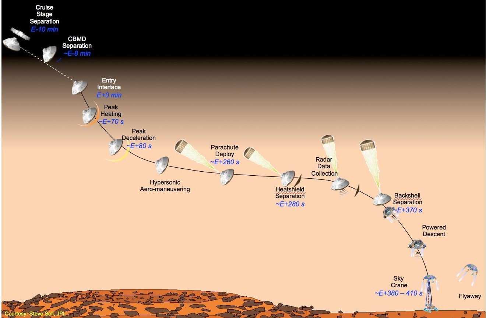
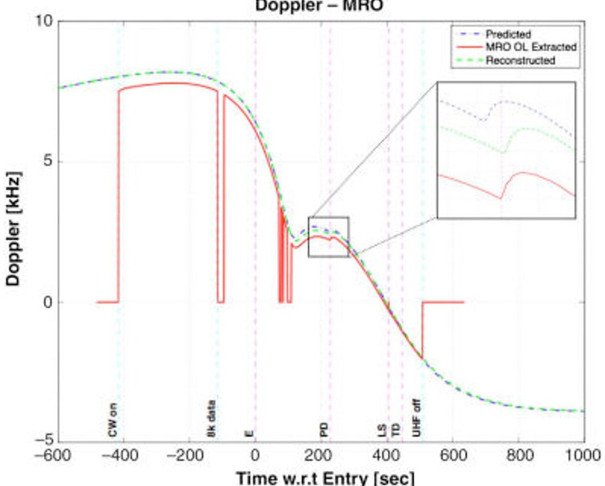
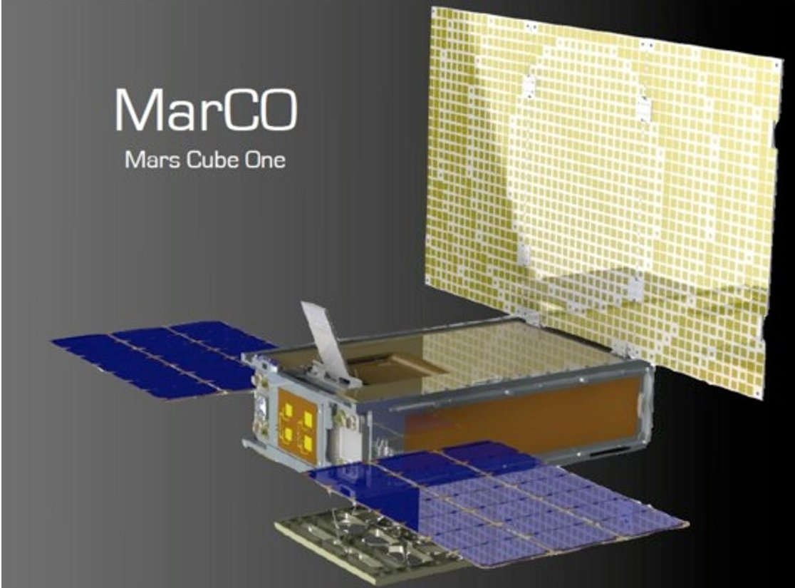
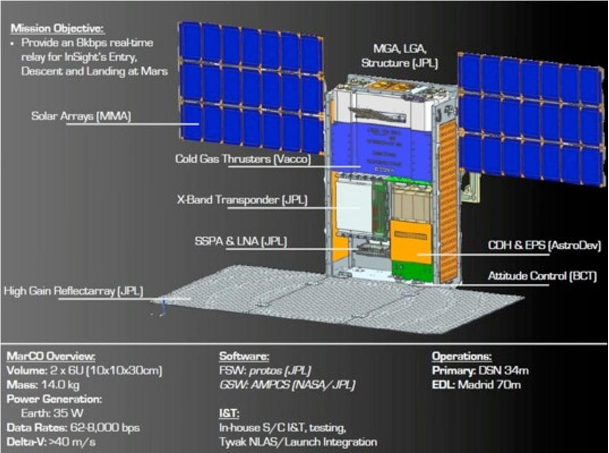
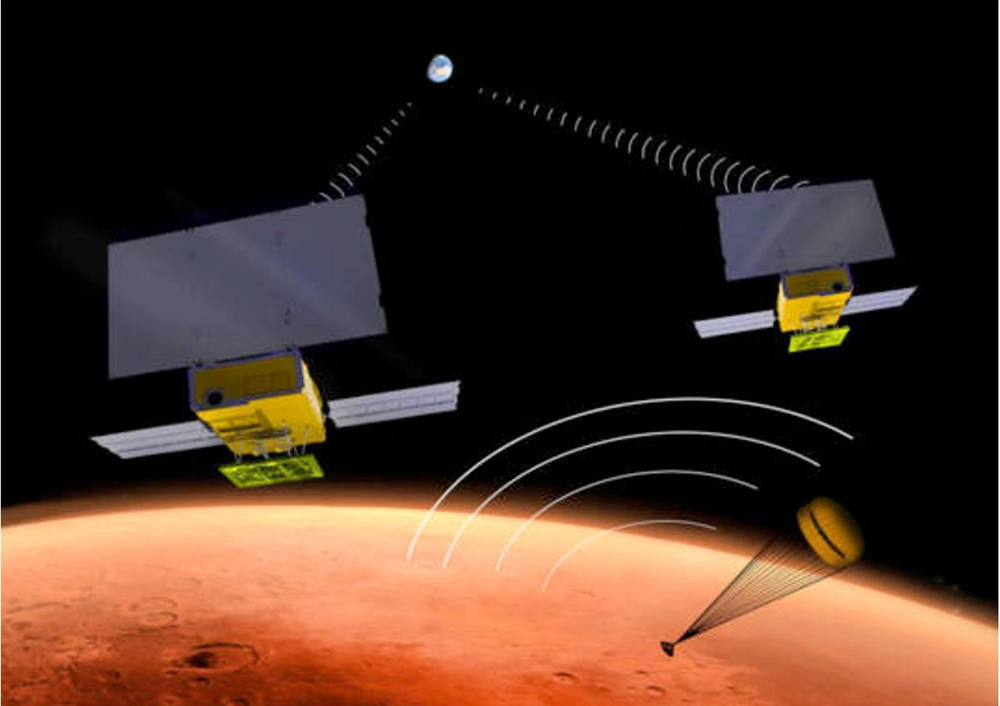

<!-- PDF_PAGE: 1 -->

# Mars Cube One (MarCO) Shifting the Paradigm in Relay Deep Space Operations

Sami Asmar $ ^{1} $ and Steve Matousek $ ^{2} $ Jet Propulsion Laboratory, California Institute of Technology, Pasadena, CA 91109, USA

A very significant challenge in planetary missions' design and operations is communications with ground control teams during critical events and highly risky maneuvers. These events include entry, descent, and landing (EDL) and orbit insertion, which should not be carried out in the blind - without at least downlink communications. Although vast planetary distances and long round-trip light times disallow real-time intervention from controllers, acquiring the relevant performance parameters in near realtime can be imperative for determining the corrective actions needed immediately following the critical event or, in the case of significant anomalies, aid in the diagnostic efforts. During several previous Mars missions landing events, and the Huygens probe landing on Titan, the communications strategy relied on proximity links to planetary orbiters, which then relayed the data to the Deep Space Network (DSN). A second back-up and parallel method was the successful attempts to receive the signal carrier directly at Earth, often using large radio telescopes when the wavelength was outside the DSN's reception bands. This Direct-to-Earth (DTE) method was only possible due to special techniques utilizing the DSN's open-loop receivers. In every case, picking up the signal during EDL was very challenging since the lander's link budget was designed for proximity relay via a local orbiter and not for distances across the solar system. Not all future missions can rely on the presence of preexisting orbiters at their planetary targets to relay their critical data and, furthermore, most missions would not likely have the resources to implement a reliable DTE link at acceptable data rates. A new method is introduced here that increases the chances of communications success. With the advent CubeSats, one or more of them can be launched with the primary mission, travel to the planetary target, be positioned to view the critical event, and carry out real-time relay of the data to the DSN at acceptale rates. CubeSats have flown in the Earth environment but not in deep space, so careful design as well as flight experience are needed. The relay function requires the possible development of new radios and antennas to meet challenging specifications due to the low mass, size, and power. After an initial technical demonstration of the concept and gaining operational experience, the cost can decrease as systems become more standardized and the reliability increases. This paper describes the invention of the "carry your own relay" concept and the formulation of a mission likely to be the first planetary CubeSat mission called Mars Cube One (MarCO). It also describes the operational concept of relay via small spacecraft and their significant role in reducing mission risk as well as overall mission cost.

## I. Introduction

FOR a space mission intended to land on the surface of another planet for scientific exploration, the mission phase called Entry, Descent, and Landing (EDL) is the most risky of all mission phases, sometimes called the seven minutes of terror by control teams. NASA has landed several spacecraft on the surface of Mars using different EDL technologies from Viking's entry from orbit to Curiosity's direct entry $ ^{1} $ . For each case, the spacecraft arrives at high speed to the top of Martian atmosphere marking the end of the cruise phase and the start of EDL phase, where the speed is significantly reduced and a complex sequence of events follows until touch down. Due to the

<!-- PDF_PAGE: 2 -->

long round-trip light time between the spacecraft and ground controllers, mission teams rely on pre-programmed sequence execution without human interference and only monitor the resulting actions. Such monitoring requires near real-time communications from the landing vehicle to the ground stations either via a relay to an over-head orbiter, directly to Earth, or both. The Direct-To-Earth (DTE) method branches into two different techniques, telemetry and carrier-only, as will be discussed below. Figure 1 shows an example of the type of EDL events using the latest lander on Mars, Curiosity $ ^{2} $ . It shows the complexity of events and the high dynamics undergone by the spacecraft, which translate into challenges in the communications techniques.

Figure 1. The Entry, Descent, and Landing sequence of event for the Curiosity Mars rover, which landed in 2012. This illustrates the risky and complex sequence as well as high dynamics, which lead to a challenge in the communications during this period.

## II. Relay Communications for Mars Landers

To date, seven NASA spacecraft have successfully landed on the surface of the red planet: Viking 1 and 2 in 1976, Mars Pathfinder in 1997, Spirit and Opportunity in 2004, Phoenix in 2008, and Curiosity in 2012. The next planned landing is ESA's ExoMars Schiaparelli module from orbit in the Fall of 2016 and InSight direct entry in the Fall of 2018. Other planetary landers in recent history include ESA's Huygens probe that touched down on the surface of Titan, Saturn's largest moon, in 2005.

For recent Mars cases, Mars orbiters such as Mars Odyssey, the Mars Reconnaissance Orbiter (MRO), or Mars Express (MEX) participated in relay communications and enabled the delivery of telemetry to Earth after the completion of the event. For example, as described by Kornfeld et al. $ (2008)^{3} $ , the Phoenix mission utilized an Xband ( $ \sim 8.4 $ GHz downlink) communication system with the DSN from launch until arrival at Mars. A few minutes before it arrived at the atmospheric entry point, about 125 km above the surface, the spacecraft separated from its cruise stage and, five seconds later, started transmitting via its Ultra High Frequency (UHF) transceiver to the relay orbiters. It then turned, as planned, to the entry attitude and entered the Martian atmosphere with an inertial entry velocity of approximately 5.6 km/s. 123 seconds after entry, the spacecraft experienced its peak deceleration of 8.5 Earth g. Subsequent events included the parachute deployment, jettisoning of the heat shield, landing leg deployment, then activating the radar prior to the terminal descent and touchdown. The communications challenge is clear from the extreme velocity dynamics as well as the spacecraft shedding components and having to switch to new antennas.

<!-- PDF_PAGE: 3 -->

Phoenix started transmitting a UHF carrier-only signal a few seconds after separation as the orbiters were configured for the mode, sometimes called open-loop, where the signal is sampled and recorded without a receiver lock. The raw samples are transmitted to Earth via the X-band communications link for post-processing by the operations teams. Phoenix transmitted telemetry at a rate of 8 kbits/s until after the parachute deployment where the rate was increased to 32 kbits/s. Figure 2 shows the Phoenix EDL signal profile relayed via $ \mathrm{MRO}^{3}. $ This demonstrates a successful case where the relay communications worked as planned, as it has also worked for other Mars landers. In most cases, as discussed below, a back-up method was put in place in case of anomalies or long delays with the relay method.

Figure 2. The Doppler profile of the EDL sequence of the Phoenix mission as captured and relayed through the MRO spacecraft in 2008.

## III. Direct-to-Earth Communications for Mars Landers

The term DTE typically implies the communications of data (bits and digital files), which is the normal communications method for the vast majority of solar system missions. However, in the context of EDL communications, the link budget is not sufficient to transmit data. The carrier is received and characterized by itself and mined for very important information communicated in the form of a Doppler profile. When the Mars Pathfinder small rover landed on July 4, 1997, relay communication was not an option. Also not an option was the DTE link with telemetry modulation due to the very low link margin. The mission managers were concerned about landing in the blind and needed an alternate solution. Our team at the time (led by the late Gordon Wood) innovatively came up with the concept of semaphores $ ^{4} $ superimposed on the carrier for confirming the execution and timing of key sequenced events. During EDL, semaphores were constructed by switching between two selectable rover subcarrier frequencies; but once on the spacecraft had reached the surface and the dynamics were eliminated, additional semaphores were produced by turning on and off an un-modulated X-band carrier. Our team determined that the link margin enabled, barely, the reception of the X-band signal carrier at the Spain DSN 70-m diameter station but did not allow for any telemetry modulation. A communications strategy was developed based strategically on DSN open-loop recording of the carrier along with appropriately timed semaphore sub-carrier signals that could corroborate key events of the lander's arrival. Normal closed-loop signal lock-up and tracking would not be possible for the expected received signal-to-noise ratio (SNR) as described in the reference $ ^{4} $ . With this method, the DSN open-loop recorded signal would enable confirming sequence execution in real time plus one-way light time, to the delight of mission managers, as well as enable post-event post-construction of the flight path from a Doppler profile.

<!-- PDF_PAGE: 4 -->

With the success of this method, it has become common practice to utilize signal carrier reception and characterization using ground stations during EDL either as a prime or a back-up method, although often on bestefforts basis because it could not drive the design of the mission. The ground stations were often not DSN stations when the signal to be captured at Earth was a UHF signal since the DSN does not operate in the UHF band. Instead, large radio telescopes worldwide, such as the Green Bank Telescope, Parkes radio telescope and others; future missions plan to utilize the Effelsberg radio telescope and Giant Metrewave Radio Telescope $ ^{5} $ . The Curiosity mission was large enough to enable multiple methods: relay via an orbiter, DTE X-band link to the DSN, as well as ground radio telescope reception of the UHF relay at Parkes in Australia. The latter process was essentially eavesdropping on the conversation between Curiosity and MRO but picking-up carrier-only due to link limitations and judging that the carrier Doppler profile provides sufficient information to evaluate the progress of the EDL sequence. Furthermore, the concept of semaphores grew into communications of critical events by "tones" for other missions. This concept is now also planned for the Jupiter orbit insertion phase of the Juno mission.

## IV. CubeSat Relay Concept And the MarCO Mission

When preparing for the InSight mission EDL at Mars, originally planned to occur in 2016 and is currently planned for 2018, our team was called upon to implement a DTE best-efforts approach to pick up the UHF carrier as was done with Phoenix, since the InSight spacecraft bus is inherited from the Phoenix bus. Work proceeded to make arrangements with large radio telescopes as has been done in the past. This time, however, new ideas and technologies have evolved since the Curiosity EDL to create a new concept. The advent of CubeSats commonly utilized at universities and launched for short duration mission in the Earth environment was a big factor. CubeSats, however, have never been flown in deep space or towards planetary targets. Among other limitations to achieve sufficiently distant deep space missions was the communications system. A CubeSat-sized transponder had not existed and X-band antennas as well as power amplifiers were also too big. However, JPL had breakthroughs in these areas in recent years. JPL prototyped a CubeSat-specific transponder called Iris $ ^{6,7} $ initially intended to fly on the INSPIRE mission. This opened up the possibility of exploring a Mars CubeSat mission. Our formulation team studied the concept and documented a feasible spacecraft for management to secure funding. The mission is named Mars Cube One (MarCO).

The concept is to launch multiple identical CubeSats with specific communications capabilities on the InSight launch rocket. They would separate from the launch vehicle in Earth orbit shortly after the InSight spacecraft is separated and begins its half-year cruise phase to Mars. The CubeSats would then begin their own cruise-phase to Mars to arrive at the same time. The concept is based on independently flying to Mars as opposed to being carried by InSight in order not to impact the design of InSight spacecraft and essentially be an independent demonstration of a new technology; this includes independent navigation and trajectory correction maneuvers. Since this would be the first CubeSat in deep space experience, sufficient redundancy was needed. The size limitations for each spacecraft prevent component redundancy, so spacecraft redundancy was chosen and four spacecraft were proposed. Due to cost, it was decided to build and launch two identical and redundant spacecraft, MarCO-A and MarCO-B. Only one was needed to accomplish the mission, namely to act as a relay satellite at Mars at the time of the InSight EDL.

Since InSight would transmit a UHF signal to MRO during EDL, MarCO needed to receive the UHF signal and simultaneously transmit the data via an X-band link to the DSN. This required that MarCO carry a UHF antenna and an X-band antenna as well as a transponder capable of receiving UHF and receiving/transmitting at X-band. The Iris radio needed to be modified to provide these capacities and Iris v2 was completed in time - the development of the Iris radio for INSPIRE and a second generation for MarCO enabled many deep space missions to be proposed subsequently and many CubeSat missions planned to be launched with EM-1 will utilize Iris. In addition, JPL antenna engineers developed a wire loop deployable UHF antenna to be placed on the side of the spacecraft facing Mars during EDL and a new flat array X-band antenna on the side facing Earth during EDL. Figures 1, 2, and 3 show the spacecraft design as well as the envisioned operational scenario at Mars.

The solar-powered MarCO 6U spacecraft carry batteries as well as fuel for trajectory maneuvers and attitude adjustments. There is no scientific payload and the mission is expected to live only through the cruise phase and the few minutes of EDL relay. MarCO would not enter Mars orbit. Their altitude at the time of EDL is between 3000 and 4000 km above the Martian surface selected for UHF link budget considerations as well as mission design.

The MarCO spacecraft are complete and ready for launch. Future publications by the engineering teams can detail the design. The delay in InSight launch by two years means that the CubeSat relay technology demonstration is also delayed by two years, but they would remain the first Mars CubeSats. With their implementation, the

<!-- PDF_PAGE: 5 -->

concept of "carry your own relay" can be utilized by all future missions with such needs. This eliminates the dependency on existing orbital assets. In the case of InSight, the existing assets, though functional, were aging.

Figure 3. An artist image of the Mars Cube One spacecraft, a 6U CubeSat with deployable solar panels and deployable UHF antenna (below, not visible) and flat X-band antenna (yellowish) $ ^{8} $ .

Figure 3. Selected design parameters published on the MarCO spacecraft $ ^{8} $

<!-- PDF_PAGE: 6 -->

This low-cost relay solution provides several key strategic advantages to NASA by reducing risk to future landed missions and paving a path to future small spacecraft for scientific exploration and engineering applications, advances the innovation and engages the public and students interest.

Figure 3. An artist drawing of the Mars Cube One spacecraft in the operations phase anticipated for the Fall of 2018. MarCO would be positioned about 3500 km above the Martian surface in view of the EDL of the InSight spacecraft and would receive the UHF signal transmitted by InSight to an orbiter then relay it in real time at X-band to the $ \mathrm{D S N}^{8}. $

## V. Conclusion And Future Outlook

The innovative concept of carry your own relay for future deep space and planetary missions reduces mission risk significantly at critical phases at low cost. It is expected to become common practice after the initial demonstration of the technology enabled via advances in CubeSats and radio communications systems.

Future concepts being examined for applications of MarCO-like planetary missions is Radio Science experiments $ ^{9} $ . Spacecraft-to-spacecraft links, also known as crosslinks, can be enabled by two or multiple CubeSats around a planet to utilize radio occultations of the atmosphere for profiling the ionosphere and neutral atmosphere as well as examine surface scattering from the planet to characterize its material and electrical properties. The concept of crosslink radio occultations has been demonstrated between the Odyssey and MRO spacecraft and simulations show significant advantage in global coverage and SNR with two MarCOs around Mars. It is expected that other scientific breakthroughs would be possible with this method.

## Acknowledgments

The work described in this paper was carried out at the Jet Propulsion Laboratory, California Institute of Technology, under contract with the National Aeronautics and Space Administration.

<!-- PDF_PAGE: 7 -->

## References

$ ^{1} $Korzun, A. M., Cruz, J. R., & Braun, R. D. (2008, March). "A survey of supersonic retropropulsion technology for mars entry, descent, and landing," Aerospace Conference, 2008 IEEE, 2008, pp. 1, 15.

$ ^{2} $Asmar, S. W., Oudrhiri, K., Kahan, D., Esterhuizen, S., Sarkissian, J., Jackson, S., Preisig, B., Karatekin, O., and Griebel, H., "Curiosity's Landing Dynamics as Observed at the CSIRO Parkes Radio Telescope," International Planetary Probe Workshio IPPW-10 San Jose, CA, June 2013.

$ ^{3} $Kornfeld, R. P., Bruvold, K. N., Morabito, D. D., Craig, L. E., Asmar, S. W., and Ilott, P. A., "Reconstruction of Entry, Descent, and Landing Communications for the Phoenix Mars Lander," Journal of Spacecraft and Rockets, 48(5), 2011, pp. 822, 835.

$ ^{4} $Wood, G. E., Asmar, S. W., Rebold, T. A., and Lee, R. A., "Mars Pathfinder entry, descent, and landing communications," The Telecommunications and Data Acquisition Progress Report 42-131, July-September 1997, pp. 1, 19.

$ ^{5} $Asmar, S., "Communicating by Doppler Detecting Spacecraft Dynamics During Critical Maneuvers," $ 12^{\mathrm{th}} $ SpaceOps Conference, Stockholm, Sweden, June 2012.

$ ^{6} $Duncan, C., Smith, A., & Aguirre, F. (2014). Iris Transponder-Communications and Navigation for Deep Space.

7 Aguirre, F. H. (2015, March). X-Band electronics for the INSPIRE Cubesat deep space radio. In Aerospace Conference, 2015 IEEE (pp. 1-10). IEEE.

$ ^{8} $Kane, V., Planetary Society Blog, URL: http://www.planetary.org/blogs/guest-blogs/van-kane/0708-marco-planetary-cubesats.html [cited 30 March 2016].

$ ^{9} $Asmar, S., Ao, C., Edwards, Jr., C., Kahan, D., Pi, X., Paik, M., and Mannucci, A., "Demonstration of Mars Crosslink Occultation Measurements for Future Small Spacecraft Constellations," IEEE Aerospace Conference, Big Sky, MT, 2016.