<!-- PDF_PAGE: 1 -->

# Architecture Modeling on the Europa Project

Gregory F. Dubos $ ^{1} $ , Samuel Schreiner $ ^{2} $ , David A.Wagner $ ^{3} $ , Grailing Jones $ ^{4} $ , Alek Kerzhner $ ^{2} $ , Justin Kaderka $ ^{2} $ Jet Propulsion Laboratory, California Institute of Technology, Pasadena, California, 91109

In 2015 NASA chartered a partnership between the Jet Propulsion Laboratory (JPL) and the Johns Hopkins Applied Physics Laboratory (APL) to begin planning a mission to study the Jovian moon Europa. The project has adopted a Model-Based Systems Engineering (MBSE) approach to its architecting process since its early formulation, developing certain modeling practices and tools as needed, with the expectation that this process would result in a more consistent and verifiable architecture than with a more traditional document-based approach. A sound architecture is essential to provide the rationale for requirements on the system design, and to define the trade space of acceptable design points within which technical and programmatic concerns as well as project objectives can be addressed.

This paper provides an overview of the framework used by the Europa project to describe the mission architecture and discusses how a system model was instrumental in providing a single-source-of-truth for this description. Several key modeling patterns to represent the architecture are presented, along with audit methods to ensure the consistency and the correctness of the model. Finally, the benefits and challenges of using a model-based approach to generate traditional requirements documents and other gate products are assessed.

## Nomenclature

AFID = Architecture Framework Identifier

C2R = Concept-to-Realization

FS = Flight System

GNC = Guidance, Navigation and Control

JOI = Jupiter Orbiter Insertion

MBSE = Model-Based-Systems Engineering

MOS = Mission Operations System

SSoT = Single-Source-of-Truth

SysML = Systems Modeling Language

WBS = Work Breakdown Structure

## I. Introduction

In 2015 NASA chartered a partnership between the Jet Propulsion Laboratory (JPL) and the Johns Hopkins Applied Physics Laboratory (APL) to begin planning a mission to study the Jovian moon Europa. Europa is covered in water ice, and believed to harbor an ocean of liquid water below the ice that could potentially support life. The mission is currently in the specification phase of its lifecycle with an anticipated launch in the early 2020s. The spacecraft is projected to arrive at Europa later that decade and its main objective is to assess the habitability of the Jovian moon.

The planned Europa mission faces many complex challenges and will require extraordinarily careful planning to ensure success. The project has adopted a Model-Based Systems Engineering (MBSE) approach to its architecting process since its early formulation, developing certain modeling practices and tools as needed, with the expectation

<!-- PDF_PAGE: 2 -->

that this process would result in a more consistent and verifiable architecture than with a more traditional document-based approach. While formal modeling techniques have largely grown out of domain-specific analyses (e.g. mechanical and electrical CAD), systems engineering has been slower to adopt model-based techniques in part because its scope necessarily spans multiple technical domains. It is up to the system architecture to reconcile disconnects or incompatibilities between those domain-specific analyses that intentionally abstract away details they are not directly responsible for. More importantly, a sound architecture is essential to provide the rationale for requirements on the system design, and to define the trade space of acceptable design points that address technical and programmatic concerns as well as project objectives.

This paper provides the next chapter in a series of reports on the progress of the use of a model-based approach to perform systems engineering and architecting of the Europa project $ ^{1,2,3} $ . First, the paper discusses the need for properly describing a mission architecture and provides an overview of the framework used on the Europa project to capture this description. Section III then highlights the importance of keeping a single-source-of-truth in the form of a system model that captures the various elements, relationships, constraints and requirements composing the architecture, so that the information remains correct and consistent. Specific architectural patterns, such as those for constraints, requirements, and their traceability, are then presented in further detail in section IV. Section V describes how the usage of such well-established patterns enables audit activities on the architecture model in order to not only ensure that the information is captured correctly and completely, but also to check that the overall set of elements and relationships remains consistent. In section VI, the benefits and challenges of using a model-based approach to generate traditional requirements documents and other gate products are assessed. Finally, the paper concludes with a summary of the lessons learned from using a system model to capture the mission architecture on the Europa project.

## II. Overview of the Europa Architecture Framework

## A. What is a System Architecture?

In the context of systems engineering, an Architecture refers to the fundamental organization of the system (i.e. functionality, composition and relationships), its relations to the environment and the bounding set of constraints on designs that would be acceptable for a particular purpose. In a simple sense, the architecture includes the requirements specifying a system along with the context needed to explain those requirements. For a given system, we distinguish the architecture from the system design which represents the response to the requirements specified by the architecture.

The primary purpose of the system architecture is to decompose the system into implementable subunits around boundaries that most effectively enable parallel development. But it must also ensure that the over-arching mission objectives are achievable using that system. To that end, the architecture must have certain properties. The architecture must:

1. Clearly and quantitatively capture the system objectives;

2. Specify the functional components of the system including elements that must be developed, or used to perform essential functions, including operational teams and implementing organizations;

3. Identify the environments and other "external" conditions in which this system must operate; or in the case of science missions, environments we intend to study;

4. Identify a work breakdown, organization, and plan to ensure successful implementation, test, and operation;

5. Identify the essential properties of the elements, and the driving interactions (state effects) between them in order to relate objectives to performance;

6. Specify the analyses that prove that the objectives are achievable.

Traditional document-based architectures will typically address all of these areas, but will have difficulty ensuring consistency, and completeness between documents. That makes validating the system performance against objectives all the more challenging. Items 5 and 6 strive to quantify all requirements and performance, and relate them in objective analyses that can be run continually through the development process to assess achievability. Achievability analysis must take into account appropriate uncertainty and probabilistic models to demonstrate achievability within a given margin of error or confidence.

## B. The Europa Architecture Framework

The Europa Architecture Framework $ ^{4,5} $ developed by the Europa Project Architect Robert Rasmussen is a set of guiding principles and patterns that the project used to guide the development of its architecture description. It is

<!-- PDF_PAGE: 3 -->

comprised of a number of categories of information relevant to systems engineering and their interrelationships. It uses ISO/IEC/IEEE $ 4 2 0 1 0^{6} $ as a point of departure, sharing a number of key concepts and definitions with this established standard.

In this framework, the system Architecture is described by an Architecture Description, which is comprised of a number of Views. Each View is a description of the Architecture addressing a Concern held by one or more identified Stakeholders and conforms to a particular Viewpoint. Concerns are comprised of Success Criteria, which ultimately provide metrics of suitability for the system solutions that will realize the architecture. Each Concern is addressed by a number of Views featuring the elements, relationships and properties pertinent to that particular Concern's set of Success Criteria, as illustrated in Figure 1.

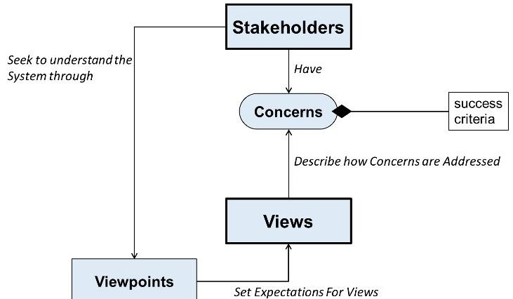

Figure 1. Stakeholder Concerns addressed through Views

The Europa Architecture Framework goes on to further extend the basic metamodel described in ISO/IEC/IEEE $ 4 2 0 1 0^{6} $ by adding a number of elements, properties and relations important to systems engineering. In essence, it is intended to be a systems engineering metamodel, providing a shared set of concepts and definitions for the diverse body of project systems engineers to describe, deliberate and deliver architecture-related products over the project life cycle.

## C. Concepts and Realizations

In addition to the right metamodel, appropriate organizing principles for structuring the elements and relations of our architecture model were also needed. The first impulse would simply be to model the elements of the system and apply properties directly to those elements. In a small model implemented by one or two people, this might result in a consistent set of properties. In a system with thousands of parts, tens of thousands of properties, and hundreds of people involved in specifying them, this process becomes much less tractable. The Europa Architecture Framework leverages the aspect-oriented design approach from software engineering $ ^{7} $ to separate the conceptual definitions of properties and analyses from the specific real elements that compose the system. For example, the concept of a Power Load is defined once as a model aspect and then applied to any system component that consumes electrical power. This ensures a consistent definition of load properties and interfaces across the system, and the work of defining the aspect need be done only once. The real components of the system thus acquire most properties through this "realization" relationship with a conceptual aspect or prototype. We implemented this separation by using Conceptual and Realizational views.

Concepts or Conceptual Views provide higher level, abstract, design-independent descriptions of the system-tobe and are closely aligned with Concerns. In the spirit of separating concerns, they typically address one specific topic (e.g. "Observation Strategy", "Data Transport and Management", "Fault Tolerance", "Risk Management", etc.). These views promote the exploration of the solution space in terms of the desired outcomes (the "whys") without prematurely encumbering the architects with direct consideration of the design (the "hows"). The Concepts tend to be organized around traditional analytical abstractions, which in turn map closely to engineering disciplines such as electrical power, propulsion, thermal analysis and data management.

Realizational Views are sets of views which collectively explain how the Concepts converge into a realizable system. Realizational views describe how the many points of view articulated through separate Concepts converge on single elements that can be produced/delivered. These elements comprise a "catalog" of items that can be included in any of the point designs of the solution space specified by the architecture, such as "High Gain

<!-- PDF_PAGE: 4 -->

Antenna", "Mass Spectrometer", "Avionics Flight Software", "Flight System Testbed", or "Mission Design and Navigation Team". Realizational views also explain why particular Realizational elements were selected, as well as the implications of that selection.

## D. Concept Structure and Hierarchy

In addition to addressing Stakeholder Concerns, Conceptual Views also may address issues raised by higherlevel concepts. These higher-level issues are communicated to lower-level concepts as Derived Constraints. Derived constraints are assertions on the architecture that must be true in order for the approach described by a concept to work. The existence of incoming derived constraints from a concept makes the higher level concept a Parent to the receiving concept (the Child concept).

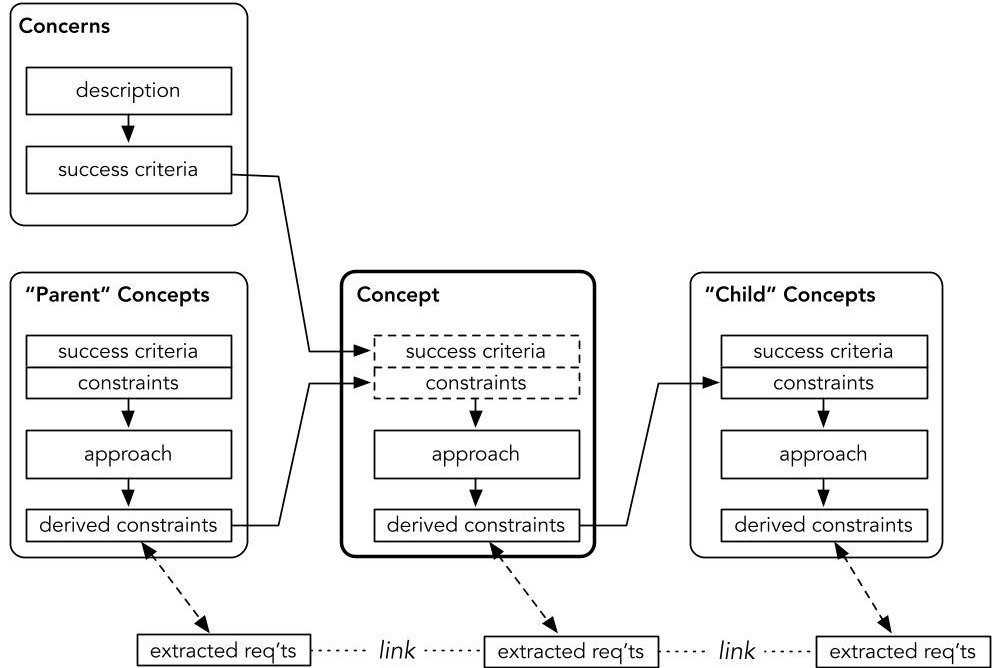

Figure 2. Conceptual View internal structure and Hierarchy [Adapted from Ref. 8]

Concepts address incoming issues (both success criteria from stakeholder concerns and derived constraints from parent concepts) by describing a general approach to dealing with the incoming issues. This general approach begins in the form of text narrative and is subsequently elaborated in descriptions of functions, performing conceptual elements, and behaviors of a general approach to satisfying the set of incoming issues to the concept. The approach specification also results in a set of derived constraints which are in turn referred to selected child concepts for elaboration in their approaches. The concepts form a hierarchy consistent with the hierarchy of concerns that the architecture responds to. The resulting concept hierarchy is represented as an acyclic graph flowing from top-level parent concepts to sets of attendant child concepts, as illustrated in Figure 3.

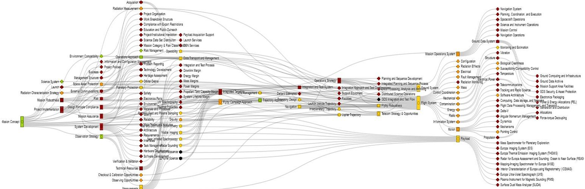

Figure 3. Overview of the Europa Project Conceptual View Hierarchy

American Institute of Aeronautics and Astronautics

<!-- PDF_PAGE: 5 -->

Issues and the specifications elaborating them become progressively fine-grained as one moves from the higher concepts (leftmost in Figure 3) to the lower tier elaborating child concepts (e.g. the highest level concept - Mission Concept - is shown on the left; the lowest level concepts are shown towards the right). The specifications generated by this process lend themselves easily to visualization techniques such as the example in Figure 3, which is a snapshot of the current Europa concept hierarchy. Each node represents a single concept, and a branch between nodes denotes that one or more derived constraints pass from a parent concept to a child for elaboration. Such visualizations have provided systems architects with valuable insights as to the present and evolving state of the architecture $ ^{9} $

## E. Realizational Views and Requirements

Realizational Views describe how the parallel specifications of elements from the concepts result in a single Realizational element imbued with the complementary specifications from each applicable concept. Elements from concepts may be realized by any number of Realizational elements. In the example in Figure 4, two Concepts (Electrical Power and Mass) independently make assertions as to the existence of conceptual elements (Battery and Inertial Body) in their respective approaches. Each of these conceptual elements is characterized by one or more properties (Battery has Charge and Inertial Body has Mass). In the Electrical Power Concept, Battery is related to the function Store Electrical Energy. This relationship serves to justify the existence of Battery in the specification as it performs a function, which in turn is related to satisfying the concern(s) addressed by the Electrical Power Concept. The two conceptual elements are realized by a Real Battery, which inherits the superset of specifications from the two realized conceptual elements. The Realizational view of Real Battery goes on to explain how the specification of Real Battery realizes the conceptual elements and the implications of it doing so.

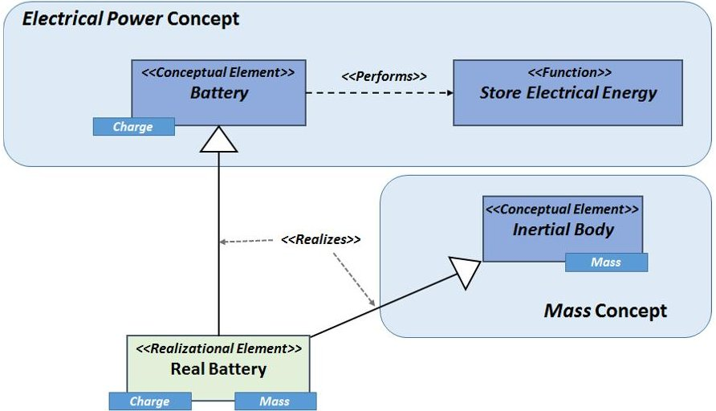

Figure 4. A real battery "realizes" properties from conceptual aspects

Requirement in our framework has the same definition as promulgated by the International Council on Systems Engineering (INCOSE). Requirements are derived by analysis of derived constraints and levied on Realizational (as opposed to Conceptual) elements. A Requirement is a specification that is authorized by a Work Package from the project Work Breakdown Structure (WBS) and must be satisfied by any acceptable design.

Conceptual constraints serve as a means of discovering Requirements and also provide rationale for Requirements. While conceptual constraints originate from multiple areas or disciplines (i.e., conceptual views), they ultimately are reconciled in realization space into actual Requirements that represent a binding agreement (i.e. a "shall" statement) between an Authorizing and Implementing Workpackage from the WBS regarding the thing that will be built/delivered (see Figure 5). The traceability of Requirements to Constraints provides a path of rationale by linking the Realizational element delivered (the "what") to the Conceptual Elements realized and ultimately back to the original Concerns of the Stakeholders.

<!-- PDF_PAGE: 6 -->

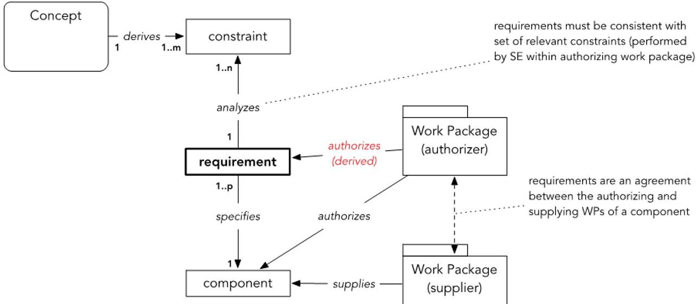

Figure 5. Requirements from Constraints [adapted from Ref. 8]

The following example illustrates how multiple constraints may be turned into one final requirement specified on a component of the architecture:

a. One constraint derived from the Operations Approach concept may require the Flight System to autonomously achieve and maintain a power-positive, thermally safe, and commandable state without requiring action from the Mission Operations System (MOS) for $ N_{ops} $ days in the event of a Flight System fault occurring during the Jupiter tour. This constraint can be traced back to to the planned ground contact frequency discussed as part of the Operations Approach concept.

b. On the other hand, the existence of solar conjunctions during which the Flight System cannot communicate with the Earth may provide a similar but different constraint on the autonomous maintenance of a safe state by the Flight System. Such constraints related to geometric considerations, e.g. a maximum of $ N_{sol.conj} $ days of solar conjunction, would be discussed in the Jupiter trajectory concept.

c. Ultimately, one requirement that will be levied on the Flight System during the Jupiter tour would reconcile these two different constraints coming from different concepts (taking the maximum duration $ N_{Jup.safe}=\max(N_{ops},N_{sol.conj}) $ in this case) and could read for example:

"Given any single fault condition occurring on the Flight System after completion of the autonomous launch activities and until JOI critical activities, the Flight System shall autonomously achieve and maintain a power-positive, thermally safe, and predictable communications-enabled state without requiring action from the Mission Operations System for at least $ N_{Jup.safe} $ days."

As illustrated in Figure 6, the realizational view describes the realizational element and lists the conceptual elements it realizes as well as the applicable derived constraints on the realized element "inherited" from the conceptual elements. In addition to constraints applied to the conceptual elements, the realizational view also lists constraints on the realizational element due to practicalities of realization (such as allowances) which are not considered in the individual concepts. Systems architects and engineers can then use an element realizational view to assess how conceptual constraints should become actual requirements on the real element (hardware, software, team, etc.).

<!-- PDF_PAGE: 7 -->

## 1. Definition

Realizational Element

<table border="1"><tr><td>Name</td><td>AFID</td><td>Description</td><td>Supplier</td></tr><tr><td>Stellar Reference Unit</td><td>RE100.201</td><td>Sensor used to measure basebody orientation with respect to star field.</td><td>06.10 GNC Subsystem</td></tr></table>

Composite parts

<table border="1"><tr><td>Role Name</td><td>Type</td></tr><tr><td>SRU Internal Structure</td><td>Structure</td></tr><tr><td>...</td><td>...</td></tr></table>

Elements with functional use references to this element

<table border="1"><tr><td>Name</td></tr><tr><td>Vault-Y Panel Assembly</td></tr><tr><td>Nadir Platform Assembly</td></tr><tr><td>...</td></tr></table>

## 2. Conceptual Mapping

<table border="1"><tr><td>Realized Conceptual Element</td><td>AFID</td><td>Conceptual View</td></tr><tr><td>Star Scanner</td><td>CE100.880</td><td>Pointing Control</td></tr><tr><td>Conductive Element</td><td>CE100.171</td><td>Electrical</td></tr><tr><td>Flight Hardware</td><td>CE100.577</td><td>Planetary Protection</td></tr><tr><td>Powered Component</td><td>CE100.668</td><td>Temperature</td></tr><tr><td>Thing With Mass</td><td>CE100.585</td><td>Mass</td></tr><tr><td>GNC Sensor</td><td>CE100.795</td><td>Integration and Test System</td></tr><tr><td>Electrical Assembly</td><td>CE100.285</td><td>Electrical</td></tr><tr><td>...</td><td>...</td><td>...</td></tr></table>

## 3. Mapped Constraints

<table border="1"><tr><td>AFID</td><td>Constraint Name</td><td>Text or Mathematical Expression</td><td>Maturity</td><td>Conceptual Element</td><td>Concept</td></tr><tr><td>CT103.544</td><td>GNC Sensors Alignments</td><td>GNC Sensors shall provide alignment features.</td><td>Prelim(Ready for Baseline)</td><td>GNC Sensor</td><td>Integration and Test System</td></tr><tr><td>CT100.121</td><td>SIT surface cleanliness</td><td>Exposed surfaces of Flight System Components shall be maintained at a biological cleanliness level of N spores/m2or less during integration activities.</td><td>Draft</td><td>Flight Hardware</td><td>Planetary Protection</td></tr><tr><td>CT100.382</td><td>Charge Bleed Path</td><td>All conductive elements greater than Xcm2in surface area or wires longer than Ycmshall have a conductive path to structurewith a resistance less than ZMΩwhen measured in air.</td><td>Prelim</td><td>Conductive Element</td><td>Electrical</td></tr><tr><td>CT100.361</td><td>Bond Straps</td><td>Where direct electrical bonding to the flight system structure is not possible and/orwhere moveable metal-to-metal joints are present, bonding straps of length-to-widthratio of less than k:p shall be employed.</td><td>Prelim</td><td>Electrical Assembly</td><td>Electrical</td></tr><tr><td>...</td><td>...</td><td>...</td><td>...</td><td>...</td><td>...</td></tr></table>

## 4. Requirements

Figure 6. Notional Example of a Realization View for a Stellar Reference Unit (abridged)

<!-- PDF_PAGE: 8 -->

## III. Maintaining a Single-Source-of-Truth for the Architecture Description

While the architecture framework aims at describing a cohesive set of elements, properties and constraints of the system, this effort would be vain if all the different views of the architecture were distributed in multiple local repositories managed by various groups of engineers independently and at different paces. Indeed, the existence of multiple sources of truth to describe the system architecture typically leads to inconsistencies and eventually incorrect information. Furthermore, when rapid changes to the architecture have to be made during the early phases of the project, systems engineers cannot iterate as rapidly as needed, because much effort is required to generate consistent and correct views. In traditional systems engineering approaches, the view consistency and correctness problem is typically managed, but not necessarily mitigated, using file-based configuration and version management, along with manual and laborious consistency checking among the files, as represented in Figure 7.

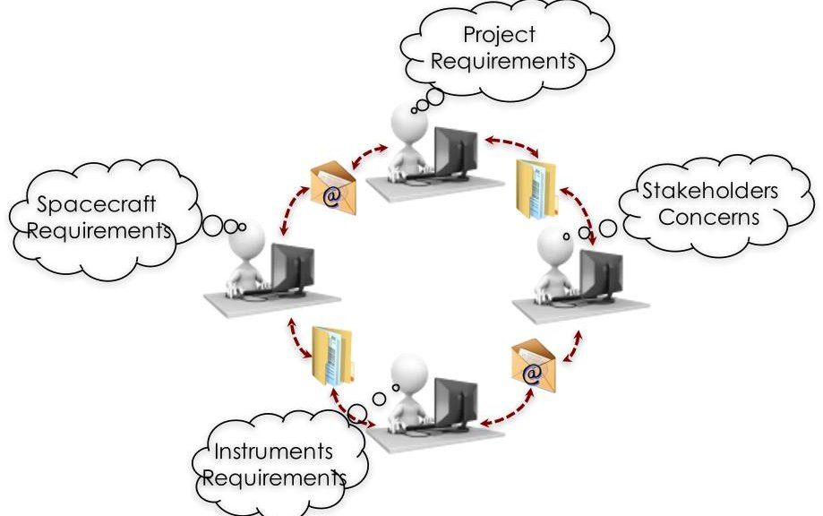

Figure 7. Iterations of the system architecture in the traditional systems engineering practice of maintaining and exchanging information using files and emails.

Theified by the University of California, Berkeley The Europa project $ ^{10} $ has instead been taking a MBSE approach to managing the technical representation of the Flight System $ ^{11} $ and is now extending this methodology to capture the system architecture. The models then become the Single-Source-of-Truth (SSoT) through which no duplication of information occurs.

Any environment considered to capture knowledge about the architecture and serve as the Single-Source-of- Truth must be able to store the information in a queryable form so that the different views can either be automatically generated from the SSoT or checked for consistency with this SSoT. This makes conventional representation environments such as Microsoft Excel, Visio, or PowerPoint ineffective as the information is typically not captured consistently. Our general approach to managing consistency and correctness of the views is by allowing only a Single-Source-of-Truth that is captured as integrated models in a single (but potentially distributed) repository, as illustrated in Figure 8.

Capturing this information in a model required the definition of modeling patterns to formalize the representation and semantics of essential relationships. The Systems Modeling Language $ ^{12} $ (SysML) provides many foundational modeling patterns, but requires specialization to clarify some of the semantics needed to document a system architecture. Using specialized modeling patterns embedded in SysML, elements of the architecture model, such as conceptual components, properties, constraints, and relationships, are captured in a consistent and queryable manner. This architecture model information is then visualized through end-user specific views (e.g. "Mass Spectrometer" view in Figure 8 shows only mass spectrometer information) according to well-defined viewpoints.

<!-- PDF_PAGE: 9 -->

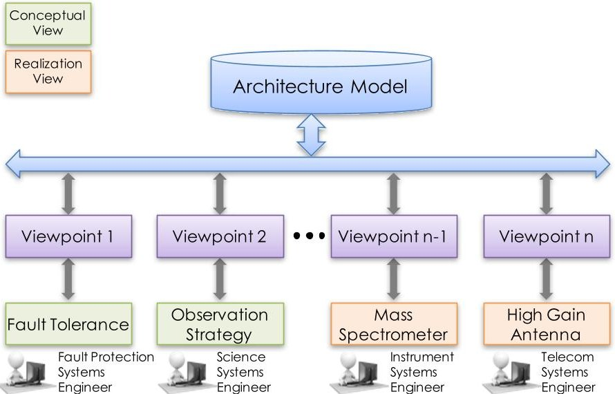

Figure 8. The Architecture Model used as a Single-Source-of-Truth for conceptual and realizational descriptions of the system.

Because a view is merely exposing a set of model information related to a specific domain, it provides an opportunity for the user to directly interact and modify the system model. One such interaction the user might perform is changing an element of a view (e.g. the value of a property). Once performed, this action will change the underlying system model to the new value. Another interaction the user might perform is to cross-reference an element from another view. This system model element would then be exposed by two views. Because a user is now directly interacting with the system model, if the value of this element is changed in one view, its value is automatically updated in the other view. This feature promotes consistency across views and products that are generated from the system model.

## IV. Architectural Patterns

A modeling pattern organizes information contained in a system model by assigning it to distinct model elements and by defining the proper relationships between these elements. Some of the modeling patterns used on the Europa project to capture information about the architecture (such as those defining the relationships between Concepts, Constraints, Elements and Requirements) are listed in Table 1. A subset of the key modeling patterns are described in further detail in this section.

Table 1. Examples of architecture modeling patterns used on the Europa Project (non-exhaustive list)

<table border="1"><tr><td>Pattern</td><td>Description</td></tr><tr><td>Architecture Framework Identifier(AFID)</td><td>Provides an approach to uniquely identify elements in the modeling environment.</td></tr><tr><td>Constraint Allocation Tracking(CAT)</td><td>Tracks the maturity of the agreement between parent concept and child concept of one constraint passed from parent to child.See Ref.13 for more details.</td></tr><tr><td>Constraint Elaboration(traceability)</td><td>Captures constraint traceability inter- and intra-concepts.</td></tr><tr><td>Defined Element</td><td>Captures the definitions for Elements(such as Conceptual or Realizational Components),Properties,but also things that are not specifically identified in the Architecture Framework,such as engineering "Terms"(e.g. "Failure").The pattern also provides a way to store an acronym associated with a particular Element or Term.The Defined Element pattern then supports the creation of local and global glossary,i.e. alphabetized lists of definitions and acronyms.</td></tr><tr><td>Derived Constraint constrains Conceptual Element</td><td>Describes how constraints derived in concepts constrain conceptual elements.</td></tr><tr><td>Maturity</td><td>Tracks the maturity of elements.The meaning of the maturity states(e.g. Identified,Draft,Preliminary,Baseline,Final)are usually agreed upon by the relevant team which can define specific criteria for each level.</td></tr></table>

<!-- PDF_PAGE: 10 -->

<table border="1"><tr><td>Policy</td><td>Describes how to capture a Policy in the realization space and how to link it to a constraint in conceptual space. Whereas a requirement is a limitation or restriction on a property or characteristic of an element, a Policy is more of a constraint on the way an action or process is carried out.</td></tr><tr><td>Realizational Element realizes Conceptual Element</td><td>Captures the relationship between a Conceptual Element and the Realizational Element.</td></tr><tr><td>Stakeholder represents Concern</td><td>Captures the relationship between a Stakeholder and its concern(s). Stakeholders promote and defend the matters that they concern themselves with, which is why the stakeholder not only represents the concern, but also owns it.</td></tr><tr><td>Trade Study</td><td>Describes how to capture a Trade Study, which is the systematic deliberation inside and between concepts on the proper configuration of Architectural elements (Element, Relationship, Property) to meet a stated need when alternatives exist.</td></tr><tr><td>Verification Item verifies Requirement</td><td>Captures verification items (VIs), which are the points of interface between a system engineering&#x27;s requirement and the VnV engineer&#x27;s planning and verification execution information. Each VI currently tracks verification method(s) and a verification approach.</td></tr></table>

## A. Constraints and Requirements

Constraints are derived from analyses in conceptual space and act to constrain conceptual elements, which can be components, data products, properties, etc. Requirements are realizational constructs that are authorized by a work package and specify a realizational element. As conceptual elements are realized into real elements, requirements occur at the intersection of conceptual constraints and the realized elements. For example, a constraint on the conceptual element Flight Hardware should result in requirements on all real elements that realize Flight Hardware, such as the Flight Computer, Solar Arrays, etc. The constraint and requirement pattern is shown in Figure 9.

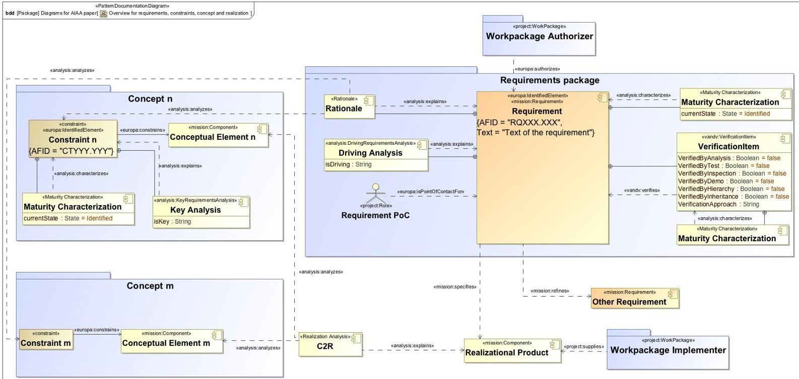

Figure 9. Pattern for capturing constraints and requirements

## B. Constraint and Requirement Traceability

Traceability is a key part of providing the justification for requirements and constraints. By examining the parents and children of a particular requirement, insight can be gained into the requirement's justification and context. As discussed in section II, constraints are derived, or explained, from within a concept narrative in response

<!-- PDF_PAGE: 11 -->

to incoming constraints. The derived constraints are then allocated to an appropriate child concept of the parent concept according to the concept hierarchy. An analysis of the child concept then elaborates the derived constraint from the parent concept, and during this elaboration, additional constraints may be generated and allocated to a child of the child concept. Using this framework, constraints continue to get refined down the concept hierarchy until they are determined to be fully elaborated.

The traceability of requirements can be determined from the union of two sources of information. First, the parents and children of a given requirement can be determined from the parents and children of the linked constraint. This approach utilizes the concept narrative analyses to "tell the story" of the requirements traceability, which can provide context that goes significantly beyond traditional approaches. The second method for capturing requirements traceability involves direct links between a requirement to its parents and children. This approach, while easier to implement and similar to existing techniques, provides less information supporting the assertion of a given requirement's parents and children. These two methods are used in our architecture model to provide information concerning the traceability of requirements and constraints.

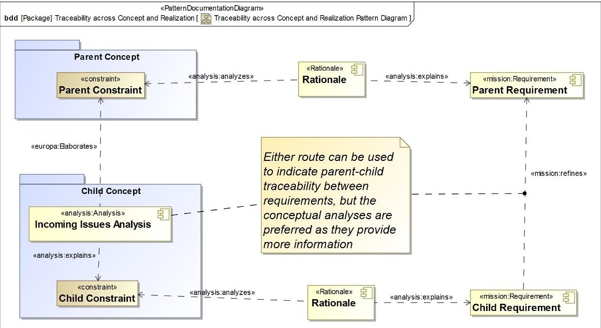

Figure 10. Pattern for constraint and requirement traceability

## C. Maturity Pattern

Tracking the maturity of model elements is critical as the model evolves. Maturity can be used to track how much development and review certain information has received. For example, as the text of a constraint or requirement undergoes review and revision, it can advance to higher maturity levels. Maturity can also be used to track the completeness of a model element. A complete requirement should include text, unique ID, both parents and children, a specified element, an authorizing workpackage, a verification method, etc. The maturity of the requirement can measure the completeness of the element's specification. Any number of different maturity states can be defined, depending on the use case. Figure 11 illustrates the pattern for characterizing the maturity of a given model element. (Note that the 《PatternWildcard》 stereotype simply indicates that any element can be assigned a maturity).

<!-- PDF_PAGE: 12 -->

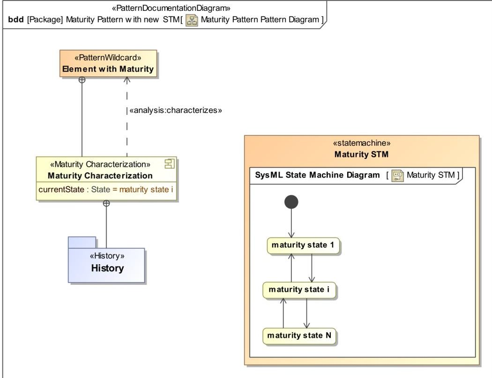

Figure 11. Pattern for capturing the maturity characterization of a given model element.

## V. Auditing the Architecture

As discussed earlier, an objective of model-based architecting is to improve the consistency and correctness of the resulting specification. Previous sections have suggested methods by which the model-based approach helps to avoid simple errors of referential inconsistency through structure or design of the model. Auditing is an active process used to assert and assess rules of consistency in a model. Previous work $ ^{13} $ presented a framework that can be used to evaluate validation rules on the model. This section provides an overview of the audits being performed on the architecture, with:

- Syntactic rules that restrict the kinds of things that can be defined in the model and what kinds of relationships can be expressed. Rules at this level are based on the SysML modeling language, modeling ontologies defined at the project or institutional level, and the embedding of those ontologies into SysML.

- Performance audits that attempt to evaluate analyzing performance of particular point designs against constraints identified in the architecture.

Methods for evaluating such rules are discussed below, given the definition of some key architectural patterns provided previously. In addition to model auditing, the automatic correction of model errors is also discussed.

## A. Evaluating Syntactic Rules

At the core of this model-based architecting approach is the notion of defining a single model element with a single definition to represent each subject of specification, and then using these elements by reference when referring to that subject. While this requires effort upfront to identify common subjects and agree on their definitions, it provides the strongest possible guarantee of consistency from that point forward.

A large number of ambiguities arise from incompleteness of specification within the model. Finding such ambiguities in a model is often a matter of matching elements against established patterns. For example, every requirement should specify one thing. A requirement in the model lacking a specifies relation to something is relatively easy to locate. Similarly, given the definition of a pattern describing how a Component performs a Function, various queries can be performed to validate the architecture, such as finding Components that perform no Functions; finding Functions performed by elements that are not defined as Components; or finding Functions with more than one performing Component.

Syntactic rules should ideally be evaluated during model construction. Software developers have learned that it is far less painful to be informed of errors immediately as code is being entered and to fix those errors immediately. The alternative of either ignoring errors, or not being aware of them, results in compounding the errors as references are made to invalid or inconsistent elements. Furthermore, it becomes increasingly difficult to remove erroneous

<!-- PDF_PAGE: 13 -->

model elements from a highly-interconnected model the longer those elements are present and able to acquire more relations.

The evaluation of syntactic rules during model creation can be implemented in a number of ways. The SysML model is by nature a declarative structure. SysML modeling tools can inherently enforce and verify certain rules of SysML syntax and its extensions. On the Europa project, supporting tooling has been developed to assist in model construction from existing patterns. This tooling can be used to apply existing patterns to create new model content or supplement existing model content to complete a pattern. For instance, consider two different patterns where a conceptual constraint can constrain a conceptual element and a requirement can specify a real element. If a user erroneously tried to use the Europa tooling to add a specifies relationship between a conceptual constraint and a real element, this would violate the pattern and the software would not create the erroneous relationship.

In addition to validation during model construction, it is imperative to validate the conformance of existing model content to patterns throughout the lifecycle of the model. Although validation rules enforced during model construction can help maintain conformance between the model and its governing patterns, there are often opportunities for a divergence between model content and patterns. A pattern can be extended or further defined during model construction, which necessitates the validation of existing content. Furthermore, there are often avenues for model content creation that bypass existing pattern validations for various reasons. On the Europa project, several options are leveraged for the validation of existing model content. Views can be generated to show pattern violations or areas where a particular pattern is incomplete. One example is a view that displays requirements and their specified elements, which can show which requirements specify unacceptable elements or no element at all.

In addition to standard views, a validation framework was developed for Europa that provides a platform for creating, executing, and presenting the results from validation rules $ ^{13} $ . The rules are implemented as pieces of software that execute a set of logic over a certain scope of the model to generate lists of elements that pass, violate, or are skipped for the given rule. For example, a simple rule checks whether a requirement has a dependency relationship with the specifies designation (i.e., "stereotype" in SysML terms) to a realizational element, according to the pattern requirement pattern described previously. A list of the violating elements can be presented in a view, as shown in Figure 12, or used elsewhere.

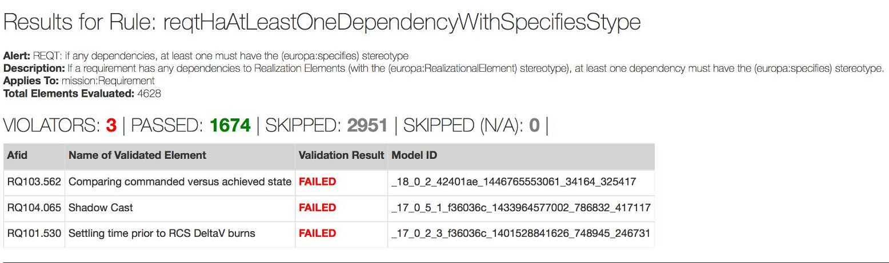

Figure 12. Example of an audit of the architecture model using a simple validation rule.

## B. Correcting Syntactic Errors

For the large system model on Europa, it is not enough to simply validate the model content and present the results. When the number of violating elements is significantly large, it quickly becomes infeasible to have users manually go into the model and correct the content. Each rule violation represents a discrepancy between model content and a given pattern, which inherently includes information on what the correct model content should be. Normally, a user would evaluate the results from the pattern violation and then decide what corrective action to take, but for many patterns, one or more corrective actions can be inferred from existing model content. On the Europa project, the validation framework includes the ability to associate corrective actions with rule violations. The corrective actions are automatically generated during validation and encoded as model actions that can be executed. In essence, when a rule is violated, supporting information is gathered from the model to create a corrective model action that addresses the violation. Depending on the nature of the corrective action(s), they may be proposed to the user or automatically implemented in the model.

<!-- PDF_PAGE: 14 -->

One example is the Concept-to-Realization (C2R) mapping pattern, shown in Figure 9. The C2R mapping takes the form of a closed loop: a requirement is linked to a conceptual constraint, which constrains a conceptual element, which realizes into a real element, which must be specified by the same requirement. On the Europa project, a set of validation rules assess which edges and nodes are missing from the C2R loop and each missing element is captured as a rule violation. Consider the case where there is a requirement that is linked to a conceptual constraint that constrains a conceptual element, but the requirement does not specify anything. If the constrained conceptual element realizes into a real element, one proposed correction for the violation would be to suggest that requirement should specify that real element.

By incorporating corrective model actions into the validation process, this framework provides a powerful interface for enforcing conformance between patterns and model content. The association of corrective actions that are easily executable with rule violations considerably reduces the overhead associated with fixing the model to address violations. The user can then re-execute the validation rule to re-assess the state of the model and make further corrections.

## C. Evaluating System Performance

In addition to checking syntactic properties of the model, one of the current focus areas is the automation of analyses in order to compare the predicted performance of the system with the requirements specified in the architecture. While this is still work in progress, this subsection provides a description of the capability currently being developed and its future potential.

One of the challenges of this type of approach is identifying how a particular point design relates to the architecture. The current approach is to relate properties bound by requirements to properties of the point design. These are augmented with mathematical relationships between the properties that describe the physics or expected design (for instance, the relationship between power usage and which components are active during a particular time period). When analyzing system performance, some of these bounds are likely to appear as inconsistent with some requirements on the system. A model-based approach to system architecting can capture these properties and relationships explicitly, allowing margins to be calculated and audits to be performed that compare a proposed design point (or space of design points) to the proposed requirements.

SysML does not currently offer any intrinsic support for this sort of analysis (despite the existence of a number of emerging commercial software tools, which have been investigated by Karban et al. $ ^{14,15} $ for example). The approach followed by the Europa project has been to transform model content from SysML into a more analyzable form, that is then augmented with content available from domain-specific sources, to finally perform simulations using available off-the-shelf tools such as Mathematica and System Modeler.

To date, model extraction has involved the use of analysis-specific transformations in the form of scripts that can traverse the model content, identify needed information, and then translate that information into a form that can be interpreted by external tools. More recent efforts have focused on the use of intermediate forms for the extracted model content to enable the reuse of model flattening code that transforms the model into a form more consistent with the representation expected by solvers. For instance, removing unnecessary meta-data and replacing implicit usage-type combinations with explicit constraint and variable definitions.

One key example of such analyses is the assessment of spacecraft power balance. This analysis requires evaluation of mission scenarios to ensure that power demand never exceeds what the system can supply (with margin for uncertainty). Since the current baseline for the Europa mission is a solar-powered spacecraft, the analysis needs to consider trajectory, orientation, shadowing of the solar panels, and energy storage in a battery, as well as many different components being turned on and off in support of different operations. The analytical model was manually developed in Modelica $ ^{16} $ to reflect the content of the SysML model, but was not automatically generated. Over time, many of the intrinsic properties (e.g., element loads) were transcribed into the SysML model, and then transformations were developed so that those properties could be configuration managed in the SysML model and then delivered into the simulation model through model transformations. To date, requirements are not explicitly captured in this model, but parameters related to the requirements are reported by the performance models. These are used as part of margin reports which are reviewed manually, but the parameters are not re-ingested into the SysML model. This is one of the significant near-term focuses of the project.

## VI. Producing Gate Products and Other Documents from the Architecture Model

The architecting effort ultimately results in the creation of traditional gate products supporting the standard NASA gate reviews. On the Europa project, a model-generated Mission Concept Report and Project Requirements Document (PRD) were used as part of the Mission Concept Review (MCR). Subsequent revisions of the PRD as

<!-- PDF_PAGE: 15 -->

well as other system-level requirements document are among the key products to be generated from the system model for the next gate reviews, as listed in Table 2. The model-generated versions have appropriate project marking and formatting to satisfy JPL configuration management guidelines (such as appropriate cover pages, headers, footers, and ITAR markers). These are also signed by project leadership and accepted as the official source of information for the project.

Table 2. Model-generated documents related to the architecture on the Europa Project (non-exhaustive list)

<table border="1"><tr><td>Gate Product</td><td>Acronym</td><td>Responsible team</td><td>Type</td></tr><tr><td>Project Requirements Document</td><td>PRD</td><td>Project System Engineering</td><td>Requirements Document</td></tr><tr><td>Spacecraft Requirements Document</td><td>SCRD</td><td>Flight System Engineering</td><td>Requirements Document</td></tr><tr><td>Risk Management Plan</td><td>-</td><td>Project System Engineering</td><td>Plan</td></tr><tr><td>Flight System Integration &amp; Testing Requirements Document</td><td>FS I&amp;T RD</td><td>Flight System Integration &amp; Test</td><td>Requirements Document</td></tr><tr><td>Payload Requirements Document</td><td>PLRD</td><td>Payload System Engineering</td><td>Requirements Document</td></tr><tr><td>Spacecraft-Payload Interface Requirements Document</td><td>SC-PL IRD</td><td>Flight System Engineering</td><td>Requirements Document</td></tr><tr><td>Mission Concept Report</td><td></td><td>Project System Engineering</td><td>Architecture Description</td></tr><tr><td>Mission Operations System Requirements Document</td><td>MOSRD</td><td>Mission Operations System Engineering</td><td>Requirements Document</td></tr></table>

## A. Advantages

The Europa project has already observed several advantages in using a model-based approach to create gate products, over the more traditional (or manual) approach, including:

- The same object (e.g. requirement) can appear in multiple documents and still remain consistent across them since it is only represented once in the Single-Source-of-Truth repository (i.e., the architecture model). When various engineers make changes to an object in the SSoT (e.g., a requirement, a component, a function), queries are rerun and these changes are propagated to all the documents referencing these model objects. This process has proven useful on several occasions: for example for environmental requirements that need to be levied across most of the hardware elements and for which any change would need to propagate to a large number of elements; or when requirements are "developed" in one document and considered as "incoming" requirements to another. Another example relate to the definitions of various terms (e.g., "fault") and model elements (e.g., "Project System") which have been themselves documented and captured in the architecture model, as mentioned in Table 1. Lists of definitions that are relevant to each specific document can then be automatically generated in the form of glossaries. During conceptual development, this allows identifying discrepancies in how words are interpreted by different teams, and once such differences are resolved, it ensures that all definitions are consistent at the final delivery of the official project documents.

- There is also an opportunity to separate the views used to develop requirements from the views used to review "final" requirements. For instance, specific views are used to allow authors to capture different aspects of the architecture (in the conceptual views), while others show the requirements for a particular implementer (in the realizational views). From this perspective, gate products are just another type of views that aggregate information in a traditional form for review by internal and external stakeholders.

- Gate products are generated via query so they can be quickly re-organized or additional information can be quickly added (assuming the information is available in the model). When developing a requirements document, there is often an iterative process in establishing the structure and the information presented. Since the model-generated gate products are generated via query, when there is a change in the overall structure of the document this involves changing the query, not the underlying document. In other words, the applicable

<!-- PDF_PAGE: 16 -->

viewpoint(s) only need to be changed once instead of changing all the views composing the document individually, resulting in important time savings. As an example, there were three major restructurings of the Europa PRD during early Phase A which were each completed in a few days, since only the presentation of the information changed and not the underlying content, preventing also any manual transcription errors. Furthermore, since the gate products are generated from a consistent model representation, the information in a given document can be compared across versions even if the presentation structure changes by comparing the underlying model content.

## B. Challenges

While the generation of model-based gate products presents many benefits (as described previously), unique challenges exist that relate to the degree of formalism inherent to the use of a system model.

- For example, queries need to be specifically crafted to present the information in a digestible form that guarantees a high formatting and presentation quality. In particular, the information needs to be stored in a way that facilitates the logical and systematic extraction of relevant pieces automatically and consistently via query, while such pieces would traditionally be arranged manually with a document-based approach. In traditional documents, requirements are placed in a certain order based on the "affinity" with other requirements. If queriable properties are not available to capture this "affinity" ordering, then requirements that would traditionally be placed together may show up in different parts of the document, hence causing confusion.

- There are also challenges in allocating adequate schedule time and margin to document generation. Until the automatic process of generation of the gate products becomes fully mature, there can be technical issues that need to be troubleshooted immediately before delivery of the document and need to be accounted for in the overall schedule. During the Phase A of the Europa project, two to three days have been allocated to the generation process to account for these uncertainties.

- While the ultimate goal of a model-based generation of gate products is to completely eliminate any manual (and therefore time consuming) adjustment of the documents during the generation process, some manual steps are currently still needed to put the "final" presentation touches on the official documents.

## VII. Summary and Future Work

Properly defining the mission architecture in the early stages of a project is a crucial systems engineering endeavor that can ensure that a sound design solution is ultimately implemented and that stakeholders concerns and high-level requirements get successfully addressed. Capturing the extensive information set necessary to describe the architecture using traditional document-based methods can quickly become daunting in a large project like Europa, especially as all the constraints, requirements, functions and elements are supposed to remain consistent.

This paper presented the architecture framework used by the Europa project to address this challenge and discussed how the architecture model represented in the SysML language was used as the single-source-of-truth for this description. In that context, several key modeling patterns were presented, including the ones used to capture constraints, requirements, their traceability, as well as their maturity as it evolves throughout the project lifecycle. Audit methods used in conjunction with these patterns were then discussed, as a helpful way to ensure the consistency and the correctness of the model. Provided this model-based approach is used consistently, one additional benefit can be the improved quality of requirements due to the rigor necessary to properly model requirements subjects (i.e., elements and properties). In addition, this approach provides opportunities to generate traditional requirements documents and other gate products in a more automated fashion, allowing shorter turn around times and a more objective organization of requirements.

Although significant progress has been achieved in setting up the infrastructure and devising the methods to enable the modeling of the architecture on the Europa project, many challenges remain, as it was learned throughout the implementation of these techniques.

- When the tooling does not support workflows in a way that is easy and efficient, the more traditional practices re-emerge and compete with the model-based approach, which may result in some confusion about the official process to follow.

- Developing the entire toolset and defining the corresponding processes ahead of time -that is, before they are actually exercised on the project by an entire team- is therefore critical to produce an architecture description

<!-- PDF_PAGE: 17 -->

on time and on budget.

- On the audit side, while finding syntactic errors can be relatively easy, fixing them may at times require significant additional work. Semantic errors still remain hard to detect due to the difficulty to express certain subtle notions in the modeling language.

- Changes in the workforce can also impact the relevance and efficiency of the architecture modeling. For example, rapid staff-ups with engineers used to a traditional process but not familiar with the model-based paradigm can make the application of these methods more challenging.

- Getting an entire team to define an architecture that will be the source for the requirements appears more difficult than obtaining consensus on the description of a point design, which can also hinder the modeling activities. When pursueing the goal of modeling the mission architecture, one should expect to observe at times some confusion between the intended/required architecture and the baseline design point. In general, it seems easier to describe a specific design that seems to work than it is to express acceptable variations around that design.

- Ultimately, managing the expectations for such modeling activities remains essential. Despite some obstacles like the ones listed previously, many discrepancies that would have persisted in the requirements have been found and corrected via the model. However, fixing everything downstream cannot be achieved solely by the model-based approach and be a substitute for the proper upstream systems engineering work. (In fact, when discrepancies are found, the architecture model is often at risk of being the "messenger" that gets blamed when it is actually the one that provided the query mechanisms to detect the inconsistencies!)

- Future modeling activities on the Europa project will build on and extend the work presented in this paper. Three major areas of interest include:

- Design verification: Continuing the work described in Section V.C, one future modeling activity will focus on comparing various point designs to the requirements codified as the architecture in a structured fashion. Although it is unlikely that such an analysis can be completely automated because of the wide variety of assertions in the requirements, providing a structured semi-automated approach will allow more rapid verification of design points and identification of disconnects. In order to support this work, more analyses that are tied to the information in the Architecture model will need to be developed, along with efficient approaches to relate individual design points $ ^{11} $

- Enhanced modeling of scenarios and behaviors: Currently, the capture of time-varying information about the architecture in the Architecture model is limited. Although significant progress has been achieved in identifying and describing scenarios, and the project is utilizing modeling tools to develop stand-alone models of mission phases, these are currently disconnected. One of the challenges is capturing scenario- and behavior-related information efficiently and accurately. Although SysML and UML provide a number of constructs for the modeling of system behavior, one of the difficulties has been finding a formalism that has appropriate semantics for capturing the desired behavior of a physical system. Statements such as "the heaters should be turned on for 2 hours before utilizing a component", regardless of the number of heaters, are difficult to capture. Also, the formalism can be intimidating at first for domain experts without software backgrounds. Future work will focus on developing tools that are more accessible to domain experts and deploying those to the project.

- Change propagation and tracking: While the Europa architecture model certainly helps to ensure consistency between different elements across the entire architecture, maintaining that consistency over time as various changes are made to the architecture represents an additional challenge. Explicit links between elements, functions, and requirements could be used to identify the impact of a particular change, but no automated approach is currently utilized for this purpose yet. One method to support a more automated change propagation is simply to track changes in an efficient manner. The tools utilized currently allow tracking changes in the name or documentation of a particular element, but not yet in the relationships that the element participates in.

In summary, despite the existence of various tooling and cultural challenges, the system modeling work on the Europa project has already proved to play an important role in delivering high-quality representations of the architecture to a variety of stakeholders, and presents promising opportunities to continue to improve the overall system engineering effort.

<!-- PDF_PAGE: 18 -->

## Acknowledgments

The work described in this paper was carried out at the Jet Propulsion Laboratory, California Institute of Technology, under a contract with the National Aeronautics and Space Administration.

We wish to acknowledge the efforts of other members of the Europa architecture modeling team not listed as coauthors of this paper, including Jean-François Castet, David Coren, Maddalena Jackson, Matthew Rozek, Marcus Wilkerson, as well as Robert Rassmussen and John Day for their key contributions in the ideas used in this work and implemented using the model-based approach.

## References

$ ^{1} $Bayer, T. J., Chung, S., Cole, B., Cook, B., Dekens, F., Delp, C., Gontijo, I., Lewis, K., Moshir, M., Rasmussen, R., and Wagner, D., "Early formulation model-centric engineering on NASA's Europa mission concept study," Proceedings of 22nd Annual International Symposium (IS2012), July 9-12 2012.

$ ^{2} $Bayer, T. J., Chung, S., Cole, B., Cooke, B., Dekens, F., Delp, C., Gontijo, I., Lewis, K., Moshir, M., Rasmussen, R., and Wagner, D., "Model based systems engineering on the Europa mission concept study," IEEE Aerospace Conference Proceedings, 2012.

$ ^{3} $Bayer, T., Chung, S., Cole, B., Cooke, B., Dekens, F., Delp, C., Gontijo, I., and Wagner, D., "Update on the Model Based Systems Engineering on the Europa Mission Concept Study," in IEEE Aerospace Conference Proceedings, 2013.

$ ^{4} $Rasmussen, R. and Muirhead, B., "A Case for Model-Based Architecting in NASA," August 2012, CL#12-4124, NASA/Caltech.

$ ^{5} $Rasmussen, R., "Architecture Framework Definition," internal JPL publication, 2013 (unpublished).

$ ^{6} $ISO/IEC/IEEE, "Systems and software engineering—architecture description," ISO/IEC/IEEE42010:2011, December $ 1^{\mathrm{st}} $ 2011.

$ ^{7} $Clarke, S., Baniassad, E., Aspect-Oriented Analysis and Design: The Theme Approach, Addison-Wesley, 2005.

$ ^{8} $ Day, J., "Europa Clipper Systems Engineering: Using Concepts to Derive Requirements," internal JPL presentation, November 2014 (unpublished).

$ ^{9} $Jackson, M. and Wilkerson, M., "MBSE-driven Visualization of Requirements Allocation and Traceability," IEEE Aerospace Conference Proceedings, 2016.

$ ^{1 0} $Europa Study Team, "Europa study 2012 report," National Aeronautics and Space Administration, JPL D-71990, May $ 1^{\mathrm{st}} $ 2012.

$ ^{1 1} $Dubos, G.F., Coren, D. P., Kerzhner, A., Chung, S. H., and Castet, J-F, "Modeling of the Flight System Design in the Early Formulation of the Europa Project," IEEE Aerospace Conference Proceedings, 2016.

$ ^{1 2} $Hause, M., "The SysML modelling language", Fifteenth European Systems Engineering Conference, Vol. 9, September 2006.

$ ^{13} $ Jackson, M., Wilkerson, M., and Castet, J-F, "Exposing Hidden Parts of the SE Process: MBSE Patterns and Tools for Tracking and Traceability," IEEE Aerospace Conference Proceedings, 2016.

$ ^{1 4} $Karban, R., Dekens, F., Herzig, S., Elaasar, M., Jankevičius, N., "Creating systems engineering products with executable models in a model-based engineering environment," SPIE Astronomical Telescopes + Instrumentation, 2016.

$ ^{15} $ Karban, R., Jankevičius, N., Elaasar, M., "ESEM: Automated Systems Analysis using Executable SysML Modeling Patterns," INCOSE International Symposium (IS), 2016.

$ ^{1 6} $Modelica Language, http://modelica.org