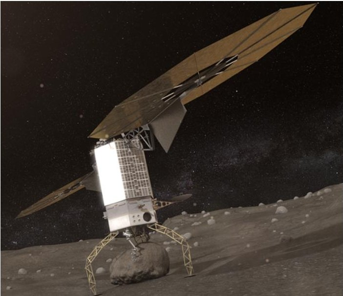
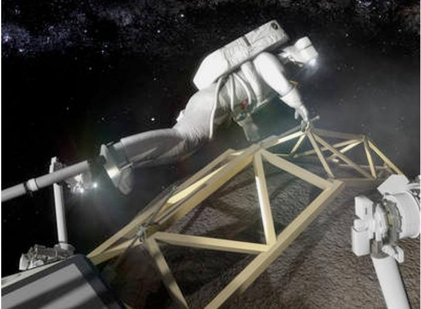
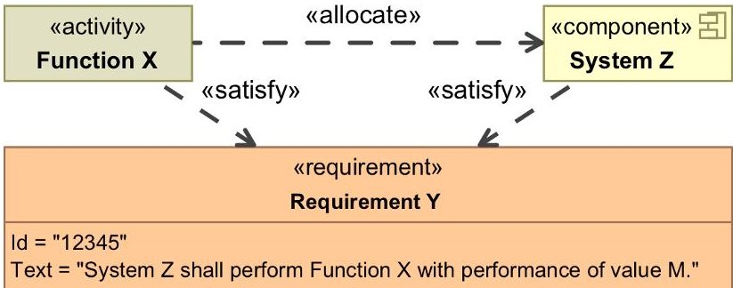
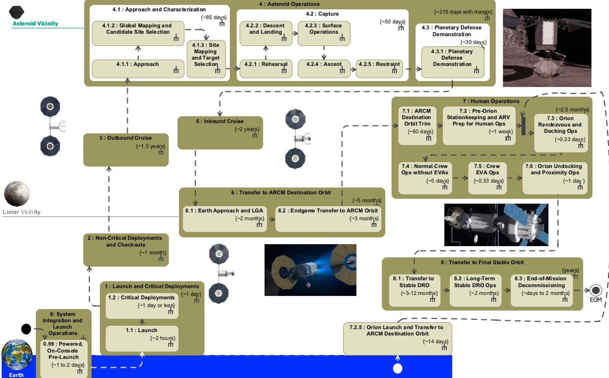
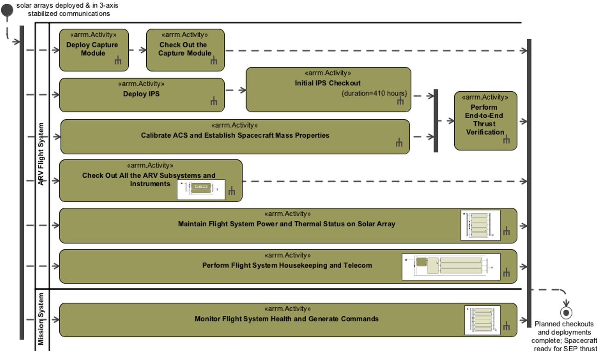
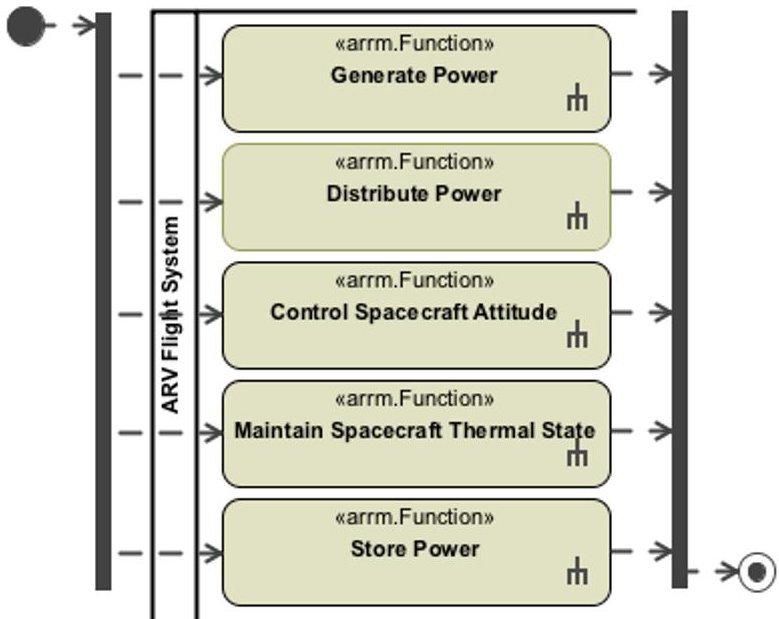
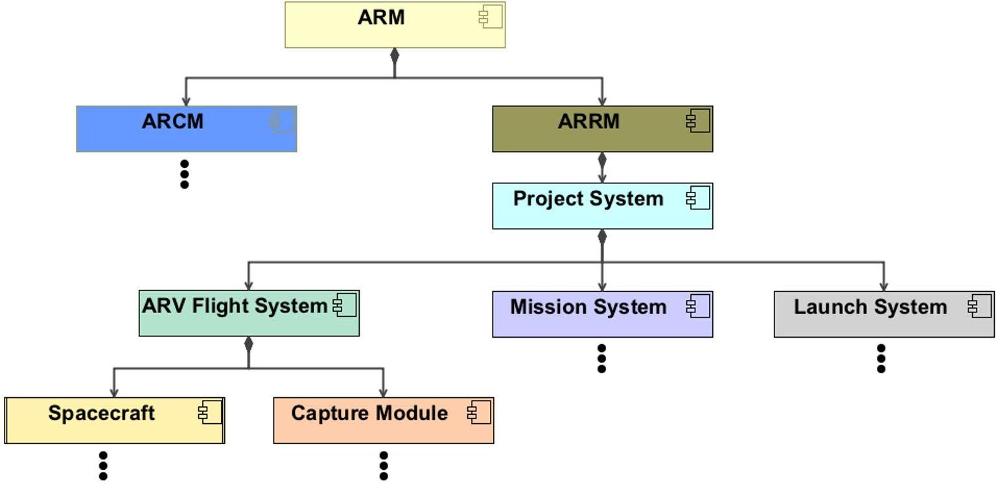
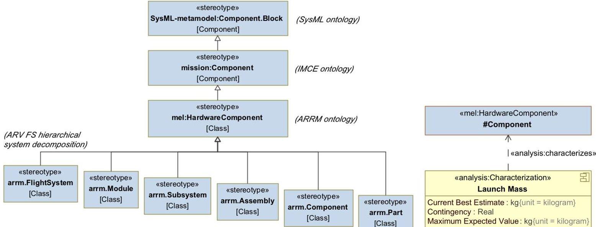
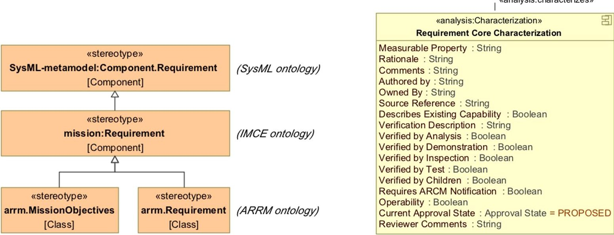
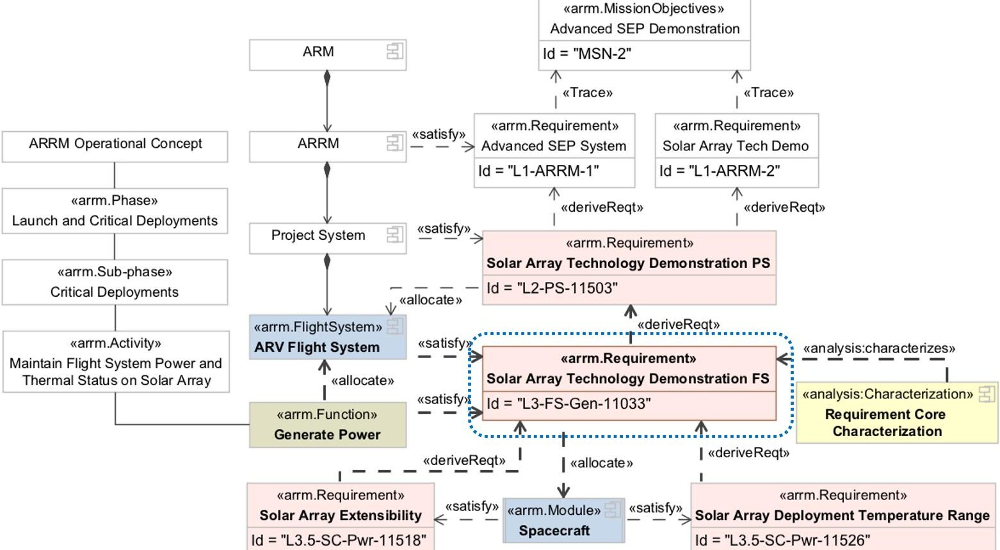

<!-- PDF_PAGE: 1 -->

# Application of Model-Based Systems Engineering for the Development of the Asteroid Redirect Robotic Mission

Oleg V. Sindiy $ ^{1} $ , Tanaz Mozafari $ ^{2} $ , and Charles J. Budney $ ^{3} $ Jet Propulsion Laboratory, California Institute of Technology, Pasadena, California, 91109

Model-Based Systems Engineering (MBSE) can augment existing Systems Engineering (SE) processes to more efficiently deliver enhanced products over the project life cycle. Using a multi-user accessible System Model, MBSE has been successfully deployed for the conceptual and preliminary design development of the Asteroid Redirect Robotic Mission (ARRM). The paper provides an overview and examples of the targeted MBSE deployment for development of the mission operational concept, system description, and functional requirements. The paper also includes description of the challenges and lessons learned.

## Nomenclature

<table border="1"><tr><td>ARRM</td><td>=</td><td>Asteroid Redirect Robotic Mission</td></tr><tr><td>ARV</td><td>=</td><td>Asteroid Redirect Vehicle</td></tr><tr><td>MBSE</td><td>=</td><td>Model-Based Systems Engineering</td></tr><tr><td>OpsCon</td><td>=</td><td>Operational Concept</td></tr><tr><td>SE</td><td>=</td><td>Systems Engineering</td></tr></table>

## I. Introduction

EARLY in Asteroid Redirect Robotic Mission (ARRM) concept development, an information management challenge presented itself to support the multi-organization, distributed team of project stakeholders, while facilitating the project's exploration of a leaner implementation of proven NASA Systems Engineering (SE) processes. $ ^{1} $ In a study of available solutions, it was established that the ARRM SE team and processes were ripe for a targeted application of Model-Based Systems Engineering (MBSE). In this context, MBSE pertains to "elevating models in the engineering process to a central and governing role in the specification, design, integration, validation, and operation of a system." $ ^{2} $ Correspondingly, this paper presents an overview of the tailored application of MBSE for ARRM functional requirements development and validation, and as needed, supporting project technical and programmatic information capture and management. Specifically, this paper describes how the ARRM team:

- Formulated an MBSE approach, which leverages System Modeling Language (SysML $ ^{3} $ ), to create an ARRM System Model within a highly distributed—and varied MBSE experience—team environment;

- Established a secure, cloud computing-based modeling, task, risk, and project data management environment;

- Refined evolving MBSE techniques for evolving project needs (including configuration management); and

- Delivered a versatile product reporting infrastructure with both web-based (e.g., View Editor $ ^{4} $ ) and traditional products (e.g., reports in pdf, lists in tabular files) extracted from a centralized System Model.

To date, the targeted application of MBSE on ARRM has supported the SE team in generating a mission operational concept (OpsCon), a system decomposition, functional requirements, and other technical and programmatic content. These deliverables have contributed to several successful, NASA mandated $ ^{1} $ program and project reviews: ARRM Mission Concept Review (MCR) $ ^{5} $ , Project Requirements Closure Technical Interchange Meeting (analogous to a NASA System Requirements Review (SRR)) , and Key Decision Point B (KDP B) $ ^{6} $ .

<!-- PDF_PAGE: 2 -->

## A. Asteroid Redirect Robotic Mission Overview

The proposed Asteroid Redirect Robotic Mission calls for capture of an asteroid boulder and its redirection to an astronaut-accessible orbit around Earth's moon. Launching in the early 2020s, the ARRM's Asteroid Redirect Vehicle (ARV) would cruise to a large Near Earth Asteroid (NEA) using a state-of-the-art Solar Electric Propulsion (SEP) system. The ARV would characterize the asteroid with onboard instruments and provide data to support the project asteroid team's selection of the boulder from several candidates. The ARV would then land on the asteroid, secure and retrieve a multi-ton boulder with the arms on the ARRM Capture Module (as illustrated in Figure 1), and ascend to an orbit around the NEA. With the increased mass of the captured boulder, the ARV would perform a gravity tractor asteroid deflection maneuver. The purpose of this demonstration is to check the feasibility of employing this type of maneuver to protect Earth from potential future asteroid impact. The ARV would then return, with the boulder, to a crew-accessible orbit in cis-lunar space. An astronaut crew, of the Asteroid Redirect Crewed Mission (ARCM), would be launched in the Orion capsule in mid 2020s to rendezvous with the ARV and captured boulder. As illustrated in Figure 2, the ARCM crew would perform extravehicular activities (EVAs) to study the asteroid material and collect samples for return to Earth for further investigation. In accomplishing its mission objectives, the ARRM would utilize and demonstrate new technologies, advance the application of existing technologies, and showcase the advantages of joint robotic and human space exploration programs. $ ^{7,8} $

## B. Intent and Early Implementation of Model-Based Systems Engineering on ARRM

MBSE seeks to provide a single-source-of-truth approach, where the content managed in a centralized System Model, and its derived products, becomes the de-

Figure 1. Artist concept for Asteroid Redirect Robotic Mission operations on an asteroid. Courtesy of NASA.

Figure 2. Artist concept for Asteroid Redirect Robotic Mission operations with an Asteroid Redirect Crewed Mission crew and captured asteroid boulder. Courtesy of NASA.

facto source of project information. A System Model can describe constituent components, relationships, interfaces, and/or ownership/responsibilities—that is, the technical architecture. If desired, a System Model can also capture information on the team organization and responsibilities, project risks, schedules, and/or budgets—that is, the programmatic information. A well-maintained and content-rich System Model can capture the technical and programmatic rationale for the system design. For example, it can assist stakeholders with:

- understanding the important aspects of the system, where each component fits within the system architecture, and how changes in one area may impact other areas;

- organizing and communicating content ownership, evolution, and maturity;

- communicating the resulting system architecture, and how it addresses stakeholder concerns (e.g., requirements, institutional policies and practices) and imposed constraints (e.g., budget, schedule, technology readiness, mission design/navigation);

- record analyses and decisions that have been made—i.e., why the team got here and what conditions would trigger a re-evaluation; and/or

- maintain integrity of the system design through trade-offs and evolving design development processes.

In implementation, not all benefits anticipated from MBSE deployment can be realized through use of a System Model alone. MBSE-related infrastructure must be configured around a centralized System Model, to enable SE users of various expertise, of different backgrounds, in distributed locations, and/or from multiple organizations to contribute to, and simultaneously access, project information managed in the System Model. For ARRM, the

<!-- PDF_PAGE: 3 -->

technical logistics of establishing a centralized System Model were equally as challenging as the programmatic logistics of providing secure, cross-center access to, and enabling collaboration within, the ARRM System Model.

Achieving this centralized data repository and modeling environment presented several challenges and opportunities for the ARRM team, which will be detailed later. To overcome initial implementation hurdles, the deployed approach leveraged best practices advanced in earlier MBSE applications at NASA. $ ^{9,10,11,12,13} $ These best practices were reviewed and then modified by ARRM's multi-center team over many brainstorming and experimentation sessions. Moreover, support from the distributed ARRM project management/leadership was, and continues to be, crucial to the successful project adoption of MBSE over traditional spreadsheet-, presentation-, and document-centric SE practices.

The transition to model-derived SE deliverables was implemented via a two-step process. First, a two-month pilot was completed during the 2013 Asteroid Robotic Mission (ARM) Feasibility Study $ ^{14} $ , where a notional, highlevel mission operational concept was captured in a SysML-based model. The products of this model were used as inputs to an event-based mission simulation (using JPL's APGen tool $ ^{15} $ ), which refined and validated the notional OpsCon mission timeline within constraints of both the mission navigation design (i.e., launch dates and trajectory) and data balance (i.e., onboard available data production, storage, spacecraft-ground communication downlink windows and volumes, etc.). Upon successful demonstration, ARRM project leadership approved a more extensive—step two—implementation of MBSE for ARRM functional requirements validation, and for any secondary opportunities based on the development team's needs. Here, functional requirements validation concerns development of technical requirements that map to identified mission (ground and flight) functions in the OpsCon, and vice versa. Subsequently, this paper presents an overview of the step two efforts for application of MBSE in ARRM Pre-Phase A-Conceptual Study and Phase A-Preliminary Analysis project life cycle phases.

## II. Standing up MBSE Infrastructure: Modeling Environment and Processes

Once the scope of the MBSE application efforts was agreed to, the multi-center ARRM SE team began with a review of the existing MBSE capabilities at all of the involved centers to understand what tools and processes were available for ARRM implementation. In some cases, capabilities developed on other missions (e.g., Europa Clipper, Orion EFT-1) were leveraged directly for ARRM. For example, specific JPL projects and support efforts had already developed customized applications for tracking technical performance parameters $ ^{16} $ and interface modeling $ ^{17,18} $ ; some of these tools and capabilities were investigated for proof-of-capability demonstrations (e.g., mass tracking, data interface diagrams) by the ARRM modeling team. In other circumstances, existing capabilities were modified to support the specific needs of ARRM. In particular, investments were directly utilized from JPL's Integrated Model Centric Engineering (IMCE) and Systems & Software Computer Aided Engineering (SSCAE) project-support communities in enhancing modeling tools and capabilities. For example, IMCE's foundational ontologies $ ^{19} $ for describing the modeled systems were employed to augment SysML for describing space (and other NASA) missions. When needed, new capabilities were developed to meet project-specific needs. Overall, the ARRM modeling team gave priority to standing up MBSE capabilities that would enable the key SE team members to contribute to, and majority of the project members to access, modeled data as soon as possible by addressing immediate project needs (i.e., targeted scope) with clear value added to the project (i.e., contributing to timely and enhanced quality technical products for upcoming reviews).

Following the selection of a SysML-based modeling tool, the ARRM modeling team initialized additional infrastructure that would support System Model utilization by the distributed project team. A collaborative modeling server was deployed with remote accessibility by team members from across the agency. Customized modeling tool and plugins (including licenses) were distributed to the modeling team, so that all members would have access to the identical toolset and features. A single ARRM System Model file was posted to this collaborative server to which stakeholders contributed modeled content. Informal working agreements were established between the modeling team on the organization of the content in the System Model and which SE team members had the authority to make changes to which content areas of the System Model. Many dedicated and regularly scheduled training sessions were held for the small MBSE-dedicated modeling team, larger SE team, and wider project stakeholders (ARRM management team) and program costumers (e.g., review board members).

Generating and reporting of products from the System Model is performed via the View Editor tool $ ^{4} $ . View Editor documents are generated based on the Document Generation (DocGen) $ ^{20} $ ontology and selected modeling tool plugin. When published to View Editor, documents can also be exported into traditional formats (such as word processing or portable document format). Tabular content can also be exported as comma separated values (csv) files which allows the project team to interact with the data in various spreadsheet-based tools. Furthermore, View Editor includes a front-end editing capability. As the modeling team creates content in the model, views are

<!-- PDF_PAGE: 4 -->

exported to View Editor for review by the wider project team. In some cases, the project team members are given write-access within View Editor to make changes to the content (e.g., such as updating the mass estimate for a given component, in-work requirement text, a system name and description, etc.), which is later absorbed in to the core System Model through information or formal synchronization of View Editor and System Model databases.

Furthermore, the ARRM team employs a web-based tracking software for tracking SE tasks, MBSE capabilities development (including bug tracking), and project management functions (e.g., risk management). Within the context of MBSE, use of a task and bug-tracking software has assisted in tool functionality development, content population into the System Model, and SE products delivery (e.g., requirement documents releases for reviews).

When select modeled content is placed under formal control, a model-based Configuration Management (CM) process is employed to implement changes to the system baseline throughout the project life cycle. The deployed CM process provides: 1) accurate and complete identification of all modeled elements and documentation for systems design, and 2) model-derived project documentation that maintains configuration integrity while utilizing the single source of truth capabilities of the System Model. Of particular value added: 1) common documentation (e.g., mission overview) is specified once and is then reused (i.e., cross-referenced) across multiple documents, and 2) a change to any modeled element propagates to all of the views that rely on that data. This has shown to improve efficiency in document creation and accuracy of document contents. When portions of System Model content mature and go under formal CM, changes to the controlled content will be implemented via Engineering Change Requests (ECRs).

On ARRM, an Engineering Change Request (ECR) process will be used for formalized impact review and approval of changes to controlled data within the System Model. The ECR process begins with the identification of a proposed change(s) and the development of the ECR by an initiator. Pertinent members of the project team complete the impact assessments and provide their feedback to the initiator. Once the ECR is ready, it is submitted to management team for review and approval. If an ECR is approved, it is modeled and validated.

The controlled document release management process is used to promote the Project's official documents from unreleased (in-work) to released (controlled) states. Released states include preliminary and baselines (initial release and revisions). When each document is ready for review, the latest document and contents are published from the System Model to VE. Once the document has been reviewed and any requested changes dispositioned, it is ready for approvals. Document approval and release is completed when required signatures are obtained using a customized workflow in the ARRM's task management tool. Document states are maintained through the model system and displayed in View Editor in the project document list. This allows the project team to view states of each document and links directly to the document in VE.

All of the ARRM information management tools are hosted into a secure cloud computing environment. The selected tools provide a wiki, chat rooms and instant messaging, task and risk management, document review and approval process, document repository and archival, System Model repository, and web-based, model-generated document presentation and editing. The tools are securely accessed (through VPN clients) by approved project users. The deployed project information tools were also customized for user interface simplicity. For example, all of the information management tools were made accessible from a single, web-based project portal. The portal also provides quick access links to all of the training materials and project (model and non-model generated) content. When accessed from the portal, a user-friendly View Editor landing page provides navigation of in-work and formally released, model-generated documents.

## III. Applying MBSE for Functional Requirements Validation on ARRM

An ontology is a formal naming and definition of the types, properties, and relationships of the fundamental entities for a particular domain of interest. For ARRM, the MBSE team employed the foundational SysML ontology to capture content in the ARRM System Model. The core types of SysML elements and relationships employed in the ARRM System Model are shown in Figure 3.

Once specified—through the definition of the Operational Concept—mission functions are allocated to systems. Furthermore, once written, a functional requirement must be satisfied by a performing system and its allocated function(s). The allocation of functions to systems then enables the project design activities (e.g., system and subsystems engineering) which seek to provide a system design that meets all of the functional requirements and mission functions.

Specialization of the core representation for ARRM needs was performed through the use of the IMCE ontology $ ^{19} $ for space mission representation. Definition of properties/attributes was performed through the use of quantitative and qualitative characterizations, which will be described (with examples) in later sections.

<!-- PDF_PAGE: 5 -->

## A. Mission Operational Concept Definition

To define and capture the ARRM operational concept (OpsCon) timeline in the ARRM System Model, the SE team utilized SysML Activities and Activity Diagrams; in the traditional SE community, these types of functional description are comparable to Functional Flow Block Diagrams (FFBDs). A top-down decomposition for the ARRM OpsCon was generally abstracted to consist of mission phases, sub-phases, activities, and functions. In the adopted ontology, these were converted to

Figure 3. Core elements and relationships within ARRM System Model.

<<arrm.Phase>>, <<arrm.Sub-phase>>, <<arrm.Activity>>, and <<arrm.Function>> stereotype specializations of a SysML <<activity>> element. The use of these designations aided the SE team in differentiating between conceptual levels of abstraction in the OpsCon. For example, ARRM mission sub-phases were defined to capture interactions between multiple systems, mission activities capture higher-level system behaviors that would require interaction of multiple subsystems, and mission functions capture lower-level behaviors that a single subsystem is expected to perform. The SE team also utilized SysML Adjunct Properties to capture the decomposition of mission phases and sub-phases into activities and functions in the System Model.

Figure 4 provides a SysML Activity diagram for the resulting notional ARRM mission timeline. This diagram presents core ARRM mission phases and sub-phases—from final stages of ARRM System Integration through the End-of-Mission (EOM). It also provides estimated durations for sub-phases and phases for a notional mission navigation and operations plan to a reference asteroid (at present, the 2008 EV5).

Figure 4. Activity diagram of a planned ARRM operations timeline. Mission images courtesy of NASA.

While the project already had multiple, existing high-level representations of the mission OpsCon (diagrams akin to Figure 4 in several other formats), the use of a SysML Activities introduced rigor into the representation. This representation required a consensus from the key stakeholders. Subject matter expert reviews were held, over several technical interchange meetings, to arrive at a unified representation for the ARRM phases, sub-phases, activities, and functions, their descriptions, and the boundaries between them. The boundaries were of particular

<!-- PDF_PAGE: 6 -->

interest because they postulated the entry and exist conditions that were found to be correlated to changes in operating scenarios, system modes, and/or external interactions. Careful attention was paid to the visual design of this diagrams as well, so as to provide products that are as visually clear as they are technically correct. $ ^{21} $

While the ideal OpsCon ontology was abstracted to consist of mission phases which decompose into sub-phases, then into activities, and finally into functions, the implementation was not as straight forward and clean cut. For example, for the "Non-Critical Deployments and Checkouts", "Outbound Cruise", and "Inbound Cruise" phases, the abstraction did not require use of sub-phases. It was sufficient to traverse from mission phases directly to the mission activities, and in some cases, even directly to lower-level mission functions. However, for the "Asteroid Operations" mission phase, the use of intermediate "sub-sub-phases" was needed between sub-phases and their corresponding activities and/or functions to help organize and manage the complexity of the abstraction for this phase. Furthermore, since a portion of the Asteroid Redirect Robotic Mission interfaces with ARCM elements during the "Human Operations" phase, selected ARCM activities and functions were also referenced in ARRM OpsCon for completeness. Similarly, certain supporting Launch System activities were referenced during the "System Integration and Launch Operations" and "Launch and Critical Deployments" phases to provide holistic views of the ARRM internal and external interactions in those phases.

Subsequently, abstractions of mission activities and functions were specified to represent the generic "every day" behaviors that the ARRM systems will perform throughout the course of the mission-i.e., typical activities and functions necessary to operate any spacecraft. The lower functions were grouped together into activities, so as to acknowledge the numerous lower-level sequences and decisions that would be executed by the project system at any given time; but also so as not to overwhelm the technical reviewers with all of the operational details. This kept the team focused on refining the ARRM mission-specific aspects of the OpsCon, which was critical to managing scope in the early discussions for the mission OpsCon definition. Examples of these high-level, generic mission activities are provided in Figure 5 for the "Non-Critical Deployments and Checkout" sub-phase; they include mission activities such as "Maintain Flight System Power and Thermal Status on Solar Array" and "Monitor Flight System Health and Generate Commands." Examples of the high-level mission activities that are unique to the ARRM include "Check out the ARV Subsystems and Instruments" and "Check out the Capture Module".

Figure 5. Example SysML Activity diagram for the ARRM Non-Critical Deployments and Checkouts sub-phase.

In Figure 5, identified mission activities are allocated to high level systems, such as the ARV Flight System and ARRM Mission System. Activity diagram swim lanes were employed to represent the allocation of activities to the respective performing systems. The MBSE team also employed an Activity diagramming convention which utilized

<!-- PDF_PAGE: 7 -->

embedded thumb images to indicate to the reviewers when additional details, for a given mission (generic or mission-unique) activity, were specified and modeled. For example, in Figure 5, a thumb overlaying the "Maintain Flight System Power and Thermal Status on Solar Array" <<arrm.Activity>> indicates an existing embedded ARV Flight System functional decomposition, which is shown in Figure 6.

Overall, the primary goal of the OpsCon development was to capture the highest level of ARRM system and subsystem behaviors. During future OpsCon refinements, the SE team can opt to add additional attributes to the various levels of OpsCon decomposition to promote rigorous application and supporting analyses derived from the System Model. For example, the SE team can add details required to construct an executable simulation of the mission that tracks technical resources (e.g., power, data, timeline margins). However, even the use of simple stereotypes and adjunct properties facilitated a more rigorous

Figure 6. Example of a SysML Activity diagram depicting an ARRM Activity further decomposed into ARRM functions.

definition, review, and consensus of the ARRM OpsCon than is typically possible in early mission concept development. Of note, the larger team of project stakeholders used model-generated views (activity diagrams) and supporting tabular lists of mission phases, sub-phases, activities, and functions to review the modeled content in View Editor-generated documents. Naturally, as refinements are made to the OpsCon content in the System Model, the updated View Editor content is periodically republished, reviewed, and re-released.

## B. System Decomposition and Characterization

A system decomposition is needed to address several technical and programmatic needs. For technical needs, a system decomposition was performed on ARRM to facilitate the allocation of Operational Concept activities and functions to performing systems, as well as technical resource management (e.g., mass tracking). For programmatic needs, a system decomposition was performed to identify organizational entities, at various partner centers, responsible for delivering various systems and their functions, and subsequently to identify requirement document owners. Resultantly, the basic system decomposition of the ARRM, within the context of the larger Asteroid Redirection Mission (ARM) program, is presented in Figure 7.

Figure 7. ARM system decomposition.

American Institute of Aeronautics and Astronautics

<!-- PDF_PAGE: 8 -->

In Figure 7, the ARM program consists of two missions, ARCM and ARRM. The technical architecture of the Asteroid Redirect mission is represented by the ARRM Project System. The Project System is managed by the Project Systems Engineering team and consists of three distinct systems—the ARV Flight System (FS), the ARRM Mission System (MS), and the ARRM Launch System (LS)—with interfaces to ARCM systems (not shown here). In this diagram, the ARV FS is further decomposed into two modules: the Spacecraft and the Capture Module. The ARRM Spacecraft will be provided by a commercial spacecraft provider. The Spacecraft is intended to be based on a reusable design (with standard interfaces) which can be deployed for other future missions; e.g., a mission to preposition supplies for a crewed mission to Mars. On the other hand, the Capture Module is uniquely tailored for ARRM-specific needs. The Capture Module is being developed at NASA's Goddard Space Flight Center. In the continuing decomposition, both the ARRM Spacecraft and the Capture Module consists of subsystems (e.g., mechanical, avionics, thermal, etc.). The respective subsystems will be decomposed further, as the technical design needs arise and the respective module designs mature. Employing this decomposition, Figure 8 and Figure 9 depict the formalized, multi-level specialization of a generalized SysML Block component into an ARRM-specific ontology and subsequent characterization required to construct a Master Equipment List (MEL) (as modified in the process described in Reference 16). Here, a generalization/inheritance relationship is a "kind of" association between two types of elements, where specialized element types inherit the properties of the generalized elements.

Figure 8. Specialization of a technical system decomposition ontology for the Asteroid Redirect Vehicle Flight System.

Figure 9. Launch Mass Characterization for ARV FS.

Specifically, in Figure 8, a SysML <<block>> component is shown to be specialized by IMCE ontology's <<mission:Component>> which is further specialized into a <<mel:HardwareComponent>>. The <<mel:HardwareComponent>> is further decomposed into an ARV-specific, technical Flight System decomposition. In Figure 9, components typed as <<mel:HardwareComponent>> are shown to be characterized by an <<analysis:Characterization>> called Launch Mass. The Launch Mass characterization provides a set of predefined quantitative attributes, which can be populated with current best estimates for mass values and contingencies, which are then employed in a quantitative MEL roll up. Ultimately, this FS decomposition and Launch Mass characterization process culminates into current best estimates (CBE) and maximum expected values (MEV) for the ARV Flight System mass in the Launch phase configuration. These masses can then be used in the mission design/navigation and for other project analyses.

## C. Functional Requirements Development and Validation

In simultaneous development of the ARRM OpsCon and system decomposition, ARRM project SE team also deployed a process for requirement development management and functional requirement validation. Figure 10 and Figure 11 provide the definition of the basic requirements ontology and qualitative analysis characterization derived for ARRM SE needs. The Requirements Core Characterization provides for the definition of qualitative attributes (beyond those provided in the SysML requirement specification: title, ID, "shall" text, etc.) such as the requirement rationale (i.e., intent), verification method(s), approval state (maturity), and other project-specific attributes.

<!-- PDF_PAGE: 9 -->

Figure 10. Specialization of the requirements ontology for ARRM.

Figure 11. Requirement Core Characterization for ARRM.

The ARM program provides mission objectives for the Asteroid Redirect Robotic Mission. ARRM project leadership employs these mission objectives to develop ARRM Level 1 mission requirements, which are then used by the project SE team to derive Level 2 Project System requirements, Level 3 System (i.e., FS, MS, and LS) requirements, and so forth. The top-down traceability of ARRM requirements parallels the ARM system decomposition of Figure 7. Each one of the systems corresponds to a set of modeled requirements which are then employed to generate project documentation, such as the "ARRM Level 2 Project Requirement Document" (PRD), "ARRM Level 3 Flight System Requirements Document", "ARRM Level 3 Mission System Requirements Document", "ARRM Level 3.5 Spacecraft Requirements Document," etc.

However, the novelty of the integrated ARRM requirements development approach is that the project SE team did not stop with the traditional top-down requirements derivation. The SE team leveraged MBSE to implement a functional requirements validation process. For ARRM Pre-Phase A-Conceptual Study and Phase A-Preliminary Analysis, the SE team mapped ARRM Project System, ARRM Mission System, ARV Flight System, ARV Spacecraft and Capture Module requirements to corresponding ARRM phases, sub-phases, activities, and/or functions. An example of the requirements development process, consisting of a detailed functional requirements validation, is shown in Figure 12 for a Level 3 Flight System requirement with an ID = "L3-FS-Gen-11033" and title of "Solar Array Technology Demonstration FS."

Figure 12 illustrates an application of the ARRM modeled element and relationship ontology, which was established specifically for ARRM functional requirements validation. In this diagram:

1. The depicted process provides validation through relationships between the decomposed and modeled OpsCon, System, and Requirement elements:

- requirements are derived from higher-level requirements, which trace to mission objectives (e.g., MSN-2 $ \rightarrow $ L1-ARRM-1 and L1-ARRM-2 $ \rightarrow $ L2-PS-11503 $ \rightarrow $ L3-FS-Gen-11033 $ \rightarrow $ L3.5-SC-Pwr-11518 and L3.5-SC-Pwr-11526),

- quality of requirements is analyzed through populated content for attributes in the characterizations,

- identified mission functions, from the OpsCon, satisfy the requirements (e.g., Generate Power function satisfies L3-FS-Gen-11033 requirement),

- functions are allocated to appropriate performing systems (e.g., Generate Power function is allocated to ARV Flight System), and

- requirements are allocated to lower level system(s) for elaboration—i.e., child requirement generation (e.g., L3-FS-Gen-11033 $ \rightarrow $ Spacecraft $ \rightarrow $ L3.5-SC-Pwr-11518 and L3.5-SC-Pwr-11526).

- 2. An audit of these relationships and characterizations can identify gaps in missing:

- requirements traceability from parent objectives,

- definition of attributes required for a well-formed requirement,

<!-- PDF_PAGE: 10 -->

Figure 12. Example of ARRM functional requirement development and validation process.

- requirements that map to identified mission functions (and vice versa),

- performing systems for the functions and/or the requirements, and/or

- requirement allocations to lower level system(s) for further elaboration.

Identification of where requirement content needs to be further matured is accomplished via tracking, reporting, and resolution (including time history) of the:

- missing relationships between functions, systems, and/or requirements,

- number of to be determined (TBD), to be resolved (TBR), to be confirmed (TBC), and to be negotiation (TBN) in the "shall" text of the requirements,

- missing values for the core characterization attributes (e.g., rationale, verification methods), and

- requirement approval states at various levels of system decomposition.

## IV. Overarching Challenges and Lessons Learned in Implementing MBSE on ARRM

Key challenges experienced during ARRM MBSE processes development, adaptation, and deployment include:

1. MBSE tools and processes are in various stages of maturity. Existing MBSE tools and techniques typically require extensive customization or tailoring to adequately accommodate an individual project's unique organization and needs. In some cases, new tool capabilities and/or techniques must be developed as well. For example, as an early adopter of MBSE principles and a consequence of being the first project in the agency to attempt MBSE via broad collaboration across multiple NASA centers and at several levels within the project team, ARRM faced multiple logistical challenges related to secure, multi-organizational access to selected existing MBSE tools. These challenges included resolving intellectual property rights for JPL-developed custom plugins and scripts, initial lack of secure collaboration servers and workspaces accessible to both JPL and NASA practitioners, and lack of common repositories and services to share custom MBSE tool plugins and scripts. Additionally, since a single System Model was used, the multi-center team had to develop a unified approach for describing and decomposing ARRM's operational concept, system, and requirements.

2. Different stages of MBSE training and experiences of systems engineers and/or modelers resulted in high learning curve for the majority of the team. Many members of the ARRM SE team who became MBSE practitioners had no previous experience with selected MBSE tools or the selected ontologies. As such, over time, the core ARRM MBSE modeling team had to invest substantial effort in generating supporting tool and methodology documentation (e.g., document and video tutorials) to increase the self-sufficiency of the evolving

<!-- PDF_PAGE: 11 -->

team. Early on, special accommodations (e.g., data entry into the model) had to be made for SE who were unable to adopt to the MBSE processes and tooling quickly; however, over time, training and process and/or tooling automation and/or simplification reduced the need for expert MBSE modelers to support such accommodations.

All in all, dedicated training support and initial accommodations competed for attention of the core MBSE modeling experts versus supporting creation and use of the modeled content and/or versus advancing (improving existing and/or creating new functionality) MBSE capabilities for evolving needs. However, overall, the delivered collaborative MBSE work environment was found to be worth the initial hardships and continued investments.

3. Distinctive methodologies and ontologies utilized by partnering project centers for technical resource and interface management, operational concept development, and requirement development initially resulted in considerable communication hurdles to capture the underlying SE needs that needed to be supported by the model. For example, different organizations utilize the seemingly common terms like "concept of operation" and "operational concept" in different ways; these terminology dissimilarities drove many team conversations about the intended (and unified) meaning for the ARRM, and the associated implications in the modeling environment.

4. Typically, very limited, dedicated project resources are available for MBSE support directly. As such, project personnel must rely on institutional support, collaboration with other projects, inclusion of domain experts on small level of effort and limited duration basis, and of course, prioritization of requested and required MBSE functionality-form and features. Overall, this kept the overall dedicated ARRM MBSE support services to less than 2 full time equivalent personnel.

Key lessons learned (numbers correspond to key challenges):

1. Tool performance is a key issue in deploying MBSE on an active project. The early versions of the tools on ARRM had significant performance (e.g., tool speed, scalability of content hosted, need for automation of manually intensive modeling tasks, like ingesting of data into the System Model from external, large tabular data sets), and stability issues, which adversely affected the ability of modelers to use the tool in a daily project working environment. Working with tool vendor and institutional support staff, these issues were corrected and addressed over time. However, it was noted how important it is to have sufficient support resources and priority, both within the project team and from institutional support teams, to resolve the early issues in a timely manner that does impede deliverables for project milestones. For MBSE deployment to be successful, it is critical that MBSE processes do not impede the delivery of project products for project milestones.

2. The scope of the MBSE efforts does not need to be vast to add clear value to a project. Starting with a relatively small (and well defined) scope of the initial MBSE efforts, where most of the users will only use a very limited number of model functions, is key to initial, near-term deployment success. As a corollary, initial training for broad team MBSE education and implementation should be relatively short and simplistic, with only a few core stakeholders/staff requiring advanced MBSE education. However, the core, expert MBSE team needs to be prepared to train other users on specified modeling functions as needs evolve and complexity of the model grows.

For example, on ARRM, the early focus on capturing requirements and functions (and relationships between them) in the model, added significant value while requiring most of the SEs to use a dozen or so modeling functions in total. Users were asked to write requirements, apply applicable requirement characterizations, enter values for selected characterization attributes, create requirement diagrams, and link requirements to each other for traceability. They were then asked to perform similar actions for operational functions, and then specify the relationships between requirements, operational functions, and performing systems.

3. Close coordination between the MBSE infrastructure and functionality developers and the technical SE users is essential, especially early on in a project. The early model development effort is a compromise between what needs to be done by the SE team and what is feasible for implementation by the MBSE team; this is part of managing scope and expectations.

Early on the project, ARRM team found that weekly coordination meetings between key SE developers and the core MBSE developers was particularly helpful in setting goals both for the MBSE implementation to support SE deliverables, but also to adjust the SE deliverables schedule based on what was possible now, next week, and each forthcoming planned software development cycle/build within the project development schedule.

4. Grow, through a well-coordinated roadmap, to more advanced modeling capabilities and model-derived deliverables. Dedicated periodic (e.g., weekly) meetings can provide this function early on, but eventually the team can arrive at a stage where future capabilities require significant MBSE processes and tool capabilities development. Coordinating with the SE users and keeping the roadmap current are important means of communicating when

<!-- PDF_PAGE: 12 -->

capabilities will become available to support future needs. Hence, MBSE scope and deliverables for the project milestones need to be well defined. Adhering to best practices for software development is critical to evolving MBSE application. That is, project should develop and deploy MBSE with up-front model development cadence and milestones, like builds for project software. In this scenario, the MBSE software tools to support project development become just as important to a success of the project as the project Ground and Flight System software. Finally, the MBSE delivery and implementation should account for visualization and conversion of modeled content into document- and/or presentation- reports that are communicative to all of the customers.

## V. Conclusions and Future Work

Employing a multi-user accessible System Model, Model-Based Systems Engineering has been successfully deployed for the conceptual and preliminary design development of the Asteroid Redirect Robotic Mission. Application of MBSE enabled early and successful ARRM operational concept, system description, and functional requirements development, management, and validation; accomplishments which are difficult to rigorously perform via traditional document-centric SE approaches. In doing so, it has been shown how MBSE can augment existing SE processes to deliver enhanced products over the project life cycle.

Future scope for MBSE on ARRM includes expanding requirements management process to include verification and validation activities involved in the System Integration and Launch Operations campaign. Additionally, the Systems Engineering team is exploring the expansion of the modeled content in the mission operational concept as inputs for executable behavior models for mission timeline verification and selected resource tracking (e.g., power, data) analyses. Each one of these expansions will require an associated ontology adaptation, establishment of modeling practices, an implementation schedule, and delivery of associated MBSE capabilities.

## Acknowledgments

This task was managed out of the Jet Propulsion Laboratory, a division of the California Institute of Technology, under a contract with the National Aeronautics and Space Administration. The Asteroid Redirect Robotic Mission is directed through the NASA Asteroid Robotic Mission (ARM) Program with funding from the Science Mission Directorate (SMD), the Space Technology Mission Directorate (STMD), and the Human Exploration and Operations Mission Directorate (HEOMD). ARM is part of the "Asteroid Initiative" that includes other funding from the NASA's Office of the Chief Technologist. The ARRM project is led by NASA's Jet Propulsion Laboratory in collaboration with NASA's Glenn Research Center, Goddard Space Flight Center, Langley Research Center, Johnson Space Center, Kennedy Space Center, and industry partners.

Work described in this paper leveraged an MBSE infrastructure and processes developed at NASA's JPL through Integrated Model-Centric Engineering (IMCE), Systems & Software Computer Aided Engineering (SSCAE), Europa mission, and many other JPL institutional processes modernization efforts. Last but not least, the authors wish to acknowledge members of the ARRM multi-center MBSE team: Benjamin Cichy of GSFC, Kathryn Trase, Vicki Crable, and Edith Parrott of GRC, and Raffi Tikidjian, Brian Weatherspoon, Carl Steiner, Larissa Kupferschmidt, Chrisma Derewa, Farah Alibay, Matthew Rozek, Robert Castillo, and Sanda Mandutianu of JPL.

## References

$ ^{1} $ "NASA Systems Engineering Processes and Requirement," NASA Procedural Requirements, NPR 7123.1B, 18 April 2013.

$ ^{2} $Estefan, J., "Survey of Model-Based Systems Engineering (MBSE) Methodologies," INCOSE MBSE Initiative, Rev. B, 23 May 2008, p. 10.

$ ^{3} $ "OMG Systems Modeling Language (OMG SysML)", specification, v. 1.3, Object Management Group, Inc., June 2012.

$ ^{4} $Delp, C., Lam, D., Fosse, E., and Lee, C.-Y., "Model Based Document and Report Generation for Systems Engineering," 2013 IEEE Aerospace Conference, Big Sky, MT, 2-9 March 2013.

5"Asteroid Redirect Mission Charts a Path Leading Toward Mars," NASA Academy of Program/Project & Engineering Leadership (APPEL) [feature], URL: http://appel.nasa.gov/2015/04/08/asteroid-redirect-mission-charts-a-path-leading-toward mars/, 8 April 2015, [cited 18 August 2016].

$ ^{6} $Mahoney, E., "NASA's Asteroid Redirect Mission Completes Robotic Design Milestone," NASA [feature], URL: http://www.nasa.gov/feature/nasas-asteroid-redirect-mission-completes-robotic-design-milestone, 15 August 2016, [cited 18 August 2016].

Gates, M., Stich, S., McDonald, M., Muirhead, B., Mazanek, D., Abell, P., and Lopez, P., "The Asteroid Redirect Mission and Sustainable Human Exploration," Acta Astronautica, Volume 111, June-July 2015, p. 29-36.

$ ^{8} $Gates, M., "Asteroid Redirect Mission Status," NASA [presentation], URL: http://www.nasa.gov/sites/default/files/files/20150408-NAC-Gates-ARM-v8-1_TAGGED.pdf, 8 April 2015, [cited 18 August 2016].

<!-- PDF_PAGE: 13 -->

$ ^{9} $Bayer T., Cooney, L., Delp, C., Dutenhoffer, C., Gostelow, R., Ingham, M., Jenkins, J., and Smith, B., "Model-Centric Engineering at JPL," 2010 IEEE Aerospace Conference, Big Sky, MT, 6-13 March 2010.

$ ^{1 0} $Simpson, K., Sindiy, O., and McVittie, T., "Orion Flight Test 1 Architecture - Observed Benefits of a Model Based Engineering Approach," 2012 IEEE Aerospace Conference, Big Sky, MT, 3-10 March 2012.

$ ^{11} $McVittie, T., Sindiy, O., and Simpson, K., "Model-Based System Engineering of the Orion Flight Test 1 End-to-End Information System," 2012 IEEE Aerospace Conference, Big Sky, MT, 3-10 March 2012.

$ ^{1 2} $Jackson, M., Muñoz Fernández, M., McVittie, T., and Sindiy, O., "Architecting Human Space Flight Program with Systems Modeling Language," AIAA Infotech@Aerospace 2012 Conference, Garden Cove, CA, 19-21 June 2012.

$ ^{13} $ Bayer, T., Chung, S., Cole, B., Cooke, B., Dekens, F., Delp, C., Contijo, I., and Wagner, D., "Update on the Model Based Systems Engineering on the Europa Mission Concept Study," 2013 IEEE Aerospace Conference, Big Sky, MT, 2-9 March 2013.

$ ^{1 4} $Asteroid Redirect Robotic Mission (ARRM) Reference Mission Concept Study Public Information Package V1," presentation, NASA JPL, GRC, JSC, LaRC, MSFC, KSC, and GSFC, 20 August 2013.

$ ^{15} $Maldague, P., Wissler, S., Lenda, M., and Finnerty, D., "APGEN Scheduling: 15 Years of Experience in Planning Automation," SpaceOps 2014 $ 13^{th} $ International Conference on Space Operations, Pasadena, CA, 5-9 May 2014.

$ ^{1 6} $Chung, S., Bayer, T., Cole, B., Cooke, B., Dekens, F., Delp, C., and Lam, D., "Model-Based Systems Engineering Approach to Managing Mass Margin," $ 5^{th} $ International Workshop on Systems & Concurrent Engineering for Space Applications (SECESA), Lisbon, Portugal, 19 October 2012.

$ ^{17} $ McKelvin, M., and Jimenez, A., "Specification and Design of Electrical Flight System Architectures with SysML," AIAA Infotech@Aerospace 2012 Conference, Garden Grove, CA, 1921 June 2012.

$ ^{18} $ McKelvin, M., Castillo, R., Bonanne, K., Bonnici, M., Cox, B., Gibson, C., Leon, J., Gomez-Mustafa, J., Jimenez, A., and Madni, A., "A Principled Approach to the Specification of System Architectures for Space Missions," AIAA Space 2015 Conference and Exposition, Pasadena, CA, 31 August - 2 September 2015.

$ ^{19} $Jenkins, S., and Rouquette, N., "Semantically-Rigorous Systems Engineering Modeling Using SysML and OWL," 5th International Workshop on Systems & Concurrent Engineering for Space Applications, Lisbon, Portugal, 17-19 October 2012.

$ ^{20} $Jackson, M., "Dynamic Gate Product and Artifact Generation from System Models," 2011 IEEE Aerospace Conference; Big Sky, MT, 5-12 March 2011.

$ ^{21} $Sindiy, O., Litomisky, K., Davidoff, S., and Dekens, F., "Introduction to Information Visualizations (InfoVis) Techniques for Model-Based Systems Engineering," 2013 Conference on Systems Engineering Research, Atlanta, Georgia, 19-22 March 2013, and Procedia Computer Science, v. 16, p. 49-58.